# 人工智能赋能工业产品缺陷检测：全面综述、关键见解与未来研究挑战

**作者：** Lutfun Nahar（a、c，通讯作者）、Mohammad Awrangjeb（a，通讯作者）、Md. Saiful Islam（b，通讯作者）。

**单位：** a. 澳大利亚格里菲斯大学信息与通信技术学院，Nathan，昆士兰州4111；b. 澳大利亚纽卡斯尔大学信息与物理科学学院，Callaghan，新南威尔士州2308；c. 孟加拉国吉大港国际伊斯兰大学，Kumira，吉大港4318。

**文献信息：** 综述论文，《先进工程信息学》69（2026）104067；[DOI：10.1016/j.aei.2025.104067](https://doi.org/10.1016/j.aei.2025.104067)。2025年2月8日收稿，2025年5月22日修回，2025年11月7日接受，2025年11月18日在线发表。© 2025 作者，由Elsevier出版，按[CC BY 4.0许可](http://creativecommons.org/licenses/by/4.0/)开放获取。期刊主页：[www.elsevier.com/locate/aei。](http://www.elsevier.com/locate/aei。)

**通讯地址：** 格里菲斯大学信息与通信技术学院，Nathan，QLD 4111，澳大利亚。电子邮箱：<lutfun.nahar@griffithuni.edu.au>（L. Nahar）；<m.awrangjeb@griffith.edu.au>（M. Awrangjeb）；<saiful.islam@newcastle.edu.au>（M. S. Islam）。

**关键词：** 物体缺陷；缺陷检验；缺陷定位；机器学习；深度学习。

> 译文保留原论文的论述、数值、引文及结论；正文按完整语义段落组织，图表按原编号保留。图像为原图，图内英文标签在图下提供中文释义；模型、数据集和作者标识保留。参考文献题名译为中文，来源出版信息和DOI保留以便检索。原文自身的数值或分类不一致不作无依据改写。

## 目录

-
-
- 2.1. 缺陷类别和材料
- 2.2. 缺陷特征
- 2.3. 缺陷检查
- 2.4. 缺陷成像
-
- 3.1. 半自动缺陷检测技术
- 3.2. 基于深度学习的自动缺陷检测技术
- 3.3. 自动缺陷检测方法的结构
-
- 4.1. 基于图像处理的半自动化技术
- 4.2. 经典机器学习技术
- 4.2.1. 监督学习
- 4.2.2. 无监督学习
- 4.2.3. 混合法
-
- 5.1. 缺陷分类方法
- 5.1.1. 监督学习（基于 CNN 的方法）
- 5.1.2. 有监督学习：基于迁移学习的模型
- 5.1.3. 混合模型
- 5.1.4. 无监督学习
- 5.1.5. 讨论
- 5.2. 缺陷分割技术
- 5.2.1. 基于编码器-解码器的监督分割
- 5.2.2. 基于金字塔网络的有监督分割
- 5.2.3. 基于注意力的监督分割
- 5.2.4. 通过无监督学习（基于 GAN）进行缺陷分割
- 5.2.5. 讨论
- 5.3. 缺陷检测技术
- 5.3.1. 结合金字塔网络的YOLO
- 5.3.2. 结合注意力模型的YOLO
- 5.4. 基于无监督、半监督及其他学习范式的缺陷检测
- 5.4.1. 基于 GAN 的模型
- 5.4.2. 基于扩散的模型
- 5.4.3. 半监督学习
- 5.4.4. 自监督学习
- 5.4.5. 弱监督学习
- 5.4.6. 讨论
-
- 6.1. 基于Transformer的模型
-
-
- 8.1. 工业环境中的数据预处理
- 8.2. 深度学习模型：网络选择与参数调优
- 8.2.1. RQ1：解决深度学习模型中的小数据集问题
- 8.2.2. RQ2：面向模型优化的超参数选择
- 8.3. 缺陷检测模型:可靠性和可解释性
- 8.3.1. RQ3：深度学习模型的可靠性挑战与解决方案
- 8.3.2. RQ4：将人在回路分析融入深度学习模型改进
- 8.3.3. 训练时间、推理、精度与持续监测方面的挑战
- 8.4. 未来的工业应用
-

## 摘要

人工智能（AI）技术，尤其是机器学习（ML）和深度学习（DL），正日益广泛地用于金属、陶瓷、玻璃、纺织品等行业的自动化缺陷检验。这些方法通过处理高质量图像来检测并定位缺陷。检验方法涵盖人工、半自动化（经典机器学习）以及全自动化（深度学习）；由于深度学习能够省去人工特征工程，因此更受青睐。深度学习模型通常采用有监督或无监督学习：有监督模型精度较高，但需要大量带标注的数据；无监督模型无需标签即可工作，不过性能通常较低。半监督、弱监督和自监督学习等新兴替代方法，在数据稀缺的条件下展现出良好前景。本文对用于缺陷分类、目标检测和分割的深度学习模型进行了全面分类。对于分类任务，本文讨论卷积神经网络（CNN）、迁移学习及混合架构等模型；对于分割任务，综述编码器—解码器模型、金字塔网络和注意力机制；对于缺陷目标检测，考察 YOLO 架构的演进，尤其关注通过与金字塔网络和注意力模块结合来增强特征提取能力的方案。本文也探讨生成对抗网络（GAN）和扩散模型等无监督方法，分析其在无需大量标注数据的情况下检测异常的能力。此外，还涵盖基于 Transformer 的模型、小样本学习、大语言模型（LLM）和基础模型等新兴策略。尽管近年取得了进展，模型的过度自信和校准不足仍给可靠性保障带来挑战。为此，本文讨论模型可信性、人在回路中的框架，以及工业部署所需的关键可靠性评估技术。本文分析现有方法的优势与局限，识别持续存在的挑战，并指出面向不同材料和缺陷类型、基于机器学习与深度学习开展缺陷检验的未来研究方向。

## 1. 引言

在复杂的工业流程中制造产品时，由于机械设计的误差，在表面、棱角处会出现内孔[1]、凹坑[2]、划伤[3]等缺陷，不仅影响产品的质量，而且影响产品的性能和价值[2,4]。不同产品上会出现不同类型的缺陷（例如钢材上的划痕 [5]、纺织品上的斑点 [6]、硬质合金上的折痕 [7] 以及玻璃上的碎裂 [8] 等）。此外，产品缺陷不仅会造成资源浪费、收入减少、客户满意度下降，还会增加识别缺陷的额外成本[9]。

新产品和二手产品经常在互联网上销售，例如 eBay、Amazon、Gumtree 和 Facebook Marketplace。买家必须依赖卖家随产品照片提供的描述，因而可能缺乏购买心仪产品的信心。可以开发独立评估系统，并在产品广告中附上检验报告，以提升买家的信心和满意度。因此，缺陷检测与分类是一个重要课题，也是工业界在产品制造和生产阶段需要专门处理的问题[10]。人工识别缺陷需要专家亲自检查并接触产品。

因此，这种方式不仅成本高，而且会使检验结果带有主观性；此外，人工接触还可能使产品产生更多缺陷。例如，Mital 等人[11]采用人工接触式方法检验工业产品零部件。该方法在某些情况下效果很好，但检测能力不足和实时性能较低会影响其表现[9]，因而无法满足现代工业生产的质量检验要求[12]。

因此，应该引入更可靠、更有效的方法。自动缺陷检测方法比手动识别具有更多优势。它节省了时间，降低了总体生产成本，消除了物理产品处理，提高了产品质量，并且从长远来看，效率很高。例如，机器视觉技术可以拍摄产品图像并允许计算机检查图像。使用计算机分析图像以及应用人工智能进行决策使过程更加自动化和可靠[13,14]。最近，自动化方法已在各种产品上进行了研究，例如药品[15]、钢铁[5]和纺织品[6]。他们主要使用计算机视觉和图像处理技术进行表面缺陷检测[16-18]。因此，现代制造和工业流程已与图像处理、计算机视觉和基于人工智能的系统集成[12,19,20]，以提高检测的准确性并减少人力需求。

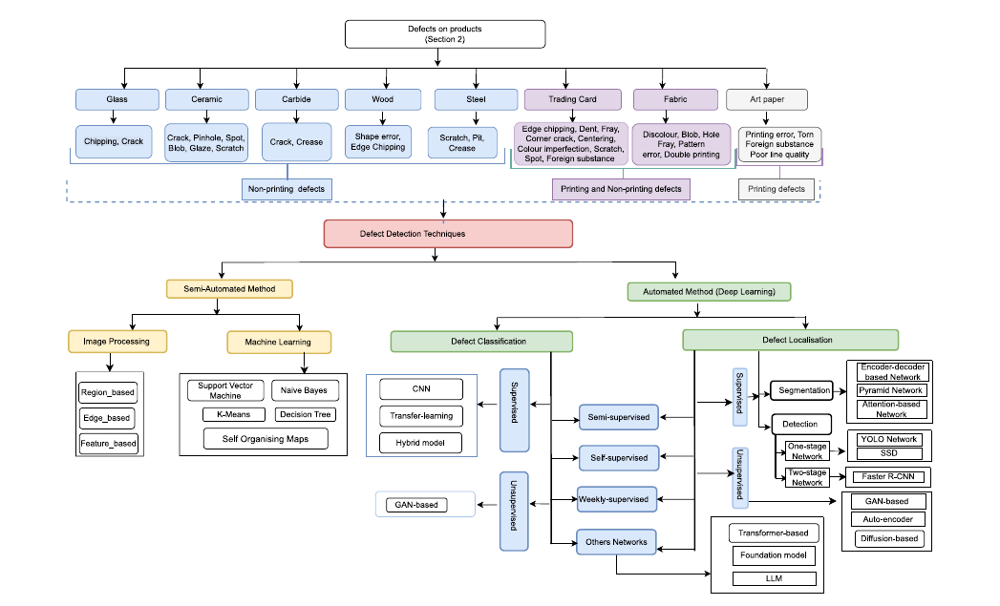

**图1.** 产品缺陷分类及其检测技术。

图内标签译释：产品缺陷（第2节）按玻璃、陶瓷、硬质合金、木材、钢材、集换式卡牌、织物、艺术纸划分；缺陷包括崩边、裂纹、针孔、斑点、斑块、釉面缺陷、划痕、折痕、形状误差、凹坑、凹痕、毛边、居中偏差、颜色缺陷、异物、孔洞、图案错误、重影印刷、撕裂和线条质量差，并区分非印刷、印刷以及二者兼有的缺陷。检测技术分为半自动与自动（深度学习）两支。半自动包括图像处理（区域、边缘、特征）和机器学习（支持向量机、朴素贝叶斯、K均值、决策树、自组织映射）。自动方法按缺陷分类与定位划分：分类包括CNN、迁移学习、混合模型及GAN；定位包括分割（编码器-解码器、金字塔、注意力网络）、目标检测（单阶段YOLO或SSD、两阶段Faster R-CNN）以及GAN、自编码器、扩散模型；中间连接半监督、自监督、弱监督和其他网络，其他网络包括Transformer、基础模型与大语言模型。图中“Weekly-supervised”按弱监督理解。

基于经典图像处理和机器学习（ML）技术的半自动缺陷检测方法严重依赖手动参数调整和特征工程。尽管在使用图像处理技术（例如纹理分析）提取的特征（例如均值、方差、曲率）上应用经典机器学习技术（例如支持向量机）提高了缺陷检测性能，但性能仍然低于所需的满意度水平。相比之下，深度学习（DL）模型[21]通过直接从图像中学习来消除手动特征提取，从而实现完全自动化、提高性能并在工业缺陷分类和定位中得到更广泛的采用。

此外，有监督深度学习模型需要大量带标注的数据才能获得较高准确率[22]，而数据采集耗费大量人力。研究人员利用数据增强[23]和合成算法缓解数据集不平衡问题[24]，但标注工作仍然耗时。分割可以帮助定位缺陷[25]，不过像素级标注会增加成本。无监督深度学习可以使用未标注数据，但一些领域仍然缺乏图像。Dong 等人[26]将数据增强与少量未标注图像上的无监督分割相结合，取得了有前景的结果。

现有的缺陷检测调查[27-33]主要关注特定产品，并主要讨论深度学习技术的应用。然而，这些调查缺乏关于缺陷尺寸的量化、缺陷位置的确定以及基于缺陷尺寸的图像捕捉设备的利用的详细描述。然而，这些方面对于开发全面的缺陷检测方法和提高各行业缺陷分析的准确性和效率非常重要。本研究重点关注利用机器视觉进行工业产品缺陷检测的发展状况。图 1 展示了这项工作的概述，例如图像处理、ML 和 DL 方法，这些方法都被详细讨论和批判性地分析，用于缺陷检测。

本文的主要贡献如下：

- 这项研究调查了工业产品上发现的不同缺陷类型的特征。
- 全面概述用于检测工业产品缺陷的半自动化和自动化方法。
- 对已用于缺陷检测应用的基于深度学习的自动化模型进行分类。
- 强调工业产品质量评估面临的挑战并总结潜在的研究方向。

本综述旨在整合并汇编采用机器学习和深度学习对各类物体缺陷进行分类与定位的相关信息。为此，我们使用缺陷检测、故障分类、裂纹识别等关键词或同义词，在 Scopus、IEEE、Elsevier、Springer 和 Google Scholar 等数据库中检索论文。首先，将钢材、木材、玻璃、织物等特定对象与关键词结合进行全文检索，去除重复文献和非英文文献；随后阅读摘要，排除与本研究无关的论文。最终，我们选取约160篇论文开展综述，旨在帮助研究人员找到适合工业应用中缺陷分类与定位的研究文献。

本文其余部分安排如下：第2节介绍缺陷类型；第3节概述不同类型的缺陷检测技术；第4节介绍半自动方法的相关研究；第5节介绍自动化方法的相关研究；第6节讨论其他网络；第7节对文献进行统计分析；第8节提出挑战与未来研究方向；最后，第9节给出结论。

## 2. 产品缺陷

目前，机器学习、深度学习等人工智能方法在工业数据分析与产品质量检验中的应用迅速增长。图2基于谷歌趋势[34]的数据，展示工业产品质量检验研究的发展。趋势表明，工业缺陷检测是持续发展的领域，质量评估对检验并维持工业产品质量具有重要作用。

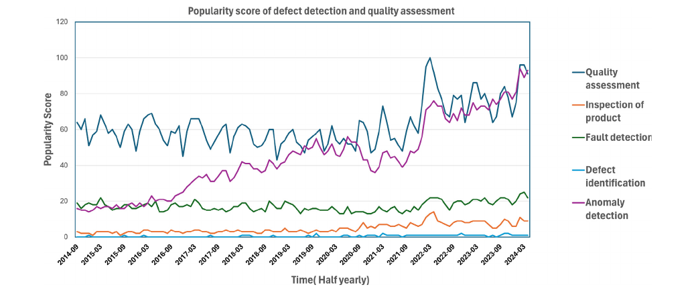

**图2.** 一段时间内产品质量评估的全球关注度得分，范围为0（最低）至100（最高）；横轴表示时间，纵轴表示对应得分。

图内标签译释：标题为“缺陷检测与质量评估的关注度得分”；横轴为时间（半年），纵轴为关注度得分；五条曲线分别表示质量评估、产品检验、故障检测、缺陷识别和异常检测。

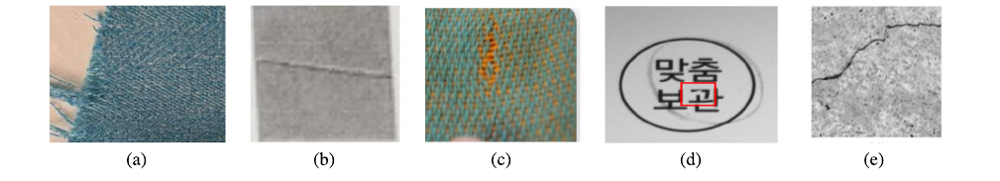

**图3.** 缺陷示例：(a) 织物毛边；(b) 钢材折痕；(c) 织物颜色缺陷；(d) 丝网印刷缺陷；(e) 金属表面裂纹。

图中(a)-(e)依次对应图注所列五类缺陷，子图字母保留。

半自动方法在规则图案上表现良好，但难以处理金属裂纹等微小缺陷；机器视觉则能够提供更准确的检测和分类。然而，缺陷形状和尺寸的变化，使全面分类和建立综合数据库变得困难。图3展示了不同产品中的缺陷示例。因此，本节按照材料介绍不同的缺陷类别，并在以下小节中描述缺陷类型、特征、检验方法和成像技术。

### 2.1. 缺陷类别和材料

本研究关注由金属、陶瓷、纺织品、纸张、木材和硬质合金制成的若干工业产品，这些产品可能存在各种缺陷。有些缺陷具有产品特异性，例如陶瓷[35,36,48]、金属或玻璃[8,45]产品可能出现裂纹，而艺术纸、织物和集换式卡牌[38-40,49,50]通常存在其他特定缺陷，如毛边、颜色和印刷缺陷。集换式卡牌、艺术纸等印刷产品可能存在两类缺陷。第一类是艺术纸边缘的凹痕、毛边等直接损坏产品材料（例如纸张）的缺陷；第二类是图案错误、颜色缺陷等与印刷质量有关的缺陷[47]。由于每种印刷设备都有独特的印刷限制，这些缺陷可能在绘制或印刷过程中产生。

相比之下，瓷砖、玻璃等产品仅存在第一类缺陷，例如瓷砖上的裂纹和针孔。因此，所有可能出现的产品缺陷可分为印刷缺陷与非印刷缺陷两类。表1列出了两类缺陷及其可能出现的材料。图案错误、颜色缺陷和线条质量差等印刷缺陷，可见于宝可梦卡牌、衣物、艺术纸等印刷产品；非印刷缺陷也存在于钢材、玻璃和金属等工业产品中。

### 2.2. 缺陷特征

缺陷可以具有不同的形状并提供不同程度的人类感知。表 2 显示缺陷通常在三个产品位置可见：表面、边缘和角落。虽然产品表面上的缺陷可能具有规则形状（例如线条、图案），但产品边缘 [8] 和拐角 [35,36] 上的缺陷通常具有随机形状。所有缺陷（例如裂纹、折痕、颜色缺陷）都是人眼可见的，因为本研究在评估产品质量时重点关注缺陷的可见性和大小。有些缺陷（例如裂纹、折痕）是明显的，因为用手指触摸即可察觉。

上述产品位置可能因各种原因而发生缺陷。例如，由于产品的移动，边缘和角落可能会出现裂纹[7]，而在生产过程中，由于产品承受的高压，裂纹可能会出现在表面。由于不利的天气条件或化学品泄漏，表面可能会出现一些缺陷（例如腐蚀、污染）。产品在制造或组装过程中的不良结构可能会在产品使用时导致产品表面出现这些缺陷。

**表1. 基于材料的缺陷类别**

| 非印刷缺陷                     | 材料或产品     | 印刷缺陷             | 材料或产品             |
| ------------------------- | --------- | ---------------- | ----------------- |
| 崩边、裂纹                     | 玻璃[8]     | 不适用              | 不适用               |
| 裂纹、针孔、斑点、斑块、角部锐利度、釉面缺陷、划痕 | 陶瓷[35,36] | 印刷错误、撕裂、异物、线条质量差 | 艺术纸[37]           |
| 毛边、斑块、孔洞、折痕               | 织物[38-40] | 颜色缺陷、图案错误、重影印刷   | 织物[40]            |
| 崩边、凹痕、毛边、划痕、角部锐利度         | 集换式卡牌[41] | 斑点、撕裂、变色、异物、居中偏差 | 集换式卡牌[41]、艺术纸[37] |
| 形状误差、崩边                   | 木材[42]    | 不适用              | 不适用               |
| 锐利度、裂纹、折痕、凹坑              | 钢材[43,44] | 不适用              | 不适用               |
| 折痕、裂纹                     | 硬质合金[7]   | 不适用              | 不适用               |

**表2. 缺陷特征与原因**

| 位置 | 形态  | 缺陷         | 可触知 | 可见 | 材料或产品                 | 原因         |
| -- | --- | ---------- | --- | -- | --------------------- | ---------- |
| 边缘 | 随机  | 崩边         | 是   | 是  | 玻璃、卡牌[8,41]           | 压力         |
| 边缘 | 随机  | 凹痕         | 是   | 是  | 卡牌、陶瓷、钢材[41,43,44]    | 移动、压力      |
| 边缘 | 随机  | 毛边         | 否   | 是  | 卡牌[41]                | 机器故障、使用    |
| 边缘 | 随机  | 裂纹         | 是   | 是  | 陶瓷、钢材、玻璃[8,43,45,46]  | 摩擦、外力      |
| 表面 | 线状  | 裂纹         | 是   | 是  | 陶瓷、玻璃、硬质合金[7,8,45,46] | 高压、材料不良    |
| 表面 | 线状  | 折痕、划痕、釉面缺陷 | 是   | 是  | 钢材、硬质合金、陶瓷、玻璃[7,46]   | 摩擦         |
| 表面 | 图案状 | 形状误差       | 否   | 是  | 卡牌、木材[42]             | 生产错误       |
| 表面 | 图案状 | 变色         | 否   | 是  | 卡牌、纺织品、艺术纸[41]        | 生产错误       |
| 表面 | 点状  | 凹坑         | 是   | 是  | 陶瓷、钢材[43,44]          | 混入杂质、压力    |
| 表面 | 点状  | 斑点、斑块      | 否   | 是  | 织物[38,39]             | 压力、使用      |
| 表面 | 块状  | 腐蚀         | 是   | 是  | 钢材、硬质合金[7,43]         | 化学品泄漏      |
| 表面 | 块状  | 污染         | 否   | 是  | 钢材、陶瓷[43]             | 生产错误、结构不良  |
| 表面 | 印刷  | 撕裂、异物      | 否   | 是  | 纺织品、艺术纸、集换式卡牌[37,47]  | 机器老化、使用、移动 |
| 角部 | 随机  | 锐利度、裂纹     | 是   | 是  | 陶瓷、玻璃[35,36]          | 移动、压力      |

### 2.3. 缺陷检查

缺陷检验起着重要作用，因为它涉及检查产品的各种属性并对其进行测试以确保其符合指定的标准。缺陷检查可以在制造过程中[8,43,44]和产品使用时[3,4,43,44,51–54]两个层面进行。当公司在将产品推向市场之前对产品进行质量评估时，可以检查产品制造过程中出现的缺陷。因此，制造阶段的缺陷检测是对新产品进行的。当产品在使用中时，可以进行缺陷检查来估计产品的状态。例如，一个人可以从一家公司购买一张新的宝可梦卡牌，并在出售该卡之前使用该卡一段时间。因此，有必要评估卡片的质量来估算其当前的价值。表3列出了不同类型的产品和缺陷及其检验级别。

制造阶段与使用阶段还需量化缺陷的尺寸、数量等属性。为更深入地检验产品质量，需要测量缺陷数量及长度。例如，木制品质量通过缺陷长度、数量、深度等指标评估，而织物等产品则主要通过缺陷长度与数量评价。

### 2.4. 缺陷成像

捕获重要的产品特征并消除意外特征（例如，由于阴影或不适当的照明环境）对于保持在缺陷检测中发挥重要作用的图像质量至关重要。为了获得产品的高质量图像，需要具有良好光学照明平台的适当图像采集硬件（例如相机、扫描仪）。合适的光学照明平台可以克服环境照明的干扰，保证成像系统的稳定性，获得高对比度的图像。

根据产品特性、缺陷类型和尺寸（例如，小、非常小）以及设备特性（例如，放大率、分辨率）来选择图像采集硬件。表 4 描述了不同设备及其特性。高分辨率和放大倍率允许从产品中捕获更详细的信息，从而对肉眼可能不可见的微小缺陷进行调查。因此，使用高分辨率图像通常可以在缺陷检测和分类过程中获得更好的性能，但它们会消耗大量计算资源。

文献[55-59]介绍了多种图像采集设备。例如，半导体产品中的缺陷若非常微小（如1-10 nm），则采用扫描电子显微镜（SEM）[55]；若缺陷较小（如1 mm）或中等大小（如3-5 mm），则各类产品均可采用高分辨率数码相机[61,62]。此外，对于木材、瓷砖等存在较深且需要测量的缺陷（如裂纹）的产品，可以采用光度立体法[51]采集用于深度测量的图像。

**表3. 缺陷量化与检验阶段**

| 材料或产品     | 新产品 | 使用中产品 | 缺陷位置     | 量化项目     | 参考文献                                                                                                  |
| --------- | --- | ----- | -------- | -------- | ----------------------------------------------------------------------------------------------------- |
| 玻璃        | 是   | 否     | 边缘、表面    | 长度、数量    | Bukieda 等[8]；Hsu 和 Lin[45]                                                                            |
| 瓷砖        | 是   | 是     | 角部、边缘、表面 | 长度、深度    | Singh 和 Yadav[35,36]；Matić 等[48]                                                                      |
| 织物        | 是   | 否     | 表面       | 长度、数量    | Chakraborty 等[38]；Ouyang 等[39]；Liu 等[40]；Almeida 等[49]；Liu 等[50]                                      |
| 集换式卡牌、艺术纸 | 是   | 是     | 角部、边缘、表面 | 深度、数量    | Masod 等[37]                                                                                           |
| 木材        | 是   | 否     | 表面、边缘    | 深度、长度、数量 | Chen 等[42]                                                                                            |
| 钢材        | 是   | 是     | 表面、边缘    | 长度、数量    | Chen 和 Li[3]；Song 和 Yan[4]；Psuj[43]；Soukup 和 Huber-Mörk[44]；Saiz 等[51]；Damacharla 等[52]；Altabey 等[53] |
| 硬质合金      | 是   | 否     | 边缘       | 长度、数量    | Parenti 等[7]                                                                                          |

**表4. 不同图像采集设备的特性**

| 设备      | 极小缺陷 | 小缺陷 | 中等缺陷 | 大缺陷 | 长度测量 | 深度测量 | 产品         | 分辨率（dpi） | 放大倍数        | 参考文献                                                                     |
| ------- | ---- | --- | ---- | --- | ---- | ---- | ---------- | -------- | ----------- | ------------------------------------------------------------------------ |
| 扫描电子显微镜 | 是    | 是   | 是    | 否   | 是    | 否    | 半导体        | 96-300   | 10-3000000倍 | Tomlinson 等[55]；Avinun-Kalish 等[56]；Becker 等[57]；Newell 等[58]；Jain 等[59] |
| 数码显微镜   | 是    | 是   | 否    | 否   | 是    | 否    | 卡牌、玻璃、叶片   | 96-300   | 34-1100倍    | Bukieda 等[8]；Rolland 等[60]                                               |
| 数码相机    | 否    | 是   | 是    | 是   | 是    | 否    | 各类产品       | 300      | 3-5倍        | Wang 等[61]；Nigam 和 Singh[62]                                             |
| 光度立体法   | 否    | 是   | 是    | 是   | 是    | 是    | 钢材、卡牌、硬质合金 | 300      | 未给出         | Saiz 等[51]                                                               |

注：原表 VS、S、M、L 分别为极小、小、中等、大；Ln 为长度，Dep 为深度。

下文简要介绍每个图像捕捉设备。

- **扫描电子显微镜：** SEM[55-59]用于检测半导体产品缺陷，其放大倍数可高达300万倍，从而发现并分析通常肉眼不可见的微小缺陷。使用现代人工智能算法处理采集数据时，可获得较高准确率，例如文献[55]中达到90%。
- **数码显微镜：** 数码光学显微镜[60]的放大倍数为34-1100倍，可采集多类产品的图像，并检测非常微小或细小的缺陷。例如，Rolland 等人[60]拍摄棉叶图像以评估叶片茸毛程度，准确率达到86%-96%。Bukieda 等人[8]利用数码光学显微镜图像检验玻璃质量，并阐述显微图像在边缘和表面缺陷检测中的重要性。
- **数码相机：** 数码相机适用于各类材料中小、中、大尺寸缺陷的成像。工业相机常用的感光器件为电荷耦合器件（CCD）或互补金属氧化物半导体（CMOS）芯片。Hsu 和 Lin[45]使用两台 CCD 相机采集玻璃质量检验图像，Nigam 和 Singh[62]使用一台 CMOS 相机采集梁体裂纹检测图像。
- **光度立体法：** 光度立体法[51]通过来自不同方向的不同光源依次照射物体，获得轮廓、表面曲率、颜色、光谱数据以及水平和垂直方向信号变化等信息。该方法能够检测小、中、大等不同尺寸的缺陷，并能识别较深的缺陷；它可检测直径65-110 mm的零件，并识别破损、凸起和裂纹。Saiz 等人[51]采用分割网络处理光度立体图像，检测金属部件缺陷，准确率为83%。

## 3. 缺陷检测技术的分类

涉及缺陷检测方法的文献大致可分为三个部分：(i) 手动、(ii) 经典图像处理和基于 ML 的半自动化以及 (iii) 基于 DL 的自动化。对于每种缺陷检查方法，目视检查方法的优点和缺点如表 5 所示。此外，半自动和自动检查方法将在以下小节中讨论。

### 3.1. 半自动缺陷检测技术

如图4所示，半自动缺陷检测包括四个关键步骤：数据采集、预处理、特征提取和分类。数据由第2.4节所述成像装置获取，并经过噪声滤除增强；随后采用统计、结构、滤波器或基于模型的方法提取特征[18,63-65]，最后使用 SVM、KNN 等学习方法分类[66,67]。

上述方法已经得到广泛研究。方法选择取决于专家意见、成功率以及数据集可用性[49,50,68-70]。例如，基于学习的方法适合检测图案表面缺陷，基于统计或模型的方法则适合识别钢材表面的变形。因此，深度学习通过自动特征提取提供了缓解上述限制的解决方案。

**表5. 缺陷检验方法**

| 方法          | 优点                | 缺点                          |
| ----------- | ----------------- | --------------------------- |
| 人工          | 可识别多种缺陷           | 耗时、主观、需要实验装置、成本高、结果不一致、需要人力 |
| 传统图像处理与机器学习 | 减少人为错误和耗时         | 特征选择与提取需要专业技能，算法参数受限，准确率较低  |
| 深度学习        | 自动提取特征，减少人力，检测精度高 | 需要大型数据集，校准不足                |

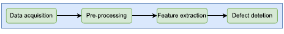

**图4.** 半自动缺陷检测系统的基本步骤。

图内流程：数据采集 → 预处理 → 特征提取 → 缺陷检测。

### 3.2. 基于深度学习的自动缺陷检测技术

如图1所示，基于深度学习的缺陷检测分为两部分：分类和定位。分类模型可以从头开始训练，也可以使用预先训练的权重（例如 ImageNet）通过迁移学习进行训练，以减少计算成本 [71]。定位方法因缺陷类型而异，包括编码器-解码器、金字塔、注意力和基于 YOLO 的网络。

此后，根据数据集可用性和学习策略，深度学习方法分为两种范式：监督学习和无监督学习。这两种学习方法已被用于许多行业的缺陷分类和定位。此外，半监督、自监督和弱监督学习因在保持竞争表现的同时减少标注工作而受到关注。关于模型如何工作的基本定义如下：

- **有监督学习：** 有监督学习是 CNN 缺陷分类与定位中最常用的学习方式。在大型训练数据集上，有监督模型可达到较高检测准确率，但收集大量标注样本需要大量人力，增加模型开发成本。无监督学习模型可以缓解这一挑战。
- **无监督学习：** 无监督学习在无需标注数据的情况下检测缺陷，因而降低标注成本。常用方法包括自编码器（AE）和生成对抗网络（GAN）。AE 通过重建输入图像学习紧凑的潜在表示；GAN 通过生成器与判别器之间的对抗训练生成逼真样本。近年来，扩散模型因能够迭代地将随机噪声去噪为高保真的无缺陷图像或合成图像而受到关注，并在复杂纹理中提供较好的重建与异常定位能力。
- **半监督、自监督与弱监督学习：** 半监督学习（SSL）利用少量标注数据和大量未标注样本，连接有监督与无监督方法，在降低标注成本的同时提供良好的泛化能力。自监督学习通过前置任务进一步减少对标签的依赖，例如对比学习在小规模或不平衡数据集上表现良好。弱监督学习利用图像级标签、稀疏标注等粗粒度监督减少标注工作，同时保持分割精度；但若缺少注意力机制或数据增强策略，其精度和泛化能力可能较低。

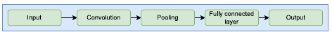

**图5.** CNN 网络的基本结构。

图内流程：输入 → 卷积 → 池化 → 全连接层 → 输出。

- **基于 CNN 的网络：** 如图5所示，CNN 由多个层组成，用于从输入图像中提取高层特征。卷积层通过滤波器生成特征图，网络采用反向传播训练，以最小化损失函数；最后的输出层在图像级或像素级执行分类[72,73]。
- **编码器-解码器网络：** 编码器-解码器是用于缺陷分割的成熟深度学习架构。编码器将输入映射为低维潜在表示，解码器再根据该编码表示生成所需输出。U-Net 是此类模型的典型实例[74]。
- **金字塔网络：** 金字塔网络用于缺陷检测中的多尺度分析，通过不同分辨率提取特征，从多个尺度全面理解图像，并结合低分辨率和高分辨率特征的细节进行学习[75]。
- **基于注意力的网络：** 注意力机制近年来在计算机视觉中受到广泛关注。它选择性地关注重要输入元素，提高深度学习模型的预测准确率与计算效率[76-79]。
- **基于 YOLO 的网络：** 缺陷目标检测网络分为单阶段和两阶段算法。YOLO[80]与 SSD[81]等单阶段模型一步预测目标位置及类别，检测速度较快；Faster R-CNN[82]等两阶段模型先生成候选区域，再细化检测结果。YOLO 及其各代模型近年来在缺陷检测中日益流行。
- **其他网络：** 基于 Transformer 的模型、基础模型和大语言模型（LLM）等先进网络也日益受到关注。Transformer 擅长捕获长距离依赖，适用于分类与分割；SAM、CLIP 等基础模型在少量监督下具备较强泛化能力；小样本学习可利用有限数据有效训练。大语言模型与视觉模型结合后，可通过语言推理提升可解释性，支持多模态缺陷分析。

### 3.3. 自动缺陷检测方法的结构

图6展示了自动缺陷检测系统的典型架构。产品在适当照明下沿传送带移动，工业相机组从不同角度采集图像，并将数据存储在工业计算机上。数据采集取决于分辨率、速度、准确率等应用要求，以及照明条件和物体尺寸等因素。第2.4节介绍了适用于不同产品的缺陷图像采集设备。

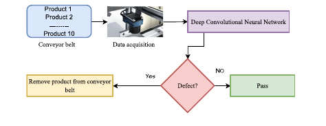

**图6.** 自动缺陷检测系统的结构。

图内标签译释：多件产品经传送带进入图像采集环节，图像送入深度卷积神经网络，依据“是否存在缺陷”判断；有缺陷则剔除，无缺陷则通过。

用于数据采集的常见类型相机包括用于 2D 区域成像的面阵相机和用于实时应用深度信息的 3D 相机。此外，扫描仪还可用于某些应用，其中一致的照明对于缺陷检测至关重要。例如，可以扫描集换式卡牌[83]来检测缺陷，而扫描仪提供的一致照明可确保均匀的图像质量，有助于准确的缺陷检测。视觉系统处理发生在计算机上，现代机器视觉模型分析捕获的图像以确定产品缺陷。如果检测到缺陷，系统会将产品从传送带上移除；否则，产品继续前进。

## 4. 半自动学习方法的缺陷检测效果

机器视觉是一种流行的工业产品质量检测方法，它利用先进的计算机视觉算法和成像技术来执行高效的检测，减少或无需任何手动辅助。许多研究都探索了这种方法，涵盖各个产品领域的图像处理和机器学习方法。本节从两个关键方面全面概述这些研究：图像处理和机器学习。

### 4.1. 基于图像处理的半自动化技术

图像处理技术[21,84,85]通过识别与正常表面图案的偏差来检测缺陷，特别是当缺陷在视觉上与背景不同时。常见的方法包括基于边缘、基于小波和基于特征的方法[86, 87]。边缘检测技术，如Canny、Otsu等被广泛应用；例如，Parenti 等人 [7] 应用 Canny 边缘进行硬质合金检查，检测小至 10-50 μm 的缺陷，而 Bukieda 等人 [8] 使用 Otsu 阈值来识别玻璃上的裂纹和黑点，准确率分别为 80% 和 60%。基于小波的方法可以实现多尺度分析。 Lu 和 Chen [88] 使用基于小波的分割检测金属表面裂纹的准确率达到 99%，Nigam 和 Singh [62] 将小波分析与斜率检测结合起来进行梁裂纹识别。基于特征的技术，如局部二值模式 (LBP) 与极限学习机 (ELM) 相结合，在冷轧钢带缺陷检测中显示出 95% 的准确率 [89]，而适用于瓷砖的基于颜色和纹理的分级方法已实现高达 96% 的准确率 [90,91]。

表6总结了这些技术的性能。例如，Singh 和 Yadav[35]对瓷砖图像使用图像处理与数学运算，报告的准确率为96%；Matić 等人[48]在边缘和角部缺陷检测中获得90%的准确率。

然而，传统图像处理技术虽然能有效检测均匀表面上的缺陷，但面对现实场景中形状、尺寸、纹理各异的缺陷时存在困难。固定的特征集合限制了方法对不同产品的适应性。为克服这些挑战，研究人员采用机器学习算法，在可扩展且稳健的框架中处理这些变化。

### 4.2. 经典机器学习技术

本节讨论分类、回归与聚类等传统机器学习算法[94,95]。按学习策略，它们可分为有监督、无监督和半监督三类；还可采用混合方法提高学习性能。表7总结了这些机器学习算法在不同研究中的应用。

#### 4.2.1. 监督学习

有监督学习[69,111]通常使用带标签数据进行缺陷分类：模型在已知数据集上训练，并在未见数据上验证。支持向量机（SVM）在激光焊接、铜带检验[66,101,102]，以及航空航天和汽车领域的钢带缺陷分类中表现良好[111]。Mandriota 等人[99]将 SVM 与 Gabor、小波特征结合检测铁轨缺陷，其中 Gabor 滤波器优于其他特征。K 近邻（KNN）利用灰度共生矩阵特征，在织物缺陷检测中达到96%准确率[96]，还与特征选择结合用于齿轮裂纹检测[97]。Oliveira 等人[104]结合随机森林、逻辑回归与可解释性工具检测轮胎缺陷，准确率达到96%。Zorić 等人[112]将傅里叶频谱环带特征应用于瓷砖缺陷，F1分数达到99%。Hemalatha 等人[105]使用离散余弦变换、离散小波变换与人工神经网络检验纺织品；Anupriya 等人[106]使用单类 SVM 获得超过95%的准确率。Dorbane 等人[108]将合成少数类过采样技术（SMOTE）与 XGBoost 结合，实现可靠的钢表面缺陷分类。Li 等人[107]将主成分分析（PCA）与 SVM 结合，识别反光钢球缺陷，准确率为97.15%。朴素贝叶斯（NB）在钢表面缺陷分类中也达到98%以上的准确率，体现了其轻量且高效的特点[5]。

#### 4.2.2. 无监督学习

无监督学习算法无需标签即可检测缺陷，通常依赖聚类识别模式。K 均值聚类按相似性将数据划分为 K 组，已用于半导体材料、织物和机械故障诊断[98,100,113]，在织物缺陷检测中达到95%准确率[100]。另一种常用方法是自组织映射（SOM），它在保持拓扑关系的同时，将高维输入映射到低维空间。SOM 可结合颜色、纹理特征检测木材表面缺陷[114-116]；Silvén 等人[103]利用该方法定位木板缺陷。虽然此类方法前景良好，但通常仍需要足够的缺陷样本才能达到较高准确率。

#### 4.2.3. 混合法

混合方法结合两种或多种机器学习技术，以改善缺陷检测和分类性能。例如，SOM 与 SVM 结合用于晶圆缺陷模式检测[117]；遗传算法与 SVM 结合用于铝材检测[68]；KNN 与 CNN 结合用于识别晶圆上的未知类别缺陷[69]。Madhavan 等人[109]将 DenseNet201 提取的特征与基于树的分类器结合，在 NEU 表面缺陷数据集上达到99.72%的准确率。

**表6. 基于图像处理的缺陷检测研究汇总**

| 缺陷及产品       | 数据集大小 | 图像处理类型 | 方法        | 性能          |
| ----------- | ----- | ------ | --------- | ----------- |
| 桥梁边缘缺陷[92]  | 小型    | 基于边缘   | 线条检验      | 检测1-4 nm宽裂纹 |
| 金属表面缺陷[88]  | 6204  | 基于小波   | 未明确       | 99.5%       |
| 梁体表面缺陷[62]  | 小型    | 基于边缘   | Canny     | 检测4 mm深裂纹   |
| 钢带表面缺陷[89]  | 未明确   | 基于特征   | LBP       | 95%         |
| 混凝土表面缺陷[93] | 3420  | 基于边缘   | Canny     | 53%-79%     |
| 玻璃边缘缺陷[45]  | 小型    | 基于阈值   | Otsu大津阈值法 | 破裂60%，裂纹80% |
| 瓷砖角部缺陷[35]  | 100   | 基于边缘   | Canny     | 96.524%     |
| 瓷砖角部缺陷[36]  | 未明确   | 基于边缘   | 勾股定理      | 90%         |
| 硬质合金表面缺陷[7] | 小型    | 基于边缘   | Canny、轮廓  | 未明确         |
| 瓷砖角部缺陷[48]  | 100   | 基于阈值   | 轮廓        | 90%         |

注：Th 为阈值；原文 N/A 表示未作明确说明。表中“桥梁”及纳米单位按原表保留，文献[92]题名实际涉及线条图案微缺陷。

**表7. 缺陷检测中的机器学习技术汇总**

| 对象      | 特征提取器           | 分类器             | 数据集大小    | 准确率           |
| ------- | --------------- | --------------- | -------- | ------------- |
| 织物[96]  | GLCM            | KNN             | 400      | 96%           |
| 齿轮[97]  | 两阶段特征选择         | 加权KNN           | 未明确      | 未明确           |
| 发动机[98] | 遗传算法            | K均值             | 小型       | 94%           |
| 铁轨[99]  | Gabor滤波、小波方法    | SVM             | 400      | 未明确           |
| 织物[100] | K均值             | K均值             | 160      | 95%           |
| 铜带[101] | 小波变换            | SVM             | 未明确      | 96.7%         |
| 木材[67]  | GLCM            | SVM             | 355      | 94.37%        |
| 木材[67]  | LBP             | SVM             | 355      | 95.78%        |
| 钢材[102] | PCA             | SVM             | 13925    | 81%           |
| 钢材[5]   | DCT、SVD         | 朴素贝叶斯           | 500      | 98%           |
| 木材[103] | LBP             | SOM、KNN         | 42       | 80%           |
| 轮胎[104] | RF、LR           | RF、LR           | 107      | RF：92%，LR：96% |
| 织物[105] | GLCM-DCT、ANN    | GLCM-DCT、ANN    | 1067     | 80%           |
| 织物[106] | 单类SVM           | 单类SVM           | 200-2000 | >95%          |
| 钢材[107] | PCA、K-CV、SVM    | SVM             | 214      | 97.15%        |
| 钢材[108] | XGBoost、SMOTE   | XGBoost         | 1941     | 99.16%        |
| 钢材[109] | DenseNet        | 机器学习            | 1800     | 99.72%        |
| 钢材[110] | AlexNet、KNN、LDA | AlexNet、KNN、LDA | 1800     | 最高100%        |

注：SVM＝支持向量机；KNN＝K近邻；SOM＝自组织映射；PCA＝主成分分析；GLCM＝灰度共生矩阵；LBP＝局部二值模式；DCT＝离散余弦变换；SVD＝奇异值分解；RF＝随机森林；LR＝逻辑回归；SMOTE＝合成少数类过采样技术；LDA＝线性判别分析。

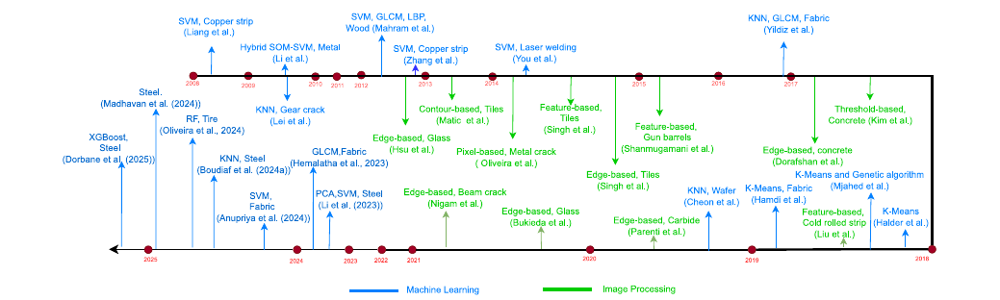

**图7.** 利用图像处理和经典机器学习对不同产品缺陷检测的时序概览。

图内标签译释：蓝色为机器学习，绿色为图像处理；横向折返时间轴为2008-2025年。方法与对象包括：SVM铜带、SOM-SVM混合金属、KNN齿轮裂纹、SVM/GLCM/LBP木材、SVM激光焊接、KNN/GLCM织物、基于轮廓的瓷砖、基于边缘的玻璃、基于像素的金属裂纹、基于纹理的瓷砖、基于特征的枪管、基于边缘的混凝土、基于阈值的混凝土、基于边缘的梁体裂纹、基于边缘的硬质合金、基于特征的冷轧带钢、KNN晶圆、K均值织物、K均值与遗传算法、K均值、PCA/SVM钢材、SVM织物、GLCM织物、KNN钢材、随机森林轮胎、XGBoost钢材以及钢材深度特征分类。作者标识按原图保留，具体方法和性能见表6、表7。

图7按时间顺序展示了使用图像处理和机器学习对不同产品进行缺陷检测的代表方法。机器学习算法的一项优点是，即使样本有限，也能取得较好结果；但它们依赖人工设计的特征，而复杂情况中的特征往往难以获取。在现实条件下，这些方法可在特定设置（例如某些参数配置）中表现良好，却对条件变化敏感。相比之下，深度学习模型自动提取特征并对缺陷分类，只需要真实标注数据，同时对不同缺陷类型和应用具有更强适应性。

## 5. 基于深度学习的自动缺陷检测效果

深度学习在缺陷分类与定位领域发展迅速，许多研究[20,43,44,118-120]已将其应用于不同产品。本节批判性综述深度学习在缺陷检验中的应用，涵盖有监督和无监督分类方法，以及分割与目标检测定位技术：用于分割的编码器-解码器、金字塔和注意力网络，以及用于目标检测的金字塔型和注意力型 YOLO 模型。表8总结了这些方法的优点与局限。此外，半监督、弱监督和自监督学习因能够在保持较高性能的同时减少标注需求而受到关注；Transformer、基础模型、小样本学习和大语言模型也日益融入缺陷检验流程，支持更强泛化能力及交互式缺陷分析。

**表8. 缺陷分类与定位网络的优点和缺点**

| 学习策略  | 缺陷检验任务                   | 模型                       | 优点                       | 缺点                |
| ----- | ------------------------ | ------------------------ | ------------------------ | ----------------- |
| 有监督学习 | 分类[49,50,70,119,121-123] | VGGNet、AlexNet等预训练模型及CNN | 仅需图像级标签，学习能力强，分类准确率高，训练快 | 不能确定缺陷位置          |
| 有监督学习 | 定位[46,47,74,124-127]     | FCN、U-Net等语义分割网络         | 可检测细小缺陷区域                | 需要耗时的像素级标注        |
| 无监督学习 | 分类[128-130]              | CNN、GAN                  | 可从未标注或部分标注数据学习，无需完整标注    | 检测精度仍需提高，无法确定缺陷区域 |
| 无监督学习 | 定位[24,131,132]           | 混合模型、CycleGAN            | 无需像素级标注，可用于实时应用          | 训练和验证速度慢          |

注：FCN＝全卷积网络；GAN＝生成对抗网络。

### 5.1. 缺陷分类方法

缺陷分类网络的目标是对产品表面不同类型的缺陷进行分类。最流行的模型是监督学习，当给定大型训练数据集时，它可以实现显着的缺陷检测精度。

#### 5.1.1. 监督学习（基于 CNN 的方法）

有监督 CNN 是常见的缺陷分类与定位方法，已用于 LED 芯片（准确率95%[119]）、电池激光焊缝（99.87%[122]）、织物（95%[49]、98.1%[50]）和织物印花[38]等产品。Park 等人[121]采用有监督深度卷积神经网络（DCNN）检测手机屏幕盖板划痕，在16800幅带标注图像上达到99%准确率。Dorafshan 等人[93]采用另一种有监督 DCNN 检测混凝土裂纹，同样达到99%。Cha 等人[133]无需计算人工缺陷特征便完成高精度混凝土裂纹检测；Golding 等人[134]使用 DCNN 检测混凝土裂纹，也达到99%准确率。

Ouyang 等人[39]提出的系统依次执行图像预处理、织物图谱确定、候选缺陷图生成和 CNN 分类，以98%的准确率识别织物缺陷。Almeida 等人[49]从头构建新的 CNN，并采用漏检减少技术提高性能，以较低成本实现95%准确率的织物缺陷检测。Chakraborty 等人[38]使用 DCNN 识别织物上的斑点和印花不匹配。Tabernik 等人[135]提出两阶段表面检验模型，结合分割网络与 DCNN 进行缺陷分类。Ren 等人[136]利用预训练 CNN 提取图像块特征进行缺陷分类。为处理错误标注和图像不确定性，Yu 等人[137]引入处理人工标注噪声的 DCNN：先通过对称残差滤波模块去除环境噪声，再用改进后的数据集训练联合概率分类模型，以识别印刷电路板（PCB）表面缺陷。He 等人[138]将 DCNN 与多层次特征聚合网络结合，对钢材表面缺陷分类，实验表明其准确率优于其他 CNN。

#### 5.1.2. 有监督学习：基于迁移学习的模型

在预训练模型中，选择网络深度和卷积核大小来配置模型并不容易。为配置缺陷检测模型，Konovalenko 等人[139]将14种神经网络用于金属表面缺陷检测，包括 InceptionV3、Inception-ResNetV2、ResNet、DenseNet、EfficientNet、MobileNet 和 U-Net。研究表明，深度为50层的 DenseNet 与 ResNet 表现良好，展现了最强的缺陷检测泛化能力。

Singh 和 Desai[140]使用 ResNet-101 提取特征，再用 SVM 分类，降低钢材缺陷检测的计算成本；尽管样本有限，数据增强仍改善了结果。在织物检验中，Jun 等人[23]提出包含局部与全局缺陷预测的两步学习方法：先增强数据、采用直方图均衡改善图像，再用 Inception-V1 进行局部预测、LeNet-5 进行最终分类。Liu 等人[50]修改 VGG16，以更快处理速度和98.1%的准确率识别复杂纺织缺陷。

从工业应用角度看，有时需要复杂的特征提取和建模技术来区分微小变化与真正缺陷。Mewada 等人[141]提出基于残差网络的 CNN 方法，修改预训练 ResNet50，将织物缺陷分为四组，准确率达到95.36%。

这两种方法在不同的缺陷模式中都提供了显着的缺陷分类准确性。然而，收集所有可能的缺陷模式的全面表示是一个巨大的挑战。这会导致数据集不平衡，某些类别的样本可能有限，从而难以充分标记所有数据。为了解决这个限制，无监督模型被证明是有利的。

#### 5.1.3. 混合模型

混合模型结合不同的缺陷分类方法，以提升性能。例如，Li 和 Zhang[144]将 Gabor 滤波器与神经网络结合，检测织物的非印刷缺陷，准确率为98.6%。Chen 等人[42]提出混合模型，对木材表面的高、正常、过长、过短等缺陷类别分类。WDD-DL 系统第一阶段采用多种预处理技术，第二阶段使用不同 DCNN 检测缺陷。Damacharla 等人[52]采用 CNN 自动检测钢材缺陷，并使用 TLU-Net 混合方法进一步提升性能。Dharmawan 等人[145]使用集成深度学习对缺陷形状分类，准确率达到99.03%。另一项研究[146]使用带标注数据训练的双 VGG16 提取特征，构建新的表面缺陷检测网络，虽然准确率较高，但耗时较多。

**表9. 采用有监督学习进行缺陷分类的研究汇总**

| 参考文献               | 对象    | 图像数或数据集           | 方法                        | 性能                              | 类别   |
| ------------------ | ----- | ----------------- | ------------------------- | ------------------------------- | ---- |
| Park 等[121]        | 玻璃    | 16800             | CNN                       | 准确率99%                          | CNN  |
| Dorafshan 等[93]    | 混凝土   | 未给出               | CNN                       | 准确率99%                          | CNN  |
| Cha 等[133]         | 混凝土   | 332               | CNN                       | 准确率98.22%（51轮）、97.95%（49轮）      | CNN  |
| Golding 等[134]     | 混凝土   | 40000             | CNN                       | F1：99.331%（10轮）、99.549%（20轮）    | CNN  |
| Ouyang 等[39]       | 织物    | 1160              | 结合成对势激活的CNN               | 公开数据98%，人工数据90%                 | CNN  |
| Almeida 等[49]      | 织物    | TILDA、MVTec       | 结合漏检减少的CNN                | 准确率75%                          | CNN  |
| Saiz 等[51]         | 钢材    | >25000            | CNN                       | 处理时间短                           | CNN  |
| Chakraborty 等[38]  | 织物    | 380               | CNN                       | 无缺陷56%，斑点73%，印刷错误62%            | CNN  |
| Tabernik 等[135]    | 钢材    | KolektorSSD       | 结合分割的CNN                  | AP：95%                          | CNN  |
| Ren 等[136]         | 木材    | NEU-DET           | 结合像素级分割的CNN               | 准确率94.29%                       | CNN  |
| [137]              | PCB   | HRIPCB            | 利用辅助推理模型处理标签噪声            | 准确率79.62%                       | CNN  |
| He 等[138]          | 钢材    | NEU-DET           | 多特征融合CNN                  | 准确率99.67%                       | CNN  |
| Zheng 等[142]       | 钢材    | DAGM、NEU、CCL      | CNN                       | DAGM：99%；NEU：99.95%；CCL：95.67%  | CNN  |
| Altabey 等[53]      | 管道    | 900               | CNN                       | 准确率93.53%，回归率92.04%             | CNN  |
| Xu 等[143]          | 桥梁    | 2068              | CNN、深度可分离模型               | 准确率96.37%，特异度95.83%，F1：87%      | CNN  |
| Singh 和 Desai[140] | 钢材    | 未给出               | ResNet-101＋SVM            | AP：100%                         | 迁移学习 |
| Jun 等[23]          | 织物    | 5000              | InceptionV1、LeNet-5       | 准确率92%                          | 迁移学习 |
| Liu 等[50]          | 织物    | 6000              | DCNN、VGG16                | 准确率98%                          | 迁移学习 |
| Mewada 等[141]      | 织物    | TILDA、DAGM        | ResNet50                  | 准确率95.36%，F1：95.35%             | 迁移学习 |
| Li 和 Zhang[144]    | 织物    | 未给出               | Gabor滤波器、CNN              | 准确率98.6%                        | 混合   |
| Chen 等[42]         | 木材    | >45000            | WDD-DL、Inception ResnetV2 | 精确率97%，召回率90%，F1：92%            | 混合   |
| Damacharla 等[52]   | 钢材    | 12568             | 迁移学习TLU-Net               | 比基线模型提高5%                       | 混合   |
| Dharmawan 等[145]   | 金属    | 未给出               | 集成CNN                     | 准确率99.03%                       | 混合   |
| Zhou 等[146]        | 钢材、玻璃 | NEU-DET、DAGM-2007 | 双VGGNet                   | NEU-DET：99.44%；DAGM-2007：99.49% | 混合   |

注：TL＝迁移学习。表内数值、任务类别与正文不一致处，均分别忠实保留原文。

总体而言，混合模型提供了良好的准确性，但训练过程缓慢并且需要大量数据。此外，所提出的模型存在一些局限性，特别是在复杂纹理中的缺陷定位等任务上。表 9 全面概述了使用监督技术的各种文章中与缺陷分类相关的关键方面。该表提供了有关各种方法所达到的准确性、实验中使用的数据集大小以及每项研究所采用的方法的信息。

#### 5.1.4. 无监督学习

最常用的无监督学习模型包括自编码器（AE）和 GAN。例如，Zenati 等人[147]训练 GAN，以更高效率检测高维数据中的缺陷；Lian 等人[128]结合 CNN 与 GAN 检测细小表面缺陷。GAN 还被用于为表面检验生成合成数据[129,130]。快速 AnoGAN[148]提高了检测速度，但此类方法仍难处理复杂图案。基于 CycleGAN 的方法[149]用于标注缺陷像素并训练 U-Net，在不同表面上取得良好结果。Yu[150]改进基于 AE 的特征学习进行晶圆缺陷检测，准确率达到97%。Mujeeb 等人[151]使用 AE 识别集成电路（IC）缺陷，灵敏度为85%、特异度为7%，并通过数据增强从单个样本训练。Haselmann 等人[152]对塑料部件进行无监督表面检验，AUC 为98%。Shakir 和 Topal[153]采用基于图像块的频谱比较，实现无监督织物缺陷检测，准确率为94%，并提供了包含10种织物、27类缺陷的数据集。Tian 和 Li[154]利用 AE 对图像块进行编码与解码，实现像素级分类，并通过调整潜在空间改善缺陷定位。表10总结了上述研究的应用和功能。

**表10. 采用无监督学习进行缺陷分类的研究汇总**

| 参考文献                | 对象   | 图像数或数据集 | 方法                   | 性能              | 类别  |
| ------------------- | ---- | ------- | -------------------- | --------------- | --- |
| Lian 等[128]         | 钢材   | 未给出     | CNN结合GAN局部变化         | 准确率99.2%        | GAN |
| Niu 等[129]          | 多类物体 | CCSD-NL | SDGAN                | 错误率从3.5%降至1.77% | GAN |
| Deecke 等[130]       | 多类物体 | 未给出     | GAN                  | 准确率94%          | GAN |
| Tsai 等[149]         | 木材   | 400幅    | 输入-输出对CycleGAN与U-Net | 准确率99.49%       | GAN |
| Yu[150]             | 晶圆   | WM-811K | 带流形正则化的增强堆叠去噪自编码器    | 准确率89.6%        | AE  |
| Mujeeb 等[151]       | 集成电路 | 未给出     | AE单类特征               | 灵敏度85%          | AE  |
| Haselmann 等[152]    | 塑料部件 | 未给出     | AE单类特征               | AUROC：98%       | AE  |
| Shakir 和 Topal[153] | 织物   | 十种织物数据集 | AE与局部频谱              | 准确率94%          | AE  |
| Tian 和 Li[154]      | 织物   | TILDA   | AE与跨图像块相似性           | 准确率99%          | AE  |

注：GAN＝生成对抗网络；AE＝自编码器。

#### 5.1.5. 讨论

这类方法的共同特点是主要采用有监督学习，因此训练阶段需要带标注数据，这也是主要挑战。无监督学习不依赖大量已标注缺陷样本，能够显著减少图像数据集的标签制作与人工像素级标注工作；但相较于有监督学习，其主要缺点是准确率和可靠性较低。

### 5.2. 缺陷分割技术

缺陷定位的另一项挑战是缺陷分割，它用于评估、定位和量化缺陷，也是全面评价产品质量的必要环节[124,125,155,156]。因此，本节介绍采用深度学习分割技术完成这些定位任务的研究。表11列出编码器-解码器、金字塔网络和注意力机制三类缺陷分割研究的关键特征。

#### 5.2.1. 基于编码器-解码器的监督分割

全卷积网络（FCN）最初作为有效学习的有监督分割模型被提出[157]。Balzategui 等人[158]据此设计 FCN 架构，生成缺陷分割图并准确识别缺陷区域。Zambal 等人[126]采用语义分割实现自动纤维铺放过程中的缺陷分割。Liu 等人[125]同样利用语义分割检测织物缺陷，准确率达到99.6%。随后，Ronneberger 等人[74]提出 U-Net，多项研究将其用于不同应用并取得良好结果。Han 等人[127]修改 U-Net 并结合区域候选网络（RPN），形成识别硅晶圆缺陷区域的混合方法。另一项研究[124]提出基于分割网络的端到端可训练模型，通过多尺度特征学习检测裂纹，以较低成本获得高于 U-Net 的精度。Lu 等人[159]提出实时表面缺陷分割方法，先利用 MobileNetV2 提取特征，再通过反向注意力模块关注关键区域，最后利用边界细化模块检测缺陷。该方法通用性良好，但需要带标注的数据集。

Drass 等人[46]采用语义分割与人工智能生成的掩码检测玻璃边缘裂纹，准确率达到99%。Jing 等人[156]将 MobileNetV2 与语义分割结合检测织物缺陷；Ning 等人[160]采用具有多尺度感知的 U-Net 变体检测陶瓷缺陷，mAP 为95.13%，但高度依赖掩码精度。Bai 等人[161]通过组归一化和分裂注意力增强钢材缺陷分割，IoU 为89.11%。Neven 和 Goedemé[54]提出用于缺陷分类的多分支 U-Net，但难以区分前景与背景。为捕获更广泛的上下文，Wang 等人[162]引入混合 Transformer；Luo 等人[163]提出具有语义增强的 I2GF-Net，处理复杂纹理，但计算需求较高。Chen 等人[164]开发 A-Net 实现轻量级实时分割，但处理不同缺陷类型的效果有限。Zhu 等人[165]结合 ResNet34 与深度可分离卷积，减少木材检测冗余。近年来，像素级分割也取得进展：He 和 Liu[166]在 DAGM 上获得0.845的 mIoU；Liu 和 He[155]提出 TAS2-Net，在同一数据集上将 mIoU 提高至0.869；Cao 等人[167]采用带多级特征模块的像素级分割网络定位缺陷，在 RSDD 上获得0.85的 mIoU。

FCN、U-Net 等编码器-解码器模型具有较强分割能力，但因依赖密集标注、对类别不平衡敏感，以及难以处理微小或低对比度缺陷，其工业应用受到限制。轻量化变体能够提高速度，却往往牺牲精度。金字塔网络和注意力模块可增强多尺度学习及对缺陷的关注，但也增加计算复杂度。大多数已综述研究表明，在分割网络中 U-Net 优于 FCN；像素级分割在缺陷分割中也取得了显著成功。

#### 5.2.2. 基于金字塔网络的有监督分割

这些方法侧重于通过使用多尺度特征来改进结果。他们从较低的尺度获得丰富的上下文信息，从最大的尺度获得高分辨率。然而，与实时处理相关的挑战是这一类别的主要问题。

Lin 等人[168]以 ResNet-34 为主干，结合全局动态卷积和多尺度融合特征提取空间信息，解决细小、低对比度缺陷识别问题；再将这些特征与反向注意力模块结合，提高小表面缺陷识别性能。为使用少量训练样本获得准确结果，Meng 等人[169]提出带空间注意力的语义分割网络，采用由细节-语义引导模块、耦合空间金字塔池化和改进残差收缩模块组成的双分支架构，以降低表面缺陷检测对大量标注数据的需求。Liu 等人[170]同样使用金字塔网络提取多尺度特征图，再输入参数量有限的轻量级 CNN 进行分割。

**表11. 使用深度学习进行缺陷分割的研究汇总**

| 参考文献                | 对象     | 图像数或数据集                  | 模型                           | 性能                                             | 类别      |
| ------------------- | ------ | ------------------------ | ---------------------------- | ---------------------------------------------- | ------- |
| Liu 等[125]          | 织物     | DAGM 2007                | 改进语义分割                       | 准确率99.6%                                       | 编码器-解码器 |
| Ronneberger 等[74]   | 硅晶圆    | 106幅                     | 区域候选网络RPN、U-Net              | 精确率83%                                         | 编码器-解码器 |
| Zou 等[124]          | 多类物体   | 260幅                     | SegNet                       | F1：87%                                         | 编码器-解码器 |
| Drass 等[46]         | 玻璃     | 未给出                      | U-Net＋Xception               | IoU：99.25%                                     | 编码器-解码器 |
| Jing 等[156]         | 织物     | YFI、FI                   | MobileNetV2、语义分割             | 精确率99%，F1：95%                                  | FCN     |
| Ning 等[160]         | 陶瓷     | 未给出                      | U-Net语义分割                    | mAP：95.13%，IoU：90.70%                          | 编码器-解码器 |
| Bai 等[161]          | 钢材     | Kaggle                   | 编码器-解码器＋分裂注意力                | IoU：89.11%                                     | 编码器-解码器 |
| Neven 和 Goedemé[54] | 钢材     | 1万幅                      | 混合网络                         | mIoU提高6.8%                                     | 编码器-解码器 |
| Wang 等[162]         | 织物     | SD-saliency-900、织物数据     | Transformer与CNN混合            | mAP分别为97.91%、98.08%                            | 编码器-解码器 |
| Luo 等[163]          | 木材     | VSB-DET、NEU-DET、OULU-DET | 信息引导反馈＋自顶向下反馈编码器＋语义分割        | mAP：VSB-DET 78.4%，OULU-DET 63.6%，NEU-DET 83.9% | 编码器-解码器 |
| Chen 等[164]         | 钢材     | NEU、DAGM、MT              | A形轻量级神经网络                    | DAGM IoU：82.86%                                | 编码器-解码器 |
| Zhu 等[165]          | 木材     | 1100                     | 深度可分离空洞卷积                    | IoU：79.73%，F1：88.11%                           | 编码器-解码器 |
| He 和 Liu[166]       | 钢材     | DAGM                     | 像素级分割                        | mIoU：84.5%                                     | 编码器-解码器 |
| Liu 和 He[155]       | 钢材     | DAGM、NEU-DET             | TAS2-Net                     | mIoU：86.9%                                     | 编码器-解码器 |
| Konovalenko 等[139]  | 金属     | >140万                    | ResNet、DenseNet、U-Net        | 准确率93%，IoU：91%                                 | 编码器-解码器 |
| Yoon 等[47]          | 艺术纸    | 349                      | 改进U-Net++                    | Dice分数72%                                      | 编码器-解码器 |
| Cao 等[167]          | 钢材     | MT、RSDD、CFD              | 像素级模型                        | mIoU分别为73.7%、85%、60.1%                         | 编码器-解码器 |
| Lin 等[168]          | 瓷砖、PCB | DAGM、MT                  | ResNet34多尺度融合特征及局部金字塔边缘特征    | IoU：DAGM 86.33%，PCB 95.31%                     | 金字塔     |
| Meng 等[169]         | 瓷砖     | KolektorSDD              | 语义分割网络＋空间金字塔池化               | IoU：61.97%，准确率99.51%                           | 金字塔     |
| Liu 等[170]          | 铁轨表面   | 未给出                      | 金字塔特征提取＋CNN                  | AP：81.41%                                      | 金字塔     |
| Wang 等[79]          | 芯片     | 未给出                      | CSPDarkNet53-SA、空间金字塔、路径聚合网络 | mAP：78.47%                                     | 注意力     |
| Liu 等[76]           | 瓷砖     | NEU-DET、DAGM             | 多混洗块空洞卷积与双注意力                | AP：91.47%，IoU：89.52%，准确率99.25%                 | 注意力     |
| Zhong 等[171]        | 木材     | 未给出                      | DeepLabv3＋位置注意力              | IoU：82.79%，F1：83.90%                           | 注意力     |
| Luo 等[78]           | 钢材     | DAGM、KolektorSDD         | 显著性热图记忆注意力                   | AP：96.2%                                       | 注意力     |
| Yang 等[172]         | 多类物体   | SD-saliency-900、RSSD     | 注意力像素级模型                     | Dice系数85.4%                                    | 注意力     |
| Shao 等[132]         | 织物     | FID、AITEX、TILDA          | 多任务平均教师像素级分割                 | mIoU：82.5%                                     | 注意力     |
| Niu 等[173]          | 多类物体   | DAGM、KOLEKTORSDD         | GAN＋注意力模块                    | AP：99.24%，IoU：59.43%                           | GAN     |
| Kim 等[24]           | 金属     | 未给出                      | PixelGAN                     | 未给出                                            | GAN     |
| Xu 等[174]           | 织物     | 11800                    | GAN                          | mAP：78%                                        | GAN     |
| Wan 等[175]          | 织物     | AITEX、TILDA、MVTEC        | 无监督高频特征映射                    | 检测AUC提高5.3%，分割提高2.9%                           | 未给出     |

注：ED＝编码器-解码器；Attn＝注意力；FCN＝全卷积网络；GAN＝生成对抗网络。

这些架构通常涉及复杂的设计和高昂的计算成本，这阻碍了它们对实时或资源受限环境的适用性。尽管努力减少标注要求和参数大小，例如使用轻量级主干或空间注意力，但多个模块的集成仍然会增加模型延迟和训练复杂性。平衡准确性与效率仍然是更广泛的工业采用的关键挑战。

#### 5.2.3. 基于注意力的监督分割

注意力机制允许模型在执行任务时关注输入的特定部分。它动态地为输入中的不同元素分配权重，指示它们的相对重要性或相关性。

例如，王等人 [79] 使用具有空间注意力、空间金字塔池和路径聚合网络的 CSPdarkNet53-SA 来增强半导体中的微小缺陷检测，以捕获多尺度细粒度特征。同样，刘等人 [76]提出了一种自适应分割网络，将多尺度缺陷特征与扩张卷积和双重注意力上下文引导相结合，有效识别实际工业数据集中的小且纹理相似的缺陷。

近年来，研究人员日益关注将注意力机制引入像素级分割。Zhong 等人[171]基于 DeepLabv3+ 设计深度高斯注意力网络，通过 Transformer 注意力捕获全局信息，即使在困难位置也能提高木材缺陷分割精度；同时利用空洞空间金字塔池化（ASPP），并将高斯模块融入注意力机制，处理模糊、形状和尺寸各异的缺陷。Luo 等人[78]使用特征金字塔提取特征，再通过卷积算子和记忆注意力增强特征模块生成显著性图，利用图中特征进行预测；少量像素级标注样本即可取得良好效果。Shao 等人[132]使用另一种像素级网络，在织物上获得0.825的 mIoU。由于缺陷像素只占图像极小部分，像素级缺陷检测始终面临类别不平衡，影响检测性能。Yang 等人[172]为此提出基于注意力的焊接缺陷分割网络，Dice系数达到0.854。

上述这些方法在缺陷定位方面表现出色，但仍然面临检测精度和数据不平衡的问题。基于注意力的分割通过关注相关区域来增强缺陷检测，改善复杂纹理中小或模糊缺陷的定位。基于空间、通道和 Transformer 的注意力模块增强了上下文理解，并已有效集成到 U-Net 和 DeepLabv3+ 等模型中。然而，它们的好处是以增加复杂性、内存使用以及对域偏移和类不平衡的敏感性为代价的，除非仔细优化，否则会限制实时部署。

#### 5.2.4. 通过无监督学习（基于 GAN）进行缺陷分割

本节重点介绍一些关于无监督或弱监督模型的研究。基于GAN的模型，例如cycleGAN和pixelGAN，是非常广泛使用的用于缺陷分割的无监督模型。例如，牛等人 [173]提出了一种弱监督缺陷识别技术，该技术使用图像级标注来定位和分割缺陷区域。为此，他们将缺陷注意模块与 CycleGAN 结合起来。生成器使用测试图像进行训练，通过使用建议的方法进行比较来进行缺陷检测。实验结果表明在一系列工业应用中具有出色的缺陷分割性能。这些方法为检测表面缺陷提供了有价值的替代方案，而无需严重依赖标记数据。金等人 [24]在半导体制造数据上采用基于pixelGAN的模型来识别缺陷并分割缺陷区域。比较结果表明，他们的方法在实际行业数据集中比其他基线模型表现更好。

Xu 等人[174]采用 GAN 数据增强缓解织物缺陷训练样本不足。模型结合缺陷定位图、双 U-Net 和多头注意力，使浮线、线状缺陷、结点、孔洞和污渍五类缺陷的准确率分别从41%、44%、38%、42%、41%提高至78%、76%、72%、67%、64%。Wan 等人[175]提出高频特征映射模型，捕获丰富高频细节，并用查询-键注意力模块比较缺陷；相较于已有先进织物检测方法，其检测 AUC 平均提高5.3%，分割 AUC 平均提高2.9%。

#### 5.2.5. 讨论

本类别的研究均关注图像中的缺陷分割。编码器-解码器网络在相关深度学习文献中占比最高，表明近期大量研究采用此类架构进行缺陷识别，并改善相关结果。其中一个值得关注的方面是未标注数据的利用，一些研究探索了无监督学习，展示了从无标签数据中学习的能力，使缺陷检测更加易用、灵活。整合未标注数据后，编码器-解码器模型变得更加稳健，能够适应不同场景；但其准确率及实时应用能力仍有提升空间。

### 5.3. 缺陷检测技术

工业视觉中的缺陷目标检测通常分为单阶段（如 SSD[81]、YOLO[80]）和两阶段方法（如 Faster R-CNN[82]）。单阶段检测中，Shafi 等人[176]以 MobileNet 为主干，结合 SSD 实时检测钢材缺陷。Zhang 等人[177]采用 YOLO 检测钢带缺陷，通过锚框和置信度图进行定位。两阶段方法中，Wang 等人[178]采用 Faster R-CNN 检测微小钢表面缺陷，分类准确率为81%、检测准确率为72%；Cha 等人[179]使用同一模型检测混凝土裂纹和钢材腐蚀。Akhyar 等人[180]采用带可变形区域候选网络和随机缩放的级联 R-CNN，提高钢表面检测精度。近年来，YOLO 因速度较快而更加流行，许多研究通过特征金字塔或注意力模块提升性能。本节重点讨论这些进展。

#### 5.3.1. 结合金字塔网络的YOLO

本节关注将特征金字塔网络与 YOLO 结合进行缺陷检测的方法。Liu 等人[40]提出 YOLOv4 网络，定位背景中含有斑点的细小缺陷区域；他们使用对比度受限自适应直方图均衡（CLAHE）处理输入，并以空间金字塔池化结构替代最大池化。该方法在工业试验中具有实时性能，但有限的图像分辨率降低了检测精度。表12总结了使用金字塔特征策略的研究。

Han 等人[181]将 Transformer 模块与 CSP-Darknet53 结合，使木材缺陷检测 mAP 提高3.1%，但仍难处理细裂纹。An 等人[182]将 YOLOv8 与 BiFormer 结合，木材检测 mAP 提高3.5%，代价是较高计算成本。在 LED、陶瓷等其他产品上，Zhong 等人[183]提出采用多头自注意力的 CM-YOLOv5，mAP 提高3.8%；Chen 等人[184]使用 BiFPN，mAP 达到90.8%。Chen 等人[185]改进 YOLOv5 的多层次特征聚合，陶瓷缺陷 mAP 达到94.3%。此后，YOLOv8 在不规则表面环境中优于 YOLOv5。Zhao 等人[186]通过动态坐标注意力和多尺度模块修改 YOLOv8n，检测钢材缺陷。Mei 等人[187]结合语义信息与增强注意力改进 YOLOv8，织物缺陷检测精度达到97.4%。Song 等人[188]进一步采用可变形卷积和 C2f 模块，使 YOLOv8 的 mAP 提高6.9%。尽管如此，大多数模型仍难以检测复杂环境中细小、低对比度的缺陷。

机械环境因素有时会使钢带、陶瓷生产中出现复杂缺陷；检测这些缺陷对于保证产品质量、防止高科技产业的经济损失至关重要。Du 等人[189]提出自适应聚焦特征提取方法，结合特征金字塔网络，更好地捕捉缺陷形态与空间变化，提高适应性；在 NEU-DET 上达到83.5% mAP，比基线高8.2%。Peng 等人[190]提出双注意力特征金字塔网络，在 ResNet50 早期阶段加入可变形卷积，钢表面缺陷检测平均精度达到87.9%；但随机形状缺陷仍需进一步研究。针对多物体场景，Zhang 等人[191]提出轻量级 CNN，以坐标注意力主干和双向加权特征金字塔提取特征；该方法虽有效，却仍难处理复杂缺陷。Zhao 等人[192]提出基于注意力的多尺度特征聚合模块，利用交叉注意力和自增强注意力改善前景-背景区分，但在不同缺陷类别上精度不一致，且计算需求较高。Wan 等人[193]将空间金字塔池化与注意力模块结合，构建增强型 YOLOv5，以改善缺陷定位；在彩色印花织物数据集上获得87.6%的 mAP，优于基线模型。

**表12. 使用金字塔网络进行缺陷检测的研究汇总**

| 参考文献         | 对象    | 图像数或数据集     | 方法                           | 性能                        | 类别  |
| ------------ | ----- | ----------- | ---------------------------- | ------------------------- | --- |
| Liu 等[40]    | 织物    | Kaggle      | YOLOv4                       | mAP：98%                   | 金字塔 |
| Han 等[181]   | 木材    | 3606        | YOLOv5中的坐标注意力与Transformer编码器 | mAP：84.2%                 | 金字塔 |
| An 等[182]    | 木材    | 6134        | YOLOv8                       | mAP比基线模型提高5.8%            | 金字塔 |
| Zhong 等[183] | LED   | 128         | YOLOv5＋多头自注意力                | mAP比基线模型提高3.5%            | 金字塔 |
| Chen 等[184]  | 微型LED | VOC2017     | 多尺度卷积＋FPN＋坐标注意力              | mAP：64.0%                 | 金字塔 |
| Chen 等[185]  | 陶瓷    | 1000        | YOLOv5中的深度可分离卷积与高效通道注意力      | mAP：94.30%                | 金字塔 |
| Zhao 等[186]  | 钢材    | NEU-DET     | YOLOv8n多尺度自适应融合              | mAP提高0.9%                 | 金字塔 |
| Mei 等[187]   | 织物    | 2116        | YOLOv8n＋注意力＋FPN              | mAP：97.4%                 | 金字塔 |
| Song 等[188]  | 钢材    | NEU-DET     | 基于YOLOv8的多方向优化               | mAP：84.3%                 | 金字塔 |
| Du 等[189]    | 钢材    | NEU-DET     | 自适应聚焦特征AFF-Net               | mAP：83.5%                 | 金字塔 |
| Peng 等[190]  | 金属    | NEU-DET     | ResNet50＋双注意力FPN             | mAP：87.9%                 | 金字塔 |
| Zhang 等[191] | PCB   | NEU-DET、PCB | CNN＋注意力＋FPN                  | mAP：NEU 78.64%，PCB 91.95% | 金字塔 |
| Zhao 等[192]  | 织物、铝材 | Tianchi     | FPN与路径聚合FPN                  | mAP提高1.4%                 | 金字塔 |
| Wan 等[193]   | 织物、铝材 | 13000       | 基于空间金字塔池化的改进YOLOv5           | mAP：87.6%                 | 金字塔 |

此类研究的重点是通过使用多尺度特征来改进结果。基于 YOLO 的模型通过金字塔特征和注意力提高了准确性，达到 97.4% mAP。虽然 YOLOv5 比 YOLOv4 提高了速度，但两者都面临着小或低对比度缺陷的问题。 YOLOv8 提供了更好的准确性，但在复杂环境中的实时部署、泛化和鲁棒性方面仍然存在挑战。尽管不断进步，但平衡精度、速度和可靠性仍然是工业应用的关键。然而，与泛化和实时处理相关的挑战是这一类别的主要问题。

#### 5.3.2. 结合注意力模型的YOLO

研究人员将注意力与 YOLO 结合，尤其利用多尺度特征融合增强小缺陷检测。Pan 等人[196]、Li 和 Zhu[197]、Mao 等人[198]、Chen 等人[199]、Cao 等人[200]和 Li 等人[201]在陶瓷、手机玻璃、磁瓦等表面上，报告了 mAP、精确率、召回率和 F1 分数的显著提升。但极端长宽比缺陷的检测及对标注数据依赖的减少仍是挑战。Lu 等人[202]采用滑动窗口方法，对大于窗口的缺陷处理困难。表14总结了这些注意力检测研究。

Cui 等人[203]基于 YOLOv7 引入级联高效层注意力模块，检测木材表面小缺陷，mAP 比基线模型提高2.1%。Zhang 等人[204]使用新颈部结构与压缩-激励注意力，构建轻量级模型，将木材缺陷检测精度提高至76.5%，mAP 比 YOLOv8 高2.9%，但仍难处理带裂纹的节子。Lei 等人[205]提出适应性电池缺陷检测模型 DGNet，结合轻量级特征融合与 ShuffleNet 主干，以较低计算量获得91.8% mAP。Zhou 和 Wang[206]将三元卷积坐标注意力模块用于 YOLO，捕获跨通道特征，在 NEU-DET、GC10-DET 上优于基线。Yuan 等人[207]在 C2f 中采用 Faster 模块、Ghost 卷积和通道注意力，构建多类别钢缺陷模型，在 NEU-DET 上表现良好，但受标注问题影响，难以检测龟裂缺陷。

Ding 和 Yang[194]通过卷积块注意力与数据增强改进 YOLOv5，检测平板玻璃表面微小缺陷，获得98.36% mAP，比基线模型提高2.62%，但未处理边缘缺陷。Li 和 Yang[195]结合通道、空间等混合注意力模块与密集连接，提出基于 YOLOv5 的金属表面检测模型，在提高精度的同时保持实时性。Xu 等人[208]提出金属表面的光栅旋转成像方法，并将其融入具有多尺度交叉组合注意力的 YOLOv7-tiny，mAP 比基线模型提高0.8%；但对微小缺陷仍有困难，需要进一步增强特征。

**表13. 工业缺陷检测中YOLO模型及增强方法比较**

| YOLO变体          | 优点                       | 局限                         |
| --------------- | ------------------------ | -------------------------- |
| YOLOv4[40]      | 引入空间金字塔池化，mAP和速度优于YOLOv3 | 小缺陷、低对比度缺陷较难，分辨率受限，细粒度特征较弱 |
| YOLOv5[194,195] | 轻量，训练与推理更快               | 易遗漏细裂纹、复杂纹理；杂乱或噪声环境中稳健性较低  |
| YOLOv8[186,187] | 更先进主干，可整合BiFormer        | 计算量高，泛化与极端缺陷变化仍有挑战         |
| YOLO＋金字塔网络（表12） | 更好检测不同大小缺陷               | 增加延迟与模型体积                  |
| YOLO＋注意力模块（表14） | 聚焦缺陷区域，提高微小、细微和低对比度缺陷检测  | 对标注质量敏感                    |
| YOLO＋坐标注意力（表14） | 增强通道与空间感知，提高总体精度         | 附加层增加计算量                   |

**表14. 使用注意力网络进行缺陷检测的研究汇总**

| 参考文献             | 对象 | 图像数或数据集             | 方法                       | 性能                       | 类别  |
| ---------------- | -- | ------------------- | ------------------------ | ------------------------ | --- |
| Pan 等[196]       | 陶瓷 | 未给出                 | YOLOv5＋ECA注意力            | mAP提高4.5%                | 注意力 |
| Li 和 Zhu[197]    | 织物 | NEU、广东天池            | 改进YOLOv5                 | mAP：87.89%               | 注意力 |
| Mao 等[198]       | 玻璃 | >16410              | 动态检测头YOLOv5＋注意力＋跨层连接     | mAP：95%                  | 注意力 |
| Chen 等[199]      | 玻璃 | >7100               | YOLOv5、MobileNetV3、多尺度融合 | mAP提高3.9%                | 注意力 |
| Cao 等[200]       | 瓷砖 | 未给出                 | YOLOv5＋注意力               | AP提高4.9%                 | 注意力 |
| Li 等[201]        | 磁瓦 | CALTECH-101、VOC2007 | 全局与局部注意力多分辨率模块           | 准确率99.50%                | 注意力 |
| Lu 等[202]        | 瓷砖 | 未给出                 | YOLOv5＋ShuffleNetV2＋路径聚合 | AP：98%，F1：97%，mAP：96.73% | 注意力 |
| Cui 等[203]       | 木材 | 未给出                 | 级联重心YOLOv7               | mAP提高1.2%                | 注意力 |
| Zhang 等[204]     | 木材 | 4000                | YOLO中的压缩-激励与注意力机制        | mAP提高2.98%               | 注意力 |
| Lei 等[205]       | 电池 | 未给出                 | 自适应轻量主干与特征融合             | mAP：91.8%                | 注意力 |
| Zhou 和 Wang[206] | 钢材 | NEU-DET、GC10-DET    | YOLO＋注意力                 | mAP：89.0%                | 注意力 |
| Yuan 等[207]      | 钢材 | NEU-DET             | YOLOv8＋通道注意力             | mAP：75.8%                | 注意力 |
| Ding 和 Yang[194] | 玻璃 | 未给出                 | YOLOv5＋卷积块注意力            | mAP：98.36%               | 注意力 |
| Li 和 Yang[195]   | 金属 | 未给出                 | YOLOv5＋空间、通道注意力          | mAP：98.9%                | 注意力 |
| Xu 等[208]        | 金属 | CSD-DET             | YOLOv7-tiny＋多尺度交叉融合注意力   | mAP：80%                  | 注意力 |

表13总结了 YOLO 各变体及其与金字塔网络、注意力模块结合进行缺陷检测时的优点与局限。注意力与 YOLO 的结合提高了检测性能，尤其适用于陶瓷、玻璃、金属表面微小而细微的缺陷。通道、空间、坐标注意力以及多尺度融合显著改善 mAP、精确率等指标。DGNet、YOLOv7-tiny 等轻量级版本降低计算负荷，具有实时应用潜力；但极端长宽比、不规则形状、标注不足的缺陷仍难检测。滑动窗口难以处理较大缺陷，一些注意力模型对特定缺陷（如带裂纹节子或龟裂）的表现较差。

尽管在受控环境中具有很高的准确性,但在各种现实世界情景中,普遍性和稳健性仍然是持续的挑战。

### 5.4. 基于无监督、半监督及其他学习范式的缺陷检测

本节介绍用于缺陷检测的无监督模型（如GAN、扩散模型）、半监督、弱监督和自监督模型（如对比学习），各类方法将在以下小节讨论。

#### 5.4.1. 基于 GAN 的模型

Zhang 等人[131]提出结合自注意力与非泄漏数据增强的多尺度渐进式 GAN，解决样本不足问题。生成的合成图像改善缺陷检测模型的收敛速度和准确率，并通过 YOLOv5 进一步评估。Ou 等人[209]提出基于 StyleGAN3 的数据增强，生成陶瓷缺陷样本，缓解数据采集和标注困难，缩短训练时间、提高检测精度。Xie 等人[210]提出 CycleGAN 与 StyleGAN 混合的 HMTGAN，通过潜在空间采样及新损失函数生成高质量缺陷样本，在裂纹数据上表现良好。Yang 等人[211]采用仅在无缺陷样本上训练的频移卷积自编码器，缓解样本不足并减少人工标注。表15总结了相关 GAN 缺陷检测研究。此类方法尤其在无监督和弱监督条件下展现前景，为降低对标注数据的依赖提供了有价值的替代方案。

**表15. 采用无监督学习进行缺陷检测的研究汇总**

| 参考文献         | 对象   | 图像数或数据集      | 方法          | 性能               | 模型类别 | 任务   |
| ------------ | ---- | ------------ | ----------- | ---------------- | ---- | ---- |
| Zhang 等[131] | 钢材   | GC10、NEU-DET | 多尺度渐进式GAN   | mAP：95%          | GAN  | 目标检测 |
| Ou 等[209]    | 陶瓷   | 1353         | 小样本StyleGAN | mAP比YOLOv5提高1.5% | GAN  | 目标检测 |
| Xie 等[210]   | 多类物体 | 未给出          | 高质量匹配迁移GAN  | 未给出              | GAN  | 目标检测 |
| Yang 等[211]  | 多类物体 | 未给出          | 频移卷积自编码器    | mAP：95.19%       | AE   | 目标检测 |

注：GAN＝生成对抗网络；AE＝自编码器。

#### 5.4.2. 基于扩散的模型

扩散模型正在成为工业缺陷检测和增强的强大工具，可解决数据稀缺问题并提高稳健性。这些生成模型通过学习的反向过程（通常以无监督的方式进行训练）来学习通过对随机噪声进行去噪来合成逼真的图像。 MED-AGNeT [212] 将条件扩散模块与基于注意力的检测相结合，以提高纺织品缺陷检测的准确性。唐等人 [213]使用时间步自适应去噪增强无监督织物缺陷定位。在钢材缺陷检测中，Tai 等人 [214]应用带有词元和域适应的稳定扩散来提高准确性。表 16 总结了缺陷检测扩散网络领域的选定论文。表中显示，潜在扩散模型（LDM）和 DiffAD 用于重建正常图案并以像素级精度隔离异常，如钢铁 [215] 和一般工业表面缺陷检测 [216] 中所见。洪等人 [217]使用YOLO-DSC和基于DDIM的增强来实现高效的实时检测。总体研究表明，扩散模型，无论是用于数据生成还是重建，都可以大大增强无监督和半监督的缺陷检测流程。

#### 5.4.3. 半监督学习

半监督学习在数据稀缺的工业缺陷检测中已表现出有效性，代表研究见表17。Lei 等人[218]结合 CSPNet、CBAM 与混合 U-Net，利用泊松噪声合成数据增强，在 GC10-DET 上获得98.22% mAP，泛化能力较强，但在不可控现实条件下仍可能遇到困难。Song 等人[219]提出 MSD Net，结合 CycleGAN 域迁移、伪标签和多头自注意力，较有监督基线提高4.8%，但域迁移与注意力模块增加了复杂度。DifferNet[220]仅从正常样本学习，但对较大缺陷的定位噪声较多。Cao 等人[221]提出具有异常感知特征增强的知识蒸馏方法，但高度依赖教师模型质量。Shi 等人[222]结合轻量级 DeepLabv3+ 与 MobileNetV2，通过动态阈值和交叉伪监督增强，mIoU 超过86%，但在运动模糊等不利条件下仍有限制。

#### 5.4.4. 自监督学习

自监督学习（SSL）日益成为可靠的工业缺陷检测方法，尤其适用于标注稀缺的情形。它利用前置任务从未标注数据中学习。例如，对比学习使相似实例在特征空间中靠近，使不相似实例远离，可结合 SimCLR[223]、较强数据增强以及 ResNet、ConvNet 等编码器。Li 等人[224]提出基础方法 CutPaste，通过图像块替换生成合成异常，仅使用正常样本即可稳健训练，在 MVTec AD 上达到95.2% AUC，但合成图像块未必能完全模拟真实缺陷。Lv 等人[225]进一步采用 ECA-Net 与 CAM 损失增强空间感知，将 AUC 提高至0.946，但仍需人工调参。

表18总结了自监督学习用于缺陷检测的研究。Zabin 等人[226]使用 SimCLR 框架和轻量级编码器，在降低计算复杂度的同时，在 NEU 上获得97.78%准确率，但对数据增强与批量大小敏感。Hu 等人[227]采用 SimSiam 和推土机距离（EMD）进行多目标检测；Wu 等人[228]融合对比学习与图像修复目标，在五个数据集上展现较强泛化能力，但对微小缺陷的性能下降，且依赖人工设计的前置任务。Xu 等人[229]设计轻量级分割模型 SEDD，结合单应变换伪标签与空间-通道注意力，AUC 为98.4%，适用于实时应用，但在复杂纹理场景中存在限制。Wang 等人[230]提出 TSMMIS，利用最小-最大实例相似性的自监督教师-学生框架进行小样本学习，在 NEU 上获得95.5%准确率，但对网络深度与超参数敏感。Huang 等人[231]提出 ACViT-SCL，将元学习、SimCLR 和自适应交叉 Transformer 结合，在小样本场景中表现良好。

尽管自监督学习增强了标签稀缺场景下的表征学习，模型校准、对数据增强的敏感性与实际部署效率仍然存在挑战。未来可结合自监督学习、小样本学习与 Transformer，在泛化能力、性能和实时可行性之间取得平衡。

#### 5.4.5. 弱监督学习

当缺乏足够的带标注训练数据时，可采用弱监督学习（WSL）。表19总结了相关贡献。Wu 等人[232]利用图像级标注与孪生网络，缩小图像级和像素级监督之间的差距。为在不增加计算复杂度的情况下提高性能，该方法采用对数求和指数全局池化模块与基于最大池化的非局部注意力。Xu 等人[233]使用带残差注意力的 VGG 类 CNN，凭借少量标签检测 KolektorSDD 中的缺陷。Luo 等人[234]提出融合特征金字塔网络与注意力的记忆显著性框架，在 DAGM、Severstal 等数据集上表现良好。基于 CycleGAN 的 DefectGAN[235]无需像素级真实标注即可达到81.05%的 IoU。Huang 等人[236]引入带注意力的嵌套 U-Net++，AUC 达到100%，但受到模型复杂度及合成数据依赖的限制。虽然弱监督模型能够降低标注成本并适应不同缺陷，但泛化能力、部署成熟度以及对合成或对抗组件的依赖，仍可能影响性能。

**表16. 基于扩散模型的缺陷检测研究汇总**

| 文献    | 对象   | 图像数或数据集   | 方法                   | 性能             | 模型类别 | 任务      |
| ----- | ---- | --------- | -------------------- | -------------- | ---- | ------- |
| [212] | 织物   | 自定义       | MEDiffusion          | 真阳性率TPR提高1.88% | 扩散   | 分类、目标检测 |
| [213] | 织物   | 内部数据      | 时间步自适应扩散             | F1提高5.42%      | 扩散   | 目标检测    |
| [214] | 钢材   | NEU、CCBSD | StableSDG：带词元适配的稳定扩散 | 准确率提高10%       | 扩散   | 分类、目标检测 |
| [215] | 钢材   | NEU-seg   | 稳定扩散＋DeepLabV3+      | 未给出            | 扩散   | 分割      |
| [217] | 钢材   | NEU-DET   | YOLO-DSC             | mAP：80%        | 扩散   | 目标检测    |
| [216] | 多类物体 | MVTec-AD  | DiffAD               | AUROC：98.3%    | 扩散   | 目标检测    |

**表17. 工业缺陷检测的半监督学习模型汇总**

| 文献    | 对象   | 数据集                     | 关键特征或说明                        | 性能               | 任务   |
| ----- | ---- | ----------------------- | ------------------------------ | ---------------- | ---- |
| [218] | 钢材   | GC10-DET                | 带CBAM的混合U-Net，泊松噪声增强           | mAP：98.22%       | 分割   |
| [219] | 钢材   | Steel Benchmark、VOC2007 | CycleGAN域适应、伪标签、多头自注意力         | mAP@0.5：96.1%    | 目标检测 |
| [220] | 多类物体 | MVTec AD、Magnetic Tile  | 仅正常样本训练的归一化流，无监督定位             | AUROC最高97.7%     | 目标检测 |
| [221] | 塑料   | 自定义10950个图像块            | 带异常感知特征增强的教师-学生蒸馏              | AUROC：95%，F1：92% | 目标检测 |
| [222] | 钢材   | KolektorSDD             | 带MobileNetV2和动态阈值的轻量DeepLabv3+ | mIoU最高86.32%     | 分割   |

#### 5.4.6. 讨论

总体而言，与金字塔网络相比，注意力网络在获取缺陷信息方面具有优势。但有监督目标检测网络与分割网络一样，也需要大量带像素级标注的数据，通常意味着较高人力和标注成本。半监督与自监督缺陷检测则较灵活，可使用有限或不完整的数据标签。因此，实际应用应根据具体数据状况与资源约束选择合适方法。

## 6. 其他网络

除结合特征金字塔、注意力机制的 YOLO 模型外，基于 Transformer、大语言模型和基础模型的方法也被用于缺陷检测与分割。

### 6.1. 基于Transformer的模型

Transformer 能有效捕获长距离依赖和全局上下文，为工业缺陷检测带来重要进展。继注意力机制的发展之后，视觉 Transformer、Swin Transformer、DETR 等模型在钢材、印刷电路板和纺织品的分割、分类与检测中表现良好[238-240]。表20总结了相关研究。Su 等人[238]将 RT-DETR 与 CBAM 用于印花织物，MS-DETR[240]实现了高性能实时 PCB 缺陷检测；RTCN[241]、LSwin[243]、CGTD-Net[245]与 LMViT[247]进一步推进钢材缺陷分割与分类。Chen 等人[258]提出高效边缘增强网络 EEE-Net，通过 Transformer 模块和序列缩减提高精度，包含边缘编码器、解码器及边缘信息聚合模块。在玻璃和手机屏幕上的实验表明，其性能优良，适用于实时工业应用。

Gao 等人[259]也实现了基于 Transformer 的表面缺陷检测框架。在 VSwin Transformer 中采用图像块嵌入，将输入图像划分为重叠块，以从原始像素中提取更抽象的信息；再汇总不同图像块的特征，输入检测模块。该方法在小数据集训练时优于迁移学习技术。但这类模型通常存在内存占用高、推理耗时长、需要大量标注数据等局限，实时部署较难。Su 等人[242]提出语义对齐的动态 Transformer 模型 PMSA-DyTr，能给出准确结果，但复杂模块也增加了系统复杂度与过度检测风险。JDCBL[248]将上下文 Transformer 与对比损失结合用于织物检验，但推理较慢且需要手动调参。为克服这些限制，研究人员探索了轻量、数据利用效率更高的小样本方法。MAPTNet[239]和 CPANet[249]在小数据集上展现较强分割能力；EidNet[250]、DSRF[252]分别针对低样本环境中的分类和检测；MFANet[251]有效连接粗、细粒度缺陷，但计算开销可能较大。虽然小样本模型减少了标注依赖，但有时仍难识别细微、模糊缺陷。将 Transformer 与小样本或自监督学习结合，为构建稳健、可扩展且可泛化的工业缺陷检测系统提供了有前景的方向。

**表18. 工业缺陷检测的自监督学习模型汇总**

| 文献    | 对象   | 数据集                        | 方法                            | 性能                  | 任务    |
| ----- | ---- | -------------------------- | ----------------------------- | ------------------- | ----- |
| [224] | 多类物体 | MVTec AD                   | 基于合成剪贴图像块的无标签自监督训练            | 检测准确率95.2%，定位96.0%  | 检测、定位 |
| [225] | 多类物体 | MVTec AD                   | ECA-Net、CAM损失增强空间关注           | AUC：94%             | 目标检测  |
| [226] | 钢材   | NEU、Severstal、GC10         | SimCLR或NNCLR对比学习＋轻量CNN        | 准确率97.78%           | 目标检测  |
| [228] | 多类物体 | NEU-DET、RSDDs、KolektorSDD2 | 全局和局部对比与修复任务融合                | 五个数据集上达到先进水平        | 检测、分类 |
| [227] | 多类物体 | NEU-DET、GC10-DET           | SimSiam与推土机距离EMD              | mAP提高6.8%           | 目标检测  |
| [229] | 钢材   | Crack、Kolektor             | 单应变换伪标签、注意力、轻量编码器             | AUC：98.4%，AP：74.84% | 分割    |
| [230] | 钢材   | NEU、X-SDD、GC10             | 小样本教师-学生框架与实例相似性判别            | NEU准确率95.5%         | 目标检测  |
| [231] | 钢材   | NEU、PKU-PCB、CLD            | SimCLR主干、自适应交叉Transformer、小样本 | 10样本准确率72.26%       | 目标检测  |
| [237] | 多类物体 | MVTec AD                   | ViT、确定性马赛克修复与显著性掩码            | AUROC：92%           | 目标检测  |

**表19. 工业缺陷检测的弱监督学习模型汇总**

| 文献    | 对象   | 数据集                        | 方法             | 性能                                  | 任务 |
| ----- | ---- | -------------------------- | -------------- | ----------------------------------- | -- |
| [233] | 多类物体 | KolektorSDD                | VGG与残差注意力      | 未给出                                 | 分割 |
| [234] | 多类物体 | DAGM、KolektorSDD、Severstal | 显著性热图与记忆融合     | 未给出                                 | 分割 |
| [236] | 多类物体 | MVTec AD、MT、CT、DAGM        | 带注意力的嵌套U-Net++ | AUC：MVTec 99.9%，DAGM 99.1%，MT 73.6% | 分割 |
| [235] | 多类物体 | CCSD-NL                    | 图像转换与CycleGAN  | IoU：81.05%                          | 分割 |

SAM、CLIP、GPT 等基础模型（FM）以及大语言模型（LLM）具有较强泛化能力，可用于零样本和小样本场景，因而成为工业缺陷检测的潜在工具[260]。这些模型在广泛数据上预训练，只需少量标注数据即可针对特定任务微调，适用于数据稀缺场景。表21总结了该方向的研究。Jiang 等人[254]开发 PA-SAM，以改进 SAM 实现高效微调，并通过 IPEG 模块自动生成提示，在 SD-Saliency-900、Tire-Seg 等数据集上显著提升性能。大语言模型因可整合视觉-语言推理、支持多模态交互而受到关注。Zhang 等人[255]结合 ResNet-18 与大语言模型模糊推理，生成可解释的缺陷说明。AnomalyGPT[256]支持开放集缺陷检测与多轮对话；Boonmee 等人[257]则采用 GPT-4，通过迭代提示诊断工业故障。尽管存在这些优势，基础模型通常需要大量内存与计算资源，而且若不作进一步适配，难以灵活适应特定领域特征。

## 7. 本研究的主要发现

上一节介绍了工业应用中基于深度学习的缺陷检测方法的研究论文的方法论和准确性。本节概述了缺陷检测技术的统计分析。根据图 1 中描述的分类法，整个文献大致分为两类：半自动和自动缺陷检测方法。

图8比较了半自动与自动缺陷检测方法的研究数量。基于深度学习的自动方法占主导，共141篇；半自动方法为27篇。图9进一步比较自动方法的学习策略：有监督学习占主导，接近101篇；无监督学习次之，为25篇；自监督、半监督和弱监督的研究均少于20篇。这表明，利用其他学习策略应对数据稀缺与标注成本问题，仍有较大的研究空间。

随后，有监督技术进一步按分类与定位划分，定位又分为分割和目标检测。图10展示了工业缺陷识别中这些功能的分布：分割与目标检测最常见，共101篇，其中44篇研究分割、57篇研究目标检测，重点是突出显示对应缺陷的像素或位置；另有34篇研究关注判断产品表面是否存在缺陷。

**表20. 基于Transformer与小样本模型的缺陷检测研究汇总**

| 文献    | 对象    | 数据集           | 方法                               | 性能                    | 模型类别             | 任务   |
| ----- | ----- | ------------- | -------------------------------- | --------------------- | ---------------- | ---- |
| [238] | 织物    | 9828          | RT-DETR＋CBAM                     | AP：58.8%              | Transformer      | 目标检测 |
| [239] | 钢材    | FSSD-12       | 多尺度自适应原型Transformer              | 单样本mIoU：66.5%         | 小样本              | 分割   |
| [240] | PCB   | 3283          | MS-DETR＋Hilo注意力                  | mAP：96.9%，小目标AP：68.3% | Transformer      | 目标检测 |
| [241] | 钢材    | NEU-DET       | Swin Transformer＋可变形卷积块          | mAP提高3.8%             | Swin Transformer | 目标检测 |
| [242] | 钢材    | NEU-DET       | 嵌入局部卷积的长短期自注意力与语义对齐Transformer   | mAP：81.2%             | 语义Transformer    | 目标检测 |
| [243] | 钢材    | NEU-DET、GC10  | LSwin Transformer                | mAP@0.5：81.2%         | 混合Transformer    | 目标检测 |
| [244] | 钢材    | NEU-DET       | ViT                              | 准确率96.39%             | 视觉Transformer    | 分类   |
| [245] | 钢材    | NEU-DET等      | 通道全局Transformer与Swin Transformer | mIoU：75.16%           | 双Transformer     | 分割   |
| [246] | 织物    | ZJU、HKU       | CNN与Swin Transformer             | F度量75.33%             | 混合               | 分割   |
| [247] | 钢材    | NEU-DET       | 记忆增强ViT                          | 准确率97.22%             | Transformer      | 分类   |
| [248] | 织物    | Tianchi       | 上下文Transformer、联合动态上下文与平衡学习      | mAP@50：39.3%          | 上下文Transformer   | 目标检测 |
| [249] | 钢材    | FSSD-12       | ResNet50主干的跨位置聚合网络               | 未给出                   | 小样本              | 分割   |
| [250] | 钢材    | FSC-20        | EidNet：ResNet18与扩展类间距离           | 10样本准确率95.89%         | 小样本              | 分类   |
| [251] | 钢管    | CGFSDS-9      | 多特征引导策略与三元原型模块                   | mIoU：75.45%           | 小样本              | 分割   |
| [252] | PCB   | DeepPCB       | 前景选择性特征增强与检测通道调节变换               | 10样本mAP@50：80.2%      | 小样本              | 目标检测 |
| [253] | 钢表面缺陷 | NEU-DET，1800幅 | 稀疏滑动窗口注意力，将各像素自注意力限制在近邻          | mAP：83.7%             | 稀疏注意力Transformer | 目标检测 |

注：AP＝平均精度。

**表21. 工业缺陷检测的基础模型与大语言模型研究汇总**

| 文献    | 对象   | 数据集                      | 方法                                        | 性能        | 任务   |
| ----- | ---- | ------------------------ | ----------------------------------------- | --------- | ---- |
| [254] | 多类物体 | SD-Saliency-900、Tire-Seg | 轻量多尺度部分卷积聚合增强图像编码器；IPEG自动生成高质量提示嵌入，引导掩码分割 | 未给出       | 分割   |
| [255] | 钢材   | Kaggle                   | 可解释AI与模糊大语言模型解释，遗传算法优化参数                  | 准确率81.03% | 目标检测 |
| [256] | 多类物体 | MVTec-AD、VisA            | AnomalyGPT：ImageBind与提示学习器，支持开放集检测        | AUC：95.3% | 目标检测 |
| [257] | 多类物体 | 传感器数据                    | GPT-4、多轮提示与结构化咨询                          | 准确率95%    | 目标检测 |

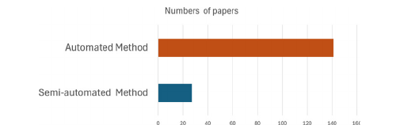

**图8.** 工业应用中半自动与自动缺陷检测方法的分布。

图内标签译释：横轴为论文数；两条柱形分别为自动方法（141篇）和半自动方法（27篇）。

此外，我们进一步将深度学习模型划分为用于缺陷分类的 CNN、迁移学习和混合模型，以及用于缺陷定位的编码器-解码器、金字塔网络、YOLO 和注意力模型。图11显示，CNN 在分类中占比最高，为37%；编码器-解码器在分割中占主导，为39%；结合注意力机制的 YOLO 则在目标检测中领先。这表明，近期研究倾向于采用注意力架构，因为它们能够提取多层次特征并聚焦重要信息。图12展示了2012-2025年缺陷检测、分割与分类方法的发表趋势。

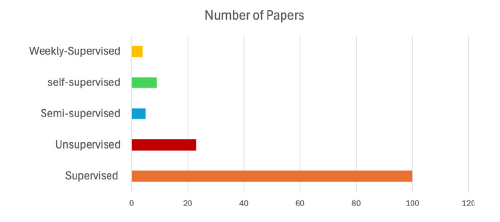

**图9.** 工业应用中不同监督方式的缺陷检测模型分布。

图内标签译释：横轴为论文数；纵轴依次列出弱监督、自监督、半监督、无监督和有监督学习。

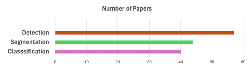

**图10.** 工业应用中缺陷检测、分割和分类功能的分布。

图内标签译释：横轴为论文数；三条柱形分别为目标检测、分割和分类。

图12表明，早期，尤其是2012-2016年，传统机器学习和图像处理占主导。随着深度学习兴起，这些传统方法逐渐减少；自2017年起，CNN 与迁移学习的使用明显增加，反映出该领域转向数据驱动方法。约2019年起，主要用于分割的编码器-解码器日益流行；注意力网络和金字塔网络也逐步增加，表明多尺度表征与增强特征提取受到重视。最近，GAN、Transformer，以及半监督、自监督、弱监督学习发展加快，研究转向能够生成合成数据、利用有限标注或处理复杂视觉模式的模型。这些趋势体现了提高各工业领域缺陷检测效率和精度的持续创新。

钢材、织物、金属、玻璃及其他工业材料领域均有许多数据集。表9-21中，一些缺陷分类研究报告了数据集大小，另一些仅提供名称。对于给出数据集大小的工作，我们绘制气泡图，展示不同模型在不同数据规模下的表现。

图13显示了 CNN、迁移学习与混合模型的数据集规模和准确率之间的关系。

图中可见，大数据集通常对应较高准确率；迁移学习即使在中等规模数据上也表现良好，混合模型同样具有竞争力。缺陷分类、分割与目标检测采用了多种数据集，最常用的四种是 DAGM、NEU-DET、MVTec 和 KolektorSDD。模型性能通常用 mAP、mIoU 等指标评价，相关方法与报告结果见表9-21。图13还比较了四个数据集上不同方法的结果：DAGM 与 NEU-DET 的性能分布较宽，尤其是编码器-解码器和注意力模型，表明模型实现或数据集复杂度存在差异；MVTec 上的准确率普遍较高，自监督学习与大语言模型尤其突出；KolektorSDD 上自监督与 GAN 模型结果较高，而金字塔方法较弱。这说明应结合数据集类型与缺陷复杂程度选择模型。

## 8. 开放挑战和未来研究方向

自动化检测系统对于工业领域的质量评估变得越来越重要。一些研究人员发表了关于工业产品缺陷检测和分类的评论文章[27-30]，但该领域仍然存在许多挑战需要解决。本次调查对使用图像处理、ML 和 DL 方法的缺陷检测和分类方法进行了全面研究，并描述了它们如何应用于不同的产品。本节介绍了已确定的开放挑战，分类如下：(1) 数据预处理，(2) 深度学习模型，(3) 模型可靠性和可信度。图 14 表示未来研究方向的示意图，将缺陷检测模型中出现挑战的所有关键组件可视化。此外，还研究了一些将来应考虑的发现。

### 8.1. 工业环境中的数据预处理

本节分析了收集缺陷检查数据集的主要挑战，因为这是所有 DCNN 模型的必要步骤。数据库带来了数据清洗、数据标签、数据隐私和数据共享等一系列挑战。

- **数据清洗：** 工业图像采集受到照明不均、相机噪声等限制，可能出现模糊、缺陷不清晰或噪声问题，因此输入模型前需要预处理。去噪可改善数据质量和模型稳健性，随后应根据模型要求调整图像尺寸。
- **数据标注：** 数据标注是准备训练数据集的关键，但需要大量人工。数据隐私也是自动缺陷检测的重要挑战，尤其是企业对数据保密的领域；一些研究者不愿公开数据，也增加了其他研究者收集数据与训练模型的难度。Nahar 等人[261]为集换式卡牌自动缺陷检测制定标准化采集策略：先用双边滤波去噪，再通过算法裁剪指定尺寸区域，建立统一尺寸数据库。另一项研究[229]将钢材图像系统地裁剪为预定大小的图像块，构建包含不同缺陷类型的自定义数据集。但这两项研究均首先进行人工标注。研究[262]则提出SSL方法，以应对数据标注挑战。

### 8.2. 深度学习模型：网络选择与参数调优

本节讨论缺陷检测与分类网络的选择挑战。前文介绍了人工、半自动和自动三类方法。半自动方法采用基于滤波器、边缘等图像处理技术，可缓解人工检验中的主观性、高人力成本和人为错误等问题，并减少对实验装置的需求。基于机器学习的半自动方法也能解决这些问题，但仍受到特征提取不足等因素限制。自动缺陷检测具有较高精度和较低成本，能处理不同图案，但仍存在大量标注数据需求、数据集不平衡和超参数调优等问题。因此，需要关注以下研究问题。

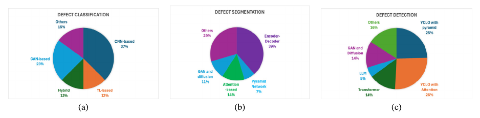

**图11.** 工业应用中的缺陷检测深度学习方法的百分比:(a) 分类、(b) 分割和(c) 检测。

图内数据译释：(a)缺陷分类：CNN 37%、迁移学习12%、混合模型13%、GAN 23%、其他15%；(b)缺陷分割：编码器-解码器39%、金字塔网络7%、注意力14%、GAN与扩散11%、其他29%；(c)缺陷目标检测：YOLO与金字塔25%、YOLO与注意力26%、Transformer 14%、大语言模型5%、GAN与扩散14%、其他16%。

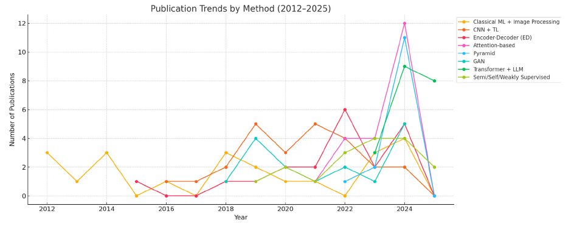

**图12.** 产品缺陷检测中经典机器学习与现代学习方法的论文发表趋势。

图内标签译释：标题为“按方法划分的论文发表趋势（2012-2025）”；横轴为年份，纵轴为论文数；图例依次为传统机器学习与图像处理、CNN与迁移学习、编码器-解码器、注意力、金字塔、GAN、Transformer与大语言模型、半监督/自监督/弱监督。

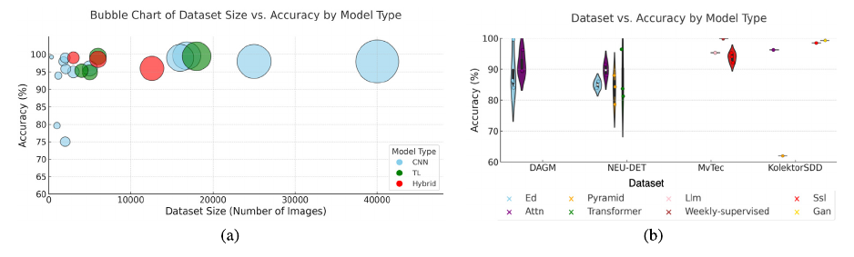

**图13.** 关于各种应用的不同数据集的准确性:(a) 分类(b) 分割与目标检测。

图内标签译释：(a)按模型类别比较数据集规模与准确率的气泡图，横轴为图像数量，纵轴为准确率（%），图例为CNN、迁移学习、混合模型；(b)按模型类别比较不同数据集准确率，横轴为DAGM、NEU-DET、MVTec、KolektorSDD，纵轴为准确率（%），图例包括编码器-解码器、注意力、金字塔、Transformer、大语言模型、弱监督、自监督、GAN。

- **RQ1：** 面对小规模数据集，如何有效使用深度学习模型？
- **RQ2：** 对于特定任务，应调整哪些超参数以获得最佳性能？

#### 8.2.1. RQ1：解决深度学习模型中的小数据集问题

工业场景中的自动缺陷检测存在一个根本挑战：相较于大量正常且标注正确的样本，带标注的缺陷数据十分稀缺。这种不平衡可能使模型训练产生偏差，妨碍有效泛化。为缓解问题，可采用正则化、早停，以及平移、翻转、缩放等数据增强，提高模型的稳健性及对新数据的适应能力[23,38,261,263]。

#### 8.2.2. RQ2：面向模型优化的超参数选择

选择合适网络架构并微调超参数十分关键，包括层数、步幅、卷积核大小、批量大小、优化器和学习率等，其选择受数据集规模与目标检测精度影响。神经元数量和激活函数又增加了网络设计的复杂性。总体而言，要获得可泛化的模型精度，需要仔细选择并微调这些参数[14,139]。缺陷定位进一步增加复杂性，通常采用 FCN[157]、U-Net[74]等专用语义分割网络；但它们需要大量像素级人工标注，从而推动了 GAN[264]等无监督模型的发展。这些方法减少标注负担，代价是精度略低于有监督方法。上述策略共同服务于实际工业缺陷检测系统的优化。

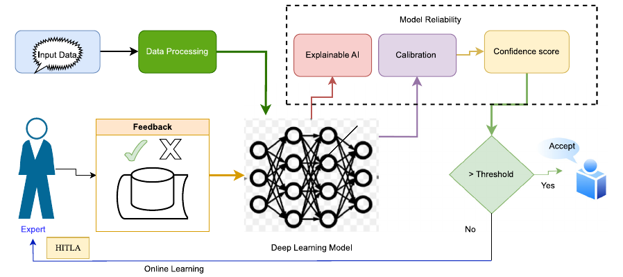

**图14.** 建议研究方向示意图。TL：迁移学习；HITLA：人在回路分析。

图内流程与标签译释：输入数据 → 数据处理 → 深度学习模型；模型可靠性部分包括可解释人工智能、校准和置信度分数。若分数高于阈值，则接受结果；否则进入在线学习回路，由专家通过人在回路分析（HITLA）提供反馈，并更新模型。反馈中勾号和叉号表示正确或错误判断。

### 8.3. 缺陷检测模型:可靠性和可解释性

尽管深度学习已广泛用于各行业缺陷检测，近期研究发现模型输出的校准不足，限制了其在关键决策中的应用。CNN 的另一项挑战是可解释性：模型具有黑箱特征，难以理解其决策依据。此外，模型训练完成后用于现实任务时，需要认识到任何模型都可能犯错，也可能产生不确定预测。为改进和评估深度学习模型，可以将专家知识引入 DCNN，通过专家反馈作出决策或重新训练模型。

- **RQ3：** 如何确保对黑箱模型（如深度学习）决策的信任？
- **RQ4：** 重新训练模型需要多少数据？

#### 8.3.1. RQ3：深度学习模型的可靠性挑战与解决方案

本小节描述了工业缺陷检测中深度学习模型的可靠性,侧重于可解释性、不确定性估计和校准。 这三个方面一起决定了在实时决策环境中部署模型时如何可信和可靠。

**(a) 通过可解释人工智能提高模型可靠性。** 本节讨论决策与实时应用中的可靠性，尤其是 CNN。由于其黑箱特征，可解释性是主要障碍。尽管各层能够识别决策所需的模式，但哪些模式或特征被优先采用、为何被采用，通常并不清楚。这种不透明性在医疗、自动驾驶等必须理解决策过程的关键领域引起广泛关注。

为此，研究人员探索可解释人工智能（XAI），提高系统的可靠性、可信性与透明度。显著性图[265,266]、Grad-CAM 等方法可帮助解释 CNN 决策。虽然 XAI 能改善透明度，准确决策仍需要维持对模型的合理信任。其他综述[267,268]也介绍了 XAI 在不同应用中的实践。

**(b) 深度学习模型的不确定性估计。** 不确定性量化（UQ）是模型评估中的另一项挑战，因为已有缺陷检测方法通常基于干净、完好、无污染的训练数据开发。当前人工智能方法不仅在不确定性量化上需要较多计算资源，还往往需要修改网络拓扑和优化过程，并进行多次运行以监测模型不稳定性。Abbaszadeh Shahri 等人[269]提出自动随机停用连接权重（ARDCW），无需改变优化过程，即可通过单次前向传播有效估计不确定性，并能应用于已训练网络，其表现优于其他模型。Yu 等人[137]同时处理环境照明造成的图像不确定性与人工失误造成的 PCB 标注不确定性：采用对称残差滤波与概率分类，并结合联合概率推理引擎进一步改善结果。该方法在自采数据和公开数据上均表现良好，也能检测复杂图案中的缺陷。但挑战仍然存在，应考虑融合多种模型，在保证高检测精度的同时减轻模型负担[146,270,271]。

**(c) 提高深度神经网络置信度可靠性的校准技术。** 深度神经网络在多类任务中表现优良，却常缺乏适当校准。在工业质量检验等实时决策中，网络置信度的可信性对系统可靠性至关重要。已有多种概率与度量方法应对校准问题，包括温度缩放、贝塔校准、Platt 缩放、保序回归、矩阵缩放和向量缩放[272-274]。这些方法可校准模型并为测试数据生成置信度分数，系统可据最高概率作出决策。校准良好的模型可显著改善缺陷分类和检测决策[263]。Lei 等人[275]提出过程不确定性下的表面缺陷检测方法，结合自适应卷积、边缘分离小波变换与置信度筛选学习，提高准确率和稳健性，实验表明其在工业数据集上表现良好。

#### 8.3.2. RQ4：将人在回路分析融入深度学习模型改进

训练深度学习模型后，重要的是要承认没有任何模型是完美的，并且在某些情况下其预测可能是不确定的。 HITLA 通过整合人类专业知识和知识来完善和评估基于 DL 的模型输出 [276,277]。在 HITLA 中，可以在不同级别上将人类纳入学习过程，具体取决于谁控制该过程。主动学习需要人类对未标记的样本进行标注，从而扩展和改进训练数据集。迭代再训练涉及人工输入，以根据新带标注的数据完善模型，通常使用基于池的场景来查询实例。当预测低于某个阈值时，置信度评分会提示人为干预，从而确保模型的准确性和问责制[263,278,279]。有效的反馈收集，包括识别误检和漏检，有助于持续改进模型[263]。尽管其有效性，但在解决人类时间限制和开发专家系统来处理被标记为需要人工复核的实例方面仍然存在挑战，这凸显了行业应用中持续存在的问题。

#### 8.3.3. 训练时间、推理、精度与持续监测方面的挑战

部署基于深度学习的工业缺陷检测模型的最关键挑战之一在于平衡推理速度与训练时间。虽然改进的 YOLOv8 和 DGNet 等高级模型表现出强大的检测能力，可实现高达 98.36% 的 mAP [187,188,205]，但它们需要大量的计算资源，限制了它们在边缘设备或高速生产线等低延迟设置中的使用。在某些领域，例如织物或钢材检查，2-10 秒之间的推理时间可能是可以接受的；然而，实时应用程序需要更快的结果。基于 MobileNet 的架构 [156] 等轻量级模型提供更快的推理速度，但在处理复杂或低对比度缺陷时往往表现不佳。类似地，通过注意力或金字塔模块增强的 YOLO 变体 [182,186,203] 提高了准确性，但由于复杂性增加，通常会增加延迟。虽然推理时间在许多应用中通常是可以接受的，但训练时间成为设计用于持续监控和模型更新的系统的关键瓶颈。在生产环境中，随着时间的推移会出现新的缺陷类型，因此需要频繁地进行重新训练，这就提出了如何在不影响模型性能的情况下有效适应的问题。

为此，持续监测与人工反馈对评估模型在新数据上的表现十分重要[276,277]。人在回路分析（HITLA）系统将不确定或低置信度预测交由人工审查，既支持质量控制，也生成重新训练所需的新标注数据。重新训练策略因数据而异：有的方法用少量数据逐步更新模型，有的方法等待足够数据后微调或从头训练。两者均有权衡：小批量更新可能缺乏泛化能力，大批量更新则可能面临数据分布变化和训练时间增加的问题。此外，小数据集上的迁移学习微调可能导致灾难性遗忘，使原本表现良好的类别性能下降[263]。因此，研究需要平衡训练成本、更新频率与性能保持；迁移学习、持续学习及自适应微调，是维持现实缺陷检测系统稳健性和响应能力的关键。

### 8.4. 未来的工业应用

综述表明，在工业需求和 NEU-DET、DAGM、TILDA 等基准数据推动下，织物（14-18篇）、钢材（12-15篇）和木材（10-12篇）的研究最多。金属、陶瓷、玻璃各有约5-6篇，而混凝土、塑料、电池、PCB、发动机或齿轮各仅2-3篇，通常受到公开数据不足或专有数据限制。纸张、艺术纸仅有1篇，集换式卡牌仅有3篇，明显研究不足[41,280-282]。这些领域缺少基准数据集，阻碍了深度学习发展；其视觉复杂性与精度要求，也使其成为具有挑战的未来方向，尤其需要针对性的数据集构建和增强。目前，集换式卡牌缺陷检测、分类的整个流程依赖人工和主观判断，导致质量评估不一致，因此值得深入探索。卡牌质量评价应考虑角部缺陷、边缘缺陷、表面缺陷和居中度测量[263,283]，共同评估整体品相。角部缺陷指卡牌角部的不规则形态或损伤[263]，影响卡牌尺寸与外观；边缘缺陷则指磨损、凹痕等造成的沿边缘瑕疵。表面划痕、瑕疵与印记影响视觉吸引力，综合评估这些缺陷可帮助收藏者判断卡牌质量。另一广泛研究的领域是织物缺陷检测[40,49,50,156]。织物检测系统对纺织生产质量保证至关重要，纺织工厂日益需要自动系统替代高强度人工目检，推动研究人员和从业者开发基于 CNN 的深度方法识别织物缺陷。

## 9. 结论

人工智能和深度学习技术的最新进展已成功应用于工业产品的缺陷检测。由于工业场景和不同类型材料的特殊性，寻找合适的深度学习模型来解决缺陷检测问题非常困难。本文通过研究 150 多项科学贡献，对缺陷检测和分类方法进行了全面研究。文献综述证实，由于数据集标记和标注相关的挑战，除了监督模型之外，学者们还研究了无监督、自监督、半监督和弱监督模型。实现预期的显着检测精度和训练模型都存在与这两种类型的模型相关的问题。此外，在复杂图案中找到缺陷区域也带来了另一种挑战。

本文首先综述了人工、半自动和自动三类缺陷检验。人工方法能够帮助识别缺陷，但完全依赖人的判断，且需预先配置检验装置；半自动方法可以缓解这些问题，但仍难识别不同材料中的不同缺陷。机器学习与深度学习因能够处理多种材料和缺陷而受到关注。许多情况下，传统机器学习半自动方法的效率低于深度学习；深度学习的主要挑战则在于对大型训练数据集的依赖。其次，本文探讨了深度学习在不同材料缺陷检测中的应用，评价其精度与性能：分类模型包括 CNN、迁移学习和混合模型；定位模型包括编码器-解码器、金字塔网络、YOLO 与注意力模型。分析表明，编码器-解码器在分割中最突出，注意力增强的 YOLO 在目标检测中占主导。无监督、半监督、自监督和弱监督方法在文献中也占有一定比例；大语言模型、基础模型、小样本学习与 Transformer 等新兴方法受到越来越多关注。最后，在识别主要挑战之后，可以预期，学术界和工业界对自动检验的需求将继续增长。

## CRediT作者贡献声明

**Lutfun Nahar：** 可视化、软件、研究调查、数据整理、初稿撰写、验证、方法设计、形式化分析、概念构思。**Mohammad Awrangjeb：** 方法设计、经费获取、概念构思、监督指导、形式化分析、可视化、审阅与修改、验证、项目管理、研究调查。**Md. Saiful Islam：** 验证、项目管理、研究调查、形式化分析、可视化、方法设计、经费获取、概念构思、审阅与修改、监督指导。

## 利益冲突声明

Lutfun Nahar 声明获得 Media8 Pty. Ltd 的经费支持。其余作者声明，不存在可能被认为影响本文所报告工作的已知竞争性经济利益或私人关系。

## 数据可用性

文章所述研究没有使用任何数据。

## 参考文献

[1] Y. Peng, G. Liu, Y. Quan, Q. Zeng：《基于激光散斑剪切干涉的内部缺陷深度测量》。Opt. Laser Technol. 92 (2017) 69–73.

[2] X. Rao, F. Zhang, Y. Lu, X. Luo, F. Chen：《电火花金刚石磨削引起的反应烧结碳化硅表面及亚表面损伤》。Int. J. Mach. Tools Manuf. 154 (2020) 103564.

[3] J.s. Chen, C.s. Li：《串列冷轧带材表面热划伤缺陷的预测与控制》。J. Iron Steel Res. Int. 22 (2) (2015) 106–114.

[4] K. Song, Y. Yan：《基于完整局部二值模式的热轧钢带表面缺陷抗噪方法》。Appl. Surf. Sci. 285 (2013) 858–864.

[5] F. Pernkopf：《利用贝叶斯网络分类器检测钢坯表面缺陷》。Pattern Anal. Appl. 7 (3) (2004) 333–342.

[6] W. Zhang, C. Ye, K. Zheng, J. Zhong, Y. Tang, Y. Fan, M.J. Buehler, S. Ling, D.L. Kaplan：《面向智能纺织应用的仿天蚕丝分级纤维》。ACS Nano 12 (7) (2018) 6968–6977.

[7] P. Parenti, L. Pagani, M. Annoni：《硬质合金高精度钻削中崩边缺陷的自动识别》。Precis. Eng. 60 (2019) 383–393.

[8] P. Bukieda, K. Lohr, J. Meiberg, B. Weller：《磨削与抛光后玻璃边缘光学质量和强度研究》。Glas. Struct. Eng. 5 (3) (2020) 411–428.

[9] T. Wang, Y. Chen, M. Qiao, H. Snoussi：《产品质量控制中快速、稳健的卷积神经网络缺陷检测模型》。Int. J. Adv. Manuf. Technol. 94 (9) (2018) 3465–3471.

[10] S.H. Huang, Y.-C. Pan：《半导体行业自动视觉检验综述》。Comput. Ind. 66 (2015) 1–10.

[11] A. Mital, M. Govindaraju, B. Subramani：《零件检验中人工与混合方法的比较》。Integr. Manuf. Syst. (1998).

[12] P. Kopardekar, A. Mital, S. Anand：《人工、混合与自动检验的文献及研究现状》。Integr. Manuf. Syst. (1993).

[13] E.R. Davies：《计算机视觉与机器视觉：理论、算法和实践》。2012.

[14] J.K. Park, B.K. Kwon, J.H. Park, D.J. Kang：《基于机器学习的表面缺陷检验成像系统》。Int. J. Precis. Eng. Manuf.-Green Technol. 3 (3) (2016) 303–310.

[15] L.M. Kandpal, E. Park, J. Tewari, B.-K. Cho：《药品无损质量检验的光谱技术综述》。J. Biosyst. Eng. 40 (4) (2015) 394–408.

[16] P. Mahajan, S. Kolhe, P. Patil：《自动织物缺陷检测技术综述》。Adv. Comput. Res. 1 (2) (2009) 18–29.

[17] H.Y. Ngan, G.K. Pang, N.H. Yung：《自动织物缺陷检测综述》。Image Vis. Comput. 29 (7) (2011) 442–458.

[18] X. Xie：《利用纹理分析检测表面缺陷的近期进展综述》。ELCVIA: Electron. Lett. Comput. Vis. Image Anal. (2008) 1–22.

[19] D.P. Penumuru, S. Muthuswamy, P. Karumbu：《工业4.0背景下利用机器视觉和机器学习识别与分类材料》。J. Intell. Manuf. 31 (5) (2020) 1229–1241.

[20] O. Badmos, A. Kopp, T. Bernthaler, G. Schneider：《利用卷积神经网络进行锂离子电池电极图像缺陷检测》。J. Intell. Manuf. 31 (4) (2020) 885–897.

[21] R. Shanmugamani, M. Sadique, B. Ramamoorthy：《利用计算机视觉与机器学习检测和分类枪管表面缺陷》。Measurement 60 (2015) 222–230.

[22] X. Dong, C. Taylor, T. Cootes：《基于随机森林的X射线图像航空航天焊缝自动检验系统》。IEEE Trans. Autom. Sci. Eng. 18 (2021) 2128–2141.

[23] X. Jun, J. Wang, J. Zhou, S. Meng, R. Pan, W. Gao：《采用两阶段策略和深度卷积神经网络的织物缺陷检测》。Text. Res. J. 91 (1–2) (2021) 130–142.

[24] J. Kim, Y. Nam, M.-C. Kang, K. Kim, J. Hong, S. Lee, D.-N. Kim：《半导体制造过程中的对抗式缺陷检测》。IEEE Trans. Semicond. Manuf. 34 (3) (2021) 365–371.

[25] X. Dong, C.J. Taylor, T.F. Cootes：《通过训练通用卷积神经网络编码器实现缺陷检测与分类》。IEEE Trans. Signal Process. 68 (2020) 6055–6069.

[26] X. Dong, C.J. Taylor, T.F. Cootes：《利用无监督局部深度特征学习自动检验航空航天焊缝》。Knowl.-Based Syst. 221 (2021) 106892.

[27] T. Czimmermann, G. Ciuti, M. Milazzo, M. Chiurazzi, S. Roccella, C.M. Oddo, P. Dario：《面向工业应用的视觉缺陷检测与分类方法综述》。Sensors 20 (5) (2020).

[28] J. Yang, S. Li, Z. Wang, H. Dong, J. Wang, S. Tang：《利用深度学习检测制造缺陷：全面综述与当前挑战》。Materials 13 (24) (2020).

[29] W. Yang：《基于深度学习的表面缺陷检测综述》。in: Proceedings of the 2022 7th International Conference on Modern Management and Education Technology, MMET 2022, Atlantis Press, 2022, pp. 362–367.

[30] Z. Ren, F. Fang, N. Yan, Y. Wu：《基于机器视觉的缺陷检测研究现状》。Int. J. Precis. Eng. Manuf.-Green Technol. 9 (2) (2022) 661–691.

[31] A. Saberironaghi, J. Ren, M. El-Gindy：《利用深度学习检测工业产品缺陷的方法综述》。Algorithms 16 (2) (2023) 95.

[32] B. Tang, L. Chen, W. Sun, Z.-k. Lin：《基于机器视觉的钢材表面缺陷检测综述》。IET Image Process. 17 (2) (2023) 303–322.

[33] R. Ameri, C.C. Hsu, S.S. Band：《工业应用中深度学习表面缺陷检测方法的系统综述》。Eng. Appl. Artif. Intell. 130 (2024) 107717.

[34] Google Trends：《谷歌趋势》。2023, <https://trends.google.com/trends/>.

[35] R. Singh, G.C. Yadav：《利用方形瓷砖图像和反三角函数检测角部缺陷》。Int. J. Eng. Comput. Sci. 3 (09) (2014) 8047–8055.

[36] R. Singh, G.C. Yadav：《生产阶段方形瓷砖角部缺陷分类》。Int. J. Comput. Sci. Trends Technol. (IJCST) 2 (4) (2014).

[37] M.Y. Masod, R. Ahmad, M. Mohamad：《平版胶印印刷缺陷综述》。in: O.H. Hassan, S.Z. Abidin, R. Anwar, M.F. Kamaruzaman (Eds.), Proceedings of the International Symposium on Research of Arts, Design and Humanities (ISRADH 2014), Springer Singapore, Singapore, 2015, pp. 489–497.

[38] S. Chakraborty, M. Moore, L. Parrillo-Chapman：《利用卷积神经网络自动检测印花织物缺陷》。2021.

[39] W. Ouyang, B. Xu, J. Hou, X. Yuan：《利用嵌入激活层的卷积神经网络检测织物缺陷》。IEEE Access 7 (2019) 70130–70140.

[40] Q. Liu, C. Wang, Y. Li, M. Gao, J. Li：《一种基于深度学习的织物缺陷检测方法》。IEEE Access 10 (2022) 4284–4296.

[41] Card Grading：《卡牌评级》。2023, <https://www.psacard.com/services/tradingcardgrading>.

[42] L.C. Chen, M.S. Pardeshi, W.T. Lo, R.K. Sheu, K.C. Pai, C.Y. Chen, P.Y. Tsai, Y.T. Tsai：《利用深度学习检测拼接木板缺陷》。Wood Sci. Technol. 56 (2) (2022) 477–507.

[43] G. Psuj：《利用深度学习整合多传感器数据以表征钢构件缺陷》。Sensors 18 (1) (2018) 292.

[44] D. Soukup, R. Huber-Mörk：《利用卷积神经网络从光度立体图像检测钢表面缺陷》。in: International Symposium on Visual Computing, Springer, 2014, pp. 668–677.

[45] Q.C. Hsu, C.M. Lin：《检测玻璃基板边缘缺陷的图像检验系统》。in: Applied Mechanics and Materials, vol. 121, Trans Tech Publ, 2012, pp. 3970–3976.

[46] M. Drass, H. Berthold, M.A. Kraus, S. Müller-Braun：《基于深度学习的语义分割：玻璃切割边缘裂纹检测》。Glas. Struct. Eng. 6 (1) (2021) 21–37.

[47] B. Yoon, H. Lee, J. Jeong：《结合图像块划分的改进U-Net++用于丝网印刷微缺陷检验》。Appl. Sci. (Basel) 12 (9) (2022) 4679.

[48] T. Matić, I. Vidović, Ž. Hocenski：《基于轮廓的瓷砖边缘与角部缺陷实时检测》。Tech. Gaz. 20 (6) (2013) 1063–1070.

[49] T. Almeida, F. Moutinho, J.P. Matos-Carvalho：《结合深度学习与漏检减少的织物缺陷检测》。IEEE Access 9 (2021) 81936–81945.

[50] Z. Liu, C. Zhang, C. Li, S. Ding, Y. Dong, Y. Huang：《利用优化神经网络识别织物缺陷》。J. Eng. Fibers Fabr. 14 (2019) 1558925019897396.

[51] F.A. Saiz, I. Barandiaran, A. Arbelaiz, M. Graña：《利用深度分割网络的钢部件制造光度立体缺陷检测系统》。Sensors 22 (3) (2022) 882.

[52] P. Damacharla, A. Rao, J. Ringenberg, A.Y. Javaid：《TLU-Net：自动钢表面缺陷检测的深度学习方法》。in: 2021 International Conference on Applied Artificial Intelligence, ICAPAI, IEEE, 2021, pp. 1–6.

[53] W.A. Altabey, M. Noori, T. Wang, R. Ghiasi, S.-C. Kuok, Z. Wu：《通过提取三维阴影建模特征识别钢管裂纹的深度学习方法》。Appl. Sci. 11 (13) (2021) 6063.

[54] R. Neven, T. Goedemé：《用于钢表面缺陷类型与严重程度分割的多分支U-Net》。Metals 11 (6) (2021) 870.

[55] W. Tomlinson, B. Halliday, D. Farrington, A. Skumanich：《用于先进过程控制的在线SEM自动缺陷分类》。in: 2000 IEEE/SEMI Advanced Semiconductor Manufacturing Conference and Workshop. ASMC 2000 (Cat. No. 00CH37072), IEEE, 2000, pp. 131–137.

[56] M. Avinun-Kalish, O. Sagy, S.M. Im, C. Lee, J. Oh, J. Lim, C. Kim, H. Yoo：《利用二次电子能谱仪增强电压衬度及底层缺陷复查的新型SEM成像》。in: 2009 IEEE/SEMI Advanced Semiconductor Manufacturing Conference, IEEE, 2009, pp. 223–227.

[57] B. Becker, R. Porat, H. Eschwege：《利用基于SEM的晶圆斜边复查识别外缘芯片良率损失来源》。in: 2010 IEEE/SEMI Advanced Semiconductor Manufacturing Conference, ASMC, IEEE, 2010, pp. 119–122.

[58] T. Newell, B. Tillotson, H. Pearl, A. Miller：《半导体量产制造中利用SemVision检测电气缺陷》。in: 2016 27th Annual SEMI Advanced Semiconductor Manufacturing Conference, ASMC, IEEE, 2016, pp. 151–156.

[59] A. Jain, J.G. Sheridan, F. Levitov, V. Aristov, S. Yasharzade, H. Nguyen：《利用新型电子检测系统对埋藏缺陷进行在线SEM成像：缺陷检验与减少》。in: 2018 29th Annual SEMI Advanced Semiconductor Manufacturing Conference, ASMC, IEEE, 2018, pp. 259–263.

[60] V. Rolland, M.R. Farazi, W.C. Conaty, D. Cameron, S. Liu, L. Petersson, W.N. Stiller：《HairNet：评估叶片茸毛程度的深度学习模型，该表型与棉纤维产量、价值和抗虫性有关》。Plant Methods 18 (1) (2022) 8.

[61] J. Wang, Y. Ma, L. Zhang, R.X. Gao, D. Wu：《智能制造中的深度学习：方法与应用》。J. Manuf. Syst. 48 (2018) 144–156.

[62] R. Nigam, S.K. Singh：《利用小波变换与摄影测量检测梁体裂纹》。in: Structures, vol. 25, Elsevier, 2020, pp. 436–447.

[63] M.W. Ashour, F. Khalid, A. Abdul Halin, L.N. Abdullah, S.H. Darwish：《利用多方向剪切波特征分类热轧钢带表面缺陷》。Arab. J. Sci. Eng. 44 (4) (2019) 2925–2932.

[64] Y. Huang, K.L. Chan：《通过高阶统计量中的谐波提取进行纹理分解》。IEEE Trans. Image Process. 13 (1) (2004) 1–14.

[65] R. Kulkarni, E. Banoth, P. Pal：《利用条纹投影自动检测表面特征：基于自回归建模的方法》。Opt. Lasers Eng. 121 (2019) 506–511.

[66] X.W. Zhang, F. Gong, L.Z. Xu：《利用多元统计方法与SVM检验铜带表面缺陷》。Int. J. Comput. Appl. Technol. 43 (1) (2012) 44–50.

[67] A. Mahram, M.G. Shayesteh, S. Jafarpour：《结合统计和纹理特征分类木材表面缺陷》。in: 2012 35th International Conference on Telecommunications and Signal Processing, TSP, 2012, pp. 749–752.

[68] Y. Huang, D. Wu, Z. Zhang, H. Chen, S. Chen：《基于EMD和GA-SVM的脉冲TIG焊接气孔检测与缺陷诊断》。J. Mater. Process. Technol. 239 (2017) 92–102.

[69] S. Cheon, H. Lee, C.O. Kim, S.H. Lee：《用于晶圆表面缺陷分类和未知类别检测的卷积神经网络》。IEEE Trans. Semicond. Manuf. 32 (2) (2019) 163–170.

[70] X. Kang, E. Zhang：《基于稀疏字典学习的通用自适应织物缺陷检测算法》。IEEE Access 8 (2020) 221808–221830.

[71] J. Deng, W. Dong, R. Socher, L.-J. Li, K. Li, L. Fei-Fei：《ImageNet：大型分层图像数据库》。in: 2009 IEEE Conference on Computer Vision and Pattern Recognition, 2009, pp. 248–255.

[72] Y. Lecun, L. Bottou, Y. Bengio, P. Haffner：《应用于文档识别的基于梯度的学习》。Proc. IEEE 86 (11) (1998) 2278–2324.

[73] K. Fukushima：《Neocognitron：用于不受位置平移影响的模式识别机制的自组织神经网络模型》。Biol. Cybernet. 36 (4) (1980) 193–202.

[74] O. Ronneberger, P. Fischer, T. Brox：《U-Net：用于生物医学图像分割的卷积网络》。in: Medical Image Computing and Computer-Assisted Intervention – MICCAI 2015, Springer International Publishing, 2015, pp. 234–241.

[75] T.Y. Lin, P. Dollár, R. Girshick, K. He, B. Hariharan, S. Belongie：《用于目标检测的特征金字塔网络》。in: 2017 IEEE Conference on Computer Vision and Pattern Recognition, CVPR, 2017, pp. 936–944.

[76] T. Liu, Z. He, Z. Lin, G.Z. Cao, W. Su, S. Xie：《用于表面缺陷检测的自适应图像分割网络》。IEEE Trans. Neural Netw. Learn. Syst. (2022).

[77] S. Niu, Y. Peng, B. Li, Y. Qiu, T. Niu, W. Li：《基于缺陷分割需求的新型深度学习数据增强系统》。J. Intell. Manuf. 35 (2) (2024) 687–701.

[78] X. Luo, S. Li, Y. Wang, T. Zhan, X. Shi, B. Liu：《MaMiNet：用于表面缺陷检测的记忆注意力多重推理网络》。Comput. Ind. 145 (2023) 103834.

[79] S. Wang, H. Wang, F. Yang, F. Liu, L. Zeng：《用于芯片表面缺陷检测的注意力深度学习》。Int. J. Adv. Manuf. Technol. 121 (3) (2022) 1957–1971.

[80] J. Redmon, S. Divvala, R. Girshick, A. Farhadi：《YOLO：统一的实时目标检测》。in: 2016 IEEE Conference on Computer Vision and Pattern Recognition, CVPR, IEEE Computer Society, Los Alamitos, CA, USA, 2016, pp. 779–788.

[81] W. Liu, D. Anguelov, D. Erhan, C. Szegedy, S. Reed, C.Y. Fu, A.C. Berg：《SSD：单阶段多框检测器》。in: B. Leibe, J. Matas, N. Sebe, M. Welling (Eds.), Computer Vision – ECCV 2016, Springer International Publishing, Cham, 2016, pp. 21–37.

[82] S. Ren, K. He, R.B. Girshick, J. Sun：《Faster R-CNN：利用区域候选网络实现实时目标检测》。IEEE Trans. Pattern Anal. Mach. Intell. 39 (2015) 1137–1149.

[83] Collectible Card：《收藏卡牌》。2024, <https://collectiblemadness.com.au>.

[84] Ç. Aytekin, Y. Rezaeitabar, S. Dogru, I. Ulusoy：《基于实时机器视觉的铁路扣件检验》。IEEE Trans. Syst. Man, Cybern.: Syst. 45 (7) (2015) 1101–1107.

[85] H.D. Lin, H.L. Chen：《利用机器视觉自动检验光学元件视觉缺陷》。J. Appl. Eng. Sci. 16 (4) (2018) 447–453.

[86] A. Mohan, S. Poobal：《利用图像处理检测裂纹：批判性综述与分析》。Alex. Eng. J. 57 (2) (2018) 787–798.

[87] G. Wang, W.T. Peter, M. Yuan：《采用三阈值Canny边缘检测器从红外图像序列自动检测内部裂纹》。Meas. Sci. Technol. 29 (2) (2018) 025403.

[88] M. Lu, C.L. Chen：《基于机器视觉的轴承表面缺陷检测与分类》。Appl. Sci. 11 (4) (2021) 1825.

[89] Y. Liu, K. Xu, D. Wang：《基于局部二值模式与极限学习机的冷轧带钢在线表面缺陷识别》。Metals 8 (3) (2018) 197.

[90] F. López, J.M. Valiente, R. Baldrich, M. Vanrell：《利用CIE Lab空间颜色统计进行快速表面分级》。in: Iberian Conference on Pattern Recognition and Image Analysis, Springer, 2005, pp. 666–673.

[91] F. López, J.M. Valiente, J.M. Prats：《利用软颜色-纹理描述子进行表面分级》。in: Iberoamerican Congress on Pattern Recognition, Springer, 2005, pp. 13–23.

[92] S. Iida, T. Uchiyama：《在线边缘粗糙度低于1 nm的线条与间隔图案上制造预设微缺陷》。Micro Nano Eng. 3 (2019) 44–49.

[93] S. Dorafshan, R. Thomas, M. Maguire：《深度卷积神经网络与边缘检测器在混凝土图像裂纹检测中的比较》。Constr. Build. Mater. 186 (2018) 1031–1045.

[94] A. Bustillo, D.Y. Pimenov, M. Mia, W. Kapłonek：《考虑面铣刀齿磨损的平面度偏差机器学习自动预测》。J. Intell. Manuf. 32 (3) (2021) 895–912.

[95] D. Dhall, R. Kaur, M. Juneja：《机器学习算法及其应用综述》。in: Proceedings of ICRIC 2019, Springer, 2020, pp. 47–63.

[96] K. Yıldız, A. Buldu, M. Demetgul：《采用K近邻算法的纺织面料热图像缺陷分类方法》。J. Ind. Text. 45 (5) (2016) 780–795.

[97] Y. Lei, M.J. Zuo：《基于加权K近邻分类算法的齿轮裂纹程度识别》。Mech. Syst. Signal Process. 23 (5) (2009) 1535–1547.

[98] S. Mjahed, S. El Hadaj, K. Bouzaachane, S. Raghay：《利用遗传算法与K均值聚类诊断发动机故障信号》。in: Proceedings of the International Conference on Learning and Optimization Algorithms: Theory and Applications, 2018, pp. 1–6.

[99] C. Mandriota, M. Nitti, N. Ancona, E. Stella, A. Distante：《用于铁轨缺陷检测的基于滤波器的特征选择》。Mach. Vis. Appl. 15 (4) (2004) 179–185.

[100] A.A. Hamdi, M.S. Sayed, M.M. Fouad, M.M. Hadhoud：《利用纹理滤波与K均值聚类无监督检测花纹织物缺陷》。in: 2018 International Conference on Innovative Trends in Computer Engineering, ITCE, IEEE, 2018, pp. 130–144.

[101] R. Liang, Y. Ding, X. Zhang, J. Chen：《基于径向基核SVM的铜带表面缺陷检验》。in: 2008 Fourth International Conference on Natural Computation, vol. 2, IEEE, 2008, pp. 41–45.

[102] D. You, X. Gao, S. Katayama：《结合WPD-PCA、FNN和SVM的激光焊接过程监测与缺陷诊断》。IEEE Trans. Ind. Electron. 62 (1) (2014) 628–636.

[103] O. Silvén, M. Niskanen, H. Kauppinen：《利用无监督聚类检验木材》。Mach. Vis. Appl. 13 (5) (2003) 275–285.

[104] R.M.A. Oliveira, Â.M.O. Sant’Anna, P.H.F. da Silva：《用于工业过程缺陷检测的可解释机器学习模型》。Comput. Ind. Eng. 192 (2024) 110214, <http://dx.doi.org/10.1016/j.cie.2024.110214,URLhttps://www.sciencedirect.com/science/article/pii/S0360835224003358>.

[105] R. Hemalatha, K. Muthumeenakshi, S.R. and：《利用融合全局特征和神经网络检测与分类织物缺陷的机器学习模型》。Aust. J. Electr. Electron. Eng. 20 (4) (2023) 371–386, <http://dx.doi.org/10.1080/1448837X.2023.2247605>.

[106] K. Anupriya, K. Sasidharan, D.P. Kumar, S. Chandiran：《利用机器学习智能检测缺陷以改善织物质量控制》。in: 2024 International Conference on System, Computation, Automation and Networking, ICSCAN, 2024, pp. 1–6, <http://dx.doi.org/10.1109/ICSCAN62807.2024.10894618>.

[107] L. Li, T. ming Ren, M. Feng：《基于改进K-CV参数优化SVM的钢球表面缺陷识别研究》。Adv. Mech. Eng. 15 (12) (2023) 16878132231218586, <http://dx.doi.org/10.1177/16878132231218586>.

[108] A. Dorbane, F. Harrou, Y. Sun：《利用可解释机器学习与SMOTE改善不平衡数据下的钢板制造缺陷检测》。J. Mater. Eng. Perform. (2025) <http://dx.doi.org/10.1007/s11665-025-11136-2>.

[109] S. Madhavan, N.V. Sridharan, T.K. Mahanta, S. Vaithiyanathan：《利用机器学习算法和深度学习特征诊断热轧钢表面缺陷》。Arab. J. Sci. Eng. (2024) <http://dx.doi.org/10.1007/s13369-024-09744-6>.

[110] A. Boudiaf, S. Benlahmidi, A. Dahane, A. Bouguettaya：《基于AlexNet与机器学习的钢带表面缺陷分类混合模型开发》。J. Fail. Anal. Prev. 24 (3) (2024) 1376–1394, <http://dx.doi.org/10.1007/s11668-024-01927-5>.

[111] H. Jia, Y.L. Murphey, J. Shi, T.-S. Chang：《用于表面缺陷检测的智能实时视觉系统》。in: Proceedings of the 17th International Conference on Pattern Recognition, 2004, Vol. 3, ICPR 2004, IEEE, 2004, pp. 239–242.

[112] B. Zorić, T. Matić, Ž. Hocenski：《利用傅里叶变换特征分类素坯瓷砖以检测缺陷》。ISA Trans. 125 (2022) 400–414, http:// dx.doi.org/10.1016/j.isatra.2021.06.025, URL <https://www.sciencedirect.com/science/article/pii/S0019057821003414>.

[113] S. Halder, D. Cerbu, M. Saib, P. Leray：《利用K均值算法分析SEM图像：先进计量与缺陷检验》。in: 2018 29th Annual SEMI Advanced Semiconductor Manufacturing Conference, ASMC, IEEE, 2018, pp. 255–258.

[114] H. Kauppinen, H. Rautio, O. Silven：《用于彩色视觉表面检验的免分割缺陷检测和SOM分类》。in: Polarization and Color Techniques in Industrial Inspection, vol. 3826, SPIE, 1999, pp. 270–280.

[115] T. Mäenpää, M. Turtinen, M. Pietikäinen：《基于纹理的实时表面检验》。Real-Time Imaging 9 (5) (2003) 289–296.

[116] M. Niskanen, O. Silvén, H. Kauppinen：《结合颜色、纹理与无监督聚类的木材检验》。in: Proceedings of the Scandinavian Conference on Image Analysis, Citeseer, 2001, pp. 336–342.

[117] T.S. Li, C.L. Huang：《半导体制造中利用SOM-SVM混合方法识别缺陷空间模式》。Expert Syst. Appl. 36 (1) (2009) 374–385.

[118] K. Gopalakrishnan, S.K. Khaitan, A. Choudhary, A. Agrawal：《结合迁移学习的深度卷积神经网络用于计算机视觉数据驱动路面病害检测》。Constr. Build. Mater. 157 (2017) 322–330.

[119] H. Lin, B. Li, X. Wang, Y. Shu, S. Niu：《利用深度卷积神经网络自动检验LED芯片缺陷》。J. Intell. Manuf. 30 (6) (2019) 2525–2534.

[120] L. Occhipinti, G. Spoto, M. Branciforte, F. Doddo：《利用细胞神经网络进行缺陷检测与表征》。in: ISCAS 2001. the 2001 IEEE International Symposium on Circuits and Systems (Cat. No. 01CH37196), vol. 3, IEEE, 2001, pp. 481–484.

[121] J. Park, H. Riaz, H. Kim, J. Kim：《基于多深度神经网络模型的盖板玻璃高级缺陷检测与分类》。Manuf. Lett. 23 (2020) 53–61.

[122] Y. Yang, L. Pan, J. Ma, R. Yang, Y. Zhu, Y. Yang, L. Zhang：《用于激光焊接自动光学检验的高性能深度学习算法》。Appl. Sci. 10 (3) (2020) 933.

[123] J.-F. Jing, H. Ma, H.-H. Zhang：《利用深度卷积神经网络自动检测织物缺陷》。Color. Technol. 135 (3) (2019) 213–223.

[124] Q. Zou, Z. Zhang, Q. Li, X. Qi, Q. Wang, S. Wang：《DeepCrack：学习分层卷积特征以检测裂纹》。IEEE Trans. Image Process. 28 (3) (2018) 1498–1512.

[125] Y. Liu, Y. Yang, W. Chao, X. Xu, T. Zhang：《基于语义分割的表面缺陷检测研究》。DEStech Trans. Comput. Sci. Eng. (2019).

[126] S. Zambal, C. Heindl, C. Eitzinger, J. Scharinger：《基于人工生成数据的自动纤维铺放端到端缺陷检测》。in: International Conference on Quality Control By Artificial Vision, 2019.

[127] H. Han, C. Gao, Y. Zhao, S. Liao, L. Tang, X. Li：《基于深度卷积神经网络的多晶硅晶圆缺陷分割》。Pattern Recognit. Lett. 130 (2020) 234–241.

[128] J. Lian, W. Jia, M. Zareapoor, Y. Zheng, R. Luo, D.K. Jain, N. Kumar：《利用夸大局部变化的GAN进行深度学习微小表面缺陷检测》。IEEE Trans. Ind. Informatics 16 (2) (2020) 1343–1351.

[129] S. Niu, B. Li, X. Wang, H. Lin：《利用GAN生成缺陷图像样本以改善缺陷识别》。IEEE Trans. Autom. Sci. Eng. 17 (3) (2020) 1611–1622.

[130] L. Deecke, R. Vandermeulen, L. Ruff, S. Mandt, M. Kloft：《利用生成对抗网络检测图像异常》。in: Machine Learning and Knowledge Discovery in Databases: European Conference, ECML PKDD 2018, Dublin, Ireland, September 10–14, 2018, Proceedings, Part I 18, Springer, 2019, pp. 3–17.

[131] H. Zhang, D. Pan, J. Liu, Z. Jiang：《用于物体表面缺陷检测的新型MAS-GAN数据合成方法》。Neurocomputing 499 (2022) 106–114.

[132] L. Shao, E. Zhang, Q. Ma, M. Li：《结合多任务平均教师的像素级半监督织物缺陷检测》。IEEE Trans. Instrum. Meas. 71 (2022) 1–11.

[133] Y.J. Cha, W. Choi, O. Büyüköztürk：《基于卷积神经网络的深度学习裂纹损伤检测》。Computer-Aided Civ. Infrastruct. Eng. 32 (5) (2017) 361–378.

[134] V.P. Golding, Z. Gharineiat, H.S. Munawar, F. Ullah：《利用深度学习检测混凝土结构裂纹》。Sustainability 14 (13) (2022) 8117.

[135] D. Tabernik, S. Sela, J. Skvarc, D. Skočaj：《基于分割的表面缺陷深度学习检测方法》。J. Intell. Manuf. 31 (2019) 759–776.

[136] R. Ren, T. Hung, K.C. Tan：《用于自动表面检验的通用深度学习方法》。IEEE Trans. Cybern. 48 (3) (2018) 929–940.

[137] X. Yu, L. Han-Xiong, H. Yang：《应对图像与标签不确定性的PCB缺陷协同学习分类模型》。IEEE Trans. Instrum. Meas. 72 (2023) 1–8.

[138] Y. He, K. Song, Q. Meng, Y. Yan：《融合多层次特征的端到端钢表面缺陷检测》。IEEE Trans. Instrum. Meas. 69 (4) (2020) 1493–1504.

[139] I. Konovalenko, P. Maruschak, J. Brezinová, O. Prentkovskis, J. Brezina：《用于金属表面缺陷检测的U-Net类CNN架构研究》。Machines 10 (5) (2022) 327.

[140] S.A. Singh, K.A. Desai：《利用机器视觉与卷积神经网络的自动表面缺陷检测框架》。J. Intell. Manuf. 34 (4) (2023) 1995–2011.

[141] H. Mewada, I.M. Pires, P. Engineer, A.V. Patel：《利用布谷鸟搜索优化深度残差网络分类织物表面缺陷并进行系统分析》。Eng. Sci. Technol. an Int. J. 53 (2024) 101681.

[142] X. Zheng, H. Wang, J. Chen, Y. Kong, S. Zheng：《用于自动表面检验的通用半监督深度学习方法》。IEEE Access 8 (2020) 114088–114099.

[143] H. Xu, X. Su, Y. Wang, H. Cai, K. Cui, X. Chen：《利用卷积神经网络自动检测桥梁裂纹》。Appl. Sci. 9 (14) (2019) 2867.

[144] Y. Li, C. Zhang：《利用Gabor滤波器与PCNN检验织物缺陷的自动视觉系统》。SpringerPlus 5 (1) (2016) 1–12.

[145] I.D.M.O. Dharmawan, J. Lee, S. Sim：《在磁光无损检验中利用深度卷积神经网络迁移学习分类缺陷形状》。Appl. Sci. 12 (15) (2022) 7613.

[146] F. Zhou, G. Liu, F. Xu, H. Deng：《基于双线性模型的通用自动表面缺陷检测》。Appl. Sci. 9 (15) (2019) 3159.

[147] H. Zenati, C.S. Foo, B. Lecouat, G. Manek, V.R. Chandrasekhar：《高效的GAN异常检测》。2018, arXiv preprint arXiv:1802.06222.

[148] T. Schlegl, P. Seeböck, S.M. Waldstein, G. Langs, U. Schmidt-Erfurth：《f-AnoGAN：利用生成对抗网络的快速无监督异常检测》。Med. Image Anal. 54 (2019) 30–44.

[149] D.M. Tsai, S.K.S. Fan, Y.H. Chou：《用于表面缺陷检测的自动标注深度分割》。IEEE Trans. Instrum. Meas. 70 (2021) 1–10.

[150] J. Yu：《利用增强型堆叠去噪自编码器学习特征以识别晶圆图缺陷》。IEEE Trans. Semicond. Manuf. 32 (4) (2019) 613–624.

[151] A. Mujeeb, W. Dai, M. Erdt, A. Sourin：《利用深度自编码器进行缺陷检测的单类特征学习方法》。Adv. Eng. Informat. 42 (2019) 100933.

[152] M. Haselmann, D.P. Gruber, P. Tabatabai：《利用基于深度学习的图像补全检测异常》。in: 2018 17th IEEE International Conference on Machine Learning and Applications, ICMLA, IEEE, 2018, pp. 1237–1242.

[153] S. Shakir, C. Topal：《利用局部频谱细化的无监督织物缺陷检测》。Neural Comput. Appl. 36 (3) (2024) 1091–1103.

[154] H. Tian, F. Li：《基于自编码器与跨图像块相似性的织物缺陷检测》。in: 2019 16th International Conference on Machine Vision Applications, MVA, IEEE, 2019, pp. 1–6.

[155] T. Liu, Z. He：《TAS2-Net：用于微小表面缺陷检测的三重注意力语义分割网络》。IEEE Trans. Instrum. Meas. 71 (2022) 1–12.

[156] J. Jing, Z. Wang, M. Rätsch, H. Zhang：《Mobile-Unet：用于织物缺陷检测的高效卷积神经网络》。Text. Res. J. 92 (1–2) (2022) 30–42.

[157] J. Long, E. Shelhamer, T. Darrell：《用于语义分割的全卷积网络》。in: CVPR, 2015.

[158] J. Balzategui, L. Eciolaza, N. Arana-Arexolaleiba：《利用电致发光与全卷积神经网络检测多晶太阳能电池缺陷》。in: 2020 IEEE/SICE International Symposium on System Integration, SII, 2020, pp. 949–953.

[159] P. Lu, J. Jing, Y. Huang：《MRD-Net：用于表面缺陷检测的高效CNN分割网络》。IEEE Trans. Instrum. Meas. 71 (2022) 1–12.

[160] X. Ning, N. Wu, X. Cui, M. Yin, Q. Zheng, X. Wang：《基于深度可分离卷积与恒等块ASPP的氮化硅陶瓷轴承圆柱滚子表面缺陷无损检测》。J. Mater. Sci., Mater. Electron. 35 (17) (2024) 1127.

[161] D. Bai, G. Li, D. Jiang, B. Tao, J. Yun, Z. Hao, D. Zhou, Z. Ju：《基于深度特征融合的钢板制造表面缺陷区域识别》。Comput. Electr. Eng. 116 (2024) 109166.

[162] J. Wang, G. Xu, F. Yan, J. Wang, Z. Wang：《Defect Transformer：用于表面缺陷检测的高效混合Transformer架构》。Measurement 211 (2023) 112614.

[163] Q. Luo, W. Xu, J. Su, C. Yang, W. Gui, O. Silvén, L. Liu：《I2GF-Net：用于复杂纹理背景木材表面缺陷检测的层间信息引导反馈网络》。IEEE Trans. Instrum. Meas. 73 (2024) 1–13.

[164] B. Chen, T. Niu, W. Yu, R. Zhang, Z. Wang, B. Li：《A-Net：用于实时表面缺陷分割的A形轻量级神经网络》。IEEE Trans. Instrum. Meas. 73 (2024) 1–14.

[165] Y. Zhu, Z. Xu, Y. Lin, D. Chen, Z. Ai, H. Zhang：《用于木材表面破损缺陷分割的多源数据融合网络》。Sensors 24 (5) (2024).

[166] Z. He, Q. Liu：《用于工业表面缺陷检测的深度回归神经网络》。IEEE Access 8 (2020) 35583–35591.

[167] J. Cao, G. Yang, X. Yang：《基于深度特征融合的表面缺陷像素级分割卷积神经网络》。IEEE Trans. Instrum. Meas. 70 (2020) 1–12.

[168] Q. Lin, J. Zhou, Q. Ma, Y. Ma, L. Kang, J. Wang：《EMRA-Net：融合局部与全局特征以检测微小、低对比度表面缺陷的像素级网络》。IEEE Trans. Instrum. Meas. 71 (2022) 1–14.

[169] Y. Meng, H. Xu, Z. Ma, J. Zhou, D. Hui：《基于空间注意力的少样本表面缺陷细节-语义引导网络》。Appl. Intell. 53 (6) (2023) 7022–7040.

[170] Y. Liu, H. Xiao, J. Xu, J. Zhao：《基于金字塔特征与轻量级卷积神经网络的铁轨表面缺陷检测》。IEEE Trans. Instrum. Meas. 71 (2022) 1–10.

[171] Y. Zhong, Z. Ling, L. Liu, S. Zhang, H. Wen：《用于木材表面缺陷分割的深度高斯注意力网络》。IEEE Trans. Instrum. Meas. 73 (2024) 1–12.

[172] L. Yang, S. Song, J. Fan, B. Huo, E. Li, Y. Liu：《用于像素级焊接缺陷检测的自动深度分割网络》。IEEE Trans. Instrum. Meas. 71 (2021) 1–10.

[173] S. Niu, B. Li, X. Wang, S. He, Y. Peng：《用于弱监督表面缺陷分割的缺陷注意力模板生成CycleGAN》。Pattern Recognit. 123 (2022) 108396.

[174] Y. Xu, C. Zhi, S. Wang, J. Chen, R. Sun, Z. Dong, L. Yu：《FabricGAN：用于数据增强和织物缺陷检测改进的增强生成对抗网络》。Text. Res. J. (2024).

[175] D. Wan, C. Gao, J. Zhou, X. Shen, L. Shen：《利用高频特征映射的无监督织物缺陷检测》。Multimedia Tools Appl. 83 (7) (2024) 21615–21632.

[176] I. Shafi, A. Mazahir, A. Fatima, I. Ashraf：《利用单阶段检测与MobileNet检测、分类空心圆柱表面内部缺陷》。Measurement 202 (2022) 111836.

[177] J. Zhang, X. Kang, H. Ni, F. Ren：《基于分类优先YOLOv3-Dense网络的钢带表面缺陷检测》。Ironmak. Steelmak. 48 (5) (2021) 547–558.

[178] Y. Wang, M. Liu, P. Zheng, H. Yang, J. Zou：《云边计算环境中使用Faster R-CNN的智能表面检验系统》。Adv. Eng. Informat. 43 (2020) 101037.

[179] Y.J. Cha, W. Choi, G. Suh, S. Mahmoudkhani, O. Büyüköztürk：《基于区域深度学习的自主结构视觉检验与多类型损伤检测》。Computer-Aided Civ. Infrastruct. Eng. 33 (9) (2018) 731–747.

[180] F. Akhyar, Y. Liu, C.-Y. Hsu, T.K. Shih, C.-Y. Lin：《FDD：基于深度学习的钢材缺陷检测器》。Int. J. Adv. Manuf. Technol. 126 (3) (2023) 1093–1107.

[181] S. Han, X. Jiang, Z. Wu：《结合注意力的改进YOLOv5木材缺陷检测算法》。IEEE Access 11 (2023) 71800–71810.

[182] H. An, Z. Liang, M. Qin, Y. Huang, F. Xiong, G. Zeng：《基于CWB-YOLOv8算法的木材缺陷检测》。J. Wood Sci. 70 (1) (2024) 26.

[183] Z. Zhong, C. Li, M. Chen, H. Wu, T. Kiyoshi：《利用自注意力神经网络检测微型LED缺陷》。Digit. Signal Process. 149 (2024) 104474.

[184] M. Chen, S. Han, C. Li：《基于显微视觉与深度学习的高效微型LED缺陷检测》。Opt. Lasers Eng. 177 (2024) 108116.

[185] W. Chen, B. Zou, G. Yang, Q. Zheng, T. Lei, C. Huang, J. Liu, L. Li：《基于深度学习的3D打印陶瓷零件多尺度表面缺陷实时检测系统》。Ceram. Int. 50 (8) (2024) 13101–13112.

[186] B. Zhao, Y. Chen, X. Jia, T. Ma：《复杂背景场景下的钢表面缺陷检测算法》。Measurement 237 (2024) 115189.

[187] S. Mei, Y. Shi, H. Gao, L. Tang：《基于改进YOLOv8n的织物缺陷检测算法研究》。Electron. (Switzerland) 13 (11) (2024).

[188] X. Song, S. Cao, J. Zhang, Z. Hou：《基于YOLOv8的钢表面缺陷检测算法》。Electronics 13 (5) (2024).

[189] Y. Du, H. Chen, Y. Fu, J. Zhu, H. Zeng：《AFF-Net：采用自适应聚焦特征的钢带表面缺陷检测网络》。IEEE Trans. Instrum. Meas. 73 (2024) 1–14.

[190] Y. Peng, F. Xia, C. Zhang, J. Mao：《用于轴承表面缺陷检测的形变特征提取与双注意力特征金字塔网络》。IEEE Trans. Ind. Informat. 20 (6) (2024) 9048–9058.

[191] D. Zhang, X. Hao, D. Wang, C. Qin, B. Zhao, L. Liang, W. Liu：《用于工业表面缺陷检测的高效轻量级卷积神经网络》。Artif. Intell. Rev. 56 (9) (2023) 10651–10677.

[192] Y. Zhao, Q. Liu, H. Su, J. Zhang, H. Ma, W. Zou, S. Liu：《用于高效表面缺陷检测的注意力多尺度特征融合》。IEEE Trans. Instrum. Meas. 73 (2024) 1–10.

[193] S. Wan, S. Lin, Q. Yuan, Z. He：《基于注意力机制与空间到深度变换的彩色印花织物缺陷检测新方法》。Signal, Image Video Process. 18 (1) (2024) 227–238.

[194] P. Ding, L. Yang：《全反射照明下结合改进数据增强的玻璃缺陷检测》。Appl. Sci. (Switzerland) 14 (13) (2024).

[195] J. Li, Y. Yang：《HM-YOLOv5：用于热压导光板缺陷检测的快速准确网络》。Eng. Appl. Artif. Intell. 117 (2023) 105529.

[196] H. Pan, G. Li, H. Feng, Q. Li, P. Sun, S. Ye：《基于改进YOLOv5s的陶瓷圆盘表面缺陷检测》。Heliyon 10 (12) (2024) e33016.

[197] X. Li, Y. Zhu：《用于织物缺陷检测的实时高精度卷积神经网络》。Complex Intell. Syst. 10 (3) (2024) 3371–3387.

[198] Y. Mao, J. Yuan, Y. Zhu, Y. Jiang：《基于深度学习的智能手机玻璃表面缺陷检测》。Int. J. Adv. Manuf. Technol. 127 (11) (2023) 5817–5829.

[199] Z. Chen, S. Huang, H. Lv, Z. Luo, J. Liu：《结合多尺度特征融合与双重轻量化策略的改进YOLOv5汽车玻璃缺陷检测》。Vis. Comput. 40 (11) (2024) 8099–8112.

[200] T. Cao, K. Song, L. Xu, H. Feng, Y. Yan, J. Guo：《用于瓷砖表面缺陷检测的平衡多尺度目标评分网络》。Measurement 224 (2024) 113914.

[201] J. Li, K. Wang, M. He, L. Ke, H. Wang：《基于注意力卷积神经网络的磁瓦表面缺陷分类与检测》。Appl. Soft Comput. 159 (2024) 111631.

[202] Q. Lu, J. Lin, L. Luo, Y. Zhang, W. Zhu：《陶瓷砖质量控制中的有监督自动表面缺陷检测》。Adv. Eng. Informat. 53 (2022) 101692.

[203] W. Cui, Z. Li, A. Duanmu, S. Xue, Y. Guo, C. Ni, T. Zhu, Y. Zhang：《CCG-YOLOv7：采用改进YOLOv7检测小目标木材缺陷》。IEEE Access 12 (2024) 10575–10585.

[204] Q. Zhang, L. Liu, Z. Yang, J. Yin, Z. Jing：《WLSD-YOLO：木材表面缺陷检测模型》。IEEE Access 12 (2024) 65088–65098.

[205] Y. Lei, C. Yanrong, T. Hai, G. Ren, W. Wenhuan：《DGNet：用于新能源汽车电池集流体缺陷检测的自适应轻量级模型》。IEEE Sensors J. 23 (23) (2023) 29815–29830.

[206] Q. Zhou, H. Wang：《CABF-YOLO：用于钢带表面缺陷检测的准确高效深度学习方法》。Pattern Anal. Appl. 27 (2) (2024) 36.

[207] Z. Yuan, H. Ning, X. Tang, Z. Yang：《GDCP-YOLO：利用轻量级机器学习改进钢表面缺陷检测》。Electronics 13 (7) (2024).

[208] H. Xu, F. Han, W. Zhou, Y. Liu, F. Ding, J. Zhu：《ESMNet：用于精密金属工件表面缺陷检测的增强YOLOv7方法》。Meas.: J. Int. Meas. Confed. 235 (2024).

[209] H. Ou, J. An, X.-a. Wang, J. Xiong, X. Chen, Q. Wang：《基于StyleGAN3的陶瓷缺陷检测数据增强方法》。in: 2023 IEEE 6th International Conference on Industrial Cyber-Physical Systems, ICPS, 2023, pp. 1–5.

[210] X. Xie, C. Li, R. Qing, C. Zhou, Z. Zhang：《用于合成跨材料表面缺陷图像的高质量匹配迁移生成对抗网络》。Digit. Signal Process. 148 (2024) 104441.

[211] Z. Yang, M. Zhang, Y. Chen, N. Hu, L. Gao, L. Liu, E. Ping, J.I. Song：《基于正样本的空气舵表面缺陷检测》。J. Intell. Manuf. 35 (1) (2024) 95–113.

[212] J. Liu, H. Li, H. Liu, J. Liang：《MED-AGNeT：基于条件扩散定制样本增强的注意力引导纺织缺陷检测网络》。Int. J. Cogn. Comput. Eng. 6 (2025) 238–254, <http://dx.doi.org/10.1016/j.ijcce.2025.01.002,URLhttps://www.sciencedirect.com/science/article/pii/S2666307425000026>.

[213] S. Tang, Z. Jin, Y. Zhang, J. Lu, H. Li, J. Yang：《面向时间步自适应扩散模型的无监督织物表面缺陷检测》。Processes 11 (9) (2023) <http://dx.doi.org/10.3390/pr11092615,URLhttps://www.mdpi.com/2227-9717/11/9/2615>.

[214] Y. Tai, K. Yang, T. Peng, Z. Huang, Z. Zhang：《利用扩散先验生成钢表面缺陷识别所需的缺陷图像样本》。IEEE Trans. Autom. Sci. Eng. 22 (2025) 8239–8251, <http://dx.doi.org/10.1109/TASE.2024.3482362>.

[215] J. Leiñena, F.A. Saiz, I.n. Barandiaran：《利用潜在扩散模型提高钢表面视觉缺陷分割网络性能》。Sensors 24 (18) (2024) <http://dx.doi.org/10.3390/s24186016,URLhttps://> [www.mdpi.com/1424-8220/24/18/6016](http://www.mdpi.com/1424-8220/24/18/6016).

[216] X. Zhang, N. Li, J. Li, T. Dai, Y. Jiang, S.-T. Xia：《利用扩散概率模型进行无监督表面异常检测》。in: 2023 IEEE/CVF International Conference on Computer Vision, ICCV, 2023, pp. 6759–6768, <http://dx.doi.org/10.1109/ICCV51070.2023.00624>.

[217] Y. Hong, Z. Wang, W. Wu, Z. Liu, B. Tan, G. Chen, Y. Li：《结合去噪扩散隐式模型与数据增强的钢表面缺陷检测》。in: 2024 8th International Conference on Imaging, Signal Processing and Communications, ICISPC, 2024, pp. 15–19, <http://dx.doi.org/10.1109/ICISPC63824.2024.00010>.

[218] M. Lei, Q. Weimin, C. Ying, H. Xinyi, P. Hujian, H. Xinru：《基于半监督框架的钢表面缺陷检测》。in: 2024 IEEE 4th International Conference on Software Engineering and Artificial Intelligence, SEAI, 2024, pp. 128–133, <http://dx.doi.org/10.1109/SEAI62072.2024.10674129>.

[219] Z. Song, X. Huang, C. Ji, Y. Zhang, Z. Chao, Y. Peng：《基于半监督学习与多头自注意力协调的跨域细粒度钢带缺陷检测》。Comput. Electr. Eng. 121 (2025) 109916, <http://dx.doi.org/10.1016/j.compeleceng.2024.109916,URLhttps://> [www.sciencedirect.com/science/article/pii/S0045790624008425](http://www.sciencedirect.com/science/article/pii/S0045790624008425).

[220] M. Rudolph, B. Wandt, B. Rosenhahn：《DifferNet：利用归一化流进行半监督缺陷检测》。2020, arXiv:2008.12577, URL <https://arxiv.org/abs/2008.12577>.

[221] Y. Cao, Y. Song, X. Xu, S. Li, Y. Yu, Y. Zhang, W. Shen：《用于微小缺陷检测的半监督知识蒸馏》。in: 2022 IEEE 25th International Conference on Computer Supported Cooperative Work in Design, CSCWD, 2022, pp. 1010–1015, <http://dx.doi.org/10.1109/CSCWD54268.2022.9776026>.

[222] C. Shi, K. Wang, G. Zhang, Z. Li, C. Zhu：《用于工业表面缺陷的高效精确半监督语义分割》。Sci. Rep. 14 (1) (2024) 21874, <http://dx.doi.org/10.1038/s41598-024-72579-6>.

[223] T. Chen, S. Kornblith, M. Norouzi, G. Hinton：《视觉表征对比学习的简单框架》。2020, arXiv:2002.05709, URL <https://arxiv.org/abs/2002.05709>.

[224] C.L. Li, K. Sohn, J. Yoon, T. Pfister：《CutPaste：用于异常检测与定位的自监督学习》。2021, arXiv:2104.04015, URL <https://arxiv.org/abs/2104.04015>.

[225] G. Lv, Y. Mei, Y. Sun, Y. Gu, F. Nian：《工业产品的自监督表面缺陷检测方法》。in: 2022 China Automation Congress, CAC, 2022, pp. 5531–5536, <http://dx.doi.org/10.1109/CAC57257.2022.10055459>.

[226] M. Zabin, A.N.B. Kabir, M.K. Kabir, H.-J. Choi, J. Uddin：《金属表面缺陷检测的对比自监督表征学习框架》。J. Big Data 10 (1) (2023) 145, <http://dx.doi.org/10.1186/s40537-023-00827-z>.

[227] X. Hu, J. Yang, F. Jiang, A. Hussain, K. Dashtipour, M. Gogate：《结合匹配度量与自监督对比表征学习的钢表面缺陷检测》。Appl. Soft Comput. 145 (2023) 110578, <http://dx.doi.org/10.1016/j.asoc.2023.110578,URLhttps://www.sciencedirect.com/science/article/pii/S1568494623005963>.

[228] H. Wu, B. Li, L. Tian, Z. Sun, C. Dong, W. Liao：《CoRe：用于表面缺陷检验的对比与修复自监督学习》。IEEE Trans. Instrum. Meas. 72 (2023) 1–12, <http://dx.doi.org/10.1109/TIM.2023.3291776>.

[229] R. Xu, R. Hao, B. Huang：《利用自监督策略和分割网络进行高效表面缺陷检测》。Adv. Eng. Informat. 52 (2022) 101566.

[230] T. Wang, Z. Li, Y. Xu, J. Chen, A. Genovese, V. Piuri, F. Scotti：《通过最小-最大实例相似性的自监督教师-学生模型进行小样本钢表面缺陷识别》。IEEE Trans. Instrum. Meas. 72 (2023) 1–16, <http://dx.doi.org/10.1109/TIM.2023.3315404>.

[231] X. Huang, Y. Li, Y. Bao, W. Zheng：《结合对比学习的自适应交叉Transformer表面缺陷检测》。IEEE Trans. Instrum. Meas. 73 (2024) 1–17, <http://dx.doi.org/10.1109/TIM.2024.3470998>.

[232] X. Wu, T. Wang, Y. Li, P. Li, Y. Liu：《基于类激活图的弱监督表面缺陷检验》。IEEE Trans. Instrum. Meas. 71 (2022) 1–10.

[233] L. Xu, S. Lv, Y. Deng, X. Li：《基于卷积神经网络的弱监督表面缺陷检测》。IEEE Access 8 (2020) 42285–42296, <http://dx.doi.org/10.1109/ACCESS.2020.2977821>.

[234] X. Luo, S. Li, Y. Wang, T. Zhan, X. Shi, B. Liu：《MaMiNet：用于表面缺陷检测的记忆注意力多重推理网络》。Comput. Ind. 145 (2023) 103834, <http://dx.doi.org/10.1016/j.compind.2022.103834,URLhttps://www.sciencedirect.com/science/article/pii/S0166361522002305>.

[235] S. Niu, H. Lin, T. Niu, B. Li, X. Wang：《DefectGAN：利用生成对抗网络进行弱监督缺陷检测》。in: 2019 IEEE 15th International Conference on Automation Science and Engineering, CASE, 2019, pp. 127–132, <http://dx.doi.org/10.1109/COASE.2019.8843204>.

[236] K. Huang, Y. Zeng, J. Zhao, S. Chai, F. Yang：《基于嵌套U-Net架构的弱监督复杂纹理缺陷检测》。J. Nondestruct. Eval. 44 (1) (2025) 24.

[237] Y. Park, S. Kang, M.J. Kim, Y. Lee, H.S. Kim, J. Yi：《基于视觉缺陷遮蔽的自监督异常检测》。Sci. Rep. 14 (1) (2024) 18872, <http://dx.doi.org/10.1038/s41598-024-69698-5>.

[238] Z. Su, Y. Shao, P. Li, X. Zhang, H.Z. and：《用于数字印花织物高质量缺陷检测的改进RT-DETR网络》。J. Nat. Fibers 22 (1) (2025) 2476634, <http://dx.doi.org/10.1080/15440478.2025.2476634>.

[239] J. Huang, Y. Wu, X. Zhou, J. Lin, Z. Chen, G. Zhang, L. Xia, J. Zhang：《用于小样本钢带表面缺陷分割的多尺度自适应原型Transformer网络》。IEEE Trans. Instrum. Meas. 74 (2025) 1–14, <http://dx.doi.org/10.1109/TIM.2025.3550227>.

[240] L. Ji, C. Huang, H. Li, W. Han, L. Yi：《MS-DETR：用于PCB缺陷检测的实时多尺度检测Transformer》。Signal, Image Video Process. 19 (3) (2025) 203, <http://dx.doi.org/10.1007/s11760-024-03757-2>.

[241] S. Hou, H. He, K. Peng, S. Qiao：《基于改进Swin Transformer的热轧钢带缺陷检测》。Comput. Inform. 43 (6) (2024) 1352–1371.

[242] J. Su, Q. Luo, C. Yang, W. Gui, O. Silvén, L. Liu：《PMSA-DyTr：用于钢带缺陷检测的先验调制、语义对齐动态Transformer》。IEEE Trans. Ind. Informat. 20 (4) (2024) 6684–6695, <http://dx.doi.org/10.1109/TII.2023.3347747>.

[243] W. Zhu, H. Zhang, C. Zhang, X. Zhu, Z. Guan, J. Jia：《利用高效Swin Transformer进行钢表面缺陷检测与分类》。Adv. Eng. Informat. 57 (2023) 102061, <http://dx.doi.org/10.1016/j.aei.2023.102061,URLhttps://www.sciencedirect.com/science/article/pii/S1474034623001891>.

[244] V. Vasan, N.V. Sridharan, S. Vaithiyanathan, M. Aghaei：《利用视觉Transformer检测与分类热轧钢表面缺陷》。Heliyon 10 (19) (2024) e38498, <http://dx.doi.org/10.1016/j.heliyon.2024.e38498,URLhttps://www.sciencedirect.com/science/article/pii/S240584402414529X>.

[245] H. Liu, C. Chen, R. Hu, J. Bin, H. Dong, Z. Liu：《CGTD-Net：基于通道全局Transformer的工业钢带表面缺陷检测双分支网络》。IEEE Sensors J. 24 (4) (2024) 4863–4873, <http://dx.doi.org/10.1109/JSEN.2023.3346470>.

[246] H. Qu, L. Di, J. Liang, H. Liu：《U-SMR：用于织物缺陷检测的U-SwinT与多残差网络》。Eng. Appl. Artif. Intell. 126 (2023) 107094, <http://dx.doi.org/10.1016/j.engappai.2023.107094,URLhttps://www.sciencedirect.com/science/article/pii/S0952197623012782>.

[247] S.T.K. Ayon, F.M. Siraj, J. Uddin：《利用可学习记忆视觉Transformer检测钢表面缺陷》。Comput. Mater. Contin. 82 (1) (2025) 499–520, <http://dx.doi.org/10.32604/cmc.2025.058361,URLhttps://www.sciencedirect.com/science/article/pii/S1546221825000463>.

[248] N. An, L. Wan：《JDCBL：面向真实织物缺陷检测的联合动态上下文与平衡学习框架》。IEEE Trans. Instrum. Meas. 74 (2025) 1–12, <http://dx.doi.org/10.1109/TIM.2025.3558828>.

[249] H. Feng, K. Song, W. Cui, Y. Zhang, Y. Yan：《用于小样本钢带表面缺陷分割的跨位置聚合网络》。IEEE Trans. Instrum. Meas. 72 (2023) 1–10, <http://dx.doi.org/10.1109/TIM.2023.3246519>.

[250] H. Zhang, H. Liu, R. Guo, Q. Liu, L. Liang, W. Ma, D. Liu：《利用位置方向变换扩展类间距离的小样本钢带表面缺陷实时分类网络》。IEEE Sensors J. 24 (24) (2024) 42523–42537, <http://dx.doi.org/10.1109/JSEN.2024.3488000>.

[251] K. Song, H. Feng, T. Cao, W. Cui, Y. Yan：《MFANet：用于跨粒度小样本无缝钢管表面缺陷分割的多特征聚合网络》。IEEE Trans. Ind. Informat. 20 (7) (2024) 9725–9735, <http://dx.doi.org/10.1109/TII.2024.3383513>.

[252] Y. Li, S. Wang, Z. Jing, J. Zheng, X. Han, X. Zheng, F. Sun：《DSRF：通过动态选择调节融合实现小样本PCB表面缺陷检测》。J. Supercomput. 81 (4) (2025) 529, <http://dx.doi.org/10.1007/s11227-025-07071-7>.

[253] Y. Li, Z. Han, W. Wang, H. Xu, Y. Wei, G. Zai：《基于稀疏全局注意力Transformer的钢表面缺陷检测》。Pattern Anal. Appl. 27 (4) (2024) 152, <http://dx.doi.org/10.1007/s10044-024-01375-9>.

[254] Y. Jiang, J. Chen, J. Lu：《通过部分卷积微调与自动提示器利用视觉基础模型进行缺陷分割》。Sensors 25 (8) (2025) <http://dx.doi.org/10.3390/s25082417,URLhttps://www.mdpi.com/1424-8220/25/8/2417>.

[255] K. Zhang, Y.P. Tsang, C.K. Lee, C. Wu：《将大语言模型与可解释模糊推理系统结合以实现可信钢材缺陷检测》。Pattern Recognit. Lett. 192 (2025) 29–35, <http://dx.doi.org/10.1016/j.patrec.2025.03.017,URL> <https://www.sciencedirect.com/science/article/pii/S0167865525001096>.

[256] Z. Gu, B. Zhu, G. Zhu, Y. Chen, M. Tang, J. Wang：《AnomalyGPT：利用大型视觉-语言模型检测工业异常》。Proc. the AAAI Conf. Artif. Intell. 38 (3) (2024) 1932–1940, <http://dx.doi.org/10.1609/aaai.v38i3.27963,URL> <https://ojs.aaai.org/index.php/AAAI/article/view/27963>.

[257] A. Boonmee, K. Wongsuwan, P. Sukjai：《利用大语言模型进行工业机器故障咨询》。2024, arXiv:2410.03223, URL <https://arxiv.org/abs/2410.03223>.

[258] Y. Chen, J. Pan, J. Lei, D. Zeng, Z. Wu, C. Chen：《EEE-Net：用于玻璃表面缺陷检测的高效边缘增强网络》。IEEE Trans. Instrum. Meas. 72 (2023) 1–13.

[259] L. Gao, J. Zhang, C. Yang, Y. Zhou：《Cas-VSwin Transformer：用于表面缺陷检测的Swin Transformer变体》。Comput. Ind. 140 (2022) 103689.

[260] T. Yang, L. Chang, J. Yan, J. Li, Z. Wang, K. Zhang：《基于基础模型的工业缺陷检测综述》。2025, arXiv:2502.19106, URL <https://arxiv.org/abs/2502.19106>.

[261] L. Nahar, M.S. Islam, M. Awrangjeb, R. Verhoeve, G. Tuxworth：《DeepCornerNet：集换式卡牌角部自动评级的深度学习方法》。in: International Conference on Digital Image Computing: Techniques and Applications, IEEE, 2023, pp. 24–31.

[262] J. Yang, G. Fu, W. Zhu, Y. Cao, Y. Cao, M. Ying Yang：《利用多尺度与通道压缩特征的深度学习表面缺陷检验系统》。IEEE Trans. Instrum. Meas. 69 (10) (2020) 8032–8042.

[263] L. Nahar, M.S. Islam, M. Awrangjeb, R. Verhoeve：《集换式卡牌角部自动评级：通过深度学习识别缺陷与校准置信度》。Comput. Ind. 164 (2025) 104187.

[264] I.J. Goodfellow, J. Pouget-Abadie, M. Mirza, B. Xu, D. Warde-Farley, S. Ozair, A. Courville, Y. Bengio：《生成对抗网络》。Mach. Learn. (2014).

[265] S. Konate, L. Lebrat, R.S. Cruz, E. Smith, A. Bradley, C. Fookes, O. Salvado：《深度学习可解释性显著性方法比较》。in: 2021 Digital Image Computing: Techniques and Applications, DICTA, 2021, pp. 01–08.

[266] F. Forest, H. Porta, D. Tuia, O. Fink：《利用可解释人工智能从分类走向分割：裂纹检测与扩展监测研究》。2023.

[267] A. Saranya, R. Subhashini：《可解释人工智能模型与应用的系统综述：近期进展与未来趋势》。Decis. Anal. J. 7 (2023) 100230.

[268] S. Ali, T. Abuhmed, S. El-Sappagh, K. Muhammad, J.M. Alonso-Moral, R. Confalonieri, R. Guidotti, J. Del Ser, N. Daz-Rodrguez, F. Herrera：《可解释人工智能：实现可信人工智能的已有认识与待解决问题》。Inf. Fusion 99 (2023) 101805.

[269] A. Abbaszadeh Shahri, C. Shan, S. Larsson：《通过自动预测深度学习量化地下水位建模不确定性的新方法》。Nat. Resour. Res. 31 (3) (2022) 1351–1373.

[270] A. Mohammed, R. Kora：《集成深度学习全面综述：机遇与挑战》。J. King Saud Univ. - Comput. Inf. Sci. 35 (2) (2023) 757–774.

[271] M. Ganaie, M. Hu, A. Malik, M. Tanveer, P. Suganthan：《集成深度学习综述》。Eng. Appl. Artif. Intell. 115 (2022) 105151.

[272] C. Guo, G. Pleiss, Y. Sun, K.Q. Weinberger：《现代神经网络的校准》。in: Proceedings of the 34th International Conference on Machine Learning, vol. 70, PMLR, 2017, pp. 1321–1330.

[273] B. Ji, H. Jung, J. Yoon, K. Kim, Y. Shin：《分箱温度缩放：通过简单缩放技术改善置信度校准》。in: 2019 IEEE/CVF International Conference on Computer Vision Workshop, ICCVW, IEEE Computer Society, Los Alamitos, CA, USA, 2019, pp. 4190–4196.

[274] J. Maroas, R. Paredes, D. Ramos：《利用解耦贝叶斯神经网络校准深度概率模型》。Neurocomputing 407 (2020) 194–205.

[275] L. Lei, H.-X. Li, H.-D. Yang：《过程不确定性下表面缺陷检测的自适应卷积置信度筛选学习》。Inform. Sci. 640 (2023) 119014.

[276] X. Wu, L. Xiao, Y. Sun, J. Zhang, T. Ma, L. He：《机器学习中的人在回路综述》。Future Gener. Comput. Syst. 135 (2022) 364–381.

[277] M. Wilchek, W. Hanley, J. Lim, K. Luther, F.A. Batarseh：《用于计算机视觉可靠性保障的人在回路综述》。Eng. Appl. Artif. Intell. 123 (2023) 106376.

[278] T.T.T. Nguyen, T.T. Nguyen, X.C. Pham, A.W.-C. Liew, Y. Hu, T. Liang, C.T. Li：《新型在线贝叶斯分类器》。in: 2016 International Conference on Digital Image Computing: Techniques and Applications, DICTA, 2016, pp. 1–6.

[279] M. Payette, G. Abdul-Nour：《机器学习在可靠性工程中的应用综述》。Sustainability 15 (7) (2023).

[280] J.C.S. Hernandez：《利用图像分类与目标检测进行万智牌卡牌评级》。Stanford University, 2020.

[281] Grading Standard：《评级标准》。2023, <https://www.psacard.com/resources/gradingstandards>.

[282] Popularity Score：《关注度及其影响因素》。2023, <https://blog.psacard.com>.

[283] L. Nahar, M.S. Islam, M. Awrangjeb, R. Verhoeve：《利用迁移学习对集换式卡牌边缘评级：方法、实验与评估》。in: 2024 IEEE International Conference on Big Data (BigData), 2024, pp. 2005–2012, <http://dx.doi.org/10.1109/BigData62323.2024.10825939>.

## 作者简介

Lutfun Nahar 分别于2010年、2011年获得孟加拉国吉大港大学计算机科学与工程荣誉学士、硕士学位；2013年加入吉大港国际伊斯兰大学，2017-2022年任助理教授。目前，她在澳大利亚格里菲斯大学信息与通信技术学院攻读博士学位，研究基于深度学习的物体质量评估，研究兴趣包括机器学习、图像处理与人工智能。

Mohammad Awrangjeb 是澳大利亚格里菲斯大学信息与通信技术学院高级讲师，2008年获澳大利亚莫纳什大学计算机科学博士学位，2004年获新加坡国立大学计算机科学与工程硕士学位，2001年获孟加拉国工程技术大学计算机科学工程学士学位。研究兴趣包括遥感数据中的目标提取与建模、多媒体安全、图像处理，以及遥感数据融合。

Md. Saiful Islam（IEEE高级会员）是澳大利亚纽卡斯尔大学信息与物理科学学院高级讲师，2014年2月获澳大利亚斯温伯恩科技大学计算机科学与软件工程博士学位，2005年、2007年分别获孟加拉国达卡大学计算机科学与工程荣誉学士、硕士学位。研究兴趣包括数据管理、人工智能、大数据与安全分析。
