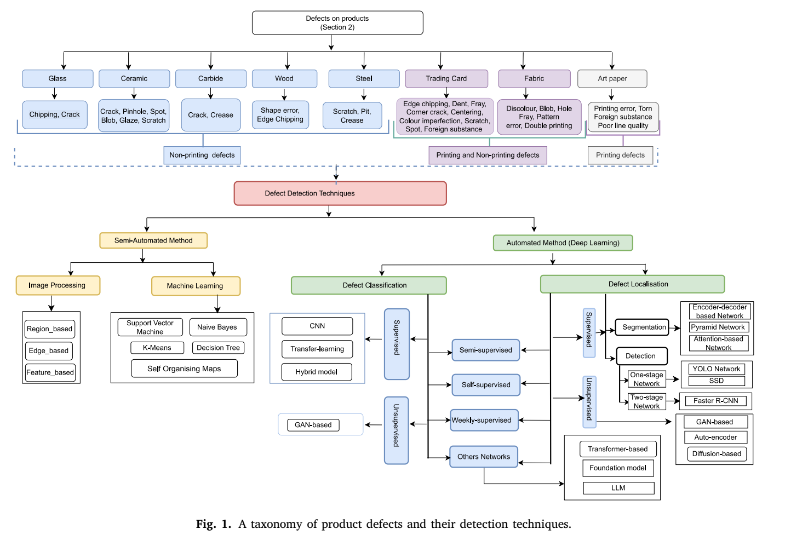

# 从工业缺陷的任务地图读到 PCB 像素分割

整理：2026-11-16。原文：Nahar 等，*AI-enabled defect detection in industrial products: A comprehensive survey, key insights and future research challenges*，Advanced Engineering Informatics 69（2026）；首页注明2025-11-18在线发表。这里解释这份综述的组织与本课题的关系，不把它当作截至今天的最新检索。

[原论文 PDF](<AI-enabled defect detection in industrial products_ A comprehensive survey, key insights and future research challenges.pdf>)｜[已有中文译文](full_translation_zh.md)｜[研究主文档](../../../research/thesis-research-and-study-guide-zh.md)｜[论文阅读总报告](../../261107/research-plan-and-paper-reading-report-zh.md)

## 它能帮我回答什么

这是一篇跨材料、跨任务的工业视觉缺陷综述，涉及玻璃、陶瓷、钢材、木材、织物和印刷品等对象。它既讨论传统图像处理和机器学习，也讨论深度学习，重点不是提出一个新网络，而是把“产品有什么异常、用什么图像、产生什么输出、需要什么监督”放在同一张地图上。第2节介绍缺陷和成像，第3—4节整理传统流程，第5节按分类、分割、检测讨论深度方法，第6节补充其他网络，第7—8节做统计和展望。

对《PCB外观缺陷检测方法研究》最有用的问题是：为什么当前应称为监督缺陷分割，为什么多尺度与局部细节是有前人依据的候选，以及为什么可解释性不能只靠彩色热图。本文能支持背景和方法族定位，不能代替PCB专门文献，更不能直接证明DINO加局部分支合适。跨材料的共性是局部异常与正常结构可能混淆；不同材料的周期性、反光、尺寸与标注条件又决定同一模块未必有同样效果。

## 用原图建立三个互相独立的坐标

来源：原论文 **Fig. 1，PDF实际第3页**，原页节选，未重画。[裁剪记录](reading-figures/sources.json)。

先看上半部：不同材料对应裂纹、凹坑、边缘损坏、颜色和印刷异常等外观。这回答“观察对象是什么”，不是给每种缺陷指定唯一算法。再看中间的传统半自动方法与深度自动方法：它区分特征和判别流程如何获得。最后看右下部：classification、segmentation、detection是输出任务，supervised、unsupervised等是训练条件，encoder–decoder、pyramid、attention则是结构机制。**这些分类轴相交，不能读成互斥的单选树。**监督分割网络可以同时有编码器—解码器、多尺度融合和注意力。

把自己放进图里：PCB1是对象坐标；真实像素mask是监督坐标；背景/缺陷逐像素输出是分割坐标；SegFormer是结构实例。DINO的自监督预训练属于表征来源，若下游用真实mask训练头，下游依然是监督分割。正常参照如果参与得分，是判别机制的改变，不能由预训练方式直接推出。这张图的价值是防止混用概念，而不是按方框位置评判先进程度。

图中“自动”也不能理解为系统不需要人。数据采集、标注、选模、阈值和质量复核仍可能需要人工。“传统”同样不意味着只能输出图像标签：阈值和形态学也能产生像素区域。阅读时要把组织术语还原为输入和计算，不要照搬为技术优劣判断。

## 三条路线怎样产生结果

### 构造特征，再判断是否异常

第4节的传统流程是成像→去噪/增强→边缘、纹理或区域特征→规则或分类器。以划痕为例，局部方向性与灰度变化可以形成描述子，再由阈值或分类器判断是否偏离正常。优点是每一步处理对象清楚，少量数据下也可能有效；局限是“哪些纹理是背景”通常由人预先规定，换光照或材料后，特征可能首先响应正常变化。

联系PCB时，不能立即得出“加Canny”的结论：线路、字符和引脚本身有大量正常边缘。若边缘响应在正常结构上同样强，增强操作会同时放大误报。可借用的思维是追踪处理前后的信息变化：缺陷在输入缩放后已经消失，还是仍可见但判别失败？前者是几何和数据问题，后者才可能由特征或头改善。混在一起会错误地把所有收益归给新增模块。

### 通过监督分割学习缺陷像素

第5.2节将分割归为编码器—解码器、多尺度金字塔与注意力等路线。编码器逐步汇聚纹理和上下文，解码器将粗网格特征转成较密预测；跳接把早期细空间信息送到输出端。核心矛盾是降采样利于扩大感受野，却可能将细线缺陷与正常区域平均。上采样增加网格密度，但不保证找回已经丢失的真实细节。

多尺度融合让细网格边界与粗网格语义相遇。PCB上单看一个深色小块可能像正常印字，扩大上下文才知道它是否处于缺件位置；只看粗上下文又可能漏掉极细破损。局部分支的候选价值在于补充细节，并让上下文约束它。但更多特征也可能传入更多纹理噪声，应与简单融合、相近容量卷积头及尺度调整比较，判断收益来自细节机制还是增加参数。

注意力通过通道或位置权重改变信息贡献，可以加强有用响应，也可能放大偏差。已有注意力骨干上再加注意力，需要新的问题证据；“背景复杂”只能说明挑战存在，不能证明某个设计必要。权重图描述中间计算，若没有对最终得分的忠实性核验，不能直接称为解释。

### 描述正常模式，再判断偏离

无监督和生成式路线中，重构模型学习正常外观，测试时比较输入与重构；合成方法还可扩充训练样本。重构检测的直观理由是正常结构容易还原，未见缺陷较难还原，残差于是可能标出异常。是否成立取决于正常结构是否也重构失败、缺陷是否被一并复制。**残差是模型误差，不天然是缺陷真值。**

另一种正常建模用预训练特征或正常样本描述正常范围，再比较距离。这与工作二更接近，但本综述不能代替PatchCore、DINOSaur等机制原文。还需核对特征提取位置、正常库构造、空间限制与得分聚合。若展示的正常块并未参与评分，而得分来自独立分割分支，展示就不能说明模型采用了这个参照。

## 表格如何支持论述

第5.2节和表11可作为分割文献索引。先看Object与Dataset，再看Model和Function，最后看Accuracy列。该列混有accuracy、IoU、F1、AP、mAP，材料、样本与任务也不统一；它适合说明某条思路用于哪些问题，不适合按最高数字选冠军。像素accuracy尤其容易被正常背景数量主导，不能与前景IoU混读。

对特别想引用的单行，应回到被引原论文。综述压缩了网络、任务和数据条件，引用对应或任务命名也可能不够精确。写作若要用确切性能，需核实原实验表、划分和指标定义。因此这里保留机制和线索，不将二手数字搬成PCB1的性能目标。

第7节的方法占比和时间趋势描述的是作者检索集合，不能证明所有工业场景采用相同路线；发表数量也不等于成熟度。第8节的可靠性、校准和人在回路讨论，则帮助区分“分数高”“概率可信”和“判别依据可核验”。这三件事需要不同证据，不能用一项总体精度全部覆盖。

## 已填写的PCB分析案例

以下是学习用假设案例，不是新增实验事实：微小缺陷漏分，附近正常字符却有误报。

| 观察问题 | 综述给出的分析线索 | 当前可形成的核验 |
| --- | --- | --- |
| 512输入中缺陷是否仍存在 | 成像、缩放与网络损失是不同环节 | 对照原图、letterbox图和mask，先看信息与标签 |
| 细节分支为何可能有效 | 细网格补局部线索，粗特征提供上下文 | 先建DINO简单头，在train/val按尺度与结构分组 |
| 字符为什么被误判 | 局部异常纹理可能与正常结构相似 | 查参照是否属于同类结构，不只看距离 |
| 热图命中是否算解释 | GT重叠支持定位相关性 | 说明实际评分路径，比较证据与随机干预 |

这个案例给出的是可验证问题，没有替自己选定模块。SegFormer已完成，DINO简单头、局部支路和正常参照未做，不能把综述中的多尺度收益写成自己方案的结果。解释工作不以IoU必须上涨为定义，但需报告它对定位和成本的影响，才知道核验依据付出了什么代价。

还可以练习一个反例：新增细节支路后，缺陷召回提高，但正常引脚边缘误报更多。该结果并不立即否定细节思想，因为它可能改善了信息保留，却没有提供足够的结构判别；也不能只报召回宣布成功。应同时看原图前景IoU、正常误报、各类失败与增量成本。如果简单提高输入尺度获得相近收益，那么复杂适配的必要性尚未建立。这正是从“模块有用”走到“为何需要这个模块”的差别。

## 分三次阅读并留下答案

第一遍读第2节、图1和第5.2节，画出输入→表示→像素输出，讲清encoder、decoder、pyramid和attention的角色。第二遍读表11，选择与细节或正常背景混淆相关的原论文，记录改变的是特征、融合还是训练。第三遍读第8节，为可解释性整理评价维度。分类与YOLO历史可在写背景时回查，不必逐个背模型。

**问：本文证明预训练特征优于SegFormer吗？**不能，当前需要同划分、尺度和标注预算的直接对照。**问：标注昂贵是否意味着应改normal-only？**它是领域动机，当前已有mask的监督任务仍合理，协议改变需要另行讨论。**问：精度与可信性是否天然是两项贡献？**它们是目标，贡献还需明确问题、机制、比较和适用范围。

阅读后的有效表述是：本课题在PCB外观场景中研究监督像素分割，拟考察预训练表示适配和判别依据核验；多尺度、注意力及正常建模均有前人基础，具体收益和机制差异尚待实验。能够准确说明已有基础和待验证部分，比记住综述中的几十个名称更接近读懂。

