# 工业视觉异常检测深度学习综述

作者：Zhuo Li¹、Yuhao Yan¹、Xiangheng Wang¹、Yifei Ge¹、Lin Meng²。

¹ 日本滋贺，立命馆大学理工学研究科。² 日本滋贺，立命馆大学理工学部。通讯作者：Lin Meng，menglin@fc.ritsumei.ac.jp。

《Artificial Intelligence Review》，2025年，第58卷，文章号279。接收：2025年5月30日；在线发表：2025年6月14日。© 作者，2025年。DOI：[10.1007/s10462-025-11287-7](https://doi.org/10.1007/s10462-025-11287-7)。

原文：[A survey of deep learning for industrial visual anomaly detection.pdf](<A survey of deep learning for industrial visual anomaly detection.pdf>)。

> 翻译说明：依照原论文82页的章节结构组织，正文按完整段落排布。模型、数据集、作者、公式变量及文献标识保留。图中英文标签另附中文释义；表格以中文表头重建。原文内部的分类、数值或排版疑点按原意保留，并以译注标示。

## 摘要

工业视觉异常检测对于保障系统的可靠性、安全性和效率至关重要。本文对当前先进的异常检测技术进行全面综述，分析其方法、实现及近期进展。本文希望帮助研究人员更快理解新兴趋势，同时为初学者提供结构清晰的基础。我们系统梳理了近期的 196 篇论文，涵盖全监督、半监督、自监督、弱监督和无监督五种学习策略。本文详细介绍十二类工业异常检测方法，说明其理论基础、技术原理和实际应用；还全面介绍工业视觉异常检测的二维与三维数据集。此外，我们对实验结果进行批判性分析与总结，确定关键性能指标，并讨论工业异常检测领域的最新趋势。除分析之外，本文还提供具有可操作性的建议，帮助为实际部署选择合适的模型。最后，本文指出开放挑战并概述未来研究方向，以推动这一不断发展的领域取得创新。详细资源见：https://github.com/IHPCRits/IAD-Survey。

关键词：深度学习；计算机视觉；工业视觉异常检测。

## 1 引言

工业视觉异常检测是现代制造业中保障产品质量、提高生产效率的关键技术。随着计算机视觉和深度学习技术的发展，该领域正从传统自动化迅速转向智能视觉检验系统。工业视觉异常检测从根本上不同于一般视觉异常检测，这主要源于工业环境提出的独特挑战。具体而言，工业视觉异常检测所处理的异常往往表现为细微的外观变化，同时缺陷样本有限，对检测准确性和实时处理能力的要求严格。相比之下，一般视觉异常检测通常涉及更多样的异常类型，而不受工业应用这些严格条件的约束。此外，工业环境中的异常经常具有特定的结构和语义特征，例如轻微的表面缺陷、精确的尺寸偏差或逻辑错位，标准视觉异常检测方法难以捕捉这些特征。实际工业环境固有的条件给工业视觉异常检测带来多项挑战。首先，异常标注数据稀缺乃至完全缺失，增加了采用监督学习的难度，需要开发有效的无监督或半监督技术。其次，制造条件的变化，包括照明、相机角度及环境因素的变化，会显著影响产品的视觉外观，因此异常检测方法必须在不同运行条件下保持稳健。第三，工业数据集通常严重不平衡，正常样本远多于异常样本，导致模型难以准确刻画异常而不产生过多误检。最后，传感器缺陷或恶劣环境条件造成的高水平图像噪声，会进一步增加检测难度。随着生产工艺日趋精细、生产线速度不断提高，人工检验已无法同时满足效率和准确性的要求，因而对高精度、自动化、自适应视觉异常检测技术的需求不断增长。近年来，基于深度学习的方法已成为该领域的主流范式，在多个基准上取得显著成绩。然而，数据类型、检测任务和模型架构的多样性使研究呈现碎片化。尽管已有这些进展，仍缺少对现有方法进行全面组织、分类和比较的系统综述。因此，本文对近期基于深度学习的工业视觉异常检测方法进行结构化、深入的综述。

近期，Li等（2023）全面且系统地综述了先进的可解释异常检测技术，依据各项技术关键方面的特征提出分类体系，旨在帮助实践者与研究人员选择适合自身需求的方法。Cao等（2024）综述视觉异常检测的挑战、方法与前景，在概述背景和概念定义的同时，从样本规模、数据模态和异常层次三个角度系统分类、梳理并讨论近期进展。Liu等（2024）从神经网络架构、监督程度、损失函数、评价指标和数据集等方面，全面综述基于深度学习的图像异常检测技术。Lin等（2024）综述无监督工业异常检测中的RGB、三维和多模态方法，对这三种模态环境下的无监督工业异常检测进行全面总结。这些综述提供了有价值的见解，但主要关注一般图像异常检测、特定学习范式或单一数据模态。为弥补这一不足，并针对实际工业应用提供更完整的视角，本文对基于深度学习的工业视觉异常检测进行全面综述。具体而言，我们深入研究相关方法与应用，覆盖全监督、半监督、弱监督、自监督和无监督五种学习范式，并系统讨论缺陷样本稀缺或标签含噪场景下的解决方案。除主要深度学习范式外，我们还汇编和分析开源资源，包括常用数据集、性能指标、公开代码库及基准比较，以促进结果复现、增强实际相关性并提高研究效率。我们还依据学习策略提出工业视觉异常检测方法的结构化分类，使其与实际标注条件和部署约束相对应。全文重点介绍该领域有影响力的工作。本研究旨在全面分析最新进展，覆盖图像级与像素级两种检测粒度：前者将整张图像分类为正常或异常，后者定位异常区域。此外，我们还研究多类别异常设置下的方法。本文贡献总结如下：

- 依据学习策略与监督程度系统组织现有研究范式，根据可获得的标注类型提供准确的方法指导。

- 全面分析工业异常检测方法，重点说明其在实际生产环境中的适用性与局限性。

- 总结该领域的关键挑战和研究空白，提出有前景的未来研究方向，为进一步发展提供支持。

图1展示全文组织结构。第2节从学习方式与实现技术两个方面，深入且系统地综述基于深度学习的工业异常检测；第3节总结工业视觉异常检测数据集；第4节介绍评价指标和实验结果；第5节展望该领域的挑战与未来方向；最后，第6节总结本综述。

## 2 用于工业视觉异常检测的深度学习

为提供结构清晰且连贯的工业异常检测方法概览，本文从学习策略和方法实现两个互补视角对文献进行分类。第一种视角关注监督程度，包括全监督、半监督、弱监督、自监督和无监督学习，反映不同工业场景中标注数据的可用性。第二种视角关注方法的核心特征，例如重建模型、特征嵌入、生成建模和检测策略。实际方法往往处于这两个维度的交叉位置。例如，无监督方法可以采用特征嵌入机制，也可以利用GAN或扩散模型等生成模型。通过采用这种双轴框架，本综述希望更完整地呈现工业视觉异常检测的技术全貌，并为研究人员理解和选择合适方法提供多条路径。

### 2.1 异常检测学习策略

在工业视觉异常检测的不同学习范式中，标注数据的构成显著不同。全监督方法依赖完整细致的标注，即正常样本及全部已知缺陷类别的像素级或实例级标签，标注成本最高，但缺陷语义信息最准确。半监督场景中，只有少量正常和异常图像得到完整标注，大规模未标注数据则同时包含正常图像与未知缺陷图像。模型通过将少量高质量标注与大量原始数据结合，平衡标注成本与性能。自监督方法只为正常图像统一赋予“正常”标签，不需缺陷标注；必要时可以引入更多未标注正常图像，通过前置任务学习更丰富表示。弱监督方法仅使用正常与异常样本的粗粒度图像级OK/NG标签，无需像素或实例标注，显著降低人工成本，但也带来定位精度低、标签噪声等问题。无监督方法完全依赖正常样本的标注，所有正常图像只标为“正常”，不含缺陷信息；模型通过识别偏离正常分布的情况检测异常，但阈值确定及误检控制更困难。表1总结不同监督策略在工业视觉异常检测中的优点、局限与应用场景。

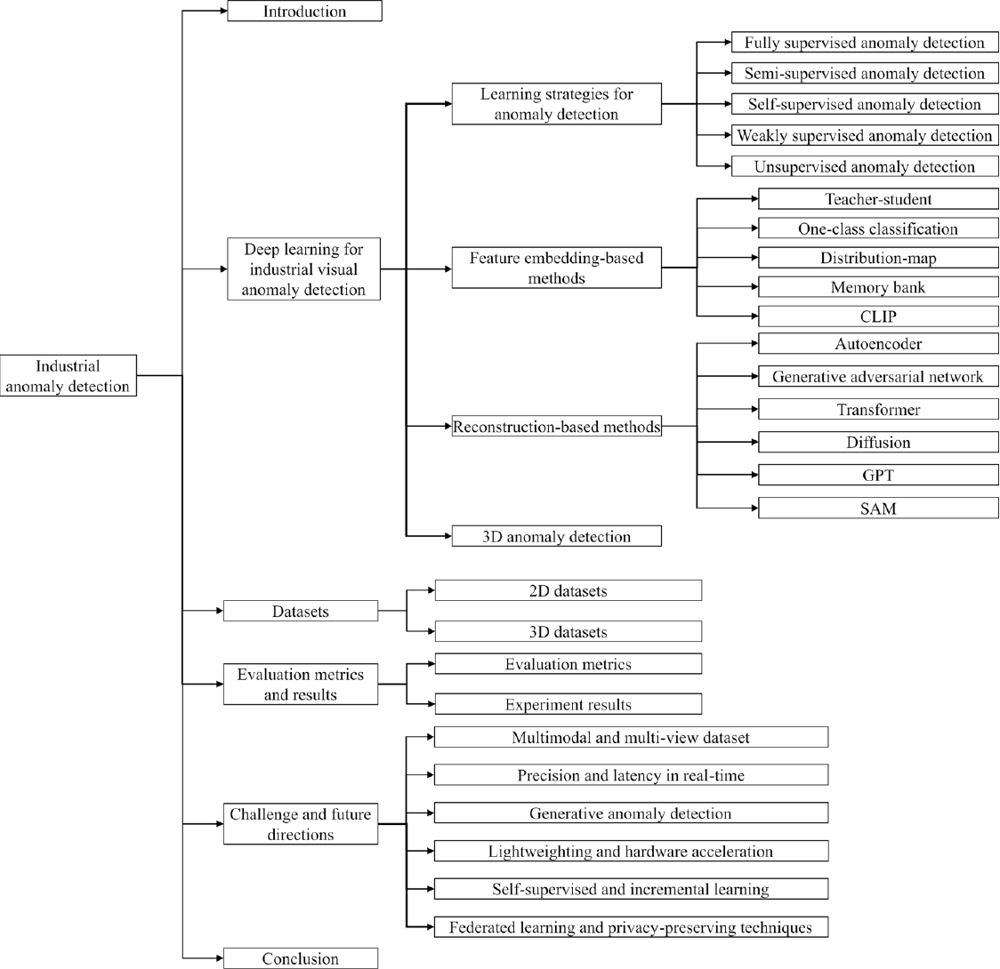

**图1** 工业异常检测综述的组织结构，展示各节覆盖的学习策略、方法、数据集及未来方向等主要主题。

图中文字释义：Introduction：引言；Industrial anomaly detection：工业异常检测；Deep learning for industrial visual anomaly detection：工业视觉异常检测的深度学习；Learning strategies for anomaly detection：异常检测学习策略；Fully/Semi/Self/Weakly/Unsupervised anomaly detection：全监督／半监督／自监督／弱监督／无监督异常检测；Feature embedding-based methods：基于特征嵌入的方法；Teacher-student：师生模型；One-class classification：单类分类；Distribution-map：分布图；Memory bank：记忆库；Reconstruction-based methods：基于重建的方法；Autoencoder：自编码器；Generative adversarial network：生成对抗网络；Diffusion：扩散；3D anomaly detection：三维异常检测；2D/3D datasets：二维／三维数据集；Evaluation metrics and results：评价指标与结果；Experiment results：实验结果；Challenge and future directions：挑战与未来方向；Multimodal and multi-view dataset：多模态与多视角数据集；Precision and latency in real-time：实时精度与延迟；Generative anomaly detection：生成式异常检测；Lightweighting and hardware acceleration：轻量化与硬件加速；Self-supervised and incremental learning：自监督与增量学习；Federated learning and privacy-preserving techniques：联邦学习与隐私保护技术；Conclusion：结论。CLIP、GPT与SAM释义见图2。

本小节概述工业视觉异常检测采用的各类监督学习方法。第2.1.1节介绍全监督学习，第2.1.2节介绍半监督学习，第2.1.3节讨论自监督学习，第2.1.4节详述弱监督学习，第2.1.5节探讨无监督学习。

**表1 不同学习策略下工业异常检测方法比较**

| 学习策略 | 优点 | 局限性 | 典型应用场景 |
| --- | --- | --- | --- |
| 全监督异常检测 | 精度高，标签明确 | 标注成本高，难以应对新异常 | 已知异常类型，要求高精度 |
| 半监督异常检测 | 结合少量标注和大量未标注数据，提高检测效果 | 标注与未标注数据的平衡复杂，性能依赖未标注数据质量 | 标注样本稀缺 |
| 自监督异常检测 | 结合少量标注和大量未标注数据，提高检测效果 | 标注与未标注数据的平衡复杂，性能依赖未标注数据质量 | 标注样本稀缺 |
| 弱监督异常检测 | 使用低质量或不完整标注，降低标注成本 | 低质量标注影响性能，需处理标签噪声 | 样本标注不准确 |
| 无监督异常检测 | 无需标注数据，自动识别未知异常 | 错误率较高，难准确界定异常 | 标注成本高 |

【译注：原表的自监督行与半监督行文字相同，此处按原表保留。】

#### 2.1.1 全监督异常检测

尽管全监督异常检测具有检测精度优势，但对大量标注数据的依赖及有限的泛化能力限制了其实际应用。此外，工业缺陷通常呈长尾分布，某些关键缺陷样本极少，仅占全部样本的一小部分。为解决这些问题，近期研究着重降低标注成本、提高泛化能力并实现实时检测，以增强方法的实用性和有效性。针对数据不平衡，现有方法主要从损失函数重加权和样本级重采样两个方面入手。前者如焦点损失和类别平衡损失，增加困难或少数类别样本的梯度贡献，使模型更有效地关注这些样本；后者采用困难样本挖掘、类别平衡批采样、少数类别过采样，以及利用GAN或扩散模型合成缺陷等技术，增加稀有缺陷的有效训练暴露。YOLOv3-Tiny、YOLOv5和YOLOv8等YOLO系列方法因其速度与准确性，已广泛用于全监督工业异常检测（Yuan等，2022；Zhou等，2023；Song等，2024）。为进一步改善YOLO系列的表现，Yuan等（2022）通过优化YOLOv3-Tiny网络结构、改进损失函数并采用数据增强和预处理，显著提高表面缺陷检测准确性与效率。Zhou等（2023）将CSP模块和全局注意力机制引入YOLOv5，改善金属表面小目标缺陷检测的准确性与速度。Song等（2024）提出改进的YOLOv8钢材表面缺陷检测模型，通过整合可变形卷积、双向特征金字塔网络和BiFormer注意力机制，并将损失函数改为WIoUv3，实现更有效的多尺度特征融合和自适应注意力分配。这些改进显著提升检测准确性和泛化性能，尤其适用于复杂纹理与不规则形状缺陷。

#### 2.1.2 半监督异常检测

半监督学习使用少量标注数据和大量未标注数据进行协同训练与预测（Cai和Gao，2023）。半监督框架中的标注与未标注数据集通常严重不平衡：已标注缺陷远少于正常样本，无法覆盖所有缺陷类别。主流方法首先依据置信度为未标注样本生成伪标签，再进行一致性正则化或知识蒸馏。为避免伪标签进一步加剧不平衡，研究人员提出自适应重加权和不确定性感知采样策略，在训练过程中动态提高高置信度少数类别样本的贡献。此外，对已标注异常应用MixUp或CutMix等半合成缺陷插值，可增加稀有缺陷的表观变化。半监督学习尤其适合标注数据稀缺、缺陷难以获取或标注的工业场景。通过学习正常样本的分布，或利用有限的已标注异常样本，半监督学习可以有效识别异常。例如，Akcay等（2019）提出基于条件生成对抗网络的GANomaly，通过联合学习图像空间生成与潜在空间推断实现有效异常检测。Rudolph等（2021）提出半监督缺陷检测方法DifferNet，解决制造过程中缺陷样本稀缺且特征未知所带来的挑战。DifferNet利用卷积神经网络提取图像特征，并通过归一化流对多尺度特征进行密度估计，结合多变换评分实现高精度缺陷检测与定位。该模型训练只需少量样本，因此在难以获取大规模缺陷数据的工业场景中具有较高实用价值。Yang等（2023）提出MemSeg，用于工业产品图像中的高精度实时表面缺陷检测。MemSeg利用合成样本和记忆样本辅助学习，将多尺度特征融合与空间注意力机制结合，把半监督检测过程转化为端到端语义分割任务，显著增强模型区分正常与异常模式的能力，实现高效准确的缺陷检测。Yao等（2023）提出半监督场景下的边界引导对抗学习方法BGAD，通过学习已知异常边界并有效降低这些异常带来的偏差，增强模型的判别能力。

#### 2.1.3 自监督异常检测

自监督学习已成为工业异常检测的重要范式，尤其适用于标注数据稀缺、含噪或获取成本高的情形。不同于依赖详细标注的传统监督方法，自监督方法通过在未标注数据上设计前置任务，自动产生监督信号。图像恢复、对比学习、特征增强和序列预测等常见任务，使模型能够学习稳健且信息丰富的特征表示，减少对标注样本的依赖并提高泛化能力。在工业领域，自监督学习具有多方面作用：（1）无需异常标注即可从丰富的正常样本有效学习；（2）通过建模正常数据的内在结构，帮助发现此前未见的缺陷；（3）增强模型对复杂实际环境中多样且不断变化的缺陷模式的适应能力。

尽管当前深度学习模型在已知缺陷类型上表现良好，面对训练期间未出现的未知缺陷时，性能往往下降，主要因为其学习高度依赖训练数据分布。为解决这一问题，研究人员提出多种泛化增强策略。一方面，CutPaste（Li等，2021）和PatchSVDD（Yi和Yoon，2020）等自监督方法通过构造伪异常样本或利用局部图像结构学习特征，在无需标签的情况下提高未知缺陷识别能力。另一方面，DifferNet（Rudolph等，2021）和MemSeg（Yang等，2023）等半监督方法，通过结合流模型、记忆机制及少量已知异常，提高新缺陷的可辨识性。近期，具有更强表示能力的扩散模型，以及引入语言先验的对比学习方法，例如WinCLIP（Jeong等，2023），也被广泛用于提高模型对未知异常的泛化能力，为工业场景中不断变化的缺陷形态提供可扩展检测方法。

自监督学习通过在未标注数据上设计前置任务，自动产生监督信号（Hojjati等，2024；Li等，2024；Luo等，2022；Tsai和Wang，2023；Wei等，2025；Bin和Wang，2024；Huang等，2024；Qin等，2024；Bauer等，2024；Lijie等，2024）。工业异常检测中的自监督学习通过建模正常样本特征，实现有效的异常识别与定位，尤其适合异常样本稀缺、数据分布复杂的应用。

自监督训练阶段只使用正常图像。然而，在构建前置任务时，掩码、旋转和颜色扰动等不同变换之间可能存在一定的“类别”不平衡，导致模型对部分变换过于敏感。常见解决策略包括引入记忆队列，确保对比学习中存储的特征向量均匀覆盖各种增强视图；在重建任务中采用随机掩码率采样，以及平衡不同变换的调度方案。这些技术帮助模型对不同潜在异常模式维持均衡表示能力。虽然它们不直接生成缺陷样本，但能够提高模型对多类异常的稳健性与泛化能力。

Yi等（2020）提出PatchSVDD，提高图像异常检测定位能力。它区别于传统SVDD，采用自监督学习，使模型自动聚合同语义图像块，从而更好识别异常，并以分层编码、多尺度检测融合不同尺度结果，提高准确性。Li等（2021）提出CutPaste，仅用正常样本训练高性能缺陷检测模型，通过裁剪正常图像部分并随机粘贴至另一图像，模拟缺陷、构建伪异常训练样本。CutPaste采用两阶段框架：先学习正常数据深度表示，再用生成式单类分类区分正常与异常模式；它还可扩展至图像块级表示学习，无需标注即可精确定位高分辨率图像缺陷。Zou等（2022）提出“找不同”自监督预训练SPD，以平滑局部增强和SPD训练策略解决现有自监督方法局部敏感性不足，显著改善异常检测与分割。Ristea等（2022）提出新型自监督预训练卷积注意力模块，以有效重建并识别异常样本。该方法通过掩码或移除部分输入并预测缺失信息来训练模型，将重建误差用作异常指标。Madan等（2023）提出自监督掩码卷积Transformer模块SSMCTB，解决传统异常检测方法捕捉全局结构特征不足的问题。SSMCTB在神经网络任意层遮挡输入信息，以三维卷积和Transformer模块重建掩码数据，仅从正常样本学习，无需异常样本。Cai等（2023）提出创新且稳健的差异感知异常检测框架DAF，改善过度依赖合成数据外观的现有自监督方法。尽管传统自监督方法表现良好，其对合成数据的敏感性往往限制实际泛化能力。因此，DAF引入师生网络生成与外观无关的差异图作为引导，并将分割解码器与辅助头结合，准确定位异常。

Tien等（2023）重新审视Deng和Li（2022）的反向蒸馏技术，提出RD++。该方法在正常图像中加入随机噪声模拟伪异常，增强对异常的泛化能力，并引入多投影层学习不同尺度的局部表示。此外，采用自监督最优传输损失进一步压缩特征空间，使正常图像特征分布更加紧凑。最后，RD++在多任务学习框架中结合对比损失与重建损失，在压缩正常样本特征分布的同时抑制异常信号，在多个数据集上实现高精度异常检测、定位及实时推理。Yoo等（2023）提出ST-SSAD，在无监督场景中系统调节数据增强超参数。该框架将数据增强策略与模型调参结合，通过无监督验证损失和可微增强函数自动、高效地调节异常检测模型。由于不依赖标签，ST-SSAD尤其适合难以获得标签的异常检测任务。Zuo等（2024）提出自监督域适应方法ReconFA，解决预训练CNN特征与目标数据域不匹配的问题。ReconFA设计自监督多尺度特征聚合策略，将多尺度聚合模块与特征重建任务结合，使预训练特征有效适应目标域，显著提升异常检测性能。Li等（2024）提出IMRNet，解决实际数据不足导致现有三维异常检测模型可扩展性受限的问题，通过迭代掩码重建与特征比较，高效检测和定位三维点云中的异常区域。Zhang等（2024）提出特征选择网络RealNet，通过生成逼真且多样的合成异常样本，应对现有工业图像异常检测方法面临的困难。RealNet包含三个模块：强度可控扩散异常合成（SDAS）产生不同异常强度的合成样本；异常感知特征选择（AFS）帮助选择有代表性的预训练特征子集；重建残差选择模块（RRS）则自适应筛选有助于异常定位的重建残差。通过三个模块协同工作，RealNet在异常检测任务中取得出色表现。Tu等（2024）提出从局部到全局的自监督特征适配方法LSFA，通过微调适配器学习适用于异常检测任务的特征表示。其核心是解决预训练模型的源数据与目标工业数据之间的域差异，通过模态内特征紧致性优化（IFC）和跨模态局部-全局一致性优化（CLC）改进特征表示。IFC通过动态更新记忆库，在局部图像块与全局原型两个层级优化特征紧致性，使正常特征更加集中，提高对异常的敏感性。CLC则通过对比学习对齐RGB图像与三维点云等不同模态的特征，增强多模态信息交互，确保局部和全局层级上的跨模态一致性。LSFA使用预训练视觉Transformer与点Transformer提取特征，并引入适配器微调预训练特征，使其适应具体异常检测任务。

总体而言，自监督学习通过利用正常数据的内在结构，在降低标注成本的同时实现可扩展且具有泛化能力的异常检测，因此尤其适用于变化较大、监督有限的工业场景。

#### 2.1.4 弱监督异常检测

弱监督学习能够减少对精细标注数据的依赖，降低标注成本，提高检测自动化程度与准确性，尤其有利于数据分布复杂且异常样本稀少的情况，为实际工业应用提供高效灵活的解决方案（Shenxing等，2023；Wang等，2024）。为减轻模型偏向正常样本的问题，常用热图重加权多实例学习：为NG图像中得分最高的图像块分配较大权重，鼓励模型关注潜在缺陷区域。也可以在局部合成伪缺陷，丰富负样本多样性。与此同时，伪标签自举可以迭代细化NG样本中的缺陷区域，逐步平衡有效正负图像块的数量，提高定位精度。Ding等（2022）提出基于解耦表示学习的异常检测方法DRA，利用有限的已标注异常样本检测已知和未知异常类型。DRA学习已知异常、伪异常和潜在残余异常等多种解耦异常表示，显著提高对不同异常的泛化能力。Zhang等（2023）提出原型残差网络PRN，以应对工业异常检测与定位中的数据稀缺、异常细微难辨及外观变化等挑战。PRN学习异常模式与正常模式之间的残差，结合多尺度原型和多维自注意力机制重建异常区域分割图，从而准确检测并定位不同大小、形状和数量的异常区域。此外，PRN纳入多种异常生成策略，扩充并增加异常样本的多样性，进一步提升泛化能力，实现高效检测与精确定位。Xie等（2024）提出IM-IAD基准，解决工业图像异常检测缺少统一评价基准的问题。IM-IAD评估不同监督程度、学习范式和效率要求下各类算法的表现，在七个数据集及多个算法上开展大规模实验，为改进算法和确定后续研究方向提供参考。

Zhu等（2024）提出异常异质性学习AHL，即使在开放集异常检测设置下只有少量异常样本，也能检测训练中未见异常。现有方法常假设异常同分布，泛化因而受限；AHL建模多样异常分布，协同训练判别模型，学习适合不同新领域的统一模式，有效检测类型多样的异常。Cao等（2024）提出BiaS，解决无监督图像异常定位方法在监督任务中易过拟合、不能有效利用已知异常信息的问题。BiaS先产生已知与未知异常的有偏知识，再传递给两个专门学生网络，通过将无监督方法提升至近似监督水平，改善开放世界检测的性能与泛化。Rolih等（2024）提出节省内存的分块集成TE，解决高分辨率工业小异常检测的内存消耗问题；它把高分辨率图像分成小块，每块训练独立模型，显著减少内存，并用重叠分块策略提高性能。Božič等（2021）提出融合全监督与弱监督的混合监督方法，减少对精细标注的依赖，灵活适应不同标注粒度。该方法包含两个子网络，分别用于像素级缺陷分割和图像级缺陷分类；即使仅依赖弱标注，也能获得接近全监督模型的检测表现，同时显著降低对准确标注的依赖和标注成本。

#### 2.1.5 无监督异常检测

与需要异常样本标注的监督学习相比，无监督异常检测通过挖掘数据自身的模式识别异常，无需依赖任何缺陷标签。训练数据可以全部为正常样本，也可以为未区分正常与异常的混合样本。所采用的方法广泛，包括密度估计、聚类、基于重建的生成方法，以及对比学习。无监督方法具有较强泛化能力，能够检测此前未见的缺陷，因此在工业视觉检验中得到有价值的应用。它利用未标注数据识别异常，从数据集中提取分布模式和特征表示（Qiangwei等，2024；Haohao等，2023）。常见思路是依据正常样本的统计特性或生成模型构建正常模式表示，将偏离该模式的情况判为异常。无监督学习尤其适合正常样本大量、异常样本较少的检测任务，在实际应用中展现出较高自动化程度与良好检测效果，因而成为工业异常检测不可或缺的工具。数据集不平衡，即正常样本远多于异常样本，会显著影响模型训练和性能，造成决策边界偏移、对稀有事件的检测敏感性下降及较高漏检率。无监督方法通常假设训练时只有正常数据，因此常被认为适合此类场景；但缺少异常样本也会限制模型对细微或未知缺陷的泛化能力。为缓解上述问题，近期许多方法引入伪异常、异常合成或对比学习，平衡潜在特征空间，模拟稀有异常特征、提高表示可分性，增强高度不平衡环境中的稳健性。数据增强对工业视觉异常检测尤其重要，特别是在异常样本有限时；有效策略通过模拟逼真异常场景增强泛化和稳健性。例如，图像块增强（Fan等，2024）利用自监督学习合成相似异常，将无监督检测重新表述为监督目标检测，实现直接定位。RealNet（Zhang等，2024）引入强度可控扩散异常合成SDAS，生成多样逼真异常、丰富训练分布。相较翻转裁剪等传统增强，异常感知策略更关注缺陷局部变化及上下文一致性。

Wang等（2021）同时比较局部与全局特征，解决工业场景中大量异常数据难以获取和标注的问题。该方法利用Local-Net提取局部特征，利用Global-Net获取全局特征，并引入两个检测头：不一致异常检测头捕捉全局与局部特征之间的不一致，失真异常检测头发现图像块中的细微缺陷。结合两个层级的特征信息，使方法无需大量异常标注即可有效检测多种异常。Yu等（2021）提出FastFlow，以轻量二维归一化流将输入图像特征映射至标准正态分布，并将概率值作为异常分数，高效准确地检测和定位异常。McIntosh和Albu（2023）提出InReaCh，旨在消除传统图像异常检测方法对纯正常训练数据的依赖。具体而言，InReaCh关联训练集中高置信度正常图像块，构造多个通道，并据此评估新输入中的图像块，从而对包含异常的复杂图像进行高效检测与定位。Liang等（2023）提出OCR-GAN，解决传统重建方法重建能力不足造成的性能瓶颈。OCR-GAN引入频率解耦模块（FD），将输入图像分解为不同频率分布，并利用通道选择模块（CS）促进多频率分支的信息交互，显著改善基于重建的无监督异常检测。Zhou等（2024）提出多尺度流框架MSFlow，解决物体尺寸变化带来的无监督异常检测挑战。MSFlow通过异构并行流和融合流捕捉特征并在多尺度间交换信息，增强图像级和像素级检测与定位的性能及泛化能力。Yang等（2024）提出将重建视为序列的方法RAS，解决统一无监督异常检测中特征重建方法上下文感知不足的问题。RAS基于Transformer框架，引入RAS-Transformer模块增强重建时的上下文对应关系。Chen等（2024）提出渐进边界引导异常合成策略PBAS，无需辅助纹理即可定向合成关键特征级异常。PBAS包含近似边界学习（ABL）、异常特征合成（AFS）和精细边界优化（RBO）。ABL首先利用中心约束学习近似决策边界，通过特征对齐改进中心初始化，使正常样本分布更加紧凑。随后，AFS在正常特征超球面分布引导下，以更灵活的尺度合成异常。初始边界较松散，可能包含真实异常，因此RBO通过对合成异常和正常特征进行二分类，进一步细化决策边界。Radicioni等（2025）通过分析振动信号的功率谱密度准确估计链节距变化，并结合局部温度测量评估滑轨磨损，为提高工业生产可靠性与效率提供技术支持。

如图2所示，本小节详细概览工业视觉异常检测方法。第2.2节介绍基于特征嵌入的方法，包括师生模型、单类分类、分布图、记忆库、对比语言图像预训练和异常聚类。第2.3节介绍基于重建的方法，包括自编码器、生成对抗网络、Transformer、扩散模型、生成式预训练Transformer及任意分割模型。第2.4节介绍三维异常检测。

### 2.2 基于特征嵌入的方法

工业视觉异常检测中，基于特征嵌入的方法将图像数据映射到特征空间，从而有效区分异常样本。本节全面综述这类方法，依次详述师生模型（第2.2.1节）、单类分类（第2.2.2节）、分布图（第2.2.3节）、记忆库（第2.2.4节）、对比语言图像预训练（第2.2.5节）及异常聚类（第2.2.6节）。

#### 2.2.1 师生模型

如图3所示，基于师生网络的工业异常检测融合迁移学习与知识蒸馏。教师网络通常是规模较大、训练充分的模型，已从大规模数据集中学得丰富的正常数据特征表示；学生网络规模较小，通过模仿教师网络的输出进行训练。训练阶段，首先使用仅包含正常样本的数据集训练教师网络，随后学生网络以教师网络的中间输出或特征图为学习对象，通过知识蒸馏学习其特征分布。推理阶段，将待检工业图像同时输入教师与学生网络，比较两者输出差异。如果差异显著，说明图像可能存在异常。学生网络规模较小，有助于提高计算效率并减少资源消耗；同时，借助教师网络学得的丰富特征表示，学生网络能够更好地捕捉和识别异常，提高检测准确性。

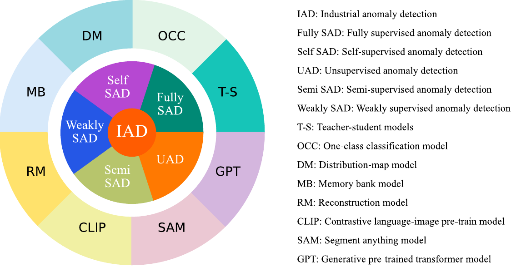

**图2** 工业视觉异常检测中，学习策略与代表性方法族之间的映射关系概览。

图中文字释义：IAD：工业异常检测；Fully SAD：全监督异常检测；Semi SAD：半监督异常检测；Weakly SAD：弱监督异常检测；Self SAD：自监督异常检测；UAD：无监督异常检测；T-S：师生模型；OCC：单类分类；DM：分布图；MB：记忆库；RM：重建模型；CLIP：对比语言图像预训练；SAM：任意分割模型；GPT：生成式预训练Transformer。

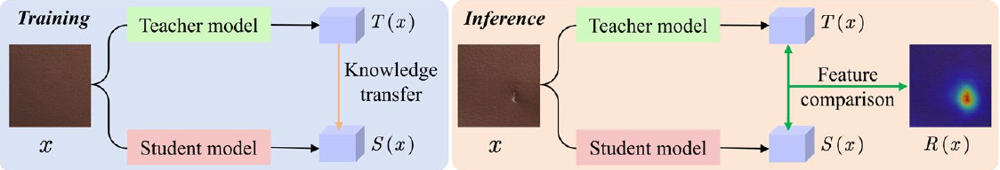

**图3** 师生模型。训练阶段：学生迭代学习并逼近教师的特征表示，实现知识迁移。推理阶段：以教师为基准，比较师生特征；当输入包含异常时，二者差异显著，从而检测并定位异常区域。

图中文字释义：Training／Inference：训练／推理；Teacher model／Student model：教师模型／学生模型；Knowledge transfer：知识迁移；Feature comparison：特征比较；$T(x)$／$S(x)$：教师／学生输出；$R(x)$：异常响应图。

教师模型$T$是预训练的高性能网络，学生模型$S$则是规模较小的网络，旨在学习并逼近教师模型输出的特征。给定输入工业图像$I$，教师模型和学生模型分别提取其特征，记为$F^T$与$F^S$。

$$
\begin{cases}F^T=T(I;\theta_T),\\F^S=S(I;\theta_S).\end{cases}\tag{1}
$$

其中，$F^T\in\mathbb{R}^{H\times W\times C_T}$和$F^S\in\mathbb{R}^{H\times W\times C_S}$为输出特征图，高度和宽度分别为$H$和$W$，$C_T$和$C_S$表示特征通道数。教师模型参数$\theta_T$固定，训练期间不更新；$\theta_S$为学生模型的可训练参数，在训练期间优化。训练阶段的目标是最小化$F^T$与$F^S$之间的差异，常用度量包括均方误差（MSE）和余弦相似度损失：

$$
\mathcal L_{\mathrm{MSE}}=\frac1{H\times W\times C_T}\sum_{i=1}^H\sum_{j=1}^W\sum_{k=1}^{C_T}(F^T_{i,j,k}-F^S_{i,j,k})^2,\tag{2}
$$

$$
\mathcal L_{\cos}=1-\frac{\sum_{i,j,k}F^T_{i,j,k}\cdot F^S_{i,j,k}}{\|F^T\|\cdot\|F^S\|}.\tag{3}
$$

如式（4）所示，有时可以将多个损失组合成复合损失：

$$
\mathcal L=\alpha\mathcal L_{\mathrm{MSE}}+\beta\mathcal L_{\cos},\tag{4}
$$

其中，$\alpha$和$\beta$为权重参数。推理时，通过度量教师模型与学生模型输出之间的差异计算异常分数。位置$(i,j)$处的特征差异记为$D_{i,j}$，定义为：

$$
D_{i,j}=\|F^T_{i,j}-F^S_{i,j}\|_2,\tag{5}
$$

其中，$F^T_{i,j}$和$F^S_{i,j}$为特征图在位置$(i,j)$处的特征向量。将所有位置的差异$D_{i,j}$映射为异常分布图$D=\{D_{i,j}\mid i=1,2,\ldots,H,\ j=1,2,\ldots,W\}$，其中$D\in\mathbb R^{H\times W}$。对异常分布图$D$进行全局归一化，计算整体异常分数：

$$
\mathcal A=\frac1{H\times W}\sum_{i,j}^{H}D_{i,j},\tag{6}
$$

当异常分数$\mathcal A>\tau$时，将图像判为异常，其中$\tau$为异常检测阈值。

具体而言，Bergmann等（2020）提出基于师生框架的无监督异常检测方法“无先验知识的学生”（US），训练学生网络模仿预训练教师网络的输出，通过分析学生网络的预测不确定性与回归误差检测异常。Wang等（2021）提出同时比较局部与全局特征的无监督方法，利用Local-Net提取图像块特征、Global-Net捕捉周围环境的上下文特征，并引入不一致与失真两个异常检测头，分别检测局部与全局特征不匹配、图像块内部细微缺陷。Salehi等（2021）提出多分辨率知识蒸馏（MKD），在只有正常样本时学习能够区分正常与异常的表示。MKD将ImageNet预训练专家网络多个中间层的特征，蒸馏至更简单的克隆网络；处理异常输入时，通过分析两个网络的特征差异进行检测与定位。Deng等（2022）提出反向蒸馏（RD），利用教师与学生编码器，由教师提取单类嵌入，学生重建多尺度表示。为提高准确性，RD引入可训练的单类瓶颈嵌入模块，将高维特征压缩为紧凑嵌入，在保留正常模式信息的同时抑制异常扰动。RD对多尺度特征进行知识蒸馏，利用余弦相似度损失量化教师与学生的激活差异，并聚合多尺度异常图计算损失，使学生模仿教师行为，实现高性能异常检测。Wan等（2022）提出基于预训练特征映射（PFM）的无监督图像异常检测与分割，通过将图像从一个预训练特征空间映射至另一个空间检测异常，并进一步提出双向PFM（B-PFM）和多层级双向PFM（MB-PFM）。B-PFM引入反向映射实现双向特征利用，提高信息效率与模型性能；MB-PFM结合多层级映射，通过多尺度融合增强复杂异常检测能力。Yamada等（2022）提出师生金字塔匹配（STPM），融合师生网络与判别网络提高准确性：学生重建正常图像特征，教师提供异常区域的特征表示。此外，STPM以异常图像产生的伪异常训练判别网络，更准确地区分正常与异常区域。Rudolph等（2023）提出非对称师生网络（AST），采用归一化流作为教师进行密度估计，训练前馈学生网络检测距离更远的异常。Cao等（2022）提出基于信息知识蒸馏的异常分割方法IKD，通过提取信息丰富的知识、提供强监督信号，缓解神经网络容量与知识不匹配导致的过拟合。为改善分割性能，IKD引入上下文相似度损失（CSL）和自适应困难样本挖掘（AHSM）。CSL捕捉正常数据流形内的上下文信息，AHSM优先选取包含有价值信息的困难样本，引导模型关注更具挑战性的情况。Gu等（2023）提出记忆引导知识蒸馏MemKD，通过存储正常数据信息，提高学生生成特征的正常性，并采用正常性表示学习策略构造正常样本集，使正常知识回忆模块无需异常数据即可学习先验知识，在推理时检索调用。Zhang等（2023）提出DeSTSeg，解决传统师生框架缺少异常数据约束、多层级特征融合依赖经验的问题。它整合预训练教师、去噪学生编码器-解码器与分割网络；通过去噪使学生对异常输入产生不同于教师的特征表示，并利用分割网络自适应融合多层级特征，显著提高检测性能。Tong等（2024）提出基于反向蒸馏的增强异常检测与定位模型EMMFRKD，利用增强多尺度特征互映射融合模块提取多尺度判别特征。此外，该模型利用坐标注意力与单类别嵌入记忆库增强异常区域表示、改善重建质量。Wu等（2024）提出自编码器知识蒸馏AEKD，通过非对称师生结构解决传统蒸馏方法的泛化问题，同时引入可训练多尺度特征融合模块抑制异常干扰，为教师与学生设计不同的数据流，扩大其异常表示差异。Gu等（2024）提出非对称师生网络ASTMFR，应对异常样本难收集的问题。它通过掩码特征再生（MFR）模块增强学生在正常样本上的特征对齐，并通过非对称结构增加测试时未见异常样本的特征多样性，缓解传统方法异常特征过于相似的问题，显著改善检测与定位准确性。

Li等（2024）提出多类别异常检测框架MCAD，在蒸馏过程中融合关系知识蒸馏，增强知识迁移和学生网络表达能力，实现高性能异常检测、定位与分类。Zhang等（2024）提出用于结构与逻辑异常检测的双学生知识蒸馏框架DSKD。局部学生关注精确重建低层特征，主要检测结构异常；全局学生学习全局关联，增强逻辑异常检测。为改善全局信息获取，全局学生引入全局上下文聚集模块（GCCB），压缩高层语义特征后恢复原尺寸，以保留最关键的全局信息。为进一步加强上下文学习，框架引入上下文亲和性损失，计算学生特征向量与教师特征图内全部特征向量的余弦相似度，将结果转化为概率分布，再用KL散度量化师生分布差异，优化全局学生的特征学习。Batzner等（2024）提出EfficientAD，平衡计算效率与检测性能。该方法引入轻量特征提取器和师生网络，检测异常特征、识别逻辑异常；从编码器继承的师生网络在低延迟、高吞吐量下实现高精度检测，以毫秒级延迟准确识别结构和逻辑异常。Zhang等（2024）提出特征蒸馏学习方法FCACDL，解决师生网络特征表示与检测表现受教师网络限制的问题。它采用视觉Transformer主干，融合中心特征策略、自注意力掩码策略与多视图一致性约束，通过特征蒸馏和自监督学习提高视觉异常检测性能。Liu等（2024）提出双建模解耦蒸馏DMDD，解决现有知识蒸馏异常检测方法的过度泛化问题。DMDD构建解耦师生网络，引入正常蒸馏与异常蒸馏组成的双模式蒸馏策略，提高准确性和稳健性；同时采用多感知分割网络优化异常图融合。

#### 2.2.2 单类分类

单类分类是介于自监督或无监督学习与弱监督学习之间的一种过渡范式。训练时与无监督学习类似，只涉及正常样本，但其目标函数显式学习单类边界以区分潜在异常，而非仅进行重建或密度估计。因此，单类分类在标注成本接近无监督学习的同时，可获得接近监督方法的判别性能，是工业应用中较具成本效益的策略。如图4所示，单类分类指训练时只知道一个类别，通过学习该类别数据点在特征空间中的分布，判断新数据点是否属于同一类别。它仅关注识别单个类别内的数据点，无需预先了解多个类别。其核心思想是学习包围正常样本特征空间的边界或概率分布，将偏离该边界的样本识别为异常。常见单类分类方法包括基于边界和基于概率分布的模型。支持向量数据描述（SVDD）是代表性算法，通过构造包围全部训练样本的最小超球面，对新数据点进行分类：球内数据点为正常，球外数据点为异常。对于输入工业图像$I$，特征表示$f$定义为：

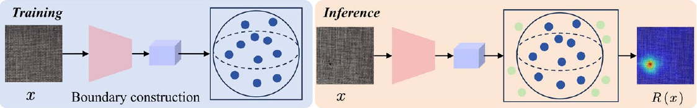

**图4** 单类分类方法。训练阶段：仅使用正常样本，在特征空间建立包围正常数据点的边界。推理阶段：对验证数据进行相同特征提取，与学得边界比较；边界内为正常，边界外为异常。

图中文字释义：Training／Inference：训练／推理；Feature extraction：特征提取；One-class classification／Classifier：单类分类／分类器；Normal／Anomaly：正常／异常；Decision boundary：决策边界。 Boundary construction：边界构建；$x$：输入图像；$R(x)$：异常响应图。

$$
f=E(I;\theta_E),\tag{7}
$$

其中，$E$为特征提取网络，$\theta_E$为其参数，$f\in\mathbb R^d$表示图像的特征向量，$d$为特征维数。SVDD的目标是寻找半径$R$最小的超球面，以包围正常样本的特征向量。

$$
\min_{R,c}\;R^2+\frac1{\nu N}\sum_{i=1}^N\xi_i,\tag{8}
$$

约束为$\|f_i-c\|^2\le R^2+\xi_i$，$\xi_i\ge0$，$\forall i$。其中，$R$和$c$分别为超球面的半径与中心；$\xi_i$为松弛变量，允许部分样本位于超球面外；$\nu$控制松弛变量的权重；$N$为正常样本数。异常分数定义为样本与球心之间的距离：

$$
\mathcal A_{\mathrm{distance}}(f)=\|f-c\|^2,\tag{9}
$$

当$\mathcal A>R^2$时，样本为异常。

类似地，基于自编码器的单类分类通过编码器-解码器结构学习重建正常样本。自编码器的目标是最小化重建误差：

$$
\mathcal L_{\mathrm{recon}}=\frac1N\sum_{i=1}^N\|f_i-\hat f_i\|^2,\tag{10}
$$

其中，$f_i$为输入特征，$\hat f_i$为重建特征。推理时，将重建误差作为异常分数：

$$
\mathcal A_{\mathrm{recon}}(f)=\|f-\hat f\|^2,\tag{11}
$$

当$\mathcal A(f)>\varepsilon$时，样本被判定为异常，$\varepsilon$为重建误差阈值。可以将边界距离、重建误差等多种评分方式组合，获得综合异常分数：

$$
\mathcal A_{\mathrm{final}}=\alpha\mathcal A_{\mathrm{distance}}+\beta\mathcal A_{\mathrm{recon}},\tag{12}
$$

其中，$\mathcal A_{\mathrm{distance}}=\|f-c\|^2$表示基于SVDD的异常分数，$\mathcal A_{\mathrm{recon}}=\|f-\hat f\|^2$表示基于自编码器的异常分数，$\alpha$与$\beta$为权重参数。

Li等（2021）提出CutPaste，仅用正常图像训练高性能模型，从正常图像裁取图像块并随机粘贴到同一图像其他位置，制造局部结构不一致以模拟异常。它先学习正常数据深度特征，再构造单类分类器，区分正常模式与合成异常改变的模式，并扩展至图像块级表示学习，无需训练标注即可定位高分辨率图像缺陷。Cao等（2023）提出通用正常性学习ADShift，以无监督方式在训练和推理中最小化分布内、分布外正常样本的差距，提高分布偏移下的准确性与稳健性，缓解分布不一致影响。Liu等（2023）提出SimpleNet，由预训练特征提取器、特征适配器、异常特征生成器和异常判别器组成；它在特征空间加入高斯噪声产生异常，用二分类判别器区分正常异常，实现高效准确检测定位。Yang等（2024）提出半监督工业图像方法SLSG，应对特征嵌入与单类分类挑战。它融合自监督学习、自注意力卷积网络，以生成式预训练网络帮助编码器学习正常模式嵌入，利用模拟异常提供伪先验，构造通用图结构全面建模图像元素关系，显著增强检测，尤其逻辑异常表现。Strater等（2024）提出跨域框架GeneralAD，以视觉Transformer提取特征，通过自监督异常特征生成制造难辨伪异常，再用注意力判别器准确检测图像级异常、产生可解释异常图，实现语义、近分布及工业情形下的通用检测。He等（2024）提出两阶段密集预训练DS2，解决缺少全面异常样本造成图像定位模型迁移性差的问题；通过双正样本选择标准与多尺度特征学习，增强微小细微异常区分。相较端到端模型，DS2在新数据集上迁移性更强，即使训练集和批大小较小，也保持较高稳定性与稳健性。Chen等（2024）提出统一框架GLASS，克服现有工业检测策略异常覆盖与可控性不足，重点检测外观接近正常区域的弱缺陷；它结合全局异常合成（GAS）和局部异常合成（LAS），改善弱缺陷检测。此外，通过梯度上升和截断投影引导的高斯噪声，可控地产生近分布异常，进一步增强缺陷检测。GLASS还通过纹理叠加在图像级合成多样异常，实现覆盖更广且更可控的异常合成策略，显著改善工业异常检测与定位表现。

#### 2.2.3 分布图

如图5所示，分布图方法在特征空间中建立正常样本分布图，度量样本特征对正常分布的偏离程度，生成异常分布图以识别异常区域。

利用预训练特征提取网络将工业图像$I$转换为特征图$F\in\mathbb R^{H\times W\times C}$，其中$H$和$W$分别为特征图的高度和宽度，$C$为通道数。对于位置$(i,j)$处的特征向量$f_{i,j}\in\mathbb R^C$，定义：

$$
F=\{f_{i,j}\mid i=1,2,\ldots,H,\ j=1,2,\ldots,W\}.\tag{13}
$$

通常采用高斯分布对正常样本的特征分布建模，以描述特征的空间分布。假设正常样本在各位置$(i,j)$处的特征向量$f_{i,j}$服从高斯分布。

$$
f_{i,j}\sim\mathcal N(\mu_{i,j},\Sigma_{i,j}),\tag{14}
$$

其中，$\mu_{i,j}\in\mathbb R^C$为位置$(i,j)$处的均值向量，$\Sigma_{i,j}\in\mathbb R^{C\times C}$为协方差矩阵。训练阶段利用正常样本估计均值向量和协方差矩阵：

$$
\mu_{i,j}=\frac1N\sum_{n=1}^N f^n_{i,j},\qquad\Sigma_{i,j}=\frac1N\sum_{n=1}^N(f^n_{i,j}-\mu_{i,j})(f^n_{i,j}-\mu_{i,j})^T,\tag{15}
$$

其中，$N$为正常样本数，$f^n_{i,j}$为第$n$个正常样本在位置$(i,j)$处的特征向量。对于输入样本的特征向量$f_{i,j}$，计算其与正常分布的马氏距离，以量化该位置的异常程度：

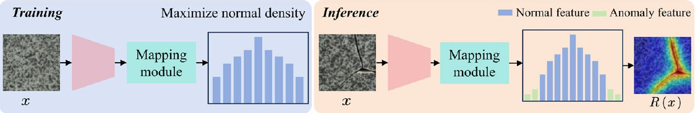

**图5** 分布图方法。训练阶段：从正常样本提取特征，通过映射模块将数据投影至特征分布空间，最大化正常数据密度。推理阶段：将新样本映射至相同空间，若特征分布与学得正常分布显著不同，则判为异常。

图中文字释义：Training／Inference：训练／推理；Feature extraction：特征提取；Mapping：映射；Distribution：分布；Normal distribution：正常分布；Anomaly map：异常图。 Maximize normal density：最大化正常数据密度；Mapping module：映射模块；Normal feature／Anomaly feature：正常特征／异常特征；$x$：输入图像；$R(x)$：异常响应图。

$$
D_{i,j}=\sqrt{(f_{i,j}-\mu_{i,j})^T\Sigma_{i,j}^{-1}(f_{i,j}-\mu_{i,j})}.\tag{16}
$$

$D_{i,j}$越大，说明偏离正常分布越远，该位置发生异常的可能性越高。将所有位置的马氏距离$D_{i,j}$映射为分布图$D\in\mathbb R^{H\times W}$：

$$
D=\{D_{i,j}\mid i=1,2,\ldots,H,\ j=1,2,\ldots,W\}.\tag{17}
$$

通过设定阈值$\varepsilon$，可以识别分布图中的异常区域。

$$
A_{i,j}=\begin{cases}1,&D_{i,j}>\varepsilon,\\0,&\text{其他情况}.\end{cases}\tag{18}
$$

其中，$A_{i,j}$为二值异常掩码，1表示异常区域，0表示正常区域。阈值$\varepsilon$依据训练集或验证集确定。为计算整张输入图像的异常分数$\mathcal A$，对分布图$D$进行归一化并求和：

$$
\mathcal A=\frac1{H\times W}.\tag{19}
$$

【译注：原论文式（19）仅印出$1/(H\times W)$，缺少其文字说明所述的求和项。此处忠实保留原式，未擅自补写。】

设定全局阈值$\tau$；当异常分数$\mathcal A>\tau$时，将图像判为异常。

具体而言，Yu等（2021）提出FastFlow，通过轻量二维归一化流将输入图像特征转换为标准正态分布，以概率值为异常分数，高效准确地检测和定位异常。Rudolph等（2021）提出半监督缺陷检测方法DifferNet，解决制造过程中缺陷样本稀缺且特征未知的挑战。它以卷积神经网络提取特征，采用归一化流估计特征密度，结合多尺度特征提取和多变换评分，实现高精度缺陷检测与定位。仅用少量训练样本即可有效检测定位，尤其适合难以获取大规模缺陷数据的工业应用。Zhang等（2022）提出PEDENet，整合图像块嵌入网络、密度估计网络与位置预测辅助网络，仅用正常图像训练即可准确定位异常。它利用深度编码器降维、高斯混合模型估计图像块嵌入分布、多层感知机（MLP）预测相邻图像块的相对位置。Gudovskiy等（2022）提出实时无监督异常检测与定位模型CFLOW-AD，旨在无需标注数据或异常样本的情况下，对高分辨率图像进行高效异常检测。CFLOW-AD基于条件归一化流，结合预训练卷积神经网络提取特征，利用多尺度解码器估计特征向量的似然，实现快速准确的检测与定位。Wan等（2022）提出位置增强特征映射PEFM，应对智能制造自动视觉检验中大小、形状、颜色各异异常的性能与效率挑战。它融合位置编码与特征映射，用预训练卷积网络提取并映射特征，以不同预训练网络提取特征间的映射残差作为异常分数。Zheng等（2022）提出从粗到细的非对比学习，检测工业高分辨率图像中的细微、细粒度异常。该框架先在图像与特征层面进行粗对齐，统一物体像素位置，再在精对齐阶段采用自监督非对比学习，最大化批次内所有对应位置的特征相似度，学习紧凑且语义丰富的正常图像表示。该方法不需要对异常样本作先验假设，因而增强对多种异常的泛化，提高检测准确性与定位精度。Kamoona等（2024）提出随机有限集（RFS）框架下基于特征能量的轻量工业缺陷检测，解决传统全局特征提取对照明、视角变化不稳健且未充分利用几何信息的问题。它通过迁移学习处理局部特征，将其建模为RFS，以RFS能量为异常分数，通过多元高斯分布建模正常样本的点模式特征相似度分布，在低计算成本下学习参数并显著提高检测准确性。Rudolph等（2022）提出全卷积跨尺度归一化流CS-Flow，用于工业自动缺陷检测，尤其针对无法获取无缺陷样本的情形。CS-Flow联合处理不同尺度特征图，利用归一化流灵活估计输入密度并赋予概率值，实现高精度图像级检测。Zhou等（2024）提出MSFlow，应对无监督异常检测中的异常尺寸变化。MSFlow通过异构并行流与融合流捕捉特征、交换多尺度信息，增强对异常尺寸变化的泛化，在图像级和像素级检测定位任务上取得显著性能提升。Cao等（2023）提出协同差异优化CDO，缓解卷积网络泛化能力过强导致的无监督图像异常检测过度泛化。CDO利用合成异常，优化正常与异常样本间的边界及重叠，细化特征差异分布；通过边界优化与重叠优化模块，增强正常与异常特征的分离、减少特征重叠，提高检测准确性和定位可靠性。Lei等（2023）提出PyramidFlow，应对工业检验中不可控因素造成的缺陷定位挑战。它结合基于潜在模板的缺陷比较定位范式、金字塔归一化流，进行多尺度融合与体积归一化，无需外部先验即可增强泛化，实现高分辨率定位。Silva等（2024）提出AttentDifferNet，在DifferNet中加入SENet与CBAM注意力模块，显著改善多个工业检验数据集的缺陷检测和分类表现。Milkovic等（2024）提出基于归一化流的快速图像异常检测方法FRAnomaly，利用单一尺度的多个特征集及专门设计的归一化流，减少模型参数与推理时间，解决传统方法性能不足、复杂度高的问题，实现高效准确的检测。

#### 2.2.4 记忆库

记忆库是一种长期记忆机制，在工业视觉异常检测中展现出独特优势。它模拟人类记忆行为，为异常检测提供更智能高效的解决方案。图6展示基于记忆库的方法架构。其核心是自适应记忆更新机制，通过记录存储工业异常检测过程中的交互数据，实现相关信息的长期保留与利用，提高检测准确性和效率。给定工业图像$I$，首先利用预训练特征提取网络将图像映射至特征空间，获得特征向量$f$。

$$
f=E(I;\theta_E),\tag{20}
$$

其中，$E$为特征提取网络，$\theta_E$为其参数。图像的特征向量为$f\in\mathbb R^d$，$d$为特征维数。记忆库存储一组正常样本特征向量，记为$\mathcal M$，定义如下：

$$
\mathcal M=\{m_1,m_2,\ldots,m_k\},\qquad m_i\in\mathbb R^d.\tag{21}
$$

其中，$k$为记忆库大小，即存储的正常样本特征向量数，$m_i$表示一个正常样本的特征向量。推理阶段，对于给定输入样本$I$，首先利用特征提取网络提取特征向量$f$，随后计算其与记忆库$\mathcal M$中所有正常特征的相似度或重建误差。输入特征与记忆库中存储特征$m_i$之间的最近邻距离，可以通过余弦相似度或欧氏距离确定。

$$
S_i=\cos(f,m_i)=\frac{f\cdot m_i}{\|f\|\|m_i\|}.\tag{22}
$$

$$
D_i=\|f-m_i\|_2^2.\tag{23}
$$

从最近邻中选择最小距离$D_{\min}$或最大相似度$S_{\max}$：

$$
D_{\min}=\min_iD_i,\qquad S_{\max}=\max_iS_i.\tag{24}
$$

根据最近邻距离或相似度定义异常分数$\mathcal A$：

$$
\mathcal A=D_{\min}=\min_i\|f-m_i\|_2^2.\tag{25}
$$

基于余弦相似度的异常分数$\mathcal A$定义为：

$$
\mathcal A=1-S_{\max}=1-\max_i\cos(f,m_i).\tag{26}
$$

设定阈值$\varepsilon$。当异常分数$\mathcal A>\varepsilon$时，将输入样本判为异常。

为改善检测性能，可以引入重建误差机制。将输入特征映射到最近邻特征空间$m_k$，并据此重建近似特征：

$$
\hat f=W(m_k),\qquad k=\arg\min_i\|f-m_i\|_2.\tag{27}
$$

其中，$W$为重建映射函数。重建误差定义为：

$$
\mathcal L_{\mathrm{recon}}=\|f-\hat f\|_2^2.\tag{28}
$$

最终的综合异常分数为：

$$
\mathcal A_{\mathrm{recon}}=\alpha\mathcal A+\beta\mathcal L_{\mathrm{recon}}.\tag{29}
$$

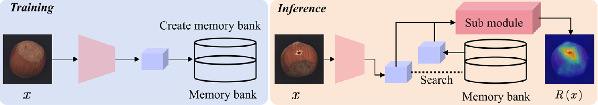

**图6** 记忆库方法。训练阶段：提取并存储正常样本特征，形成正常数据分布的记忆。推理阶段：对验证数据执行相同特征提取，在记忆库查询最相似条目并计算异常分数；若与存储正常特征差异显著，则判为异常。

图中文字释义：Training／Inference：训练／推理；Feature extraction：特征提取；Memory bank：记忆库；Similarity／Comparison：相似度／比较；Anomaly score／map：异常分数／异常图。 Create memory bank：创建记忆库；Sub module：子模块；Search：检索；$x$：输入图像；$R(x)$：异常响应图。

其中α和β是加权参数。

近年来，记忆库在工业视觉异常检测中的应用逐渐受到关注。研究人员提出多种记忆增强无监督方法，探索将记忆库与状态空间框架结合的记忆增强状态空间模型，旨在提高检测准确性与效率，推动工业生产智能化和自动化。Defard等（2021）提出图像块分布建模PaDiM，这是一种基于单类学习的工业图像异常检测定位框架。PaDiM利用经过余弦训练的卷积神经网络提取图像块嵌入向量，用多元高斯分布建模正常类别分布，并捕捉CNN不同语义层级间的相关性，提高定位精度。Roth等（2022）提出PatchCore，利用ImageNet预训练模型提取具有局部感知能力的中层图像块特征，通过核心集压缩构造紧凑而有代表性的记忆库，在高效推理的同时实现精确检测与定位。Tsai等（2022）提出多尺度图像块表示学习MSP，应对图像异常检测分割中小区域或复杂纹理异常的检测挑战。MSP 通过在不同尺度上滑动图像块、提取有代表性的特征来增强特征表示能力，同时捕获全局与局部上下文信息。此外，MSP 结合 K-Means 聚类、余弦相似度和自监督学习策略优化损失函数，使模型能够有效地从正常样本中学习特征表示。Sungwook 等（2022）提出基于耦合超球面的特征适配方法 CFA，用于解决传统异常定位方法的特征偏差问题。CFA 通过迁移学习、可学习的图像块描述以及可扩展记忆库，对目标数据集的特征进行适配，增强异常检测与定位精度；该记忆库的运作不依赖目标数据集的大小。由此，CFA 能够准确区分正常特征与异常特征。McIntosh 和 Albu（2023）提出无监督异常检测方法 InReaCh，以克服传统图像异常检测依赖干净训练数据的局限。InReaCh 关联训练数据中置信度较高的正常图像块，构建通道，并据此建立模型来评价新的图像块。Bae 等（2023）提出工业异常检测与定位算法 PNI，以解决该领域缺乏位置与邻域信息的问题。PNI 结合位置和邻域信息，利用多层感知机（MLP）网络与直方图来建模正常特征的分布。此外，PNI引入以合成异常图像训练的像素级细化网络，提高异常图细节和准确性，尤其改善物体级异常分类。Liu等（2023）提出多样性可度量异常检测框架，平衡基于重建的方法中“重建多样正常模式”与“检测未知异常”之间的取舍。它引入金字塔形变模块PDM，模拟并量化正常模式多样性以及异常严重程度，并将PDM与信息压缩模块ICM结合，无需外部估计器即可准确重建多样正常模式、可靠度量异常严重程度。Kim等（2023）提出快速自适应图像块记忆FAPM，解决现有工业异常检测方法推理速度不足的问题。FAPM利用局部与分层记忆库存储图像嵌入特征，通过局部自适应核心集采样消除冗余计算，在保持检测精度的同时显著加速推理。Xie等（2023）提出GraphCore，在少量样本下高效检测异常，利用图神经网络提取视觉等距不变特征，改善数据稀缺场景中的表现。Yongheng等（2023）提出自更新记忆与中心聚类SMCC，解决工业产品缺陷样本稀少、分类标准不清晰等问题。SMCC以预训练模型提取特征，用高斯混合模型聚类得到簇中心，使正常样本特征紧密分布在中心周围，便于区分异常。此外，SMCC采用自更新记忆库减少内存使用，并优化预训练网络参数，使其适应当前数据分布，高效完成检测定位，显著改善准确性与稳健性。Hu等（2024）提出DMAD，应对实际工业场景的多类别异常检测。DMAD构造正常与异常双记忆库，计算特征距离和注意力，增强特征表示并学习异常分数，结合无监督与半监督学习提高检测准确性和稳健性。Zhou等（2024）提出VQ-Flow，缓解多类别异常检测中类别间模式混杂导致的性能下降。它引入分层向量量化，使归一化流无需类别标签即可区分不同概念、捕捉概念特定正常模式；概念原型码本区分概念，概念特定模式码本学习各概念正常模式，再以高斯混合模型对条件分布进行概念感知建模，模拟复杂多类别分布，有效完成多类别建模与异常检测。Zuo等（2024）提出自监督域适应方法ReconFA，通过结合多尺度聚合模块与特征重建任务的自监督多尺度融合，使预训练CNN特征适应目标数据域，改善异常检测。Zhao等（2024）提出高效无监督点云异常检测PointCore，解决传统方法计算复杂、特征不匹配的问题。PointCore采用单库设计，融合局部坐标与全局PointMAE特征，为不同特征分配不同优先级，并引入归一化排序方法，处理不同尺度的异常分数，减少推理计算成本与干扰，提高检测准确性和效率。Shuai等（2024）提出表示偏差减少方法REB，解决预训练特征的域偏差、局部密度偏差导致的性能限制。它利用自监督任务与DefectMaker缺陷生成策略缓解域偏差，用基于局部密度模型归一化距离的局部密度K近邻减小密度偏差。Hyun等（2024）提出ReConPatch，应对工业缺陷稀有且未知的挑战；它利用成对相似度与上下文相似度作为伪标签，通过对比表示学习训练线性调制的图像块特征表示，构建面向目标、易分离的特征空间，实现高性能检测。Lee等（2022）提出CRAD，解决多类别检测中的泛化差、恒等捷径及复杂度高的问题。它将空间特征映射至连续网格坐标，融合局部和全局正常特征，并进行特征细化，在连续空间有效表示正常特征，增强泛化并缓解恒等捷径。此外，CRAD降低存储与计算复杂度。Koshil等（2024）提出AnomalousPatchCore（APC），针对既有方法仅用正常样本、未充分利用异常信息的问题，通过微调特征提取器并结合分类、分割和重建三个辅助任务，有效利用正常与异常样本。Wang等（2024）提出记忆增强状态空间模型MemoryMamba，应对复杂、有限及不平衡缺陷数据带来的识别困难。它结合状态空间技术与记忆增强机制，提高缺陷识别准确性和稳健性，以粗粒度、细粒度记忆编码模块捕捉缺陷层级特征，并通过对比学习及互信息最大化优化记忆网络。He等（2024）提出MambaAD，解决传统CNN和Transformer在异常检测中捕捉长程依赖困难、计算复杂度高的问题。它采用Mamba架构的新型解码器，通过局部状态空间增强模块和混合状态空间（HSS）模块结合全局与局部特征提取。

#### 2.2.5 对比语言图像预训练

如图7所示，基于视觉语言模型的工业异常检测通过多模态学习结合视觉特征与语言描述，提高检测准确性。这类方法利用大规模预训练多模态模型（Radford等，2021），联合建模图像特征与文本描述，识别视觉异常。虽然工业场景不像一般场景那样容易获得文字描述，多模态方法仍具有良好前景。在实际应用中，文本信息可以从生产标准、缺陷分类体系和质量控制指南中系统提取，为视觉上难以区分的异常提供语义丰富的参照。文本还使检测结果更易解释，便于操作人员理解问题并及时纠正。因此，尽管工业环境缺少自然产生的文字标注，利用结构化领域文本资源的多模态方法对于提升实际异常检测表现仍有意义和价值。给定工业图像$I$，首先通过视觉编码器提取视觉特征：

$$
F=E_{\mathrm{vis}}(I).\tag{30}
$$

其中，$E_{\mathrm{vis}}$表示视觉特征提取器，$F\in\mathbb R^d$为图像的全局特征向量，$d$为特征维数。分块处理的图像也可以表示为特征序列。

$$
F=\{f_1,f_2,\ldots,f_N\}.\tag{31}
$$

利用一组预定义文本提示$\mathcal T=\{T_1,T_2,\ldots,T_k\}$描述正常或异常状态。例如，$T_1$：“物体正常”；$T_2$：“物体存在缺陷”；$T_3$：“表面存在裂纹”。利用语言编码器提取文本特征：

$$
L_j=E_{\mathrm{lang}}(T_j),\qquad j=1,2,\ldots,k.\tag{32}
$$

其中，$E_{\mathrm{lang}}$为语言特征提取器，$L_j\in\mathbb R^d$表示文本描述$T_j$的嵌入向量。视觉语言模型的核心是计算图像特征$F$与文本特征$L_j$之间的相似度。通常使用余弦相似度：

$$
S_j=\cos(F,L_j)=\frac{\langle F,L_j\rangle}{\|F\|\|L_j\|}.\tag{33}
$$

其中，$S_j$表示输入图像$I$与文本描述$T_j$之间的相似度，$S_j\in[-1,1]$；其值越高，视觉特征与文本描述越匹配。对于多个文本描述，最终相似度表示为向量$S=\{S_1,S_2,\ldots,S_k\}$。工业异常检测假设正常样本与正常文本描述的相似度较高，而异常样本与异常文本描述更加一致。基于该假设，通过分析相似度分布识别异常。异常分数$\mathcal A$定义为异常描述与正常描述对应相似度之差：

$$
\mathcal A=\max_{j\in\mathcal A_T}S_j-\max_{j\in\mathcal N_T}S_j.\tag{34}
$$

其中，$\mathcal A_T$为异常文本描述集合，$\mathcal N_T$为正常文本描述集合，$\max_{j\in\mathcal A_T}S_j$表示图像与异常文本的最大相似度，$\max_{j\in\mathcal N_T}S_j$表示图像与正常文本的最大相似度。为增强局部异常检测，可以将局部图像块的视觉特征与语言描述匹配，计算各局部区域的相似度。给定图像块特征$F_i$，其局部相似度为：

$$
S_{i,j}=\cos(F_i,L_j).\tag{35}
$$

对所有图像块，局部异常分数$\mathcal A_{\mathrm{local}}$定义为：

$$
\mathcal A_{\mathrm{local}}=\max_{i,j\in\mathcal A_T}S_{i,j}-\max_{i,j\in\mathcal N_T}S_{i,j}.\tag{36}
$$

将全局与局部异常分数组合，得到最终异常分数：

$$
\mathcal A_{\mathrm{final}}=\alpha\mathcal A+\beta\mathcal A_{\mathrm{local}},\tag{37}
$$

其中，$\alpha$和$\beta$为权重参数。

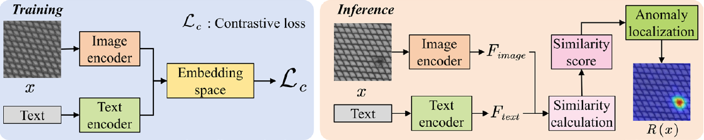

**图7** 对比语言图像预训练（CLIP）方法。训练阶段：将图像$x$及其文字描述分别输入图像与文本编码器，映射至共享嵌入空间；对比损失$\mathcal L_c$拉近匹配图文对，推远不匹配图文对，实现跨模态对齐。推理阶段：给定新图像与文本，图像和文本编码器分别产生特征表示$F_{image}$与$F_{text}$，计算相似度分数；若分数低于某阈值，说明图像与描述存在显著差异，输入被标为异常。

图中文字释义：Training／Inference：训练／推理；Image encoder／Text encoder：图像编码器／文本编码器；Text prompt：文本提示；Contrastive loss：对比损失；Similarity：相似度；Normal／Abnormal：正常／异常。 Text：文本；Embedding space：嵌入空间；Similarity score／Similarity calculation：相似度分数／相似度计算；Anomaly localization：异常定位；$F_{image}$／$F_{text}$：图像／文本特征；$R(x)$：异常响应图。

近年来，对比学习尤其通过视觉语言对齐成为工业异常检测的重要方法。图像重建、伪异常生成和掩码建模等传统自监督方法之外，对比学习通过构造正负样本对建立判别性嵌入空间。CLIP、WinCLIP等模型利用多模态监督实现零样本异常检测，在物体类别变化和域偏移下展现较强泛化能力。传统自监督方法则侧重建模图像内部结构或重建视觉内容，往往在单模态结构化环境中表现良好，适合缺陷类型明确的任务。

近期，研究人员开始探索如何将对比学习，尤其视觉语言模型，适配工业环境，以支持语义异常检测和定位。代表性工作WinCLIP以CLIP为基础，引入专门面向异常分割的机制。Jeong等（2023）提出WinCLIP，通过组合式提示以及多尺度特征提取与聚合，实现与文本对齐的零样本异常分割。此外，增强版本WinCLIP+引入正常图像额外信息，进一步提高分类和分割准确性。Tamura（2023）提出RWDA，针对需要大量异常样本及每个物体类别单独模型的问题，利用CLIP作为数据源，通过随机数据增强生成多样文本嵌入作为训练数据，训练前馈网络区分正常与异常，而无需类别特定训练图像或繁琐提示集成。Chen等（2023）提出零样本框架CLIP-AD，解决没有测试物体参考图像时的异常检测。它利用CLIP零样本能力，通过代表向量选择范式改善文本提示设计，并采用结构化特征修改策略构建分阶段双路径模型（SDP）计算异常图，再引入微调线性层（SDP+）解决特征不对齐，实现高效零样本异常检测。为解决统一零样本检测与定位，Deng等（2023）提出AnoCLIP，引入无需训练的值到值注意力机制提取CLIP局部特征，设计领域感知的对比状态提示模板，加强视觉语言对齐，并通过快速测试时适应优化视觉标记与文本提示的对齐，提高检测定位准确性。Zhou等（2024）提出AnomalyCLIP，通过不包含物体语义的文本提示学习，应对零样本检测中对多种领域特定异常模式的泛化难题。它学习对象无关文本提示，利用大规模预训练CLIP捕捉图像的通用正常性与异常性，使模型关注异常区域而非物体语义，实现跨类别泛化异常识别，并结合全局与局部上下文优化、文本与视觉空间对齐，显著改善多数据集上的检测分割性能。Cai等（2024）提出CLIP-ADA，通过可学习提示与异常区域细化策略，解决多类别工业检测资源消耗高、定位精度低的问题。CLIP-ADA以自监督学习将可学习文本提示关联至异常模式，实现多类别统一检测，并采用从粗到细的区域细化策略，将初步粗定位结果用作注意力图，增强准确识别定位异常区域的能力。Li等（2024）提出PromptAD，解决传统方法高度依赖人工设计提示、缺少自动化的问题。PromptAD通过语义拼接将正常样本提示转换为异常样本提示，构造大量负样本，促进单类场景中的提示学习；同时引入显式异常间隔，利用超参数显式调节正常与异常提示特征间的距离，从而仅利用正常样本实现有效检测。Gu等（2024）提出零样本方法FiLo，在没有目标类别先验样本时准确检测定位工业产品异常，利用自适应学习的细粒度描述与位置增强的高质量定位。FiLo以大语言模型生成详细异常描述，引入多尺度、多形状跨模态交互模块，增强对不同大小形状异常的定位，提高零样本检测定位准确性与可解释性。Zhang等（2024）提出双图像增强CLIP（DiE-CLIP），解决没有目标数据集训练样本时准确识别定位视觉异常的问题。它用成对图像作为视觉参考，结合CLIP联合视觉语言评分，显著改善异常分类定位，并引入通过合成异常增强定位的测试时适应模型。Lee等（2024）提出多模态提示学习方法AnoPLe，应对少样本异常检测中的异常样本稀缺，通过双向提示学习与多模态交互检测异常。该方法利用模拟异常和轻量解码器增强局部语义理解，融合全局与局部语义改善图像级检测。Li等（2024）提出视觉语言模型零样本工业异常检测框架IAD-CLIP，包括预训练CLIP、免训练适配模块和测试时适应机制。免训练模块采用值到值注意力与状态提示空间；预训练CLIP用于特征提取，适配模块通过视觉编码器和文本编码器处理提取的特征，实现异常检测与定位。

#### 2.2.6 异常聚类

Wan等（2021）提出高斯聚类预训练特征框架GCPF，解决工业异常定位计算复杂、内存消耗高的问题。GCPF利用预训练CNN提取特征，通过多独立多元高斯聚类（MIMGC）与多层级异常评分实现像素级定位，在提高准确性的同时显著减少计算时间和存储需求，增强工业实用性。Sohn等（2023）利用预训练深度嵌入和现成聚类方法，将异常图像按不同异常类型聚类；通过基于图像块嵌入的距离函数度量图像相似性，对嵌入欧氏距离加权平均得到相似度权重，并以无监督或半监督方式估计权重，有效突出缺陷区域。Zhang等（2023）提出无监督表面异常分割网络JRCC-Net，利用模拟异常与正常样本间的距离差异学习决策边界，结合模拟异常策略、联合表示与对比聚类，在推理时检测异常。Yao等（2024）提出分层高斯混合归一化流HGAD，解决统一异常检测任务中归一化流方法的统一映射问题。它结合类间高斯混合建模与类内混合类中心学习，增强多类别正常分布学习，避免不同类别映射至同一高斯先验造成的性能下降，并引入互信息最大化损失提高类别区分能力及模型判别性。

### 2.3 基于重建的方法

#### 2.3.1 自编码器

自编码器是一种无监督神经网络，通过编码器-解码器结构将输入压缩为低维表示，再重建与原数据相似的输出。图8展示基于重建方法的基本架构，其目标是最小化重建误差，以获得有效数据表示。自编码器包含编码器和解码器：前者将输入压缩为低维表示，后者尽可能重建原数据。给定输入图像$I$，可表示为：

$$
I\xrightarrow{\mathrm{编码器}}z\xrightarrow{\mathrm{解码器}}\hat I,\tag{38}
$$

其中，$z$为低维表示，$\hat I$为解码器重建的图像。编码器旨在最小化重建图像与原图像之间的差异。通常使用均方误差度量原图像$I$与重建图像$\hat I$之间的差异：

$$
\mathcal L(I,\hat I)=\|I-\hat I\|_2^2=\sum_{i=1}^n(I_i-\hat I_i)^2,\tag{39}
$$

其中，$X$和$\hat X$均为表示图像像素值的$n$维向量。工业异常检测的基本假设是：自编码器能够较好地重建正常图像，而异常图像的重建误差较高。因此，重建误差可作为判断图像是否异常的依据。设定阈值$\varepsilon$，当重建误差超过该阈值时，图像被判为异常：

$$
\begin{cases}\mathcal L(I,\hat I)>\varepsilon,&I\text{为异常图像},\\\mathcal L(I,\hat I)\le\varepsilon,&I\text{为正常图像}.\end{cases}\tag{40}
$$

训练阶段通过最小化重建误差优化自编码器参数。常用优化方法为梯度下降，其更新目标为：

$$
\theta^*=\arg\min_\theta\sum_{i=1}^m\mathcal L(I_i,\hat I_i;\theta),\tag{41}
$$

其中，$\theta$为自编码器参数，$I_i$为训练集中的第$i$张图像，$m$为训练样本数。

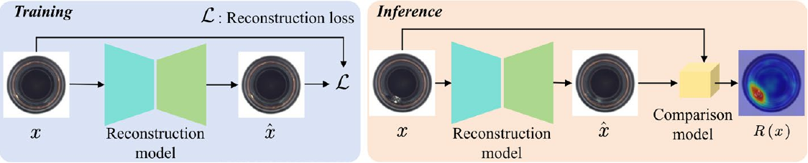

**图8** 重建方法。训练阶段：模型学习重建正常图像$x$的主要特征，重建网络产生$\hat x$，以损失$\mathcal L$度量其与$x$的差异；迭代最小化损失，使模型捕捉正常数据内在结构与分布。推理阶段：输入新图像$x$得到$\hat x$，将二者送入比较模块。显著差异意味着模型无法忠实重建输入，通常指示异常区域。

图中文字释义：Training／Inference：训练／推理；Reconstruction network：重建网络；Reconstruction loss：重建损失；Comparison：比较；$x$：输入图像；$\hat x$：重建图像。 Reconstruction model：重建模型；Comparison model：比较模型；$R(x)$：异常响应图。

工业异常检测中的自编码器学习正常数据表示，识别显著偏离该表示的异常样本。其优点包括无需监督、有效降维、特征提取以及捕捉复杂非线性关系；主要局限是模型过复杂或瓶颈层过大时，可能过于精确地重建输入而未捕捉关键特征。为此，研究人员提出稀疏、去噪和变分自编码器等变体（Nguyen等，2024），通过附加约束与优化目标改善性能和适用性。Zavrtanik等（2021）提出DRAEM，检测图像中显著偏离正常外观的局部区域。它结合重建与判别子网络，联合学习异常图像及其正常重建的表示，同时定义正常与异常决策边界，无需复杂后处理即可直接准确定位分割异常。Zavrtanik等（2021）还提出基于图像修复的RIAD，将图像分块、随机移除部分区域，再用训练好的编码器-解码器重建，检测异常。RIAD的关键思想是异常区域训练时未见，难以准确重建，而正常区域能够较好重建。比较输入与重建图像差异即可有效检测定位异常；其基于梯度相似度的训练损失进一步提升视觉检测表现。Shi等（2021）提出基于深度特征重建的无监督异常分割DFR，无需异常先验即可自动检测并定位图像中微小且难发现的异常区域。DFR通过预训练深度卷积网络提取多尺度区域特征，利用高效卷积自编码器重建特征，快速识别异常。Hou等（2021）提出分割与组装异常检测DAAD，将图像重建表述为“分割与组装”过程，以多尺度块级记忆模块调控正常和异常样本的重建能力，并通过对抗学习增强语义特征，在图像和语义特征两个空间检测异常，解决无异常样本时区分正常异常图像的难题。Yang等（2022）提出基于深度特征对应关系的无监督检测分割DFC，应对异常样本稀缺或缺失时的异常结构检测。它构建特征提取与特征估计组成的非对称双网络，用深度特征对应机制建模评估分支间一致性，并引入自特征增强策略及多上下文残差学习模块，显著改善稳健性和检测表现。Zavrtanik等（2022）提出双子空间重投影DSR，克服现有方法难合成与正常模式相似异常的局限。它采用量化特征空间表示，利用两个解码器分别重建通用物体外观和特定物体外观，替代传统图像合成异常生成，实现更稳健的检测定位。Schlüter等（2022）提出自然合成异常NSA，仅用正常训练数据实现自监督检测定位。NSA利用泊松图像编辑，将不同图像中缩放后的图像块无缝融合到目标图像，生成自然多样异常，消除既有方法明显的不连续性，显著提升检测定位。Ristea等（2022）提出自监督预训练卷积注意力模块SSPCAB，通过预测输入中被遮挡或缺失的信息，无需异常样本即可训练，并以重建误差作为异常分数，提高检测表现。为应对工业少样本及跨产品类别适应，Fang等（2023）提出FastRecon，在数据稀缺时快速检测新产品异常。它通过特征重建，用少量正常样本生成查询样本的正常版本，再用带分布正则化的回归算法确定最佳变换，确保重建结果与查询样本视觉相似且符合正常特征。Guo等（2023）提出模板引导分层特征恢复THFR，检测复杂正常模式中不同大小的异常。它通过瓶颈压缩保留正常特征、过滤异常特征，再以模板引导补偿机制恢复失真特征，将异常转换为正常表示，准确检测定位不同尺度异常。Madan和Ristea（2023）提出SSMCTB，可在神经网络任意层掩码输入，通过三维卷积和Transformer模块重建掩码数据，仅用正常样本训练。Park等（2024）提出损失放大LAMP，无需改变网络结构，仅修改损失函数即可提升检测。它使损失景观更陡峭，使未见异常模式产生更大重建误差，改善无监督异常检测。Chen等（2024）提出隐式前景引导网络IFgNet，以多任务学习结合前景检测和图像重建，通过共享网络与任务特定注意力区分前景背景，减少背景噪声误分类与干扰，提高准确性。Liu和Wang（2024）提出多类别异常自编码器MAAE，应对多类别检测存储成本高、训练效率低和性能下降。MAAE通过空间和通道注意力捕捉全局类别信息及特征分布，引入自适应噪声生成器和特征融合模块，模拟真实噪声、保留表面语义，实现跨类别统一检测并提高性能与泛化。Fan等（2024）提出图像块数据增强PatchAnomaly，通过自监督学习合成相似异常，将无监督检测转为监督目标检测，无需复杂后处理即可直接定位异常。Zhang等（2024）提出DC-AE，解决传统自编码器错误地将异常重建为正常特征的问题。它结合双约束自编码器DCAE与自适应加权相似性空间注意力AWSSA，通过对抗学习和全局记忆库限制泛化，防止异常区域被错误重建；AWSSA增强异常关注，进一步改善定位。

#### 2.3.2 生成对抗网络

生成对抗网络在工业异常检测中展现出很大潜力。通过使用正常样本训练模型，并利用正常样本与异常样本在特征分布上的差异识别异常，GAN能够有效应对工业场景中异常样本稀缺的问题。此外，生成对抗网络可以生成高质量模拟数据，有助于在缺少真实异常数据时训练和测试异常检测模型（Xia等，2022）。GAN旨在训练生成器$G$，使其生成接近真实数据分布$p_{\mathrm{data}}(x)$的样本；判别器$D$则旨在区分真实样本与生成样本。其整体优化目标为：

$$
\min_G\max_DV(D,G)=\mathbb E_{x\sim p_{\mathrm{data}}}[\log D(x)]+\mathbb E_{z\sim p_z}[\log(1-D(G(z)))],\tag{42}
$$

其中，$x$为真实样本，$z\sim p_z$为输入生成器的随机噪声，$G(z)$为生成器产生的样本，$D(x)$为判别器对真实样本的输出，$D(G(z))$为判别器对生成样本的输出。生成器$G$对输入图像$I$进行重建，得到$\hat I$。重建误差$\mathcal L_{\mathrm{recon}}$用作异常检测指标：

$$
\mathcal L_{\mathrm{recon}}=\|I-G(I)\|^2,\tag{43}
$$

判别器对输入$I$及生成样本$\hat I$的输出$D$提供额外的异常检测依据。判别器损失为：

$$
\mathcal L_{\mathrm{disc}}=-\log D(I)-\log(1-D(G(I))),\tag{44}
$$

为提高检测准确性，通常组合重建误差与判别器损失，得到综合异常分数$\mathcal A(I)$：

$$
\mathcal A(I)=\alpha\mathcal L_{\mathrm{recon}}+\beta\mathcal L_{\mathrm{disc}},\tag{45}
$$

其中，$\alpha$和$\beta$为平衡重建误差与判别器损失贡献的权重参数。当$\mathcal A(I)$超过预定义阈值$\varepsilon$时，检测到异常。

尽管GAN在工业异常检测中表现良好，仍面临关键挑战：首先，训练可能不稳定，易发生模式崩溃；其次，工业数据通常含噪且异常类型多样，需要对噪声和不同缺陷模式保持较强稳健性。GAN是最早用于合成异常生成的方法之一，通过扰动或重建正常图像学习产生缺陷模式，以伪异常丰富训练分布，增强缺陷识别。Yan等（2021）提出基于语义上下文的SCADN，解决无监督数据集中低概率密度异常难检测的问题；它生成多尺度条纹掩码遮挡正常样本语义上下文，推理时比较重建与输入得到误差图，从而识别异常，有效缓解传统方法在复杂场景的局限。Liang等（2023）提出OCR-GAN，解决传统异常检测重建能力有限造成的性能退化。OCR-GAN通过创新频率解耦模块将输入分解为不同频率分布，再以通道选择模块促进多频率分支交互，显著改善基于重建的无监督检测。Duan等（2023）提出少样本缺陷图像生成方法DFMGAN，解决真实缺陷图像稀缺造成的工业检测性能不足。DFMGAN采用两阶段训练：先以大量无缺陷图像训练StyleGAN2主干，再引入缺陷感知残差块生成逼真缺陷掩码，操控掩码区域内特征，产生高质量、多样缺陷图像，有效扩充数据集并改善检测表现。

#### 2.3.3 Transformer

近年来，YOLOv5、YOLOv8等模型因推理快、架构轻量而广泛用于工业视觉异常检测。它们基于CNN，擅长快速定位识别划痕、断裂、异常轮廓等明显缺陷，适合要求实时性和部署效率的生产环境。在异常边界清晰、标注充分时，YOLO可实现低延迟高精度检测。基于Transformer的方法通过自注意力构建全局上下文关系，特征表达能力更强，能捕捉长距离依赖与细粒度差异，尤其适合异常模式模糊、背景复杂或异常嵌入局部纹理的情形，在照明不均、背景干扰和不规则结构下表现出更高稳健性与泛化能力。虽然其计算资源消耗较高，轻量Transformer的发展正逐渐减小实时性能方面的劣势。

Mishra等（2021）提出视觉Transformer异常检测定位VT-ADL，自动识别工业图像显著变化，通过重建与图像块嵌入保留空间信息，结合高斯混合密度网络定位异常。You等（2022）提出ADTR，仅用正常样本训练，以Transformer重建预训练深度特征，而非直接处理原始像素，并通过新型损失优化，使缺少异常样本时仍能有效检测。Lee和Kang（2022）提出AnoViT，克服传统CNN仅提取局部特征、难捕捉全局信息的问题；它利用ViT自注意力捕捉全局上下文，结合卷积层保留空间细节，实现准确检测定位。De等（2022）提出基于视觉Transformer的掩码模型MeTAL，解决现有图像异常方法重建识别异常区域的局限。MeTAL以掩码多头自注意力，仅利用周围图像块信息重建各块，忽略块内潜在异常。此外，MeTAL在传统方形块之外引入水平与垂直条纹块，将多种编码结合为最终图像块表示，相比仅用方块显著改善性能。Pirnay和Chai（2022）提出图像修复Transformer（InTra），解决传统卷积自编码器能够重建异常区域而导致漏检的问题。它用自注意力Transformer重建被掩码图像块，无需卷积，借助全局上下文有效检测定位异常。Jiang等（2022）提出掩码Swin Transformer U-Net（MSTUNet），解决传统CNN全局上下文提取不足；它对正常样本实施异常模拟与掩码策略，利用Swin Transformer全局学习能力重建掩码区域，并结合U-Net端到端检测，实现高精度工业检测定位。Zhang等（2025）提出基于纯ViT的新型对称结构ViTAD，用于多类别无监督异常检测（MUAD）。现有方法依赖复杂金字塔及大量人工设计，ViTAD采用简洁纯ViT架构，通过宏观和微观设计优化实现高效强大的检测。宏观上，去除多尺度特征跳跃连接，仅用最后阶段特征输入，避免信息路径过短引发潜在泄漏。微观上，采用归一化前的特征融合，保留位置嵌入增强表示，移除类别标记以免干扰空间结构。Yao等（2023）提出聚焦差异FOD，解决传统方法未充分分析局部特征差异及图像内外关联、难以检测复杂异常的问题。FOD通过Transformer自注意力建立图像内部与图像之间关联，以基于RBF核的对象相关性自监督学习，结合对象相关性与熵约束，增强正常异常区分，实现有效检测定位。Luo等（2024）提出自适应掩码修复网络AMI-Net，解决无监督重建方法难区分正常异常区域的局限。它引入自适应掩码生成器，融合多尺度预训练特征提取与随机位置定量掩码策略，提高准确性和实时性；测试时动态遮挡缺陷区域、保留正常区域。Yao等（2024）提出先验正常性提示Transformer（PNPT），解决多类别检测中的恒等映射问题，通过正常性提示与双流结构重建样本内在特征，以捕捉类别特定正常性。其架构包含类别特定正常性提示池、分层图像块嵌入、语义对齐耦合编码、上下文语义条件解码四个模块，有效区分正常与异常，显著提高多类别工业图像异常检测性能。

#### 2.3.4 扩散模型

工业异常检测中，扩散模型通过逆向过程重建高质量图像，移除输入中的异常区域（Haohao等，2023），再逐像素、逐特征比较输入与重建图像检测异常。条件去噪过程保证物体图像恢复的一致性，提高准确性。像素级比较分析各像素差异，特征级比较捕捉高层语义变化；基于这些差异计算异常分数，量化异常严重程度。

$$
q(x_t\mid x_{t-1})=\mathcal N(x_t;\sqrt{1-\beta_t}x_{t-1},\beta_tI),\tag{46}
$$

其中，$x_t$为第$t$步的含噪数据，$\beta_t\in(0,1)$为预设的噪声增量控制参数。经过$T$步后，$X_T$服从$\mathcal N(0,I)$分布。依据封闭性，任意第$t$步的数据分布可以显式写为：

$$
q(x_t\mid x_0)=\mathcal N(x_t;\sqrt{\bar\alpha_t}x_0,(1-\bar\alpha_t)I),\tag{47}
$$

其中，$\bar\alpha_t=\prod_{s=1}^t(1-\beta_s)$表示累积噪声衰减因子。去噪过程旨在通过学习去噪分布$p_\theta(x_{t-1}\mid x_t)$逐步移除噪声，从而反向重建原始数据$x_0$。

$$
p_\theta(x_{t-1}\mid x_t)=\mathcal N(x_{t-1};\mu_\theta(x_t,t),\Sigma_\theta(x_t,t)),\tag{48}
$$

其中，$\mu_\theta(x_t,t)$表示模型学习的均值函数，$\Sigma_\theta(x_t,t)$表示学习的方差函数。优化目标是最小化去噪误差，使模型能够从噪声中准确重建原始数据。扩散模型的训练目标通常通过下式优化：

$$
\mathcal L_{\mathrm{denoise}}=\mathbb E_{x_0,t,\varepsilon}[\|\varepsilon-\varepsilon_\theta(x_t,t)\|^2],\tag{49}
$$

其中，$x_0\sim q(x_0)$为真实样本，$t\sim\operatorname{Uniform}(1,T)$为扩散步数，$\varepsilon\sim\mathcal N(0,I)$为高斯噪声。具体而言，Wyatt等（2022）提出基于去噪扩散概率模型（DDPM）的异常检测方法AnoDDPM。该方法将传统高斯噪声替换为多尺度单纯形噪声，以解决高分辨率图像中大面积异常区域的检测问题。

这有效增强了异常识别与定位。Zhang等（2023）提出DiffusionAD，解决传统生成模型重建质量差导致的性能限制。它利用去噪扩散模型，引入噪声到正常模式范式和快速单步去噪范式，显著提高检测定位效率与精度。Mousakhan等（2023）提出去噪扩散异常检测DDAD，通过条件机制引导图像去噪，结合像素级与特征级比较定位异常，并通过域适应增强特征提取器，显著改善传统重建方法。Yin等（2023）提出无监督多类别检测LafitE，解决恒等捷径问题；它利用潜在扩散模型重建正常特征分布，采用特征编辑改善重建、减少误检，并通过合成异常构造伪验证集来选择超参数，提高检测定位准确性。Zhang等（2023）提出无监督表面异常检测DiffAD，应对传统重建在异常区域结构变化及重建方面的困难。它利用潜在扩散模型生成高质量多样图像，结合噪声条件嵌入与插值通道技术增强异常区分，通过减小重建与原图的像素差异提高检测定位精度。Lu等（2023）提出基于去噪扩散的RAN，引入随机噪声遮挡异常像素，利用生成扩散模型中间去噪过程计算像素异常分数，以KL散度提高精度，并通过梯度去噪将异常图像平滑转换为正常图像，解决传统方法意外重建异常区域导致的性能不足。He等（2024）提出扩散多类别检测框架DiAD，保持图像类别和像素结构完整性，结合像素空间自编码器、潜在空间语义引导网络、特征空间预训练提取器及空间感知特征融合模块，提高重建准确性。DiAD在保持原图语义完整性的同时重建异常区域，显著提高检测定位性能。Teng等（2024）提出AnomalyDiffusion，用有限样本生成异常图像，解决工业异常数据稀缺。它利用潜在扩散模型的强先验，整合空间异常嵌入和自适应注意力重加权，生成与异常掩码精确对齐的高质量异常图像。Tebbe和Tayyub（2024）提出动态去噪扩散概率模型D3AD，应对不同尺度异常的精确定位，通过动态计算噪声步数、利用潜在空间表示以及采用域自适应特征提取器，提高定位准确性。D3AD采用动态隐式条件机制，根据初始异常预测调整加噪，实现更准确的异常分割；在潜在空间而非像素层去噪，减少计算需求，提高大面积缺失部件的重建质量。准确确定最佳噪声步数显著改善检测，尤其定位表现。Yao等（2024）提出全局与局部自适应扩散GLAD，解决无监督异常检测的样本重建挑战。它为每个样本预测特定去噪步数，进行空间自适应特征融合，缓解不同异常重建难度不均，提高重建质量与检测精度；再通过面向异常的训练范式引入合成异常，改善异常区域重建，实现高性能检测定位。Fučka等（2024）提出TransFusion，用单阶段迭代同时重建和定位异常，克服传统两阶段架构过度泛化与细节丢失。Yan等（2024）提出AnomalySD，针对正常样本稀缺的工业制造，利用稳定扩散模型的零样本、少样本修复能力，结合分层文本提示和前景掩码机制进行异常检测微调。推理时以多尺度掩码与原型引导掩码准确遮挡修复异常，实现高效检测定位。Zhang等（2024）提出特征选择网络RealNet，通过生成逼真多样合成异常改善工业检测。其三个模块为：（1）强度可控扩散异常合成SDAS，精确操控缺陷位置、强度和结构，模拟稀有、细微及复杂异常；（2）异常感知特征选择，挑选有代表性的预训练特征子集，提高异常敏感性；（3）重建残差选择，自适应挑选残差提高定位精度。基于扩散的异常生成在保持高视觉保真度与结构多样性的同时，有效解决缺陷样本稀缺。

#### 2.3.5 生成式预训练Transformer

图9展示基于GPT的工业视觉异常检测框架。Li等（2023）提出大型多模态模型Myriad，应对详细描述异常并作准确判断的挑战。Myriad以预训练工业检测模型作为视觉专家，用视觉专家标记化器将异常图嵌入为大语言模型可理解的标记，并结合专家驱动的视觉语言提取模块产生领域特定视觉语言标记，实现精确检测和全面描述。Zhang等（2024）研究基于视觉问答范式的大型多模态模型GPT-4V在零样本异常检测中的应用。他们提出GPT-4V-AD，通过细粒度区域分割、精心设计的提示及文本到分割转换，准确定位评估异常区域。Zhaopeng等（2024）提出基于大型视觉语言模型的AnomalyGPT。传统方法需要人工设阈值且难适应复杂工业情形，AnomalyGPT通过图像解码器与提示学习器模拟异常图像数据，无需人工阈值调整即可自动检测定位、直接评估异常，并支持多轮对话及少样本上下文学习，增强实用性和准确性。Xu等（2024）提出Customizable-VLM，通过适配通用视觉语言模型增强工业泛化；它以多模态提示策略融合专家知识，引导异常检测与推理，并统一多模态输入表示。研究表明，视觉和语言提示结合可以改善不同数据模态的异常检测，实现多种工业场景中的通用检测与推理。Zhang等（2024）提出LogiCode，解决传统方法难处理的工业逻辑异常。LogiCode利用大语言模型的逻辑推理能力，自动生成Python代码，识别组件计数不正确、元素缺失等异常，并提供详细解释；通过代码提示、代码生成、代码执行三个模块，将从规则定义到异常检测的全过程自动化，支持工业质量控制并减少人工检验。Hattori等（2024）提出基于分割元素的SEAD，解决影响整幅图像的逻辑异常检测局限。SEAD以ComAD为基础，通过SegGPT分割，在记忆库中存储正常图像各元素的颜色和像素数，再依据测试图像与记忆库的欧氏距离检测异常。

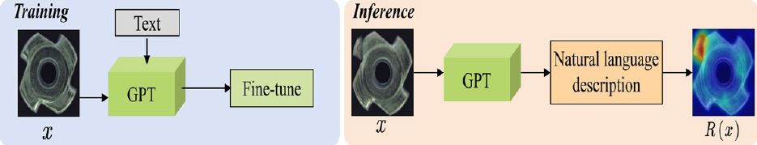

**图9** GPT方法。训练阶段：将输入图像$x$及对应文本输入GPT，微调生成与图像内容一致的自然语言，通过迭代捕捉正常图像语义。推理阶段：GPT依据学得知识为新图像产生描述；若描述显著偏离正常样本语义，则判为异常。

图中文字释义：Training／Inference：训练／推理；Text description／Text prompt：文本描述／文本提示；GPT：生成式预训练Transformer；Normal／Abnormal：正常／异常。 Text：文本；Fine-tune：微调；Natural language description：自然语言描述；$R(x)$：异常响应图。

#### 2.3.6 任意分割模型

图10展示基于SAM的工业视觉异常检测框架。Cao等（2023）提出免训练异常分割SAA+，解决现有模型依赖领域微调、泛化有限的问题。它利用领域专家知识和目标图像上下文，通过混合提示正则化适配基础模型，增强跨域泛化；级联提示引导的目标检测与分割模型产生异常区域，以混合提示减少语言歧义、提高分割精度。Liu等（2024）提出无监督持续异常检测UCAD，通过对比学习提示实现持续学习，缓解工业制造缺标注带来的困难，减轻灾难性遗忘和计算负担。框架包含持续提示模型CPM与基于结构的对比学习SCL：CPM以关键提示知识记忆引导预测，保持一致任务目标；SCL结合SAM，通过对比学习增强特征，提高分割表现。Li等（2024）提出SAM引导双流轻量模型STLM，改善工业异常检测效率与可移动部署能力。该框架利用SAM强泛化，通过两个轻量图像编码器实现无监督检测：一流生成正常与异常区域的判别性逐行及通用特征，另一流重建无异常图像，增强异常特征可分性。共享掩码解码器与特征聚合模块生成异常图，在保持高性能的同时显著减少参数和推理时间，应对效率及可移动部署的双重挑战。

### 2.4 三维异常检测

三维异常检测利用深度图、点云或多视图投影等输入识别结构缺陷。其感知方式、特征编码和模型结构均不同于主要使用颜色纹理的二维方法。本小节综述近年来有代表性的三维视觉异常检测方法，更清楚地呈现工业视觉异常检测的技术进步。Chen等（2023）提出EasyNet，解决现有三维方法在部署、存储和实时性方面的困难。它用多尺度、多模态编码器-解码器重建异常分割图，以注意力信息熵融合模块整合推理特征，无需预训练模型或记忆库即可高效实时检测，显著提高性能与速度。Zhu等（2024）提出Group3AD，应对高分辨率三维点云样本点多、特征退化、异常占比小等挑战。它通过组级特征比较学习提高效率和精度，以簇间均匀性网络IUN、簇内对齐网络IAN优化特征分布，再以几何信息驱动的自适应组中心选择AGCS增强潜在异常检测。Li等（2024）提出DRAIN，改善传统方法不能有效利用深度信息的局限。DRAIN通过三维重建和三维分割组成的双重建网络，以编码器-解码器处理RGB与深度图，再结合轻量多层感知机及双注意力融合特征，实现高性能三维工业检测。Zhou等（2024）提出R3D-AD，解决现有方法资源消耗高、异常区域重建不完整的问题；它用扩散模型重建点云，通过自监督Patch-Gen模拟多样缺陷形状，增强泛化，实现完整异常点云重建与高效检测。Cao等（2024）提出互补伪多模态特征CPMF，融合局部几何和全局语义：前者由手工三维描述子提取，后者由二维预训练网络从多视图图像提取，并结合多视图投影和特征聚合提高检测准确性。Cheng等（2024）提出多视图投影框架MVP-PCLIP，将点云投影为多视图深度图，结合预训练视觉语言模型进行异常检测。MVP-PCLIP应对传统无监督点云检测泛化差、采集成本高和冷启动问题，引入可学习视觉提示及自适应文本提示，增强异常关注、提高文字描述准确性，显著改善零样本检测。Zhou等（2024）提出PointAD，在没有目标三维训练样本时检测未见物体异常，构建整合R-CNN、三维点云及二维像素表示的统一框架，提高三维异常理解与检测能力。PointAD以多视图渲染将三维点云投影到多个二维视图，用CLIP提取像素表示并映射回三维空间；混合表示学习优化三维与二维信息的文本提示理解，实现多种三维物体上的稳健检测，并可在推理时无额外训练地融合二维RGB信息。Liu等（2024）构建综合三维工业数据集Real3D-AD，解决高精度点云异常数据稀缺和系统基准缺失；同时提出基于配准的Reg3D-AD，以特征记忆库存储局部、全局特征，提高检测精度。Costanzino等（2024）提出多模态框架CFM，克服传统方法识别复杂工业异常的局限；它用Transformer提取二维图像和三维点云特征，训练轻量网络学习跨模态特征映射，通过观测与映射特征不一致检测异常，并采用层剪枝优化内存和计算效率，在加速推理、降低内存的同时显著改善检测与分割。

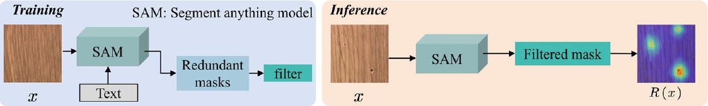

**图10** 任意分割模型（SAM）方法。训练阶段：根据图像$x$和文本提示生成多个候选分割掩码，过滤多余或不准确区域，将更精确分割结果存于模型。推理阶段：为新图像生成掩码，按学得过滤策略细化；过滤后的掩码用于定位潜在异常并生成异常热力图。

图中文字释义：Training／Inference：训练／推理；Text prompt：文本提示；Segmentation masks：分割掩码；Mask filtering：掩码过滤；Anomaly map：异常图。 Text：文本；Redundant masks：冗余掩码；filter：过滤；Filtered mask：过滤后的掩码；$R(x)$：异常响应图。

## 3 数据集

工业视觉检验中的异常通常分为结构异常和语义异常。结构异常表现为产品表面的几何缺陷或物理损伤，如划痕、裂缝、孔洞和凹痕，可通过局部纹理或边缘有效识别。语义异常主要是高层语义错误，如部件缺失、逻辑不匹配或位置不合理，通常难直接通过低层像素特征判断。MVTec AD主要包含结构异常，涵盖织物撕裂、瓶口变形、晶体管焊点异常等典型工业表面缺陷；MVTec LOCO AD进一步引入组件数量不正确、安装错位等逻辑异常，更接近实际工业场景复杂视觉判断需求。因此，实验比较特别标示各方法处理不同异常类型的性能差异，以帮助理解其能力边界。

本节全面概述常用工业异常检测数据集。第3.1节介绍二维数据集，第3.2节介绍三维数据集；同时，从任务复杂性、视觉结构多样性、跨域泛化和实际工业场景一致性等方面进行多维分析分类，将数据集分为三个层级，如图11所示。

- 顶层包括Real-IAD和AeBAD，具有高分辨率、多视角、跨域变化及视频数据，在缺陷多样性、场景真实性和任务复杂度上有较高代表性。

- 中层包括MVTec AD、VisA、MVTec LOCO-AD和MPDD，均提供高质量标注，支持广泛异常检测任务，因其多功能性与可靠性，广泛用于基准比较、方法验证和性能评估。

- 底层包括BTAD、Eyecandies、MVTec 3D-AD和Real3D-AD，主要适合几何结构建模等专门子任务，但在标注粒度及跨域泛化等方面仍有一定局限。

### 3.1 二维异常检测

MVTec AD数据集 Bergmann等人(2019年)模拟了真实世界工业生产情景，并用作异常检测的基准。该模型由15个工业产品类别组成，包括5个纹理和10个对象类别。训练集仅包含正常图像，而测试组则包含正常和异常的图像，带有像素级的说明。因此，这一数据集已成为无监督的异常检测和定位的广泛使用基准。

VisA（Zou等，2022）采用自监督学习，通过“找不同”任务预训练模型，改善异常检测和分割。数据集有12个物体子集，共10,821张图像，其中9,621张正常、1,200张异常。PCB1至PCB4四个印刷电路板子集具有晶体管、电容、芯片等复杂结构；Capsules（胶囊）、Candles（蜡烛）、Macaroni1和Macaroni2（通心粉）四个子集在同一视野中包含多个实例，其中胶囊和Macaroni2的位置、姿态变化显著；Cashew（腰果）、Chewing Gum（口香糖）、Fryum（膨化零食）及Pipe Fryum（管状膨化零食）四个子集物体大致对齐。异常包括划痕、凹痕、污渍和裂缝等表面缺陷，以及错位、部件缺失等结构缺陷。

BTAD（Mishra等，2021）包含工业产品主体与表面缺陷，提供1,800张正常训练图像。与MVTecAD相比，BTAD不提供精细细节标注，更适合大尺度异常检测。

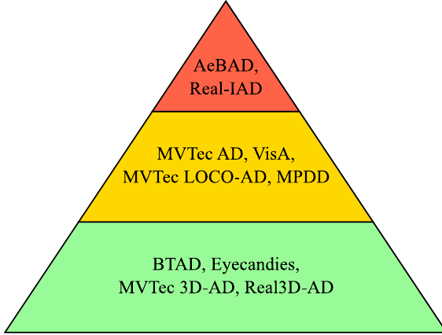

**图11** 工业异常检测基准数据集的层次分类。金字塔从下至上表示任务复杂度和实际场景一致性增加，依据包括视觉多样性、缺陷真实性、标注质量与域变化。

图中文字释义：各层均为数据集专名。顶层：AeBAD、Real-IAD；中层：MVTec AD、VisA、MVTec LOCO-AD、MPDD；底层：BTAD、Eyecandies、MVTec 3D-AD、Real3D-AD。

AeBAD（Zhang等，2023）不同于主要关注缺陷检测的MVTec AD和VisA，强调同类数据跨域的多样性，旨在自动检测航空发动机叶片异常、保障运行稳定。它包含单叶片数据集AeBAD-S及视频异常数据集AeBAD-V。AeBAD-S的单叶片图像具有不同尺度、宽高比，主要特点是未对齐和尺度变化显著；训练与测试正常图像还因照明、视角变化产生域偏移。AeBAD-V包含装配后航空发动机叶片视频，便于整体叶盘旋转过程中的异常检测，其关键挑战是训练与测试视角不一致。

MPDD（Jezek等，2021）是评估工业生产缺陷检测与分割的无监督数据集，关注涂漆金属零件，包含六类共6,600张图像，其中训练5,280张、测试1,320张。图像包含不同朝向、位置和距离的多个物体，具有多样照明及非均匀背景，并对异常提供像素级标注，支持精确定位。

MVTec LOCO-AD（Bergmann等，2022）用于评估无监督异常检测与定位，包含五种实际工业检验场景采集的3,644张图像，涵盖结构及逻辑异常。结构异常包括产品划痕、凹痕与污染；逻辑异常来自隐含约束违反，例如允许物体摆放错误或必需物体缺失。

### 3.2 三维异常检测

MVTec 3D-AD（Bergmann等，2022）是大规模无监督三维异常检测定位基准，包含工业级三维传感器采集的高分辨率扫描，共十个物体类别。各类别均有无缺陷训练、验证图像，以及含划痕、凹痕、孔洞、污染和变形等缺陷的测试图像；每张异常测试图像均有详细像素标注。

Eyecandies（Bonfiglioli等，2022）是无监督异常检测定位基准，包含十个糖果类别共14,234张图像，每类具有复杂纹理、自遮挡和镜面反射等独特挑战。

Real3D-AD（Liu等，2024）是首个包含点云的工业异常检测数据集，含12类共1,254张图像。它结合RGB图像提取表面特征、三维点云捕捉几何结构，以识别物体形状及表面异常；还提供深度图，利用深度信息更详细表示形状。所有物体和零件来自真实工业生产，具有划痕、孔洞、裂纹、变形和部件缺失等多样缺陷。

Real-IAD（Wang等，2024）是大型多视角工业异常检测数据集，包含超过150,000张高分辨率工业产品图像，涉及金属、塑料、木材、陶瓷、混合材料等30种不同材料。每件产品从五个视角拍摄，提供多视角覆盖及详细像素级缺陷标注。Real-IAD不仅在规模上超过既有数据集，还引入图像级评价指标，并首次采用全监督工业异常检测设置，更好模拟实际场景，推动研究与实际应用。

## 4 评价指标与结果

### 4.1 评价指标

工业异常检测中的精确率（Precision，亦称查准率）衡量模型正确识别异常的能力，数学定义为：

$$
\mathrm{Precision}=\frac{TP}{TP+FP},\tag{50}
$$

其中，$TP$（真正例）为正确预测出的异常，$FP$（假正例）为被误判为异常的正常样本。精确率越高，模型表现越好。召回率衡量真实异常中被模型正确识别的比例，定义为：

$$
\mathrm{Recall}=\frac{TP}{TP+FN},\tag{51}
$$

其中，$FN$（假反例）为被误判为正常的真实异常。召回率越高，模型能够正确识别的异常越多。为取得均衡评价，当精确率与召回率同等重要时，采用两者的调和平均数$F_1$分数：

$$
F_1=2\times\frac{\mathrm{Precision}\times\mathrm{Recall}}{\mathrm{Precision}+\mathrm{Recall}},\tag{52}
$$

$F_1$分数越高，表明模型在精确率与召回率之间取得的平衡越好。图像级AUROC由图像级受试者工作特征（ROC）曲线下的面积（AUC）得到，用于度量模型的图像级分类性能。模型为每张图像输出一个异常分数，表示该图像为异常的可能性。根据所有图像的真实标签（正常或异常）及预测分数绘制ROC曲线，横轴为假正率（FPR），纵轴为真正率（TPR）。通过计算 ROC 曲线下的面积得到 AUC 值。AUROC 取值为 0 至 1，数值越高，表示模型的分类性能越好。该指标主要评价模型区分正常图像与异常图像的能力，即判断整幅图像是否存在异常，而不考虑异常的具体位置。

像素级 AUROC（Pixel-AUROC）由像素级 ROC 曲线得到，用于衡量模型区分异常像素与正常像素的能力。对于每个像素，模型输出一个异常分数，表示该像素属于异常的概率。将所有像素的真实标签（正常／异常）与相应预测分数进行比较，然后以像素级假阳性率（FPR）为横轴、像素级真阳性率（TPR）为纵轴构建 ROC 曲线，再计算曲线下的面积，得到 AUC 值。

逐区域重叠度（PRO）是一种针对像素级异常分割设计的指标，用于量化预测缺陷区域与真实缺陷区域之间的重叠程度。与仅统计像素级真阳性（TP）和假阳性（FP）的传统方法不同，PRO 首先将真实缺陷区域划分为一个或多个独立区域，再计算这些区域与相应预测区域的重叠。相较于逐个像素评价预测是否正确，这种方法更能反映缺陷检测与定位的整体效果。

Bergmann 等人（2022）提出的 sPRO 在 PRO 的基础上引入归一化策略，以更公平地评价异常检测性能。通过对 PRO 进行归一化，sPRO 减轻了极小或极大缺陷区域引起的评价偏差，从而使不同算法之间的比较更加公平。

在工业异常检测中，有时需要考虑异常形状、尺寸以及未知检测场景的变化。为应对这一挑战，通常采用 PRO 曲线下面积（AUPRO）。AUPRO 用于量化模型在异常区域检测方面的整体性能，尤其关注定位精度。对于每个异常区域，随着预测阈值变化，计算真实异常区域与预测异常区域之间的交并比（IoU）。横轴为预测区域的归一化像素覆盖率（NPC），定义为预测区域面积与真实异常区域面积之比；纵轴为 IoU，对 PRO 曲线下的面积积分，得到 AUPRO 值。与 AUROC 相比，AUPRO 更重视异常定位的准确性，而非仅评价分类性能。调节预测阈值，可以分析模型对不同异常尺寸的敏感性。〔译注：此处按原文翻译；原文关于 AUPRO 的横纵轴及 IoU 的描述存在指标定义混用，使用时应以对应原始评测协议为准。〕

总体而言，Image-AUPRO、Pixel-AUPRO、PRO、AUPRO 和 sPRO 构成了面向工业缺陷检测的多层次评价框架，尤其适用于像素级分割任务。这些指标强调缺陷的精确定位与识别，并采用不同计算方法和阈值调整来处理极端情况。对于需要精确定位和全面检测的工业应用，与仅使用像素级精确率和召回率相比，这些指标提供的评价更有针对性、也更具可解释性，有助于研究人员更有效地比较和改进各种缺陷检测算法。〔译注：Image-AUPRO 和 Pixel-AUPRO 的拼写沿用原文。〕

### 4.2 实验结果

本节介绍工业异常检测的实验结果，旨在为研究人员提供清晰的比较分析，以便更准确地选择适合不同场景的异常检测方法。所有实验结果均摘自各方法的原始论文，完全采用其公开的训练与测试集划分、输入分辨率、骨干网络和评估脚本。为确保评价具有代表性和多样性，本文覆盖第 2 节介绍的主要类别，具体包括基于重建的模型（例如 CutPaste、PatchCore）、基于特征嵌入的模型（例如 FastFlow、SPADE），以及基于扩散的模型（例如 RealNet）。选择范围也涵盖无监督、弱监督和小样本等不同学习范式。这种广泛覆盖有助于更全面地比较各种学习策略与检测范式。在探索不同制造环境中的适用性时，Bono 等人（2023）提出的质量控制方法，将软测量传感器与异常检测器结合，有效解决了高度不稳定工况下的质量监控问题。基于该研究，本文所列实验数据来自多种工业生产环境，充分反映异常检测方法在各类场景中的实际性能。表 2 汇总了部分方法的主要特点，为研究人员选择异常检测策略提供参考。表 3 汇总不同方法在 MVTec AD 和 VisA 数据集上的实验结果及资源消耗。表 4 和表 5 分别给出 MVTec AD 数据集各类别的图像级和像素级结果；类似地，表 6 和表 7 给出 VisA 数据集各类别的图像级和像素级结果。表 8 给出 MVTec 3D AD 数据集上的实验结果，表 10 给出 MVTec LOCO AD 数据集上的实验结果。此外，图 12 展示 MVTec AD 数据集的实验结果，通过可视化直观呈现不同方法的异常检测性能差异。图 13 展示 VisA 数据集的异常检测实验可视化结果，清楚体现各方法对复杂结构、多实例物体以及单实例物体异常的检测能力。图 14 展示 MVTec 3D AD 数据集的实验可视化结果，直观说明不同方法处理三维异常检测任务的表现。MVTec 3D AD 为多个物体类别提供高质量 RGB-D 数据，并包含真实的三维表面缺陷。与主要关注纹理异常的二维数据集不同，该数据集能够评价方法捕捉几何变形、深度异常和不规则表面拓扑的能力，这些能力在现代工业检测中日益重要。此外，近期文献已广泛采用 MVTec 3D AD 作为三维视觉异常检测算法的评价基准，以保障实验结果的可比性与可复现性。这些特点使其成为验证基于重建及深度感知的异常检测方法性能的合适且有代表性的数据集。图 15 展示 MVTec LOCO AD 数据集的检测结果，图 16 展示 BTAD、MPDD 和 AeBAD-S 数据集的检测结果，以更直观的方式比较不同方法的优势。〔译注：本段关于 CutPaste、PatchCore 等方法的分类沿用原文，与其常见技术分类及本文其他章节的分类存在不一致。〕

在实际工业视觉异常检测中，由于检测环境、对象类型和缺陷模式多样，参数选择与调优始终是关键挑战。不同工业场景可能需要不同的阈值、特征维数和骨干网络深度，才能获得最佳性能。针对这些问题，研究中普遍采用若干策略。一种做法是使用在多个公开数据集（例如 MVTec AD、VisA）上表现稳健的配置初始化参数，以获得良好起点。此外，可利用从目标环境采集的少量验证图像进行轻量调优，校准决策阈值或细化特征选择层。进一步地，注意力机制、多尺度融合以及可学习归一化层等自适应模块，已被证明能够有效降低模型对固定参数值的敏感性。这些技术有助于模型在照明条件、背景纹理和缺陷形状发生变化时保持更好的泛化能力。随着工业系统走向真实部署，在参数设计中平衡通用性与适应性，仍然是异常检测框架必须考虑的问题。多项代表性研究已探索并验证这些参数适配策略，包括 Li 等人（2021）的 CutPaste、Roth 等人（2022）的 PatchCore，以及 Jeong 等人（2023）的 WinCLIP；这些研究展示了跨工业数据集的较强稳健性与迁移能力。

实验结果进一步揭示了不同算法在处理结构异常与语义异常方面的差异。以 MVTec LOCO AD 为例，本文计算了多种方法在结构异常（SA）及逻辑／语义异常（LA）条件下的 AUROC 指标。由表 9 可见，GCAD 在处理结构异常时表现更好，例如连接器类别的 SA-AUROC 达到 99.0；而 ComAD 在逻辑异常检测方面具有一定优势，说明其更擅长对上下文语义关系建模。这些结果表明，不同异常类型可能需要不同的建模策略：结构异常更依赖细粒度边界重建和低层特征建模，而语义异常更依赖全局上下文理解和高层特征比较。〔译注：此处“表 9”和数值 99.0 均保留原文；逻辑／结构异常的汇总结果实际另见表 10，正文引用与表中数值存在不一致。〕

根据表 3 至表 9 以及图 12 至图 16 的结果，可以观察到，PatchCore、FastFlow 等基于特征嵌入的方法在结构异常检测方面表现良好，并能在缺陷模式清晰的不同数据集之间展现较强泛化能力。RealNet 等基于扩散的方法在定位与异常合成两方面均取得优异表现，尤其适合复杂背景或低对比度区域。与此同时，基于重建的方法具有可靠的检测能力，但往往对异常尺度和纹理变化更加敏感。这些发现揭示了检测准确率、稳健性和计算效率之间的权衡，可为不同工业场景下选择合适方法提供参考。

**表2 部分工业异常检测方法的特点**

| 方法 | 主要特点 |
| --- | --- |
| AdaCLIP（Cao等，2024） | 1. 混合可学习提示与语义融合模块。2. 利用CLIP预训练文本图像对齐能力，显著提高异常模式感知与检测。 |
| AnomalyCLIP（Zhou等，2024） | 1. 用对象无关通用文本提示抽象图像正常与异常共性。2. 减少特定类别知识依赖，提高跨场景泛化适应性。 |
| AnoVL（Deng等，2023） | 1. 免训练值到值注意力提取关键特征。2. 测试时适应增强零样本与少样本检测定位。 |
| CLIP-AD（Chen等，2023） | 1. 新的文本提示设计范式和分阶段双路径模型，解决图文特征对齐。2. 逐步对齐融合图文特征，提高准确性与稳定性。 |
| DiAD（He等，2024） | 1. 通过语义引导和空间感知特征融合保留全局语义，精确重建异常区域。2. 持续改善多类别检测定位。 |
| FAIR（Liu等，2023） | 1. 以频率感知图像恢复利用高频信息区分正常异常模式。2. 简单U-Net即可取得先进表现，易部署和扩展。 |
| GLASS（Chen等，2024） | 1. 可控全局-局部异常合成，产生逐渐逼真的弱缺陷训练样本。2. 对弱缺陷和微小异常敏感，同时保持高精度与高效率。 |
| WinCLIP（Jeong等，2023） | 1. 窗口化特征提取结合语言引导异常定义，细粒度分析局部区域。2. 平衡局部细节检测与整体语义理解，在工业视觉场景表现出色。 |

**表3 MVTec AD与VisA数据集上的性能及计算资源需求比较**

斜杠两侧依次对应MVTec AD和VisA；短横线与留空项按原表保留。

| 方法 | 文献 | 学习策略 | 主干网络 | 图像AUROC | 像素AUROC | AUPRO | 帧率FPS | 批大小 | GPU显存（约GB） |
| --- | --- | --- | --- | --- | --- | --- | --- | --- | --- |
| DestSeg Zhang等 (2023) | KBS2024 | 监督 | WRN50-2 | 98.85/– | 98.55/ | –/ | 74.7 | 32 | 10.4 |
| DRAEM Zavrtanik等 (2021) | ICCV2021 | 弱监督 | U-Net | 98.05/79.48 | 97.49/91.37 | – /– | 54 | 8 | 11.9 |
| WinCLIP Jeong等 (2023) | CVPR2023 | 弱监督 | ViT-B-16-plus-240 | 79.87/72.51 | 87.55/91.41 | 72.52/69.93 | – | 256 | 13.1 |
| REB Shuai等 (2024) | KBS2024 | 弱监督 | ResNet18 | 99.20/– | –/ | –/ | – | 96 | 16.2 |
| FAIR Liu等 (2023) | arXiv2023 | 弱监督 | U-Net | 98.10/96.73 | 98.21/97.69 | 93.87/– | – | 8 | 7.3 |
| PUAD Sugawara和Imamura (2024) | arXiv2024 | 弱监督 | R101-2 | 98.30/– | –/ | – /– | – | 1 | 1.2 |
| AdaCLIP Cao等 (2024) | ECCV2024 | 弱监督 | ViT-L-14-336 | 86.69/34.01 | 88.50/57.09 | – /– | – | 1 | 11.0 |
| AnomalyCLIP Zhou等 (2024) | ICLR2023 | 弱监督 | ViT-L-14-336 | 91.56/81.81 | 91.07/95.33 | 96.34/85.14 | – | 8 | 7.3 |
| AnoVL Deng等 (2023) | arXiv2023 | 弱监督 | ViT-B-16-plus-240 | 92.49/79.20 | 90.85/89.89 | 77.69/71.12 | – | 8 | 3.2 |
| DiAD He等 (2024) | AAAI2024 | 无监督 | ResNet50 | 96.13/86.76 | 96.75/96.04 | 90.89/– | – | 2 | 22.5 |
| GLASS Chen等 (2024) | ECCV2024 | 无监督 | WRN50-2 | 99.58/98.06 | 98.85/98.34 | 92.02/85.78 | – | 8 | 5.1 |
| HGAD Yao等 (2024) | ECCV2024 | 无监督 | EfficientNet-B6 | 98.90/96.80 | 98.10/98.80 | – /– | – | 8 | 7.4 |
| SimpleNet Liu等 (2023) | CVPR2023 | 无监督 | WRN50-2 | 99.52/87.18 | 97.31/96.83 | – /– | 77 | 8 | 6.6 |
| MMR Zhang等 (2023) | COMIND2023 | 无监督 | ResNet50 | 98.35/ | 97.20/ | 92.61/ | – | 16 | 5.8 |
| PADIM Defard等 (2021) | ICPR2021 | 无监督 | WRN50-2 | 95.50/ | 97.33/ | –/ | 60.32 | 32 | 0.5 |
| NSA Schlüter等 (2022) | ECCV2022 | 无监督 | ResNet18 | 97.20/ | 96.06/ | –/ | – | 64 | 6.5 |
| RIAD Zavrtanik等 (2021) | PR2021 | 无监督 | WRN50-2 | 91.65/ | 94.15/ | –/ | – | 4 | 10.6 |
| CFA Sungwook等 (2022) | IEEE2022 | 无监督 | WRN50-2 | 99.17/ | 98.15/ | 94.44/ | – | 4 | 4.8 |
| UniAD You等 (2022) | NeurIPS2022 | 无监督 | EfficientNet-B4 | 96.5/88.78 | 96.8/98.32 | –/– | 56.8 | 8 | 3.8 |
| RD Deng和Li (2022) | CVPR2022 | 无监督 | WRN50-2 | 98.46/ | 97.81/ | 93.93/ | 90.6 | 32 | 14.1 |
| RD++ Tien等 (2023) | CVPR2023 | 无监督 | WRN50-2 | 99.44/ | 98.25/ | 94.99/ | ≈ 134 | 16 | 12.7 |
| PatchCore Roth等 (2022) | CVPR2023 | 无监督 | WRN50–2 | 99.10/ | 98.06/ | 93.41/ | 22.3 | 2 | 5.5 |
| CFLOW-AD Gudovskiy等 (2022) | WACV2022 | 无监督 | WRN50–2 | 97.87/ | 97.35/ | 94.60/ | 27 | 32 | 4.8 |
| MuSc Zhou等 (2024) | ICLR2024 | 无监督 | WRN50–2 | 97.72/92.53 | 97.11/98.71 | –/ | 47.6 | 1 | 4.5 |

**表4 MVTec AD图像级异常检测性能（AUROC，%）比较**

| 方法 | 地毯 | 网格 | 皮革 | 瓷砖 | 木材 | 瓶子 | 电缆 | 胶囊 | 榛子 | 金属螺母 | 药丸 | 螺钉 | 牙刷 | 晶体管 | 拉链 | 均值 |
| --- | --- | --- | --- | --- | --- | --- | --- | --- | --- | --- | --- | --- | --- | --- | --- | --- |
| SimpleNet（Liu等，2023） | 99.40 | 99.25 | 100.0 | 99.96 | 100.0 | 100.0 | 99.93 | 97.69 | 99.82 | 99.95 | 98.88 | 98.28 | 99.72 | 100.0 | 99.97 | 99.52 |
| MMR（Zhang等，2023） | 99.50 | 100.0 | 100.0 | 98.70 | 99.10 | 100.0 | 97.70 | 97.10 | 100.0 | 99.90 | 98.10 | 92.30 | 100.0 | 95.10 | 97.70 | 98.35 |
| PADIM（Defard等，2021） | 98.40 | 89.80 | 98.80 | 95.90 | 99.00 | 99.60 | 85.50 | 87.00 | 84.10 | 97.40 | 86.90 | 74.50 | 94.70 | 92.50 | 74.10 | 90.55 |
| PaDiM（原表第二行）（Defard等，2021） | 99.90 | 95.70 | 100.0 | 97.40 | 98.80 | 99.80 | 92.20 | 91.50 | 93.30 | 99.20 | 94.40 | 84.40 | 97.20 | 97.80 | 90.90 | 95.50 |
| DRAEM（Zavrtanik等，2021） | 96.27 | 100.0 | 100.0 | 100.0 | 99.21 | 96.90 | 93.40 | 96.05 | 100.0 | 99.36 | 96.75 | 99.26 | 99.72 | 94.17 | 99.68 | 98.05 |
| SMCC（Yongheng等，2023） | 100.0 | 99.30 | 100.0 | 100.0 | 99.60 | 100.0 | 96.60 | 96.60 | 100.0 | 99.60 | 96.50 | 91.10 | 100.0 | 100.0 | 98.50 | 98.52 |
| NSA（Schlüter等，2022） | 95.60 | 99.90 | 99.90 | 100.0 | 97.50 | 97.70 | 94.50 | 95.20 | 94.70 | 98.70 | 99.20 | 90.20 | 100.0 | 95.10 | 99.80 | 97.20 |
| RIAD（Zavrtanik等，2021） | 84.20 | 99.60 | 100.0 | 98.70 | 93.00 | 99.90 | 81.90 | 88.40 | 83.30 | 88.50 | 83.80 | 84.50 | 100.0 | 90.90 | 98.10 | 91.65 |
| CFA（Sungwook等，2022） | 97.30 | 99.20 | 100.0 | 99.40 | 99.70 | 100.0 | 99.80 | 97.30 | 100.0 | 100.0 | 97.90 | 97.30 | 100.0 | 100.0 | 99.60 | 99.17 |
| RD（Deng和Li，2022） | 98.90 | 100.0 | 100.0 | 99.30 | 99.20 | 100.0 | 95.00 | 96.30 | 99.90 | 100.0 | 96.60 | 97.00 | 99.50 | 96.70 | 98.50 | 98.46 |
| RD++（Tien等，2023） | 100.0 | 100.0 | 100.0 | 99.70 | 99.30 | 100.0 | 99.20 | 99.00 | 100.0 | 100.0 | 98.40 | 98.90 | 100.0 | 98.50 | 98.60 | 99.44 |
| PatchCore（Roth等，2022） | 98.70 | 98.20 | 100.0 | 98.70 | 99.20 | 100.0 | 99.50 | 98.10 | 100.0 | 100.0 | 96.60 | 98.10 | 100.0 | 100.0 | 99.40 | 99.10 |
| CFLOW-AD（Gudovskiy等，2022） | 99.23 | 96.89 | 99.61 | 97.71 | 94.49 | 98.76 | 97.64 | 98.98 | 98.82 | 98.56 | 98.95 | 98.10 | 98.56 | 93.28 | 98.41 | 97.87 |
| MuSc（Zhou等，2024） | 99.88 | 98.75 | 100.0 | 100.0 | 98.51 | 99.92 | 98.88 | 95.89 | 99.64 | 96.92 | 95.83 | 82.74 | 100.0 | 99.42 | 99.42 | 97.72 |
| REB（Shuai等，2024） | 99.60 | 100.0 | 100.0 | 100.0 | 99.70 | 100.0 | 100.0 | 99.30 | 99.70 | 100.0 | 99.00 | 94.70 | 96.10 | 99.90 | 100.0 | 99.20 |
| DestSeg（Zhang等，2023） | 99.60 | 100.0 | 100.0 | 100.0 | 99.30 | 100.0 | 98.13 | 97.33 | 98.54 | 98.83 | 96.78 | 96.33 | 99.44 | 98.50 | 100.0 | 98.85 |
| WinCLIP（Jeong等，2023） | 96.39 | 57.89 | 99.15 | 94.70 | 95.79 | 99.29 | 57.61 | 61.19 | 92.68 | 60.90 | 83.50 | 58.95 | 79.17 | 63.96 | 96.95 | 79.87 |
| HGAD（Yao等，2024） | 100.0 | 100.0 | 100.0 | 100.0 | 99.60 | 100.0 | 97.00 | 98.90 | 99.50 | 100.0 | 99.00 | 98.00 | 93.10 | 98.10 | 99.80 | 98.87 |
| FAIR（Liu等，2023） | 99.72 | 98.83 | 99.97 | 100.0 | 99.56 | 100.0 | 97.23 | 95.17 | 99.18 | 97.90 | 99.37 | 90.45 | 100.0 | 97.46 | 96.72 | 98.10 |
| DiAD（He等，2024） | 98.31 | 98.21 | 100.0 | 95.86 | 96.61 | 100.0 | 90.00 | 94.22 | 97.10 | 96.13 | 95.07 | 91.19 | 96.77 | 96.30 | 96.23 | 96.13 |
| AdaCLIP（Cao等，2024） | 99.88 | 92.86 | 99.97 | 99.49 | 97.94 | 97.70 | 81.69 | 84.48 | 59.61 | 55.79 | 87.89 | 84.77 | 94.58 | 78.04 | 85.67 | 86.69 |
| AnomalyCLIP（Zhou等，2024） | 100.0 | 97.80 | 99.80 | 100.0 | 96.90 | 88.70 | 70.30 | 89.50 | 97.20 | 92.40 | 81.10 | 82.10 | 85.30 | 93.90 | 98.40 | 91.56 |
| AnoVL（Deng等，2023） | 99.30 | 98.10 | 100.0 | 100.0 | 99.30 | 96.30 | 87.80 | 79.10 | 94.00 | 97.40 | 86.60 | 78.00 | 92.20 | 86.40 | 92.90 | 92.49 |

纹理类别为地毯至木材；物体类别为瓶子至拉链。PaDiM在原表中连续列出两组结果，未说明配置差异，此处保留为两行。

**表5 MVTec AD像素级异常检测性能（AUROC，%）比较**

| 方法 | 地毯 | 网格 | 皮革 | 瓷砖 | 木材 | 瓶子 | 电缆 | 胶囊 | 榛子 | 金属螺母 | 药丸 | 螺钉 | 牙刷 | 晶体管 | 拉链 | 均值 |
| --- | --- | --- | --- | --- | --- | --- | --- | --- | --- | --- | --- | --- | --- | --- | --- | --- |
| SimpleNet（Liu等，2023） | 97.28 | 95.83 | 99.16 | 92.34 | 93.77 | 98.00 | 97.44 | 98.88 | 97.58 | 98.69 | 98.27 | 99.14 | 98.45 | 96.73 | 98.09 | 97.31 |
| MMR（Zhang等，2023） | 98.75 | 99.00 | 99.22 | 95.63 | 94.80 | 98.30 | 95.43 | 98.03 | 98.50 | 95.94 | 98.42 | 99.47 | 98.35 | 90.18 | 97.99 | 97.20 |
| PADIM（Defard等，2021） | 98.80 | 93.60 | 99.00 | 91.70 | 94.00 | 98.10 | 94.90 | 98.20 | 97.90 | 96.70 | 94.60 | 97.20 | 98.60 | 96.80 | 97.60 | 96.51 |
| PaDiM（原表第二行）（Defard等，2021） | 99.00 | 96.50 | 98.90 | 93.90 | 94.10 | 98.20 | 96.80 | 98.60 | 97.90 | 97.10 | 96.10 | 98.30 | 98.70 | 97.50 | 98.40 | 97.33 |
| DRAEM（Zavrtanik等，2021） | 96.23 | 99.56 | 98.88 | 99.50 | 97.17 | 99.27 | 95.43 | 94.04 | 99.55 | 98.73 | 97.62 | 99.68 | 98.12 | 89.97 | 98.63 | 97.49 |
| SMCC（Yongheng等，2023） | 99.10 | 97.70 | 99.30 | 96.20 | 94.50 | 98.80 | 98.60 | 99.10 | 98.90 | 99.30 | 98.80 | 98.30 | 99.10 | 97.70 | 98.90 | 98.29 |
| NSA（Schlüter等，2022） | 95.50 | 99.20 | 99.50 | 99.30 | 90.70 | 98.30 | 96.00 | 94.30 | 97.60 | 98.40 | 98.50 | 96.50 | 94.90 | 88.00 | 94.20 | 96.06 |
| RIAD（Zavrtanik等，2021） | 96.30 | 98.80 | 99.40 | 89.10 | 85.80 | 98.40 | 84.20 | 92.80 | 96.10 | 92.50 | 95.70 | 98.80 | 98.90 | 87.70 | 97.80 | 94.15 |
| CFA（Sungwook等，2022） | 99.28 | 98.12 | 99.37 | 95.21 | 91.53 | 98.84 | 98.97 | 99.11 | 98.85 | 99.15 | 98.93 | 98.91 | 98.96 | 98.06 | 99.02 | 98.15 |
| RD（Deng和Li，2022） | 98.90 | 99.30 | 99.40 | 95.60 | 95.30 | 98.70 | 97.40 | 98.70 | 98.90 | 97.30 | 98.20 | 99.60 | 99.10 | 92.50 | 98.20 | 97.81 |
| RD++（Tien等，2023） | 99.20 | 99.30 | 99.40 | 96.60 | 95.80 | 98.80 | 98.40 | 98.80 | 99.20 | 98.10 | 98.30 | 99.70 | 99.10 | 94.30 | 98.80 | 98.25 |
| PatchCore（Roth等，2022） | 99.00 | 98.70 | 99.30 | 95.40 | 95.00 | 98.60 | 98.40 | 98.80 | 98.70 | 98.40 | 97.40 | 99.40 | 98.70 | 96.30 | 98.80 | 98.06 |
| CFLOW-AD（Gudovskiy等，2022） | 99.20 | 96.26 | 99.60 | 97.53 | 94.15 | 98.05 | 97.02 | 98.77 | 98.73 | 98.22 | 98.96 | 97.09 | 98.50 | 90.39 | 97.76 | 97.35 |
| MuSc（Zhou等，2024） | 99.45 | 98.18 | 99.72 | 97.89 | 97.25 | 98.47 | 95.74 | 98.95 | 99.38 | 86.02 | 97.49 | 98.78 | 99.53 | 91.31 | 98.42 | 97.11 |
| DestSeg（Zhang等，2023） | 98.93 | 98.57 | 99.80 | 99.27 | 98.22 | 99.23 | 97.28 | 99.00 | 99.62 | 97.79 | 99.03 | 99.42 | 99.45 | 93.39 | 99.18 | 98.55 |
| WinCLIP（Jeong等，2023） | 98.66 | 79.42 | 98.56 | 86.57 | 92.38 | 91.14 | 54.09 | 90.85 | 98.15 | 71.09 | 94.48 | 94.35 | 97.24 | 68.96 | 97.36 | 87.55 |
| HGAD（Yao等，2024） | 99.40 | 99.10 | 99.60 | 97.00 | 96.40 | 98.40 | 96.20 | 99.00 | 98.70 | 97.20 | 98.50 | 99.40 | 98.70 | 95.40 | 98.80 | 98.12 |
| FAIR（Liu等，2023） | 99.62 | 99.37 | 99.65 | 98.39 | 97.01 | 98.37 | 98.26 | 93.99 | 99.48 | 98.28 | 98.28 | 98.85 | 99.16 | 95.09 | 99.35 | 98.21 |
| DiAD（He等，2024） | 98.37 | 98.19 | 99.11 | 92.97 | 93.52 | 98.35 | 94.97 | 96.97 | 98.22 | 97.54 | 95.64 | 98.05 | 99.02 | 94.03 | 96.27 | 96.75 |
| AdaCLIP（Cao等，2024） | 98.99 | 97.21 | 99.32 | 87.54 | 95.53 | 86.52 | 69.43 | 93.53 | 95.62 | 72.03 | 87.26 | 97.78 | 92.93 | 57.84 | 95.93 | 88.50 |
| AnomalyCLIP（Zhou等，2024） | 98.80 | 97.30 | 98.60 | 94.70 | 96.40 | 90.40 | 78.90 | 95.80 | 97.20 | 74.60 | 91.80 | 97.50 | 91.90 | 70.80 | 91.30 | 91.07 |
| AnoVL（Deng等，2023） | 98.70 | 96.40 | 98.90 | 96.20 | 95.70 | 93.10 | 82.20 | 90.70 | 95.40 | 76.70 | 82.90 | 93.00 | 93.20 | 77.90 | 91.70 | 90.85 |

纹理类别为地毯至木材；物体类别为瓶子至拉链。PaDiM在原表中连续列出两组结果，未说明配置差异，此处保留为两行。

**表6 VisA图像级异常检测性能（AUROC，%）比较**

| 方法 | PCB1 | PCB2 | PCB3 | PCB4 | 通心粉1 | 通心粉2 | 胶囊 | 蜡烛 | 腰果 | 口香糖 | 膨化零食 | 管状膨化零食 | 均值 |
| --- | --- | --- | --- | --- | --- | --- | --- | --- | --- | --- | --- | --- | --- |
| DRAEM Zavrtanik等 (2021) | 71.90 | 78.50 | 76.60 | 97.40 | 69.80 | 59.40 | 83.40 | 69.30 | 81.70 | 93.70 | 89.20 | 82.80 | 79.48 |
| UniAD You等 (2022) | 94.20 | 91.10 | 82.20 | 99.00 | 82.80 | 76.00 | 70.30 | 95.80 | 94.30 | 97.50 | 86.90 | 95.30 | 88.78 |
| SimpleNet Liu等 (2023) | 91.60 | 92.40 | 89.10 | 97.00 | 85.90 | 68.30 | 74.10 | 84.10 | 88.00 | 96.40 | 88.40 | 90.80 | 87.18 |
| ViTAD Zhang等 (2025) | 95.80 | 90.60 | 90.90 | 99.10 | 85.80 | 79.10 | 79.20 | 90.40 | 87.80 | 94.90 | 94.30 | 97.80 | 90.48 |
| FAIR Liu等 (2023) | 97.70 | 97.20 | 99.30 | 98.70 | 97.90 | 91.70 | 93.90 | 96.00 | 96.50 | 96.20 | 96.80 | 98.80 | 96.73 |
| MuSc Zhou等 (2024) | 89.10 | 93.61 | 93.16 | 98.34 | 89.45 | 68.34 | 88.27 | 96.27 | 98.56 | 98.26 | 98.54 | 98.44 | 92.53 |
| DiAD He等 (2024) | 88.10 | 91.40 | 86.20 | 99.60 | 85.70 | 62.50 | 58.20 | 92.80 | 91.50 | 99.10 | 89.80 | 96.20 | 86.76 |
| WinCLIP Jeong等 (2023) | 78.61 | 57.02 | 51.58 | 88.56 | 60.54 | 59.60 | 65.70 | 85.03 | 71.04 | 87.56 | 71.70 | 93.12 | 72.51 |
| AdaCLIP Cao等 (2024) | 25.47 | 34.56 | 46.17 | 15.50 | 41.01 | 44.62 | 55.82 | 37.75 | 32.91 | 22.44 | 30.71 | 21.21 | 34.01 |
| AnomalyCLIP Zhou等 (2024) | 83.70 | 60.10 | 60.70 | 94.40 | 87.80 | 73.30 | 87.50 | 81.10 | 71.70 | 97.40 | 91.10 | 92.90 | 81.81 |
| AnoVL Deng等 (2023) | 82.90 | 50.40 | 69.70 | 84.70 | 68.40 | 65.00 | 80.30 | 96.00 | 89.60 | 95.60 | 87.50 | 80.30 | 79.20 |

**表7 VisA像素级异常检测性能（AUROC，%）比较**

| 方法 | PCB1 | PCB2 | PCB3 | PCB4 | 通心粉1 | 通心粉2 | 胶囊 | 蜡烛 | 腰果 | 口香糖 | 膨化零食 | 管状膨化零食 | 均值 |
| --- | --- | --- | --- | --- | --- | --- | --- | --- | --- | --- | --- | --- | --- |
| DRAEM Zavrtanik等 (2021) | 94.70 | 92.30 | 90.80 | 94.40 | 95.00 | 94.60 | 97.10 | 82.20 | 80.70 | 91.10 | 92.40 | 91.10 | 91.37 |
| UniAD You等 (2022) | 99.20 | 98.00 | 98.20 | 97.20 | 99.00 | 97.30 | 97.40 | 99.00 | 99.00 | 99.10 | 97.30 | 99.10 | 98.32 |
| SimpleNet Liu等 (2023) | 99.20 | 96.60 | 97.20 | 93.90 | 98.90 | 93.20 | 97.10 | 97.60 | 98.90 | 97.90 | 93.00 | 98.50 | 96.83 |
| ViTAD Zhang等 (2025) | 99.50 | 97.90 | 98.20 | 99.10 | 98.50 | 98.10 | 98.20 | 96.20 | 98.50 | 97.80 | 97.50 | 99.50 | 98.25 |
| FAIR Liu等 (2023) | 99.70 | 98.90 | 99.30 | 97.80 | 99.70 | 91.70 | 93.90 | 98.00 | 98.80 | 98.30 | 96.80 | 99.40 | 97.69 |
| MuSc Zhou等 (2024) | 99.49 | 97.39 | 98.05 | 98.69 | 99.51 | 97.16 | 98.73 | 99.36 | 99.33 | 99.54 | 97.93 | 99.39 | 98.71 |
| DiAD He等 (2024) | 98.70 | 95.20 | 96.70 | 97.00 | 94.10 | 93.60 | 97.30 | 97.30 | 90.90 | 94.70 | 97.60 | 99.40 | 96.04 |
| WinCLIP Jeong等 (2023) | 88.71 | 87.52 | 88.53 | 95.50 | 92.80 | 85.09 | 87.78 | 91.15 | 92.17 | 97.92 | 91.46 | 98.32 | 91.41 |
| AdaCLIP Cao等 (2024) | 73.16 | 61.96 | 71.36 | 31.91 | 80.08 | 69.47 | 61.24 | 10.29 | 69.52 | 30.23 | 72.06 | 53.85 | 57.09 |
| AnomalyCLIP Zhou等 (2024) | 94.50 | 92.50 | 88.00 | 95.80 | 98.10 | 97.30 | 95.10 | 98.70 | 92.50 | 99.10 | 94.10 | 98.30 | 95.33 |
| AnoVL Deng等 (2023) | 94.10 | 87.70 | 84.10 | 95.60 | 88.10 | 85.50 | 84.70 | 96.00 | 90.10 | 96.50 | 89.00 | 87.30 | 89.89 |

**表8 MVTec 3D AD数据集上的性能及计算资源需求比较**

| 方法 | 文献 | 主干网络 | 图像AUROC | 像素AUROC | AUPRO | 批大小 | GPU显存（约GB） |
| --- | --- | --- | --- | --- | --- | --- | --- |
| 3D-ADS（Horwitz和Hoshen，2023） | CVPRW2023 | WideResNet50 | 87.80 | 99.19 | 95.97 | 4 | 22.4 |
| MMR（Zhang等，2023） | COMIND2023 | ResNet50 | 98.00 | 99.00 | 95.23 | 64 | 5.8 |
| CPMF（Cao等，2024） | PR2024 | ResNet18 | 85.37 | 87.85 | 83.17 | 1 | 2.6 |
| HGAD（Yao等，2024） | ECCV2024 | EfficientNet-B6 | 98.00 | 99.00 | 95.23 | 8 | 7.3 |
| CFM（Costanzino等，2024） | CVPR2024 | ViT-B/8（DINO） | 98.00 | 99.00 | 95.23 | 4 | 18.7 |

**表9 MVTec 3D-AD数据集的图像AUROC与AUPRO结果**

每格斜杠前为图像AUROC，斜杠后为AUPRO。

| 输入模态 | 方法 | 百吉饼 | 电缆密封接头 | 胡萝卜 | 饼干 | 木销 | 泡沫 | 桃子 | 土豆 | 绳索 | 轮胎 | 均值 |
| --- | --- | --- | --- | --- | --- | --- | --- | --- | --- | --- | --- | --- |
| 深度 | Depth GAN Bergmann等（2022） | 53.0/11.1 | 37.6/7.2 | 60.7/21.2 | 60.3/17.4 | 49.7/16.0 | 48.4/12.8 | 59.5/0.3 | 48.9/4.2 | 53.6/44.6 | 52.1/7.5 | 52.4/14.2 |
| 深度 | Depth AE Bergmann等（2022） | 46.8/14.7 | 73.1/6.9 | 49.7/29.3 | 67.3/21.7 | 53.4/20.7 | 41.7/18.1 | 48.5/16.4 | 54.9/6.6 | 56.4/54.5 | 54.6/14.2 | 54.6/20.3 |
| 深度 | Depth VM Bergmann等（2022） | 51.0/28.0 | 54.2/37.4 | 46.9/24.3 | 57.6/52.6 | 60.9/48.5 | 69.9/31.4 | 45.0/19.9 | 41.9/38.8 | 66.8/54.3 | 52.0/38.5 | 54.6/37.4 |
| 深度 | Voxel GAN Bergmann等（2022） | 38.3/44.0 | 62.3/45.3 | 47.4/87.5 | 63.9/75.5 | 56.4/78.2 | 40.9/37.8 | 61.7/39.2 | 42.7/63.9 | 66.3/77.5 | 57.7/38.9 | 53.8/58.8 |
| 深度 | Voxel AE Bergmann等（2022） | 69.3/26.0 | 42.5/34.1 | 51.5/58.1 | 79.0/35.1 | 49.4/50.2 | 55.8/23.4 | 53.7/35.1 | 48.4/65.8 | 63.9/1.5 | 58.3/18.5 | 57.2/34.8 |
| 深度 | Voxel VM Bergmann等（2022） | 75.0/45.3 | 74.7/34.3 | 61.3/52.1 | 73.8/69.7 | 82.3/68.0 | 69.3/28.4 | 67.9/34.9 | 65.2/63.4 | 60.9/61.6 | 69.0/34.6 | 69.9/49.2 |
| 深度 | 3D-ST Bergmann和Sattlegger（2023） | 86.2/– | 48.4/– | 83.2/– | 89.4/– | 84.8/– | 66.3/– | 76.3/– | 68.7/– | 95.8/– | 48.6/– | 74.8/– |
| 深度 | FPFH Zavrtanik等 (2024) | 82.5/97.3 | 55.1/87.9 | 95.2/98.2 | 79.7/90.6 | 88.3/89.2 | 58.2/73.5 | 75.8/97.7 | 88.9/98.2 | 92.9/95.6 | 65.3/96.1 | 78.2/92.4 |
| 深度 | AST Rudolph等 (2023) | 88.1/– | 57.6/– | 96.5/– | 95.7/– | 67.9/– | 79.7/– | 99.0/– | 91.5/– | 95.6/– | 61.1/– | 83.3/– |
| 深度 | M3DM Wang等 (2023) | 94.1/94.3 | 65.1/81.8 | 96.5/97.7 | 96.9/88.2 | 90.5/88.1 | 76.0/74.3 | 88.0/95.8 | 97.4/97.4 | 92.6/95.0 | 76.5/92.9 | 87.4/90.6 |
| 深度 | EasyNet Chen等 (2023) | 73.5/16.0 | 67.8/3.0 | 74.7/68.0 | 86.4/75.9 | 71.9/75.8 | 71.6/6.9 | 71.3/22.5 | 72.5/73.4 | 88.5/79.7 | 68.7/50.9 | 74.7/47.2 |
| 深度 | DRAIN Li等 (2024) | 81.3/76.8 | 72.0/87.2 | 93.6/97.8 | 92.4/89.5 | 82.9/86.9 | 72.0/56.8 | 87.6/86.2 | 85.9/85.4 | 90.4/92.8 | 69.2/75.2 | 82.7/83.5 |
| RGB | DifferNet Rudolph等 (2021) | 85.9/– | 70.3/– | 64.3/– | 43.5/– | 79.7/– | 79.0/– | 78.7/– | 64.3/– | 71.5/– | 59.0/– | 69.6/– |
| RGB | PADiM Defard等 (2021) | 97.5/– | 77.5/– | 69.8/– | 58.2/– | 95.9/– | 66.3/– | 85.8/– | 53.5/– | 83.2/– | 76.0/– | 76.4/– |
| RGB | PatchCore Roth等 (2022) | 87.6/90.1 | 88.0/94.9 | 79.1/92.8 | 68.2/87.7 | 91.2/89.2 | 70.1/56.3 | 69.5/90.4 | 61.8/93.2 | 84.1/90.8 | 70.2/90.6 | 77.0/87.6 |
| RGB | STFPM Wang等 (2021) | 93.0/– | 84.7/– | 89.0/– | 57.5/– | 94.7/– | 76.6/– | 71.0/– | 59.8/– | 96.5/– | 70.1/– | 79.3/– |
| RGB | CFLOW-AD Gudovskiy等（2022） | 94.1/85.5 | 93.0/91.9 | 82.7/95.8 | 79.5/86.7 | 99.0/96.9 | 88.6/50.0 | 73.1/88.9 | 47.1/93.5 | 98.6/90.4 | 74.5/91.9 | 83.0/87.2 |
| RGB | RD4AD Deng和Li (2022) | 97.5/– | 98.7/– | 94.3/– | 57.5/– | 99.9/– | 83.0/– | 86.3/– | 61.8/– | 98.4/– | 89.9/– | 86.7/– |
| RGB | AST Rudolph等 (2023) | 94.7/– | 92.8/– | 85.1/– | 82.5/– | 98.1/– | 95.1/– | 89.5/– | 61.3/– | 99.2/– | 82.1/– | 88.0/– |
| RGB | M3DM Wang等 (2023) | 94.4/95.2 | 91.8/97.2 | 89.6/97.3 | 74.9/89.1 | 95.9/93.2 | 76.7/84.3 | 91.9/97.0 | 64.8/95.6 | 93.8/96.8 | 76.7/96.6 | 85.1/94.2 |
| RGB | EasyNet Chen等 (2023) | 98.2/75.1 | 99.2/82.5 | 91.7/91.6 | 95.3/59.9 | 91.9/69.8 | 92.3/69.9 | 84.0/91.7 | 78.5/82.7 | 98.6/88.7 | 74.2/63.6 | 90.4/77.6 |
| RGB | DRAIN Li等 (2024) | 99.4/97.4 | 99.5/95.2 | 93.2/93.8 | 98.5/90.1 | 97.5/97.3 | 93.6/67.7 | 84.7/92.2 | 79.4/83.4 | 99.8/90.9 | 82.6/78.2 | 92.8/88.6 |
| RGB与深度 | Depth GAN Bergmann等（2022） | 53.8/42.1 | 37.2/42.2 | 58.0/77.8 | 60.3/69.6 | 43.0/49.4 | 53.4/25.2 | 64.2/28.5 | 60.1/36.2 | 44.3/40.2 | 57.7/63.1 | 53.2/47.4 |
| RGB与深度 | Depth AE Bergmann等（2022） | 64.8/43.2 | 50.2/15.8 | 65.0/80.8 | 48.8/49.1 | 80.5/84.1 | 52.2/40.6 | 71.2/26.2 | 52.9/21.6 | 54.0/71.6 | 55.2/47.8 | 59.5/48.1 |
| RGB与深度 | Depth VM Bergmann等（2022） | 51.3/38.8 | 55.1/32.1 | 47.7/19.4 | 58.1/57.0 | 61.7/40.8 | 71.6/28.2 | 45.0/24.4 | 42.1/34.9 | 59.8/26.8 | 62.3/33.1 | 55.5/33.6 |
| RGB与深度 | Voxel GAN Bergmann等（2022） | 68.0/66.4 | 32.4/62.0 | 56.5/76.6 | 39.9/74.0 | 49.7/78.3 | 48.2/33.2 | 56.6/58.2 | 57.9/79.0 | 60.1/63.3 | 48.2/48.3 | 51.8/63.9 |
| RGB与深度 | Voxel AE Bergmann等（2022） | 51.0/46.7 | 54.0/75.0 | 38.4/80.8 | 69.3/55.0 | 44.6/76.5 | 63.2/47.3 | 55.0/72.1 | 49.4/91.8 | 72.1/1.9 | 41.3/17.0 | 53.8/56.4 |
| RGB与深度 | Voxel VM Bergmann等（2022） | 55.3/51.0 | 77.2/33.1 | 48.4/41.3 | 70.1/71.5 | 75.1/68.0 | 57.8/27.9 | 48.0/30.0 | 46.6/50.7 | 68.9/61.1 | 61.1/36.6 | 60.9/47.1 |
| RGB与深度 | 3D-ST Bergmann和Sattlegger（2023） | –/95.0 | –/48.3 | –/98.6 | –/92.1 | –/90.5 | –/63.2 | –/94.5 | –/98.8 | –/97.6 | –/54.2 | –/83.3 |
| RGB与深度 | FPFH Zavrtanik等 (2024) | 91.8/– | 74.8/– | 96.7/– | 88.3/– | 93.2/– | 58.2/– | 89.6/– | 91.2/– | 92.1/– | 88.6/– | 86.5/– |
| RGB与深度 | AST Rudolph等 (2023) | 98.3/– | 87.3/– | 97.6/– | 97.1/– | 93.2/– | 88.5/– | 97.4/– | 98.1/– | 100.0/– | 79.7/– | 93.7/– |
| RGB与深度 | M3DM Wang等 (2023) | 99.4/– | 90.9/– | 97.2/– | 97.6/– | 96.0/– | 94.2/– | 97.3/– | 89.9/– | 97.2/– | 85.0/– | 94.5/– |
| RGB与深度 | EasyNet Chen等 (2023) | 99.1/83.9 | 99.8/86.4 | 91.8/95.1 | 96.8/61.8 | 94.5/82.8 | 94.5/83.6 | 90.5/94.2 | 80.7/88.9 | 99.4/91.1 | 79.3/52.8 | 92.6/82.1 |
| RGB与深度 | DRAIN Li等 (2024) | 99.5/97.9 | 99.7/86.3 | 95.2/97.7 | 97.2/93.2 | 94.3/91.6 | 95.3/85.4 | 96.3/95.1 | 82.3/96.3 | 99.0/92.4 | 84.1/56.5 | 94.3/89.2 |

**表10 MVTec LOCO AD的图像级逻辑与结构异常检测性能（LA/SA AUROC）**

每格斜杠前后分别为逻辑异常（LA）和结构异常（SA）结果，“平均”列也按两类分别统计；末列为综合均值。

| 方法 | 早餐盒 | 果汁瓶 | 图钉 | 螺钉袋 | 拼接连接器 | 平均 | 均值 |
| --- | --- | --- | --- | --- | --- | --- | --- |
| DRAEM（Zavrtanik等，2021） | 75.10/85.40 | 97.80/90.80 | 55.70/81.50 | 56.20/85.00 | 75.20/95.50 | 72.00/87.64 | 79.82 |
| AST（Rudolph等，2023） | 80.00/79.90 | 91.60/95.50 | 65.10/77.80 | 80.10/95.90 | 81.80/89.40 | 79.72/87.70 | 83.71 |
| PatchCore（Roth等，2022） | 74.80/80.10 | 70.90/98.50 | 76.60/87.90 | 67.80/92.00 | 79.20/88.00 | 73.86/89.30 | 81.58 |
| ComAD（Liu等，2023） | 94.50/68.51 | 90.46/80.24 | 79.65/66.56 | 88.90/93.90 | 84.10/63.56 | 87.52/74.55 | 81.04 |
| RD（Deng和Li，2022） | 66.70/60.30 | 93.60/95.20 | 63.60/84.80 | 54.10/89.20 | 75.30/95.90 | 70.66/85.08 | 77.87 |
| GCAD（Bergmann等，2022） | 87.00/80.90 | 100.0/98.90 | 97.50/74.90 | 56.00/70.50 | 89.70/78.30 | 86.04/80.70 | 83.37 |

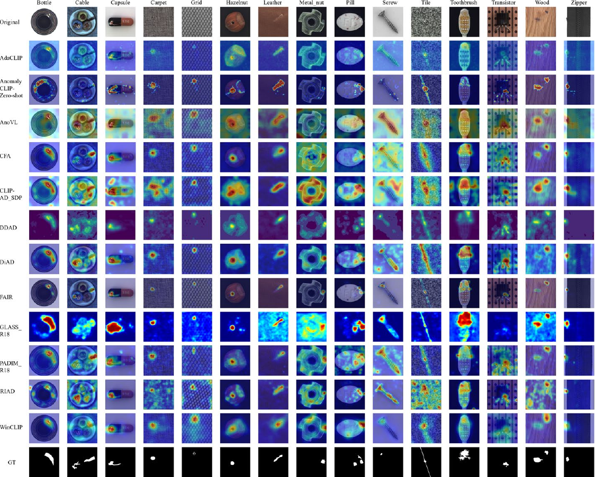

**图12** MVTec AD数据集上的实验结果。

图中文字释义：Original：原始图像；GT：真实标注；Zero-shot：零样本。各列依次为Bottle（瓶子）、Cable（电缆）、Capsule（胶囊）、Carpet（地毯）、Grid（网格）、Hazelnut（榛子）、Leather（皮革）、Metal_nut（金属螺母）、Pill（药丸）、Screw（螺钉）、Tile（瓷砖）、Toothbrush（牙刷）、Transistor（晶体管）、Wood（木材）、Zipper（拉链）。中间各行为对应模型的异常热力图，模型名保留。

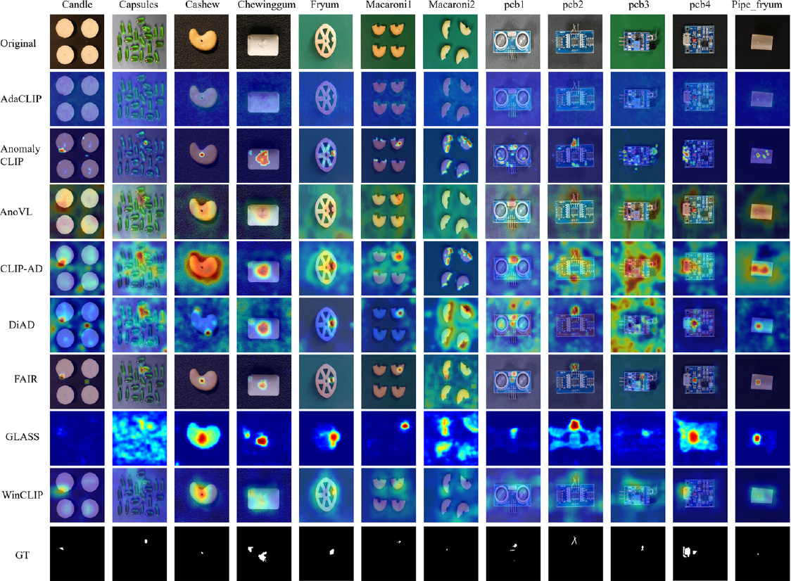

**图13** VisA数据集上的实验结果。

图中文字释义：Original：原始图像；GT：真实标注。各列依次为Candle（蜡烛）、Capsules（胶囊）、Cashew（腰果）、Chewinggum（口香糖）、Fryum（膨化零食）、Macaroni1／2（通心粉1／2）、pcb1至pcb4（印刷电路板1至4）、Pipe_fryum（管状膨化零食）。中间各行为对应模型异常热力图。

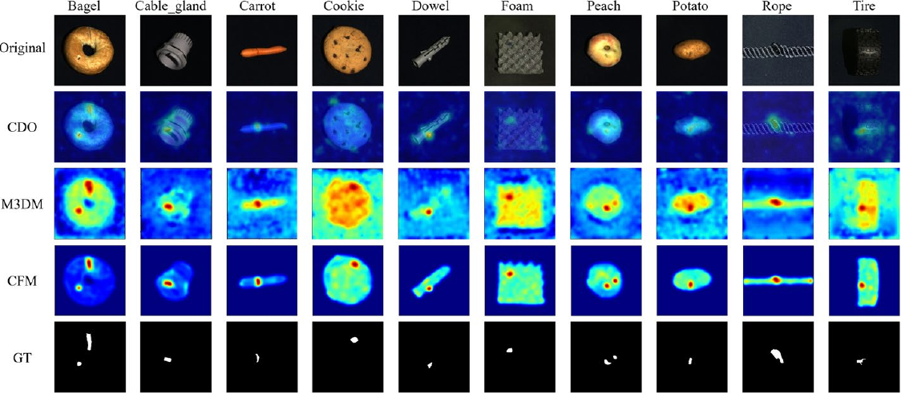

**图14** MVTec 3D AD数据集上的实验结果。

图中文字释义：Original：原始图像；GT：真实标注。各列依次为Bagel（百吉饼）、Cable_gland（电缆密封接头）、Carrot（胡萝卜）、Cookie（饼干）、Dowel（木销）、Foam（泡沫）、Peach（桃子）、Potato（土豆）、Rope（绳索）、Tire（轮胎）。CDO、M3DM、CFM各行为相应模型异常热力图。

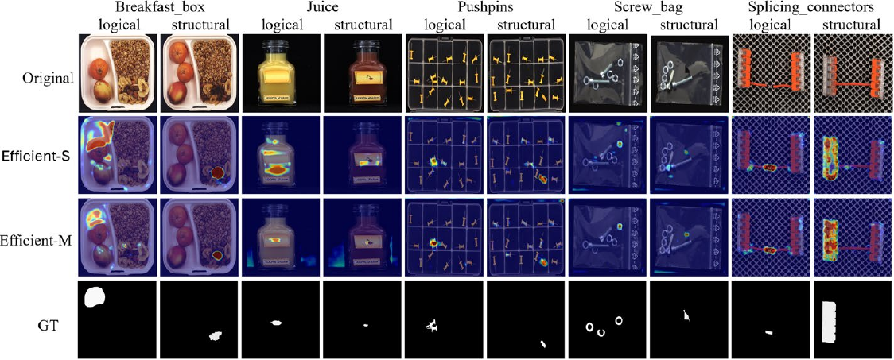

**图15** MVTec LOCO AD数据集上的实验结果。

图中文字释义：Original：原始图像；GT：真实标注；logical／structural：逻辑异常／结构异常。五组类别为Breakfast_box（早餐盒）、Juice（果汁）、Pushpins（图钉）、Screw_bag（螺钉袋）、Splicing_connectors（拼接连接器），每组分别展示两类异常。Efficient-S／Efficient-M为模型配置名称，保留原标识。

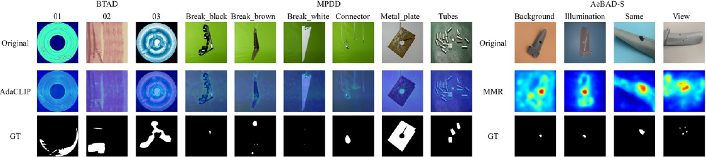

**图16** BTAD、MPDD和AeBAD-S数据集上的实验结果。

图中文字释义：Original：原始图像；GT：真实标注。BTAD列01、02、03为类别编号；MPDD列Break_black／Break_brown／Break_white为黑色／棕色／白色破损件，Connector为连接件，Metal_plate为金属板，Tubes为管件；AeBAD-S列Background／Illumination／Same／View分别为背景变化／照明变化／相同条件／视角变化。AdaCLIP与MMR为模型名。

### 4.3 参数选择

在工业视觉异常检测（IVAD）系统的真实部署中，超参数选择与优化仍是模型实施的主要挑战之一。困难主要源于工业环境的多样性与复杂性，不同生产线在相机角度、照明条件、缺陷表现形式以及合格产品的尺寸公差方面可能存在显著差异。这些差异妨碍了决策阈值、特征维数、骨干网络深度和批大小等关键超参数的统一优化。此外，生产过程中的环境变化，例如设备磨损、照明漂移或材料变化，可能引起域偏移，使性能随时间下降。这些动态因素进一步增加了参数选择难度，并降低固定超参数配置的长期可靠性。为应对这些问题，常见做法是以在多个公开数据集（例如 MVTec AD、VisA）上表现稳健的参数配置作为初始基线，然后利用少量现场数据进行轻量微调，校准阈值或调整特征相关设置。此外，引入注意力机制、多尺度特征融合、可学习归一化层等自适应模块，可以减轻模型对固定参数的敏感性，提高其在生产条件变化时的泛化能力。这些策略已在多种工业场景中得到广泛验证，表明它们在改善部署稳健性方面具有有效性和实用价值。

在工业视觉异常检测系统的实际部署中，阈值设置对实用性和经济效率起着关键作用。阈值过低会造成过多误报，导致生产线频繁中断，并增加人工复检成本；阈值过高则可能漏掉真实缺陷，带来重大质量风险。因此，选择恰当阈值是有效部署模型的必要条件。常见方法是在离线阶段利用少量标注数据，通过最大化 F1 分数确定初始阈值。仅有正常样本时，通常先对正常数据进行统计建模，再在异常分数分布的高分位点设置阈值，使其满足目标误报率。然而，模型部署后，照明变化、设备老化以及生产批次差异等因素常会导致异常分数分布漂移。为此，可以采用滑动窗口统计或代价敏感动态校准方法，在误报与漏报之间保持最佳平衡。工业实践表明，合理设计的阈值管理策略可使假阳性率降低超过 40%，同时将假阴性率保持在 0.1% 以下，凸显阈值优化在实际应用中的关键作用与实用价值。

## 5 挑战与未来方向

本节概述若干关键的未来研究方向，以推动工业异常检测领域的发展。

### 5.1 多模态与多视角数据集

在工业异常检测中，单幅 RGB 图像往往不足以完整捕捉产品或部件的异常特征。许多潜在异常并不限于物体表面，裂纹、空洞等内部缺陷更依赖 X 射线和超声等具有穿透能力的成像技术进行检测。相比之下，点云虽然能够提供三维形状信息，却无法穿透到物体深处。因此，仅依赖可见光或基于表面的检测技术，仍可能遗漏关键内部异常。为提高检测覆盖范围和准确率，有必要构建融合多模态数据的综合数据集，例如 RGB 图像、点云、X 射线成像和超声扫描。通过多模态协同，工业系统能够更全面地评估产品内外部状态，从而更精确地定位和识别复杂异常。这既是数据采集与融合面临的挑战，也是工业异常检测未来的重要方向。此外，要从多个观察方向捕捉物体异常，多视角数据采集方案同样不可或缺。以 Real-IAD 为例，该数据集面向真实工业场景，采用大规模、多视角采集方式，每个物体至少从五个不同视角拍摄，以充分考虑潜在外观变化。这类多视角、多模态数据资源，不仅能够适应工业场景中多变的物体形态和复杂背景，还可支持深度学习算法开展缺陷识别、定位和分类，最终为构建高精度、稳健的工业异常检测系统奠定坚实基础。

### 5.2 实时检测中的精度与延迟

在工业视觉检测场景中，实时异常检测与批处理检测在系统设计、性能要求和应用目标方面存在显著差异。实时检测强调毫秒级图像采集与推理响应，广泛用于高速节拍生产线、半导体缺陷检测等对响应速度极为敏感的场景。以 EfficientAD 为例，它在 NVIDIA RTX A6000 GPU 上的单图推理时延约为 2 毫秒，每秒最多处理 600 张图像，展现出优秀的实时检测性能，为工业部署提供参考。然而，在实际部署中，深度学习模型要实现实时性仍面临多种计算瓶颈。首先，卷积神经网络和 Transformer 等模型参数量大，需要执行大量矩阵与卷积运算，显著增加推理时延。其次，工业图像通常分辨率较高，大量中间特征和模型参数会造成内存瓶颈与带宽压力。同时，数据预处理与传输也对输入输出（I/O）性能提出挑战。边缘设备计算能力有限，往往难以支持复杂模型稳定运行，功耗与散热设计约束也不容忽视。此外，数据采集、预处理、模型推理与后处理各环节的时延存在累积效应；若缺乏系统级协同优化，整体响应将显著减慢。相比之下，批处理更适用于离线质量分析、缺陷统计和异常追溯。通过缓存图像或集中处理，批处理为模型表达能力提供更大空间，能够使用更复杂的模型结构和更强的后处理模块。不过，其检测结果存在反馈延迟，难以满足需要立即干预或控制的实时工业场景。

从技术实现角度看，实时检测通常依赖轻量模型、模型压缩技术和高效推理引擎，并部署在边缘设备、现场可编程门阵列（FPGA）或人工智能模块上。批处理则可以利用云资源运行大模型，实现更高分辨率或多模态检测能力。总体而言，实时检测强调低时延、高响应速度以及边缘部署能力；批处理则侧重分析的复杂度与深度，更适用于战略性质量监控和模型事后评估。在实际工业部署中，将边缘实时检测与云端批处理分析结合的混合架构，已成为兼顾即时干预和系统可扩展性的主流趋势。

### 5.3 生成式异常检测

在工业视觉异常检测领域，生成式检测方法日益受到重视。这些方法通过深度生成模型学习“正常”数据的分布，从而在推理阶段检测异常。对于正常样本易于获取、异常样本稀缺或难以获取的工业场景，这种方式尤其有效。随着生成模型在网络架构、训练策略、推理效率和可解释性方面持续进步，工业视觉异常检测正朝着更高准确率、更强适应性和更好可解释性的方向发展。特别是结合弱监督、半监督与多模态数据融合技术后，生成式异常检测在工业应用中的潜力能够进一步释放，支持高度自动化且可靠的工业系统，并为适应动态制造过程和多样缺陷模式提供更稳健的解决方案。

### 5.4 轻量化与硬件加速

随着工业自动化与智能制造快速发展，工业物联网和边缘计算在工业视觉异常检测中的应用价值日益突出。工业物联网连接高分辨率工业相机、智能传感器与执行器，持续、高频地采集并分发生产过程中的多源图像数据，为异常检测模型提供丰富、实时的视觉信息。然而，传统云端检测方法受到图像传输时延、带宽瓶颈及数据隐私问题限制，难以满足高速节拍生产线对低时延和高响应速度的实际需求。

为应对这些挑战，边缘计算正逐渐成为主流选择。将视觉异常检测模型直接部署在靠近数据源的边缘设备上，系统即可实现本地推理和毫秒级响应，显著降低传输时延与通信负载。在此过程中，可利用剪枝、量化和知识蒸馏等技术优化轻量神经网络架构，使其在资源受限的硬件平台上稳定运行。例如，在边缘 GPU 方面，NVIDIA Jetson Orin Nano 运行经过 INT8 量化的 EfficientAD 模型，处理每帧 640 × 640 图像约需 1.5 毫秒，满足高速节拍生产线每秒 600 帧的要求。在边缘张量处理单元（TPU）方面，Google Coral TPU 经过完整 INT8 编译后，运行基于 MobileNet 的检测器，推理时延为 12 毫秒。在工业 FPGA 方面，预装深度学习处理单元（DPU）或 Vitis-AI 的 AMD（Xilinx）Kria KV260 与 Versal AI Edge 模块，处理每帧 1080p 图像需 5 至 7 毫秒，同时保证确定性时延与低功耗。此外，TPU 和 FPGA 等专用硬件加速器在并行性、能效与可定制性方面具有独特优势，为边缘视觉检测任务提供有力支持。边云协同架构也已广泛用于工业场景：边缘端承担实时检测和初筛，云端负责复杂场景建模及高精度模型更新，从而平衡响应速度与检测准确率。未来，工业视觉检测系统将继续在边缘端融合低功耗视觉模块、多模态感知融合机制以及自适应结构搜索技术，更好地满足工业现场对高准确率、高效率和低功耗的多重需求，推动智能质量控制系统广泛落地。此外，在提高系统效率与部署灵活性的同时，模型网络安全也是工业部署中不可忽视的问题。人工智能驱动的异常检测模型可能面临多种风险，例如对抗攻击（通过构造输入误导模型）、数据投毒（篡改训练样本）和模型泄露（通过输出重建输入数据）。一旦这些安全风险遭到利用，不仅会影响系统可靠性，还可能导致生产线异常，甚至泄露敏感数据。因此，实际部署应引入对抗训练、访问控制和加密模型压缩等安全机制，保障工业智能检测系统的稳健性与可信性。

### 5.5 工业视觉异常检测的增量学习

在工业生产中，产品设计、制造工艺和缺陷类型不断变化，常使静态模型失效，因而需要代价高昂的完整重新训练。增量学习提供了一种实用方案，使模型在保留已学知识的同时，适应新出现的缺陷类别和变化的数据分布。这种方式显著减少频繁重新训练所需的时间与计算资源，并支持模型持续保持性能。在真实工业视觉异常检测部署中，增量学习通常分为两个互补阶段。第一阶段是自动发现新异常，常通过聚类或对被标记样本进行目视检查来完成。一旦确认新的缺陷模式，即可在低负载时段或直接在边缘设备上对模型进行有针对性的增量更新，迅速融入新特征。第二阶段重点是逐步适应照明条件变化、材料差异或设备磨损导致的分布偏移。在这一阶段，使用持续到来的小批量数据更新模型，并经常利用经验回放或正则化约束，防止对先前缺陷知识产生灾难性遗忘。展望未来，随着生产线自主性和灵活性不断提高，增量学习将在保障工业视觉异常检测系统对未预见缺陷模式保持高度稳健性与响应能力方面发挥关键作用。这种能力对于在动态工业环境中维持一致的质量控制至关重要。

### 5.6 联邦学习与隐私保护技术

随着工业场景日益重视数据安全，联邦学习与隐私保护技术在视觉异常检测中受到越来越多关注。传统训练范式通常依赖集中汇聚数据，存在数据泄露及不符合监管要求的潜在风险。相比之下，联邦学习将模型训练分布到多个本地客户端，并在不传输原始图像数据的情况下更新参数，从而增强数据安全与合规性。

在工业视觉检测任务中，不同工厂、设备或生产线之间的数据分布常存在显著差异。联邦学习能够在保留各节点特定数据域特征的同时开展协作式模型训练，从而改善异构环境下的泛化能力。此外，结合差分隐私、同态加密与安全聚合技术，可进一步防止从模型更新中推断或重建敏感数据，在边缘端提供稳健保护。

近期关于基于联邦学习的异常检测框架研究，已开始探索分布式边缘节点之间的知识共享策略，尤其关注如何应对概念漂移与非平稳数据流。未来，将联邦学习与多模态融合、模型压缩及知识蒸馏相结合，有望推动更安全、高效且可扩展的工业视觉异常检测系统发展。

## 6 结论

本文系统探讨了工业视觉异常检测从方法到实际应用的发展现状与新兴趋势。根据监督程度和监督信号，将现有方法划分为全监督、半监督、自监督、弱监督和无监督五类，并结合具体案例，深入分析其设计动机、实现挑战和性能特点。此外，本文综述基于嵌入和基于重建的工业视觉异常检测方法，比较它们在提高检测准确率和降低推理成本方面的优势与局限。通过全面分析现有数据集及其应用场景，总结工业视觉异常检测面临的主要挑战，包括数据多样性不足、标注成本高，以及对轻量模型的迫切需求。为应对这些挑战，本文提出若干有前景的研究方向，包括引入生成模型、开发轻量方法、融合多模态数据，以及构建系统化、集成化的工业异常检测方案。希望对这些方向的深入探讨能够进一步推动工业视觉异常检测在真实场景中的应用，提高工业生产与质量控制的效率和可靠性。

## 作者贡献、经费与声明

作者贡献：全体作者共同参与研究构思与设计。Zhuo Li：数据整理、初稿撰写、方法学、项目管理、软件、验证。Yuhao Yan：数据整理、初稿撰写、软件、验证。Xiangheng Wang：数据整理、审阅与编辑。Yifei Ge：审阅与编辑、调查研究、资源。Lin Meng：审阅与编辑、概念构思、项目管理、形式分析。全体作者阅读并批准最终稿。

经费：本研究部分得到JST SPRING支持，项目编号JPMJSP2101。

数据可用性：数据可应要求提供。

利益冲突：作者声明不存在可能影响本文所报告工作的已知竞争性经济利益或个人关系。

开放获取：本文依据知识共享署名-非商业性使用-禁止演绎4.0国际许可协议授权。只要适当注明原作者与来源、提供许可链接，并说明是否修改授权材料，即可出于非商业目的在任何媒介或格式下使用、分享、分发和复制。该许可不允许分享基于本文全部或部分内容改编的材料。除非材料署名行另有说明，文中图像及其他第三方材料包含在本文知识共享许可范围内。若材料未纳入该许可，且拟议用途不属于法律允许或超出允许范围，则须直接获得著作权人许可。许可全文：[CC BY-NC-ND 4.0](http://creativecommons.org/licenses/by-nc-nd/4.0/)。

## 参考文献

1. Akcay S, Atapour-Abarghouei A, Breckon TP (2019)。《GANomaly：通过对抗训练进行半监督异常检测》。In Computer Vision–ACCV 2018: 14th Asian Conference on Computer Vision, Perth, Australia, December 2–6, 2018, Revised Selected Papers, Part III 14, 页码：622–637. Springer出版社

2. Bae J, Lee J-H, Kim S (2023)。《PNI：利用位置与邻域信息的工业异常检测》。载IEEE/CVF国际计算机视觉会议论文集 (ICCV), 页码：6373–6383

3. Batzner K, Heckler L, König R (2024)。《EfficientAD：毫秒级延迟下的精确视觉异常检测》。载IEEE/CVF计算机视觉应用冬季会议论文集 (WACV), 页码：128–138

4. Bauer A, Nakajima S, Müller K-R (2024)。《用于视觉异常检测的自监督自编码器》。Mathematics 12(24):3988

5. Bergmann P, Batzner K, Fauser M, Sattlegger D, Steger C (2022)。《超越凹痕与划痕：无监督异常检测与定位中的逻辑约束》。Int J Comput Vis 130(4):947–969

6. Bergmann P, Fauser M, Sattlegger D, Steger C (2019)。《MVTec AD：用于无监督异常检测的综合真实世界数据集》。载IEEE/CVF计算机视觉与模式识别会议论文集 (CVPR)

7. Bergmann P, Fauser M, Sattlegger D, Steger C (2020)。《无先验知识的学生：利用判别性潜在嵌入的师生异常检测》。载IEEE/CVF计算机视觉与模式识别会议论文集 (CVPR)

8. Bergmann P, Jin X, Sattlegger D, Steger C (2022)。《用于无监督三维异常检测与定位的MVTec 3D-AD数据集》。In Proceedings of the 17th International Joint Conference on Computer Vision, Imaging and Computer Graphics Theory and Applications (VISIGRAPP), 页码：202–213

9. Bergmann P, Sattlegger D (2023)。《利用深度几何描述子的三维点云异常检测》。载IEEE/CVF计算机视觉应用冬季会议论文集, 页码：2613–2623

10. Bin W, Wang X (2024)。《利用特征增强辅助的自监督学习进行工业图像异常检测》。Appl Sci 14(16):7301

11. Bonfiglioli L, Toschi M, Silvestri D, Fioraio N, Gregorio D De (2022)。《用于无监督多模态异常检测与定位的Eyecandies数据集》。载亚洲计算机视觉会议论文集 (ACCV), 页码：3586–3602

12. Božič J, Tabernik D, Skočaj D (2021)。《用于表面缺陷检测的混合监督：从弱监督到全监督学习》。Comput Ind 129:103459

13. Cai Y, Liang D, Luo D, He X, Yang X, Bai X (2023)。《用于稳健异常检测的差异感知框架》。IEEE Trans Ind Inform 20(3):3986–3995

14. Cai W, Gao J (2023)。《SSCL：用于工业异常检测的半监督对比学习》。载中国模式识别与计算机视觉会议 (PRCV), 页码：100–112. Springer出版社

15. Cai Y, He X, Liang D, Tong A, Bai X (2024)。《通过适配预训练视觉语言模型进行异常检测》。arXiv预印本 arXiv:2403.09493

16. Cao Y, Wan Q, Shen W, Gao L (2022)。《用于图像异常分割的信息丰富的知识蒸馏》。Knowl-Based Syst 248:108846

17. Cao Y, Xiaohao X, Liu Z, Shen W (2023)。《用于可靠图像异常定位的协同差异优化》。IEEE Trans Industr Inf 19(11):10674–10683

18. Cao Y, Xiaohao X, Shen Weiming (2024)。《用于点云异常检测的互补伪多模态特征》。Pattern Recogn 156:110761

19. Cao Y, Xu X, Sun C, Gao L, Shen W (2024)。《BiaS：引入有偏知识以增强无监督图像异常定位》。IEEE Trans Syst Man Cybernetics: Syst 54(4):2342–2353

20. Cao Y, Xu X, Sun C, Cheng Y, Du Z, Gao L, Shen W (2023)。《通过混合提示正则化实现无需训练的任意异常分割》。arXiv预印本 arXiv:2305.10724

21. Cao Y, Xu X, Zhang J, Cheng Y, Huang X, Pang G, Shen W (2024)。《视觉异常检测综述：挑战、方法与前景》。arXiv预印本 arXiv:2401.16402

22. Cao Y, Zhang J, Frittoli L, Cheng Y, Shen W, Boracchi G (2024)。《AdaCLIP：通过混合可学习提示适配CLIP以实现零样本异常检测》。载欧洲计算机视觉会议, 页码：55–72. Springer出版社

23. Cao T, Zhu J, Pang G (2023)。《分布偏移下的异常检测》。载IEEE/CVF国际计算机视觉会议论文集 (ICCV), 页码：6511–6523

24. Chen Q, Luo H, Gao H, Lv C, Zhang Z (2024)。《用于工业异常检测的渐进边界引导异常合成》。IEEE Trans Circ Syst Video Technol 35:1193–1208

25. Cheng Y, Cao Y, Xie G, Lu Z, Shen W (2024)。《迈向零样本点云异常检测：一种多视图投影框架》。arXiv预印本 arXiv:2409.13162

26. Chen Q, Luo H, Lv C, Zhang Z (2024)。《用于工业异常检测与定位的梯度上升统一异常合成策略》。载欧洲计算机视觉会议 (ECCV)

27. Chen R, Xie G, Liu J, Wang J, Luo Z, Wang J, Zheng F (2023)。《EasyNet：一种用于三维工业异常检测的简易网络》。载第31届ACM国际多媒体会议论文集 (ACM MM)

28. Chen X, Xu H, Deng C, Tu X, Ding X, Huang Y (2024)。《用于异常检测与定位的隐式前景引导网络》。In ICASSP 2024-2024 IEEE International Conference on Acoustics, Speech and Signal Processing (ICASSP), 页码：2970–2974. IEEE

29. Chen X, Zhang J, Tian G, He H, Zhang W, Wang Y, Wang C, Wu Y, Liu Y (2023)。《CLIP-AD：用于零样本异常检测的语言引导分阶段双路径模型》。arXiv预印本 arXiv:2311.00453

30. Costanzino A, Ramirez P Z, Lisanti G, Stefano LD (2024)。《通过跨模态特征映射进行多模态工业异常检测》。载IEEE/CVF计算机视觉与模式识别会议论文集 (CVPR), 页码：17234–17243

31. De NA, Pankaj M, Luca FG, Claudio P (2022)。《用于图像异常定位的掩码Transformer》。Int J Neural Syst 32(07):2250030

32. Defard T, Setkov A, Loesch A, Audigier R (2021)。《PaDiM：用于异常检测与定位的图像块分布建模框架》。载国际模式识别会议, 页码：475–489. Springer出版社

33. Deng H, Li X (2022)。《通过单类嵌入的反向蒸馏进行异常检测》。载IEEE/CVF计算机视觉与模式识别会议论文集 (CVPR), 页码：9737–9746

34. Deng H, Zhang Z, Bao J, Li X (2023)。《AnoVL：适配视觉语言模型以实现统一的零样本异常定位》。arXiv预印本 arXiv:2308.15939

35. Ding C, Pang G, Shen C (2022)。《同时捕捉灰天鹅与黑天鹅：开放集监督异常检测》。载IEEE/CVF计算机视觉与模式识别会议论文集 (CVPR), 页码：7388–7398

36. Duan Y, Hong Y, Niu L, Zhang L (2023)。《通过缺陷感知特征操控进行少样本缺陷图像生成》。载AAAI人工智能会议论文集 37:571–578

37. Fan L, Ding Y, Pagnucco M, Song Y (2024)。《用于异常检测与定位的图像块级数据增强》。In ICASSP 2024-2024 IEEE International Conference on Acoustics, Speech and Signal Processing (ICASSP), 页码：5425–5429. IEEE

38. Fang Z, Wang X, Li H, Liu J, Hu Q, Xiao J (2023)。《FastRecon：通过快速特征重建进行少样本工业异常检测》。载IEEE/CVF国际计算机视觉会议论文集 (ICCV), 页码：17481–17490

39. Fučka Matic, Zavrtanik Vitjan, Skočaj Danijel (2024)。《TransFusion：一种基于透明度的异常检测扩散模型》。载欧洲计算机视觉会议 (ECCV)

40. Gu H, Li G, Liu Z (2024)。《用于异常检测的基于掩码特征再生的非对称师生网络》。Multimedia Tools Appl 83(42):90573–90594

41. Gudovskiy D, Ishizaka S, Kozuka K (2022)。《CFLOW-AD：通过条件归一化流实现实时无监督异常检测与定位》。载IEEE/CVF计算机视觉应用冬季会议论文集 (WACV), 页码：98–107

42. Gu Z, Liu L, Chen X, Yi R, Zhang J, Wang Y, Wang C, Shu A, Jiang G, Ma L (2023)。《记住正常性：用于无监督异常检测的记忆引导知识蒸馏》。载IEEE/CVF国际计算机视觉会议论文集 (ICCV), 页码：16401–16409

43. Guo H, Ren L, Fu J, Wang Y, Zhang Z, Lan C, Wang H, Hou X (2023)。《用于异常检测的模板引导分层特征恢复》。载IEEE/CVF国际计算机视觉会议论文集 (ICCV), 页码：6447–6458

44. Gu Z, Zhu B, Zhu G, Chen Y, Li H, Tang M, Wang J (2024)。《FiLo：通过细粒度描述与高质量定位进行零样本异常检测》。arXiv预印本 arXiv:2404.13671

45. Haohao X, Shuchang X, Yang W (2023)。《利用扩散模型进行无监督工业异常检测》。J Vis Commun Image Represent 97:103983

46. Hattori K, Ishibashi R, Kaneko H, Izumi Tomonori, Lin Meng (2024)。《基于分割元素的异常检测》。IEEE Access, Sead

47. He H, Bai Y, Zhang J, He Q, Chen H, Gan Z, Wang C, Li X, Tian G, Xie L (2024)。《MambaAD：探索用于多类别无监督异常检测的状态空间模型》。Adv Neural Inform Proc Syst. https://do i.org/10.48550/arXiv.2404.06564

48. He H, Erfani S, Gong M, Ke Q (2024)。《通过密集预训练学习用于图像异常定位的可迁移表示》。载IEEE/CVF计算机视觉应用冬季会议论文集 (WACV), 页码：1113–1122

49. He H, Zhang J, Chen H, Chen X, Zhishan Li X, Chen YW, Wang C, Xie Lei (2024)。《用于多类别异常检测的扩散框架》。载AAAI人工智能会议论文集 38:8472–8480

50. Hojjati H, Ho TKK, Armanfard N (2024)。《计算机视觉及更广泛领域中的自监督异常检测：综述与展望》。Neural Netw 172:106106

51. Horwitz E, Hoshen Y (2023)。《回归特征：经典三维特征几乎就是三维异常检测所需的一切》。载IEEE/CVF计算机视觉与模式识别会议研讨会论文集, 页码：2968–2977

52. Hou J, Zhang Y, Zhong Q, Xie D, Pu S, Zhou H (2021)。《分割与组装：学习用于无监督异常检测的分块记忆》。载IEEE/CVF国际计算机视觉会议论文集 (ICCV), 页码：8791–8800

53. Huang J, Zhao K, Li C, Lin Y, Liu Z, Wang K, Lian S (2024)。《利用图像块生成与比较网络进行自监督视觉异常检测》。载国际智能计算会议, 页码：96–113. Springer出版社

54. Hu J, Chen X, Gan Z, Peng J, Zhang S, Zhang J, Wang Y, Wang C, Cao L, Ji R (2024)。《DMAD：用于真实世界异常检测的双记忆库》。arXiv预印本 arXiv:2403.12362

55. Hyun J, Kim S, Jeon G, Kim S H, Bae K, Kang B J (2024)。《ReconPatch：用于工业异常检测的对比图像块表示学习》。载IEEE/CVF计算机视觉应用冬季会议论文集 (WACV), 页码：2052–2061

56. Jeong Jongheon, Zou Y, Kim T, Zhang D, Ravichandran A, Dabeer O (2023)。《WinCLIP：零样本与少样本异常分类及分割》。载IEEE/CVF计算机视觉与模式识别会议论文集 (CVPR), 页码：19606–19616

57. Jezek S, Jonak M, Burget R, Dvorak P, Skotak M (2021)。《基于深度学习的金属零件缺陷检测：在复杂条件下评估现有方法》。In 2021 13th International congress on ultra modern telecommunications and control systems and workshops (ICUMT), 页码：66–71. IEEE

58. Jiang J, Zhu J, Bilal M, Cui Y, Kumar N, Dou R, Feng S, Xiaolong X (2022)。《用于工业异常检测的掩码Swin Transformer U-Net》。IEEE Trans Industr Inf 19(2):2200–2209

59. Kaitai Z, Bin W, Jay KCC (2022)。《PEDENet：通过图像块嵌入与密度估计进行图像异常定位》。Pattern Recogn Lett 153:144–150

60. Kim D, Park C, Cho S, Lee S (2023)。《FAPM：用于实时工业异常检测的快速自适应图像块记忆》。In ICASSP 2023-2023 IEEE International Conference on Acoustics, Speech and Signal Processing (ICASSP), 页码：1–5. IEEE

61. Koshil M, Wegener T, Mentrup D, Frintrop S, Wilms C (2024)。《AnomalousPatchCore：探索工业异常检测中异常样本的使用》。载欧洲计算机视觉会议 Workshop (ECCVW)

62. Lee J C, Kim T, Park E, Woo S S, Ko J H (2022)。《用于异常检测的连续记忆表示》。载欧洲计算机视觉会议. Springer出版社

63. Lee Y, Kang P (2022)。《AnoViT：利用视觉Transformer编码器-解码器进行无监督异常检测与定位》。IEEE Access 10:46717–46724

64. Lee S, Lee S, Song BC (2022)。《CFA：基于耦合超球面的特征适配以实现面向目标的异常定位》。IEEE Access 10:78446–78454

65. Lee Y, Jang S, Yoon H (2024)。《AnoPLe：仅使用正常样本、通过双向提示学习进行少样本异常检测》。arXiv预印本 arXiv:2408.13516

66. Lei J, Hu X, Wang Y, Liu D (2023)。《PyramidFlow：利用金字塔归一化流进行高分辨率缺陷对比定位》。载IEEE/CVF计算机视觉与模式识别会议论文集 (CVPR), 页码：14143–14152

67. Li C-L, Sohn K, Yoon J, Pfister T (2021)。《CutPaste：用于异常检测与定位的自监督学习》。载IEEE/CVF计算机视觉与模式识别会议论文集 (CVPR), 页码：9664–9674

68. Li Z, Zhu Y, Van Leeuwen M (2023)。《可解释异常检测综述》。ACM Trans Knowl Discov Data 18(1):1–54

69. Li Z, Ge Y, Wang X, Meng Lin (2024)。《通过双重建网络进行三维工业异常检测》。Appl Intell 54(20):9956–9970

70. Li Z, Ge Y, Yue X, Meng L (2024)。《MCAD：通过关系知识蒸馏进行多类别异常检测》。Neural Comput Appl 6(23):14543–14557

71. Liang Y, Zhang J, Zhao S, Wu R, Liu Y, Pan S (2023)。《用于无监督异常检测的全频率通道选择表示》。IEEE Trans Image Proc 32:4327–4340

72. Li H, Chen Z, Xu Y, Hu J (2024)。《双曲空间异常检测》。载IEEE/CVF计算机视觉与模式识别会议论文集 (CVPR), 页码：17511–17520

73. Li Z, Ge Y, Li Q, Meng L (2024)。《IAD-CLIP：用于零样本工业异常检测的视觉语言模型》。In 2024 International Conference on Advanced Mechatronic Systems (ICAMechS), 页码：123–128. IEEE

74. Lijie Z, Yuan C, Qichun Z, Reza KH (2024)。《基于前景增强与自编码器重建的自监督异常检测》。SIViP 18(1):343–350

75. Lin Y, Chang Y, Tong X, Yu J, Liotta A, Huang G, Song W, Zeng D, Wu Z, Wang Y et al (2024)。《无监督工业异常检测中RGB、三维及多模态方法综述》。arXiv预印本 arXiv:2410.21982

76. Li C, Qi L, Geng Xin (2024)。《用于异常检测的SAM引导双流轻量模型》。ACM Transactions on Multimedia Computing, Communications and Applications

77. Liu T, Li B, Xiao D, Jiang B, Jin X, Jin L, Zhao Z (2023)。《用于可调节且包含逻辑约束的工业视觉检验的组件感知异常检测框架》。Adv Eng Inform 58:102161

78. Liu J, Xie G, Chen R, Li X, Wang J, Liu Y, Wang C, Zheng F (2024)。《Real3D-AD：一个点云异常检测数据集》。Adv Neural Inform Proc Syst 36:30402–30415

79. Liu J, Xie G, Wang J, Li S, Wang C, Zheng F, Jin Y (2024)。《工业图像深度异常检测：综述》。Mach Intel Res 21(1):104–135

80. Liu W, Chang H, Ma B, Shan S, Chen X (2023)。《多样性可度量的异常检测》。载IEEE/CVF计算机视觉与模式识别会议论文集 (CVPR), 页码：12147–12156

81. Liu J, Kai W, Nie Q, Chen Y, Gao B-B, Liu Y, Wang J, Wang C, Zheng Feng (2024)。《利用对比学习提示进行无监督持续异常检测》。载AAAI人工智能会议论文集 38:3639–3647

82. Liu T, Li B, Du X, Jiang B, Geng L, Wang F, Zhao Z (2023)。《FAIR：用于工业视觉异常检测的频率感知图像恢复》。arXiv预印本 arXiv:2309.07068

83. Liu J, Wang F (2024)。《用于多类别工业异常检测的混合注意力自编码器》。In ICASSP 2024-2024 IEEE International Conference on Acoustics, Speech and Signal Processing (ICASSP), 页码：4120–4124. IEEE

84. Liu X, Wang J, Leng B, Zhang S (2024)。《用于无监督异常检测的双建模解耦蒸馏》。载第32届ACM国际多媒体会议论文集 (ACM MM)

85. Liu Z, Zhou Y, Xu Y, Wang Z (2023)。《SimpleNet：用于图像异常检测与定位的简单网络》。载IEEE/CVF计算机视觉与模式识别会议论文集 (CVPR), 页码：20402–20411

86. Li Y, Wang H, Yuan S, Liu M, Zhao D, Guo Y, Xu C, Shi G, Zuo W (2023)。《Myriad：将视觉专家用于工业异常检测的大型多模态模型》。arXiv预印本 arXiv:2310.19070

87. Li W, Xu X, Gu Y, Zheng B, Gao S, Wu Y (2024)。《迈向可扩展的三维异常检测与定位：基于三维异常合成的基准与自监督学习网络》。载IEEE/CVF计算机视觉与模式识别会议论文集 (CVPR), 页码：22207–22216

88. Li X, Zhang Z, Tan X, Chen C, Qu Y, Xie Y, Ma L (2024)。《PromptAD：仅利用正常样本学习提示以进行少样本异常检测》。载IEEE/CVF计算机视觉与模式识别会议论文集 (CVPR), 页码：16838–16848

89. Luca R, Morgan BF, Simone C (2025)。《利用振动与温度监测塑料链式输送系统》。Mech Syst Signal Process 223:111935

90. Luiz Vieira André, Silva e, Simões Francisco, Kowerko Danny, Schlosser Tobias, Battisti Felipe, Teichrieb Veronica (2024)。《注意力模块改善工业检验中的图像级异常检测：DifferNet案例研究》。载IEEE/CVF计算机视觉应用冬季会议论文集 (WACV), 页码：8246–8255

91. Luo J, Lin J, Yang Z, Liu H (2022)。《SMD异常检测：一种自监督纹理与结构异常检测框架》。IEEE Trans Instrum Meas 71:1–11

92. Luo W, Yao H, Yu W, Li Z (2024)。《AMI-Net：用于工业异常检测与定位的自适应掩码修复网络》。IEEE Trans Autom Sci Eng. https://doi.org/10.1109/TASE.2024.3368142

93. Lu F, Yao X, Fu C-W, Jia J (2023)。《将异常作为噪声去除以实现工业缺陷定位》。载IEEE/CVF国际计算机视觉会议论文集 (ICCV), 页码：16166–16175

94. Madan N, Ristea N-C, Radu Tudor Ionescu, Kamal Nasrollahi, Fahad Shahbaz Khan, Thomas B Moeslund, Mubarak Shah (2023)。《用于异常检测的自监督掩码卷积Transformer模块》。IEEE Transactions on Pattern Analysis and Machine Intelligence

95. Mansoor Kamoona Ammar, Khodadadian Gostar Amirali, Xiaoying Wang, Mark Easton, Alireza Bab-Hadiashar, Reza Hoseinnezhad (2024)。《在随机有限集框架内利用点模式特征能量进行缺陷异常检测》。Eng Appl Artif Intell 130:107706

96. McIntosh D, Albu A B (2023)。《跨实现通道：超越单类分类的无监督异常检测》。载IEEE/CVF国际计算机视觉会议论文集 (ICCV), 页码：6285–6295

97. Milković F, Posilović L, Medak D, Subašić M, Lončarić S, Budimir M (2024)。《FRanomaly：基于流的快速图像异常检测》。Appl Intell 54(4):3502–3515

98. Mishra P, Verk R, Fornasier D, Piciarelli C, Foresti G L (2021)。《VT-ADL：用于图像异常检测与定位的视觉Transformer网络》。In 2021 IEEE 30th International Symposium on Industrial Electronics (ISIE), 页码：01–06. IEEE

99. Morgan BF, Luca R, Simone C (2023)。《在高度不一致条件下运行的自动化生产线质量控制新方法》。Eng Appl Artif Intell 122:106149

100. Mousakhan A, Brox T, Tayyub J (2023)。《利用条件去噪扩散模型进行异常检测》。arXiv预印本 arXiv:2305.15956

101. Nguyen H H, Nguyen C N, Dao X T, Duong Q T, Kim Dzung P T, Pham M-T (2024)。《用于异常检测的变分自编码器：比较研究》。arXiv预印本 arXiv:2408.13561

102. Park YH, Kang S, Kim M J, Jeong H, Park H, Kim H S, Yi J (2024)。《提升异常检测性能的神经网络训练策略：重建损失放大的视角》。In ICASSP 2024-2024 IEEE International Conference on Acoustics, Speech and Signal Processing (ICASSP), 页码：5165–5169. IEEE

103. Pirnay J, Chai K (2022)。《用于异常检测的图像修复Transformer》。载国际图像分析与处理会议, 页码：394–406. Springer出版社

104. Qiangwei W, Li H, Tian C, Wen L, Li Xinyu (2024)。《AEKD：用于工业异常检测的无监督自编码器知识蒸馏》。J Manuf Syst 73:159–169

105. Qin J, Chunzhi G, Jun Y, Zhang C (2024)。《用于图像异常检测的多层级显著性引导自监督学习》。Signal, Image and Video Processing, pp 1–13

106. Radford A, Kim J W, Hallacy C, Ramesh A, Goh G, Agarwal S, Sastry G, Askell A, Mishkin P, Clark J, et al (2021)。《从自然语言监督中学习可迁移视觉模型》。In Proceedings of the 38th International Conference on Machine Learning, ICML, volume 139, 页码：8748–8763. PMLR

107. Ristea N-C, Madan N, Ionescu RT, Nasrollahi K, Khan FS, Moeslund TB, Shah M (2022)。《用于异常检测的自监督预测卷积注意力模块》。载IEEE/CVF计算机视觉与模式识别会议论文集 (CVPR), 页码：13576–13586

108. Rolih B, Ameln D, Vaidya A, Akcay S (2024)。《分而治之：通过节省内存的分块集成进行高分辨率工业异常检测》。载IEEE/CVF计算机视觉与模式识别会议研讨会论文集, 页码：3866–3875

109. Roth K, Pemula L, Zepeda J, Schölkopf B, Brox T, Gehler P (2022)。《迈向工业异常检测中的完全召回》。载IEEE/CVF计算机视觉与模式识别会议论文集 (CVPR), 页码：14318–14328

110. Rudolph M, Wandt B, Rosenhahn B (2021)。《看似相同却又不同：利用归一化流进行半监督缺陷检测》。载IEEE/CVF计算机视觉应用冬季会议论文集 (WACV), 页码：1907–1916

111. Rudolph M, Wehrbein T, Rosenhahn B, Wandt B (2022)。《用于基于图像的缺陷检测的全卷积跨尺度流》。载IEEE/CVF计算机视觉应用冬季会议论文集 (WACV), 页码：1088–1097

112. Rudolph M, Wehrbein T, Rosenhahn B, Wandt B (2023)。《用于工业异常检测的非对称师生网络》。载IEEE/CVF计算机视觉应用冬季会议论文集 (WACV), 页码：2592–2602

113. Salehi M, Sadjadi N, Baselizadeh S, Rohban M H, Rabiee H R (2021)。《用于异常检测的多分辨率知识蒸馏》。载IEEE/CVF计算机视觉与模式识别会议论文集 (CVPR), 页码：14902–14912

114. Schlüter Hannah M, Tan J, Hou B, Kainz B (2022)。《用于自监督异常检测与定位的自然合成异常》。载欧洲计算机视觉会议, 页码：474–489. Springer出版社

115. Shenxing W, Xing W, Rifki KM, Zhiheng M, Yihong G (2023)。《用于弱监督异常检测与分割的拓扑保持迁移学习》。Pattern Recogn Lett 170:77–84

116. Shi Y, Yang J, Qi Z (2021)。《通过深度特征重建进行无监督异常分割》。Neurocomputing 424:9–22

117. Shuai L, Dongmei M, Wai W (2024)。《REB：减少工业异常检测表示中的偏差》。Knowledge-Based Syst 290:111563

118. Sohn K, Yoon J, Li C-L, Lee C-Y, Pfister T (2023)。《异常聚类：将图像分为异常类型一致的簇》。载IEEE/CVF计算机视觉应用冬季会议论文集 (WACV), 页码：5479–5490

119. Song X, Cao S, Zhang J, Hou Z (2024)。《基于YOLOv8的钢材表面缺陷检测算法》。Electronics 13(5):988

120. Sträter Luc PJ, Salehi M, Gavves E, Snoek Cees GM, Asano Yuki M (2024)。《GeneralAD：通过关注失真特征进行跨领域异常检测》。载欧洲计算机视觉会议 (ECCV)

121. Sugawara S, Imamura R (2024)。《PUAD：一种出奇简单的稳健异常检测方法》。arXiv预印本 arXiv:2402.15143

122. Tamura M (2023)。《利用CLIP的随机词数据增强进行零样本异常检测》。In 34th British Machine Vision Conference 2023, BMVC, 页码：18–21

123. Tebbe J, Tayyub J(2024)。《D3AD：用于异常检测的动态去噪扩散概率模型》。arXiv预印本 arXiv:2401.04463

124. Teng H, Zhang J, Yi R, Yuzhen D, Chen X, Liu L, Wang Y, Wang C (2024)。《AnomalyDiffusion：利用扩散模型进行少样本异常图像生成》。载AAAI人工智能会议论文集 38:8526–8534

125. Tien TD, Nguyen AT, Tran NH, Huy TD, Duong STM, Nguyen CD. Tr, Truong Steven QH (2023)。《重新审视用于异常检测的反向蒸馏》。载IEEE/CVF计算机视觉与模式识别会议论文集 (CVPR), 页码：24511–24520

126. Tong G, Li Q, Song Y (2024)。《基于反向知识蒸馏的增强多尺度特征互映射融合，用于工业异常检测与定位》。IEEE Trans Big Data 10(4):498–513

127. Tsai C-C, Wu T-H, Lai S-H (2022)。《用于图像异常检测与分割的基于多尺度图像块的表示学习》。载IEEE/CVF计算机视觉应用冬季会议论文集 (WACV), 页码：3992–4000

128. Tsai M-C, Wang S-De (2023)。《利用合成异常进行自监督图像异常检测与定位》。In 2023 10th International Conference on Internet of Things: Systems, Management and Security (IOTSMS), 页码：90–95. IEEE

129. Tu Y, Zhang B, Liu L, Li Y, Zhang J, Wang Y, Wang C, Zhao C (2024)。《用于三维工业异常检测的自监督特征适配》。载欧洲计算机视觉会议, 页码：75–91. Springer出版社

130. Wan Q, Gao L, Li X, Wen L (2021)。《基于预训练特征高斯聚类的工业图像异常定位》。IEEE Trans Industr Electron 69(6):6182–6192

131. Wan Q, Gao L, Li X, Wen L (2022)。《基于预训练特征映射的无监督图像异常检测与分割》。IEEE Trans Industr Inf 19(3):2330–2339

132. Wan Q, Cao Y, Gao L, Shen W, Li X (2022)。《用于图像异常检测的位置编码增强特征映射》。In 2022 IEEE 18th International Conference on Automation Science and Engineering (CASE), 页码：876–881. IEEE

133. Wang K, Zhang S, Cao Y, Yang L (2024)。《基于稀疏先验的弱监督异常检测》。Electronic Res Archive 32(6):3728–3741

134. Wang G, Han S, Ding E, Huang D (2021)。《用于异常检测的师生特征金字塔匹配》。arXiv预印本 arXiv:2103.04257

135. Wang Q, Hu H, Zhou Y (2024)。《MemoryMamba：用于缺陷识别的记忆增强状态空间模型》。arXiv预印本 arXiv:2405.03673

136. Wang Y, Peng J, Zhang J, Yi R, Wang Y, Wang C (2023)。《通过混合融合进行多模态工业异常检测》。载IEEE/CVF计算机视觉与模式识别会议论文集, 页码：8032–8041

137. Wang S, Wu L, Cui L, Shen Y (2021)。《关注图像块：通过全局与局部特征比较进行异常定位》。载IEEE/CVF计算机视觉与模式识别会议论文集 (CVPR), 页码：254–263

138. Wang C, Zhu W, Gao B-B, Gan Z, Zhang J, Gu Z, Qian S, Chen M, Ma L (2024)。《Real-IAD：用于多功能工业异常检测基准评估的真实世界多视角数据集》。载IEEE/CVF计算机视觉与模式识别会议论文集 (CVPR), 页码：22883–22892

139. Wei C, Hui HY, Xia Ji Ze (2025)。《TDAD：利用两阶段扩散模型进行自监督工业异常检测》。Comput Ind 164:104192

140. Wyatt J, Leach A, Schmon Sebastian M, Willcocks Chris G (2022)。《AnoDDPM：使用单纯形噪声的去噪扩散概率模型异常检测》。载IEEE/CVF计算机视觉与模式识别会议研讨会论文集, 页码：650–656

141. Xia X, Pan X, Li N, He X, Ma L, Zhang X, Ding N (2022)。《基于生成对抗网络的异常检测：综述》。Neurocomputing 493:497–535

142. Xie G, Wang J, Liu J, Lyu J, Liu Y, Wang C, Zheng F, Yaochu Jin (2024)。《制造业工业图像异常检测基准》。IEEE Transactions on Cybernetics, Im-iad

143. Xie G, Wang J, Liu J, Zheng F, Jin Y (2023)。《突破工业视觉少样本异常检测的极限：GraphCore》。载第11届国际学习表征会议, ICLR 2023, Kigali, Rwanda, May 1-5, 2023

144. Xu X, Cao Y, Chen Y, Shen W, Huang X (2024)。《定制视觉语言基础模型以进行多模态异常检测与推理》。arXiv预印本 arXiv:2403.11083

145. Yamada S, Kamiya S, Hotta K (2022)。《用于异常检测的重建师生网络与判别网络》。In 2022 IEEE/RSJ International Conference on Intelligent Robots and Systems (IROS), 页码：2725–2732. IEEE

146. Yan Z, Fang Q, Lv W, Su Q (2024)。《AnomalySD：利用稳定扩散模型进行少样本多类别异常检测》。arXiv预印本 arXiv:2408.01960

147. Yang H-Y, Chen H, Liu L, Lin Z, Chen K, Wang L, Han J, Ding G (2024)。《通过将重建视为序列来增强上下文，以实现统一无监督异常检测》。arXiv预印本 arXiv:2409.06285, 2024

148. Yang J, Shi Y, Qi Z (2022)。《学习用于无监督异常检测与分割的深度特征对应关系》。Pattern Recogn 132:108874

149. Yang M, Peng W, Feng H (2023)。《MemSeg：利用差异与共性进行图像表面缺陷检测的半监督方法》。Eng Appl Artif Intell 119:105835

150. Yang M, Liu J, Yang Z, Zhaoyang W (2024)。《SLSG：利用改进特征嵌入与单类分类进行工业图像异常检测》。Pattern Recogn 156:110862

151. Yan X, Zhang H, Xuemiao X, Xiaowei H, Heng P-A (2021)。《从正常样本中学习语义上下文以进行无监督异常检测》。载AAAI人工智能会议论文集 35:3110–3118

152. Yao H, Cao Y, Luo W, Zhang W, Yu W, Shen W (2024)。《用于多类别工业图像异常检测的先验正常性提示Transformer》。IEEE Trans Ind Inform. https://doi.org/10.1109/TII.2024.3413322

153. Yao X, Li R, Qian Z, Luo Y, Zhang C (2023)。《聚焦差异：用于图像异常检测的内部与相互关联学习》。载IEEE/CVF国际计算机视觉会议论文集 (ICCV), 页码：6803–6813

154. Yao X, Li R, Qian Z, Wang L, Zhang C (2024)。《用于统一异常检测的分层高斯混合归一化流建模》。载欧洲计算机视觉会议, 页码：92–108. Springer出版社

155. Yao H, Liu M, Wang H, Yin Z, Yan Z, Hong X, Zuo W (2024)。《GLAD：通过全局与局部自适应扩散模型改善无监督异常检测中的重建》。载欧洲计算机视觉会议 (ECCV)

156. Yao X, Li R, Zhang J, Sun J, Zhang C (2023)。《用于监督异常检测的显式边界引导半推拉对比学习》。载IEEE/CVF计算机视觉与模式识别会议论文集 (CVPR), 页码：24490–24499

157. Yin H, Jiao G, Wu Q, Karlsson Borje F, Huang B, Lin C Y (2023)。《LAFITE：用于无监督多类别异常检测的特征编辑潜在扩散模型》。arXiv预印本 arXiv:2307.08059

158. Yi J, Yoon S (2020)。《Patch SVDD：用于异常检测与分割的图像块级支持向量数据描述》。载亚洲计算机视觉会议论文集 (ACCV)

159. Yongheng L, Xiangdong G, Zhiqing WJ, Huiyuan L (2023)。《基于自更新记忆与中心聚类的无监督工业图像异常检测与定位》。IEEE Trans Instrum Meas 72:1–10

160. Yoo J, Zhao L, Akoglu L (2023)。《用于自监督异常检测的端到端数据增强超参数调优》。arXiv预印本 arXiv:2306.12033

161. You Z, Cui L, Shen Y, Yang K, Xin L, Zheng Y, Le X (2022)。《用于多类别异常检测的统一模型》。Adv Neural Inf Process Syst 35:4571–4584

162. You Z, Yang K, Luo W, Cui L, Zheng Y, Le X (2022)。《ADTR：利用特征重建的异常检测Transformer》。载国际神经信息处理会议, 页码：298–310. Springer出版社

163. Yuan H, He i, Zheng X, Li C, Wu A (2022)。《基于改进YOLOv3-Tiny算法的表面缺陷检测》。In 2022 41st Chinese Control Conference (CCC), 页码：5769–5774. IEEE

164. Yu J, Zheng Y, Wang X, Li W, Wu Y, Zhao R, Wu L (2021)。《FastFlow：通过二维归一化流进行无监督异常检测与定位》。arXiv预印本 arXiv:2111.07677

165. Z Ye, Wang X, Deng R, Bao T, Zhao R, Wu L (2022)。《聚焦分布：用于异常检测与定位的从粗到细非对比学习》。In 2022 IEEE International Conference on Multimedia and Expo (ICME), 页码：1–6. IEEE

166. Zavrtanik V, Kristan M, Skočaj Danijel (2021)。《通过图像修复重建进行视觉异常检测》。Pattern Recogn 112:107706

167. Zavrtanik V, Kristan M, Skočaj D (2024)。《继续DRAEM：通过异常模拟进行判别式三维异常检测》。Pattern Recogn Lett 181:113–119

168. Zavrtanik V, Kristan M, Skočaj D (2021)。《DRAEM：用于表面异常检测的判别式训练重建嵌入》。载IEEE/CVF国际计算机视觉会议论文集 (ICCV), 页码：8330–8339

169. Zavrtanik V, Kristan M, Skočaj D (2022)。《DSR：用于表面异常检测的双子空间重投影网络》。载欧洲计算机视觉会议, 页码：539–554. Springer出版社

170. Zhang R, Wang H, Feng M, Liu Y, Yang G (2023)。《JRCC-Net：用于表面异常检测的联合表示与对比聚类分割网络》。IEEE Trans Instrum Meas 72:1–14

171. Zhang Z, Zhao Z, Zhang X, Sun C, Chen X (2023)。《域偏移下的工业异常检测：真实世界数据集与掩码多尺度重建》。Comput Ind 151:103990

172. Zhang R, Wang H, Feng M, Liu Y, Yang G (2024)。《用于无监督异常检测的双约束自编码器与自适应加权相似性空间注意力》。IEEE Trans Ind Inform 20:9393–9403

173. Zhang J, Chen X, Xue Z, Wang Y, Wang C, Liu Y (2024)。《GPT-4V-AD：探索面向视觉问答的GPT-4V在零样本异常检测中的定位潜力》。Human Activity Recognit Anom Detect 2201:3–16

174. Zhang J, Chen X, Wang Y, Wang C, Liu Y, Li X, Yang M-H, Tao D (2025)。《探索用于多类别无监督视觉异常检测的普通ViT特征》。Comput Vis Image Understanding 253:104308

175. Zhang Y, Cao Y, Xu X, Shen W (2024)。《LogiCode：一种由大语言模型驱动的逻辑异常检测框架》。arXiv预印本 arXiv:2406.04687

176. Zhang Z, Deng H, Bao J, Li X (2024)。《用于零样本异常检测的双图像增强CLIP》。arXiv预印本 arXiv:2405.04782

177. Zhang X, Li N, Li J, Dai T, Jiang Y, Xia S-T (2023)。《利用扩散概率模型进行无监督表面异常检测》。载IEEE/CVF国际计算机视觉会议论文集 (ICCV), 页码：6782–6791

178. Zhang X, Li S, Li X, Huang P, Shan J, Chen T (2023)。《DeSTSeg：用于异常检测的分割引导去噪师生模型》。载IEEE/CVF计算机视觉与模式识别会议论文集 (CVPR), 页码：3914–3923

179. Zhang S, Liu J (2024)。《用于视觉异常检测的特征约束与注意力条件蒸馏学习》。In ICASSP 2024-2024 IEEE International Conference on Acoustics, Speech and Signal Processing (ICASSP), 页码：2945–2949. IEEE

180. Zhang J, Suganuma M, Okatani T (2024)。《用于图像异常检测的上下文亲和性蒸馏》。载IEEE/CVF计算机视觉应用冬季会议论文集 (WACV), 页码：149–158

181. Zhang H, Wang Z, Wu Z, Jiang Y-G (2023)。《DiffusionAD：用于异常检测的范数引导单步去噪扩散》。arXiv预印本 arXiv:2303.08730

182. Zhang H, Wu Z, Wang Z, Chen Z, Jiang YG (2023)。《用于异常检测与定位的原型残差网络》。载IEEE/CVF计算机视觉与模式识别会议论文集 (CVPR), 页码：16281–16291

183. Zhang X, Xu M, Zhou XZ (2024)。《RealNet：利用逼真合成异常进行异常检测的特征选择网络》。载IEEE/CVF计算机视觉与模式识别会议论文集 (CVPR), 页码：16699–16708

184. Zhaopeng G, Zhu B, Zhu G, Chen Y, Tang M, Wang Jinqiao (2024)。《AnomalyGPT：利用大型视觉语言模型检测工业异常》。载AAAI人工智能会议论文集 38:1932–1940

185. Zhao B, Xiong Q, Zhang X, Guo J, Liu Q, Xing X, Xu X (2024)。《PointCore：利用局部与全局特征的高效无监督点云异常检测器》。arXiv预印本 arXiv:2403.01804

186. Zhou C, Zhenyu L, Lv Z, Meng M, Tan Y, Xia K, Liu K, Zuo H (2023)。《基于改进YOLOv5的金属表面缺陷检测》。Sci Rep 13(1):20803

187. Zhou Q, Yan J, He S, Meng W, Chen J (2024)。《PointAD：从点与像素理解三维异常，以实现零样本三维异常检测》。Adv Neural Inform Proc Syst. https://doi.org/10.48550/arXiv.2410.00320

188. Zhou Y, Xu X, Song J, Shen F, Shen HT (2024)。《MSFlow：用于无监督异常检测的多尺度流框架》。IEEE Trans Neural Netw Learn Syst 36:2437–2450

189. Zhou Q, Pang G, Tian Y, He S, Chen J (2024)。《AnomalyCLIP：用于零样本异常检测的对象无关提示学习》。载第12届国际学习表征会议, ICLR

190. Zhou Q, Pang G, Tian Y, He S, Chen J (2024)。《MuSc：利用未标注图像相互评分的零样本工业异常分类与分割》。载第12届国际学习表征会议, ICLR

191. Zhou Z, Wang L, Fang N, Wang Z, Qiu L, Zhang S (2024)。《R3D-AD：通过扩散重建进行三维异常检测》。载欧洲计算机视觉会议 (ECCV)

192. Zhou Y, Xu X, Sun Z, Song J, Cichocki A, Shen HT (2024)。《VQ-Flow：通过分层向量量化驾驭归一化流，以进行多类别异常检测》。arXiv预印本 arXiv:2409.00942

193. Zhu J, Ding C, Tian Y, Pang G (2024)。《用于开放集监督异常检测的异常异质性学习》。载IEEE/CVF计算机视觉与模式识别会议论文集 (CVPR), 页码：17616–17626

194. Zhu H, Xie G, Hou C, Dai T, Gao C, Wang J, Shen L (2024)。《通过组级特征对比学习实现高分辨率三维异常检测》。载第32届ACM国际多媒体会议论文集 (ACM MM)

195. Zou Y, Jeong J, Pemula L, Zhang D, Dabeer O (2022)。《用于异常检测与分割的“找不同”自监督预训练》。载欧洲计算机视觉会议, 页码：392–408. Springer出版社

196. Zuo Z, Wu Z, Chen B, Zhong X (2024)。《利用自监督多尺度聚合进行基于重建的异常检测特征适配》。In ICASSP 2024-2024 IEEE International Conference on Acoustics, Speech and Signal Processing (ICASSP), 页码：5840–5844. IEEE

出版者说明：Springer Nature对已发表地图和机构隶属关系中的管辖权主张保持中立。
