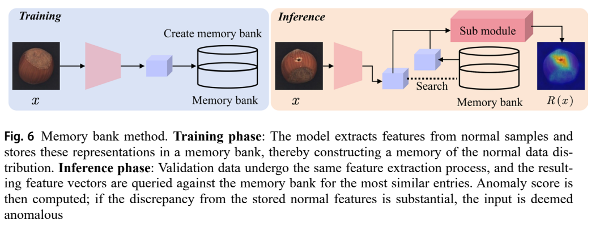

# 工业视觉异常检测：先读监督条件，再读正常证据怎样形成

整理：2026-11-16。原文：Li等，*A survey of deep learning for industrial visual anomaly detection*，Artificial Intelligence Review 58:279（2025），2025-06-14在线发表。这里使用作者当时纳入文献的知识范围，不将其当作2026年的实时榜单。

[原论文 PDF](<A survey of deep learning for industrial visual anomaly detection.pdf>)｜[已有中文译文](full_translation_zh.md)｜[研究主文档](../../../research/thesis-research-and-study-guide-zh.md)｜[论文阅读总报告](../../261107/research-plan-and-paper-reading-report-zh.md)

## 先把“异常检测”拆开

这篇长综述将学习策略、方法族、数据集、评价和应用挑战放在一起。作者总结五类学习策略，讨论教师—学生、单类分类、分布建模、记忆库、重构和视觉语言/基础模型等方法。学习策略回答训练看到了什么信息，方法族回答得分怎样计算，两者不是一一对应。同一记忆库可采用冻结预训练特征，也可先用标注适配表示，不能凭方法名判断监督条件。

对自己的研究，要拆开三个阶段：DINO怎样预训练；PCB下游是否使用异常mask；最终如何得到缺陷得分。**自监督骨干加真实mask训练分割头，仍是监督下游任务。**当前PCB1是有像素标注的high-shot派生协议，不因引入正常库自动变成normal-only，也不因异常图数量有限自动成为官方few-shot。读综述要写实际可访问的数据，不能只复制家族标签。

异常还有结构与逻辑两个层面。结构异常包括破损、污染等局部外观变化；逻辑异常可能是部件数量、排列和关系不符合要求，孤立局部仍看起来正常。这解释了局部距离对部分异常有效，却未必发现所有缺件或关系错误。当前PCB1可见外观mask不等于完整装配关系验证，综述的范围不能整体移入毕业论文。

## 把记忆库图读成计算路径

来源：**Fig. 6，PDF实际第24页**，保留原图注节选，未重画；[裁剪记录](reading-figures/sources.json)。相关公式在实际第24—25页。

Training端正常图经过特征提取器，将表示存入Memory bank；Inference端以相同方式提取查询，Search寻找相近项，后续模块形成异常热图。关键不是有一张正常图给人看，而是库中特征真正参与得分。原图是家族级示意，Sub module不表示所有记忆库都有相同评分或持续更新机制，具体需回对应原论文。

正文以最小距离或最大余弦相似度解释基础评分。可写成：查询位置p的特征为z_p，训练正常库M，d_p=min(m∈M)‖z_p−m‖。距离大表示该查询难以由正常库解释，不是某工艺缺陷的校准概率。如果使用整图向量，先得到图像分数；使用空间特征后映回原图，才能形成定位。图中出现热图不表示所有实现都天然有精细mask。

工作二还需在图外补齐索引：每个库特征绑定来源整图、位置和预处理坐标，才能展示实际采用的参照。若只存向量，评分后另找一张看起来合适的图片，展示与计算可能脱节。ViT token包含全图上下文，来源小裁剪只能追溯位置，不能证明分数完全由这个小框的像素决定。

## 三条路线各自依赖什么

### 教师—学生：异常来自模仿误差

第2.2.1节与图3以正常数据上的表示模仿为核心。教师提供特征，学生学习输出相似特征；测试时差异大则作为异常线索。相比直接分割，它不一定要收集每种缺陷作正类，但需要学生在正常输入上学得好、在异常上又不过度泛化。若对所有输入都复制教师，异常差异会消失；若正常结构也学不好，正常误报增加。

应核对教师是否固定、学生用哪些数据、比较哪些层、差异如何归一化和组合。教师不是人类专家解释，学生误差也不是制造原因。可借鉴的是用清楚的中间差异构造分数；冻结DINO加监督头未必包含模仿损失和差异评分，不能因此称为教师—学生异常检测。综述图中的网络关系要还原为损失和推理关系，而不只看有几个分支。

### 正常分布与记忆库：两种表示正常的办法

分布方法把正常特征压缩为统计分布、密度或可逆变换；记忆库保留正常实例，以近邻距离度量偏离。前者存储可能紧凑，但须判断分布假设是否容纳多样结构；后者便于追溯实例，却受库覆盖、大小和搜索成本影响。训练少见的正常结构，也可能因远离库中全部实例而被误报。

PCB还涉及位置：全局搜索时，查询焊盘可能匹配另一位置的相似金属；严格同坐标时，轻微位移又可能排除正确参照。位置约束把几何先验放入候选集合，并不保证结构一致。VisA没有每张待测图配对的黄金正常板，正常库必须来自训练正常图；先在train/val检查板型、姿态与配准，再判断约束是否可行。

该路线与可解释性最直接，但容易循环论证：模型按距离评分，将查询换成最近邻后距离下降，本来就是预期。还应查参照结构是否正确、能覆盖多少最终评分，以及同面积随机替换或正常→正常替换会怎样。可追溯计算是机会，不等于充分解释，更不等于制造语义正确。

### 重构：比较输入与正常估计

重构家族学习还原正常图或表示；异常可能难被正常生成机制还原，于是残差形成异常图。与记忆库相比，参照往往是模型生成的正常估计，而不是实际存在的训练图。它能展示哪里难重构，但模糊边缘、反光和少见正常结构也可能留下残差；强复制网络又可能将缺陷一起还原。

重构质量高并不等于检测好：异常也重构得好会削弱对比，粗糙重构又会污染正常区域。因此要同时看正常误差、异常行为与最终定位，不能只看生成图是否漂亮。当前不必增加生成模型研究，保留“评分误差到底对应什么”的审查方式即可。正常库距离、模仿差异与重构残差虽都叫异常分数，实际依据不同，核验也不应完全相同。

## 如何读性能表

第3节整理二维、三维等数据，第4节集中比较。表4/5分别是MVTec AD图像/像素AUROC，表6/7对应VisA。顺序应是数据和监督→计分单位→指标→数字。同名VisA不代表划分相同，更不代表与当前mask监督PCB1协议一致。全类别均值也可能掩盖PCB单类困难。

AUROC描述跨阈值排序，IoU描述某工作点预测集合与GT的交并比。异常像素大体排在正常前面，仍可能在选定阈值下产生许多误报；缺陷比例小时尤其要看清。综述像素AUROC不能直接与SegFormer前景IoU比高低，图像AUROC也不能转述为像素覆盖。若比较正常库，应在披露监督和数据的前提下补任务所需的原图定位评价。

本文覆盖广，但学习策略归类和家族描述需要回查。“semi-supervised”在一些异常文献指只用正常训练样本，在一般机器学习又指少量标注加大量未标注；正文例子不能全部套同一定义。这里以图像和标签的实际访问为准。对某方法训练条件、更新能力和精确数值，优先核实被引原文，不用综述一句话代替实验协议。

对资源表也应采取相同态度。参数少并不等于搜索快，库容量和查询网格会影响内存与延迟；推理中同时运行教师和学生、反复重构或检索，也有不同代价。当前主线是精度与可解释性，效率记录为代价即可，不能因为综述强调部署便自动扩成第三个研究任务。

## 已填写的研究卡与案例

| 项目 | 目前具体答案 | 本文带来的追问 |
| --- | --- | --- |
| 任务 | PCB1真实mask监督二值分割 | 正常库和监督头怎样在披露协议后比较？ |
| 已做内容 | SegFormer完成；DINO和参照未做 | 固定DINO表征先能完成哪些定位？ |
| 参照来源 | 候选为训练正常图 | 是否覆盖同类结构，位置限制是否需可靠对齐？ |
| 解释对象 | 候选为某区域实际得分 | 是检索分数、分割分数还是最终融合分数？ |
| 核验 | 匹配、干预、稳定性与路径覆盖 | 展示是否绑定实际近邻，是否控制拼接伪影？ |

用正常焊盘误报作假设练习：先取实际网格查询，检查最近项究竟是焊盘、字符还是别处反光，再比较全局和可行的位置邻域检索。若换约束后距离降低但结构仍错配，不能说问题已解决；若匹配正确却仍高分，可能是表示对成像变化敏感，单改检索范围不够。这样把表示、匹配、评分分开，避免将所有错误归因于参照不好。

反过来，缺陷可能在全局库找到一个外观相似的正常字符，距离很小而漏检。缩小候选范围也许能排除错误近邻，但前提是正确正常结构确实存在，且约束没有把它排除。这个例子说明更小距离不总是更好，更强限制也不总是更准。需要在真实评分中核验，而不是只用“匹配图更像”判断。

## 分三次读完最相关部分

第一次读第2.1节和图2，逐项写训练可见信息，将自身协议定位。第二次精读第2.2.4节、图6和公式，再读教师—学生及重构作对照，目标是能手算一个近邻分数并追溯来源。第三次读第3—4节与VisA两组表，分清图像/像素、排序/工作点，再沿引用读机制原文。CLIP、GPT、SAM与三维方法按问题回查，不作为当前新增清单。

**问：采用正常库就有可解释性吗？**它提供追溯机会，仍需匹配、忠实性和覆盖证据。**问：距离换个刻度会提高定位吗？**同一打分单元使用相同严格递增映射不会改变排序；若后续有插值或融合，再检查最终关系。**问：为什么保留监督头？**它利用已有mask提供必要对照，帮助区分机制收益与监督条件变化。读完应能解释三种得分来自哪里，并准确说出哪些事实已成立、哪些只是候选。

