# 印制电路板自动检测：一篇全面易懂的综述

作者：Luis Augusto Libório Oliveira Fonseca、Yuzo Iano、Gabriel Gomes de Oliveira、Gabriel Caumo Vaz、Giulliano Paes Carnielli、Júlio César Pereira、Rangel Arthur。

作者单位：巴西坎皮纳斯州立大学电气与计算机工程学院，圣保罗州坎皮纳斯市阿尔伯特·爱因斯坦大道，邮编 13083-852。

期刊：《人工智能探索》（Discover Artificial Intelligence），2024 年，第 4 卷，文章号 10。收稿日期：2023 年 4 月 13 日；接收日期：2023 年 6 月 17 日。在线发表日期：2024 年 2 月 5 日。© 作者，2024 年。开放获取。DOI：[10.1007/s44163-023-00081-5](https://doi.org/10.1007/s44163-023-00081-5)。

原文：[本目录原始论文](<Automatic printed circuit board inspection- a comprehensible survey.pdf>)。

> 翻译说明：本译文按原论文的逻辑段落连续排版，合并跨行、跨页的同一段落，保留章节、图表编号、数值和文献编号。作者姓名、算法和数据集名称、期刊出版标识以及网址保留原文，以便检索。18 幅原图保留，图注及图内技术标签的中文释义紧随各图。原文中涉及算法定义、学习范式或统计指标的可疑表述，保留作者所述内容，并用“译注”与译文区分。

## 摘要

印制电路板（PCB）在任何电子产品中都发挥着关键作用，其制造质量保证对最终产品价格有重大影响。因此，更优检测方法的研究与开发已成为国际上持续升温的课题。在多种 PCB 检测范式中，对电路板开展视觉检测构成了现代技术的主体。为此，本文汇集了过去 25 年中最具影响力的研究，重点介绍其工作策略及其发展演进，包括通过引入人工智能（AI）方法来提高整体性能、降低运行成本。此外，本文强调公开 PCB 数据集对于促进检测方法开发和提供基准测试参照的重要性。最后，本文描述并讨论该领域近期面临的主要挑战。

**关键词：**印制电路板；缺陷检测；光学检测；机器学习；概念漂移。

## 1 引言

电子制造是持续呈现显著指数增长的工业领域之一。2021 年，电子产品合同制造与设计服务市场规模估计为 4813 亿美元，年增长率为 10.5%，预计到 2030 年将达到约 11586 亿美元 [1]。

尽管中国在电子制造市场中占据较大份额，全球趋势仍显示，此类产品的制造活动正向世界各地进一步分布。这意味着企业为了争取更大市场份额而面临更激烈的竞争，也使开发更优质量控制规程的重要性日益突出 [2]。目前，工业研发投资整体上越来越关注高标准技术的应用，其范围不仅包括产品制造本身，也包括更加灵活、自动化的质量检测系统。在工业 4.0 所涉及的技术优化过程中，这类改进后的体系通常称为智能制造系统（SMS）[3]。

目前，电子制造商为提高生产质量，正致力于开发高精度检测型智能制造系统。这与近年来“零缺陷制造”（ZDM）的趋势一致，其目标是将尽可能减少制造故障的策略纳入企业发展路线图 [4]。对电子行业而言，每台电子设备的核心部件都是 PCB。因此，PCB 可能成为产品最脆弱的部分，也就成为制造缺陷控制的首要关注对象 [5–7]。

PCB 已形成成熟的产品概念，其制造可以划分为裸板（BPCB）制造和电路板组装（PCBA）两个阶段。BPCB 指仅含导电线路、孔、过孔和焊盘的绝缘基板；PCBA 则指在 PCB 上装配元器件的阶段，其中大多数器件需要焊接到板上，例如电阻、电容、电感和集成电路等 [6]。

在早期制造过程中，PCB 检测仅依靠专业人员进行电气测试和目视检查。然而，随着生产速度提高、精度标准提升和元器件尺寸缩小，再加上工作环境给人造成的压力与疲劳，这种方式很快就难以满足要求 [6,7]。因此，人们陆续开发出自动光学检测（AOI）、X 射线成像、层析摄影、超声成像和热成像等多种 PCB 检测策略 [8]。虽然这些方法都推动了检测质量的提升，但其中多数很快受到费用高或耗时长等因素限制。相比之下，AOI 能够以更快、完全无损的方式检测几乎所有类型的缺陷，因此成为最有用的方法 [6–8]。然而，尽管过去三十年来 AOI 一直是 PCB 检测系统中的普遍首选，其价格仍然很高，而且供应商仅限于少数私营企业，因此中等规模 PCB 制造商仍然无法摆脱人工目视检查 [5,9]。近期许多先进研究利用人工智能在计算机视觉应用中的新进展来提高 AOI 性能。因此，过去几年的研发主要致力于开发成本更低的 PCB 自动光学检测系统 [5–7,10]。

随着机器学习，尤其是深度学习的发展，基于计算机视觉的检测系统已经成为可用的高水平技术。然而，这类系统的数据采集成本往往较高。深度学习视觉系统通常依赖包含数千张图像的数据集，才能使模型适用于稳健、实用的场景，而这在经济上并不总是可行。此外，这类系统通常无法抵御概念漂移，即数据域随时间自然变化，导致人工智能模型性能下降的关键问题。因此，即使人工专家的检测速度和准确率有限，仍然不可或缺。不过，近期人工智能方法已在高速应用中展示出令人期待且有效的结果。

本文介绍 AOI 系统在 PCB 质量控制中最具代表性的应用，重点梳理技术随时间发生的重大变化，并指出当前先进研究中最常采用的策略趋势和所面临的挑战。此外，本文旨在增进对最新 PCB 检测人工智能应用的理解，说明其用途和仍然存在的局限。

本文结构如下：第 2 节介绍 PCB 的构成及检测策略的常见划分；第 3 节介绍裸板检测相关研究；第 4 节重点讨论组装电路板检测方法；第 5 节解释 AOI 的一般构成及其当前优势与局限；最后，第 6 节举例介绍主要的开源 PCB 数据集，并描述其主要组成和特征。

**作者说明：**Yuzo Iano、Gabriel Gomes de Oliveira、Gabriel Caumo Vaz、Giulliano Paes Carnielli、Júlio César Pereira 和 Rangel Arthur 对本文作出了同等贡献。通信作者：Luis Augusto Libório Oliveira Fonseca，l167994@dac.unicamp.br。其他作者邮箱依次为：yuzo@unicamp.br、oliveiragomesgabriel@ieee.org、g226919@dac.unicamp.br、giulliano@gmail.com、juliopereira83@yahoo.com.br、rangel@ft.unicamp.br。

## 2 背景

PCB 检测过程可按缺陷所在对象划分为裸板检测和组装电路板检测。根据 PCB 缺陷分析文献，几乎任何类型的 PCB 都存在一组常见、相互共通的缺陷类别。在这两个对象范围中，一些常见缺陷会使 PCB 功能完全失效：裸板上的未蚀刻铜、开路、短路、漏孔和孔位偏移，以及组装板上的元件缺失、烧毁、反装和焊接开路。另一些缺陷虽然不会使 PCB 功能完全丧失，却仍可能在运行中造成电气扰动，并因加速退化而导致早期失效：裸板上的过蚀刻或欠蚀刻、鼠咬、局部开路、残铜、潜在短路、污物污染和气泡，以及组装板上的元件偏移、立碑、冷焊、元件局部烧毁和潜在不良元件 [5–8]。图 1 展示了一个裸板和一个组装板的缺陷样本。

**图 1　裸板与组装电路板的缺陷样本。**（a）取自 Ding 等人 [11] 公开 PCB 数据集的裸板，缺陷为鼠咬；（b）取自 Lu 等人 [12] 的 FICS-PCB 数据集的组装板，缺陷为元件缺失。

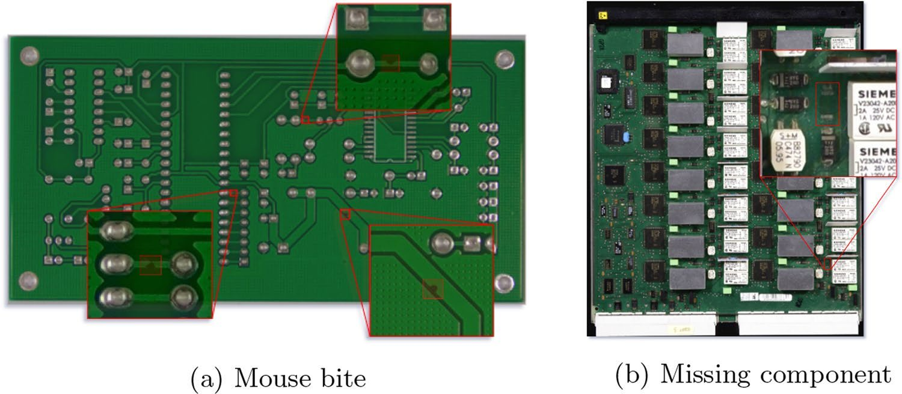

图内标注：（a）鼠咬；（b）元件缺失。

PCB 检测既可采用传统方法，例如计算机辅助工具、多种附加设备，或单纯依靠人工技能；也可以将上述方法与使用训练数据集的人工智能方法结合，从而提升检测系统的速度和准确性。因此，本文按照 PCB 缺陷对象及检测方法的不同组织内容，结构如图 2 所示。

**图 2　本文对 PCB 检测方法、检测对象和技术路线的组织结构。**检测方式包括人工、自动光学检测及其他方法；缺陷对象分为裸板和组装电路板；主要技术路线分为传统方法与人工智能方法。各类检测方式、对象与技术路线之间可以组合。

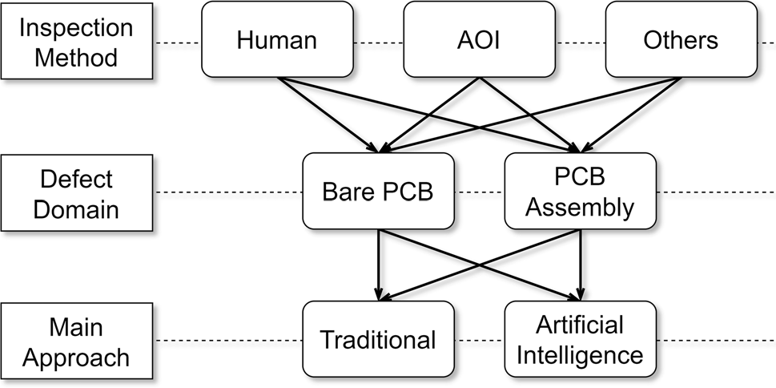

图内标注：检测方式；人工；自动光学检测；其他；缺陷对象；裸板；组装电路板；主要技术路线；传统方法；人工智能。

接下来的第 3 节和第 4 节分别总结主要的裸板与组装电路板先进检测方法。每节又分为不使用人工智能的方法和使用人工智能的方法两部分。随后，第 5 节详述工业界最期望采用的 PCB 检测方式 AOI，介绍其主要优点和局限。最后，由于人工智能方法是近期研究最活跃的路线，训练数据集又在其中发挥关键作用，第 6 节还概述公开 PCB 数据集的来源。

## 3 裸板检测

本节的第 3.1 节和第 3.2 节介绍本文涵盖的裸板检测研究。各项研究按时间顺序组织，从较早的工作一直到当前先进方法，时间线如图 3 所示。

**图 3　本文涵盖的裸板检测方法时间线。**传统方法包括 Putera [13]（2010）、Chauhan [14] 和 Guan [15]（2011）、Ibrahim [16]（2012）、Chaudhary [17]（2017）及 Zhu [20]（2018）；人工智能方法包括 Londe [23]（2014）、Lu [24]（2018）、Ding [11] 和 Ihar [29]（2019）、He [31]（2020）、Adibhatla [32]（2021）及 Bhattacharya [5]（2022）。

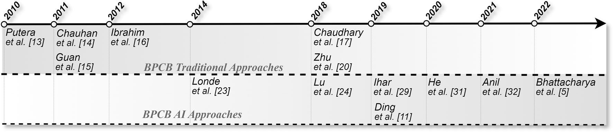

图内分区：裸板传统方法；裸板人工智能方法。横轴为年份，作者姓名及文献编号保留检索标识。

### 3.1 传统方法

Putera 和 Ibrahim [13] 将此前的两种技术结合，通过基于模板匹配的分割与形态学特征提取分析裸板线路。该方法要求待测样本与模板样本之间进行充分的图像配准，即两幅图像必须具有相同的相对位置与方向。随后，利用 MATLAB 计算工具，将每幅图像分割为四种形态区域：方形区域、孔区域、粗线区域和细线区域。得到的图像再进行黑白二值化，使模板与待测图像中对应的区域能够逐对执行异或（XOR）逻辑运算。图像对之间的差异是运算后留下的唯一残余，可据此判定缺陷，如图 4 所示。该技术能够识别研究所述 14 类裸板缺陷中的 7 类。尽管作者报告了较高的检测置信度，他们也指出，分割与二值化步骤有时会产生不需要的噪声，从而增加漏检风险。

**图 4　Putera 和 Ibrahim [13] 对模板与待测样本执行异或运算的示例。**

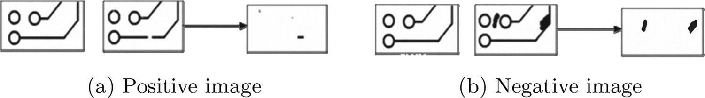

图内标注：（a）正差分图像；（b）负差分图像。此处正、负表示差分结果的方向。

同样采用模板匹配思路，Chauhan 和 Bhardwaj [14] 也提出一种基于异或逻辑运算的图像比较方法。不过，该方法不像前一项研究那样按形态区域分割图像，而是对异或运算结果进行几何统计分析。分析结果揭示了不同裸板缺陷可能具有的重复模式，这些模式可作为后续确定性图像分类算法的重要特征。作者还强调，要得到有意义的结果，异或运算方法受到图像配准精度的限制。

Guan 和 Guo [15] 提出一种用于增强裸板图像的数学方法，将其作为缺陷检测的预处理技术。作者利用裸板照片中导电线路与绝缘基板之间的高对比度，推导出一种称为“双 Sigmoid 运算”的方法，能够增强图像清晰度并进一步滤除噪声。简而言之，该方法先对灰度图像执行 Sigmoid 求导运算，减轻拍摄所引入的常见边缘平滑效应，然后通过后续积分运算恢复原图。作者认为，相比通常会引入不必要边缘平滑的标准去噪算法，该方法的主要优势在于能够同时滤除噪声并锐化图像边缘。图 5 给出了其中一个结果示例。

**图 5　Guan 和 Guo [15] 的原始图像与增强图像对比。**

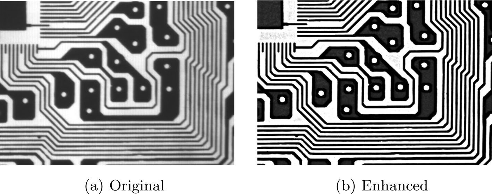

图内标注：（a）原始图像；（b）增强图像。

为改进基于异或运算的模板匹配方法，Ibrahim 等人 [16] 提出由多个图像处理步骤组成的流水线算法，其中包括异或运算，最后则针对不同待检缺陷分别使用不同算法。检测范围包括七种缺陷：漏孔、尺寸错误、开路、短路、针孔、欠蚀刻和鼠咬。作者提出的一项重要创新是配准算法：通过组合多种几何变换，使待测图像相对于模板图像实现精确的方向匹配。作者报告，使用 MATLAB 软件处理分辨率为 1580 × 917 的图像，平均耗时约 20 秒。根据生产节拍的不同，这一速度可能成为工业应用的限制，但仍然快于人工检测。

Chaudhary [17] 提出一种新的裸板自动检测系统，并称其速度足以满足实时制造场景。该方案在灰度模板图像与待测图像组成的图像对上，采用 FAST 图像特征提取算法 [18] 和 MSAC 图像配准算法 [19]。此外，与 Putera 和 Ibrahim 等人的研究 [13,16] 类似，该方法通过图像分割分离作者认为构成裸板的三个主要部分，即导线、焊盘和孔。分割依据二值图像的归一化直方图进行阈值处理，如图 6 所示。可从直方图中提取二值化阈值，将背景、导线与焊盘分开，而孔则可进一步从焊盘中分割出来。完成分割后，像此前研究 [13,16] 一样，对模板和待测图像对执行相减，得到正差分图像和负差分图像。针对不同缺陷类型，选用相应的结果图像作为缺陷检测与分类算法的输入。作者针对 14 种最常见的裸板缺陷模式，分别提出一种基于几何分析的图像处理算法，并报告能够准确检测和分类这些缺陷。此外，他们声称处理时间约为 2.53 秒，有望形成实时 AOI 方法。

**图 6　Chaudhary 等人 [17] 用于图像分割的归一化直方图。**

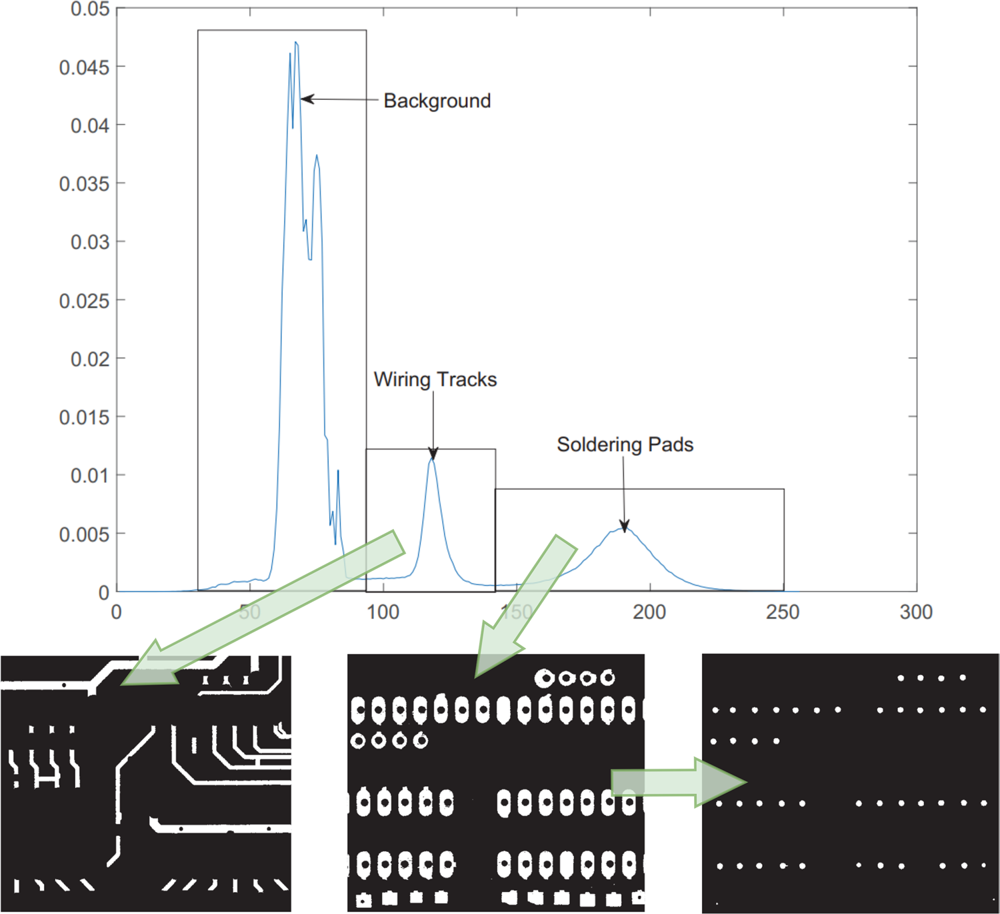

图内标注：背景；导线；焊盘。归一化灰度直方图的不同峰值区域对应不同板面结构，箭头指向各结构的分割结果。

Zhu 等人 [20] 采用模板匹配分析五种裸板缺陷。相比此前方法，主要区别是采用离散小波去噪来改善图像质量 [21]，并使用霍夫变换提取特征以完成图像配准 [22]。其缺陷检测与分类方式与前人相似，即通过图像相减进行检测，再利用几何分析算法进行分类。基于包含 30 张缺陷 PCB 图像的数据集，作者报告检测率为 100%，分类准确率为 90%。图 7 展示了该研究中的缺陷检测示例。

**图 7　Zhu 等人 [20] 在裸板上检测五种缺陷的示例。**

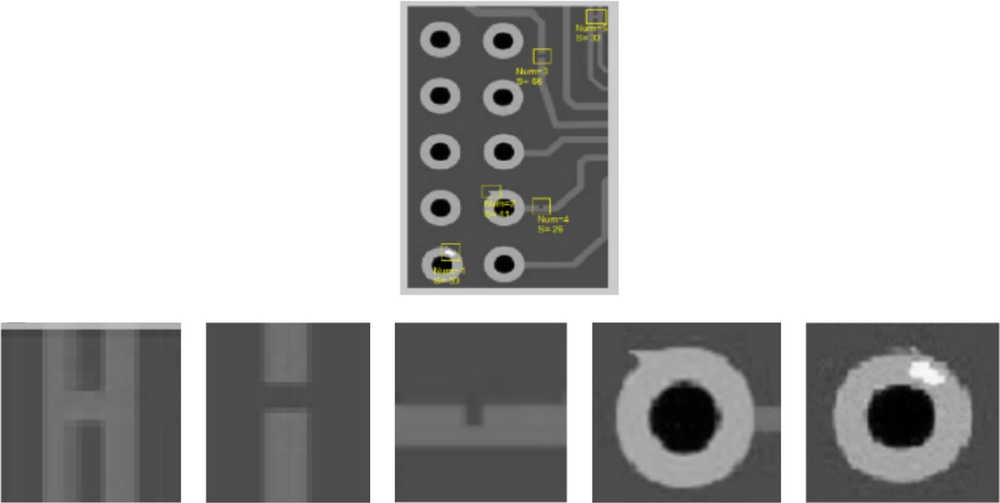

图中黄色框标示五类缺陷区域；下方依次给出相应的局部放大图。

### 3.2 人工智能方法

Londe 和 Chavan [23] 的研究可能是最早利用机器学习改进 PCB 自动光学检测系统的应用之一。该方法使用 MATLAB 图像处理工具箱，对一对图像执行基于模板匹配的差异提取，再处理所得结果，提取可用于区分全部 14 类已知裸板缺陷的判别特征。所使用的机器学习算法为 K 近邻（KNN），原文将其描述为一种对特征数据集进行聚类的非参数模型，即提取数据集中所有样本之间的特征距离，并将样本分为设计者预先定义的 K 个簇。例如，原文称，对于包含 14 类缺陷的系统，可以设置 K = 15，其中一类表示“无缺陷”。作者报告全部 14 类缺陷的平均准确率为 75.37%，但未说明测试图像数量和缺陷数量。

> 译注：上段保留了原文对 KNN 的描述，但 KNN 通常是基于近邻投票的监督分类方法，K 表示近邻数量，而不是类别数或簇数。原文将其与聚类和类别数混同，阅读时应予区分。

Lu 等人 [24] 采用监督机器学习分类算法，提出结合确定性图像处理技术与支持向量机（SVM）的方案。图像预处理先进行二值化，然后利用中值滤波器和均值滤波器去噪。随后，通过局部二值模式（LBP）和方向梯度直方图（HOG）算法开展两步特征提取，用于降维和信息筛选 [25,26]。两类特征再通过贝叶斯融合进行合并，并开展 SVM 训练 [27]。数据集由正负样本对构成，包含 184 张训练图像和 108 张测试图像；作者报告缺陷检测准确率为 89.22%。

Ding 等人 [11] 指出，裸板缺陷通常仅由极少数图像像素构成，相对于整幅高分辨率 PCB 图像，其尺寸非常小。这给传统卷积神经网络（CNN）架构带来挑战，因为微小图像区域的信息往往在网络深层消失。为解决这一问题，作者受到 He 等人提出的 ResNet [28] 启发，设计了如图 8 所示的金字塔拼接技术，将 CNN 较浅层的信息注入更深层，从而保留小尺寸目标的信息。该研究使用 Huang 等人 [10] 的公开数据集，报告平均精度均值（mAP）为 98.9%。

**图 8　Ding 等人 [11] 的金字塔残差连接模型架构。**

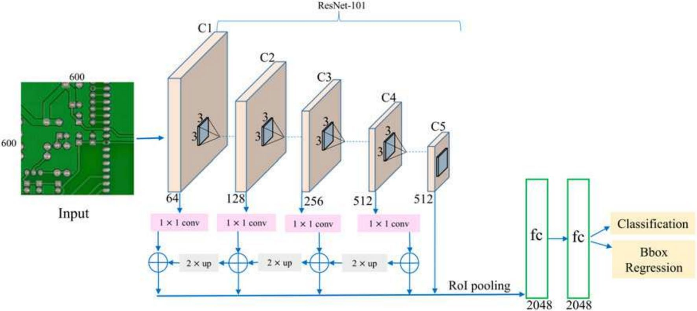

图内标注：输入；1 × 1 卷积；2 倍上采样；感兴趣区域池化；全连接层；分类；边界框回归。骨干网络为 ResNet-101，阶段标为 C1 至 C5；图中通道数依次为 64、128、256、512、512，两个全连接层各为 2048 维。

Ihar 等人 [29] 提出将无监督深度学习方法转换为用于裸板检测的自监督方法。作者强调，工业环境中通常缺少缺陷 PCB 样本，这对监督机器学习应用构成重大挑战。为此，作者解释如何让自监督模型从具有代表性的无缺陷样本集和少量缺陷样本中学习。该研究采用 Simonyan 和 Zisserman 提出的预训练 VGG16 模型 [30]，并以自监督方式使用 PCB 数据进行微调，使模型学会将数据分为两个簇，分别对应正常样本与缺陷样本。作者报告，缺陷检测平均准确率为 80%，其中某些缺陷类别超过 95%；同时，模型只需要很少的缺陷样本即可训练，作者认为这是重要的工业应用特征。

与前一项研究一样，He 等人 [31] 使用 VGG16 网络构建自监督方法，以应对具有代表性的缺陷样本数量不足的问题。两者的主要区别在于，该研究采用常见的模板匹配差分技术。不过，他们并不通过确定性规则提取图像对特征，而是使用 VGG16-lite 骨干网络，以自监督方式提取特征，使模型学到更优的数据表征图。完成提取后，对特征执行相减，再将所得特征送入另一个定制深度学习网络，检测并分类六种常见裸板缺陷，并根据缺陷边界框尺寸分为三个输出。图 9 展示模型架构及输入输出。作者使用 2000 个训练样本和 1000 个测试样本，报告分类准确率为 98.6%。

> 译注：本文将上述方法称为“自监督”；但参考文献 [31] 的题名为“基于监督与半监督学习的实时 PCB 缺陷检测器”。此处保留综述作者的术语，不将其改写为已经核实的学习范式。

**图 9　He 等人 [31] 的模型架构、输入与输出。**

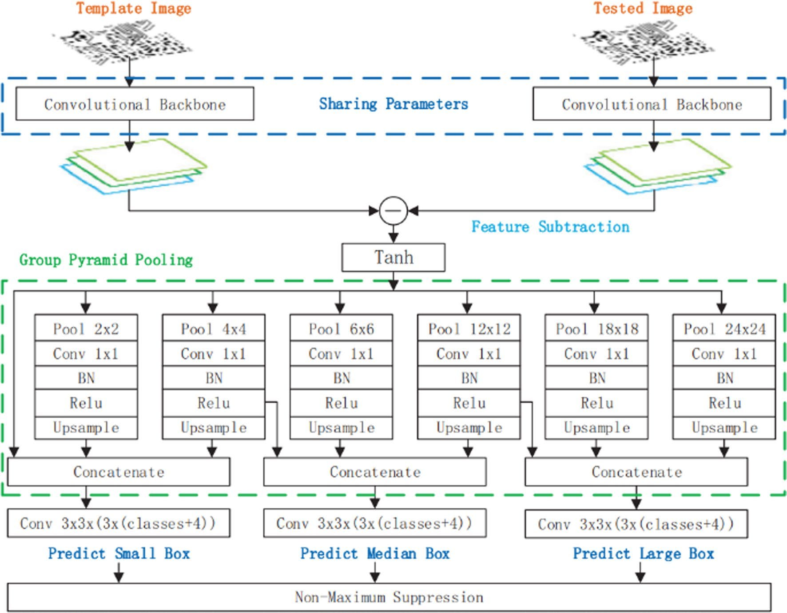

图内标注：模板图像与待测图像分别进入共享参数的卷积骨干网络，所得特征相减后经双曲正切函数，进入分组金字塔池化模块。六个分支的池化尺度分别为 2 × 2、4 × 4、6 × 6、12 × 12、18 × 18、24 × 24；各分支依次执行 1 × 1 卷积、批归一化、整流线性激活和上采样，再按图示进行拼接。三个预测分支分别预测小、中、大边界框，卷积标注为 3 × 3 × [3 ×（类别数 + 4）]；最后执行非极大值抑制。

Adibhatla 等人 [32] 使用先进深度学习模型 YOLOv5 [33]，以监督学习方式开展目标检测与分类。作者描述的数据集包含 23000 个 PCB 样本；为更好地表征相对于整板而言十分微小的缺陷，将样本切分为小图像块。数据按九份训练、一份测试的比例划分，并结合十折交叉验证策略。YOLO 模型被训练为在矩形边界框内检测缺陷区域，并输出类别置信度。该研究不训练模型区分不同缺陷类别，而是将所有缺陷归为一个类别。作者称，这种选择能够提高模型检测效果，代价是不判断具体缺陷类别，而这可以作为后续任务完成。作者报告，最佳平均准确率为 99.74%，假阳性率为 0.23%。图 10 展示论文中正确检出微小裸板缺陷的真阳性示例。

**图 10　Adibhatla 等人 [32] 的裸板缺陷检测样例图像。**

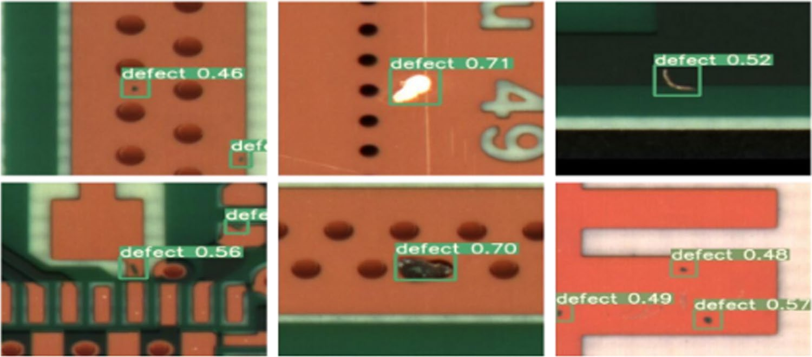

图内标注中的“缺陷”后接模型输出的置信度；矩形框为检测到的缺陷位置。

Bhattacharya 和 Cloutier [5] 提出一种与前述工作类似的方法，也使用 YOLOv5 检测缺陷。不同之处在于，他们用定制结构修改原始 YOLOv5 架构，并称该结构的数据利用效率更高，同时仍可对各个目标缺陷类别进行分类。在实验中，作者使用 Huang 等人 [10] 的数据集，其中只有 1386 张图像，包含六种裸板缺陷。此外，他们提出一种数据合成方法，以提高小数据集条件下数据的代表性。作者报告平均准确率为 98.3%，假阳性率低于 5%；同时，在相同数据条件下与此前先进 PCB 检测方法进行比较，其方法取得最佳结果。

## 4 组装电路板检测

接下来的第 4.1 节和第 4.2 节概述本文涉及的组装电路板检测研究，其时间顺序如图 11 所示。

**图 11　本文涵盖的组装电路板检测方法时间线。**

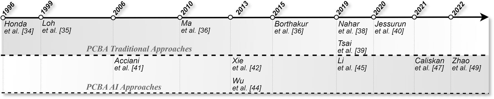

图内分区：组装电路板传统方法；组装电路板人工智能方法。时间线覆盖 Honda [34]（1996）、Loh [35]（1999）、Acciani [41]（2006）、Ma [36]（2010）、Xie [42] 和 Wu [44]（2013）、Borthakur [37]（2015）、Nahar [38]、Tsai [39] 和 Li [45]（2019）、Jessurun [40]（2020）、Caliskan [47]（2021）以及 Zhao [49]（2022）。

### 4.1 传统方法

早在 20 世纪 90 年代，Honda 等人 [34] 和 Loh [35] 的工作就参与推动了现代 PCBA 自动光学检测系统的起步，但有限的硬件能力似乎极大地限制了高效系统的开发。这两项研究都依赖人工操作的视觉检测设备：操作人员必须拍摄 PCB 上小范围关键感兴趣区域，再通过数字图像处理技术检测焊点缺陷。其主要目标是利用确定性方法和计算机辅助人工目视检查，评价元件的焊接质量。

2010 年，Ma 等人 [36] 指出，无论在检测方法还是标准评价指标方面，焊点视觉检测都仍然有待完善。他们提出一种机器视觉方法，提高 PCBA 上微小焊点的图像采集质量，其中包括用于改善图像质量的定制照明配置。此外，他们提出一种用于分析焊点图像的数学计算机处理技术，可作为后续检测研究的特征提取工具。

Borthakur 等人 [37] 提出一种受此前裸板检测方法启发的组装板检测方法。与 Guan 和 Guo [15] 类似，该研究使用小波变换提高图像处理质量。在完成方向调整和特征提取等多个预处理步骤后，执行图像相减。当模板图像和待测图像之间存在元件差异时，相减结果应在该处呈现更高对比度。作者在五种不同 PCB 类型上报告平均分类准确率为 82.5%。

与 Ibrahim 等人 [16] 类似，Nahar 和 Phadke [38] 使用 MATLAB 图像处理工具箱提取 PCBA 特征，并执行待测图像减去模板图像的操作。他们利用正、负特征差分结果，通过确定性几何算法找到目标质心，并判断其是否代表缺陷。相减前，两组特征必须具有相同方向，即完成配准。对包含 134 个独立缺陷的 103 个 PCBA 样本，作者报告检测准确率为 91.1%，但不区分缺陷类别。

Tsai 和 Huang [39] 对 PCB 检测策略作出一项重要修改。虽然仍采用模板匹配，但他们先对两幅图像执行傅里叶变换，将信息从空间域转换到频率域。作者称，该策略保留图像频率信息，同时对图像噪声和平移不敏感。因此，在频域中执行图像相减，可以更稳健地突出已有缺陷。图 12 展示其在裸板和组装板缺陷检测中的应用实例。该研究指出的一个重要限制是图像分辨率与信息密度：当使用整幅 PCB 图像时，方法似乎会失效。为解决此问题，作者将图像划分成更小图像块，从具有代表性的结果来看，这似乎解决了上述限制。

**图 12　采用较小图像块进行焊点缺陷检测的示例。**（a1）和（b1）分别为分块后的模板图像和待测图像；（a2）和（b2）为相应频域图像；（c）为相减后在空间域重建的图像；（d）为阈值处理后的图像。

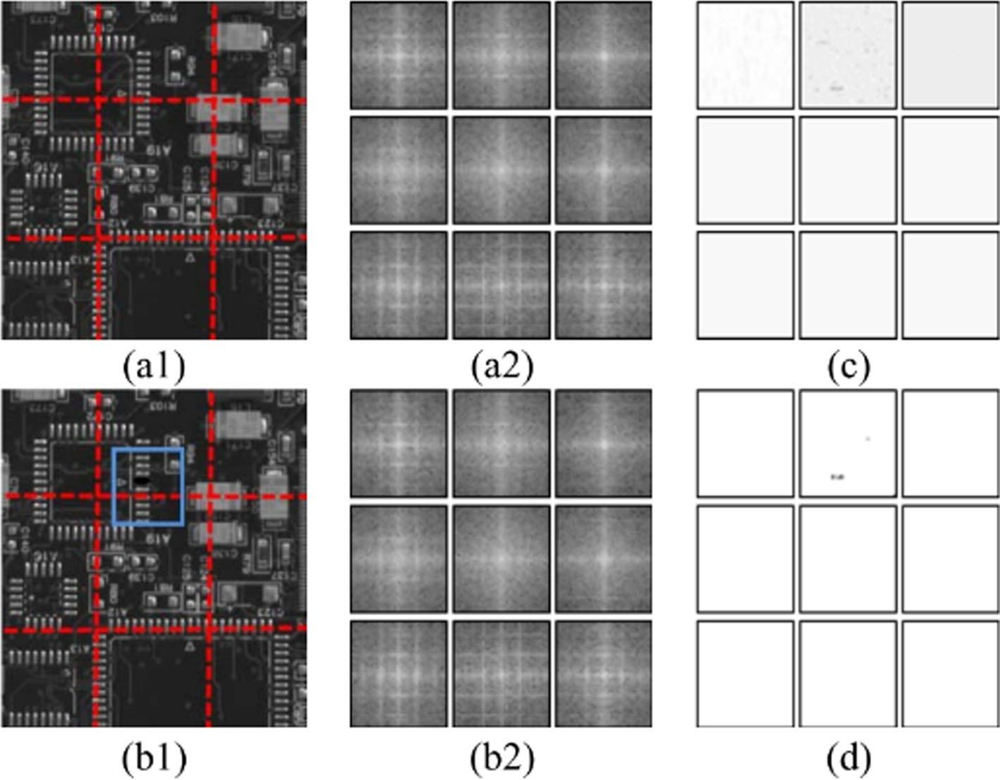

各子图标识与上方图注对应：模板与待测图像分块、频域表示、差分重建和阈值分割。

Jessurun 等人 [40] 使用一种不常见的技术开展 PCBA 元件检测，提出称为阴影检测增强（SHADE）的方法。算法在不同照明角度下拍摄多张 PCB 照片，使元件产生不同阴影。作者使用 MATLAB 软件组合这些图像，在多种照明阴影条件下对重复元件进行相减，得到模板阴影。当对有缺陷的待测样本采用相同技术时，预期能够获得不同的阴影。作者认为，SHADE 能够增强图像特征，但似乎尚未超过现有先进检测方法；不过，他们建议将其作为额外特征提取手段，以构建更稳健的方法。

### 4.2 人工智能方法

Acciani 等人 [41] 强调 PCB 焊点质量检测的重要性，并尝试将计算机视觉检测与人工神经网络结合。第一步是在较大尺度 PCB 图像中分割出包含焊点的感兴趣区域。所采用的人工智能模型是监督学习多层感知机（MLP），以焊点图像的正负样本进行训练。此外，作者采用小波和几何特征提取方法，为 MLP 提供输入数据，以增强可区分性。实验没有说明训练数据集规模，但报告通过十折交叉验证，对五种焊点状态的分类准确率达到 98.8%。

Xie 等人 [42] 将遗传编程（GP）较早地引入 PCB 检测领域。该工作仍采用图像配准和模板差分技术，同时引入滑动窗口策略，从整幅 PCB 图像中获得更多、相互之间共享信息较少的数据样本。每个滑动窗口必须事先根据是否存在缺陷标为正样本或负样本，才能作为训练数据。窗口从图像相减结果中提取，再输入遗传算法，使其学习哪些特征代表缺陷、哪些不代表缺陷。作者认为，这种方法比此前的模板匹配方法更稳健，因为 GP 能够学习工业批量生产中微小、自然且并不构成缺陷的偏差，而这些偏差通常会在传统方法中触发大量误报。文中报告假阳性率为 84.75%，与先进方法相比，这似乎并不是理想结果。不过，作者辩称，GP 方法可以对 PCB 数据域变化不敏感。后来，这一关键问题在机器学习领域被称为“概念漂移”[43]，相较此前研究，这可能是一项重要创新。

> 译注：84.75% 在原文中确实标为“假阳性率”，此处未擅自改为准确率或其他指标。GP 通常指遗传编程，遗传算法通常缩写为 GA；原文在此处及相关讨论中存在术语混用。

与前一项工作相似，Wu 等人 [44] 使用遗传算法，但本次聚焦于 PCBA 焊点检测。作者希望减轻传统 AOI 焊点检测设备对人工操作带来的疲劳，因此将人工关于焊点质量的知识转化为 14 项确定性分类特征，用以区分焊接质量。他们采用 MLP 网络区分六种主要工业焊点类别，但指出单独使用 MLP 会产生较严重的过拟合。为缓解这一问题，作者采用 GP 技术筛选输入特征，提高 MLP 的泛化能力。在 195 个焊点样本上，作者报告真阳性率为 98.46%，高于在相同数据集上应用的此前机器学习方法。

Li 等人 [45] 开展一系列大规模 PCB 元器件检测实验。研究采用 YOLOv3 架构 [46] 作为深度学习目标检测器的基线，如图 13 所示。作者并不直接开发缺陷检测系统，而是重点处理更前置的分析环节，即直接检测元器件。其主要目标是训练深度学习模型，提取 PCBA 上各个元器件的精确位置。图 14 给出输出示例。该模型能够正确分类多达 29 类 PCB 元器件，mAP 为 93.07%，其中 14 类元器件的准确率达到 100%。为取得这一结果，作者引入多项重要技术，从对原始 YOLOv3 架构的显著修改，到全面的数据增强，甚至包括使用 Altium Designer PCB 软件生成虚拟 PCBA，最终构建出包含 50 种不同 PCBA、合计 182900 个元器件的混合数据集。尽管开发复杂度较高，作者仍认为该系统是一种稳健工具，可集成到 AOI 设备中，实现 PCBA 元器件自动提取，从而支持更优的缺陷检测。

**图 13　Li 等人 [45] 使用的 YOLOv3 模型架构。**

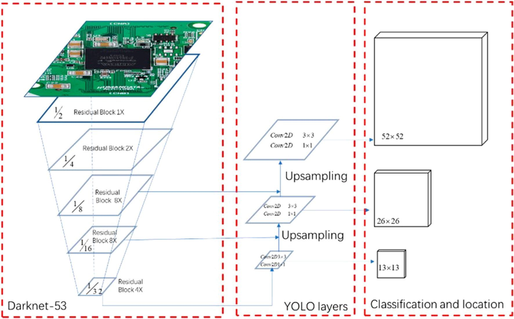

图内标注：Darknet-53；残差块；二维卷积；上采样；YOLO 层；分类与定位。五级残差块数量依次为 1、2、8、8、4，下采样比例依次为 1/2、1/4、1/8、1/16、1/32。检测分支使用 3 × 3 和 1 × 1 卷积，在 52 × 52、26 × 26、13 × 13 三个尺度输出。

**图 14　Li 等人 [45] 改进 YOLOv3 的检测输出示例。**

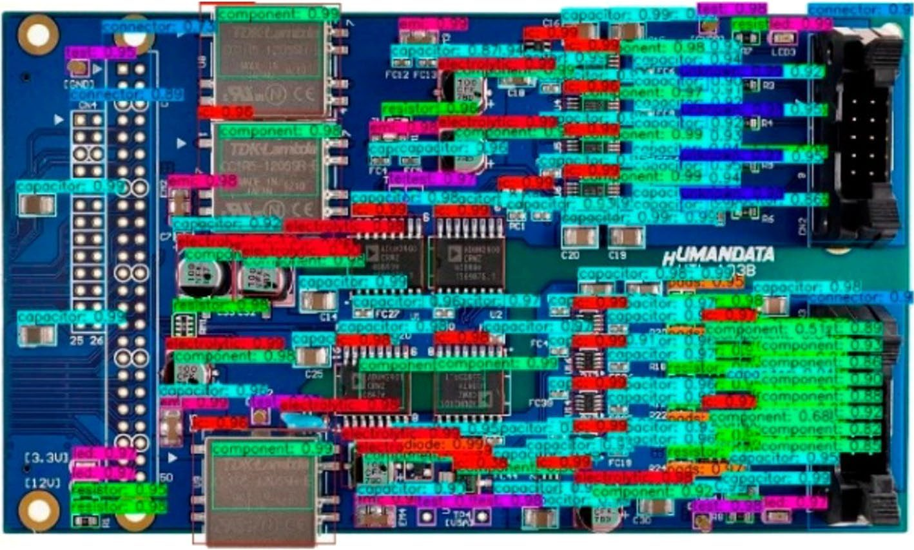

图内类别标签包括元器件、连接器、电容、电阻、集成电路、二极管、节点等；标签后的数值为置信度。密集且重叠的边界框展示元器件位置与类别，板面丝印属于实物标识。

随着 YOLO 模型在先进研究中持续取得成功，Caliskan 和 Gurkan [47] 提出采用下一代 YOLOv4 目标检测模型 [48]，检测并分类 PCBA 焊点缺陷。作者使用来自实际生产线的 40000 个样本训练模型，并对超过 70000 个焊点缺陷进行细致标注。作者强调，模型对图像方向具有不变性，因此无需图像配准；并称模型应用于训练集以外的其他 PCBA 类型时也具有稳健性。研究报告召回率为 97%，精确率为 82%。

Zhao 等人 [49] 的近期研究为高精度 PCB 检测系统提出一种新视角。论文指出，近期先进工作以海量数据集或复杂的深度学习开发为代价，换取高准确率检测系统；但在工业场景中，由于新技术和新设计不断出现，数据域持续变化，即概念漂移现象，这类系统可能很难适应。为解决此问题，作者提出一种混合方案：利用稳健的确定性图像处理技术提取关键特征，再使用较简单的机器学习分类算法。这些算法的性能可能不如 YOLO 等深度学习模型，但数据适应性和效率更高，无需数万个训练样本，因此可能更符合产品不断调整的真实制造场景。

## 5 自动光学检测设备

尽管中国在全球 PCB 生产中占据最大市场份额，主要检测方式仍然是依赖人工操作人员借助放大工具开展的传统目视检查。这种方法的普及并非偶然，而是因为其成本低、适应性强。目视检查无需前期准备费用，也无需购置专门设备。不过，这些优点的代价是检测过程具有主观性、判断时间较长，以及长期人工成本较高。此外，由于必须实际接触和搬动电路板，人工目视检查还存在损坏 PCB 的固有风险 [50]。

如第 1 节所述，自动光学检测（AOI）设备普遍被视为最理想的 PCB 检测方式。正确配置后，这类设备可以在无需物理接触的情况下自动检测，显著提高缺陷检出率，同时消除损坏电路板的风险。

许多近期文献指出，AOI 在工业中大规模应用的主要限制是高得难以承受的成本 [5,7,50,51]。AOI 设备可以有多种配置，但主要结构通常由多个处理阶段构成流水线：从图像采集工位开始，随后执行一系列参数化图像处理算法；在特征提取之后，通常通过模板参考图像执行图像相减策略。图 15 展示一种典型 AOI 应用流水线。

**图 15　Sanguino [52] 所示 AOI 系统步骤概览。**

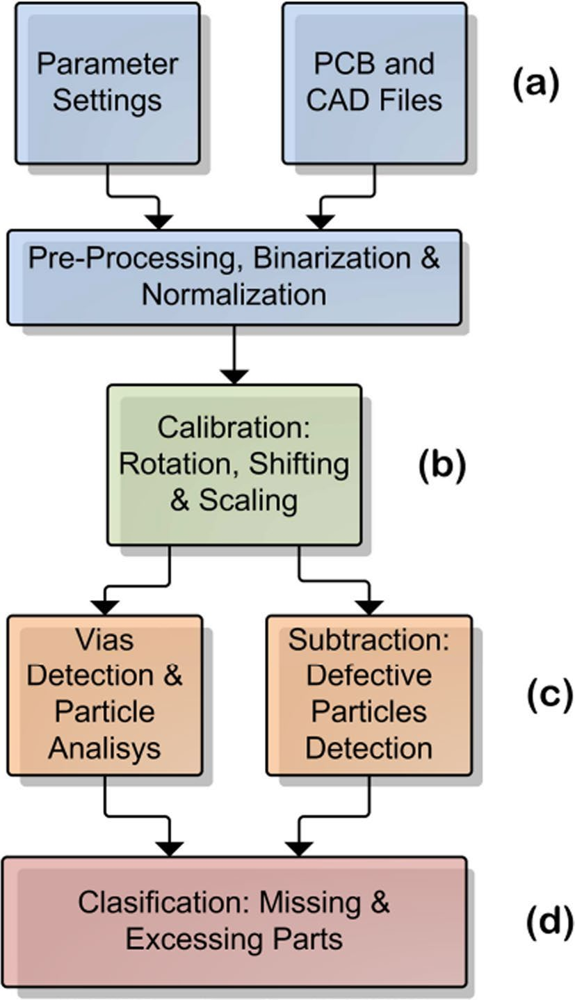

图内流程：（a）参数设置以及 PCB 与计算机辅助设计文件 → 预处理、二值化和归一化；（b）校准：旋转、平移和缩放；（c）分为“过孔检测与区域分析”和“相减：缺陷区域检测”两个分支；（d）分类：缺失部件与多余部件。

完成参数配置后，现代 AOI 可以自动从模板图像与待测图像中提取微观尺度特征，例如 15 μm 的特征，从而取得高水平准确率。一些 AOI 设备的裸板缺陷检出率能够超过 99%。不过，其应用通常依赖针对每一种特定 PCB 进行大量参数设置，这可能限制可检测的缺陷类别总数 [52]。此外，检测时间仍是重要问题，其变化高度依赖图像处理流水线，有时检测一块 PCB 会超过 10 秒。

当前先进研究正通过在 AOI 流水线的多个阶段引入人工智能策略，改善这些局限 [5,51,52]，目标是缩短推理时间，并使参数配置更加自适应，从而大幅降低应用成本。

## 6 公开 PCB 数据集

Pramerdorfer 和 Kampel [53] 于 2015 年发布了较早的公开 PCBA 数据集之一。该数据集采用高标准拍摄流程，收集来自回收设施的 748 块 PCB，从而包含较大的数据域差异。标注内容包括所有 PCB 的分割结果、9310 个集成电路边界框及其对应元数据。

Huang 等人 [10] 强调，公开数据集对于为后续研究提供基准参照十分重要。然而，PCB 数据集通常由私有数据构成，各检测系统也分别在这些数据上开发。作者指出，由于缺少基准测试参考数据，这种情况会对整个领域的发展造成负面影响。因此，他们公开了一个包含 1386 张图像的数据集，图像来自 10 种不同裸板模板，包含六种缺陷：漏孔、鼠咬、开路、短路、毛刺和残铜。所有缺陷均有边界框标注，旋转图像也进行了方向变换，以便开展配准任务。

沿着相同思路，He [31] 提出另一个裸板基准数据集，同样包含六种最常见的裸板缺陷。不过，这次图像被标准化为 640 × 640 分辨率，并进行了二值化。此外，数据集还包含数字合成缺陷，以提高正类的代表性。最终形成 1500 对包含正、负样本的裸板图像对，可用于实施监督式模板匹配方法。

Lu 等人 [12] 提出一个密集标注的 PCBA 数据集，包含来自 31 块 PCBA 样本的 9912 张图像，标注元器件共 77347 个，并为每块 PCB 提供丰富元数据。FICS-PCB 数据集包含边界框及其他形状的标注，甚至包括导电线路标注，可能是截至 2020 年最大的开放 PCBA 数据集。

2022 年，Jessurun 等人 [54] 提出一个比 FICS-PCB 更大的 PCBA 数据集，可能是当时最大的先进开放数据集。其 FPIC 数据集具有极其丰富的标注类型。作者描述了一种定期增加数据的策略，希望将其建设为通用 PCBA 开放数据集。他们为 73 块双层 PCB 样本提供超过 58000 项标注，包括边界框、元器件类别、多边形线路标记及多种元数据。至少可以确定，FPIC 是第一个提供元器件分割标注的开放 PCB 数据集。

## 7 讨论

过去 25 年间，PCB 质量检测研发在硬件能力和方法创新方面均取得了显著进步。纵观本文分析的所有论文，可以发现 PCB 检测方法存在一些稳定模式。图 16 展示了这些模式，并给出传统方法和人工智能方法中最关键逻辑操作的流程图。一些研究专注于纯粹的传统图像处理技术，另一些则将人工智能建模引入整个检测过程。表 1 和表 2 总结各论文提出的主要方法及其重要主张。

**表 1　论文汇总：第一部分，裸板检测研究。**“是/否”对应原表中的 Y/N；“是否侧重配准”按原表记录，并不意味着完全不执行配准。

| 年份与文献 | 技术路线 | 是否侧重配准 | 是否模板匹配 | 主要内容与主张 |
| --- | --- | --- | --- | --- |
| 2010、2011、2012、2018 [13,14,16,20] | 传统方法 | 是 | 是 | 通过异或运算和几何分析检测 5 至 7 种主要缺陷。 |
| 2011 [15] | 传统方法 | 否 | 否 | 提出用于预处理的图像增强算法。 |
| 2014 [23] | 人工智能 | 未说明 | 是 | 使用原文所谓的 K 近邻聚类，检测并分类 14 种缺陷。 |
| 2017 [17] | 传统方法 | 是 | 是 | 实时 AOI 检测，耗时 2.53 秒，能够检测 14 种缺陷。 |
| 2018 [24] | 人工智能 | 否 | 否 | 在训练 SVM 之前使用 LBP 和 HOG 算法。 |
| 2019 [11] | 人工智能 | 否 | 否 | 在 Huang [10] 的公开数据集上，深度学习检测器达到 98.9% mAP。 |
| 2019 [29] | 人工智能 | 未说明 | 否 | 使用预训练 VGG16 骨干网络，开展面向概念漂移场景的自监督学习。 |
| 2020 [31] | 人工智能 | 否 | 是 | 将图像相似性与自监督学习结合；同时公开裸板数据集。 |
| 2022、2021 [5,32] | 人工智能 | 否 | 否 | 调整 YOLOv5 模型，用于一般缺陷检测。 |

**表 2　论文汇总：第二部分，组装电路板检测研究。**

| 年份与文献 | 技术路线 | 是否侧重配准 | 是否模板匹配 | 主要内容与主张 |
| --- | --- | --- | --- | --- |
| 2006 [41] | 人工智能 | 否 | 否 | 以监督学习方式使用 MLP 检测 5 种焊点缺陷。 |
| 2010 [36] | 传统方法 | 未说明 | 否 | 提出用于焊点分析的特征提取工具。 |
| 2013 [42] | 人工智能 | 是 | 是 | 采用监督学习的遗传算法，对概念漂移具有稳健性。 |
| 2013 [44] | 人工智能 | 否 | 否 | 结合遗传算法与 MLP，学习焊点缺陷。 |
| 2015、2019 [37,38] | 传统方法 | 是 | 是 | 提供用于图像相减的几何特征提取工具。 |
| 2019 [39] | 传统方法 | 否 | 是 | 在相减前对图像对执行傅里叶变换，使模型对未配准图像对不敏感。 |
| 2019 [45] | 人工智能 | 否 | 否 | 使用改进 YOLOv3 大规模检测 PCB 元器件，作为 AOI 辅助工具。 |
| 2020 [40] | 传统方法 | 是 | 是 | SHADE 算法通过目标在不同照明下投射的多个阴影，增强对比检测。 |
| 2021 [47] | 人工智能 | 否 | 否 | 在包含 40000 个样本的可靠私有数据集上，使用 YOLOv4 高准确率检测焊点缺陷。 |
| 2022 [49] | 人工智能 | 未说明 | 否 | 综合多种传统技术提取图像特征，再使用机器学习，重点处理概念漂移条件下的缺陷检测。 |

尽管各项研究有各自特点，一些关键步骤一直是 AOI 方法的经典建模环节。因此，即使最现代的人工智能方法，也有时使用模板匹配等传统技术。将两者结合的方法被称为混合方法，因为它们并非只是机械重复传统方法或人工智能方法。例如，[23,42] 使用自监督人工智能模型结合模板匹配策略；而 [5,11,24,32,41,44,45,47,49] 则在不使用模板图像、仅使用待测样本的情况下采用类似人工智能技术。另一方面，[23,31,41,42,44,47] 将人工智能与传统图像配准结合，而 [5,29,32,45] 表明，可以构建对未配准图像具有稳健性的人工智能模型。

> 译注：上述文献分组及“自监督”表述沿用原文，与前文对部分研究的描述存在不一致，不能据此认定这些文献均属于自监督学习。

多数传统方法使用带图像配准的模板匹配技术，以无缺陷 PCB 图像作为待测图像的模板。两幅图像之间可执行图像相减、异或逻辑运算等多种操作。因此，模板匹配的核心是检测样本之间的差异，再通过特定几何变换进行筛选和缺陷分类。对于完全基于人工智能的方法，则必须提供由多个 PCB 样本组成的训练数据集，使模型学会区分缺陷是什么、位于何处。

**图 16　最常见 AOI 逻辑操作流程图汇总。**传统路线以模板与待测图像的预处理、配准和差分等操作为核心；人工智能路线通过训练数据学习特征、定位或分类；混合路线组合这些步骤。

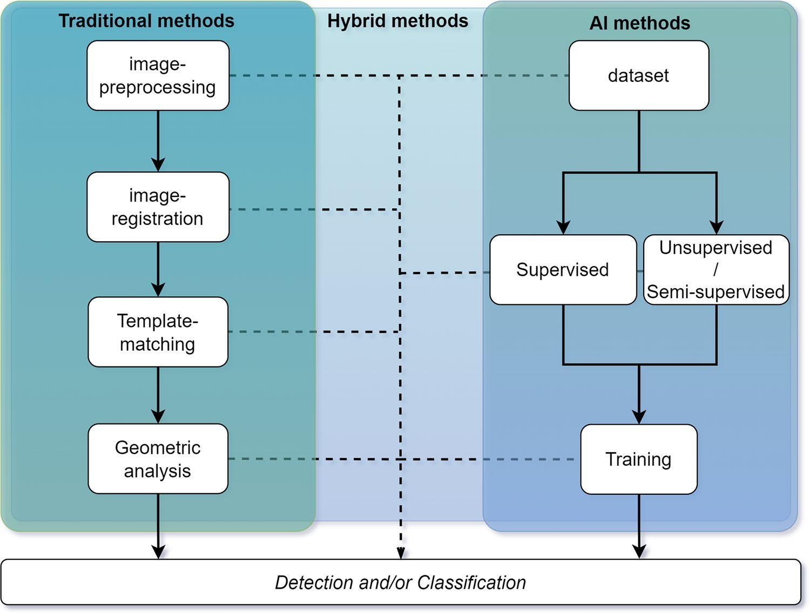

图内流程：传统方法依次执行图像预处理 → 图像配准 → 模板匹配 → 几何分析；人工智能方法由数据集进入监督或无监督／半监督路线，再进行训练；混合方法在两条路线之间组合相应步骤。所有路线最终输出检测和／或分类结果。

混合方法尝试结合前述技术最有价值的特性，弥补各自不足。例如，可以训练一个基于模板匹配的人工智能模型，使其学会自动比较图像对，从而省去复杂的图像预处理，甚至省去图像配准，形成适用于更多 PCB 类型、泛化能力更强的解决方案 [31]。然而，[49] 也说明，将一些较早的图像预处理技术与较简单的机器学习算法结合，可以更好地适应概念漂移场景，显著提升检测潜力。

在比较已达到的准确率和检测性能时，很难可靠地判断哪一种方法优于另一种，因为用于基准测试、具有代表性的公开 PCB 数据集似乎严重不足。此类研究主要由私营企业开展，各自使用特定私有数据集，因此直接比较不同方法性能并不公平。一些作者正尝试通过系统采集 PCB 样本、标注并公开数据来解决这一问题 [10,31,54]。但本文分析的大多数论文仍然使用私有数据。此外，这些私有数据集往往也缺少足够数量的图像，难以保证可靠的统计意义，因此本文研究不适合直接开展性能比较。

具有代表性的 PCB 数据集不足，是人工智能方法在该领域面临的最主要限制之一。目前，先进深度学习图像应用的成功往往与大规模数据集密切相关，数据集经常超过 100000 个样本，达到 10000000 个以上也并不罕见。相比之下，两个最大的开放 PCB 数据集只有约 10000 张图像。这个规模并非微不足道，但仍有明显发展空间。

虽然存在无法直接比较性能的问题，从整体上仍可观察到：准确率、公开数据集可用性，以及单一方法可检测的缺陷数量，都随时间有所改善。这些进步似乎与支持人工智能方法的需求不断增长相关。对于本文分析的论文，图 17 展示了过去 25 年间传统方法与人工智能方法研究的累计相对比例。截至 2004 年，全部研究都依赖传统方法和确定性算法，需要大量预处理步骤，且可检测缺陷范围有限。随着“2010 年代深度学习的兴起”[55]，优化的学习算法与更强硬件使深度学习受到广泛关注，采用人工智能技术的 PCB 检测研究达到 33%。到 2022 年，这一比例呈指数增长，超过半数研究应用了更复杂、稳健的人工智能模型，能够进行更具泛化性的推断，同时减少预处理步骤。

**图 17　按主要 PCB 检测技术路线统计的论文累计相对比例随年份的变化：仅使用传统技术，或同时采用人工智能。**

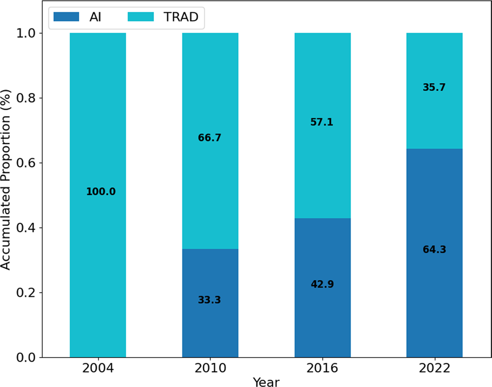

图内数据：2004 年人工智能方法占 0.0%、传统方法占 100.0%；2010 年分别为 33.3%、66.7%；2016 年分别为 42.9%、57.1%；2022 年分别为 64.3%、35.7%。横轴为年份，纵轴为累计比例；图例为人工智能方法和传统方法。

最后，人工智能方法比例的增加不仅带来显著性能提升，也似乎揭示了大多数 PCB 制造场景中的一项复杂挑战：概念漂移。每当新的 PCB 设计开始生产，都很可能包含新元器件、新架构和新布局，因此也会出现新的视觉特征。PCBA 的元器件比裸板更加多样，问题尤其突出。这暴露出人工智能模型的弱点：先前模型是在特定旧 PCB 上训练的，而这些旧 PCB 不包含后续产品代际中的新特征，由此产生的信息偏差会持续影响模型准确率。

为应对概念漂移，一些现代研究引入混合技术，目标是让模型虽然使用较早的 PCB 样本训练，却能以某种方式对新电路板设计不那么敏感，从而抵御概念漂移 [42,49]。然而，与针对特定 PCB 准备的其他方案相比，这些方法在原始准确率指标上仍然存在困难；而且，如图 18 所示，关注这一问题的工作只占整个 PCB 检测研究的很小一部分。

**图 18　本文分析的论文中，关注概念漂移问题的研究所占相对比例。**

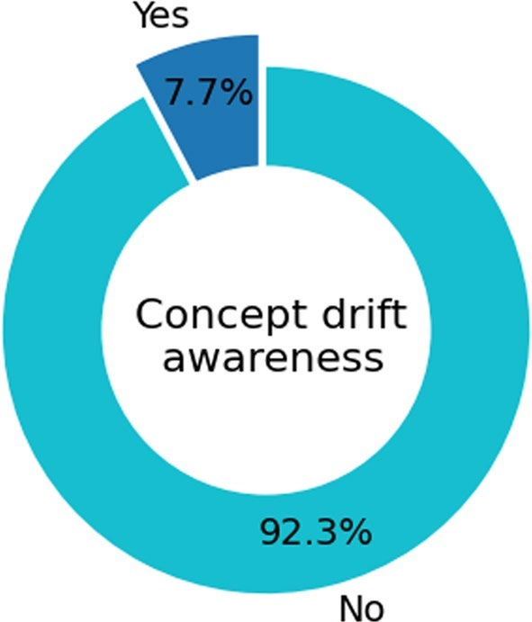

图内数据：关注概念漂移的论文占 7.7%，未关注的论文占 92.3%；环形图中心文字为“对概念漂移的关注”。

## 8 结论

本文对过去 25 年的 PCB 质量检测论文进行了按时间和类别的分析，介绍 PCB 检测环境如何通常划分为裸板与组装电路板两类，并梳理从核心传统技术到现代实时人工智能方案的演进。

在裸板检测方面，近期深度学习模型的结果似乎已经几乎完全解决了线路和焊盘检测问题，多数情况下准确率接近 100%。然而，组装板检测并未取得相同结果。由于元器件种类更多、更新更快，组装板检测更为复杂，并会给人工智能模型引入概念漂移问题。不过，现代 PCBA 检测方法已能够在不到一秒的时间内检测成千上万的不同电子元器件，提高了原有 AOI 设备的检测质量、效率和经济可承受性。

近期研发最关键的限制之一，是缺少具有代表性的公开 PCB 数据集，无法为多项研究提供共同的基准参照，也难以形成可比较不同方案的总体性能排名。因此，本文汇总表中没有统一客观性能指标列，因为每篇论文的结果都与其特定测试数据紧密相关。例如，本文综述的一些现代人工智能研究报告了高水平结果，但仍仅在私有数据集上验证，限制了结果的可复现性。不过，过去五年已有一些有价值的 PCB 数据集公开发布，可能推动后续研究实现重要改进。

就方案的数据利用效率而言，多项研究依赖在数千个样本上训练的人工智能模型，而这些样本来自成本高昂的私有数据集。这并非理想的工程方案，因为工业环境经常更换主要产品，因此容易受到概念漂移影响。由此，未来需要进一步开发数据高效的系统，以解决深度学习应用中的这一问题。

## 作者贡献、经费与声明

**作者贡献：**所有作者对本文作出了同等贡献。

**经费支持：**本研究部分由“便携设备制造过程中故障检测视觉系统”项目资助，该项目由亚马孙三星电子有限公司依据巴西信息产业法第 8.248/91 号出资。本研究还部分得到巴西高等教育人员改进协调署（CAPES）资助，资助代码为 001。

**数据可用性：**不适用。

**代码可用性：**不适用。

**利益冲突：**作者没有需要披露的相关财务或非财务利益。

**开放获取：**本文依据“知识共享署名 4.0 国际许可协议”授权。只要对原作者和来源作出适当署名，提供许可协议链接，并说明是否进行了修改，即可在任何媒介或格式中使用、共享、改编、分发和复制。除非相关材料的署名说明另有注明，本文图片及其他第三方材料同样包含在该知识共享许可中。若某些材料不在本文许可范围内，且预期用途不受法律法规允许，或超出许可范围，则需要直接向版权持有人申请许可。许可协议见：[知识共享署名 4.0 国际许可协议](http://creativecommons.org/licenses/by/4.0/)。

## 参考文献

下列文献按原论文编号保留。题名译为中文，作者、出版标识及可用的 DOI 保留，以便与正文和原始文献对应。

1. Precedence Research. 电子产品合同制造与设计服务市场。[市场报告](https://www.precedenceresearch.com/electronic-contract-manufacturing-and-design-services-market)。访问日期：2023 年 8 月 3 日。

2. Lee YT, Kumaraguru S, Jain S, Robinson S, Helu M, Hatim QY, 等. 智能制造系统绩效指标的分类体系. Smart Sustain Manuf Syst. 2017;1(1):52–74. DOI：[10.1520/SSMS20160012](https://doi.org/10.1520/SSMS20160012)。

3. Smart Manufacturing Leadership Coalition. SMLC 论坛：实施智能制造的优先事项、基础设施与协作。[报告](https://smartmanufacturingcoalition.org/sites/default/files/smlc_forum_report_vf_0.pdf)。访问日期：2023 年 8 月 3 日。

4. Powell D, Magnanini MC, Colledani M, Myklebust O. 推进零缺陷制造：研究现状视角与未来研究方向. Comput Ind. 2022;136:103596. DOI：[10.1016/j.compind.2021.103596](https://doi.org/10.1016/j.compind.2021.103596)。

5. Bhattacharya A, Cloutier SG. 面向印制电路板制造缺陷分类的端到端深度学习框架. Sci Rep. 2022;12(1):1–13. DOI：[10.1038/s41598-022-16302-3](https://doi.org/10.1038/s41598-022-16302-3)。

6. Anitha DB, Rao M. 基于图像处理技术的裸板与组装电路板缺陷检测综述. 2017 年无线通信、信号处理与网络国际会议（WiSPNET）. 2017:39–43。

7. Andrade MA, Pepe PCF, Ximenes LR, Arthur R. 面向印制电路板分析的自动检测综述. 载于：Iano Y, Saotome O, Vásquez GLK, Pezzuto CC, Arthur R, de Oliveira GG 编，第七届巴西技术研讨会论文集（BTSym’21）. Springer International Publishing;2022:423–431。

8. Moganti M, Ercal F, Dagli CH, Tsunekawa S. PCB 自动检测算法综述. Comput Vis Image Underst. 1996;63(2):287–313. DOI：[10.1006/cviu.1996.0020](https://doi.org/10.1006/cviu.1996.0020)。

9. Maurer A. 增加值贸易：方法与经验. 中国西部国际博览会。[报告](https://www.wto.org/english/res_e/statis_e/miwi_e/maurer_chengdu_oct11.pdf)。访问日期：2023 年 8 月 3 日。

10. Huang W, Wei P, Zhang M, Liu H. HRIPCB：一个具有挑战性的 PCB 缺陷检测与分类数据集. J Eng. 2020;2020(13):303–309. DOI：[10.1049/joe.2019.1183](https://doi.org/10.1049/joe.2019.1183)。

11. Ding R, Dai L, Li G, Liu H. TDD-Net：面向印制电路板的微小缺陷检测网络. CAAI Trans Intel Technol. 2019;4(2):110–116. DOI：[10.1049/trit.2019.0019](https://doi.org/10.1049/trit.2019.0019)。

12. Lu H, Mehta D, Paradis OP, Asadizanjani N, Tehranipoor M, Woodard DL. FICS-PCB：用于印制电路板自动视觉检测的多模态图像数据集. Cryptology ePrint Archive, Paper 2020/366. [论文](https://eprint.iacr.org/2020/366)。访问日期：2023 年 8 月 3 日。

13. Indera Putera SH, Ibrahim Z. 使用数学形态学与 MATLAB 图像处理工具进行印制电路板缺陷检测. 第二届教育技术与计算机国际会议. IEEE;2010;5:359–363。

14. Pal Singh Chauhan A, Bhardwaj SC. 利用机器视觉和图像相减方法检测裸板缺陷. 2011 年世界工程大会论文集;2:1597–1601。[论文](https://www.researchgate.net/profile/Sharat-Bhardwaj/publication/265319589_Detection_of_Bare_PCB_Defects_by_Image_Subtraction_Method_using_Machine_Vision/links/55ade12508aed9b7dcdaf974/Detection-of-Bare-PCB-Defects-by-Image-Subtraction-Method-using-Machine-Vision.pdf)。访问日期：2023 年 8 月 3 日。

15. Guan SA, Guo F. 一种用于 PCB 缺陷检测的新型图像增强算法. 智能科学与信息工程国际会议. IEEE;2011:454–456。

16. Ibrahim I, Ibrahim Z, Khalil K, Mokji MM, Bakar SARSA, Mokhtar N, 等. 针对六种印制缺陷的改进缺陷分类算法及其在真实印制电路板图像中的实现. Intl J Innov Comput Inf Control. 2012;8(5):3239–3250。

17. Chaudhary V, Dave IR, Upla KP. 用于缺陷检测与分类的印制电路板自动视觉检测. 无线通信、信号处理与网络国际会议（WiSPNET）. 2017:732–737。

18. Rosten E, Drummond T. 融合点与线以实现高性能跟踪. 第十届 IEEE 国际计算机视觉会议（ICCV’05）. 2005;2:1508–1515。

19. Torr PHS, Zisserman A. MLESAC：一种用于图像几何估计的新型稳健估计器. Comput Vis Image Underst. 2000;78(1):138–156. DOI：[10.1006/cviu.1999.0832](https://doi.org/10.1006/cviu.1999.0832)。

20. Zhu J, Wu A, Liu X. 基于小波去噪的印制电路板缺陷视觉检测. IOP 会议系列：材料科学与工程. IOP Publishing;2018;6:062055。

21. Edwards T. 离散小波变换：理论与实现. 计算机科学;1991。[论文](http://qss.stanford.edu/~godfrey/wavelets/wave_paper.pdf)。访问日期：2023 年 8 月 3 日。

22. Illingworth J, Kittler J. 霍夫变换综述. Comput Vis Graph Image Process. 1988;44(1):87–116. DOI：[10.1016/S0734-189X(88)80033-1](https://doi.org/10.1016/S0734-189X(88)80033-1)。

23. Londe PP, Chavan SA. 使用 MATLAB 自动检测与分类 PCB 缺陷. Int J Curr Eng Technol. 2014;4(3):2119–2123。

24. Lu Z, He Q, Xiang X, Liu H. 基于贝叶斯特征融合的 PCB 缺陷检测. J Eng. 2018;2018(16):1741–1745. DOI：[10.1049/joe.2018.8270](https://doi.org/10.1049/joe.2018.8270)。

25. Ojala T, Pietikäinen M, Mäenpää T. 基于局部二值模式的多分辨率灰度与旋转不变纹理分类. IEEE Trans Pattern Anal Mach Intell. 2002;24(7):971–987. DOI：[10.1109/TPAMI.2002.1017623](https://doi.org/10.1109/TPAMI.2002.1017623)。

26. He N, Cao J, Song L. 用于人体检测的尺度空间方向梯度直方图. 信息科学与工程国际研讨会. IEEE;2008;2:167–170。

27. Juang BH, Chou W, Lee CH. 用于语音识别的最小分类错误率方法. IEEE Trans Speech Audio Process. 1997;5(3):257–265. DOI：[10.1109/89.568732](https://doi.org/10.1109/89.568732)。

28. He K, Zhang X, Ren S, Sun J. 用于图像识别的深度残差学习. IEEE 计算机视觉与模式识别会议（CVPR）. IEEE;2016:770–778。

29. Volkau I, Abdul M, Dai W, Erdt M, Sourin A. 基于迁移学习中的无监督特征提取进行印制电路板缺陷检测. 国际网络世界会议（CW）. IEEE;2019:101–108。

30. Simonyan K, Zisserman A. 用于大规模图像识别的超深卷积网络. 第三届国际学习表征会议;2015。[论文](https://arxiv.org/pdf/1409.1556.pdf)。访问日期：2023 年 8 月 3 日。

31. He F, Tang S, Mehrkanoon S, Huang X, Yang J. 基于监督与半监督学习的实时 PCB 缺陷检测器. 第 28 届欧洲人工神经网络、计算智能与机器学习研讨会论文集（ESANN）. 2020:527–532。[论文](https://www.esann.org/sites/default/files/proceedings/2020/ES2020-33.pdf)。访问日期：2023 年 8 月 3 日。

32. Adibhatla VA, Chih HC, Hsu CC, Cheng J, Abbod MF, Shieh JS. 通过最新 YOLO 模型将深度学习应用于印制电路板缺陷检测. Math Biosci Eng. 2021;18(4):4411–4428. DOI：[10.3934/mbe.2021223](https://doi.org/10.3934/mbe.2021223)。

33. Jocher G, Chaurasia A, Stoken A, Borovec J, NanoCode012, Kwon Y, 等. ultralytics/yolov5：v7.0——YOLOv5 先进实时实例分割. Zenodo。[软件记录](https://zenodo.org/record/7347926)。访问日期：2023 年 8 月 3 日。

34. Honda T, Matsuyamatl Y, Yamamuratl H, Sasazawatl H, Ninomiyatl T, Listlt L, 等. 基于三维形状分析的表面贴装器件焊点自动视觉检测算法. MVA ’96 IAPR 机器视觉应用研讨会;1996。[论文](http://www.mva-org.jp/Proceedings/CommemorativeDVD/1996/papers/1996261.pdf)。访问日期：2023 年 8 月 3 日。

35. Loh HH, Lu MS. 基于图像分析的印制电路板检测. IEEE Trans Ind Appl. 1999;35(2):426–432. DOI：[10.1109/28.753638](https://doi.org/10.1109/28.753638)。

36. Ma J, Ma P, Su X. 基于表面恢复的焊点检测方法. Comput Inf Sci. 2010;3(2):163–170. DOI：[10.5539/cis.v3n2p163](https://doi.org/10.5539/cis.v3n2p163)。

37. Borthakur M, Latne A, Kulkarni P. 自动 PCB 缺陷检测算法比较研究与改进技术的优化方案. Int J Comput Appl. 2015;114(6):27–33. DOI：[10.5120/19985-1938](https://doi.org/10.5120/19985-1938)。

38. Nahar JA, Phadke AC. 用于组装电路板检测的计算机辅助系统. 智能计算与控制系统国际会议（ICCS）. IEEE;2019:372–376。

39. Tsai DM, Huang CK. 利用基于模板的傅里叶图像重建检测电子器件表面缺陷. IEEE Trans Compon Packag Manuf Technol. 2019;9(1):163–172. DOI：[10.1109/TCPMT.2018.2873744](https://doi.org/10.1109/TCPMT.2018.2873744)。

40. Jessurun NT, Paradis OP, Tehranipoor M, Asadizanjani N. SHADE：利用检测到的阴影自动细化 PCB 元器件估计. IEEE 电子器件物理保障与检测会议（PAINE）. 2020:1–6。

41. Acciani G, Brunetti G, Fornarelli G. 神经网络在表面贴装技术焊点光学检测与分类中的应用. IEEE Trans Ind Inf. 2006;2(3):200–209. DOI：[10.1109/TII.2006.877265](https://doi.org/10.1109/TII.2006.877265)。

42. Xie F, Uitdenbogerd A, Song A. 基于遗传编程检测 PCB 元器件贴装缺陷. IEEE 进化计算大会. IEEE;2013:1138–1145。

43. Hashmani MA, Jameel SM, Alhussain H, Rehman M, Budiman A. 概念漂移导致的准确率性能退化模型. J Appl. 2019;10(5):422–425. DOI：[10.14569/ijacsa.2019.0100552](https://doi.org/10.14569/ijacsa.2019.0100552)。

44. Wu H, Zhang X, Kuang Y, Ouyang G, Xie H. 基于神经网络与遗传算法结合的焊点检测. Optik. 2013;124(20):4110–4116. DOI：[10.1016/j.ijleo.2012.12.030](https://doi.org/10.1016/j.ijleo.2012.12.030)。

45. Li J, Gu J, Huang Z, Wen J. 改进 YOLOv3 算法在 PCB 电子元器件检测中的应用研究. Appl Sci. 2019;9(18):3750. DOI：[10.3390/app9183750](https://doi.org/10.3390/app9183750)。

46. Farhadi A, Redmon J. YOLOv3：渐进式改进. 计算机视觉与模式识别;2018;1804:1–6. Springer，柏林/海德堡，德国。（出版信息沿用原文。）

47. Caliskan A, Gurkan G. PCB 焊点自动光学检测系统的设计与实现. 智能系统与应用创新国际会议（INISTA）. IEEE;2021。

48. Bochkovskiy A, Wang CY, Liao HYM. YOLOv4：目标检测速度与准确率的最优平衡. arXiv;2020. DOI：[10.48550/arXiv.2004.10934](https://doi.org/10.48550/arXiv.2004.10934)。

49. Zhao W, Gurudu SR, Taheri S, Ghosh S, Sathiaseelan MAM, Asadizanjani N. 面向硬件保障的计算机视觉 PCB 元器件检测. Big Data Cogn Comput. 2022;6(2):39. DOI：[10.3390/bdcc6020039](https://doi.org/10.3390/bdcc6020039)。

50. Li Z, Yang Q. 基于 AOI 技术的 PCB 缺陷检测系统设计. 第四届图像与信号处理国际大会论文集（CISP）. 2011;4:1988–1991. DOI：[10.1109/CISP.2011.6100553](https://doi.org/10.1109/CISP.2011.6100553)。

51. Szymanski C, Stemmer MR. 基于 SIFT 算法的小批量生产 PCB 自动检测. IEEE 工业电子国际研讨会. 2015:594–599. DOI：[10.1109/ISIE.2015.7281535](https://doi.org/10.1109/ISIE.2015.7281535)。

52. Mateo Sanguino TJ, Smolčić-Rodríguez M. PCB 制造过程中缺陷检测的计算机辅助系统. 第十六届 IEEE 智能工程系统国际会议论文集（INES）. 2012:151–156. DOI：[10.1109/INES.2012.6249821](https://doi.org/10.1109/INES.2012.6249821)。

53. Pramerdorfer C, Kampel M. 用于基于计算机视觉的 PCB 分析的数据集. 第十四届 IAPR 机器视觉应用国际会议（MVA）. 2015:378–381。

54. Jessurun N, Dizon-Paradis OP, Harrison J, Ghosh S, Tehranipoor MM, Woodard DL, 等. FPIC：一种用于光学 PCB 保障的新型语义数据集. arXiv;2022. DOI：[10.48550/arXiv.2202.08414](https://doi.org/10.48550/arXiv.2202.08414)。

55. Greene T. 2010—2019：深度学习的兴起。[文章](https://thenextweb.com/news/2010-2019-the-rise-of-deep-learning)。访问日期：2023 年 8 月 3 日。原参考文献年份和网址存在拼接异常，此处恢复可辨识的文章标题与单一网址。

**出版者说明：**施普林格·自然对已发表地图及机构隶属关系中的管辖权主张持中立立场。

## 术语对照

| 原文术语或缩写 | 本译文用语 |
| --- | --- |
| PCB | 印制电路板 |
| Bare PCB / BPCB | 裸板、裸印制电路板 |
| PCB assembly / PCBA | 组装电路板、印制电路板组件；指过程时译为电路板组装 |
| AOI | 自动光学检测 |
| image registration | 图像配准 |
| template matching | 模板匹配 |
| image subtraction | 图像相减、图像差分 |
| solder joint / soldering pad | 焊点／焊盘 |
| mouse bite / spur / spurious copper | 鼠咬／毛刺／残铜 |
| tombstone / cold soldering | 立碑／冷焊 |
| concept drift | 概念漂移 |
| accuracy / precision / recall | 准确率／精确率／召回率 |
| false positive rate / true positive rate | 假阳性率（误报率）／真阳性率 |
| mAP | 平均精度均值 |
| backbone / feature map / bounding box | 骨干网络／特征图／边界框 |
| self-supervised / semi-supervised / unsupervised | 自监督／半监督／无监督 |

