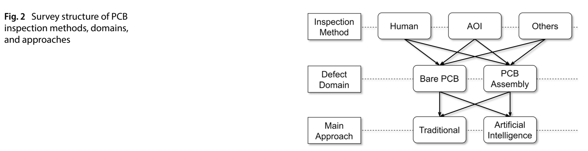

# PCB自动检测综述：先界定板、缺陷与参考条件，再选择算法

深化修订：2026年11月16日。依据本地20页综述和中文译文。它描述相应发表时点的研究，不视为2026年全部最新方法的清单。

入口：[原PDF](<Automatic printed circuit board inspection- a comprehensible survey.pdf>)｜[中文译文](full_translation_zh.md)｜[研究主文档](../../../research/thesis-research-and-study-guide-zh.md)｜[总报告](../../261107/research-plan-and-paper-reading-report-zh.md)

## 一、这篇与你的题目最直接的关系

“PCB缺陷检测”听起来是单一问题，实际上覆盖裸板线路、装配器件、焊接外观以及不同成像与功能测试。若不先界定对象，相关工作很容易把框检测精度、模板差分结果、像素IoU和电气质量混在一起。

你的研究从VisA PCB1的板级RGB外观图像出发，利用真实像素mask做背景/缺陷分割。它可以研究可见异常的位置与范围，不自动证明裸板断短路、电气失效或内部焊点质量。读这篇首先为了把题目落到可以评价的对象，而不是搜集更多网络名字。

## 二、原图的三条分类轴怎样理解

来源：原论文图2，PDF第3页；[提取记录](reading-figures/sources.json)。从上到下依次是检测方式、缺陷对象、主要方法，线条表示交叉关系。

上层人工、自动光学检测及其他方式描述怎样检查；中层裸板与组装板描述检查什么；底层传统算法与人工智能描述怎样计算。它们不是互斥的单一树形分类：自动光学系统也能用传统方法，装配板也能人工检查。

图中AOI应理解为成像与检测流程，不等于某个深度模型。你在公开图像上研究分割，属于AOI相关算法问题，但没有实际产线相机、照明、输送与验收流程，不宜直接宣称已构建产线检测系统。

## 三、裸板与装配板为什么需要不同判断依据

裸板主要包含导电图形、孔和焊盘，正常结构通常与设计规则强相关。对一条导线断裂的判断，可能依赖连接关系与规定宽度；即使局部像素外观像另一处正常间隙，它在此位置也可能不合法。

装配板增加元器件、遮挡、高度和反光，正常外观可能受器件型号、姿态及照明影响。缺件可表现为露出的正常基板或焊盘；单看局部纹理未必“异常”，它异常在应有结构没有出现。这就是外观相似与结构正确不完全相同。

这些是帮助理解的任务推导，不表示PCB1已确认所有误检原因。你需要对训练/验证图判断具体缺陷是什么，再决定位置、结构或局部表征哪个条件最重要。

## 四、三种代表路线怎样工作

### 1. 参考式比较：先建立对应，再看差异

把待测图与正常模板对齐，比较像素、边缘或特征。用教学式可写为$d_p=\|f(I)_p-f(R)_{\pi(p)}\|$：$R$为参考，$\pi$为对应关系。若有固定板型和可靠配准，它能直接表达哪里偏离正常。

困难在于差异也包括错位、反光与正常变化。模板不是免费的信息；需要说明获取、维护、适用板型和配准误差。CADNet的对应正常图与你候选正常库不同，VisA也没有逐张黄金正常板。检索得到的参照必须核对是不是同一结构，不能只说“来自正常图就可靠”。

### 2. 规则与传统图像处理：把制造先验写成检查

阈值、边缘、形态学、连通性和几何约束可把正常结构标准转为计算。例如先提取导体区域，再检查间距或连通关系。它们解释较直接，但对照明、材质和参数敏感，板型变化也可能要求重设规则。

传统方法不等于落后，也不等于对所有场景可解释。阈值选错会把高光当缺口，形态闭运算可能补掉真实细断裂。研究中若增加预处理，应说明它保留与改变了什么，不能只用“去噪”掩盖缺陷也被抹去的风险。

### 3. 学习式方法：从数据学判别，但必须核对标签

分类回答整图是否异常，目标检测输出框，像素分割输出掩码。它们需要不同粒度的监督，比较不能只看名字都叫缺陷检测。正常样本方法则主要学习正常支持范围，通过偏离判断异常，不等于有缺陷mask的分割。

你现有SegFormer属于监督分割。DINO自监督预训练描述骨干怎样学习，并不改变下游用mask训练的身份。正常参照可以是计算机制，未必要求把整个课题改成无监督。

## 五、如何阅读综述中的数据与性能

优先记录对象、输入、标签、参考需求、划分和指标，再看分数。裸板数据上的六类目标框检测，与PCB1装配外观二值分割，不能仅因同为PCB就排名。框标注也不能直接视为精细mask；人工把框填满会改变监督与评价语义。

若图像被切块，检查先分原图再切块还是随机分图块。同一原图相邻块共享纹理与照明，混入训练与测试可能高估泛化。若一个工件有多视图，也需关注物理样件独立性，不能把像素数当样本量。

综述列举的准确率、召回和速度来自不同条件，应该当作回查原始文献的线索。对你最重要的是同协议重现或适配后的比较，不是选择表里最高数字作为“先进水平”。

## 六、概念漂移和成像变化怎样影响你的候选方案

板型、器件批次、工艺与照明变化可能使正常分布改变。固定模型会把新正常外观报异常，持续加入正常参考又可能把真实缺陷容纳进去。是否更新库，需要清楚的正常数据核验与版本记录；当前阅读不要求新增持续学习研究。

位置限制尤其依赖可比较几何：相同坐标可能因板面偏移对应不同元件。若全局检索误配，邻域约束有机会帮助；若姿态不稳定，它也可能增加误报。DINOSaur已有相关近邻机制，贡献应在PCB条件与可靠性证据上进一步落实。

## 七、对两项研究的具体联系

工作一应围绕已诊断的错误选择适配。若漏检来自结构缺失，单纯更强局部纹理未必足够；若边界覆盖不足，结构位置先验也不能代替细特征。先确认问题再选机制，是这篇对你的主要帮助。

工作二要区分三层：缺陷mask回答位置，正常参照说明模型如何比较，制造诊断解释为什么出现故障。外观参照可以忠实地表明某个得分来自何种差异，但不能独自证明电气不良或工艺原因。正常来源也不保证参照匹配。

**教学案例：**待测缺件位置匹配到另一处正常基板，距离很小。错误不一定来自模型完全看不见缺件，而可能来自“任何地方找到正常外观即可”的正常定义不适合此结构。候选解决可涉及位置或结构约束，但需通过同特征、同库容量比较，并检查错位条件。这个例子是研究假设，不是已证实PCB1的主要失败原因。

## 八、读完后应该能准确表达

**我的研究能证明什么？**在限定公开数据与监督协议下，评价可见外观的二值定位和判别依据。**不能直接证明什么？**电气质量、内部缺陷、工艺因果或产线验收。**为什么不只换最新模型？**对象与正常定义可能比骨干新旧更直接决定错误。**综述怎样用于写作？**先交代对象和任务，再按参考比较、规则与学习路线介绍，关键结论回查原始论文。

建议先读对象与总分类图，再读与你任务相关的自动光学与学习路线，最后查数据和漂移挑战。留下一个已经填好的任务身份：板级RGB输入、像素监督、二值mask、当前单图基线、正常参照候选、无逐张黄金模板。它会约束后续每一项比较。

## 九、带着一个具体PCB案例重新走一遍检测流程

以下为教学案例，不是对PCB1的既定诊断：一张正常板在某焊盘处出现强反光，模型报异常。先查原图与真值，再查缩放后的输入，判断高光是否落在被误报位置；随后检查模型输出是在该位置真的高，还是还原与插值扩大了邻近响应。若采用正常参照，再看实际近邻是不是同类焊盘、正常库是否包含类似光照。

这些检查对应不同层级：输入成像、几何处理、表征与评分、最终工作点。只有确认问题落在哪层，才能讨论增加正常覆盖、改善表征或调整评分。若直接为这张测试图调阈值，既不能证明机制有效，也会产生测试反馈偏差。这个案例可帮助你把综述中的成像、算法和检测流程连起来，而非把所有误报归因于网络不够新。
