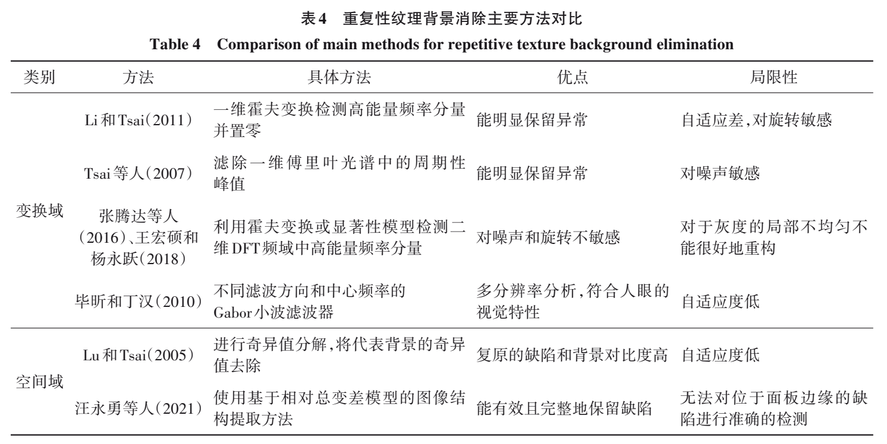

# 屏幕缺陷综述：为什么先建模背景，再谈微弱缺陷

整理：2026-11-16。原文：林思媛、吴一全，《基于视觉的液晶屏/OLED屏缺陷检测方法综述》，《中国图象图形学报》2024，29(5)。这是面向PCB的定向借鉴，屏幕方法和数据不作为本课题自动新增的任务。

[原论文 PDF](<基于视觉的液晶屏_OLED屏缺陷检测方法综述.pdf>)｜[研究主文档](../../../research/thesis-research-and-study-guide-zh.md)｜[论文阅读总报告](../../261107/research-plan-and-paper-reading-report-zh.md)

## 先认识Mura，才知道作者为什么重视背景

本文从LCD与OLED结构、缺陷类别和量化方式讲起，随后沿图像预处理、重复纹理去除、背景抑制、分割、特征分类和深度学习展开。点缺陷和线缺陷通常较规则，而Mura表现为亮度或色彩不均，可能对比度低、边界模糊、形状不规则。它不一定是一条清楚的裂纹，因此“先找强边缘再阈值”容易漏检。作者把背景建模放在重要位置，正是因为正常的照明起伏与周期纹理可能比缺陷更显著。

屏幕背景还不是一种东西。重复纹理常对应像素阵列或采样产生的莫尔条纹；缓慢亮度变化则是另一类不均匀背景。前者可表现为频谱峰值，后者更适合用平滑曲面等描述。把二者统一当成高频噪声会选错处理。阅读应先问图像的变化来自正常结构还是异常，而不是看到“背景抑制”便认为所有正常背景都能安全消除。

对PCB的联系在于：微弱缺陷是否被强正常结构掩盖，以及模型利用的差异究竟属于什么。PCB线路、字符、焊盘与元器件组成高度非均匀背景，不能默认具有屏幕的平滑性和周期性。这里迁移的是分解问题的方法，不能直接把Mura定义、屏幕工艺或专用等级标准套给PCB。

## 精读原表：每个消背景操作都带一个假设

来源：**表4，PDF实际第9页**，原页节选，未重画；[裁剪记录](reading-figures/sources.json)。

表按变换域与空间域组织，不应只看“优点”列。第一步横向读一行：方法把什么当背景，以何种计算去除，代价是什么。频域方法把周期纹理视作较强的频率成分，去除峰值后逆变换；Gabor小波用特定方向和频率观察纹理；空间域的SVD根据主要成分重构或去除背景；结构提取则利用空间变化规律分离内容。它们不是相同操作的不同名字。

第二步纵向读局限：有的对旋转或噪声敏感，有的无法处理局部灰度不均，有的自适应不足，有的边缘位置检测受限。这些限制源于它们的背景假设。周期方向改变，预设滤波方向就可能失配；局部变化不同，全图频谱就难区分；面板边缘本来不符合内部重复模式，分离规则也可能失效。

第三步问PCB能否满足前提。正常引脚和线路在某些局部有重复，却不代表整板同周期；缺陷细线可能和正常线路共享方向、频率。若将强频率全部去掉，也可能损害缺陷。表4对本研究最有用的结论因此是：背景抑制应同时检查**正常干扰是否下降、缺陷信息是否保留**，而不是只凭处理后的图看起来干净就算成功。

## 三条路线的具体计算与限制

### 建模可预期背景，再从残差中找异常

第2.2节介绍频域抑制、曲面拟合、DCT、统计与背景重构。可用一个简化理解：观测图像I由正常背景B、异常变化D和噪声N组成；先估计B，再分析I−B。但实际图像并不总满足简单可加性，估计的背景也可能把缺陷吸收进去。拟合过强时，宽而缓慢的Mura会被当成背景抹掉；拟合过弱时，正常照明残差又成为误报。

这与正常参照候选的联系是“正常基准是否可信”。屏幕背景可以从待测图自身估计，PCB参照库则可能来自训练正常图；两者都需要验证正常估计没有污染判别。VisA没有逐张黄金配对板，不能假设直接相减就只剩缺陷。若以后显示待测与正常参照差异，必须说明差异是像素、特征还是模型分数，并检查几何与光照，不能把一种残差直接解释成真实缺陷原因。

### 先增强可分性，再分割模糊区域

第2.3节讨论阈值/聚类、活动轮廓、边缘与形状等方法。阈值根据灰度或响应划出区域，聚类按特征相似性分组；活动轮廓则通过区域、平滑或边界等能量项推动轮廓演化。它们解决的困难不同：阈值需要前景背景分布有可分性，轮廓需要合理初始化与能量设计，边缘法依赖可靠梯度。低对比度不只意味着换一个阈值，还可能根本没有稳定边界可找。

联系PCB像素mask时，需要意识到标注本身定义了边界。屏幕模糊Mura与PCB锐利破损的边界性质不同，即使都报IoU也不能视为同一种难度。对于自己的错误，先区分完全漏检、缺陷覆盖不足和正常结构误报，才能判断要改善表示、空间分辨率还是判别阈值。一个方法让边界更平滑，可能提高大斑块视觉效果，却切断细线缺陷，并非统一有利。

### 学正常重构，或学习有监督的缺陷判别

第3节的深度方法包括AE/GAN重构、样本生成、迁移与监督检测分割。AE把图像压缩再还原，若主要学到正常纹理，缺陷可能在重构后被“修复”，输入残差提供异常线索；但网络也可能原样复制缺陷。监督分割则直接用mask训练像素判别，已知缺陷监督更明确，却可能对未覆盖外观和正常变化敏感。

生成样本与重构检测不能混为一谈。前者可产生异常图和标注供后续分割训练，评价应看合成数据对真实测试缺陷是否有效；后者直接用残差评分，评价应看误差是否区分正常和异常。生成图视觉逼真不证明训练收益，重构图清晰也不证明异常得分可靠。当前PCB已有真实mask，没有必要仅凭综述将生成模型列为必做。

迁移学习则复用已有表征减少从头学习需求。若采用DINO自监督预训练，再用PCB真实mask训练头，仍为监督下游。屏幕文献中对低标注或无监督的动机，不会改变当前PCB1协议。冻结骨干是否保留缺陷细节，要用简单头与真实错误检查，不能从迁移学习的一般优势推出必然胜过SegFormer。

## 指标中最值得记的是“测了什么”

第1.2节介绍SEMU与DSEMU，围绕人眼可觉察程度、缺陷对比度、面积和观察条件量化Mura。这些指标与机器分割IoU关注不同对象：前者近似描述视觉严重程度，后者衡量预测与mask一致性。缺陷面积大不必然更严重，IoU高也不表示质量等级判定正确。PCB当前没有相同的等级标签和观察模型，不能直接用这些公式做制造风险评分。

表9/10与数据表中存在大量自建数据、不同缺陷和评价方式。可用来查方法条件，但不宜把横向数字当统一实验。表12/13还区分屏幕自建数据与通用纹理数据，说明“在纹理基准有效”和“在真实屏幕产线有效”不是同一证据。对PCB亦然：未来独立PCB类别验证需按主文档事先确定，不能随便用一套屏幕数据补“跨领域”而改变任务。

背景重构评价关注无噪、无损与增强，尤其适合作为思维工具：不仅看正常背景是否变弱，还要看有没有损伤缺陷。实际做模型比较则应回到既定原图分割指标，同时记录正常误报。效率作为代价报告即可，屏幕在线检测诉求并不自动给毕业课题增加部署目标。

## 用一对假设图练习“为什么有效”

设想一幅屏幕有缓慢亮度起伏和一个低对比度斑块。平滑曲面能估计大范围亮度，残差可能突出斑块；若斑块也很大很缓，估计器可能将其一起吸收。现在换成PCB：正常元器件阴影、字符和金属反光并不组成单一平滑背景，原样使用曲面拟合很可能产生很多正常残差。这个对照解释了为何可以借“正常建模”的思路，却不能借相同背景模型作默认方案。

再设想给PCB增加局部细节支路。若细支路保留缺陷同时增强正常纹理，就像屏幕抑制器去背景时可能伤及缺陷一样，需要双面检查：缺陷覆盖增加多少，正常结构误报是否增加，是否只是更锐利的响应。若工作二采用正常参照，参照必须实际参与得分，并保留整图来源；正常参照图像的视觉合理性与评分忠实性是两种证据。

| 文章中的问题 | PCB可迁移的问题形式 | 不能直接带来的结论 |
| --- | --- | --- |
| 周期纹理掩盖Mura | 正常结构是否掩盖局部异常？ | 整板可按同一频率过滤 |
| 背景重构吸收异常 | 正常估计是否污染异常得分？ | 正常残差就是缺陷真值 |
| 低对比度边界难分 | 缺陷可见性、监督边界与网格是否一致？ | 所有PCB错误都是小目标问题 |
| 人眼严重度指标 | 区分定位、解释与质量评价 | mask面积可直接诊断工艺原因 |

## 定向阅读路径与问答

先读第1节的缺陷定义和难点，重点看Mura为什么不同于点线缺陷。然后读第2.2节和表4/5，把背景假设写出来；再读第2.3节，理解残差仍需要判别与分割。最后读第3节及表12/13，区分正常重构、合成增强和监督训练。LCD/OLED材料结构了解输入来源即可，不需把制造细节全部背下。

**问：干净的背景差分图是不是可靠解释？**它说明相对某估计存在变化，还需核验该估计、评分绑定和稳定性。**问：SEMU能替代PCB IoU吗？**不能，目标、物理尺度和标注都不同。**问：本文最有价值的一句话是什么？**任何去除正常干扰的操作，都必须同时证明保留了要检出的异常。把这句话用于数据缩放、细节适配和参照评分，比直接复制一个屏幕网络更符合当前任务。

