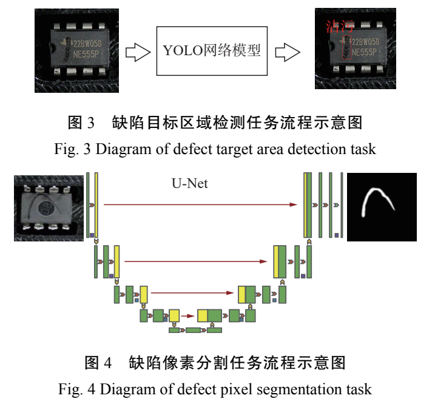

# 电子元器件表面综述：从任务定义读到特征与像素输出

整理：2026-11-16。原文：毛远宏、杨靓、刘曦等，《基于计算机视觉的电子元器件表面缺陷检测综述》，《微电子学与计算机》2026，43(7)：70—78。原文收稿/修回均在2024年，引用范围不能仅凭2026卷年视为当前最新。

[原论文 PDF](<基于计算机视觉的电子元器件表面缺陷检测综述.pdf>)｜[研究主文档](../../../research/thesis-research-and-study-guide-zh.md)｜[论文阅读总报告](../../261107/research-plan-and-paper-reading-report-zh.md)

## 先看它讨论的是哪一种“电子”

本文聚焦元器件表面，如封装划痕、沾污、引脚异常和标识问题，并将视觉任务分为匹配、分类、区域检测、像素分割，再按照图像处理、传统机器学习和深度学习组织方法。第1节给任务与流程，第2节讲技术，第3节介绍作者构建的数据，第4—5节讨论挑战与展望。它的价值是用很短的篇幅建立任务词汇，帮助把“电子行业缺陷”收敛成具体输出。

当前PCB1是一块板级复杂外观RGB图上的二值缺陷分割，包含多个元器件与背景；本文不少例子以单个封装或引脚局部为输入。两者相关但难度来源不同：单器件图可能已完成定位和姿态校正，板级图还需在大量正常结构中找少数异常。不能把单器件分类精度当成板级分割可达到的结果，也不能因为本文列了极性错误，就声称当前二类mask能识别元器件极性。

## 原图最重要的地方是“输出形式”

来源：**图3、图4，PDF实际第3页**，同页原图节选，未重画。[来源与裁剪记录](reading-figures/sources.json)。

上方图3中，芯片图经过YOLO后得到缺陷框与类别；下方图4以U-Net示意输出弯曲细线的像素mask。先盯住右端：框表达“某个矩形范围内有缺陷”，mask表达哪些像素属于缺陷，两种输出的空间精度要求不同。框可以包含大量正常背景，细线分割却必须保留形状。U-Net和YOLO只是各任务示例，不是只能使用它们，也不是图中展示就证明某模型在此数据上完成比较。

再看下方网络的下采样与上采样：压缩空间有助于提取上下文，恢复分辨率服务像素输出，跨层连接传递较细信息。这正对应当前对局部细节的关注，但不能只凭结构图认定缺陷信息一定保留。信息可能在图像缩放或编码早期已经损失，解码器并非真实细节的生成保证。

原图与PCB的最直接关系是解释评价为何不同。目标检测mAP受框重叠与置信度排序影响，分割IoU按像素交并集计算；同叫IoU，计量对象也可能不同。当前需报告原图mask的定位、前景召回和正常误报，不能用综述里框检测的“高精度”替代自己的分割验证。

## 三种技术不是名字列表，而是特征怎样获得

### 图像处理：把明确的先验写进算子

第2.1节的灰度共生矩阵GLCM描述相隔一定距离和方向的灰度对出现频率，因而能反映纹理的平滑、对比或方向性；它不是简单数灰度直方图。划痕改变邻域灰度关系时，描述子可能异常。边缘算子则响应局部梯度，阈值将响应切成候选区域，形态学与连通域分析再过滤或测量。

这一流程适合先验明确的对象，例如规则引脚的数量、间距或形状。其可解释之处是计算量和规则比较清楚，但规则清楚不等于符合真实缺陷：正常标字、焊盘边界也能有强梯度。PCB1若使用类似先验，必须检查正常复杂结构是否被误伤。不能仅以“边缘更清晰”的增强图说明检测收益，也不能由算子名字推断可解释性已经成立。

频域路线把图像看成二维信号，利用背景在某些频率较强这一假设，抑制这些频率再重构，剩余局部异常可能更明显。它依赖正常背景与缺陷在频率上的可分性；PCB规则线路和细缺陷都可能包含高频，直接滤波可能把两者一起去掉。因此它更适合作为理解背景建模的实例，而不是现在给PCB1添加固定预处理的充分理由。

### 传统机器学习：人工描述子加可训练判别

第2.2节中，SVM等方法接收手工提取特征，学习正常与缺陷的决策边界。与纯阈值相比，它不必由人逐项规定界限，但其可利用的信息仍受描述子限制。若特征只记全局纹理，极小局部缺陷的变化可能被正常区域稀释；若先裁好局部，再分类，裁剪质量就成为重要条件。

这里要区分训练标签和推理单位：一张图给一个类别，并不提供像素边界。把图切成块分类后再拼回，也会受到块大小、重叠和边界问题影响，并不自然等价于mask监督分割。对PCB研究，可借鉴“表示与判别器分开检查”：冻结DINO加简单头就是先检验已有表示可用多少，但它使用深度特征，与文中的手工描述子条件不同，不能简单贴传统机器学习标签。

### 深度学习：特征和任务一起优化

第2.3节讨论分类、目标检测及样本生成。卷积网络从图像学习多层表示，监督损失推动表示保留任务需要的信息；多尺度融合、注意力和解耦预测头都是改变信息流或优化的办法。深度可分离卷积主要降低运算，注意力主要重新分配特征权重，它们针对的环节不同，不能统一解释成“增强特征”。

对PCB1，最接近的思路是保留局部空间信息并结合上下文，减少细小缺陷与正常元器件结构混淆。但本文深度方法部分较多框检测实例，并未提供同协议PCB1分割的受控比较。现有SegFormer基线已经训练，DINO简单头、适配和参照未做。应先观察新对照的真实错误，再决定是否需要局部支路，不把文献中的小目标困难直接当作自己的故障诊断。

## 数据与业务流程要带着条件读

第3节介绍DIP与表贴塑封二极管等封装外观数据，报告414张256×256图像、其中210张缺陷图，类别含划痕、沾污、引脚异常和标识错误。这里的数字取自实际第6页，作用是说明数据规模与对象；导读没有检查下载地址当前是否可访问，也没有将其作为已获数据。还需核对标签形式、划分与重复来源，才能判断可否做分割验证。论文提供一个数据入口，不等于与当前PCB1任务兼容。

图5将采集、预处理、特征提取、匹配/分类/定位/分割和验证优化连成业务流程，适合用来审查工程链条。原文相邻段落提及根据测试结果调参优化，做研究时不能照此将最终测试集反复用于开发。应把需要调整的过程放在train/val，保留测试作报告，并如实披露已观察过PCB1历史test的事实。这里借用的是流程完整性，实验协议仍按研究主文档。

第4—5节讨论鲁棒性、实时性、更新和多模态等挑战。它们是行业问题集合，不是当前论文必须全部完成的指标。外观图无法看到内部结构，增加红外、紫外或三维采集会改变输入与工作量，不能当成已有RGB研究的自然延伸。效率可以记录为适配成本，可解释性仍应围绕实际评分依据定义。

## 将文章用于自己的两项研究

| 阅读所得 | 当前研究对应 | 仍缺的证据 |
| --- | --- | --- |
| 框与mask是不同输出 | 当前只做背景/缺陷像素分割 | 不将类别识别或工艺诊断计入已有能力 |
| 细节与语义需要协调 | 局部分支是精度候选 | DINO简单头错误诊断及简单增容/尺度对照 |
| 匹配依赖参考输入 | 正常参照是解释候选 | 训练库覆盖、几何对齐与真实评分绑定 |
| 流程可以逐环节检查 | 数据几何与模型错误分开 | 在train/val定位问题，保持原基线记录 |

用“芯片表面一条划痕”练习三种表述。分类只说这张局部图有划痕，不能指出边界；框检测说这个范围内有划痕，框中仍可能多为正常像素；像素分割给出细线轮廓，但仍不能说明模型为什么判它异常。若进一步展示一个正常芯片区域，只有它真正进入评分，才形成可追溯参照。再往前说划痕由何工艺造成，需要制造记录或其他证据，不是mask或相似图能直接回答。

同样，对于引脚弯曲，几何间距异常可能比纹理更关键。模型若只学到局部颜色，增加细纹理支路未必解决问题；需要先看错误是否与形状、位置或成像有关。当前没有引脚类型分类标注，也未确认某一错误就是弯曲，因此该例仅用于训练问题分析。它提醒自己：PCB特征适配应服务明确失败现象，不能以对象复杂为由无限加模块。

## 阅读顺序与自检答案

先读第1.1节与图1—4，给匹配、分类、框检测和像素分割各写一句输入/输出定义；再读图5与第1.2节，把已有SegFormer处理链对照一遍。第二次读第2.1—2.3节，分别追踪“描述子—判别”“人工先验—规则”“表示—损失”的关系。最后读第3节数据和第4节挑战，只记录与当前问题有关的条件。

**问：像素分割是不是天然可解释？**它提供定位，仍需明确解释哪个分数以及真实依据。**问：模型名相同能直接比较吗？**不够，单器件/板级、框/mask、是否先裁剪、监督和划分都要一致。**问：本文最值得借鉴的是什么？**是先定义任务再选技术，并沿信息路径追问错误，而不是将所有YOLO改进都列入PCB分割待做清单。

