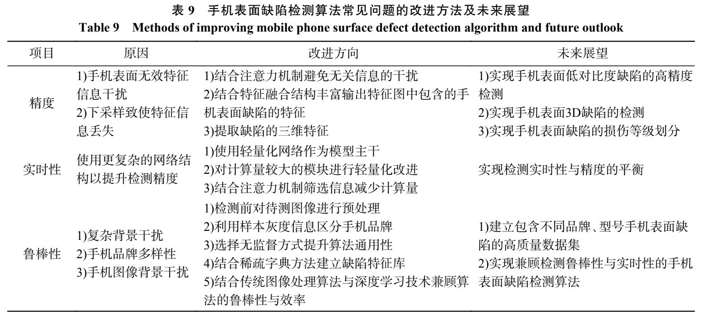

# 手机表面检测进展：把精度、细节与背景干扰连成因果问题

整理：2026-11-16。原文：吴一全、庞雅轩，《手机表面缺陷的机器视觉检测方法研究进展》，《智能系统学报》2025，20(1)：33—51；网络发表2024-11-27。它按当时的精度、实时性与鲁棒性问题组织近年文献，并非当前最新模型清单。

[原论文 PDF](<手机表面缺陷的机器视觉方法研究进展.pdf>)｜[研究主文档](../../../research/thesis-research-and-study-guide-zh.md)｜[论文阅读总报告](../../261107/research-plan-and-paper-reading-report-zh.md)

## 它的组织方法为何适合学研究问题

本文讨论手机屏幕玻璃盖板与外壳的划痕、凹坑、崩边等可见缺陷。注意对象包括透明或反光盖板、带纹理外壳，不等于显示面板的发光Mura，更不是手机内部电子故障。作者先列典型缺陷和困难，再按精度、实时性、鲁棒性介绍改进，最后整理数据和指标。它的优点是将网络设计放回一个具体失败现象，而非按模型年代逐个介绍。

PCB的直接关联是：微小和低对比度线索可能在下采样后变弱，正常纹理与成像反光可能形成误报，背景变化会影响判别。但手机外壳的规则轮廓、玻璃材质及成像设备不同，不能默认对应PCB1。当前任务仍是PCB监督二值分割；读手机论文是为了学习“问题→机制→证据”的组织，不是自动扩成多产品或三维检测课题。

## 先读原表中的因果链

来源：**表9，PDF实际第14页**，原页节选，未重画。[裁剪与来源](reading-figures/sources.json)。

从左向右读一行：精度下降被联系到无效信息与下采样损失，改进方向包括注意力和特征融合；实时性对应复杂结构带来的计算，候选是轻量骨干与模块；鲁棒性涉及背景、品牌和成像干扰，候选是预处理、建模与学习。这不是一份“把所有模块都加上”的清单，而是不同假设对应不同干预。

读表要特别区分“作者归纳的可能原因”与“我的模型已证实的原因”。PCB1已有漏检、正常误报，数据审计也发现少量极小GT在缩放后消失；这些事实并未证明所有漏检都由下采样引起，更没有证明未实现的DINO也有同样瓶颈。把表中的原因复制到自己的论文，会跳过最关键的诊断。

表中三维特征、损伤分级和新数据集是未来方向。它们需要新的输入、标签与评价，不是二维mask分割自然拥有的能力。对于当前研究，保留精度和判别依据两条主线，效率报告为代价；手机产线对实时性的要求不能自动扩成部署研究。

## 三组机制如何处理困难

### 细节与语义融合：保留“在哪里”，再判断“是什么”

第2.1节的分割网络、特征金字塔和多尺度方法，共同关注空间细节与语义的协调。深层特征汇聚上下文，有助于把正常纹理与异常区分；较浅或高分辨率分支保留细线、边缘和位置。融合时通常先对齐通道与尺度，再将细信息与语义特征组合，最终输出框或像素。不能只说它“增强特征”，应说清楚补充的信息来自哪个分辨率。

第2.3.2节举出双分支分割网络，将空间信息和语义信息融合以减少低对比缺陷损失。这与局部RGB支路候选相通：通用骨干的粗空间表示可能缺细节，从输入补充较细表示有机会改善。但原文的手机任务并不证明PCB需要同一结构；如果输入缩放已经抹去缺陷，后端融合也无法恢复真实证据。候选支路要与同尺度简单卷积头、增容和尺度变化比较，判断必要性。

还要看反面：细分支会保留正常字符、线路和引脚纹理，如果缺少足够判别，它可能增加误报。若只报告缺陷召回，不看正常区域，就无法判断是否真的改善任务。当前应以既定原图IoU、Dice、前景召回和正常误报共同诊断，不把手机分类正确率当成定位收益。

### 注意力与特定形态：让选择有明确对象

第2.1.2节区分通道和空间注意力。通道权重强调某类特征响应，空间权重强调某些位置；两者可结合，但不等于知道缺陷的制造含义。对PCB，如果正常背景引起强响应，重新加权也许能压制它；若训练数据本身诱导错误关联，注意力也可能更加集中于错误线索。因此注意力图好看不能替代干预或随机化检查。

第2.1.3节的划痕、崩边和凹坑说明任务特定先验如何进入算法。细长划痕需要考虑方向和尺度，旋转候选框可避免轴对齐框包含过多背景；崩边与正常轮廓的偏离有关，可拟合正常边界再找残差；凹坑在反光纹理下可能需要不同特征。机制的共同点是将结构假设写进模型，而非因为缺陷复杂就统一加深网络。

迁移到PCB时，应先找到有证据的失败组，例如细线覆盖不足、特定正常结构误报，再选对应机制。当前没有按工艺缺陷类别训练多类头，不能据综述的缺陷名称给PCB1错误直接定因。框方向先验也不能直接代替mask的细边界，适配时需承认输出差别。

### 背景建模：相减、过滤或重构各需什么

第2.3节讨论差分、阈值、变换域和稀疏表示等传统方法。差分依赖合适模板与对应几何；阈值依赖目标背景可分；变换域把某些纹理视为特定频率；稀疏字典假设正常图像能由少量基元表示，难表示的残差可能对应异常。它们都不是通用去背景器，其成功条件来自外壳材质和成像。

本文指出模板差分难适应多型号与反光，这对正常参照工作尤其重要。PCB1没有逐张黄金正常参考，正常库只能从训练正常图构造；参照特征相似不保证来自同类结构，坐标接近也不保证对应同一个焊盘。应先检查姿态和结构匹配，再决定位置约束，不把“手机能差分”当作PCB参考输入已具备。

重构或稀疏表示产生的残差还能混入正常反光。若解释对象是模型分数，必须说明它如何进入最终预测；仅在分割结果旁附差分图，是另一个可视化分析，不自动覆盖分割模型的决策。定位、判别依据和工艺原因仍是三个层次，表9的背景抑制建议没有消除这个边界。

## 表格证据如何使用

表1—4按分割、FPN、注意力和划痕整理方法优势、局限和相对变化，适合作为机制索引。很多性能列是相对于不同基线、不同指标的改进百分比，不能横向比较绝对能力；也要分清相对提升与百分点。没有同数据与同计量单位，不能用更大百分比证明某路线优越。

第3节的数据表进一步说明图像来源、对象和标注有差别。手机盖板微小划痕的物理尺寸与成像倍率相关，不能把微米尺度直接换算成PCB1的像素尺度；当前公开RGB图没有相同物理标定。即便都叫“小缺陷”，对网络而言占输入多少像素、经过缩放占几个网格，才是可直接讨论的计算条件。

实时性表也要看硬件、分辨率与流程。有的报告模型推理，有的包含预处理，多个模型级联还可能使入口筛选漏检成为不可恢复的错误。当前SegFormer评价总时间包含读写，不能与文献FPS直接比。可以记录新增适配与检索的成本，但没有实测就不宣称满足产线速度。

## 已填写的PCB诊断练习

| 假设现象 | 表9启发的假设 | 需要区分的证据 |
| --- | --- | --- |
| 细缺陷漏分 | 输入或特征网格丢失局部信息 | 缩放后的可见性与简单头错误不能混在一起 |
| 正常引脚被误报 | 细节与缺陷纹理相似，语义约束不足 | 检查同结构正常区域，不能只看异常图 |
| 轻微位移后参照改变 | 空间约束或表示对几何敏感 | 检查匹配结构与最终评分，而非仅距离 |
| 新支路召回提高、误报也增 | 信息保留改善，判别未必改善 | 原图指标、逐图错误、正常误报及计算代价 |

一个已可使用的口述答案是：我从手机检测综述中借鉴的是“细节丢失与背景混淆要分别处理”。先建立DINO简单头，在train/val核查错误；若有局部信息不足证据，再比较适配与简单结构。正常参照研究则检查同结构匹配和评分路径。SegFormer已完成，这些新机制仍未实施，因此现阶段不是报告自己的精度收益。

若老师追问“注意力是否就是可解释性”，可答：注意力改变中间表示贡献，可能改善判别，但权重与最终得分的关系需核验。我的解释目标是具体得分的实际依据，正常参照是候选形式，需做忠实性、匹配、稳定性与覆盖检查，并记录对定位的代价。即使IoU不升，也可能获得有价值的解释证据；反之精度升也不能替代解释验证。

## 阅读路径

第一遍读图1/2、摘要和表9，建立对象、困难和候选关系。第二遍精读第2.1.1—2.1.3节与表1—4，对每种机制写一句“它保留或选择了什么信息”；第三遍读第2.3节和表6，逐一写背景假设。最后核对第3节指标，再沿真正相近的引用阅读原文。第2.2节的轻量化适合了解成本，不必由此新开效率主线。

**问：手机与PCB都小缺陷，能直接比较吗？**不能，需对齐像素尺度、成像、标注和输出。**问：模块越多是否更有研究量？**研究量来自清楚的问题和排除替代解释，复杂结构本身不是贡献。**问：读完最该带走什么？**每项改动都能回答“针对哪种错误、改变哪段信息、用何证据判断”，把表9读成待验证链条，而不是架构采购单。

