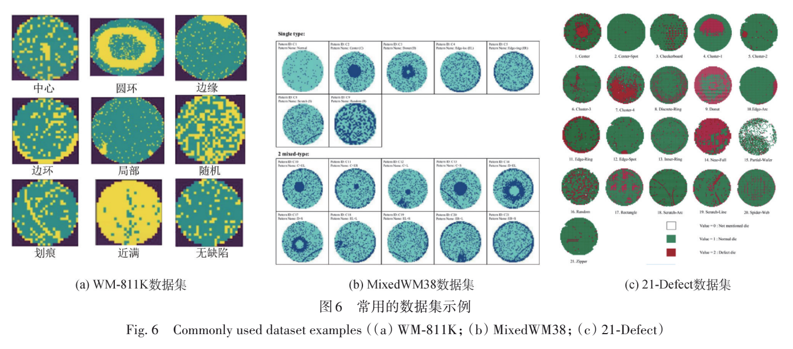

# 晶圆缺陷检测综述：区分失效分布图、表面图像与PCB定位

深化修订：2026年11月16日。本文依据本地原PDF，重点解释任务、数据与可迁移思路。作为邻近工业领域参考，不扩展你的PCB课题为晶圆工艺研究。

入口：[原PDF](<Survey of semiconductor wafer defect detection method based on machine vision.pdf>)｜[研究主文档](../../../research/thesis-research-and-study-guide-zh.md)｜[阅读总报告](../../261107/research-plan-and-paper-reading-report-zh.md)

## 一、最先要排除的误解：所有“缺陷图”不是同一种图像

晶圆图通常把大量芯粒的检测状态排回晶圆空间，呈现中心、环状、边缘、随机等分布；它更像一张空间质量统计图。晶圆表面光学图像则直接观察划痕、颗粒和纹理。前者的一个彩点可能表示一颗芯粒的状态，后者的一个像素表示成像强度，物理含义不同。

你的PCB输入是RGB外观照片，输出是可见缺陷mask。虽然三者都可能说分类、定位和异常，但晶圆图模式分类准确率不能与PCB像素IoU相比。读这篇首先要理解作者汇总文献横跨了哪些输入和目标，避免因名称都含“缺陷检测”而错误类比。

## 二、原图怎样读：几何模式不等于表面缺陷纹理

来源：原论文图6，PDF第18页；[来源记录](reading-figures/sources.json)。图中分别展示WM-811K、MixedWM38和21-Defect示例。

圆形是晶圆空间范围，彩点与图案编码不同检测状态或失效分布，不应把它们误认成相机拍到的颜色污点。中心团块、边缘环和划线模式是整图空间分布特征；混合模式则可能同时含几类结构。

这张图说明为什么某个模型擅长该领域分类，仍未必擅长PCB微小外观分割：整图模式可能横跨大量芯粒，空间尺度和语义明显；PCB缺陷可能只占很少像素、嵌在复杂正常器件中。可迁移的是如何定义任务、处理不平衡与分析空间结构，不是把数据图样或准确率直接搬过来。

## 三、沿着三条代表路线理解综述

### 1. 人工特征与监督分类

对晶圆图统计缺陷位置、密度、几何形状或变换域特征，再训练SVM等分类器。以教学方式理解，中心区域缺陷密度显著高于边缘，可能提示一种空间模式。优点是特征对应较直观，限制是人工定义可能漏掉复杂混合模式或新分布。

对PCB可以借鉴“先看错误的空间与形态分布”，但不能先假设缺陷一定在某个位置。若数据采集造成中心偏置，位置特征可能学到数据捷径，换成边缘缺陷就失败。统计模式与可靠制造规律需要区分。

### 2. 深度网络：分类、检测与分割有不同监督

分类网络用整图标签学习模式，目标检测给缺陷框，分割网络逐位置标注。任务输出越细不等于一定更高级，而取决于实际用途与标签。一个判断整片晶圆失效分布的分类任务，可能完全不需要像素mask。

你的课题明确关心缺陷范围，应保留像素评价。不能因某篇晶圆分类准确率很高，就改用图像分类替代定位，也不能把已有分割网络的预训练方式与下游标签混淆。自监督骨干加监督头仍是监督下游任务。

### 3. 少标签、正常建模与迁移

标签不足时，可使用未标注数据学习表示、聚类或生成模型，再用少量标签适配。正常建模则把偏离正常分布作为异常。不同路线使用的信息不同，需要记录是否接触异常、是否有类别名、是否用了预训练和合成数据。

**教学例子：**正常样本只覆盖一个批次，新批次出现正常空间变化，模型可能给高异常分；若不加核验就当正常加入训练，也可能吸收真实异常。这说明数据版本与正常范围是关键，不意味着本项目应增加持续学习。当前先研究固定PCB协议下的精度与解释。

## 四、为什么混合缺陷与类别不平衡值得关注

晶圆图可能同时出现多个空间模式，单标签假设会把复合模式强行归一类。类间样本也可能严重不平衡。整体准确率高，可能主要来自常见类别，稀有模式仍表现差。

对应PCB，你当前做二值分割，多个缺陷类型已并为前景，所以分类准确率不是主要目标；但缺陷形态、尺寸和位置的不均衡仍影响学习。全局IoU偏向大并集区域，逐图结果揭示另一种分布。要按预定义规则检查错误，而不是事后只选有收益的子集。

连通域也不能自动作为物理缺陷实例：一条真实裂纹可能被标成多个断开区域，两个相邻缺陷可能连成一片。若将来报告缺陷级召回，应先固定实例与匹配定义，避免以统计方便替代工艺对象。

## 五、数据表怎么读，以及原文中的一处疑点

原文表12给出常见数据集规模、类别、标记情况、分辨率与公开性。核对这些字段比只摘最大规模更重要。图像数量大不代表标注数量大，也不代表物理样件独立；制造批次相关性会影响泛化判断。

WM-811K正文写总量811457，其中172950幅带手动标签；按这两个数直接计算约为21.3%。但表12的已标记比例写0.031，二者不一致。这里明确保留为原文疑点，不据此自行认定哪个字段准确；若真要使用该数据，应查原始数据与划分。此处计算仅用于说明内部一致性检查，不是重新统计数据集。

它也提醒你：综述的表格会有转录或口径问题，重要实验条件必须回到数据源和原始论文。对你的PCB，已有清单比宽泛“VisA包含多少图”更直接；训练、验证、测试和正常/异常预算应以实际使用清单说明。

## 六、怎样联系精度与可解释性工作

精度工作可借鉴分层诊断：是输入信号不够、标注与采样不匹配、常见正常纹理混淆，还是缺少位置/结构条件？不同原因应使用不同对照。晶圆研究的空间模式并不证明PCB应强加坐标约束，后者要先验证配准和结构可比性。

解释工作可借鉴“表征含义需要映射回物理对象”。一张晶圆图中的中心热点可能提示空间关联，但不独自证明某道工序导致失效；PCB异常热图与正常参照也同理。模型依据、视觉缺陷与制造因果应分开描述。

如果正常参照距离较大，应检查它是否仅表示新批次、光照或板型差异。参照来源真实、检索计算可追踪，是解释的基础；还需匹配、稳定性、干预和覆盖证据。距离大小不能直接翻译为缺陷严重程度或工艺原因。

## 七、一张已填写的跨任务比较表

| 比较项 | 晶圆图模式分类 | 晶圆表面定位 | 当前PCB外观分割 |
| --- | --- | --- | --- |
| 输入含义 | 芯粒状态的空间分布 | 成像表面信号 | 板级RGB外观 |
| 典型输出 | 分布模式类别 | 缺陷位置或范围 | 背景/缺陷二值mask |
| 可借鉴内容 | 空间结构与不平衡分析 | 细节与成像诊断 | 原图评价与错误分组 |
| 不可直接比较 | 整图分类准确率 | 不同成像尺度的定位分数 | 与异协议AUROC或框AP排名 |

**理解问答：**图上像划痕就等于相机中的裂纹吗？不等于，可能是芯粒失效的线状分布。数据量大是否证明迁移可靠？不证明，标签、相关性和目标分布都要核对。是否应该增加晶圆实验？当前没有这一要求，本篇定位是理解与类比。最有价值的产出是什么？能准确指出一项跨领域借鉴使用了相同的机制假设，哪些数据语义又不同。

## 八、把“迁移成功”拆成可以检查的命题

教学场景：某晶圆分类方法在公开数据很高分，研究者想将其特征迁移到PCB。首先核对原输入是不是离散芯粒状态图，其次看预训练与下游监督；再问分类后的整图向量是否还保留空间网格。如果原模型只输出整体模式类别，就不能直接期待它给出精细PCB边界，需要另建密集预测接口。

即使接口可用，比较也应从同一PCB清单、相同像素预算和原图指标开始。若新配置有提升，同时改了输入分辨率、预训练和预测头，则只能先报告整套配置差异，不能声称某一个迁移机制独立有效。先用简单头检查特征，再按错误诊断适配，正是你当前DINO候选实验的合理阅读落点；它不要求现在额外实现晶圆模型。
