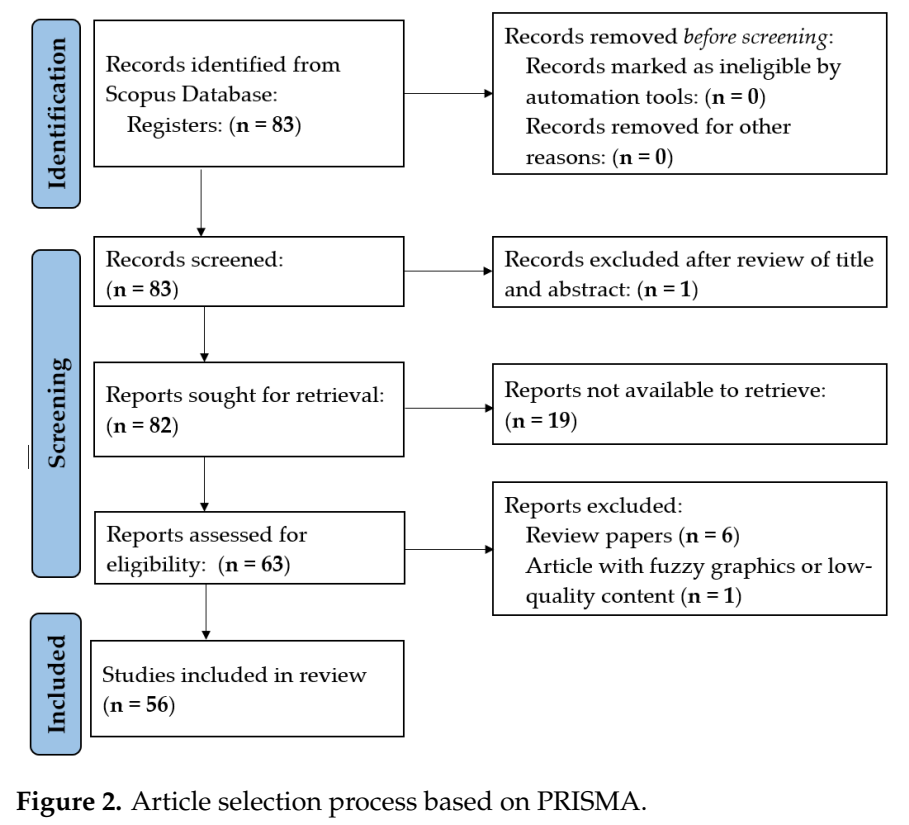

# 电子组件系统综述：读懂筛选证据，而不是把统计表当排行榜

整理：2026-11-16。原文：Montoya Magaña等，*Deep Learning Algorithms for Defect Detection on Electronic Assemblies: A Systematic Literature Review*，Machine Learning and Knowledge Extraction 8:5（2026）；首页注明2025-12-27发表。检索范围为2015年至2025年第一季度，不能以卷年推断它已覆盖2026年研究。

[原论文 PDF](<Deep Learning Algorithms for Defect Detection on Electronic Assemblies- A Systematic Literature Review.pdf>)｜[已有译文](full_translation_zh.md)｜[研究主文档](../../../research/thesis-research-and-study-guide-zh.md)｜[总报告](../../261107/research-plan-and-paper-reading-report-zh.md)

## 本文为何值得读

这篇论文围绕电子组件中的PCB与PCBA检测，使用系统文献综述流程筛选文章，再从网络、缺陷、数据与指标等角度统计。其特别价值不是详细推导一种网络，而是展示这个领域的研究证据怎样构成：研究多关注哪些对象、使用什么数据、什么信息容易缺失。因此它适合支持论文的现状分析与比较条件审查，不适合直接从最高平均精度选技术路线。

先区分PCB裸板与装配后的PCBA。前者常关注铜线、孔与焊盘几何，后者还涉及元器件、焊接、放置和标记等。综述中“component detection”有些是找正常组件的位置，并不天然是检测缺陷；“defect detection”也可能包括分类、框定位和像素分割。当前PCB1输出二值mask，不预测具体缺陷类别，更不能由一张可见光外观图判断所有内部焊点或电气失效。把研究对象和输出列清，才能知道哪些文章可以成为直接对照。

## 从PRISMA原图看证据怎样被留下

来源：**Figure 2，PDF实际第6页**，原页裁剪，未重画。[来源记录](reading-figures/sources.json)。

图从Identification开始：Scopus识别83条记录；标题摘要后保留82条，19篇全文未取得，63篇进入资格检查；再排除6篇综述和1篇图像或内容质量不足的文章，最终纳入56篇。这里的数字是原图明确报告的筛选过程，不能转述为整个PCB领域只有56篇工作。

这张图应读出两种含义。第一，系统综述需要明确来源、排除理由与筛选路径，才能知道结论由哪些证据支撑。第二，流程清楚也不等于无偏：单一数据库、日期/语言/文献类型过滤，以及未取得全文，都可能使某些技术路线缺席。作者在第5节也承认数据库与筛选范围的限制。研究中若某类网络出现少，应先考虑采样边界，再讨论成熟度，不能直接声称“无人研究”。

与PCB课题的联系是建立自己的查新记录：每篇论文不只记名字，还记对象、输入、监督、输出、最接近的机制与排除理由。例如裸板配对模板框检测可以进入背景，但不能因为标题含PCB，就与VisA mask监督单图分割混在同一性能表。这样的筛选比堆叠数量更能支持“我的问题与已有工作的关系”。

## 综述中的三类机制怎样工作

### 多尺度定位：让小缺陷在表示里仍有位置

第4.1节整理的代表工作中，多尺度特征、区域建议与不同检测头经常同时出现。其共同计算逻辑是：输入先变成不同分辨率特征，粗层提供上下文，细层保留位置；融合后预测候选区域或像素。小缺陷在深层可能只占很少网格点，若只使用深层语义，位置和边界容易变粗，融合细层就有补充信息的机会。

但“检测到小目标”与“分割好边界”是不同要求。框只需包围目标，允许包含周围正常背景；mask必须区分每个边界像素。将FPN等想法迁移到PCB1，可借鉴空间信息与语义信息协同的原理，不能照搬目标检测mAP作为分割收益证据。DINO简单头尚未建立，更不能假设其瓶颈与现有检测网络相同。先诊断train/val的漏检位置，再决定细节适配是否必要。

### 配准与差分：让差异有可比较的正常基准

综述介绍的图像对齐、边缘/PCA等传统处理，以及双流或比较式模型，都涉及先让参考与待测图具有对应关系。对齐后相减，正常共性抵消，残差可能突出异常；也可提取成对特征再学习比较。这里真正困难的是：差异包含缺陷，也包含位移、光照和正常制造变化。没有对齐或结构对应，残差会首先标出整片正常边缘。

这对正常参照工作是直接提醒。当前VisA没有每张待测图的黄金正常配对，候选正常库只能由训练正常图构建。实例检索与模板差分条件不同：前者在一组正常表示中找相似项，后者通常假设对应设计或成像位置。能否使用空间邻域，要先查板型与配准；不能因为综述有成对方法，就默认自己已有其输入前提。若引入新的人工结构标注或额外标准板，还会改变研究条件。

### 重构与合成：用数据结构补充有限缺陷监督

第4.1节及第5节还讨论自编码器、合成异常与恢复遮挡信息等方式。重构路线学习正常结构，测试异常可能产生较大重构误差；合成路线在正常图上构造人工变化，让网络学习异常与正常的区别。它们的共同动机是缺陷不足，但计算目标不同：前者以误差作分数，后者可能用合成mask训练判别器。

合成缺陷能否代表真实问题，取决于位置、形态和材质是否合理。随机贴块的边缘若比真实缺陷更明显，模型可能学拼接痕迹；重构网络若复制缺陷，误差又可能太小。对已有真实mask的PCB1，不能将“样本少”直接当作新增生成模型的理由，应先看少数异常或结构的错误是否集中、是否能由现有监督解决。这篇综述提供方法入口，不替当前研究增加数据生成任务。

## 统计表怎样读才不越界

表3记录文章、算法、对象、实现环境与数据，表4汇总网络家族，表5看缺陷覆盖，表6看数据来源，表7汇总指标。一次有效阅读可以按同一篇文章横向追踪：它属于PCB还是PCBA？检测缺陷还是正常部件？采用私有数据还是公开基准？最后才看指标。家族计数可能一篇涉及多种架构，不能把每格数量当独立实验次数。

正文报告62.5%的纳入研究依赖自建数据，应结合表6中混用自建与其他数据的类别理解。这个比例说明这批研究复现和公平比较有障碍，不证明公开数据不适合做毕业研究。相反，保留PCB1划分、尺度、监督访问和评价脚本，能让自己的方法差异可核验，但公开数据上的改进也不会自动代表产线质量控制能力。

表7尤其不能当排行榜。它按架构或数据类别汇总来自不同论文的accuracy、precision、recall、F1，训练条件、计分单位和样本不统一。表中某族平均数字较高，可能与更容易的数据或不同任务有关；数据缺项也会改变平均的证据基础。不能据此写“Transformer全面优于CNN”，更不能用它推断冻结DINO一定胜过已完成SegFormer。

讨论部分把在线无标注学习列为未来方向。这是作者的展望，不是已经实现的通用方案，也不是当前课题必须改变为在线学习的要求。当前主线仍为精度和可解释性；时间/显存等记录为方法代价，在线更新、闭环控制和产线部署需要独立数据与验证，不能仅由工业背景引出承诺。

## 已填好的“现状证据—我的问题”对应

| 综述信息 | 合理解释 | 当前研究能采取的动作 |
| --- | --- | --- |
| 小尺寸与高密度是背景困难 | 位置细节和复杂正常结构可能重要 | 先在train/val统计细小缺陷和正常误报，再讨论适配 |
| 私有数据常见 | 跨论文数字难公平对比 | 用既定PCB1清单与相同原图评价形成可复核比较 |
| PCB/PCBA缺陷范围不同 | 技术任务可能不一致 | 分开描述裸板、装配外观和内部/电气问题 |
| 模型家族多样 | 各族在解决不同问题 | 按评分机制挑近邻，不能按年份或数量选模块 |
| 仍需人工验证判断 | 自动输出不等于可信解释 | 核验实际评分依据，而非只展示一张热图 |

假设答辩老师问“已有那么多PCB算法，你的价值在哪里”。可答：综述表明已有检测、分割与自建系统基础，本课题不以首次应用某骨干为贡献。当前针对PCB1的监督像素定位，先用同协议对照定位误差，再评估适配能否改善这些错误；另研究与实际评分绑定的判别依据，检验其可靠性。这里的贡献尚待方法与证据形成，不能将选了公开数据或换骨干当作结论。

再问“你是不是解决了数据不足”。现有high-shot基线并未证明标注效率优势，训练异常图不多也不等于完成小样本研究。若后续真的研究标注预算，需要固定评价集、正常样本预算、重复抽样和预算曲线；这不是本次阅读自动新增的实验。把动机与已证明内容分开，是这篇系统综述对论文表述最有用的训练。

## 具体阅读顺序

先读第3节、表1/2和图2，掌握纳入范围。再读第4.2—4.6节与表3—6，挑出与PCB1条件接近的文章，特别核对输入和标注。第三步读表7及第5节，用异质条件解释为什么不能横向排榜。最后回第4.1节的代表工作，仅追踪与局部细节、参考比较和重构直接相关的原文。

读完应留下三条已能回答的问题：为什么综述的数量是样本集合统计；为什么同为PCB检测仍可能不可比；为什么“数据少、精度高、速度快”都需写明计量条件。对这三问有清楚答案，这篇文章就已经转化为研究设计与证据审查能力，而不只是一页摘要。

