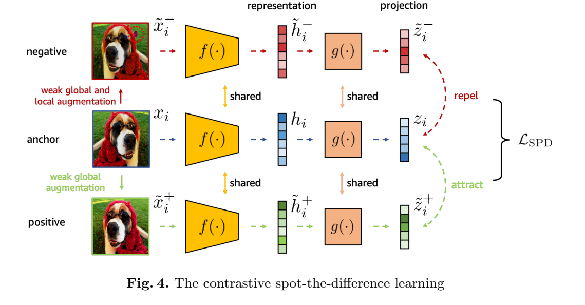

# VisA 与 SPD：先弄清监督协议，再理解“对局部差异敏感”

更新：2026-11-16。建议精读第3—5节，并按本文顺序回看原图、表格与附录。

资料：[原论文](<SPot-the-Difference Self-Supervised Pre-training for Anomaly Detection and Segmentation.pdf>)｜[中文译文](<full_translation_zh.md>)｜[研究主文档](../../../research/thesis-research-and-study-guide-zh.md)｜[论文阅读总报告](../../261107/research-plan-and-paper-reading-report-zh.md)。

本文将**论文事实**、用于理解的**教学推导**和服务于《PCB外观缺陷检测方法研究》的**研究候选**分开。后者均不是已完成实验或已决定的新任务。

## 1. 为什么这篇是数据论文，也是方法论文

设想两张装有元器件的PCB图：大部分线路、焊点和器件都一样，只有一个很小的金属熔融区域不同。分类预训练习惯回答“这是什么物体”，可能认为两张都是PCB，应该给出接近的特征。工业检测却要求回答“同一种物体哪里不对”，恰好要保留这点局部差异。SPD针对的就是这种目标张力：**对轻微照明、位移等整体变化保持稳定，同时对局部结构扰动保持敏感。**

论文有两项不同产物。VisA是图像与标注组成的数据集；SPD是加入预训练过程的学习约束。你在VisA PCB1训练SegFormer，并不意味着使用了SPD；从ImageNet权重初始化，也不意味着采用论文的ImageNet预训练方案。先把“数据来自哪里”和“特征怎样学到”拆开，后面的实验才不会混淆。

原文第4节介绍VisA：10,821张彩色图像，其中9,621张正常、1,200张异常，共12类对象；提供图像级和像素级标签。论文将PCB作为复杂结构对象的一部分。这里的异常是**可见外观异常**，不能由图像标签进一步推断电气功能失效或制造原因。

## 2. 输入、监督与输出：同一数据集可以形成不同任务

| 环节或协议 | 输入与训练信息 | 输出与评价对象 |
| --- | --- | --- |
| SPD预训练 | ImageNet图像；由增强过程生成“是否被局部扰动”的关系，不需要工业缺陷mask | 可迁移的编码器表征，不直接输出PCB缺陷mask |
| VisA 1-class | 仅正常图参与下游训练，测试含正常和异常 | 图像异常分数、像素异常图；原文主要以PaDiM评价不同预训练 |
| VisA 2-class high-shot | 正常与异常图均可用于训练；分割使用真实像素标注 | 分类器或分割器；原文分类用ResNet，分割用U-Net |
| VisA 2-class 5/10-shot | 从规定候选训练池中分别抽取每类k张，重复抽样 | 标注预算固定时的分类/定位效果 |

第4节规定high-shot按每种对象正常、异常分别60%/40%划入train/test；low-shot先按20%/80%建立池，再从训练池中为正常、异常各抽k张，报告5次随机实验平均。不能把自己的“异常训练图不很多”直接改叫官方few-shot。

当前PCB1监督基线采用high-shot的本地派生train/val/test，共530/132/442张；训练中有真实异常mask。验证集用于选模与阈值，不能与原文仅列train/test的口径悄悄合并。48张异常训练图是当前划分数量，不能与“5-shot”作字面大小比较。你的主要输出是原图缺陷概率与二值mask，当前不输出缺陷类别。

## 3. 先把三个必要术语讲明白

**表征**就是编码器把图像压成的数字描述。例如一个向量可能包含形状、纹理、颜色等混合信息；数字维度不天然对应可命名概念。“表征相似”也不等于两图每个像素一致。

**不变性**指输入变化后，模型仍给相近表征。对亮度微变不敏感有利于减少误报；但如果对缺一小块铜也不敏感，就可能漏检。问题不是“不变性越强越好”，而是哪些变化应该忽略、哪些必须区分。

**对比学习**通过“拉近该相似的一对、推远该不同的一对”训练表征。标准图像语义任务常把同一图的两个强增强视图作为正对；大裁剪、强颜色变化会鼓励忽略局部细节。SPD另加一种正负关系，专门训练“在大体相同的图里找不同”。正负是训练构造关系，不是工业正常/异常真实标签。

## 4. 顺着原图追踪SPD信息流

来源：[原PDF](<SPot-the-Difference Self-Supervised Pre-training for Anomaly Detection and Segmentation.pdf>)，PDF第7页，原图4；裁剪保留了完整机制与图注。资源坐标见[来源记录](reading-figures/sources.json)。

读图时先盯左侧三张狗图，暂时不要看损失。中间是锚点；下方只做弱全局增强，仍应与锚点相近；上方既做弱全局增强，又在局部加入SmoothBlend扰动，因此应被识别为不同。这里故意使用自然图像，说明学习目标发生在通用预训练阶段，并非直接在PCB缺陷mask上训练。

再看黄色的三个$f(\cdot)$：黄色双向“shared”表示同一套编码器权重，而非分别训练三个模型。输出$h$是图像表征。橙色$g(\cdot)$是共享投影头，将$h$变为计算预训练损失的$z$。最后看右边：绿色曲线拉近锚点与正样本，红色曲线推远锚点与局部扰动样本。**下游主要使用的是编码器表征h；不能把投影向量z直接叫最终缺陷mask。**

具体训练分四步：

1. 从图像裁一小块，做颜色扰动，再贴到同图另一个位置。构造贴块区域的二值alpha mask，用高斯模糊软化边界。这是SmoothBlend，目的是避免模型只抓住生硬拼接边。
2. 产生弱增强正样本和“弱增强＋局部扰动”负样本。弱增强包括较轻的裁剪、模糊、翻转、颜色变化，使全局差异不过大。
3. 用共享编码器与投影头处理锚点及两种视图，计算SPD相似度损失；与原有SimCLR/MoCo/SimSiam训练目标联合优化。
4. 预训练完成后，把编码器用于具体工业任务。1-class下构建正常分布或记忆；2-class下有真实标签的分类/分割网络继续学习。推理PCB图时无需再生成SmoothBlend扰动。

这说明SPD改变的是“预训练时哪些差异值得保留”，不是给推理图找一张正常模板。原图有三个分支，也不能据此说用户方法已采用三分支结构。

## 5. 两个公式，读懂每个符号与优化方向

第3.2节的混合操作为：

$$
\bar x=(1-\alpha)\odot x+\alpha\odot u.
$$
$x$是原图，$u$是贴入小块后的前景层，$\alpha$是被模糊的混合掩码，$\odot$为逐像素相乘。远离贴块时$\alpha\approx0$，输出接近原图；贴块中央$\alpha\approx1$，输出接近贴块；边缘平滑过渡。**教学例子**：某像素原亮度为100、贴块为160、$\alpha=0.25$，混合后为115。这个例子仅说明混合，不是论文实验图或PCB缺陷生成参数。

第3.3节公式(2)为：

$$
\mathcal L_{SPD}=\cos(z_i,\tilde z_i^-)-\cos(z_i,\tilde z_i^+).
$$
$z_i$为锚点投影，负号上标表示局部扰动视图，正号上标表示弱全局增强视图；$\cos$是余弦相似度。最小化损失时，第一项应减小，第二项应增大。**教学例子**：扰动相似度0.9、正样本0.8时损失为0.1；训练后分别为0.4和0.9时损失为−0.5。负损失在这里不表示异常，因为它本来就是两个相似度之差。

对于SimCLR等，公式(3)将SPD作为附加项：

$$
\mathcal L=\mathcal L_{NCE}+\eta\mathcal L_{SPD}.
$$
$\eta$控制局部敏感性约束相对原目标的权重；不是缺陷阈值。SimSiam没有相同形式的负样本InfoNCE，原文相应替换其基础损失。监督ImageNet预训练的SPD实现又有所不同：附加分类器判别是否有局部扰动，以交叉熵训练。不要把上式机械套到所有实验行。

## 6. 原论文用什么证据支持机制

先读第5.1节表3，再读第5.3节表5，避免只引用摘要的最大涨幅。

**表3比较的是VisA 12对象平均的2-class high-shot结果。**SimSiam的分割AU-PR从53.8升至59.7，监督预训练从65.1升至71.9，分别是5.9和6.8个百分点。支持的解释是：在作者固定的下游训练设置下，加入局部差异训练能改善特定表征的定位排序。它没有证明“所有自监督都强于监督预训练”：表中监督预训练＋SPD仍很强，不同SSL行的收益大小不同；SimCLR分类AU-PR甚至从93.4变为92.7。不能只保留有利行。

**表5是更接近机制的消融。**其基础配置是ImageNet SimSiam预训练，再用PaDiM做1-class检测；它改变SPD权重、SmoothBlend/CutPaste、SPD损失/交叉熵以及骨干。固定其他条件比较局部扰动形式，才能讨论“柔和扰动是否优于容易识别的硬边”；固定增强比较损失，才能讨论“相似度关系是否比二分类更适合”。但该消融的监督协议不同于表3，不能把表5的因果解释无条件延伸到用户的监督PCB分割。

表6再换成PatchCore检验预训练收益是否仅依赖PaDiM。它增加了机制适用性的证据，但不意味着各种下游模型收益相同。附录D的逐类别结果用来检查平均数是否掩盖PCB类别差异；正文平均不能替代PCB1单独结论。

**图1的GradCAM**展示加入SPD后注意区域更贴近示例缺陷，是直观支持，不能单独证明忠实解释。不同预训练导致了不同预测行为，画面“看起来对”只是现象；仍要有定量比较与干预，才能说明该区域对实际得分起什么作用。

## 7. 为什么AU-ROC很高，分割仍可能不好

第4节与附录B强调前景稀少时AU-ROC可能给过于乐观的观感。AU-ROC以$\mathrm{FP}/(\mathrm{FP}+\mathrm{TN})$计算假阳性率，正常像素极多时分母很大；AU-PR更直接考察报出的缺陷里有多少是真的。**教学例子**：100万个正常像素中误报1万个，FPR仅1%；若仅有100个缺陷像素且找回80个，则precision为$80/(80+10000)$，不到1%。低FPR和很差的报警可信度可以同时出现。

原文的AU-PR是跨阈值排序表现，你当前全局前景IoU是在确定阈值后统计交并比；两者关注不同问题。高AU-PR不保证所选工作点IoU高，IoU好也不能说明图像级误剔率满足产线需求。读论文表格时至少同时记：像素还是图像、曲线还是工作点、逐类别平均还是全像素合并。

## 8. 对精度工作与解释工作的具体借鉴

对工作一，本文最有价值的推导是：**特征目标与局部异常任务可能不匹配，应从错误与对照判断是否需要适配。**目前SegFormer-B0已完成，冻结DINO＋简单头尚未运行。可检验的候选假设是“固定表征能否保留PCB缺陷相对正常结构的差异”；如果简单头已有很好局部定位，不能仅凭SPD动机继续宣称细节缺失。如果小缺陷漏检集中于缩放后消失的mask，应先分清几何采样问题与表征问题。

不直接建议重做ImageNet大规模SPD预训练。更轻的借鉴可以是研究候选：在同一PCB监督协议下，考察局部扰动训练是否提供额外价值；但扰动必须符合图像结构，且要与普通增强、增大输入、同容量头比较。这样得到的证据才指向目标约束，而非更多训练计算。原论文没有验证你的数据或候选局部分支，不能把它写成已选方案。

对工作二，SPD可帮助提出一个解释检验：若模型声称依据局部异常，轻微全局变化后依据是否稳定；移除可疑局部后，实际缺陷得分是否下降。但“移除”会引入编辑伪影，须有等面积非缺陷区域或随机区域的对照。SPD没有正常参照检索模块，也没有给出完整解释可靠性评价。借用其直觉不等于得到忠实解释方法。

## 9. 已填写的理解问答

**问：同一张图的局部扰动为何被当负样本，不违反“同图应相似”吗？**答：是否相似由任务决定。语义分类希望同物体一致；工业局部异常需要区分细微变化。SPD保留原全局学习目标，再补局部关系，避免只学局部噪声而丢掉整体表征。

**问：SPD能定位SmoothBlend的小块吗？**答：原SPD相似度目标主要约束图像表征，预训练阶段不是直接预测该小块mask。局部敏感性最终通过下游异常图或监督分割体现，不能把图像向量关系误解成像素输出。

**问：PCB1用了VisA，为什么不能直接引用表3作我的成绩？**答：表3是12对象平均，模型、训练、指标、验证划分都与当前SegFormer实验不同。它是研究依据；本项目成绩来自本项目固定清单与原图评价。

**问：这篇能支撑“两项工作已成立”吗？**答：不能。它支撑局部敏感性与协议严谨性的重要性。精度是否改善、解释是否忠实，仍须用户任务中的同协议证据。阅读成果应是能够解释机制及其适用条件，而非复制论文摘要的涨分。
