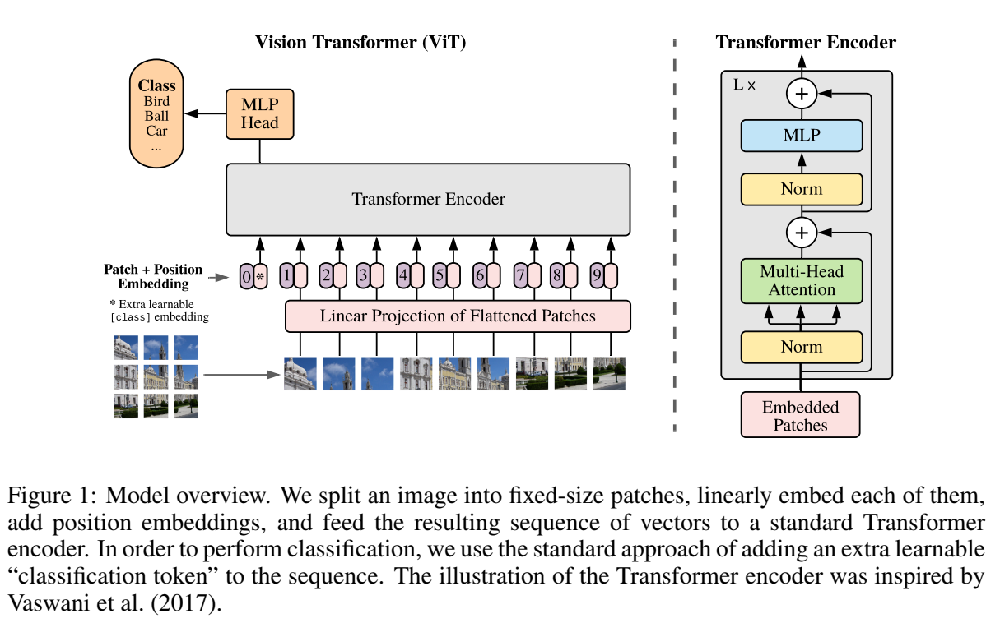

# ViT：从图像块到全局上下文，读懂DINO之前需要掌握什么

修订日期：2026年11月16日。本文解释原论文的主要计算，并把它与PCB分割和正常参照联系起来。本地文件以2020年预印本命名，首页标注ICLR 2021；模型与训练结论按本地原文理解。

入口：[原论文](<An Image is Worth 16x16 Words- Transformers for Image Recognition at Scale.pdf>)｜[中文译文](<full_translation_zh.md>)｜[阅读总报告](../../261107/research-plan-and-paper-reading-report-zh.md)｜[研究主文档](../../../research/thesis-research-and-study-guide-zh.md)

## 一、先用一句话理解ViT

ViT把图像切成一组固定大小的图像块，把每块变成向量，再让这些向量通过自注意力相互交换信息。原论文主要完成图像分类；你后续关注的DINO采用相关视觉Transformer结构，但预训练目标和具体实现另有变化。

这篇最值得掌握的是“数据怎样流动”，而不是所有分类榜单。只要能自己算出序列长度、分清空间词元与类别词元、解释上下文怎样进入局部输出，你就能更准确地阅读DINO、适配头与参照评分。下面的512输入和PCB例子属于教学推导，不是原论文PCB实验。

## 二、沿着原图从下向上读模型

来源：原论文图1，PDF第3页，裁剪保留结构图和图注。图内英文为原始标注，下面按步骤解释。

1. 左下把图像切成小块；小块仍含一组RGB像素，尚不是缺陷标签。
2. 展平图像块并线性投影，得到同样长度的向量。这一步是可学习的嵌入，不是直接求颜色平均。
3. 加上位置嵌入，让模型区别“同样外观出现在不同位置”。图中0号的额外可学习词元用于汇聚分类信息。
4. 整段序列进入Transformer编码器。每个空间词元可与其他词元交换信息，经过多层后不再只表示自己最初的小块。
5. 原论文用类别词元接MLP分类头，预测鸟、球、汽车等类别。做PCB密集预测时通常要取空间输出接分割头，不能直接把分类头输出当像素掩码。
6. 右边放大的是一个编码器块：归一化、多头注意力、残差相加，再归一化、MLP、残差相加，重复多层。

图中的箭头对你有一个重要提醒：空间位置来源仍可以追溯，但向量内容已经混合了上下文。它是正常参照来源解释与输入像素因果归因之间的分界。

## 三、手算一次图像变序列

设输入为$H\times W\times C$，图像块边长为$P$，假设高宽均可整除。原论文第3.1节给出空间词元数：

$$N=\frac{HW}{P^2}.$$

每块有$P^2C$个像素数值，展平成一个向量，再乘投影矩阵$E\in\mathbb R^{(P^2C)\times D}$，变为$D$维特征。$D$是特征维度，不是图像宽度，也不是类别数。

以512×512、RGB、16×16图像块为教学例子：每边32块，共1024个空间词元；每块展平后有$16\times16\times3=768$个数。投影后是1024×D。原始ViT再加一个类别词元，得到1025×D。这里的768是本例图像块原始长度，并不意味着所有模型的特征维度必然为768。

若分割头取空间特征，应先排除非空间词元，再将1024×D还原为32×32×D。DINOv3具体还可能包含其他额外词元，须按模型接口核查，不能仅假设“删掉第一个就一定正确”。错误地重排，可能仍得到能运行的张量，却已经破坏空间对应。

当前PCB基线使用方形补边，原图经过缩放后只有部分输入属于真实图像，其余是补边。词元网格对应的是处理后的输入坐标，恢复原图时还要处理缩放与补边。库里记录坐标也需要说明它属于原图还是模型输入，不能混用。

## 四、位置嵌入解决什么，不能解决什么

原论文公式（1）可写为：

$$z_0=[x_{\mathrm{class}};x_p^1E;\ldots;x_p^NE]+E_{\mathrm{pos}}.$$

分号表示沿序列拼接。$x_p^iE$说明第$i$块看起来怎样，位置向量说明它位于哪个序列位置。两者相加以后，模型才有条件把外观与位置一起使用。

教学类比：两块看起来相近的焊盘，如果分别位于板角与中心，它们的局部外观类似，结构角色却可能不同。位置线索有帮助，但它不是板型语义标签。两张板存在平移或旋转时，同一网格坐标也可能对应不同结构。因此，“模型使用位置嵌入”和“可跨图按坐标正确匹配”不是同一个保证。

原始ViT使用可学习一维位置嵌入，并讨论提高输入分辨率时对空间位置嵌入做二维插值。具体DINO家族的位置机制需读对应论文与实现，不能把原始ViT设置全部套过去。阅读本篇是建立概念，而不是替后续模型接口作未经核验的判断。

## 五、注意力怎样把远处信息带进一个局部词元

原文附录A讨论注意力。单头自注意力的标准形式是：

$$Q=ZW_Q,\quad K=ZW_K,\quad V=ZW_V,$$
$$\mathrm{Attention}(Q,K,V)=\mathrm{softmax}(QK^\top/\sqrt{d_k})V.$$

把三个量理解为不同角色会更容易：查询$Q$表示当前位置需要寻找什么信息；键$K$表示各位置可怎样被匹配；值$V$表示匹配之后要汇入的内容。$QK^\top$形成位置两两关系，逐行归一化后，每个位置按不同权重汇总其他位置的值。

**教学例子：**某焊盘边缘附近出现暗线，单看局部难以分辨是断裂还是阴影；其他相似焊盘和周围走线可以提供上下文。注意力结构允许这种联系，却不保证模型确实学会了正确比较。它也可能利用与缺陷偶然相关的远处背景，这正是后续解释核验要检查的部分。

多头不是多种缺陷类别。各头有各自投影，可学习不同关系，再组合输出。注意力权重高也不自动等于该像素对最终异常分数的完整因果贡献；还存在值向量、后续层、残差和预测头。不能把一张注意力图直接当作解释已经可靠的证明。

标准注意力的两两矩阵大小随词元数平方增长。在本例中，提高输入到1024方形而块大小不变，空间词元从1024增为4096，注意力关系项约增至16倍。这是关系矩阵量级的推导，不意味着整模型实际耗时严格16倍；实现、其他模块、硬件和优化都会影响成本。

## 六、残差、归一化和MLP分别在做什么

原论文公式（2）（3）描述预归一化结构：

$$z'_\ell=\mathrm{MSA}(\mathrm{LN}(z_{\ell-1}))+z_{\ell-1},$$
$$z_\ell=\mathrm{MLP}(\mathrm{LN}(z'_\ell))+z'_\ell.$$

注意力主要让词元之间交换信息；MLP在每个位置对通道作非线性变换；归一化有助于稳定数值；残差保留原信息并帮助优化。MLP在位置上分别应用，不代表它的输入仍然只来自局部，因为注意力已经把上下文混入。

这能帮助理解局部卷积分支的候选价值：卷积把邻域处理和局部结构偏好显式带入，而Transformer提供了不同的上下文计算方式。但不能从结构图直接推出卷积分支一定提高小缺陷精度。已有S³DNet等研究也用了相关空间支路，是否必要要看PCB错误和受控比较。

## 七、原论文实验的真正启发：大模型与数据规模有关系

第4.3节比较不同预训练数据规模，图3、图4展示数据规模变化下的迁移表现。核心认识是视觉归纳偏置和数据条件会改变模型相对优势：在较小预训练规模下，卷积模型或较小ViT可能更有利；大规模预训练能释放更大ViT的能力。

不要把这句话误读为“我PCB只有几十张异常，所以不能用ViT”。你不打算在PCB上从零预训练，而是使用已经预训练的骨干。预训练数据需求和下游适配所需样本是两个问题。也不要反过来认为既然模型预训练足够大，冻结后就一定能定位工业微缺陷。预训练目标、局部信息、尺度、监督和适配都可能影响结果。

第4.4节讨论模型与计算规模，图5中还含卷积混合架构。这些是分类迁移证据，不能直接证明你的局部分支结构。第4.5节和图7分析嵌入、位置和注意距离，有助于理解模型可能使用局部与全局信息，但不是对PCB异常评分的直接解释。

## 八、从分类ViT走向你的PCB分割

原论文流程是“图像→空间词元与类别词元→编码器→类别词元→分类头”。你的候选流程则是“PCB图像→空间特征→分割头→低分辨率得分→原图还原”。这是教学式任务迁移说明，不是已经实现的配置。

| 概念 | 在PCB候选实验中的对应 | 需要检查的地方 |
| --- | --- | --- |
| 空间词元 | 每个网格位置的特征 | 非空间词元是否剔除、形状是否正确 |
| 冻结编码器 | 骨干不更新 | 参数梯度、训练/推理模式是否符合设计 |
| 可训练预测头 | 利用真实掩码学习定位 | 头的容量、上采样和损失是否清楚 |
| 位置坐标 | 特征来源与参考索引 | 缩放、补边和原图坐标是否对应 |
| 全局上下文 | 局部评分可能依赖远处像素 | 解释是否只展示了部分输入依据 |

“冻结”不等于不需要训练：预测头仍可用缺陷掩码学习。“自监督预训练”也不等于你的下游实验是无监督。描述任务时，应先说明下游训练能访问什么，再说明骨干怎样预训练。

## 九、与两项研究最关键的联系

### 精度工作：不要把粗网格直接等同于必然漏检

16×16图像块内的像素经过线性投影，不是简单变成一个平均颜色。因此小于16像素的缺陷不必然完全不可见。但空间网格、输入缩放和预测头会影响精确边界，某些细微变化可能难以利用。要把“信息不存在”“存在但头学不好”“定位恢复不够”作为不同假设，而不是用一个图像块大小解释全部错误。

若输入缩放已经使缺陷信号消失，后续局部分支也无法凭空恢复；若信号仍在但粗网格定位不足，较细局部处理才可能有用。你的研究应先从训练/验证诊断和DINO简单头结果区分这些情况。

### 解释工作：真实参照来源不等于全部输入因果来源

当待测词元与库中正常词元比较时，可以忠实记录“用了哪个特征向量、来自哪张图哪一格”。但库词元也含其来源整图的上下文。若只展示一个小方块，读者可能误以为距离只比较了两个小裁剪。更准确的展示是来源整图上标记位置，并说明词元包含上下文。

直接替换缓存词元是在特征层改变计算；把原图某块替成正常后重新前向，是输入层干预，可能影响许多词元。二者都可研究，但回答不同问题，不能混写成同一忠实性证据。

## 十、用六个问题自检理解

**为什么1024个空间词元不一定是模型的总序列长度？**还可能有类别词元或其他特殊词元，具体数量由实现决定。

**D维特征是D类缺陷吗？**不是，D是表示通道数，二类预测由后续头输出。

**输出上采样到原图，是否已拥有原图像素精度的信息？**没有这种保证，插值只改变输出采样网格，不能独自恢复丢失信息。

**冻结DINO与全量微调SegFormer比较能证明什么？**能比较两套实际配置效果，但同时改变骨干与训练方式，不能单独证明预训练范式优劣。

**ViT有全局注意力，所以局部细节必然更好吗？**结构允许使用上下文，不保证细节表达或训练目标适合PCB。必须验证。

**读完本篇下一步该做什么？**用手算和形状图读懂DINO接口，随后回到DINOv3的密集特征章节。无需复现原ViT大规模分类训练，也不在本篇阅读后直接确定局部分支。
