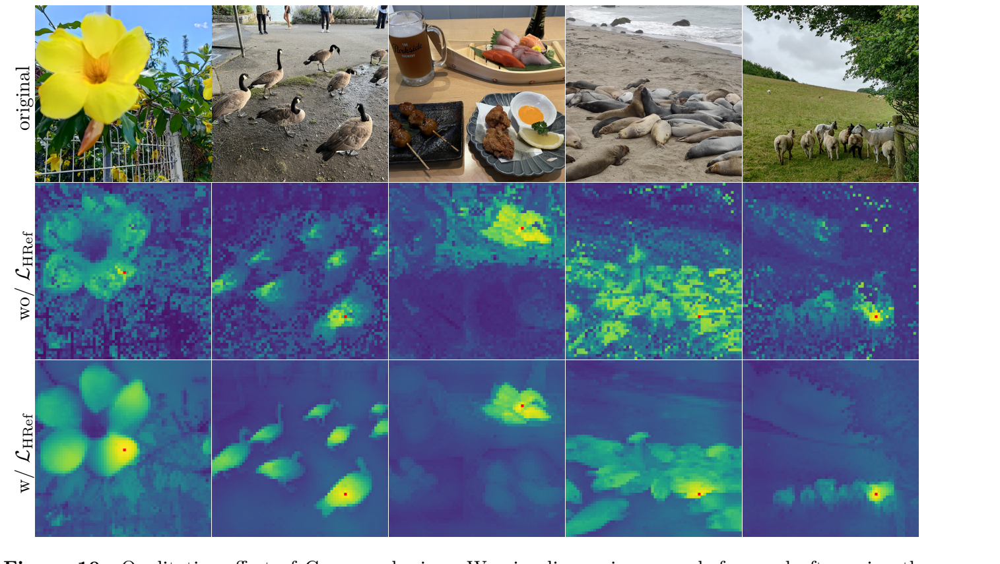

# DINOv3：从自监督表征到PCB密集预测，Gram anchoring究竟保住了什么

更新：2026-11-16。资料：[原技术报告](DINOv3.pdf)｜[中文译文](<full_translation_zh.md>)｜[研究主文档](../../../research/thesis-research-and-study-guide-zh.md)｜[总报告](../../261107/research-plan-and-paper-reading-report-zh.md)。

建议按“第4节问题与机制→第3节训练目标→第5节模型家族→第6节评价”阅读。本导读聚焦与你课题最相关的密集特征，不要求复现大模型预训练。**论文事实、教学例子、PCB研究候选**分别表述；本地已有论文不代表本机已取得可用权重或完成DINO推理。

## 1. 先纠正一个容易形成的想象

DINOv3不是输入PCB就直接输出缺陷mask的专用检测器，而是一组视觉编码器。图像经过编码器后得到全图描述与空间patch特征；具体任务还要指定怎样从特征形成分类、分割或距离得分。自监督表示预训练不用人工类别标签，**不等于下游也不能或不需要使用mask**。你当前研究完全可以在固定DINO特征上，用已有PCB像素标签训练一个头。

论文的关键问题也不是“Transformer没有局部特征”。作者发现，随着大模型训练越来越久，图像分类能力继续提高，密集预测能力却可能下降：同图不同位置的特征关系开始混乱。一个好的全图向量，不保证每个局部位置都有好描述。DINOv3通过数据、规模与训练策略提升通用表征，并用Gram anchoring专门约束局部关系的稳定性。

对你的意义是得到一个**值得检验的候选表征**，而不是“DINO一定优于SegFormer”的结论。自然图像语义关系好，仍可能不能区分PCB正常焊点与异常金属；高质量patch相似图，也不保证最细缺陷能在patch网格上保留下来。

## 2. 用一张任务卡划清预训练与下游

| 阶段 | 输入/监督 | 被训练的内容 | 输出 |
| --- | --- | --- | --- |
| 大规模自监督预训练 | 大量图像、多裁剪/遮挡等构造目标；不是PCB异常mask | 大型视觉编码器与训练专用头，教师/学生及相关正则 | 通用图像和patch表征 |
| Gram refinement | 同图空间特征的关系；来自早期Gram teacher的关系目标 | 继续修正学生的局部特征关系 | 保持全局性能的同时改善密集特征 |
| 模型蒸馏 | 大教师提供表征/训练目标 | 较小ViT等学生 | 适于实际使用的模型家族 |
| 用户拟开展的冻结DINO＋简单头 | PCB RGB与真实缺陷mask | 编码器冻结，只训练下游头 | 原图缺陷概率/二值mask |

这里的teacher是预训练中的监督来源，不是一张“正常参考PCB”。学生也不是你每次推理时必须同时运行的另一台大模型。拿到已训练的小模型后，下游可单独使用该编码器。知识蒸馏和“冻结骨干训练头”是两种不同操作，不要因为都叫transfer而混在一起。

## 3. 看懂patch token、CLS和register

ViT把图像分为patch，再将每块映射为向量token。patch token保留网格位置对应，可用于密集预测；CLS token汇总全图信息，常用于分类。register token是额外的内部工作位置，用于帮助网络处理信息、缓解某些异常patch现象，不能当作有图像坐标的缺陷点。

**教学例子**：ViT-S/16处理224×224图像时，空间网格为14×14，196个patch token；处理448×448时为28×28，784个。/16表示patch步长，不是16层网络。若一个原始3像素宽的缺陷被缩小到不足一个像素，增大token维数不能让已消失的信息回来；若信息还在，但一个token内混有大量背景，增大输入可能帮助，不过会增加计算。

中间不同Transformer层通常保持相同的空间token网格。它们有不同抽象程度，并不自动形成SegFormer的真实多分辨率金字塔。额外上采样只是改变表示的采样网格，不能与从原图提取高分辨率局部证据等同。

## 4. 训练的信息流：教师指导学生，但不是复制像素

第3.2节沿用图像级DINO目标与patch级iBOT目标。学生处理多裁剪视图以及被遮挡的patch；教师产生目标分布。图像级目标鼓励不同视图对同一场景给一致的全局描述；局部目标让学生在缺失部分输入时预测教师相应位置的表示。这里预测的是潜在表示或离散分配，不能简单说成MAE式逐像素重建。

教师通常由学生参数的指数移动平均更新，即EMA。EMA不是每步完整复制，而是让教师变化更慢，形成较稳定目标。训练头把编码器特征变成用于损失的分布，训练后下游主要使用骨干表征。Koleo正则鼓励批内表征分散，减少拥挤/塌缩；Sinkhorn-Knopp参与目标分配平衡。对初读者，先记住这些模块的职责，没必要把整个预训练工具链作为PCB实验前置任务。

重要的是，这些目标仍可能不完全兼容。全图辨识越来越强，并不自动保证每个局部token的关系适合定位。原文第4.1节在图5—6追踪训练过程，正是先观测到这种冲突，才引入关系正则；不是凭空再加一个损失项。

## 5. Gram矩阵：不固定每个向量，而固定彼此关系

设一张图有P个patch，每个特征维数为d，将归一化特征按行排成$X\in\mathbb R^{P\times d}$。$XX^\top$得到P×P矩阵，第(i,j)项是第i与第j个patch的点积；因为每行已归一化，该点积就是余弦相似度。它记录“谁与谁相似”，并不记录“这个维度叫什么”。

第4.2节公式(2)：

$$
\mathcal L_{Gram}=\left\|X_SX_S^\top-X_GX_G^\top\right\|_F^2.
$$
$X_S$为学生局部特征，$X_G$为Gram teacher局部特征，$\|\cdot\|_F^2$是所有矩阵元素平方和。目标是让学生的局部相似关系接近较早、密集性质较好的教师，而不是逐元素强迫学生特征等于早期特征。因此学生仍有机会改善全局语义，同时避免局部关系被破坏。

**教学例子**：图中A、B都属于同一物体，C是背景。教师的关系为AB=0.9、AC=0.1、BC=0.2；后期学生变成0.4、0.8、0.7，说明A/B反而与背景高度相似。三对的平方误差为0.25+0.49+0.25=0.99；完整对称矩阵还会计入对应对称项。该例只解释损失方向，不是论文实际相似度。

为何不直接用$\|X_S-X_G\|^2$？**教学推导**：若X整体右乘一个正交变换R，$(XR)(XR)^\top=XX^\top$，关系可保持不变，坐标却改变。Gram约束允许这种特征坐标变化，让学生有更大自由度。它固定相对结构，不能保证每个patch获得人工命名的语义，也不能证明异常与正常一定分离。

公式(3)将关系约束加入refinement：

$$
\mathcal L_{Ref}=w_D\mathcal L_{DINO}+\mathcal L_{iBOT}+w_{DK}\mathcal L_{dKoleo}+w_{Gram}\mathcal L_{Gram}.
$$
各w是权重，不是PCB阈值。作者在长训练后加入Gram目标，还按计划更新Gram teacher。第4.3节进一步让教师用更高分辨率，再下采样其特征，使关系目标具有更好的局部一致性。它不是用生成式超分辨率为图像创造真实缺陷细节。

## 6. 原图10：亮色区域是什么意思，不能怎样读

来源：[原PDF](DINOv3.pdf)，PDF第14页，图10；[图像来源记录](reading-figures/sources.json)。图示输入分辨率为1024×1024。

先按列读：每列是同一场景，顶行原图；下方两行比较没有/有高分辨率Gram refinement的patch余弦相似图。红点是选定的参照patch，亮色表示与它相似度高。先找到红点属于花、鸟、食物、海豹还是羊，再问亮色是否围绕对应对象形成合理区域。

然后在同列上下比较：未加该约束时可能有散乱亮点或不相干背景响应；加入后，许多示例的同物体区域更连贯、背景干扰更少。对教学最有价值的是“同一参照、同一图、比较两种表示关系”，而不是哪一张颜色更漂亮。

最后问这张图没有证明什么。这里没有PCB异常GT，没有训练一个缺陷分割器，也不是“亮色=缺陷概率”。余弦相似图描述某位置与参照位置的关系；缺陷图要指定“与谁比较、距离怎样变分数、什么算正常”。漂亮相似图可支持表征性质分析，却不能自动成为忠实解释。解释某次实际检测，需要追踪该相似度是否真正进入其得分。

## 7. 从诊断图到定量实验：证据链怎样建立

图5展示分类与分割随训练迭代的不同趋势，支持“全局提高而密集退化”的问题存在。图6展示patch相似图变差，提供对应的局部现象。两者相关不能单独证明所有密集退化都来自一个原因，但比只看最终榜单更接近机制。

图7观察引入Gram后的训练损失变化；图8追踪dense benchmark恢复；图9比较Gram teacher的训练时刻与输入分辨率；图10给出定性效果。这组证据共同支撑“关系约束有助于修复局部一致性”，且提示教师不是随便选：过晚、已退化的教师不适合充当好关系的锚点。

表3使用冻结特征做语义分割、深度等dense linear probing，最接近你计划的“固定骨干检验可用信息”。但自然场景类别、头、尺度和评价与PCB仍不同。表11等使用更复杂任务系统，反映“特征＋适配器/头”整体能力，不能与线性探针混称同一设置。第5.2节介绍小ViT蒸馏；表14比较小模型家族；表15是ConvNeXt蒸馏模型。不能把7B教师的最佳成绩当作S/16小模型的保证。

原文没有要求你在PCB训练时重做Gram anchoring。冻结使用现成模型、微调现成模型、重新预训练是不同计算量和研究问题。当前合理的第一项候选对照仍是冻结DINO＋简单头，先确定在你的mask监督任务中固定表征是否有用。

## 8. 与PCB精度工作怎样连接

可借鉴的是**把表征诊断与任务表现连接起来**。例如一个正常焊点误报，可以检查同类正常结构的特征是否稳定、异常处是否与正常结构可分，但这些图只是诊断材料；真正证据仍是固定train/val协议下的定位与正常FP变化。若特征关系好、简单头仍失败，可能是头容量、优化、类别不平衡或阈值问题，不能只归因于DINO特征。

局部RGB支路可作为候选，目的是补充token化前的空间细节；S³DNet已有直接先例，因此不能把“冻结DINO＋局部分支”当成无人做过。对你的high-shot任务，是否需要、怎样融合，应由PCB错误分布决定。增大输入也可能改善小目标，必须防止局部分支收益其实只是更高分辨率或更多参数。

不能直接套用的内容包括：大规模预训练数据配方、7B长期训练、自然图像最佳层选择、原文高分辨率耗时、最优权重。你的输入结构和标注条件不同；S/16的实际显存、时间、权重许可与取得情况要另核实。已有SegFormer保持原归档，不为测试DINO覆盖原基线。

## 9. 与解释工作怎样连接

DINO特征可支持正常参照距离评分，这是候选用途。但要明确最终分数：若普通分割头决定结果，旁边额外检索的一张正常图只是辅助证据；若实际得分由所选正常块距离计算，参照才是计算路径的一部分。即使如此，还需检查参照是不是正确结构、轻微变换后是否稳定、是否遗漏其他得分路径。

Gram良好的图内关系不等于跨图同坐标对齐。VisA PCB没有每张待测图对应的黄金模板，姿态、器件、照明可能变化；位置接近不自动等于结构语义相同。正常参照候选应与PatchCore和DINOSaur式空间近邻比较，不能只因为使用新骨干就声称新解释机制。

## 10. 已填写的理解问答

**问：自监督模型为什么还能用我的mask训练？**答：自监督描述预训练标签来源；下游可用像素标签学习映射。冻结时只训头，微调时还更新骨干，两者要分别报告。

**问：Gram anchoring是不是让学生永远停留在早期能力？**答：不是。它约束patch之间的相似关系，不逐坐标锁定特征；全局和局部其他目标继续优化，教师也按作者计划更新。

**问：图10能作为缺陷解释吗？**答：它是特征相似性可视化。只有当相似关系实际参与特定检测得分，并经匹配/干预等核验，才能讨论该得分的依据；亮色本身不表示异常。

**问：更高分辨率是否必然解决微小缺陷？**答：不必然。它增加token密度和原图信息保留机会，也增加成本；原图中缺乏对比度、标签歧义或错误参照仍可能导致失败。插值放大更不会创造原先不可见的证据。

**问：现在可以说DINO是我的改进模型了吗？**答：尚不能。当前只完成SegFormer基线，DINO简单头未实施。DINO是待检验的独立迁移对照，结果可能优、劣或互补，后续机制由实际证据决定。
