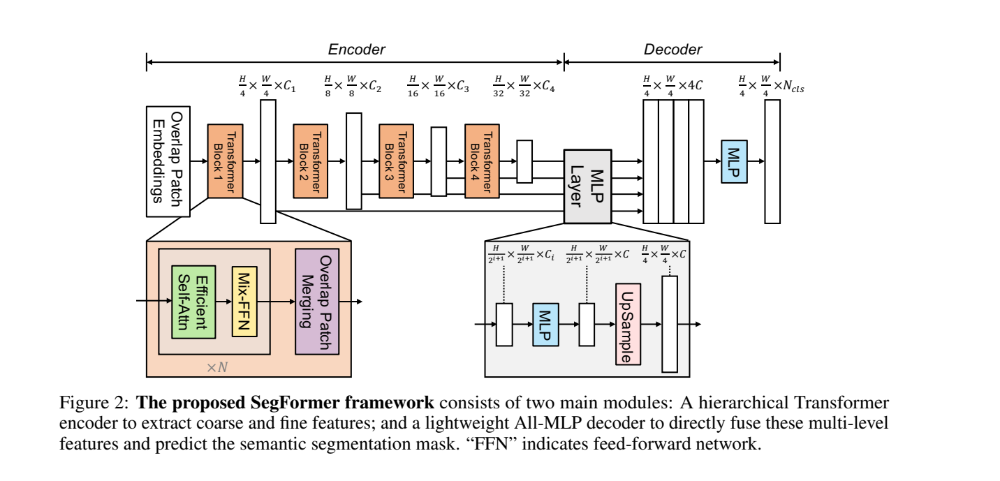

# SegFormer：把现有PCB基线从“能运行”读到“能解释数据流”

更新：2026-11-16。精读第3节、图2—3与表1，再回看本项目基线。资料：[原论文](02-SegFormer-2021.pdf)｜[中文译文](<../../261029/2. SegFormer/full_translation_zh.md>)｜[研究主文档](../../../research/thesis-research-and-study-guide-zh.md)｜[论文阅读总报告](../research-plan-and-paper-reading-report-zh.md)。

下文的**论文事实**指原架构与实验；**教学例子**用于理解张量和公式；**研究候选**是对PCB精度和解释问题的推导，不代表已增加实验任务。

## 1. 作者真正解决的问题

语义分割需要给每个位置一个类别。只知道“图中有PCB”不够，还要区分哪个位置是背景、哪个位置属于缺陷。困难在于：看局部容易把正常焊点或线路当异常，看全局又容易丢失细小边界。SegFormer试图让编码器本身同时提供较细的空间信息和较广的上下文，于是解码器可以保持简单。

论文不是工业异常检测专用方法。其主要实验在ADE20K、Cityscapes和COCO-Stuff等语义分割数据集。它在你的课题中首先是**已完成的监督分割基线**：现有PCB1结果和归档形成可复核起点。原论文说明架构为何合理；PCB上是否够用、哪里漏检，必须由本项目结果回答。不能把原论文自然场景的mIoU当成PCB预期收益。

先抓住一句话：**四级MiT编码器制造不同分辨率的特征，MLP头把四级特征对齐后融合，再给出逐位置类别分数。**“Transformer”解释一部分上下文能力，“四级特征”解释多尺度来源，“MLP头”解释输出如何形成，三者缺一就容易只记住模型名。

## 2. 任务输入、训练监督和输出

输入是单张RGB图像，不需要一张正常黄金板，也不需要support mask。训练使用与图像几何对齐的语义标签；你的任务是背景/缺陷两类。每个位置输出两个logit，logit是尚未变为概率的分数：二类分数经softmax后可取得缺陷概率，再按验证集规则阈值化。二类并不意味着网络只输出“整张图是否有问题”。

编码器通常从预训练权重初始化，训练时哪些参数更新由下游实验决定。当前工程中的CE/Dice、letterbox、原图还原、阈值和选模属于本项目训练与评价协议，不能全部归到原论文。SegFormer架构本身不规定你的PCB划分，也不会自动决定ignore=255应怎样使用。

对比DINO时必须记录这种结构差异：MiT有真实的1/4、1/8、1/16、1/32分辨率金字塔；普通ViT多个中间层往往仍是同一patch网格。把ViT第几层输出叫“多尺度”时，应区分深度层次、插值生成尺度与真实采样尺度，否则会误以为两者解码条件相同。

## 3. 原图2：先读空间尺寸，再读模块名称

来源：[原PDF](02-SegFormer-2021.pdf)，PDF第3页，图2。裁剪坐标与渲染信息见[来源记录](reading-figures/sources.json)。

第一遍沿上方箭头读。图像进入Overlap Patch Embeddings，之后经过四组Transformer Block，特征的宽高逐级下降、通道逐级增加。图中每组不是直接给出一个最终mask，而是向右侧解码器送一份中间表征。

第二遍只看右下角放大框：各级特征先经MLP统一通道，然后上采样到1/4尺度，再拼接。这里“拼接”指沿通道把不同来源的描述并排放置，不是把四张图在画布上拼成四宫格。最后的MLP学习怎样组合这些描述，输出类别通道。

第三遍看左下角：每组Transformer内部包含Efficient Self-Attention和Mix-FFN；阶段交界处再有重叠patch合并。区分“同一阶段内部重复计算”和“跨阶段改变分辨率”，就能解释为什么不同级特征兼具不同感受野与空间采样。

**教学例子**：若输入为512×512，四级空间尺寸依次是128×128、64×64、32×32、16×16。对B0，附录表6给出的通道为32、64、160、256。统一成C通道后，四张都变为128×128×C，拼接得到128×128×4C，再融合。这个例子只演示尺寸；它没有宣称本项目每次输入都为512，也没有替代实际处理器配置。

## 4. 编码器逐步做了什么

### 4.1 重叠patch嵌入保留跨块联系

直接把图像切成互不相交的块，边界两侧本来相邻的像素可能分别进入两块。第3.1节使用重叠卷积式投影：首阶段核7、步长4、padding3；之后阶段核3、步长2、padding1。相邻输出位置看到的输入范围有重叠，减少“块边界就是信息边界”的问题。

这并不保证细小缺陷完整保留。步长4仍然减少空间采样，极小目标仍可能被背景混合。重叠提供连续性机会，最终有无漏检取决于输入、权重与训练，而不是架构名称承诺。

### 4.2 自注意力让当前位置借用别处的信息

原公式(1)：

\[
\operatorname{Attention}(Q,K,V)=\operatorname{Softmax}\!\left(\frac{QK^\top}{\sqrt{d_{head}}}\right)V.
\]

`Q`是各位置发出的查询描述，`K`是各位置供匹配的键，`V`是被聚合的内容，`d_head`是单个头的特征维数。`QKᵀ`比较位置对；softmax把一行变为权重；乘V形成加权描述。**教学例子**：某焊点位置若对附近器件、线路和板面分配0.6/0.3/0.1的权重，就按此比例汇总它们的V向量。这是向量加权，不是把像素亮度平均，也不保证这些权重就是缺陷的可解释原因。

若有N个位置，完整注意力要比较约N²个位置对。SegFormer对K/V使用序列缩减，让每个Q查询较少的内容位置，以控制高分辨率计算。原文用序列长度缩减比`R=[64,16,4,1]`说明复杂度降为`O(N²/R)`；实现中常见的空间边长缩减比是`[8,4,2,1]`，平方后才对应序列长度比例。读配置时不要把这两种R当作冲突，也不要把首级序列误缩减64×64倍。

### 4.3 Mix-FFN把局部空间关系带回来

公式(3)：

\[
 x_{out}=\operatorname{MLP}\left(\operatorname{GELU}\left(\operatorname{Conv}_{3\times3}(\operatorname{MLP}(x_{in}))\right)\right)+x_{in}.
\]

第一层MLP改变每个位置的通道描述；中间深度卷积在邻域混合空间信息；GELU提供非线性；末尾MLP投影回来，残差保留原输入。深度卷积是每个通道单独做空间卷积，减少参数，并不等同于普通跨通道卷积。

作者利用卷积、padding带入位置相关信息，不依赖一张固定长度的可学习绝对位置编码表。“不需要位置编码”不能说成“模型不知道位置”：网格、卷积邻域、边界padding和分层结构都含空间信息。该设计缓解训练/测试尺寸不同时插值位置表的问题，但不取消图像缩放本身的细节损失。

## 5. 解码器为什么可以这么简单

第3.2节公式(4)可按尺寸对齐写为：

\[
\hat F_i=\operatorname{Upsample}_{H/4,W/4}\!\left(\operatorname{Linear}_{C_i\to C}(F_i)\right),\qquad
F=\operatorname{Linear}_{4C\to C}\!\left(\operatorname{Concat}_{i=1}^4\hat F_i\right),\qquad
M=\operatorname{Linear}_{C\to N_{cls}}(F).
\]

这只是将原文四步合并排版，`F_i`为第i级特征，`C_i`为其通道数，`C`为公共通道，`N_cls`为类别数，`M`是1/4尺度类别分数图。原PDF公式上采样尺寸处有排版问题，应以正文明确的H/4×W/4为准。

MLP在这里主要对每个位置的通道做线性映射，可用1×1卷积理解。它不是单独凭空建立大范围空间联系；丰富上下文主要由编码器先提供。图3用有效感受野分析说明：MiT深层已有较广响应，浅层能补充局部响应，融合使输出同时利用局部与非局部信息。所以“头简单”不等于整个模型只会局部判断。

上采样也不是重新观测原图。它把低分辨率分数插值回密集网格，若微小缺陷信息已经被编码丢掉，插值不能恢复真实证据。当前PCB项目还要去掉letterbox padding、恢复原图几何，然后计算前景IoU；若直接在填充图或缩小网格计分，可能得到不同结论。

## 6. 训练与推理：哪些操作只发生一次

训练时：RGB和mask接受一致几何变换→编码器四级特征→解码器低分辨率logits→与标签尺度/ignore规则对齐→算损失→反向更新被允许训练的参数。预训练权重是初始化来源，不是实时加载的额外参考图。

推理时：只输入图像→同样的编码与解码→还原尺寸→形成缺陷概率与mask。此时没有GT参与选择区域或调整阈值。任何利用test mask选择裁剪、后处理或阈值的行为都会改变评价有效性。

对现有代码，最好能亲自跟踪一个样本：原图尺寸是多少、letterbox后哪里是padding、标签中的255是否只表示忽略区、head输出几通道、上采样和去padding在哪一步、原图预测如何形成TP/FP/FN。能回答这些，比背出B0参数量更能说明你掌握了自己的基线。

## 7. 表1怎样支撑“层级编码＋简单头”

表1(a)给出B0—B5在不同数据集的容量与结果，支持模型家族可在精度和成本之间调整；它不是“更大模型在任何PCB任务必胜”的证据。

表1(b)改变decoder通道C。ADE20K上C从256到2048，计算和参数明显增加，mIoU并非随之等比例提高，表明复杂头或大通道不必然带来划算收益。对PCB候选局部分支，这启发一个必要控制：新增参数本身也可能改善结果，必须与普通增容头比较，才知道局部信息是否起独立作用。

表1(c)比较PE与Mix-FFN，在Cityscapes从768×768测试变为1024×2048时，PE行从77.3变为74.0，Mix-FFN从80.5变为79.8。既有同尺度差异，也有改变尺度后的下降差异。支持该设计在作者条件下较稳健，但不能把0.7个百分点下降理解成任意输入缩放均安全。

表1(d)最适合检验解码器直觉：同类MLP头配CNN与MiT表现不同；MiT-B2只用S4为43.1，使用S1—S4为45.4。说明多级融合有价值，且简单头依赖编码器提供足够上下文。该比较同时改变特征/骨干，不能当作纯粹只操纵“感受野”一个变量的因果实验。图3的ERF与定量表相互支持，但ERF是模型响应性质的分析，不是对某次PCB误判的忠实解释。

## 8. 与两项研究的具体关系

工作一的可靠起点是现有SegFormer-B0及其错误。已核实test全局IoU为0.6833、像素recall为0.7390、异常图macro IoU为0.5249；这些是本项目单seed与特定划分结果，历史test已被查看。全局IoU与逐图macro差异提示需要检查不同图像的表现，不能据此直接诊断“小缺陷是唯一主因”。

若以后与冻结DINO＋简单头比较，需要解释差异来自哪些条件：预训练、骨干、真实金字塔、更新范围、头容量和输入尺度。DINO多个同网格层不天然拥有MiT的高分辨率浅层特征，因此比较结果首先说明整体方案的任务适配性。若要进一步定位机制，应固定更多条件，不能只由两套架构分数断言“自监督优于监督”。

局部细节支路是研究候选，不是本文要求增加的模块。借鉴SegFormer应先问：浅层已有的局部信息是否没有被利用，还是输入缩放已丢掉缺陷，或阈值导致可见响应被舍弃？若真实问题是阈值/校准，叠局部分支未必有效；若误报集中在正常焊点，单纯增强边缘反而可能增加FP。

工作二应区分三种图：分割mask回答位置；attention或ERF描述内部响应；忠实解释要求说明哪些信息实际影响该次得分。SegFormer没有正常参照库，后续展示相似正常块时，若块未进入实际评分，只能算辅助对照材料。可检验的解释候选是对输入/中间特征做受控干预，观察实际缺陷logit变化；应控制干预面积、编辑伪影，并报告解释是否覆盖漏检与误报等情况。解释价值不要求IoU必然增加。

## 9. 已填写的理解问答

**问：为什么不是直接把最深特征放大成mask？**答：最深特征有较强上下文，但空间网格粗；浅层保留更多位置细节。表1(d)支持多层融合有收益。浅层也可能含噪声，融合权重需要监督学习。

**问：MLP头有没有空间感受野？**答：单个逐位置线性层本身主要混合通道，但输入特征已经携带编码器的空间上下文；上采样也让相邻输出共享信息。不能把“头没有复杂空间模块”误读成“整个输出看不到邻域”。

**问：没有位置编码为何还能定位？**答：图像按网格排列，重叠投影与3×3卷积保持邻接关系，padding等也提供位置线索。不用固定绝对位置表，只是位置处理方式不同。

**问：原文的mIoU和我报的IoU能直接比较吗？**答：不能。自然场景多类mIoU通常对类别IoU平均，你当前核心是二值前景IoU；输入、划分和聚合也不同。必须写明指标对象，不能只因名字含IoU就横排。

**问：读懂后我能说基线已经完成精度创新吗？**答：不能。完成基线意味着有可靠比较入口。贡献还需要PCB问题、机制、同协议收益和边界。你现在可以准确解释已有方法和结果，不必把尚未实施的DINO或局部分支包装成成果。
