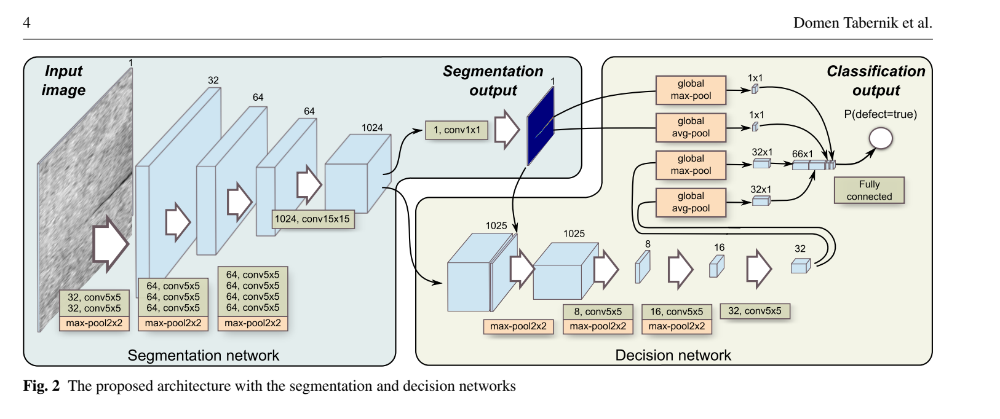

# 监督表面缺陷分割：为什么先定位，再判断整张图

更新：2026-11-16。原文：Tabernik等，*Segmentation-Based Deep-Learning Approach for Surface-Defect Detection*。资料：[本地PDF](03-Tabernik-Supervised-Surface-Defect-Segmentation-2019.pdf)｜[中文译文](full_translation_zh.md)｜[研究主文档](../../../research/thesis-research-and-study-guide-zh.md)｜[总报告](../research-plan-and-paper-reading-report-zh.md)。

这篇应读成一项**围绕工业检测条件组织方法与验证的研究**：像素监督怎样帮助少量异常图学习，定位结果怎样参与图像判定，标注精细度怎样影响最终检测。下文教学公式为便于理解的重述，均与原文架构或损失说明对应；研究建议保持候选状态。

## 1. 把作者的终点与自己的终点分开

一条细裂纹只占图像很少位置，用整图标签训练分类器时，“哪里造成不合格”的监督很弱。作者先让模型对裂纹位置作密集预测，再训练一个decision network判断整张图是否存在缺陷。第一阶段把有限的异常图转为大量有位置约束的训练信号，第二阶段利用局部响应的形状和上下文抑制误报。

作者强调，实际工业检测中每图合格/不合格常比边界完全精确更重要。因此，论文虽然用分割训练，但大量核心结果评价的是**图像级检测/分类**。你的当前目标则明确包含PCB缺陷分割和定位精度，不能因论文“粗mask也能获得高AP”，就认为边界标注或像素IoU不重要。

最值得借鉴的是研究逻辑：先定义最终输出，再问监督怎样支撑它。若最终只需报警，粗区域可能足够；若要精确面积、细边界或与mask评价对齐，粗标注的影响需要另证。没有一种标注精度对所有工业任务都“足够”。

## 2. 原始任务的输入、监督与数据独立性

原文的KolektorSDD来自电气换向器塑料嵌入表面的细裂纹，不是PCB。399张图中52张可见缺陷、347张无可见缺陷；图像分辨率1408×512。一个物理换向器的表面可被拍成最多8个相关视图。数据中“来自有缺陷工件的图”不等于“每张图都有可见缺陷”，标签以该视图是否可见为准。

训练第一阶段使用像素标注；第二阶段使用图像缺陷标签。推理只输入一张表面图，无需黄金模板、支持图或在线正常库。输出有两种：1/8分辨率的缺陷响应图，以及最终图像级分数。两者可以关联，但不是相同输出。

原文采用三折交叉验证，并在减少异常训练图数量的实验中固定各折测试集。阅读划分时要关注同一物理工件多视图的相关性。像素很多，并不把一张图变成成千上万个独立样件；按像素计算训练损失和按工件估计泛化可靠性是两个问题。对用户PCB1，目前没有完整可信物理板ID，报告探索性区间时不能把像素数量当独立样本量。

## 3. 从图2读懂两阶段网络

来源：[原PDF](03-Tabernik-Supervised-Surface-Defect-Segmentation-2019.pdf)，PDF第4页，图2；[裁剪来源记录](reading-figures/sources.json)。

先读左半边蓝底区域。输入经过多层卷积和三次max-pooling，最后形成1024通道特征。上方的1×1卷积把1024通道压到1通道，得到分割输出。蓝色小图是空间响应，不是最终“合格/不合格”标量。

接着看中间分叉：1024通道深层特征与1通道分割输出拼接，成为1025通道，送进右下方判定卷积。可见第二阶段没有只看二值mask，它还能读取分割网络尚未压成单通道的丰富描述。若仅保存阈值后的mask，会丢掉这部分信息。

最后看右上方：判定卷积的32通道输出分别做全局最大/平均池化，得到64维；原分割图也做最大/平均池化，提供2维快捷信号；总共66维经线性层形成图像判定。图中的连线解释了一个关键事实：**最终图像得分并非分割图最大值的简单重命名。**其余深层特征也能改变判定。

讲图时可以用一句完整数据流复述：高分辨率图→定位特征与响应图→二者共同形成判定特征→局部极值和整体强度统计→图像缺陷得分。这比逐个背“1024、1025、66”更重要；数字用于核查你是否真的看懂了连接关系。

## 4. 分割网络为什么这样设计

分割网络包含11层卷积和3层最大池化。前9层用5×5核，后两层用15×15和1×1核；每层后有特征归一化与ReLU。作者没有采用如今常见的复杂对称解码器，最后直接形成低分辨率响应图。

这里有一对张力：裂纹很细，需要保留局部证据；裂纹和正常纹理可能相似，又需要足够大范围来判断结构。作者用大核和高层容量扩大感受野，以max-pooling保留局部强响应。其直觉是，稀疏强缺陷响应可能在取最大时保留下来，而大步长卷积不一定总能采到它。

但应把作者设计动机与结论范围分开。最大池化也可能保留噪声；下采样后的定位图仍可能丢边界。不能由“max-pooling保留小特征”推导成“最大池化适合所有PCB小缺陷”。你已有的SegFormer使用重叠投影、多尺度特征和不同融合机制，二者应围绕实际错误比较，而不是根据某个模块的口号选型。

## 5. 两阶段训练与三个教学表达式

原文训练流程是先训练分割网络，再训练判定网络；第二阶段利用已学好的定位表示。梯度、冻结和输出类型必须按原实现理解，不能想当然地说“两个头一起端到端联合训练”。它与你当前SegFormer单个分割头优化有本质差异。

下面用**教学记号**压缩原文架构，不冒充原论文编号公式：

$$
F=f_{seg}(I),\qquad S=h_{seg}(F),\qquad
 z=h_{dec}\bigl([F,S]\bigr).
$$
$I$是图像，$F$是1024通道特征，$S$是单通道定位响应，$[F,S]$为通道拼接，$z$是最终图像判定分数。若只研究S的解释，不能声称已经解释z；因为F还有独立路径进入判定网络。

再把图2的汇聚写为：

$$
v=[\operatorname{GMP}(D),\operatorname{GAP}(D),\operatorname{GMP}(S),\operatorname{GAP}(S)],\qquad z=w^\top v+b.
$$
$D$为判定网络最后的32通道特征；GMP/GAP分别是空间最大/平均池化，v共66维。最大值擅长捕获“小范围强异常”，平均值感知“大范围整体响应”，二者提供不同证据。**教学例子**：一个像素响应很高、其余很低，与一大片中等响应可能有相同均值却不同最大值；同时使用两者有助于区分。真实网络还利用D的特征，不能用这个标量例子代替实际判定。

原文比较均方误差与交叉熵训练分割。对二分类，交叉熵可用通用教学式写为：

$$
L_{BCE}=-\frac1N\sum_j\{y_j\log p_j+(1-y_j)\log(1-p_j)\}.
$$
$y_j$为像素标签，$p_j$为缺陷概率，N为有效位置数；式子说明错误且很自信的预测受到较大惩罚。它是标准损失说明，不是本文新提出的公式。标注膨胀后，y的正区域扩大，学习目标也随之改变，绝不是“相同真值下换了一种无影响的预处理”。

## 6. 标注膨胀实验到底说明什么

原文生成多种mask：精细人工标注、不同核尺寸膨胀、较大的框式/粗标注。膨胀是把细裂纹周围一圈也当作正区域，类似用更粗的笔描裂纹。它可能使正信号更强、减轻少量对齐误差，但也把正常邻域并入训练前景。

图4展示膨胀示例；正文列5、9、13、17像素核，而图注最后一项写成15，存在表述不一致。理解实验时应按具体配置/实现核查，不能自行统一为一个“确定正确”的核。该疑点不影响“逐渐放宽标注区域”的整体直觉，但影响精确复现。

第“Segmentation and decision network evaluation”部分图5—7比较标注、分辨率、损失和判定网络。图6把若干因素的平均AP变化汇总；它支持某些配置对该检测任务有稳定收益，但平均效应可能掩盖交互。例如判定头是否有用可能取决于分割图质量，不应把每个平均增益相加预测最终结果。

“Required precision of the annotation”部分图8—9继续比较大框/粗框，结论围绕图像检测AP。较粗标注仍能帮助学习“出现这种局部结构就报警”，并不证明输出边界与细mask同样准确。若用户未来需要边界质量评价，应在相同精细测试mask上独立验证；不应为了方便标注，直接把现有精细GT膨胀后宣称定位提升。

## 7. 实验如何支持少样本与判定模块

图12比较作者方法、商业软件和标准分割网络，需注意后两种分割网络也有使用作者判定网络的设置。不是简单的“作者双网络对比裸U-Net最大值”一种比较。原文在零漏检工作点报告其方法只需3个FP进入人工复核；这是该数据、该工作点下的结果，不是通用产线误剔率保证。

图15逐步减少每折可用异常训练图，正常预算和测试集按规定保留，检查同一任务下的标注数量敏感性。原文报告25张异常训练图仍有超过99%的图像AP，5张时约96%。这证明的是特定裂纹任务中密集监督与架构可以在较少异常图下工作，不能推出任意新缺陷类的一张support图即可泛化，也不能与S³DNet的类别不重叠episodic few-shot混为一谈。

表1给出不同方法所用训练配置，避免把成绩差异只归于网络；表2与图16讨论参数与推理耗时，体现作者对计算代价的关注。硬件、原图尺寸和输出头不同，不能把原文延迟直接拿来估计4070 Laptop上的PCB1耗时。

应把“像素损失增加监督信号”理解为优化便利，而不是统计样本独立性证明。同图像素共享材质、照明和背景；若训练/测试分到同一物理样件的近似视图，再多像素也不能证明对新样件泛化。

## 8. 如何服务你的精度工作

目前你的主要输出是PCB1像素mask，已完成SegFormer-B0；DINO冻结头、局部分支还没有实施。本文可帮助形成三个诊断视角，而非直接照搬整网：

- **定位与图像判定分开检查。**某图只有少量正常FP像素，像素IoU可能影响不大，却会让“任意前景即报警”的规则判为异常。反过来，整图报警正确不表示缺陷边界好。
- **标注、采样与表征分开检查。**细目标在缩放mask时消失属于几何监督问题；模型看见目标却把正常纹理混淆，才可能涉及表征/判别问题。本文的粗mask经验不能修复已丢掉的真实标签。
- **让新增模块对应明确错误。**若未来确有图像判定需求，学习式汇聚是候选；若当前主要问题是局部漏分，增加图像头可能改善报警而不改善mask，应分别报告。

“先分割再判定”本身已是成熟先例。用户的贡献不能写成首次把分割用于工业检测，而应落到PCB特定困难、受控改动及可复核证据。也无需为阅读本文立即把现有任务扩展成多任务分类。

## 9. 对解释工作的提醒：有mask不等于解释了最终报警

这篇架构提供一个很具体的解释边界。最终图像分数既看S又看F，所以展示S只能说明一个参与路径。若把S叠在图上并称“完整判定依据”，可能遗漏由深层F导致的误报。解释评价应先选定对象：解释分割像素logit，还是解释最终图像分数？然后检查解释覆盖了哪些路径。

若将来研究正常参照，参照必须实际进入被解释的评分，或清楚标为辅助对照。本文没有正常参照匹配；它的判定特征也没有天然对应一张人能阅读的正常样本。候选干预可以分别改变S路径或F路径，观察实际z的变化，但要防止把离分布特征造成的异常响应误当有效证据。解释工作仍需忠实性、稳定性和匹配等检验，不能以AP或IoU一个数字代替。

## 10. 已填写的理解问答

**问：像素监督是不是把52张图变成数百万独立样本？**答：不是。它增加了位置层面的监督约束，降低只靠整图标签找缺陷的难度，但像素相关、同工件视图相关，统计泛化仍按独立图像/样件看待。

**问：为什么decision network不只取mask最大值？**答：最大值易被孤立误响应触发，且不描述响应形状与上下文。作者把深层特征、定位图以及最大/平均统计一起用于判定，代价是最终依据不再能只用mask完全概括。

**问：粗标注效果好，能把我的GT统一变粗吗？**答：不能由本文直接得到这个结论。原文重点是图像检测AP；你当前有精细mask、研究定位精度。可将标注敏感性作为理解工具，是否实验须有具体问题，测试真值及任务定义不能随方法改变。

**问：25张图就有效，和我的48张异常训练图有什么关系？**答：只说明少量异常图的监督分割有文献基础。对象、缺陷多样性、图像相关性、训练正常预算和评价都不同，数量大小不能直接预测你的效果。

**问：本文最值得带入开题的论点是什么？**答：工业方法设计应由监督条件与最终输出驱动，定位、整图报警、标注成本和计算代价需要分别验证。它支持研究框架，不能替代PCB上的方法贡献和实验。
