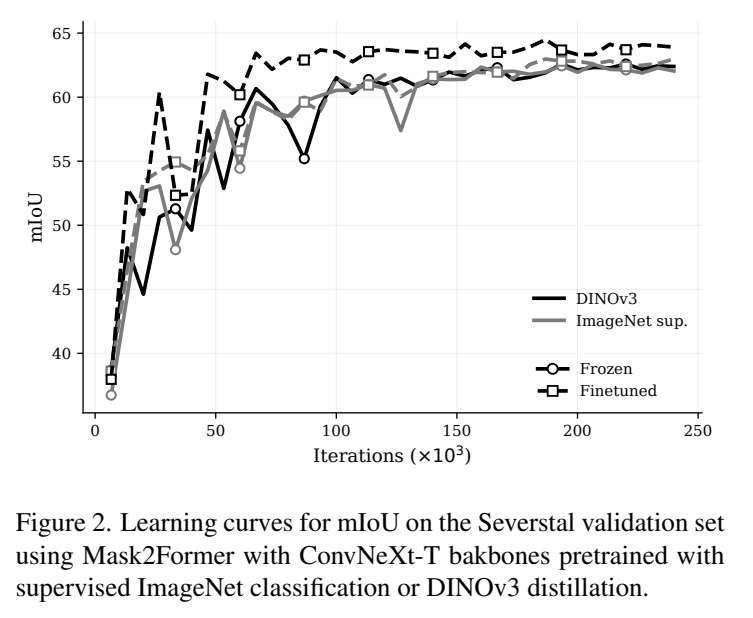

# 工业迁移学习中的DINOv3与ImageNet：如何读一篇“结果取决于条件”的比较论文

更新：2026-11-16。资料：[原论文](05-DINOv3-vs-ImageNet-Industrial-Transfer-2026.pdf)｜[中文译文](full_translation_zh.md)｜[研究主文档](../../../research/thesis-research-and-study-guide-zh.md)｜[总报告](../research-plan-and-paper-reading-report-zh.md)。

论文：*Rethinking Transfer Learning for Industrial Inspection: DINOv3 vs. ImageNet Pretraining Across RGB and X-ray Tasks*。建议先看第3节研究设计与表2，再看图2—4，最后读讨论。本文不是新网络结构论文，价值在于教你设计公平对照、识别迁移边界，并保留原文数字疑点。

## 1. 为什么它对你很重要，却不能替你选定DINO路线

在自然图像上，基础模型表现强，容易形成“新预训练直接替换旧骨干就会提升工业检测”的预期。工业缺陷往往细小、重复纹理强，而且可能是X-ray等不同成像模态。预训练学到的语义好，不一定正好包含工业任务所需的信息；能作为好的可微调初始化，也不等于能作为好的固定特征。

作者因此问两个条件问题：**同一卷积架构采用不同预训练时，下游表现怎样；这个结果是否随冻结/微调以及RGB/X-ray而变化？**论文的结论不是单一赢家，而是迁移优势依赖适配方式与目标域。它与你的研究相关，因为冻结DINO＋简单头尚未实施，正需要保留这种开放性。

最关键边界：论文主体比较的是**DINOv3教师蒸馏得到的ConvNeXt-T，与ImageNet监督预训练ConvNeXt-T**；另外列ResNet-50基线。它并未直接检验你候选的DINOv3 ViT-S/16。不能把这里“冻结ConvNeXt不占优”当作ViT-S/16必败的证据，也不能把“全量微调RGB较好”写成你的冻结ViT必胜依据。

## 2. 任务与监督：冻结不等于不训练

| 数据/任务 | 输入与标签 | 任务头与输出 |
| --- | --- | --- |
| Severstal、Rubber Rings | RGB图像与分割标签 | Mask2Former，语义分割；评价mIoU |
| RarePlanes | RGB航拍图与实例标注，用作细粒度定位迁移任务 | Mask R-CNN，实例mask；评价mask mAP@[0.5:0.95] |
| GDXray Castings | X-ray铸件图与缺陷框 | Faster R-CNN，检测框；主表报告box mAP@50 |

这些下游都是有监督任务。Frozen表示骨干参数不更新，但任务头仍用目标数据标签优化；Full表示骨干与下游头一起适配。Frozen并不是“原模型零样本直接给工业缺陷答案”。文中有时使用linear-probing-style说法，但Mask2Former等任务头并非都等价于逐位置单层线性分类器，应以具体架构说明为准。

这点尤其关系你的high-shot监督条件：你已有真实PCB mask，冻结DINO只是一个控制更新范围的实验选择，不会把任务改成normal-only异常检测，也不会凭空减少标签使用量。若未来要主张标注效率，必须另做固定评价集下的标注预算比较；“冻结参数少”本身不是“使用标注少”。

## 3. 先看懂两个轴，而不是把所有行排成榜单

论文第3.2—3.3节通过同一个ConvNeXt-T架构减小骨干结构混杂，主要变量是预训练方式。但两种预训练不只有损失差异：数据量、数据构成、蒸馏教师与训练计算也不同。因此，比较的是**预训练整套方案的迁移结果**，不能把全部变化严格归因于“自监督这一项”。

再用Frozen/Full划出第二轴，便能区分两个问题：固定表征里有没有现成可用信息；经过任务监督更新后，它是否提供更好的优化起点。两者结果可能不同。例如特征中信息需要旋转、重组或调整局部响应后才能用，固定头可能难以取出；微调后收益出现。这是可能解释，仍不是仅凭最终分数就能证明的内部机制。

ResNet-50与ConvNeXt比较时又改变了架构。若ConvNeXt更好，不能把收益全称为DINO贡献。作者保留ImageNet ConvNeXt正是为了分开“更强架构”与“不同预训练”的作用。对你的SegFormer vs DINO比较也一样：它首先是两种完整方案比较，不能直接叫纯预训练消融。

## 4. 用训练与推理信息流理解Frozen/Full

先把骨干记为$f_\theta$，任务头记为$h_\phi$，输入图像I、标签Y。下式为**教学记号**，是对第3—4节训练协议的概括，不是论文新提出的公式：

$$
\hat Y=h_\phi(f_\theta(I)),\qquad
\text{Frozen}:\ \min_\phi L(\hat Y,Y),\qquad
\text{Full}:\ \min_{\theta,\phi}L(\hat Y,Y).
$$
冻结时仍有完整前向计算，特征大小和推理计算并不因“可训练参数少”就自动减少；节省主要发生在反向与优化器状态。微调可以改变表征，但也可能过拟合或破坏通用信息，需要足够监督和合适优化。

训练数据还受采样影响。第4.3节对语义分割采用defect-aware cropping：概率0.7时，裁剪被约束包含至少一部分标注缺陷，以减少全背景crop。这个操作使用GT，发生在训练。不能在测试时用缺陷mask定位裁剪再称普通单图推理；也不能把这套训练采样与本项目整图letterbox视为相同条件。

推理时只使用图像及训练好的骨干/头，不需要原预训练数据，不生成在线教师信号，也不使用目标mask。各任务头产生mask、实例或框，再按各自协议计分。相同骨干的推理形态接近，不代表不同任务的分数可互相换算。

## 5. 原图2：同时读线型、颜色与时间轴

来源：[原PDF](05-DINOv3-vs-ImageNet-Industrial-Transfer-2026.pdf)，PDF第5页，图2；[来源记录](reading-figures/sources.json)。

第一步看坐标：横轴是训练迭代次数，不是秒数或epoch；纵轴是Severstal验证集mIoU。曲线更早到达较高mIoU，支持“较快按迭代收敛”，不能直接换成“墙钟时间更快”，因为单步耗时可能不同。

第二步读图例：黑色为DINOv3预训练，灰色为监督ImageNet；圆点/实线对应Frozen，方点/虚线对应Finetuned。要在同一种适配方式下比较黑灰，而不是把任意最高黑线与最低灰线当预训练收益。

第三步看后半程：冻结曲线接近，全量微调的DINO曲线更高。前半程有明显波动，不能截取一个早期点就宣布最终排名。论文表2明确使用最终训练迭代在验证集上的结果；它不是各自挑最高点，也不是独立封存test成绩。

最后看不确定性：这张图不是多seed均值±区间。表2注明固定随机种子42。曲线展示优化轨迹，不提供训练波动的完整统计证据。对几十分之一或一点左右差值，应把可重复性当未回答的问题，不把画面分离程度当显著性检验。

## 6. 表2的准确读法，以及一处必须保留的原文矛盾

核对本地PDF表2，语义分割的数值如下，单位均为百分制mIoU：

| 初始化与更新方式 | Severstal | Rubber Rings |
| --- | ---: | ---: |
| ImageNet监督ConvNeXt-T，Frozen | 62.04 | 73.25 |
| DINOv3蒸馏ConvNeXt-T，Frozen | 62.40 | 72.32 |
| ImageNet监督ConvNeXt-T，Full | 62.97 | 73.26 |
| DINOv3蒸馏ConvNeXt-T，Full | 64.01 | 75.60 |
| ImageNet监督ResNet-50，Full | 63.28 | 73.87 |

冻结下，DINO相对同架构ImageNet在Severstal多0.36个百分点，在Rubber少0.93个百分点，支持“没有稳定明显优势”，不能写成所有数据均退步。Full下，相对同架构ImageNet分别多1.04和2.34个百分点，支持该条件下较好的最终适配表现。

**原文疑点：第5.1节正文称Full结果相对ResNet-50和ImageNet ConvNeXt分别提高10.59、10.29 mIoU，与表2不符。**按表格直接相减：Severstal相对ResNet为$64.01-63.28=0.73$个百分点，相对ConvNeXt为$64.01-62.97=1.04$个百分点；Rubber分别为1.73和2.34个百分点。若算相对改善百分比，则需再除对应基线，如Severstal对同架构为$1.04/62.97\times100\%\approx1.65\%$，也不是10.29。这里没有理由自行替作者改表或猜测其他实验；本导读引用表列数值、保留正文疑点，复述时不采用那两个大涨幅。

对检测任务，GDXray Frozen表列DINO为7.88、ImageNet为21.32；Full为27.84与29.74，仍是ImageNet更高。这支持目标模态变化时迁移优势可能逆转，但只覆盖本文的铸件X-ray任务，不证明所有X-ray模型都如此。RarePlanes是航拍飞机定位，其工业相关性与PCB表面缺陷不同，不能把它叫另一个PCB缺陷集。

图3/4需与表2各自的指标对应：某条曲线若显示COCO式bbox AP@[.50:.95]而主表采用AP50，就不能直接从图末端读出主表数值。阅读习惯应是先记指标定义，再看数字，避免因都叫AP而误判矛盾。

## 7. 作者的机制解释有多强

论文结果支持一种经验模式：固定特征不一定占优，目标监督适配后RGB任务可受益，X-ray下则可能仍不及监督ImageNet。图2的轨迹支持优化起点差异，但没有直接识别“哪个特征维度导致收益”，也没有对局部细节分支作消融。它是一篇控制比较，不是缺陷成因诊断或可解释性方法论文。

同一任务内配方尽量一致有利于比较，但“统一默认超参”有双面性：减少为某模型单独调优的偏差，也可能没有给每种预训练各自最优适配条件。固定seed、验证集最终迭代、数据模态与任务头绑定，都是解释结论时应保留的条件。无需因此否认论文价值；应把结论写到证据所覆盖的范围。

如果要进一步确认“微调为何更好”，可能需要多个训练seed、表示诊断、更新幅度或层级适配对照。这是由本文推导的研究候选，不是论文已做，也不是建议用户立即补齐所有任务。

## 8. 怎样落实到你的精度研究

你的已完成入口是SegFormer-B0，拟对照是冻结DINOv3 ViT-S/16＋简单头；本论文的Full ConvNeXt并不构成跳过冻结对照的理由。冻结对照可先回答“固定表征能做到什么”，即便不胜出也有价值。若收益不足，再依据错误和可行性讨论局部适配、更新范围或其他载体，不预设必须全量微调。

具体可借鉴的是整理一个比较条件矩阵：骨干家族、预训练来源、更新参数、输入尺度、头容量、训练采样、mask预算、选模与评价。若DINO方案分数变化，先判断哪些轴同时变了；只有控制相应变量，才能进一步声称是表征、细节支路或融合机制起作用。

**候选假设A**：冻结DINO表征保留部分可用局部差异，但与PCB缺陷标签的映射需要适配。若简单头在同协议下已足够，复杂适配可能没有必要；若所有配置都缺同一类极小目标，输入采样可能比预训练更关键。**候选假设B**：局部分支改善细目标，同时可能增强正常纹理误报；应检查原图召回、正常FP和分层错误，而非只看总IoU。

上述是假设清单，不是替用户确定路线。论文不能授权改变high-shot监督条件，也不能替代对新增工作量的取舍。

## 9. 怎样落实到你的解释研究

不同预训练可能达到相近IoU，却依赖不同图像区域。性能接近不代表依据相同；性能较高也不证明依据可信。这篇没有提供忠实性评价，恰好提醒你解释工作须单独定义目标。

若采用正常参照作为候选，预训练决定特征距离的含义。自然图像中相似的纹理，在PCB上可能属于不同结构；X-ray负结果也说明“通用特征距离”不是跨域自动有效的量。应验证参照结构匹配、实际距离是否进入评分，以及干预后得分变化是否符合解释。单纯为更高分模型展示更漂亮热图，不能形成独立解释贡献。

冻结设置有助于在同一表征下比较不同评分或参照约束，但并不自动保证解释容易：非线性任务头仍可能组合大量特征。解释成本也要记录，包括检索时间、库大小、额外输入与失败覆盖。解释成功无需以IoU上升作为定义，但须报告其对检测任务的影响。

## 10. 已填写的理解问答

**问：为什么DINOv3名字相同，论文不能直接预测我的结果？**答：本文是蒸馏ConvNeXt-T，用户候选是ViT-S/16；头、数据、监督、分辨率和更新方式也不同。共享预训练品牌不等于同一实验。

**问：Frozen结果较弱是否说明预训练失败？**答：它说明固定特征与特定头/任务配方的组合未占优势，不等于所有适配方式均失败；Full结果正显示二者可能不同。也不能反过来说只要微调就必胜。

**问：1.04和1.65有什么区别？**答：前者是百分制mIoU的绝对百分点差，后者是除以62.97后得到的相对改善百分比。原文正文两个大涨幅与这两种算法都对不上，应该保留疑点。

**问：曲线收敛快能写效率贡献吗？**答：只能先说按迭代更快达到一定验证分数。效率贡献还需同硬件、输入、批量下的墙钟时间、显存和推理成本，不由横轴迭代直接保证。

**问：这篇给我最明确的研究原则是什么？**答：不要把预训练新旧当答案；用固定监督和评价，区分架构、预训练与适配的贡献，真实保留负结果。你的两项目标仍是PCB检测精度与可解释性，而非证明DINO必须胜出。
