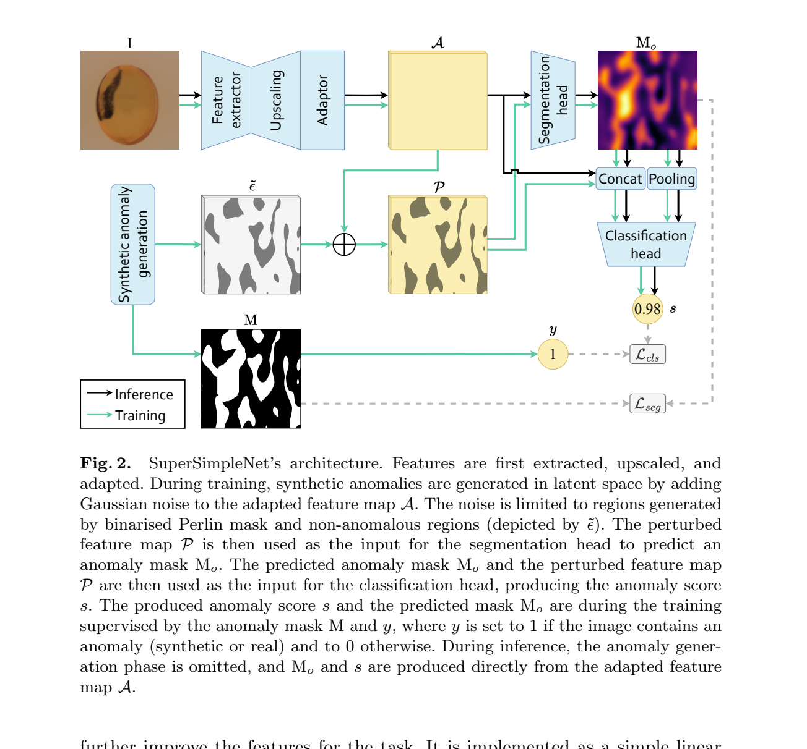

# SuperSimpleNet：强特征怎样适配缺陷，真实标注与合成异常怎样结合

深化修订：2026年11月16日。本文依据本地20页论文和中文译文讲解。原文结果、教学推导与PCB候选建议分别说明，不把阅读建议当作已完成实验。

入口：[原PDF](06-SuperSimpleNet-2024.pdf)｜[中文译文](full_translation_zh.md)｜[研究主文档](../../../research/thesis-research-and-study-guide-zh.md)｜[总报告](../research-plan-and-paper-reading-report-zh.md)

## 一、它为什么与你的精度工作直接相关

强大的预训练特征能够描述表面外观，却不一定直接形成适合缺陷的分界。SuperSimpleNet把冻结特征、轻量适配和判别头连起来，通过真实异常和特征层合成异常训练，回答“怎样利用已有特征，又不完全依赖有限缺陷样本”的问题。

这与你想研究的预训练表征适配相近，但论文没有使用DINO局部分支，也不是在你的PCB监督协议上实验。它最值得借鉴的是信息流和对照：哪些表示固定，哪里使用标注，哪些训练信号来自合成，图像判别与像素定位会不会相互牵制。先懂这些，比直接照搬所有训练参数更重要。

## 二、跟着原图走一遍训练与推理

来源：原论文图2，PDF第6页；裁剪坐标见[图片来源记录](reading-figures/sources.json)，原图保持不变。

从左向右，输入图像先经过预训练特征提取器；两层空间特征被上采样到同一尺寸，经局部池化、拼接，再进入适配器。输出$A$是可供任务使用的特征，并不是缺陷掩码。

训练分支向$A$的指定位置添加噪声，形成扰动特征$P$。分割头把$P$映射为异常响应$M_o$；分类头同时读取$P$和$M_o$，输出整图异常分数$s$。下方真实和合成掩码监督定位与分类。

推理时不再主动制造噪声，直接用真实特征$A$产生输出。图中的“训练时合成异常”不能理解成测试时先把图改坏再判断。异常图与整图分数来自不同头，虽然相关，但不是同一个输出的两种命名。

图内主要标签对应：特征提取器负责通用视觉描述，适配器负责改变任务表示，合成分支提供已知位置的训练扰动，分割头学习区域响应，分类头学习全局判别。理解每个模块使用了哪些信息，才能判断移除它的消融公平与否。

## 三、特征提取与适配：为什么上采样不等于凭空增加细节

原文第3.1节使用ImageNet预训练WideResNet50的第2、3层特征。第2层放大2倍，第3层放大4倍，使它们空间尺寸对齐，再做3×3局部平均池化并拼接。这既增加预测网格的密度，也把邻域上下文放入每个位置。

较密网格可能有利于后续头进行空间计算，但插值没有新增原图观测。若极小缺陷已经在输入缩放或编码中消失，上采样无法恢复它。另一方面，若特征仍含差异，只是头的采样太粗，改变计算网格确实可能帮助。因此，应把“信息存在与否”和“预测头是否充分利用信息”分开。

第3.2节的适配器是简单线性映射；在空间图上可用1×1卷积实现通道变换。用教学记号可写为$A(u)=W F(u)+b$，其中$u$为空间位置，$F$为拼接特征。适配器不直接扩大感受野，它改变通道组合；相关空间上下文已经来自骨干和池化。

对你的候选DINO实验，简单头和常规适配应先作为容易解释的对照。若一开始把局部分支、复杂融合和额外损失同时加入，就难以知道收益来自哪一步。

## 四、合成异常的关键：改的是特征，位置由掩码控制

原文第3.3节先生成Perlin噪声图并阈值化，得到具有空间连贯性的区域，再在允许位置加入高斯噪声。Perlin掩码决定哪里被扰动，高斯噪声决定特征怎样改变；它不是在RGB上合成一张可见裂纹照片。

为解释集合关系，可以写出以下教学重述：

$$
M_a=M_t\land\neg M_{gt},\qquad P=A+M_a\odot\epsilon,\qquad M=M_a\lor M_{gt}.
$$

$M_t$为随机区域，$M_{gt}$为真实异常掩码，$M_a$仅包含原本正常的位置。真实异常部分保留，不用噪声覆盖；最终训练标签$M$同时包含真实和合成异常。无监督条件下$M_{gt}$为空，这套计算仍可运行。

**教学例子：**一张图已有左上划痕，随机区域碰巧覆盖左上和右下。算法跳过左上真实划痕，只在右下正常区域加扰动，两处都标为异常。这样既利用真实标注，又扩展训练的异常变化。

这只是潜空间扰动的训练策略，不证明高斯特征噪声涵盖所有PCB缺陷。若合成差异与真实缺陷相距很远，模型可能学到识别人工扰动的捷径。借鉴时应比较仅真实监督、真实加合成以及必要的生成方式控制，判断收益是否真的转移到真实错误。

## 五、损失的含义：为什么达到一定分数后不再继续推

原文公式（1）对分割得分采用带间隔的截断损失：异常位置要求得分至少为$th$，正常位置要求至多为$-th$，原文$th=0.5$。对应为：

$$
l(z,y)=\begin{cases}\max(0,th-z),&y=1,\\\max(0,th+z),&y=0.\end{cases}
$$

若异常位置$z=0.2$，损失为0.3；若$z=0.8$，间隔已经满足，这一项为0。正常位置若$z=0.2$，损失为0.7，提示应降低得分。这是教学算例，帮助理解它为何不同于无止境把所有得分推到极端。

原文另加焦点损失，分割损失为截断项与焦点项之和；分类也用焦点损失。焦点项降低容易样本的相对权重，但不自动解决所有类别不平衡问题，需核对具体设置和训练数据。

第4.3节还区分梯度处理：无监督时停止分类头向分割头的梯度，有监督时采用梯度裁剪。两种信息条件不仅换了数据标签，也会改变优化路线。若比较时忽略这些差别，就可能把训练策略收益误归于网络结构。

## 六、分类头为何可能提高检测，却略损定位

分类头把分割响应与特征拼接，使用卷积及最大/平均池化形成全局判定。它能利用局部极值、整体响应与外观特征，因而不必对一个孤立高分点立即报警。但它也可能推动分割表示更适合整图分类，而非精确边界。

表5给出具体证据：完整方法的有监督检测/定位均值为98.6/95.6，去分类头为95.5/96.2。这里检测与定位采用原文相应指标，不是你的IoU。分类头对有监督检测有益，定位指标却略低于移除版本，不能写成“这个头对所有方面必然改善”。无监督条件也呈现不同变化。

表5中去上采样使有监督定位从95.6降至93.0，支持网格设计在该设置中的作用，但不等于证明原图细节被插值恢复。表6讨论V100S上的成本，图6比较多次训练的一致性；它们分别回答效果、资源和波动，不能用一个数字代替。

## 七、监督协议必须单独核对

原文监督实验在SensumSODF与KSDD2，MVTec AD和VisA采用只用正常图的设置。你不能在引用时只写“它已在VisA监督分割表现很好”。可以引用它具备利用异常mask的机制，再明确同PCB1高样本协议的效果需要另外验证。

两种设置、各类均以最后一轮模型评价，报告五个随机种子均值和标准差；你的基线按验证IoU选模。后续比较应说明选模与调参预算，避免把论文成绩直接拼接成本地对照。

## 八、怎样具体联系你的两项研究

精度方向可以借鉴“冻结特征—简单适配—预测头”的拆分，检查局部误差到底需要通道适配、空间信息还是训练数据变化。保留同骨干简单头，才能理解复杂局部方案多提供什么。合成异常是可讨论选项，不因本文有效就直接加入你的任务。

解释方向要注意最终图像分数还有分类特征路径。只显示分割图，可能遗漏分类头使用的独立证据；若将来用正常参照解释某个融合分数，同样要追踪全部参与路径。图像判定、像素定位与物理原因必须分开。

**理解问答：**适配器很小是否就没有研究价值？参数少不决定价值，关键是解决了什么PCB困难、与简单对照的收益和边界。合成异常是否意味着使用真实缺陷标签不重要？不是，两者携带不同信息，应通过消融区分。最该带走什么？一张训练/推理流图、一张监督预算表，以及“检测提高、定位可能变化不同”的具体例子。
