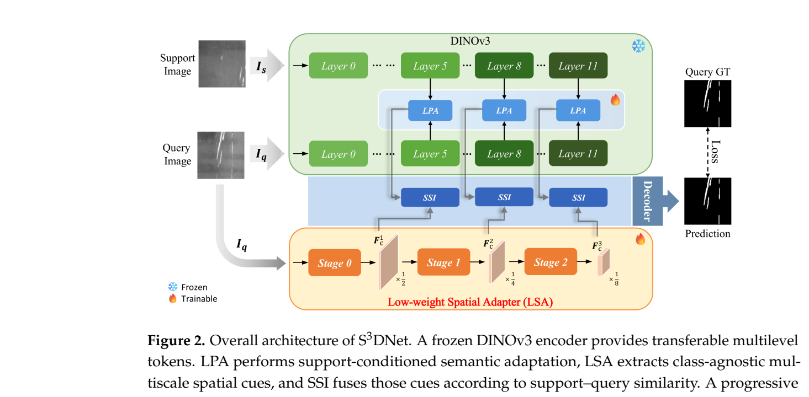

# S³DNet：支持语义怎样选择局部细节，以及它与你方案的直接重合

深化修订：2026年11月16日。本文依据本地26页论文。它是精度工作最需要理解的直接近邻之一；下文把原机制、教学解释与PCB候选问题分开。

入口：[原PDF](07-S3DNet-Few-Shot-Strip-Steel-Segmentation-2026.pdf)｜[中文译文](full_translation_zh.md)｜[研究主文档](../../../research/thesis-research-and-study-guide-zh.md)｜[总报告](../research-plan-and-paper-reading-report-zh.md)

## 一、作者把一个分割问题拆成了两个问题

少样本带钢分割既要知道“本次支持样本指定哪种缺陷”，又要找准“查询图中的边界在哪里”。强语义特征有助于前者，但粗图像块可能不利于细边界；浅层局部卷积能响应细纹理，却也容易放大正常轧制纹理。S³DNet不是简单把二者相加，而是让支持条件语义筛选空间细节。

这正是你需要警惕重复已有机制的地方：冻结DINOv3、局部RGB空间支路、适配和融合都已出现。你的课题可以借鉴组件并做有证据的PCB应用研究，但不能把这一组合写成研究空白。应进一步说明当前PCB具体错误、处理必要性、相对于简单方案的收益和失败条件。

## 二、先讲清任务：支持图不是配对正常板

一个任务给定支持集$\mathcal S=\{(I_s^{(k)},Y_s^{(k)})\}_{k=1}^{K}$与查询图$I_q$，模型预测查询掩码。支持图包含本次要识别的缺陷，支持mask标出其前景；训练与测试缺陷类别不相交，属于情景式少样本分割。

支持mask不是待测图的真值，也不是正常参考。它用于说明“现在要找什么”。你当前PCB1固定二类高样本监督，没有这类随任务变化的支持输入。若移除支持机制，模型条件已经改变，不能称为原方法原样复现。

原文完全冻结DINOv3，包括图像块嵌入、Transformer块和归一化参数，训练语义投影、适配器、空间分支、交互和解码器。冻结骨干不意味着整个系统无训练；它仍依赖训练任务及查询监督。

## 三、原图讲解：四个阶段分别提供什么信息

来源：原论文图2，PDF第8页；裁剪信息见[来源记录](reading-figures/sources.json)。

上方支持图与查询图经过同一冻结编码器，得到共享空间的多层词元。中间LPA从支持前景提取语义方向，更新查询表示。下方橙色LSA直接处理查询RGB，形成细、中、粗空间特征。SSI用支持—查询相似性控制这些局部线索，最后逐级解码为查询mask。

读图要区分三种箭头：编码器内部提供已有表示，支持路线提供当前任务条件，查询局部路线提供细节。支持mask并没有在每个查询位置直接给答案；它通过原型和相似性产生选择偏好。图中的查询GT只在训练监督端，不应在推理中访问。

原文取第5、8、11块的中间表示并投影对齐。标准柱状ViT各层词元网格通常相同，这里的“多层级”首先是不同深度表示，后续才重塑与插值到不同空间尺度；不能直接等同SegFormer原生多尺度金字塔。

## 四、LPA：把支持前景压成一个语义方向

原文公式（2）对支持特征做掩码平均：

$$p_l^{(k)}=\frac{\sum_t S_{l,t}^{(k)}m_{l,t}^{(k)}}{\sum_t m_{l,t}^{(k)}+\epsilon},\qquad \bar p_l=\frac1K\sum_k p_l^{(k)}.$$

$S$是支持词元，$m$是调整到网格的支持mask，$p$是前景原型。直觉是忽略背景，把支持缺陷压成一个平均表示，再在多支持样本间平均。这样减少背景污染，但也可能把外观多峰、形状各异的缺陷压缩得过于简单；极小支持mask如何落到词元网格也值得核对。

低秩更新为原文公式（3）（4）：

$$\Delta q_l=\alpha_l B_l\sigma(A_l\bar p_l),\qquad\widetilde Q_{l,t}=Q_{l,t}+\Delta q_l.$$

$A$先压到较小通道空间，$B$再展开，$\sigma$为非线性，$\alpha$控制幅度。同一支持派生更新加到该层所有查询位置，因此主要改变通道语义偏好，而非直接绘制空间mask。零初始化的展开投影使初始更新为零，从冻结表征起步。

教学类比是给同一块板换一副“本次寻找划痕”的眼镜，而不是把支持mask复制到查询图。它与对整个数据集学一个固定适配器不同，更新随本次支持内容改变。你的固定二类任务若借鉴低秩结构，也需要重新解释这种条件从何而来。

## 五、LSA：为什么保留原RGB路径，又为什么不能直接相信它

第3.3节使用三个浅卷积阶段，每阶段3×3、步长2，接归一化与激活，产生输入1/2、1/4、1/8分辨率的特征，通道16、32、64。它不是重新训练另一个大分类骨干，而是显式保留局部边缘、短程纹理和细结构。

原图在进入较粗词元表示前仍有细节，这给局部分支提供互补来源。但如果输入整体缩放已经抹掉缺陷，两路都可能失去信号。因此，局部支路与输入尺度必须分别分析，不能说“有RGB分支就恢复了原始细节”。

正常纹理也会产生强边缘。仅拼接所有局部特征，可能帮助细缺陷，也可能增加误报。原文设置下一步语义筛选，正是为了解决“有细节不等于有正确细节”。

## 六、SSI：把语义相似变成空间门控

原文公式（6）重新计算对齐后的支持原型$P_l$，再按式（7）（8）得到：

$$A_l(u,v)=\mathrm{sigmoid}\left(\tau_l\frac{\langle F_q^l(u,v),P_l\rangle}{\|F_q^l(u,v)\|\|P_l\|+\epsilon}\right),\qquad\widetilde F_c^l=F_c^l\odot A_l.$$

$F_q$是适配后的查询语义，$F_c$是局部空间特征，$A$是每个位置的门控强度。与支持前景相似的位置更允许局部信息通过，背景相关性弱的位置被衰减，然后再与语义特征拼接。

**教学算例，非实验：**若$\tau=4$，两个位置相似度为0.8与-0.5，则门控约为0.961与0.119。同样强度的局部边缘会被不同程度保留。若语义本身把真实缺陷看错，门控也可能压掉应保留的细节；它不是不出错的裁判。

这就是你应重点分析的机制：不是“语义负责大目标，卷积负责小目标”这种绝对分工，而是语义提供选择条件、局部提供候选细节。两者出错的方式与交互都值得诊断。

## 七、解码与监督怎样把各阶段连起来

第3.5节从粗到细上采样，与更细尺度融合，再输出双通道logits。每个融合尺度还有辅助分割头，原文公式（9）为最终交叉熵加辅助项。训练查询mask同时指导不同层级，不是只对最后一个高分辨率输出监督。

推理时针对任务计算支持原型，再用于该任务的查询。开销因此不只包含查询骨干，也包含支持处理、局部支路与解码。将论文延迟换成你的单图时间，需要明确支持能否缓存与输入几何；当前阅读并不要求马上复现完整少样本训练。

## 八、消融告诉了你什么

第4.4节表4在冻结DINOv3-Small、同三折协议下比较组件。1-shot平均mIoU：基本模型62.8，仅LPA63.3，仅LSA64.6，二者组合66.4，完整SSI方案68.1。它支持在该钢带设定中局部补充与条件交互有价值；不证明PCB必有同样瓶颈。

表5进一步比较门控和拼接：完整68.1，仅门控66.8，仅拼接66.6。这个对照比只删掉整个支路更能回答融合方式的作用。阅读时还要看每折差异、原始输入尺度、支持抽样与评价指标，不能把各项增益简单相加。

原文另分析提高DINO输入分辨率。放大输入可使缺陷占更多词元位置，但也改变计算成本。因此你的候选局部分支应与更大尺度、普通头增容和简单融合区分，而不是只与一个明显偏弱的头比较。

## 九、怎样联系你的研究，又不重复已有机制

| 原文组成 | 在你课题中的状态 | 真正需要回答的问题 |
| --- | --- | --- |
| 冻结DINO与轻量头 | 独立对照尚未实施 | 固定特征能否支持PCB定位，错误是什么 |
| RGB局部空间支路 | 候选机制 | 是否改善已诊断错误，而非仅增容 |
| 支持条件语义更新 | 当前没有同类输入 | 是否需要这种条件，不能暗中借用测试mask |
| 语义门控融合 | 有既有先例 | 相比简单融合在PCB多解决什么 |

工作一可以聚焦具体PCB适配，并通过同协议比较支撑应用价值。工作二则不能把门控图直接称为可靠解释：门控只是中间计算，仍需明确最终得分如何依赖它。若正常参照来自另一条评分路径，还要分别说明来源与覆盖。

## 十、用问答检验是否真正读懂

**支持mask与正常参照有什么区别？**前者指定本任务目标缺陷，后者描述正常外观；把二者混为一谈会改变任务语义。

**为什么同一向量加到所有查询位置仍可能有用？**它改变通道偏好，位置差异仍保留在原查询特征中，之后相似性门控才形成空间选择。

**能否删掉支持输入就直接叫PCB版S³DNet？**可以研究明确披露的改编，但输入与条件机制已改变，必须说明修改和对照，不能声称原样复现。

**怎样避免把借鉴当成创新？**画出原机制与候选方案逐项对照，再用PCB问题、必要性、同协议收益和边界定位实际贡献。当前先读懂近邻，并不等于最终结构已定。
