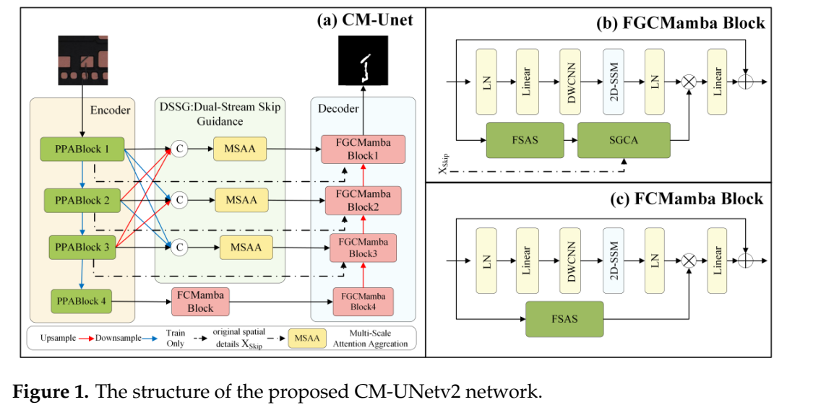

# CM-UNetv2：PCB分割中的语义细化、空间保留与边界恢复

深化修订：2026年11月16日。本文依据本地25页论文讲解。原文事实与PCB1研究推导分开，尤其不把不同数据集的mIoU直接与现有前景IoU排名。

入口：[原PDF](08-CM-UNetv2-PCB-Defect-Segmentation-2025.pdf)｜[中文译文](full_translation_zh.md)｜[研究主文档](../../../research/thesis-research-and-study-guide-zh.md)｜[总报告](../research-plan-and-paper-reading-report-zh.md)

## 一、研究问题不是简单“缺陷很小，所以加注意力”

PCB缺陷可能细长、不规则，与复杂正常纹理相邻。编码器为了获得上下文反复聚合特征，可能弱化位置细节；直接保留低层纹理又可能带入背景噪声。论文将这对张力拆为多尺度提取、语义/空间双流、解码阶段的对齐与全局关系处理。

它对你的工作一的直接意义，是提供单图、像素监督PCB研究，而不是证明全部模块都该搬到DINO上。应重点理解“哪个信息被保留、在哪一步融合、哪个实验支持”，再回到PCB1错误判断是否有相同困难。

## 二、原图怎样读

来源：原论文图1，PDF第6页；裁剪信息见[图片记录](reading-figures/sources.json)。图内名称与原文保持一致。

左侧主图是编码与解码流程。PPA块从输入抽取特征，并产生不同走向：一条继续编码，一条经过MSAA进行语义细化，一条以跳跃方式保留空间结构。右侧解码块把语义路径与空间路径重新连接，并加入频域关系计算。

先用手指沿两条跳跃线走：哪条已经进行了较强多尺度语义融合，哪条尽量保留原来的位置敏感特征？若只记“有跳跃连接”，就遗漏了本文主要问题。再看右侧查询、键、值的来源，它们来自不同职责的特征，目的是对齐而不只是把通道堆起来。

图中出现Mamba和频域操作，不表示它们本身已解释缺陷原因。它们改变网络计算，最终可解释性仍需要独立定义对象和验证。你可以把这篇用作精度相关先例，不必因此再开一条Mamba研究路线。

## 三、PPA：同时看不同范围，但不是越多分支越好

第3.1节的PPA组合局部图块、较大范围图块和串行卷积，再通过通道与空间注意力重加权。局部范围可捕捉细边缘，大范围可识别其与板面结构的关系，卷积提供显式邻域处理。它们提取的信息可能互补，也可能冗余，必须由消融判断。

把通道与空间重加权分别理解：通道权重选择哪类响应更重要，例如某类纹理描述；空间权重选择哪些位置更值得保留。原文公式（2）（3）可以概括为$F_c=M_c(F)\odot F$、$F_s=M_s(F_c)\odot F_c$。权重改变特征流，不是给每个像素提供独立人工解释标签。

原文对图块重加权的公式、维度描述存在需要结合图和实现核对的地方。例如式（1）的词元与任务嵌入维度，不宜仅从排版就写出可执行实现。导读保留其思想，不把未核定维度补成确定事实。读论文时允许记录“这里还需查实现”，比编一个看似完整公式更可靠。

## 四、DSSG：为什么要给细节留一条绕行路线

第3.2节认为MSAA融合增强语义，但可能削弱空间细节。因此，同一编码特征一条进入语义细化，一条跳过这一变换直接送解码器。用教学记号可写为：

$$X=\mathrm{MSAA}(F),\qquad X_{skip}=F.$$

$F$是当前编码特征，不是原始RGB；“直接保留”是相对于额外语义细化而言，也不意味着此前下采样没有损失。两路均保留到解码阶段，让网络有机会重新取用位置敏感信息。

**教学例子：**一条细裂纹与邻近正常走线在高层融合后可能变成宽而模糊的响应；跳跃特征可提供较清楚边缘。但若跳跃特征主要是正常纹理，直接融合也可能增加误报。因此需要后续对齐和选择，而不能仅看“多一路就多细节”。

这与S³DNet的双路思想相近又不同：S³DNet有直接RGB浅层空间分支和支持条件门控；本文是编码特征的双流跳跃，不依赖支持缺陷图。把两者都叫“双分支”会掩盖输入、职责与条件差异。

## 五、SGCA与FSAS：空间对齐和频域关系分别是什么

空间引导交叉注意力SGCA以语义流为查询、空间保留流为键和值。它允许语义内容决定去空间流中取哪些信息。查询、键和值是可学习特征投影，不等于人工给出的缺陷、正常和标签三张图。

频域自注意力FSAS则将投影后的查询和键做傅里叶变换，原文式（7）为：

$$A=\mathcal F^{-1}\bigl(\mathcal F(F_q)\cdot\overline{\mathcal F(F_k)}\bigr).$$

$\mathcal F$是频域变换，横线为共轭，逆变换回到空间关系。直觉上，相关运算可利用频域逐点乘法计算较广范围关系，再归一化后调制值特征。它不等同于“高频就是缺陷，低频就是背景”；细裂纹和正常线路都含高频，不能这样赋予物理语义。

第3.3节式（8）再将调制结果投影并残差相加。整个块改变的是信息混合和门控，并不能由公式自动推出更准确或更省资源；复杂度与实际延迟还取决于张量大小、实现与硬件。

## 六、损失与任务：为什么看起来同样是BCE加Dice，也不能直接复制

第3.4节使用二值交叉熵和Dice组合。交叉熵逐位置惩罚错误分类，Dice强调前景重叠，在正负极不平衡时提供不同优化信号。相同名称不意味着实现完全相同：前景/背景怎样平均、正常图怎样处理、平滑项和忽略区域怎样定义都会影响结果。

原文式（10）的求和上下标有排版疑点，译文已保留说明；不能将排版错误照搬成代码。你的基线为交叉熵加正GT图逐图前景Soft Dice，有其明确口径，比较时需要记录差异，而非把两者统一写成“相同损失”。

本文以MeiweiPCB图块与KWSD2评价。后者为遥感水体分割，支持的是一定结构适用性，不是第二种PCB板型证据。MeiweiPCB图块与PCB1整板外观的物体、视野、缺陷和划分条件都不同，尤其要核对图块是否按原图分组划分，防止同源区域泄漏。

## 七、读消融时怎样避免把总成绩当作机制证明

第4.4节表2在MeiweiPCB列出基础CM-UNet的mIoU为0.7932，完整方案0.8224；分别加入PPA、DSSG、FSAS相关模块得到不同变化。它支持组合在作者协议下有效，但你仍需核对mIoU平均方式和类别定义，不能直接与PCB1前景IoU的0.6833相减。

表2中DSSG单独加入的0.8099，相比基础有改善；图8展示细长与杂乱区域的变化。图像案例可以帮助理解“空间保留”的作用，但若要主张某类边界稳定改善，还需独立分组和指标，不能只选最漂亮轮廓。

表4、表5讨论嵌入维度和深度，而表头与正文解释存在需注意的列序疑点。更深未必更好，较大的容量也可能改变优化。借鉴时应把容量控制作为必要对照，不因一个结构名字先进就认定其机制独立贡献成立。

## 八、怎样具体服务你的PCB研究

精度工作可以从三种错误假设入手：语义混淆导致正常结构误报；局部信号未被保留导致漏检；解码和阈值使边界覆盖不足。它们可能并存，但需要训练/验证诊断来区分。对应的候选分别是特征适配、细空间信息、解码或评价流程检查，不应统一用加模块处理。

如果建立DINO简单头后再考虑局部支路，本文可作为“空间与语义分工”的相关依据；但应与简单融合、普通卷积头及同容量方案比较。输入尺度、标注预算、选模和原图恢复必须一致或清楚披露。

解释工作可借此理解：注意力和门控虽然参与模型，但其可视化不自动解释最终评分。若门控之外还存在残差和多个分支，单一热图可能只覆盖部分路径；要对最终输出做解释，应检查这些其他通路。

## 九、理解问答与建议阅读顺序

**空间支路和语义支路真的完全独立吗？**结构上分工不等于统计信息正交；两路来自相关图像和特征，互补程度要靠消融。

**频域操作能直接过滤掉PCB背景吗？**不能，正常结构与缺陷频谱可能重合；它是关系计算方式，不是工艺缺陷规则。

**边界看起来更细，为什么还需指标？**个别案例受选择影响，而且边界变细也可能漏掉真实面积；需结合覆盖、误报及固定评价。

**这篇最该产出什么？**一张“PPA提取什么—DSSG保留什么—SGCA如何取用—FSAS如何混合”的图，再把每项机制对应到一项可否定的PCB错误假设。先读总图与双流，再读消融，最后按必要程度深入频域公式即可。
