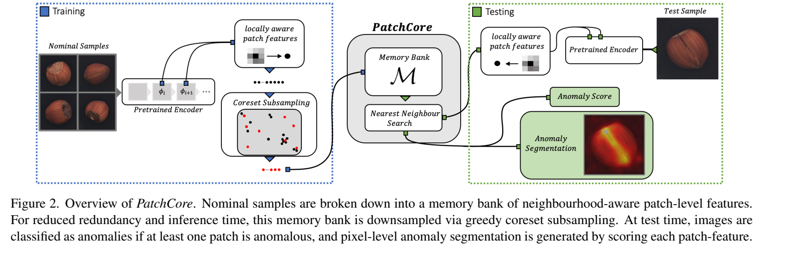

# PatchCore：把“像不像正常”写成可追踪的近邻计算

更新：2026-11-16。依据本地11页CVPR 2022正式论文；未复现实验。下文**论文事实**指原文方法或结果，**教学例子**使用人为数字，**研究推导/建议**不是论文结论。

资料：[原PDF](09-PatchCore-2022.pdf)｜[中文译文](full_translation_zh.md)｜[论文来源](https://doi.org/10.1109/CVPR52688.2022.01392)；回到[研究主文档](../../../research/thesis-research-and-study-guide-zh.md)或[阅读总报告](../research-plan-and-paper-reading-report-zh.md)。

## 1. 作者实际要解决什么

只有正常产品图片，怎样判断新图中是否存在没见过的缺陷？直接训练“正常/缺陷”分类器缺少缺陷样本；要求模型重建正常外观，又可能把异常也重建好。PatchCore选择保存正常区域的特征，新区域找不到相似正常区域时给高分。

“正常区域”不是一个平均向量。PCB里绿色基板、焊盘、引脚各有正常样貌，全部平均会得到不存在的中间状态。记忆库保存多个样本，允许正常分布有多个模式。作者面临两个困难：很深的ImageNet特征可能把细纹理压掉并带入自然物体类别偏好；把所有正常局部都存下来，检索又太慢。因此贡献要连起来理解：**中层局部聚合特征→覆盖正常变化的记忆库→核心集压缩→同一套块距离支持检测与定位**。它不是单独发明“算欧氏距离”。

“Towards Total Recall”表达追求高召回的方向，不意味着任何缺陷都不会漏检。若缺陷在特征空间与正常样本重合，最近距离仍很小；若正常外观没被库覆盖，距离也可能很大。它学到的是相对于所选特征和正常库的偏离，而不是制造规范本身。

## 2. 输入、监督与输出先对齐

| 环节 | 原论文使用的信息 | 容易混淆的地方 |
| --- | --- | --- |
| 外部预训练 | ImageNet预训练CNN，主要使用WideResNet50中间层 | “目标任务无需训练”不等于没有预训练监督 |
| 目标域建库 | 仅正常训练图，无异常mask参与建库 | 有正常数据，不是零样本 |
| 推理输入 | 测试图＋固定正常特征库 | 不要求每张测试图有逐张配对黄金模板 |
| 直接输出 | 特征位置到库中近邻的距离 | 距离不是校准好的缺陷概率 |
| 后续输出 | 上采样平滑的异常图、图像级异常分数 | 阈值后二值mask与连续热图是不同对象 |

原文§4.1在MVTec AD中先缩放再中心裁剪到224×224，训练只见正常图。你的任务是VisA PCB1 high-shot像素mask监督，已经能用异常区域训练SegFormer。因此本文是参照评分基础与可选对照，不能把原始正常样本协议和你的监督分割混为一谈，也不能把论文AUROC与现有IoU直接相减得出提升。

## 3. 顺着原图走完数据流

来源：原论文图2，本地PDF第4页，见[论文来源](https://doi.org/10.1109/CVPR52688.2022.01392)。原页裁剪，详见[资源记录](reading-figures/sources.json)。

先看左边蓝框。Nominal Samples是训练正常图；进入Pretrained Encoder后取空间特征图，而不是一个全局分类向量。向上的弯箭头通向locally aware patch features：在特征图邻域聚合，得到带上下文的向量。向下的箭头通向Coreset Subsampling：红点表示从大量正常向量中留下少量覆盖性较好的代表，它们进入中央Memory Bank。

再看右侧绿框。测试图通过同一个冻结编码器、同样的局部聚合，得到测试块向量；中央Nearest Neighbour Search把每个测试块和正常库比较。结果分两路：一路聚合成Anomaly Score，回答整图是否异常；另一路按网格排回Anomaly Segmentation，回答异常在哪里。**定位图不是另训一个分割网络，也不是给整图分数做Grad-CAM。**两路共有块距离，但图像级重加权和像素级插值各有处理。

图里没有证明“库中对应块一定是同一种结构”。全局近邻允许从别处借正常外观，有利于容忍平移，也可能让缺件位置匹配到另一处相似纹理。你的解释研究应把这两面都记录下来。

## 4. 三个核心计算怎样理解

### 4.1 中层局部特征：保留位置，再增加上下文

设冻结骨干第j层特征为 $\phi_j(x)\in\mathbb R^{C_j\times H_j\times W_j}$。位置 $(h,w)$ 的 $C_j$ 维向量本身已有CNN感受野。论文式(1)—(3)再定义邻域 $\mathcal N_p(h,w)$，聚合邻域里的向量，默认步幅1，因而保留原特征网格。默认聚合为平均池化，不是把整张图平均成一个向量。

作者组合相邻两个中间层的信息：低分辨率层先双线性插值到较高分辨率层，再组合对应位置特征，同时保留一定细节和上下文。避免一味向更深层走，是因为深层更偏ImageNet类别、分辨率更低。这里的“局部”是特征局部聚合，不等于只从孤立RGB小裁剪提取信息。

**教学例子：**一个通道连续三个位置为2、4、6，中心做3点平均得到4。若缺陷把中心4改为10，聚合变为6，信号还在但被摊薄。聚合能抑制单位置噪声，也可能削弱极小缺陷，不能说邻域越大越好。工作一应区分输入缩放损失、特征步长损失与聚合平滑损失；三者不是同一瓶颈。

### 4.2 核心集：保覆盖，不是只保数量最多的模式

所有正常图的块向量合并为 $\mathcal M$。式(5)选择小集合 $\mathcal M_C\subset\mathcal M$，让最难被代表的正常点离核心集也尽量近：

$$\min_{\mathcal M_C\subset\mathcal M}\max_{m\in\mathcal M}\min_{c\in\mathcal M_C}\|m-c\|_2.$$

从内向外读：先找每个正常点最近的代表，再找覆盖最差的正常点，最后选择代表集以缩小最坏距离。精确求解困难，算法1用贪心近似：不断加入“到当前核心集最近距离仍最大”的点；随机投影降低选点维度与成本。用于选择的低维投影，不应误认为最终评分必然只在该低维空间进行。

**教学例子：**1000个基板点聚在0附近，10个焊盘点聚在10附近，预算只留两个代表。随机抽样可能都抽到基板；覆盖型选择更有机会给两个簇各留一个。它不是认为焊盘更重要，而是避免数量少的正常模式被丢失。另一方面，污染的极端离群样本也可能被优先保留，建库质量仍重要。

压缩比例是保留比例。PatchCore-1%表示保留原库1%，不是删掉1%。减少向量数降低存储和距离计算，但不保证每种PCB结构仍有足够正常变化。核心集与随机采样必须在相同库容量、特征与数据下比较，不能让核心集多存十倍向量再宣布选点更好。

### 4.3 块距离、整图分数与像素图

测试位置u的分数可写为：

$$d_u=\min_{m\in\mathcal M_C}\|z_u-m\|_2,\qquad s^*=\max_ud_u.$$

$z_u$ 是测试向量，$m$ 是库向量；先用最小值回答“最像哪个正常块”，再用最大值回答“整图最不像正常的是哪里”。论文式(7)在最大块距离上再加与其正常近邻支持有关的重加权，因此讲原版时不能只说最终分数永远等于最大距离。

像素图将各 $d_u$ 排回空间网格，经双线性上采样、Gaussian平滑生成；§3.3设置 $\sigma=4$。新增细像素来自插值，不是新增观测。不能认为粗网格因此恢复了真实缺陷边界。若mask平滑地偏大，可能与插值、平滑和阈值有关，不应全部归因于骨干。

**教学例子：**四块的最近距离为0.2、0.3、0.4、1.5，最后一块是原始最大块。插值后周围也会有高分。删掉它实际使用的近邻，最小距离可能增大；增加更贴近它的正常向量，距离可能减小。这可核验检索计算，却不能证明那块像素就是导致真实制造缺陷的原因。

## 5. 实验支持什么，又不能支持什么

表1的MVTec AD图像AUROC：PatchCore-25%、-10%、-1%分别为99.1、99.0、99.0。摘要“最高99.6”对应另外的性能设置，不能当作表1所有默认配置的结果。表2给像素AUROC，分别98.1、98.1、98.0。这支持在该基准上大幅压库仍保留较强性能；不支持任何数据压到1%都不受损，也不代表IoU接近98%。

§4.4.1及图4考察特征深度与局部感知范围，支持中层局部特征的选择。§4.4.2及图5比较核心集、随机压缩和降低分辨率等策略：关键是保留正常支持集覆盖，而不只是减少向量。表4给出计算代价与性能取舍。应同时观察存储、建库和推理；无梯度训练仅消除其中一种成本。

§4.4.3及图6考察减少正常训练样本，支持一定样本效率；不是用你现有异常mask做监督预算曲线。表3的其他数据集结果也不是PCB跨板型迁移。论文主要验证检测与定位效用，没有给出参照匹配正确率、人评可信度或输入因果忠实性证明。**检索可记录是解释研究的便利条件，解释已经可靠仍是待证结论。**

还应区分AUROC与工作点。AUROC高说明正常、异常排序较好；选一个阈值后，正常图误报可能仍不可接受。论文表1所述F1最优阈值错分数是一种回顾性分析，不等于你可以在test上选阈值再称部署性能。PCB开发的阈值和后处理应用val选择，原test已被观察的背景照实保留。

## 6. 两项研究怎样具体借鉴

工作一的目标是精度。正常焊盘误报，可能是库漏覆盖、特征被光照影响、核心集丢掉少数模式；缺陷漏检，可能是特征不敏感，也可能全局近邻在另一结构找到“合法替代”。两类错误需要不同证据，不能看到漏检就默认加局部分支。候选比较可固定特征、分辨率、正常库预算，看原库/核心集、全局/位置邻域检索怎样改变错误；这是研究建议，尚未选定实施方案。

若使用像素mask学习适配层，方法已超出原版正常样本PatchCore。应明确哪些参数用异常监督、哪些正常图参与建库，与同骨干简单分割头、原SegFormer作同协议比较。输入分辨率也需单独控制，因为它本身可能改善小缺陷；存储多一倍参照带来的改善，也不能全算成适配层贡献。

工作二可把一次预测写成证据链：测试图坐标→实际向量→实际候选库→最近参照及来源坐标→距离→上采样/聚合→最终输出。保留来源索引增加审计能力，本身不改变预测，不能包装成新定位算法。若使用DINO，token包含全局上下文；来源裁剪只说明向量从何处提取，不等于那个裁剪是唯一像素因果依据。

解释评价分别看忠实性、匹配、稳定性、覆盖率与任务代价。忠实性核对展示近邻是否真参与分数；匹配核对是否同类PCB结构；稳定性看轻微成像变化下依据是否剧变；覆盖率看解释了多少最终路径；代价记录IoU、召回、正常误报、时间。参照更可靠而IoU不升也可能支持工作二；只覆盖少数漂亮样例或严重损害检测则须披露。

## 7. 已填写的对照例子与问答

| 情形（研究假设） | 容易下的结论 | 更完整的判读 |
| --- | --- | --- |
| 正常焊盘高分，近邻来自线路 | 模型不会识别焊盘 | 先核对同结构焊盘是否入库、是否被压缩掉、预处理是否一致；正常覆盖不足也是原因 |
| 缺件低分，近邻来自另一处基板 | 低分证明正常 | 全局外观匹配可能忽略“这里应有元件”；位置限制可能帮助，也可能因错位误报 |
| 严格递增映射后热图好看 | 新评分增加定位能力 | 同一评分单元、没有其他学习/聚合/后处理变化时排序不变，阈值重参数化不增加可达mask |

**问：最近块是真实正常证据，为什么还需干预？**答：它确实参与距离，但可能只是特征碰巧接近。先核对向量路径，再做参照替换/移除及输入干预。前者检验评分实现，后者检验像素证据。改输入区域后需重算完整图特征，不能只更新一个DINO token便称输入干预。

**问：位置约束必然更可解释吗？**答：它可能减少错配；PCB未配准或结构重复时，坐标近也会错配。可解释性要靠匹配与忠实性实测。DINOSaur已有空间邻域检索，后续贡献还须说明额外解决的PCB问题，不能把加坐标作为未有先例。

**问：怎样判断读懂了？**答：能从一张正常图讲到最终异常图：冻结CNN提中层空间特征，局部聚合并组合层级，核心集保覆盖，测试块找实际近邻，距离排成图，再上采样平滑；整图分数另有最大值与重加权。原方法提供正常偏离检测和可审计参照，不直接给制造原因，也未自动证明像素解释可靠。
