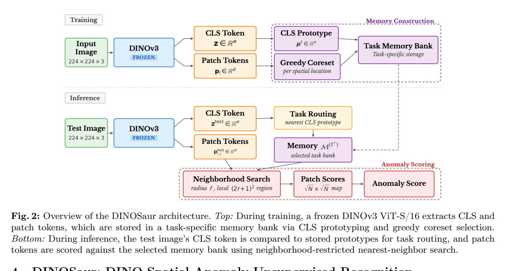

# DINOSaur：用空间正常库回答“这个位置应该是什么”

更新：2026-11-16。依据本地20页arXiv:2605.24251v2（2026-06-29）。**论文事实**、**教学例子**和**研究建议**分别标明；没有执行复现，也不据阅读选择你的新模块。

资料：[原PDF](10-DINOSaur-Continual-Anomaly-Detection-2026.pdf)｜[中文译文](full_translation_zh.md)｜[作者版本](https://arxiv.org/abs/2605.24251v2)；回到[研究主文档](../../../research/thesis-research-and-study-guide-zh.md)或[阅读总报告](../research-plan-and-paper-reading-report-zh.md)。

## 1. 先把两个问题分开

论文首先是一篇持续异常检测基准研究：生产中正常外观会变化，模型学习新条件后是否忘记旧条件？作者认为此前工作常把瓶子换成电缆当作任务变化，且缺少统一比较、逻辑异常及真实边缘设备代价评估。因此提出离散任务、连续漂移和边缘测试的组合基准。DINOSaur是这一分析之后给出的简单方法，不应把整篇只读成“DINO加近邻”。

方法直觉是：冻结特征提取器，旧向量的意义就不随新训练漂移；每个任务各存一个正常库，学习新任务时不改旧库；库内部保留位置，在邻域内寻找正常参照。这样既避免全局近邻把“缺了元件的位置”匹配到别处正常基板，也容许少量位置变化。它保留的是坐标附近出现过的外观，并没有内置“焊盘、引脚”等结构语义。

你的研究是PCB high-shot监督分割和可解释性，当前没有持续学习任务。最直接需要掌握的是空间建库、邻域欧氏近邻和评分路径；持续任务路由是理解原文的必要部分，但不因此成为你的必做模块。**本文已有像素定位：v2 §5.3与表3明确报告像素AUROC。**不能将它写成仅做整图，或把“补像素热图”当作你尚无人做的改进。

## 2. 输入、监督、术语各指什么

| 名称 | 论文里的含义 | 对你的任务的差异 |
| --- | --- | --- |
| task | 顺序到来的产品类别，或同类产品不同漂移强度 | PCB1单一静态任务不必做task routing |
| frozen backbone | DINOv3 ViT-S/16固定参数提取特征 | 你的DINO对照尚未实施，不是已取得结果 |
| CLS prototype | 当前任务所有正常图CLS的均值 | 它负责选任务，不直接给每个像素正常参照 |
| spatial coreset | 每个坐标独立保存代表性正常token | 与PatchCore全局混合压库不同 |
| neighborhood radius r | 测试位置可搜索的空间半径 | 位置约束依赖配准，不能等同结构约束 |
| forgetting | 学新任务后旧任务性能下降 | 和静态模型泛化到新板型不是一回事 |

训练/适应阶段只有正常图，无异常图、缺陷类别或mask来优化模型；“training-free”意味着无目标域梯度更新，但仍有特征提取、核心集选择及存储。测试输入一张图，自动选择一个任务库，产生每块距离、像素异常图和整图分数。其监督预算和你的像素mask监督明显不同，原文分数只在本协议内有效。

## 3. 原图怎样读：两条特征路在推理时相遇

来源：原文图2，本地PDF第6页，[v2来源](https://arxiv.org/abs/2605.24251v2)，[裁剪记录](reading-figures/sources.json)。

上半图是建库。Input Image进入冻结DINOv3，输出分两路：CLS Token进入CLS Prototype计算任务代表；Patch Tokens进入Greedy Coreset，而且是**每个空间位置各自选择**，随后存进Task Memory Bank。虚线框Memory Construction同时包括这两类信息。

下半图是推理。Test Image只过同一个DINO一次。CLS走Task Routing，与已存原型比较，输出任务编号；这根箭头决定加载哪一个Memory。Patch Tokens走Neighborhood Search，和已选库中坐标邻域的向量比较。Patch Scores是网格距离，之后可形成像素图；图中右端Anomaly Score是取最大值的整图输出。右端没有画出一个有监督分割解码器，不能因此否认正文的像素评价。

这里有两个可分别失败的选择：路由选错任务时，即使邻域搜索正确也在错误库里找；路由正确但图像错位时，局部窗口可能排除真正匹配的正常块。对于你的单类别静态PCB实验，第一种可能被协议消去，第二种仍存在。因此不能把全篇收益直接归因于空间限制。

## 4. 逐步算一次建库和推理

### 4.1 从图到14×14网格

论文§4.2用224×224图和16×16 patch，得到14×14=196个空间token；每个token有e维。设第k张正常图位置(i,j)的向量为 $p^{(k)}_{i,j}$。对固定位置收集：

$$
P_{i,j}=\{p^{(k)}_{i,j}:k=1,\ldots,D\}.
$$

D是当前任务正常图数，不是向量维度。§4.3在每个位置独立做贪心核心集，保留 $M=\max(20,\lfloor D\rho\rfloor)$ 个代表，形成 $C_{i,j}$。全库形状可理解为14×14×M×e：前两维是位置，第三维是该位置的正常变化，最后一维是表征。

**教学例子：**100张正常图、保留比率10%，公式给M=20而非10，因有最小20项规则。这说明小任务的实际压缩率未必等于名义10%。当正常样本少于20时，如何保证代表数合法需要回查具体实现/边界处理，不能根据公式擅自声称原文解决了该边界。本文不修改该公式。

### 4.2 邻域限制改变的是候选集合

位置(i,j)可用的库为：

$$
\mathcal N^r_{i,j}=\bigcup_{i'\in[i-r,i+r],\;j'\in[j-r,j+r]}C_{i',j'},\quad s_{i,j}=\min_{c\in\mathcal N^r_{i,j}}\|p^{test}_{i,j}-c\|_2.
$$

式(7)—(8)使用欧氏距离。r=0只看同坐标，r=3允许7×7邻域，边缘位置窗口会截断到合法网格。整图分数按式(9)取 $S(x)=\max_{i,j}s_{i,j}$。若14×14全局库每位置有M项，每个测试token全局需比较196M项；r=3内部位置最多49M项，约四分之一。这个四倍是候选数数量级，不是整机必然提速四倍，DINO前向和其他步骤仍有成本。

**教学例子：**测试点q到远处基板向量距离0.1，到附近正确焊盘向量0.6。全局最小距离为0.1；窗口排除远处基板后为0.6，可能更容易报警。这既可减少“借别处正常外观”的漏检，也可让正常错位焊盘高分。限制候选只会使同一q的最近距离不减，但正常和异常都可能上升，因此AUROC未必提升。

r控制容忍度，不是“语义精度旋钮”。小r要求更稳定几何，大r更宽容却可重新允许结构错配。PCB存在重复焊盘、相邻元件时，离得近未必结构同类；照明变化也可能让位置正确的向量很远。解释中必须同时报告几何条件和参照内容。

### 4.3 CLS路由与零遗忘的条件

对任务t，计算正常图CLS均值 $\mu_t$。测试CLS为z，式(10)选择 $t^*=\arg\min_t\|z-\mu_t\|_2$，然后使用该任务库。它不要求测试时提供人工任务标签，但并不是没有任务边界的完全在线流；新任务到来时的建库仍按任务组织。

冻结骨干、不改旧任务库能保证旧任务对应的表示和评分器不被训练覆盖。然而新加入任务原型可能改变最近路由选择，未必对所有旧测试图保持同一任务；分数阈值、存储淘汰也会影响部署表现。作者的“zero forgetting by construction”应连同固定库、路由及所测协议理解，不宜脱离条件当作永远无遗忘定理。表2连续漂移中也有小的非零FM。

## 5. 对照、定位结果和代价怎样读

§5.2表1中，DINOSaur的MVTec-AD图像AUROC为0.968，PatchCore加回放为0.925；LOCO为0.768与0.743。LOCO仍有显著空间，不能说已解决逻辑异常。表2连续漂移：颜色0.928、模糊0.891，几何0.519，所有方法在几何漂移下都接近机会水平。它支持冻结表示加库在这些合成外观漂移上有效，也明确暴露几何条件；不代表已覆盖真实长期产线漂移。

§5.3表3必须单独读：DINOSaur在MVTec-AD、LOCO、MTD颜色、模糊的像素AUROC分别0.947、0.810、0.875、0.857。几何像素结果未报，因为仿射填充会主导汇总指标；DNE没有空间图，所以该列为缺失。作者报告图像与像素结果相关r=0.945，这只是受测协议的经验相关。最大块得分相近并不能数学保证边界质量相近，更不能推出像素AUROC可替代你的原图IoU、Dice和正常误报。

表4的Jetson Orin Nano推理均值为91.6ms，约10.9FPS，Raspberry Pi 5为630.6ms；每任务存储7.1MB是所测MVTec配置。边缘效率是真机证据，但不能搬成你本机速度。原文为均值±标准差、30次单图运行；预处理、库加载和长期存储规模还要按实现核对。

表5同时改变核心集比率与半径：10%、r=3的五协议平均AUROC为0.801；20%、r=4为0.822，代价更大。它支持存在性能/资源取舍；并没有在完全相同DINOv3、建库预算、任务路由下给出一个“全局搜索”的独立消融，表中r最大4也不是覆盖14×14整图。因此不能把与PatchCore的全部差距说成位置约束的纯收益，骨干和库组织等因素也不同。

原文§5.1概括“所有方法训练300epochs”，DINOSaur却无权重训练；读作梯度训练方法的公共预算，而不是声称DINOSaur进行了300轮反传。论文对无监督协议下其他方法的失败有较强评论，其结论限于作者重配后的协议，不等于这些方法在原始监督/合成异常条件下都无效。

## 6. 与工作一：精度研究中的直接先例

如果候选方案是“DINO冻结特征＋正常库＋位置邻域＋欧氏距离＋像素异常图”，DINOSaur已覆盖主要机制。你的像素监督和PCB应用是不同条件，但本身不建立方法创新。工作一应先查明PCB错误：正常结构错配是否集中、板间对齐是否足够、缺陷是否在token尺度下可见，再决定是否值得比较候选限制。

同条件比较应尽量固定骨干、输入尺度、训练正常图、库容量与评分后处理，仅改变候选集合。这样若正常误报下降，可以联系具体错配消除；若IoU变化来自更高分辨率或更多正常向量，就不能归给空间约束。若另训监督适配层，应加同监督简单头及普通增容对照。上述都是研究设计建议，不是已授权新增训练清单或确定技术路线。

可能失败的假设包括：VisA板姿态不稳定让正确对应超出窗口；位置正确但结构因布局变化不再对应；全局上下文导致缺陷使许多token同时变化；缺陷本身的外观在正常库中常见，局部距离无法表达“这里缺少一个器件”。这些情况应靠样本审计区分，不能连续加模块掩盖原因。

## 7. 与工作二：从“有参照”到“依据可核验”

可借鉴的基础是保存来源图与坐标、实际候选窗口、实际最近向量和原始距离。研究增量若存在，应落在PCB参照匹配/可靠性和评价，而不是补回原文已有的像素定位。空间窗口只是几何规则，不等于已给出人可理解的结构语义。

**教学例子：**同位置附近有两个等距近邻A、B，A是焊盘、B是基板。热图不变，但展示A或B会给用户不同印象。应规定并记录tie-breaking或多个近邻的不确定性，而不是事后挑“更合理”的参照图。忠实性检查展示来源是否真被算法使用；匹配检查它是否正常、对应结构是否合适；稳定性检查输入轻扰动和库抽样变化后参照/分数如何变化。

对DINO做输入遮挡时必须重新计算整图特征，因为token含全局上下文；用原向量局部替换只能称特征干预。若只解释最近距离却最终还有分割头、融合或后处理，应标明覆盖范围。解释可靠性不要求IoU必升，但应报告检测代价及覆盖样本比例，避免仅展示成功个案。

## 8. 已填写的答辩式问答

**问：这篇只做整图，我能加像素定位吗？**答：不能这样陈述。本地v2的§5.3表3已经评价像素AUROC，邻域距离本身构成空间图；像素mask监督、边界质量及解释验证可另讨论，但不是首次增加定位。

**问：我的位置近邻与它有什么区别？**答：目前若只有同样的候选窗口，机制接近。需要证明PCB具体困难、相同条件下的差异及额外解释价值；不能用换骨干、换数据或监督变化代替机制比较。

**问：不训练为何仍可能错？**答：正常库不全、冻结特征不敏感、路由错误、几何错位都可造成错。冻结只避免参数遗忘，不保证识别能力；表2几何漂移便是重要反例。

**问：怎样正确总结？**答：DINOSaur用冻结DINOv3和逐位置正常核心集，通过CLS选任务、局部邻域欧氏近邻评分，同时支持检测和定位；持续与边缘基准是主要背景。它为你的参照候选提供直接先例和几何失败边界，尚未替你解决监督PCB分割或证明来源裁剪是像素因果解释。
