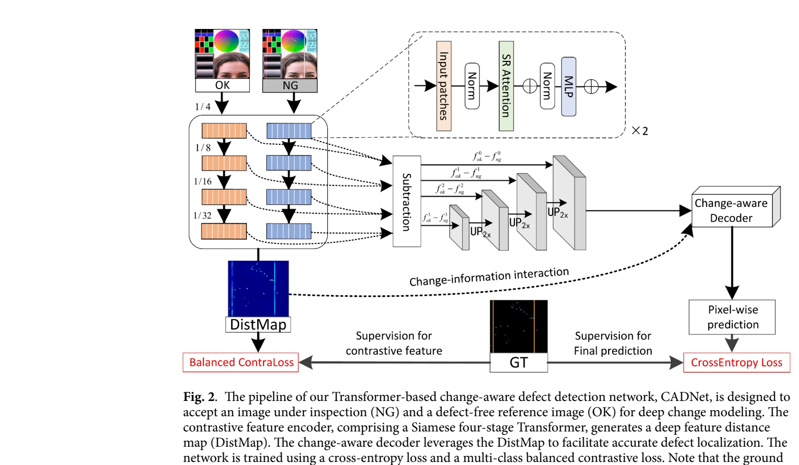

# CADNet：把缺陷分割写成“待测图与正常参考的变化检测”

更新：2026-11-16。依据本地Scientific Reports 2025论文，DOI:10.1038/s41598-025-94733-4。下文区分**论文事实**、**教学例子**和**研究建议**；没有重训模型。

资料：[原PDF](11-CADNet-Reference-Defect-Segmentation-2025.pdf)｜[中文译文](full_translation_zh.md)｜[正式来源](https://doi.org/10.1038/s41598-025-94733-4)；回到[研究主文档](../../../research/thesis-research-and-study-guide-zh.md)或[阅读总报告](../research-plan-and-paper-reading-report-zh.md)。

## 1. 为什么作者要引入第二张图

只看一张复杂PCB图，缺陷与正常细线、焊盘、文字可能很像。“一条细线”在有些位置是正常线路，在另一些位置是划痕。传统分割用异常mask学习图像到类别的映射，需要同时学背景、缺陷形态及两者关系；如果训练缺陷少，模型可能只记住几种外观。CADNet的直觉是：拿一张相应的正常图作比较，缺陷是正常内容中的变化，这样不必完全依靠缺陷长什么样。

这里最重要的词是**相应**。如果参考本来就不同，模型会把正常设计差异也当变化；如果整体错位，边缘会到处不同；如果参考也有同样的缺陷，差异可能消失。因此不是任取一张“看起来正常”的图就满足方法假设。原文结论明确承认对大几何错位敏感。

本文给你的价值有两层：工作一可理解监督条件下怎样学习“差异特征”；工作二可理解参考确实进入网络计算与参考解释已可靠之间的区别。它不是PatchCore式在无配对库中为每个块找近邻，也不是无需正常参考的单图SegFormer。**VisA没有为每张异常图提供黄金正常模板，这一输入差异是能否迁移的首要问题。**

## 2. 把任务定义读准确

论文输入是NG待测图 $x_{ng}$ 和OK无缺陷参考 $\hat x_{ok}$，输出像素类别图。训练使用像素级分割GT；多类别缺陷标签还用于类别平衡的对比损失。参考图既在训练时使用，也在推理时使用，不能只训练时给模板、测试时拿掉却声称复现原版。

原文“Problem definition”式(1)写 $x_{ng}=\sigma(x_{ok}\boxplus x_{defect})$。$\boxplus$ 表示缺陷叠加、破坏、遮盖等形成方式，$\sigma$ 表示批次、照明、老化、成像的整体变化；这是作者的建模假设，不是说真实PCB都能精确线性分解。式(3)中的深层差分 $\boxminus$ 是待学习的运算，用正常参考减少背景和成像扰动，并不是直接做RGB逐像素减法。

数据包括合成SynLCD、PKU-Market-PCB以及重组为监督学习的MVTec AD。实验“Implementation details”说明SynLCD与PCB各有10张正常基础图/参考，MVTec每类选择一张正常图作为参考。论文把MVTec全部图及GT重新随机划分70%训练、30%测试，这和标准仅正常训练的异常检测协议不同，也不同于你固定的VisA high-shot划分。跨论文数字不能脱离输入与划分比较。

## 3. 原图2里每根主要箭头是什么

来源：原文图2，本地PDF第5页，[正式论文](https://doi.org/10.1038/s41598-025-94733-4)，[裁剪记录](reading-figures/sources.json)。

从左上OK/NG开始，两路分别进入四阶段Transformer。橙色和蓝色表示两张图的特征，1/4、1/8、1/16、1/32是不同空间尺度；两路**共享参数**，并不是各训一个完全无关骨干。右上虚线框把一个编码块展开为Input patches、归一化、SR Attention、MLP及残差。

四个尺度向右进入Subtraction，比较对应层特征，随后逐级上采样与融合；这些不是最近邻搜索箭头，它们依赖对应位置。左下DistMap来自两路多层特征的距离。向下箭头连Balanced ContraLoss，表示GT指导距离空间：正常对应要靠近，缺陷对应要分开。DistMap同时通过虚线长箭头送到Change-aware Decoder，为解码提供变化提示。

最右解码器输出Pixel-wise prediction，向下接CrossEntropyLoss，由GT监督最终类别。由此可见，距离图受中间监督，最终输出又有独立的监督目标；最终分割不是简单把DistMap做阈值。讲解释时若只展示DistMap，应说它是参与预测的中间变化证据，不能说已解释所有解码决策。

## 4. 编码器为何共享，距离空间为何要训练

共享参数使OK和NG被同一函数映射，降低“不同网络任意坐标系”导致无法直接比较的风险。四阶段编码器用空间/序列缩减注意力，压缩K/V序列以降低注意力成本；相比单图网络，双图前向仍有额外代价。原文式(4)的 $d_k=N$ 记号与常见注意力使用键维度缩放的写法不同，学习时应结合其公式与实现，不把这条记号直接当通用Transformer定义。

将各尺度先对齐到较高分辨率，再拼接，式(7)定义：

$$D(i,j)=\|f_{ng}(i,j)-f_{ok}(i,j)\|_2.$$

这里 $f_{ng},f_{ok}$ 是多层组合特征，D即DistMap。欧氏距离衡量的是学习后的向量差，不是两张RGB图的颜色差。若训练得当，照明引起的变化可能被压低，缺陷引起的变化被放大；若没有相应监督与数据支持，距离也会被正常扰动主导。

**教学例子：**正常参考焊盘向量为(1,1)，待测正常焊盘因亮度变化成为(1.1,1.1)，距离约0.14；若缺损使其为(2,1)，距离1。这个分离是理想情形。若正常错位后比较到绿色基板(0,0)，距离约1.41，反而比缺损大。因此“距离大”需要对应关系作为前提，不能由数值本身确定缺陷。

普通对比损失式(8)对正常点鼓励距离向较小阈值靠近，对变化点用间隔项 $\max(0,\tau_{ng}-D)$ 推远。原文设置 $\tau_{ok}=0.3,\tau_{ng}=2.2$。这些阈值只对该学习空间与设置有意义，不应搬到DINO余弦距离上。原文正常项写法不是常见带平方/截断的教科书形式，本文保留其意图说明，不擅自补成另一种损失。

## 5. “balanced”平衡的是哪种不均衡

LCD里的长线缺陷面积大，异常点面积小。如果对每个缺陷像素直接求和，长线对距离空间训练的影响会大得多。原文式(9)—(10)按变化类别的像素比例 $f_p$ 使用逆频率 $B_p=1/f_p$，提高少数变化类的权重。它针对的是**多个缺陷类别在变化区域内部的不均衡**，不应只概括成解决一切前景/背景不平衡。

**教学例子：**一批有900个线缺陷像素、100个异常点像素，比例0.9与0.1，逆频率权重约1.11与10。两类若每点损失相同，加权总贡献可接近。实际还要看归一化和批次统计，少数噪声标签也会被放大，所以并不是小类权重越大越好。

你的PCB当前只输出背景/缺陷二值mask，没有可靠的多缺陷类别标签。直接移植“多类别平衡”时先问类别从何而来：不能把连通区域大小随意当论文的缺陷类别，也不能不增加标注就声称拥有相同监督。二值任务可讨论普通损失和距离监督，但那已经是需要明确说明的新适配条件。

最终训练目标式(16)是CE和BCL加权和，原文两者权重均1。CE让最终分割对GT正确；BCL让中间差异具有正常/缺陷区分。两条目标关联但不等价：距离图更分离不保证边界更准，最终CE也可能通过外观线索取得高分而少用参考。

## 6. 解码器如何使用DistMap

全监督形式见式(11)—(12)：先把DistMap加到特征，再经过通道、水平、垂直三个方向注意力的组合。直觉是已有足够外观监督时，用变化图作为补充定位线索。少标签/未见缺陷形式见式(13)—(14)：将归一化DistMap作为空间乘法门控，使高变化区域更容易通过，替代原有水平/垂直空间注意。

**教学例子：**特征响应均为1，变化门控在三个位置为0.1、0.8、0.2，乘法后响应成为0.1、0.8、0.2，模型更关注第二处。若真实小缺陷的DistMap只有0.05，门控也可能抑制它。这解释了强先验既能减背景噪声，也能把早期漏检传给最终输出。加法则可能让解码器保留更多原始外观信息，但未必保证使用参考。

这里的attention是信息重加权机制，不自动是忠实解释。可以展示它帮助理解流向，但要声称“模型就是因为这些变化判断异常”，还需参考移除、替换和输入干预。尤其最终还有多尺度差分与分类层时，一张门控热图不能覆盖全部计算。

## 7. 表格中的收益应怎样解释

表4是PCB多类别监督分割比较：CADNet mIoU为77.52，SegFormer为73.42，相差4.10个百分点；这不是你的PCB1结果，且CADNet有额外正常参考输入。表3的SynLCD mIoU为83.78与76.31，相差7.47个百分点。正文若用“百分比提升”需核对绝对/相对口径，直接从表重算最稳妥。参数量和FLOPs也应与输入、分辨率和双分支成本一起理解。

表7对CE、CL、BCL、CAD做消融。仅CE的mIoU为78.61，CE+CL为79.78，CE+BCL为81.26，最终BCL+CAD为83.78。CL后线类IoU从84.21到89.40，而异常点从73.00降到70.17；BCL使小类恢复至72.96，最终为73.53。这是很有教学价值的反例：总指标上升不等于所有缺陷类都改善，也支持作者强调类别平衡的原因。图7的DistMap与最终概率图对照说明中间约束和解码有不同作用，但视觉例子仍是有限样本。

图6研究线/异常点交叉测试，支持变化建模在特定合成未见外观条件下较强；不能直接扩大为能检测任何未知PCB缺陷。表6所谓0%标签，表注明确先在异常点缺陷上预训练，再到线缺陷设置；不能写成完全没见真实/合成异常的从零无监督。本文建议在引用时连同预训练和配对参考一起说清楚。

MVTec在本文被重分为监督训练，表5也只报告15类中的6类；它不是标准无监督排行榜。原文数据描述与表1的SynLCD样本总量口径亦应谨慎区分生成潜在样本、实际训练/测试数，不能据一个表推断所有组合都用于训练。本导读只用明确列出的比较与消融支撑机制。

## 8. 与工作一、工作二的可行联系和失败条件

工作一可以借鉴“将变化中间量纳入监督”的思路，而不必直接确定双图网络。首先要确认VisA中正常参照能否匹配：同板型不代表同位置对齐，一张正常训练图也不是每张测试图的黄金模板。若想通过检索选参考，检索失配就成为新误差源，必须与理想配对、普通单图头分开比较。未经这一条件分析，把CADNet直接列成可立即公平复现的PCB基线会误导工作量。

若后续研究参考选择，可固定同一分割器，比较参考正确、错位、结构相似但不对应和随机正常参考，观察正常误报、缺陷召回与边界变化。这能判断网络是否真正用参考、参考失配是否导致错误。它是可选验证设计，不代表已选定实施；配准或新增参考获取若改变技术路线需由你决定。

工作二要明确解释对象：DistMap解释两图特征差异，最终输出还混合外观与解码注意。正常参考本身进入计算是优点，但如果换参考后输出几乎不变，说明模型可能主要依靠单图外观；若随机参考反而改善，可能暴露训练偏差。可以记录参考质量、配准误差与分支贡献，评估解释覆盖和稳定性，不把“有第二张图”当作可靠性的保证。

输入层干预应两路几何一致、重新前向，检查贴片边界是否引入伪差；若未来换成DINO，局部token受整图上下文影响，来源裁剪更不能等同局部因果解释。精度与解释仍分开评价：解释更忠实不要求IoU升，但要记录任务代价。失败时可得出该参照条件不成立，而不是必须扩展成配准、生成黄金图、概念解释等更大路线。

## 9. 已填写的理解检查

**问：CADNet与PatchCore都用正常参考，是否同一种方法？**答：不是同一输入结构。CADNet比较成对OK/NG多层特征，并用像素监督学习差异与解码；PatchCore从正常库找块近邻，原版无需配对模板。比较前先列参考来源、是否配准、监督预算与输出。

**问：有真实mask，为何还要对比损失？**答：CE直接约束最终类别，BCL额外组织中间距离空间，使变化图更有区分力。表7支持它在SynLCD的组合收益；不保证二值PCB、不同骨干和不配对参照也收益。

**问：它能证明工作二可解释性提高吗？**答：它证明参考差异可用于预测，并可展示中间图。解释是否忠实、参考是否对应、是否稳定、覆盖多少最终路径仍要另外验证；论文分割消融不能替代这些评价。

**问：我现在应带走什么？**答：双图共享编码器把正常与待测映到同一空间，距离监督组织变化，多尺度差分与变化解码共同给分割。其最强前提是能取得适当正常参考；把这点讲清楚，比笼统说“参考网络更好”更接近真正读懂。
