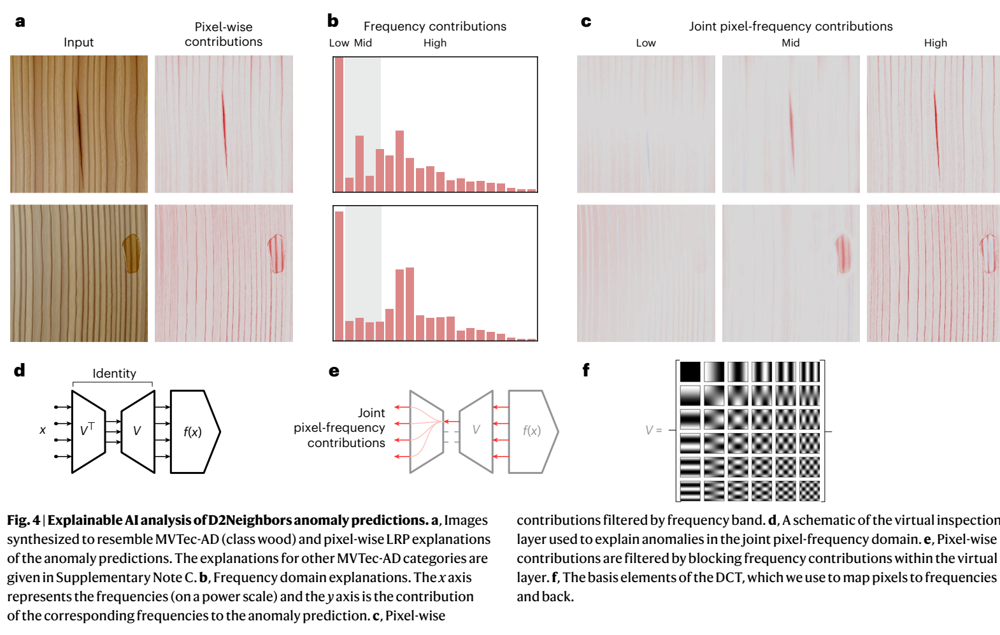

# Clever Hans效应：预测正确，可能仍依赖错误线索

更新：2026-11-16。依据Nature Machine Intelligence 2025论文《Explainable AI reveals Clever Hans effects in unsupervised learning models》，本地PDF正文页412—422。**论文事实**、**教学例子**、**研究建议**分开；本导读没有执行新实验。

资料：[原PDF](12-Clever-Hans-Effects-2025.pdf)｜[中文译文](full_translation_zh.md)｜[正式来源](https://doi.org/10.1038/s42256-025-01000-2)；回到[研究主文档](../../../research/thesis-research-and-study-guide-zh.md)或[阅读总报告](../research-plan-and-paper-reading-report-zh.md)。

## 1. 这篇论文为何与PCB解释研究直接相关

一个模型在公开测试集上分数高，为什么还可能不可靠？因为测试集中的正确标签可能和无关线索稳定地一起出现。模型利用这些线索，仍能得出“正确答案”；上线后线索关系改变，就会失败。论文将这类依赖偶然相关、在新条件失效的策略称为Clever Hans（聪明汉斯，CH）效应。它不是泛指模型所有错误，而是**已有性能掩盖了错误判别依据，条件变化才暴露问题**。

本文研究两类对象：基础表征中的相似性，以及工业异常检测中的异常分数。前者即使没有为具体下游任务训练，也可能先放大文字、水印、人等信息；后者即使只看正常图，也可能依赖缩放伪影或无关高频。无监督或自监督不使用你的缺陷标签，不等于自动免疫这种问题。

你的两项工作恰好需要区分“定位准”与“依据可靠”。缺陷热图亮在GT附近，仍可能对图像处理中一个无关频段过敏；展示一个正确正常参考，也不证明相似性来自正确结构。本文的价值是提供完整论证方式：**解释发现可疑线索→设计破坏相关性的条件变化→观察性能/分数变化→针对机制缓解并重新评价**。它不是要求你必须复现全部LRP、频域分析或医疗案例。

## 2. 研究对象、输入和输出

| 分析对象 | 模型输入/已有学习 | 被解释的实际量 | 解释输出 |
| --- | --- | --- | --- |
| 表征学习模型 | 两张图；已有CLIP、PubMedCLIP、SimCLR、Barlow Twins预训练 | 特征点积相似度 | 两图像素/块对之间的贡献关系 |
| D2Neighbors | 测试图＋正常训练图；基于像素距离 | 到正常邻居的软最小距离 | 正常样本贡献、像素贡献、频率贡献及联合贡献 |
| PatchCore分析 | 预训练CNN＋正常特征库 | 块近邻距离聚合的异常分数 | 主要检验预处理变化下检测表现 |

这是一篇分析与验证论文，不提出一个统一PCB分割网络。下游分类器的标签用于检查表征后果，异常检测的评估标签用于检验模型表现；“无监督模型”说的是被研究的表征/异常学习部分，并不是整篇研究完全不使用标签。它也没有证明所有DINO模型一定存在同一种CH效应。

## 3. 相似性解释为什么是“两边一起解释”

设表征函数为 $\Phi$，两图相似度 $s(x,x')=\langle\Phi(x),\Phi(x')\rangle=\sum_k\Phi_k(x)\Phi_k(x')$。普通单图归因若只解释一边，可能看不见两图到底由哪些对应内容共同支持“相似”。BiLRP把点积这一双线性计算反向分解到两张图的特征对，形成 $R_{ij}$：x的第i处和x'的第j处对相似性的联合贡献。

Methods式(2)的构造为：

$$\operatorname{BiLRP}(s)=\sum_k\operatorname{LRP}(\Phi_k(x))\otimes\operatorname{LRP}(\Phi_k(x')).$$

$\otimes$ 是外积，两条向量的每一项两两相乘，结果是矩阵，不是两个热图简单叠加。逐表示维度先分别传播LRP，再组合贡献，近零关系可省略，像素对可汇成块对。图2的二部图就是这种关系的可视化。它解释的是所定义的相似度，不直接等同于下游缺陷分割决策。

**教学例子：**把图像简化为“产品结构”和“水印”两个特征，A=(1,3)，B=(1,3)，点积为10，其中结构只贡献1，水印贡献9。整体很相似，来源却主要是水印。如果两张图恰好属于同一类别，分类器能正确；水印在新数据里换了，分类可能失败。真实神经特征不是这两个可读轴，BiLRP的作用是把抽象轴上的匹配重新分配到输入内容。

论文图3发现PubMedCLIP的X光相似性受文字标记支持，CLIP垃圾车相似性受角落标志支持，部分鱼类表征受人像支持。可疑解释只是发现线索，作者还用下游子群或扰动验证。值得注意的是，CLIP鱼类例子虽不聚焦鱼，却没有出现同程度的性能下降；原文也保留了这个未解现象。因此“解释看起来不合理”不能直接等价“已证明CH失效”。

## 4. 异常分数为什么可能暴露于无关高频

D2Neighbors把图像像素当向量，与正常训练样本 $u_j$ 比较。Methods中用广义均值形成软最小，可教学性写成：

$$o(x)=-\frac1\gamma\log\left[\frac1N\sum_{j=1}^{N}\exp(-\gamma\|x-u_j\|_p^p)\right].$$

$N$ 为正常样本数，$p$ 控制距离幂，$\gamma$ 控制接近硬最小的程度；论文主分析含平方欧氏距离。距离小的样本具有更大权重，式(3)将异常总分按这些权重分给正常邻居，叫“min-take-most”。它不是对离得最远的正常图赋最大解释权重。

对于平方欧氏距离，$\|x-u\|_2^2=\sum_i(x_i-u_i)^2$。任何像素方向变化都能增加距离，不像一个监督分类线性层那样可以把某些方向权重学为0。它对实际缺陷敏感，也可能对纹理重采样、高频噪声敏感。预训练特征可减弱某些输入方向，但距离定义本身不保证只响应任务所需因素。

**教学例子：**真实缺陷只在10个像素各变化0.5，平方贡献2.5；全图1000个背景像素因缩放各变化0.06，总贡献3.6。每个背景点很弱，合计却超过缺陷。单张热图可能仍让缺陷显眼，整体分数却被背景变化显著影响。这说明要看实际得分的分解与稳定性，而不只看最亮区域是否命中GT。

## 5. 原图4：从像素解释走到像素—频率解释

来源：原文图4，本地PDF第5页（刊页416），[正式论文](https://doi.org/10.1038/s42256-025-01000-2)，[裁剪记录](reading-figures/sources.json)。图中木纹是为分析展示合成的相似示例，不是你的PCB数据。

先看a列：左边输入有木纹与缺损，右边像素贡献图既在缺损也在正常纹理处有响应。单看这里，读者可能只注意到缺陷已被突出。b列把贡献按频率分解；横轴按频率从低到高，柱高是对应频段对实际异常分数的贡献。c列再将贡献按低、中、高频分别投回空间，看到无关背景响应主要由高频部分承载。它不是给图做三次不同滤波再比较预测，而是沿解释路径分解同一预测的贡献。

下方d是“虚拟层”：输入x先进入DCT变换 $V^\top$，再经逆变换V恢复，因正交变换满足 $VV^\top=I$，原预测函数保持不变。箭头右端仍是原来的 $f(x)$。e在解释传播时选择频率成分，得到联合贡献；f展示DCT基，左上低频、向更密的条纹逐渐高频。虚拟层允许换一种坐标观察同一个模型，而不是悄悄给模型加一个改变结果的滤波器。

Methods式(4)进一步写像素对与频率的贡献，再对一个像素索引或频率索引求和，得到 $R_{ik}$、$R_i$、$R_k$。学习时不必先记所有传播式，先掌握守住的对象：被解释的异常分数相同，只是分解维度不同。解释传播规则仍带方法假设，不能因为可求和就自动当作现实世界因果分解。

## 6. 作者怎样把怀疑变成证据

表1的医疗案例中，合并数据下分类平衡准确率87.5%，总体FPR18%；GitHub子群准确率81.7%，FPR51%。整体好分数掩盖来源子群风险。表征解释显示文字关联，再配合子群表现，支持需要检查来源依赖；这些医疗数字不能迁移成你的PCB误报预期。

同表中垃圾车任务：给每张卡车图插入标志，CLIP准确率由84.7降至80.3；缓解后原始84.4、标志条件83.6。鱼类的SimCLR由81.4降至74.8，Barlow Twins由83.2降至75.8。各模型受影响不同，说明数据量大和预训练强不自动排除特征放大偏差。也不能据此宣布有监督表征一定安全，监督基线在鱼类子群也有下降。

工业表2把缩放从OpenCV最近邻改成带抗锯齿的双线性处理，模拟合理预处理变化。D2Neighbors平均F1从0.91降到0.82，FNR由4%升到23%；PatchCore为0.92到0.86。统计范围是选定的五个MVTec类别，不是全部15类、VisA或PCB。Methods也说明其PatchCore预处理和原论文不同，不能将这张表解释为推翻PatchCore原始榜单。

解释分析发现高频依赖，作者加输入低通滤波作为缓解；D2Neighbors缓解后两种条件F1均0.92。这里有三个互补证据：解释指出可疑频率，改变预处理暴露失败，针对该频率的处理恢复稳健性。它比“热图好看”强，但并没有证明低通对所有工业缺陷都好。PCB细线缺损本身可能正依赖高频，照搬模糊会损害精度。

表1、2是性能验证，图3、4是机制诊断；不要互相替代。正文讨论提出学习目标和距离结构可能塑造特征放大，是作者结合实验的解释及理论分析；不能把所有无监督错误都归咎于架构而忽略数据划分、标注和成像条件。原文提到的补充Note A—D未全部包含在本地11页PDF，本文不虚构其额外消融数字。

## 7. 对工作一的启发：错误诊断先于模块选择

假设PCB正常误报集中在丝印、板边或压缩纹理。当前只能说存在这些错误，不能先宣布模型依赖伪相关。可以在train/val上看错误与预处理、成像组别是否相关，再选少量合理变化，固定分辨率、几何、GT变换和阈值策略，比较同一样本的分数与mask。若只改预处理便大幅变化，需要同时检查真实小缺陷是否因缩放丢失，避免把信号损失当成伪影依赖。

如果考虑DINO或局部分支，本文提醒：新增局部敏感性可能同时强化真实细节与背景纹理，必须按实际错误分层。精度实验仍用原图IoU、Dice、召回、正常误报，并补排序与逐图分析。对齐条件、颜色变化和频率变化应分别控制，不能一次叠加再解释原因。它提供诊断逻辑，不替你决定增加模糊层、LRP或完整频域支路。

## 8. 对工作二的启发：先写清楚解释哪个数

若候选是正常参照，应先指定解释对象：单块近邻距离、整图最大分数、某个分割区域的平均logit，还是最终融合分数。BiLRP解释点积，D2解释软最小距离；两者不能直接当成DINO欧氏近邻或监督分割logit的现成公式。必须沿实际计算选适合的验证方式。

**教学例子：**测试焊盘与参照焊盘同有编号“A7”，它们的特征很近。展示两张裁剪会让人以为匹配了焊盘结构；若遮住文字而保留结构后匹配剧变，就应继续检查是否靠文字。该干预需同面积随机遮挡、不同填充值/替换方式和伪影对照。DINO token含全局上下文，修改输入后须重算整图特征；只替换一个缓存token是特征层干预，不是像素因果证据。

解释质量至少分五项：忠实性核对分数是否真由所示路径产生；匹配核对参考内容是否合适；稳定性核对合理变化下证据是否可靠；覆盖率核对解释了多少预测分支和样本；任务代价核对精度与时间。解释工作可因更准确暴露模型缺陷而有价值，不要求IoU必然提高。相反，漂亮且命中GT的图若不能反映实际计算，不能作为成功。

## 9. 已填写的结论判断与问答

| 观察 | 现在能说什么 | 还不能说什么 |
| --- | --- | --- |
| 热图高亮PCB缺口 | 定位与GT在该图相符 | 模型只依赖缺口、无伪相关 |
| 正常参考外观相似 | 存在可展示匹配 | 相似来自正确结构、覆盖最终预测 |
| 轻微预处理后性能下降 | 该条件下不稳定，应检查信号和伪影变化 | 自动证明制造场景必然失败 |
| 针对解释发现因素的干预有效 | 为该机制提供额外支持 | 所有数据/缺陷均适用 |

**问：没有缺陷标签也会“走捷径”吗？**答：会。预训练目标可放大共享文字或中央人物，距离模型可对无关方向过敏；这些表示会被下游任务继承。无监督消除的是一种标签依赖，不是所有偏差来源。

**问：热图与GT重合是否已验证解释？**答：主要验证定位。论文木纹例子展示了局部看似合理、频域仍过度依赖的情况。须核验实际分数、干预效果和覆盖，不能把定位IoU作为唯一解释指标。

**问：我该如何在开题中使用这篇？**答：作为“为什么解释需要可靠性验证”的依据，说明准确预测可能依赖不稳健线索；你的工作二拟核验与实际评分绑定的依据。不要说本文已证明你的SegFormer或尚未实现的DINO存在CH效应，也不要用它直接确定一个新架构。
