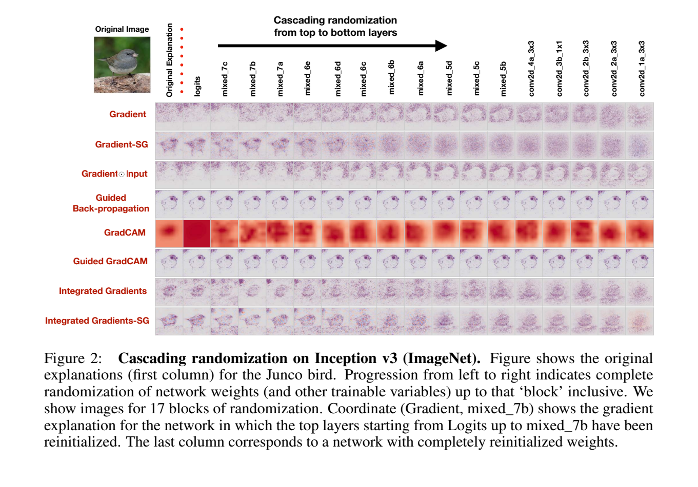

# Sanity Checks：一张漂亮热图真的反映了模型学到的东西吗

更新：2026-11-16。依据本地11页NeurIPS 2018论文《Sanity Checks for Saliency Maps》。这是解释评价论文，不是缺陷分割模型。下文**论文事实**、**教学例子**与**研究建议**分开；没有对现有模型执行随机化。

资料：[原PDF](13-Sanity-Checks-for-Saliency-Maps-2018.pdf)｜[中文译文](full_translation_zh.md)｜[论文入口](https://arxiv.org/abs/1810.03292)；回到[研究主文档](../../../research/thesis-research-and-study-guide-zh.md)或[阅读总报告](../research-plan-and-paper-reading-report-zh.md)。外部入口含后续修订，本导读的图表和章节以本地会议版为准。

## 1. 问题并不是“热图有没有轮廓”

假设你有一个训练好的图像分类器，某解释方法画出清晰的鸟轮廓。你把分类器参数全部随机初始化，它仍画出差不多的鸟轮廓。这张图可能很好看，却没有充分反映模型训练学到的分类依据，因为未经训练的同结构网络也能生成它。论文的核心问题是：**声称解释训练模型决策的方法，是否真的依赖模型参数和数据标签关系？**

图像自身有边缘和形状，网络架构也带先验。某些可视化会恢复这些输入结构，即便预测机制已被破坏。所以“看起来像目标”既可能来自模型判别，也可能来自输入恢复。对PCB同样如此：板边、走线、引脚天然有强边缘，热图沿着它们分布不自动说明模型依据这些地方作出了缺陷判断。

这篇论文提出两种可操作的反证检查：模型参数随机化，以及训练标签随机化。如果解释对该方法声称依赖的变化无反应，就限制了它能支持的结论。通过检查也不是忠实性终点：只要把模型参数哈希后画随机噪声，也可能“随参数变化”，但毫无解释价值。因此合理性检查是必要诊断，不是解释质量的单一总分。

## 2. 先知道这些显著图在计算什么

对输入x和固定目标类别分数 $S_c(x)$，不同方法的对象如下。这里“显著”表示输入对某个分数的相关程度，不是统计学显著性。

| 方法 | 核心操作 | 读图要注意 |
| --- | --- | --- |
| Gradient | $\nabla_xS_c(x)$ | 局部敏感性；正负符号和大小含义不同 |
| Gradient×Input | $x\odot\nabla_xS_c(x)$ | 乘上输入会保留输入结构，零背景尤其明显 |
| Integrated Gradients（IG） | 沿基线到输入的路径积分梯度 | 结果依赖基线和路径，不等于只算原图梯度 |
| Guided Backprop（GBP） | ReLU反传时额外截掉负梯度 | 是修改后的反传规则，不能直接当普通梯度 |
| Grad-CAM | 类别梯度对深层卷积特征加权 | 粗空间分辨率；依赖选择层与目标分数 |
| Guided Grad-CAM | Grad-CAM与GBP逐元素组合 | 清晰纹理可能主要由GBP部分提供 |
| SmoothGrad（SG） | 对多个加噪输入的解释取平均 | 是平滑封装；平均不自动赋予底层方法忠实性 |

论文§2的IG定义为：

$$
IG_i(x)=(x_i-\bar x_i)\int_0^1\frac{\partial S_c(\bar x+\alpha(x-\bar x))}{\partial x_i}\,d\alpha.
$$

$\bar x$ 为基线，$\alpha$ 为从0到1的路径位置；这不是训练参数。对线性函数 $S=w^\top x$、零基线，IG简化为 $x\odot w$，而普通梯度等于w。这个小差别是理解“输入结构能支配可视化”的关键。

## 3. 第一个检查：逐步破坏模型参数

§3有两种形式。级联随机化从输出层向输入层逐块重新初始化；到某块时，其上所有块都已经随机。独立随机化则每次只重置某一层，其余层保持训练状态。前者观察随学习机制逐渐被破坏解释如何变化，后者帮助定位解释依赖哪些层。两者不能混称“每次随机一个层”。

需要在同一输入、同一解释设置下比较原解释与随机化解释。还要记录解释目标，否则若每次改成当前模型最高预测类别，解释变化可能同时来自目标变化和参数变化。归一化、颜色尺度、符号处理也应固定或明确披露，不能每次挑最好看的图。

**教学例子：**$f(x)=w_1x_1+w_2x_2$，x=(2,1)。原权重w=(3,0)，梯度为(3,0)，强调第一维；随机权重变为(0,4)，梯度变(0,4)，强调第二维。若一种“模型解释”无论w如何都返回x=(2,1)，它恢复了输入，却没有说明该模型现在偏向哪一维。非线性网络更复杂，但检验逻辑相同。

## 4. 原图2应该横着和竖着各读一次

来源：原论文图2，本地PDF第5页，[论文入口](https://arxiv.org/abs/1810.03292)，[裁剪记录](reading-figures/sources.json)。这是ImageNet鸟图的原文实验，不是PCB验证结果。

左上是固定输入。第一列为训练模型的原解释，后面各列按顶部从左到右箭头逐步重置更多层；最右近似完全重初始化网络。上方的logits、mixed等名字是网络块边界，不是不同输入图片。每行是同一种解释方法，所以横着看能问“模型变了，它还变不变”。

Gradient和其SG行随随机化改变。GBP一行即使模型大量随机化，鸟的轮廓仍很像；Guided Grad-CAM也保留强输入结构。Grad-CAM有明显粗空间响应变化，和Guided Grad-CAM不能混为同一表现。IG与Gradient×Input肉眼也可保留形状，但论文后续指标发现其符号与排序可变化，不能一句话说这两者完全不依赖参数。

竖着看同一随机化列，可以比较不同方法：清晰并不意味着更反映学习。尤其Grad-CAM热区较粗、GBP边缘较细，细粒度视觉质量与类判别忠实性是两条轴。对PCB，“细线画得很清楚”可能只是保留了高频边缘，不足以证明模型识别出断线。

这张图不应被读成“随机模型的输出与训练模型一样”。变化的是解释与参数的关系，模型预测本身通常已退化。没有核对模型输出就只看解释，恰好是作者反对的做法。

## 5. 数值指标为何能和肉眼结论不同

§2.2区分绝对值图与保留符号的发散色图。绝对值把负贡献和正贡献都变亮；如果大量像素只是符号翻转，绝对值图仍很相似。论文使用Spearman秩相关（有/无绝对值）、SSIM和HOG直方图相关，分别观察排序、图像结构和梯度方向轮廓的相似性。

**教学例子：**原解释为(2,-1,0)，新解释为(-2,1,0)。取绝对值后都是(2,1,0)，看起来完全相同；保留符号时，它们支持和抑制的方向全换了。若只报告绝对值相关，会漏掉这种变化。反过来，符号变化也不自动说明排序的空间结构已完全重学，需一起解释。

图3显示级联随机化下的秩相关，图4给SSIM和HOG。作者特别指出IG、Gradient×Input在视觉上保留物体，但不取绝对值的秩相关会较快趋近0。结论因此是：一些方法显著不敏感；另一些方法的视觉相似会掩盖数值变化。不能扩写成“所有显著图都不可信”或“IG必然失败”。

SSIM高仅说明结构相似，HOG高可能主要意味着共同边缘，Spearman高说明排序相近；它们不是因果忠实性本身。比较不同解释方法时还应检查输出是否全零、动态范围是否塌缩。一个常数图相关度可能无定义，不能把异常数值默默记为通过。

## 6. 第二个检查：打乱标签后重新训练

§4不是把测试标签打乱再画原网络解释，而是打乱训练样本与标签的对应，再训练同结构网络。作者让网络对随机标签达到大于95%的训练准确率，使其确实记住随机关系，而非只是训练失败；测试通常接近随机猜测。随后在相同测试输入上比较真标签训练模型与随机标签训练模型的解释。

图5展示MNIST上的绝对值与保留符号图，梯度和Grad-CAM等随训练关系明显变化；GBP仍可能生成似乎合理的数字轮廓，IG与输入乘梯度也仍保留输入形状。这说明“输入看起来像0，解释也像0”不足以证明它解释了网络学到的类别关系。

对你的像素分割不能直接把图像分类标签置换方案照抄成“随机打乱所有像素”。那会同时改变空间先验、类别比例与任务可学性。若未来做随机标签检查，应说明置换单位是图像mask、区域还是其他结构，保证干预确实破坏目标关系，记录是否拟合成功；但这会增加训练成本，目前不是自动新增实验要求。

## 7. 为什么随机网络还能画出轮廓

§5.1讨论架构先验：随机卷积网络也能捕捉边缘、局部纹理和图像统计。§5.2研究输入乘随机向量：即使梯度被随机化，乘上固定图像后，原结构仍可能主导视觉。§5.3的线性模型和一层卷积加sum-pooling进一步说明有些反传图接近边缘检测。它们能提供输入/架构信息，却不一定足以调试某个已训练决策。

**教学例子：**MNIST背景像素x_i=0，前景x_i接近1。任意噪声梯度g与输入相乘后，背景仍严格为0，前景才有响应；所以即便g毫无类别意义，也能“描出数字”。PCB背景通常不全零，但走线和器件的强纹理也可能通过类似方式留下结构。

这不是说边缘图没有价值。用于看清图像几何，它很有价值；若声称解释训练模型为何误检某处，则需有额外证据。论文要限制的是解释用途与证据的匹配，不能用一张可视化替代模型学习行为分析。

## 8. 对工作一：精度诊断怎样使用这篇

你的工作一希望减少漏检与误报。如果借Grad-CAM等方法说“漏检因为模型没关注缺陷”，需要先确认解释方法确实能反映你选定分割模型、层和目标的行为。原文在分类网络上的结论提供警示，不能直接当作SegFormer/DINO具体实现的验证。分割输出是整张logit图，应明确目标是某像素、固定ROI的平均logit、最大分数还是整图聚合；不同目标会得到不同解释。

候选低成本检查可以先在少量train/val诊断样本上固定目标，逐层随机化已选头或模块，记录预测变化与解释变化。若解释始终不变，而相关输出大幅变化，就不宜用它判定“网络关注不足”。如果新增局部支路仅让解释更清晰却没有精度和受控消融支持，也不能把清晰图作为精度提升原因。

这类检查不改变已有SegFormer归档，不需要为阅读重训旧基线。若要正式做标签随机化或换解释算法，会涉及工作量与实现，应作为可选研究建议说明，而不是本导读替你选定。精度结论仍由同协议IoU、Dice、召回、正常误报和失败样本支撑。

## 9. 对工作二：把检查推广到参照与评分路径

参照展示不是梯度显著图，所以不能只拿参数随机化一项就宣布通过。应先识别哪些环节可学习、哪些是固定检索：若DINO冻结、最近邻是确定距离，新增一个完全不参与评分的“解释器”，就算对其参数随机化产生变化，也没有验证主模型解释。相反，若展示的是实际最近邻来源，应该直接审计它是否进入最小距离和最终评分。

可分别检查：打乱来源坐标是否只改变展示；换掉实际候选库是否按预期改变距离；把解释分支移除后最终预测是否改变；有多个评分分支时解释覆盖哪部分。**教学例子：**最终分数80%来自监督头、20%来自近邻，展示一张近邻只能解释后者；即使那张参照匹配正确，也不能把它说成全部判别依据。

输入干预还需等面积随机区对照、伪影控制和重新前向。DINO token有全局上下文，局部来源裁剪不等于局部像素因果范围；替换缓存token属于特征干预。解释的忠实性、参考匹配、稳定性、覆盖与代价应分别报告；这篇只覆盖其中“是否反映学习机制”的必要诊断，不代替其余维度。

解释研究成功可以是更可靠地区分证据和装饰，即使IoU不升。代价是需要明确验证对象、保存预测和解释原始数值，报告失败方法，避免只挑漂亮图。若检查失败，合适结论是该方法不适用于当前解释主张，而不是用户模型一定不可靠。

## 10. 已填写的检查判读与问答

| 结果（假设） | 应如何判读 |
| --- | --- |
| 随机化头后预测变、GBP仍描出原走线 | 有输入恢复/架构先验嫌疑，不适合单凭该图解释训练头的决策 |
| IG绝对图相近、保符号相关明显下降 | 不能说完全不敏感；需同时说明空间结构保留与符号变化 |
| 解释随机化后明显变 | 通过一种必要检查，尚需忠实性、干预与任务适用性验证 |
| 参照图展示变了、实际距离完全没变 | 可能仅改变来源索引/展示，未验证实际评分依据改变 |

**问：随机化会破坏模型，比较还有意义吗？**答：目的正是破坏学习到的机制。如果解释声称反映该机制，应该有相应变化。随机模型不是性能基线，而是解释依赖性的控制条件。

**问：所有解释都要越敏感越好吗？**答：不是。对无关输入小扰动应适当稳定，对声称依赖的决策机制变化应能响应。稳定性与参数依赖性针对不同变化，不冲突，也不能只优化一个。

**问：通过检查能叫“可解释模型”吗？**答：只能说解释在受测设置对相关变化有反应。还要明确解释对象、验证忠实性和覆盖，证明有助于理解模型。本文没有给出包办所有解释形式的认证程序。

**问：这篇给我最重要的一句话是什么？**答：热图中的PCB结构可能来自输入和架构；要用它说明模型判别依据，先证明它确实依赖相应模型与数据关系，再结合实际评分和干预评价。
