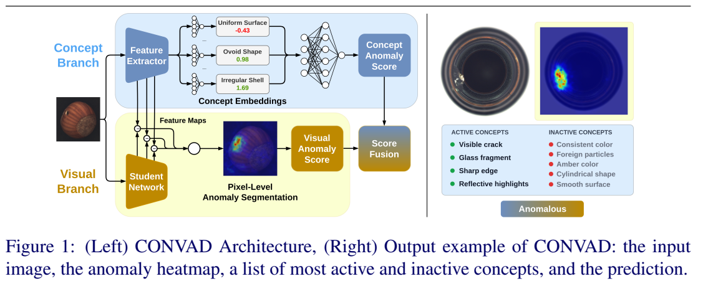

# CONVAD：概念怎样参与异常判别，解释又覆盖了多少决策

深化修订：2026年11月16日。依据本地27页第三版预印本。本文重点是解释对象、真实计算联系和评价，旨在帮助你的工作二收敛，而不直接要求新增概念标注或语言模型任务。

入口：[原PDF](14-CONVAD-2025-preprint-v3-2026.pdf)｜[中文译文](full_translation_zh.md)｜[研究主文档](../../../research/thesis-research-and-study-guide-zh.md)｜[总报告](../research-plan-and-paper-reading-report-zh.md)

## 一、它比一张异常热图多解释了什么

异常热图能指出哪里得分高，却通常不能用语义告诉人“模型认为这里出现了裂纹、颜色变化还是结构缺失”。CONVAD将概念瓶颈用于异常检测，先预测人能读懂的概念，再让概念参与异常评分，并用另一视觉分支保留像素定位能力。

这里最值得你学习的，不是立刻给PCB列几十个概念，而是一个明确原则：解释要与实际判别计算相连。如果事后生成一句“这里有划痕”，但模型可能完全没有依赖划痕，这句话仍不能代表真实依据。概念瓶颈试图把可读中间量纳入决策；你拟研究的正常参照也应追求这种计算联系。

## 二、原图逐步讲解：蓝色概念路与黄色视觉路

来源：原论文图1，PDF第2页，原图及图注裁剪；[提取记录](reading-figures/sources.json)。

左上蓝色概念分支先提取特征，再形成概念激活，最后用概念向量得到异常分数。右侧列表显示活跃与不活跃概念，不是直接从热图颜色翻译出的句子。

左下黄色视觉分支采用学生—教师思路：学生学习正常数据中的教师特征，异常时二者可能不一致，于是产生像素热图和视觉得分。两路最后融合形成图像判定。共享视觉基础有助于两种输出使用相关表示，却不保证它们在每一张图都由同一证据驱动。

图最关键的阅读问题是：如果黄色视觉路单独触发异常，蓝色概念列表还能完整解释这个结果吗？答案不是自动可以。这正是“解释覆盖”问题，后面必须沿最终评分式核查。

## 三、什么是概念瓶颈，为什么“可读概念”需要额外监督

用通用记号可写为$x\rightarrow\hat c(x)\rightarrow s_{cbm}(x)$，其中$x$是图像，$\hat c$是多个概念激活，最后一层根据激活判断异常。概念可能是可见裂隙、颜色不均、边缘完整等视觉属性，既有正常描述也有异常描述。单个概念未必与异常一一对应，最终取决于组合。

原文第4.1节借助视觉语言模型生成候选概念，结合类别和缺陷上下文，再分组去重、为图像标注概念。文本相似性过滤减少重复概念，不能保证剩下每个概念都准确、可观察或与任务有关。用人工子集检查标注质量，是对自动流程的额外评价。

需要特别核对信息预算：候选列表取代表子集并覆盖缺陷类型，自动标注提示还利用类别/缺陷信息，生成异常也含任务知识。因此即使某设置称为没有真实异常训练，也不等于完全没有异常先验。你的研究若不采用这些资源，就不能直接声称具有同样解释输出；若采用，又必须说明数据、标注与调用成本。

## 四、训练分两步，每步监督不同

第4.2节先训练概念分支，同时优化异常标签与概念标签；再冻结该分支，只用正常样本训练视觉学生，匹配教师的中间特征。不是两条路从头始终一起自由更新。

概念损失与异常损失按原文式（5）组合：

$$
\mathcal L_{cbm}=\frac{\mathcal L_Y+\lambda\sum_{j=1}^{k}\mathcal L_{C_j}}{1+\lambda k}.
$$

$k$为概念数量，$\lambda$控制概念目标的权重。分母进行尺度调整，不使“概念更多”简单变成总损失更大。各二值损失还考虑类别不平衡。概念容易预测不代表概念对缺陷判别有充分价值，需同时观察两个目标。

视觉学生的损失是正常图上的多层特征平方差平均，式（6）。学生在正常范围模仿教师，测试异常处的差异经各层上采样平均，形成热图，式（8）。这种机制能定位模型不一致的位置，却不能直接把误差解释成制造原因，也可能对未覆盖的正常变化产生响应。

## 五、概念贡献公式：能说明哪个分支的什么贡献

原文式（7）以最后线性层权重与概念激活的乘积表示贡献：

$$
\delta_j(x)=w_j\hat c_j(x).
$$

在概念分支线性得分中，各项与偏置组合后再经过输出非线性。正负权重可对应支持或抑制异常，按绝对贡献排序可突出影响较大的概念。它是模型内部计算项，不等于现实世界中某概念对缺陷的物理因果作用。

**教学例子，非论文数据：**可见裂纹激活0.9、权重2，则贡献1.8；表面完整激活0.8、权重-1，则贡献-0.8。两者共同影响分支得分。只展示“裂纹活跃”会遗漏相反证据；“不活跃概念”也不应被随意解释成模型已证明不存在该现象。

如果概念预测错了，贡献计算仍可忠实反映模型怎样使用错误概念。因此解释忠实与描述正确是不同性质：一种解释可以真实暴露错误依据；这往往恰好有助于调试。

## 六、最重要的公式：视觉分支触发后，概念解释会不会不够

视觉热图最大池化成图像分数，再用留出集选择阈值，形成二值$\hat y_{vis}\in\{0,1\}$。概念分支输出$[0,1]$内的$s_{cbm}$。原文式（9）为：

$$
s(x)=\max(\hat y_{vis}(x),s_{cbm}(x)).
$$

若视觉路为0，最终分数来自概念路；若视觉路为1，最终分数为1，即使概念路认为正常。这种逻辑为未被概念覆盖的异常提供后备，却限制了概念解释对整套输出的覆盖范围。

**教学例子：**概念分数0.2、视觉触发为1，最终1。展示一组支持0.2的概念，不能说它完整解释了最终异常；若人工修正概念使其降至0.1，视觉触发仍为1，最终判定可能不变。必须分别评价概念分支干预和最终融合输出。

表2右侧报告约88%—91%的预测由概念分支驱动，说明多数，但并非全部。该比例反映特定数据与融合规则下的路径关系，不是88%—91%的像素已获得因果解释，也不是解释忠实性的统一准确率。

## 七、概念干预到底改变什么

概念级干预修改中间概念激活，再重新计算后续分数。它相当于问“如果模型不再认为这个概念存在，会怎样判断”，而不是直接证明“把原图对应像素删掉一定得到同样结果”。概念可能相关、标签可能不完整，硬替换还可能形成模型训练中少见的组合。

第6.3节的干预整体改善很多类别，但transistor和toothbrush退化，原文将其与概念数量少、硬标签过度约束联系。这提醒你：干预不是一定越多越好，反例应保留。可读、可操作的中间量提供了验证接口，不自动消除信息不全或分布外问题。

对正常参照路线，对应的两种操作也需区分：删除/替换库特征是在评分层干预；修改待测图后重算完整DINO特征，是输入层干预。二者都可核验不同问题，不应合成一个“解释已通过”的标签。

## 八、用户觉得有用与模型依据真实，是两种证据

第6.2节研究32名参与者、582份回答，分别询问预测是否看起来正确、解释是否帮助判断，并结合隐藏真值区分有效、误导和无用。论文报告CONVAD误导比例3.1%，不能把它理解为模型错误率3.1%。

如果解释让用户相信一个本来错误的预测，就是有说服力却有害；若解释暴露模型错误，使人识别出来，则有帮助。这个评价比“你喜不喜欢这段说明”更贴近复核价值，但仍受样本选择、参与者经验与问题设计影响。582份回答也不等于582名独立专家。

你的工作二目前不必新增用户研究。可以先把匹配正确、实际评分绑定、干预响应、稳定性和覆盖做扎实，再讨论是否需要人的可用性评价。检测IoU不能代替解释可靠性，人的喜好也不能代替计算忠实性。

## 九、合成异常的域差异怎样影响解释

第6.5节以metal_nut展示合成与真实异常可能在概念表示上错位，少量真实异常加入后有所改善。二维t-SNE图是辅助可视化，不能单独证明所有分布已经对齐；相应概念和检测指标才提供更直接证据。

如果你以后借用合成异常或概念词表，需要先检查PCB结构与缺陷语义是否准确。生成图像中看似合理的痕迹可能不符合制造过程；模型也可能识别编辑痕迹而非缺陷。当前阅读只用于理解条件，不预设新增生成模型任务。

## 十、对你工作二的具体落点

这篇给你的核心设计表不是“增加一个概念头”，而是四个需要明确的对象：解释哪个最终量、证据怎样进入计算、干预改变什么、还漏掉哪些路径。

对候选正常参照，可以记录查询位置、真实近邻、来源整图与坐标、距离、映射、插值及融合。若部分预测由普通分割头单独决定，要指出参照没有覆盖它。DINO词元又含整图上下文，所以真实来源索引不等于裁剪像素的完整因果归因。

| 阅读得到的原则 | 对正常参照研究的具体要求 |
| --- | --- |
| 中间解释参与决策 | 展示实际评分所用近邻，不另找好看的图 |
| 概念可错但贡献可追溯 | 分开记录评分忠实性与参照结构匹配 |
| 后备分支限制覆盖 | 分别标记解释到的评分部分与剩余部分 |
| 干预并非总能改善 | 保存负结果、正常替换控制和失败范围 |

**理解问答：**概念模型是否天然解释全部预测？有旁路或融合时未必。概念贡献大是否就是制造原因？不是，它是模型得分的一项。正常参照与概念瓶颈能否互相替代？不能直接替代，它们表达不同证据，但都应满足计算绑定与可核验原则。最值得带走什么？一张真正标明解释覆盖的评分路径图，而不是更多看似合理的描述。
