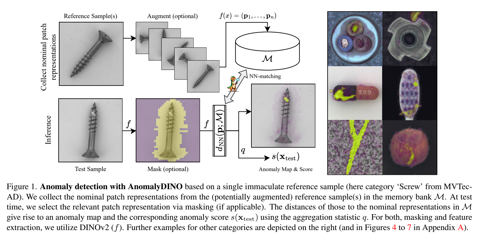

# AnomalyDINO：强视觉特征怎样用少量正常参考判断异常

修订日期：2026年11月16日。本文面向PCB监督分割与正常参照研究解释原论文机制。依据本地WACV 2025正式论文；正文涉及附录时，只说明原文指向，不把未收录补充材料当作已经逐项核验。

入口：[原论文](<15-AnomalyDINO-2025.pdf>)｜[中文译文](full_translation_zh.md)｜[阅读总报告](../research-plan-and-paper-reading-report-zh.md)｜[研究主文档](../../../research/thesis-research-and-study-guide-zh.md)

## 一、先理解它的研究问题：没有见过缺陷，怎样知道哪里不正常

想象只有一张正常螺钉照片，没有任何坏螺钉标注。一个思路是先把正常照片中的各个小区域描述出来，再观察新照片是否存在“找不到相似正常样子”的区域。AnomalyDINO沿用这种局部近邻思路，关键在于DINOv2能够提供较好的视觉特征，并通过适当参考增强、背景过滤和评分聚合适应少样本条件。

它不靠额外训练一个缺陷分割网络，而靠已有表征与正常参考完成检测。因此，“无需训练”是指该方法在目标任务上不需要再优化模型参数；它仍使用经过大量预训练的骨干，也仍需正常参考、预处理与检索计算。不能把它说成无需任何数据、知识或成本。

你当前已用PCB像素掩码训练SegFormer，信息条件不同。阅读它的目的，是理解强特征与简单正常匹配能提供什么能力，并为可解释性候选机制建立基础，而不是不经讨论把课题改成正常样本少样本异常检测。

## 二、原图逐步讲解：正常库如何变成异常图

来源：原论文图1，PDF第2页。图中上半部分为正常参考建库，下半部分为测试推理，右侧为其他类别的异常图示例。

按箭头读上半部分：正常参考图可以做旋转等增强；每张参考经同一特征提取器$f$得到图像块特征；这些特征汇总为记忆库$\mathcal M$。注意，圆柱体保存的核心是特征，不是一个训练后能自动生成正常图的网络。

下半部分：测试图先进行可选物体掩码，避免无关背景触发高分；然后提取同类图像块特征；每块与库内特征做最近邻匹配，得到局部差异。差异一方面恢复为空间异常图，另一方面经统计量$q$汇成整图异常分数。图内黄色/紫色掩码不是缺陷真值监督，它服务于选择相关物体区域。

右侧颜色图说明方法能输出位置，但图像本身不证明每个高分都来自真实缺陷，也不证明正常参照结构对应正确。你以后若展示PCB近邻，应同时记录实际检索来源与失败例，而不只是选取视觉最好的一张参考。

## 三、任务条件与几个容易混淆的词

| 概念 | 本文具体含义 | 与当前PCB项目的差别 |
| --- | --- | --- |
| 少样本 | 少量正常参考图，正文比较1、2、4、8、16张等预算 | 不是少量带缺陷mask的监督训练 |
| 无需目标训练 | 不另行优化目标模型参数 | PCB分割头仍可用真实mask训练 |
| DINOv2 | 原论文使用的自监督视觉表征 | 不能因后续代码移植而改称原文使用DINOv3 |
| 物体掩码 | 过滤无关背景的可选操作 | 不是缺陷标注，不代表异常位置已知 |
| 参考图 | 提供正常外观样本 | 不要求逐张配对黄金正常图 |

正常参考少时，主要困难不只是不知道缺陷长什么样，还包括正常变化没有被充分覆盖。例如参考螺钉朝上、测试正常螺钉朝斜，距离可能变大。增强试图扩展“允许的正常变化”，但增强是否合理取决于任务：如果某个器件旋转本身就是异常，旋转不变可能消除有用信号。

## 四、从公式看它究竟比较了什么

原文第3.1节先把正常参考的图像块特征并入库。令$f(x)=(p_1,\ldots,p_n)$，则可简写为：

$$\mathcal M=\bigcup_{x\in X_{\mathrm{ref}}}\{p_j(x):j=1,\ldots,n\}.$$

这里$X_{\mathrm{ref}}$是正常参考集，$p_j(x)$是第$j$个位置的特征向量，$n$由输入分辨率和图像块大小决定。原文DINOv2块边长为14；这与拟用DINOv3-S/16的16不同，网格大小不能混算。

原文公式（2）（3）分别给出近邻评分和余弦距离：

$$d_{NN}(p;\mathcal M)=\min_{m\in\mathcal M}d(p,m),\qquad d(p,m)=1-\frac{p^\top m}{\|p\|\|m\|}.$$

先对一个测试块寻找特征方向最相近的正常块，再把最小差异当异常分数。距离小表示库内至少有一个相似正常表示；距离大表示在当前表征和库覆盖下缺少相似参照。后者不是“已证明存在物理故障”。

**教学例子，非原文实验：**某待测焊盘块对三个正常候选的余弦相似度是0.95、0.70、0.60，则距离为0.05、0.30、0.40，异常得分取0.05。若最相似候选实际来自另一类金属结构，得分仍可能很低。这揭示特征近邻的一个限制：它优化的是表示相似，不保证工艺结构对应。

反过来，正常焊盘因高光改变而与库中特征差异增大，也可能高分。研究正常参照时，结构匹配与成像变化都要检查。你不能仅给距离套一层单调映射，就认为这两类歧义已被解决。

## 五、整图分数为什么不直接取一个最大值

原文公式（4）用统计量$q$聚合所有图像块距离，正文选取最高1%距离的均值。它希望兼顾“异常通常局部”与“单个极大值可能只是噪声”。具体离散个数和舍入由实现决定，尤其网格较小时需要核对。

**教学例子：**若1000个块只有一个正常高光误报为0.9，其余为0.05，最大值是0.9，而最高1%的10项均值为$(0.9+9\times0.05)/10=0.135$。若真实缺陷使10个块都升至0.6，尾部均值就是0.6；这种聚合更容易区分孤立极值与持续高分。但最高1%也不是通用最优选择：异常只影响一个块时，扩大尾部比例可能稀释信号；背景噪声成片时也未必能解决。

局部图与整图分数的路线还不同。原文通过双线性上采样和高斯平滑生成像素异常图，平滑参数为$\sigma=4.0$；整图采用高距离尾部聚合。不能默认整图得分就是最后平滑图的最大值。它也提醒你：用于解释某个图像报警的参照，必须覆盖实际聚合所依赖的那些局部项。

对PCB微小缺陷，平滑可能稳定噪声，也可能扩散或弱化边界。是否使用、怎样设置，应在本地验证条件下决定，不直接复制参数并称为公平设置。

## 六、增强与背景过滤：正常性究竟被怎样定义

第3.2节讨论旋转增强和物体掩码。少样本库倾向于增加正常变化，全样本库则常需要压缩以控制检索成本。两种设计并不矛盾，因为参考覆盖与资源约束不同。

物体掩码由DINOv2特征的第一主成分阈值化获得，并经形态处理。它利用特征中的物体/背景结构，但并不保证每种对象都能正确分离。原文图2就展示部分物体区域被误判为背景，并设置每类检查是否适用。该选择带有物体条件与检查流程，不能在实验中省略描述。

你的PCB通常充满多种元器件和线路，未必存在一个清晰、占比合适的单主体。若掩码把板边、小焊点或低对比区域过滤掉，后续异常检测根本没有机会处理它们。因此，“减少背景误报”的收益必须同时检查缺陷覆盖损失。不能只展示过滤后热图更干净。

旋转也是如此。整块板姿态变化与局部器件旋转异常不是同一件事。增强若把本应判为异常的结构变成允许正常变化，会降低判别信息。先定义正常与异常的语义，再确定哪些变换可接受。

## 七、实验应怎样读：不要混淆图像判别与精细定位

表2、表3分别报告MVTec-AD与VisA，按参考数比较图像与像素指标。一个有教学意义的例子是VisA单样本、448输入：图像AUROC为85.6±1.5，像素AUROC为97.5±0.1，分割F1-max为41.9±0.5。它们是不同对象与聚合，不能把高像素AUROC解释成97.5%的缺陷正确分割。

同表的672输入相应像素AUROC为97.8±0.1、分割F1-max为45.1±0.9。提高分辨率对定位的影响可能比对整图判别更明显。这里的F1-max是遍历阈值的最佳值，并非已经通过独立验证选择的部署工作点；与你当前固定协议Dice不能直接比较。

第4.2节讨论预处理、聚合、特征与成本。图3的推理时间还注明设备差异和部分非官方实现，阅读时要核对横轴是对数尺度。不能把论文单图时间直接当作你的4070笔记本表现。原文对附录的详细指向可作为继续查阅线索，本地正式论文没有自动包含全部补充页。

## 八、把它放回你的两项研究

### 精度工作：复杂结构要与简单强特征区分

本文支持先理解强表征和简单匹配的能力，但不证明你的监督分割需要改用近邻。若后续适配提高精度，应说明是否改变了局部缺陷与正常结构的可分性，是否只来自尺度或后处理。本文本身使用DINOv2正常样本协议，不是你DINOv3监督PCB结果的直接替代基线。

### 解释工作：记录真实参照，再评价它是否可靠

近邻公式让来源具有可追溯性：可以知道某个得分使用哪个正常特征。但还需要判断该参照是否是相同结构、在扰动下是否稳定、是否覆盖图像分数的尾部聚合，以及高分是否由正常光照造成。近邻来源不是工艺缺陷原因。

可考虑的教学式检查包括：用实际高分区域替换与等面积随机替换比较；加入正常到正常替换控制；输入改动后重新前向并重新检索。它们是待讨论的验证思路，不是本文已经为你完成的实验，也不要求一次开展所有路线。

## 九、读完后应能回答

**库越大一定越好吗？**增加库可覆盖更多正常变化，但增加检索成本，也可能把本应异常的相似外观容纳进去；须看数据语义和实际结果。

**参考样本少就等于标注效率研究吗？**不等于。本文的正常参考预算与监督缺陷mask预算不同，需另设协议才可讨论标注效率。

**无训练等于零样本吗？**不等于，它仍用正常参考；批量零样本是论文另行讨论的设置，不能混称。

**它对我最直接的价值是什么？**提供一条简洁正常参照链路，让你具体理解“距离来自哪里”，也暴露匹配、增强、聚合与解释覆盖的条件。
