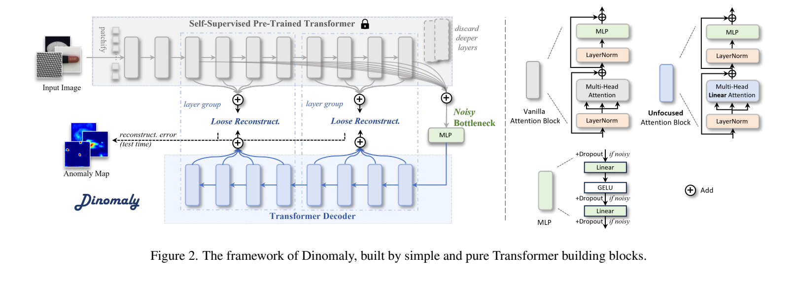

# Dinomaly：为什么异常检测有时需要“不要重建得太好”

修订日期：2026年11月16日。本文依据本地CVPR 2025正式论文讲解；图像与数字来自本地原文，PCB联系为导读分析。补充材料的引用不代表本地正式PDF包含所有附录。

入口：[原论文](<16-Dinomaly-2025.pdf>)｜[中文译文](full_translation_zh.md)｜[总报告](../research-plan-and-paper-reading-report-zh.md)｜[研究主文档](../../../research/thesis-research-and-study-guide-zh.md)

## 一、先理解一个看似矛盾的目标

普通重建任务希望输入什么就尽可能恢复什么。重建式异常检测却希望：正常区域恢复好，没见过的异常恢复不好，再用差异发现异常。如果解码器能力强到连异常也原样复制，重建误差反而变小，检测失败。因此，这里不是无条件追求重建误差最低，而是希望正常与异常产生可区分的误差。

Dinomaly研究多类别统一异常检测：一套模型学习多种正常对象，而不是每类独立训练一套。正常模式多样化后，模型可能把恢复能力推广到未见异常，作者称其为过度泛化，并用简洁结构限制直接复制。它与你当前单个PCB类的监督分割不同，但能帮助理解“特征能力强”和“异常得分可靠”之间并非自动等价。

## 二、原图逐步解释：编码器、瓶颈和解码器各做什么

来源：原论文图2，PDF第3页。左侧整体流程，右侧放大标准与线性注意力块以及MLP瓶颈。

上方灰色编码器有锁标记，表示冻结的自监督预训练骨干。它从正常输入提取多层特征，不在本任务中重新学习完整视觉表征。中间绿色瓶颈通过带Dropout的MLP汇入信息，下面蓝色解码器学习恢复所需特征。虚线连接不是直接把原RGB图复制回来，而是比较编码与解码特征。

两组相加符号对应层分组。作者把多个层的特征视为整体，放宽逐层一一对齐约束；测试时，两组的逐点余弦差异平均，生成异常图。右侧的线性注意力替代Softmax注意力，既改变信息混合方式，也有计算上的考虑。

读这张图时先回答三件事：训练目标来自哪儿？来自正常图的冻结编码器特征。哪些参数更新？瓶颈与解码器等训练部分。测试异常分数来自哪儿？同一位置编码特征与其重建的差异。这与“查询正常库并找一个邻居”根本不同。

## 三、任务身份与默认实现

第4.1节说明训练只使用正常图，并在MVTec-AD、VisA、Real-IAD上评价。统一多类别模型共享参数，类别内部和类别之间的正常模式都需要被表示。多类别不表示模型在你的任务中预测多种缺陷语义类别。

默认骨干是DINOv2带寄存词元的ViT-Base/14。输入先缩放到448方形，再中心裁剪到392方形，空间网格为28×28。这个预处理在原任务有其设置，但对PCB板边缺陷，中心裁剪可能直接丢失区域，不能未经检查复制。后续DINOv3移植也不等于原论文骨干。

瓶颈Dropout默认0.2，Real-IAD用0.4；这些是论文配置，不是PCB最佳超参数。记录它们的目的是理解作者怎样随正常多样性调整约束，而不是把每个设置都变成你的调参任务。

## 四、机制一：含噪瓶颈为什么不是普通的“防过拟合”一句话

第3.2节用Dropout随机丢弃瓶颈激活，让解码器不能始终拿到完整输入，只能借助剩余信息恢复正常特征。这类似去噪恢复：训练目标仍是正常表示，输入信息却被扰动。

**教学例子，非论文数据：**假设正常焊盘有一套稳定纹理，解码器若逐项复制输入，测试时异常划痕也可能被复制；若训练中部分信息被遮蔽，它需要学习正常结构间的关联来恢复。遇到不符合这些关联的区域，恢复误差才可能较大。

但Dropout不保证任何异常都恢复不好。异常可能与正常十分接近，或网络仍学会足够广泛的复制。因此，机制解释需要实验支持，不能只靠“加噪声更鲁棒”的口号。训练噪声也不意味着测试图一定要人为添加相同噪声；须核对训练与推理模式。

## 五、机制二：为什么利用线性注意力“不容易聚焦”的特点

普通Softmax注意力可在某个位置产生非常尖锐的权重。若每个输出只盯着相同输入位置，它就接近直接复制。第3.3节用注意力图与示意矩阵解释这种风险。

原文用简化形式写线性注意力：

$$
\mathrm{LA}(Q,K,V)=\phi(Q)\big(\phi(K)^\top V\big).
$$

这是原文公式（3）的等价排布，$Q,K,V$为查询、键和值，$\phi$为正值特征映射；论文的表达用于说明计算顺序与不聚焦特性。完整实现的归一化等细节还应对照代码，不把这个简化式当成全部实现。

标准关系矩阵先形成$N\times N$项，重排后的形式先计算通道间汇聚。论文给出主要复杂度由$O(N^2d)$变为$O(Nd^2)$。降低复杂度并不自动意味着所有任务更好；这里作者把较分散的信息混合作为防止局部原样复制的候选优点。

原文图3比较Softmax与线性注意力分布，观察后者更分散。它支持信息传播机制的解释，但不是普遍定理，也不说明所有线性注意力都无法复制异常。最终仍要看检测消融，而不是把注意力图本身当成性能证明。

## 六、机制三：宽松重建究竟“松”在哪里

第3.4节有两种放松，需分开理解。

**第一种是层对应放松。**若要求编码器每层都被解码器对应层精确模仿，学生可能连异常也学得过于相似。作者将多个层相加成组，再进行组间重建。图4把稀疏逐层、密集逐层、单组和双组方式放在一起。它不是简单“少用几个损失”，而是改变允许解码器怎样组织恢复信息。

**第二种是位置梯度放松。**容易重建的位置不必继续同等强度地优化，让训练更关注困难部分。原文公式（4）—（6）使用全局余弦损失和困难挖掘。对距离较小的易点，将反向梯度缩为0.1倍，而不是完全停止；论文脚注提到完全停止偶尔造成不稳定。

余弦距离为：

$$
D_{\cos}(a,b)=1-\frac{a^\top b}{\|a\|\|b\|}.
$$

全局损失对分组特征图展平后比较，测试异常图则看逐点距离。训练目标的聚合与推理评分的空间形式不同，阅读时不能把两者都模糊称为“逐像素误差”。

**教学例子：**大面积正常背景已经恢复得很好，如果继续占据大量优化权重，细微正常结构的学习可能被淹没。降低易点梯度可改变优化重点，但“困难点”仍来自训练正常图，不等同于已经知道真实缺陷在哪里。它不能替代监督mask。

## 七、训练和推理完整串起来

训练：正常图进入冻结编码器→取指定中间层→经过含噪瓶颈与解码器→形成层组→计算宽松重建损失→只更新训练部分。正常图多样性决定模型要恢复哪些模式。

推理：待测图进入同一系统→计算编码与重建的分组特征→对位置求余弦差异并平均→得到空间异常图→按原文约定形成图像输出与指标。高分表示重建不一致，不直接等于可见像素差，也不等于某个训练正常图是它的真实参考。

因此，Dinomaly提供的是隐式正常建模：正常知识在参数与特征重建行为中。PatchCore/AnomalyDINO提供显式库匹配：可定位具体近邻来源。二者都需要解释评价，显式来源便于追溯，隐式重建则不能凭空声称找到了对应正常样件。

## 八、怎样从消融真正理解必要性

表3列出含噪瓶颈NB、线性注意力LA、双组约束LC、宽松损失LL的不同组合。基线图像AUROC为98.41，像素AP为62.96；完整组合分别为99.60和69.29。这里的值是MVTec-AD多类别条件下的作者报告，不是本地PCB效果。

值得认真看的是：LC单独加入时，像素AP从62.96降到61.05；它与NB组合时为68.16。这说明机制之间存在交互，不能把每个模块都描述为独立、必然提升。LA单独加入对某些指标也变化很小，完整组合结果不能证明任何单件放进任意网络都有用。

表4、表5讨论骨干和输入规模，图5讨论不同预训练模型。若输入更大、模型更强、训练更久同时发生，不能把差异单独归于一个结构。像素AUROC接近饱和时，AP或F1可能仍不高，应分别理解。F1-max为最佳阈值评价，不应直接当成独立验证选定的部署效果。

本地正式PDF会引用额外附录；若需要逐项复核超参数或更多数据集消融，应另外取得对应补充材料。当前导读不把这些引用补成已验证事实。

## 九、对你研究方向的具体帮助

### 对精度工作：更强特征不等于更有区分力的评分

你的监督分割头直接用缺陷mask学习前景，与这里依赖正常重建误差不同。不能把“防止异常重建”的结构原样当作监督分割需求。但可以借鉴一种分析方式：一个模块改变了什么信息流，为什么这种改变应有助于特定错误，消融是否支持，是否存在交互。

因此，当局部分支带来收益时，也要问它是否与语义特征互补、是否只增加容量、是否在正常纹理上放大误报。读本文的价值是学习受控机制论证，不是为课题追加另一整套重建路线。

### 对解释工作：异常图本身没有解释误差来源

某区域重建差异大，可能来自真实异常，也可能来自正常外观覆盖不足、边界或成像变化。它指示“模型哪里不能一致恢复”，没有直接证明“为什么制造中出现缺陷”。同理，你的正常库距离大也只是某种偏离，需要匹配和干预核验。

如果以后把重建分数与参照分数融合，应明确各分支贡献，不能只解释可检索的一条分支而宣称解释了全部预测。当前没有必要预设融合；先把单一评分路径理解清楚。

## 十、与相邻论文的对照与理解问答

| 维度 | AnomalyDINO | Dinomaly | 当前PCB监督基线 |
| --- | --- | --- | --- |
| 目标信息 | 少量正常参考 | 多类正常训练图 | 正常与真实缺陷mask |
| 任务适配 | 参考处理与检索，无目标参数训练 | 训练瓶颈与解码器 | 训练监督分割模型 |
| 分数来源 | 到正常库的最近距离 | 特征重建差异 | 监督学习的前景输出 |
| 正常依据 | 显式特征库 | 隐式恢复能力 | 模型参数中的判别规律 |

**为什么重建更好反而可能检测更差？**若正常与异常都恢复好，二者误差接近，异常评分失去区分力；需要看相对分布，而不只看训练损失。

**宽松损失会不会忽略缺陷？**训练只见正常图，选择的是易恢复正常位置，不是按真实缺陷标签筛选。它的任务身份仍是正常样本学习。

**统一多类别是否就是跨板型零适配泛化？**不是，模型已经用多个类别正常数据训练；未接触目标板型是另一个数据条件。

**最应带走的研究习惯是什么？**不要给每个模块编一个必然有效的故事；先追踪计算，再看单独与组合消融，保留退化结果及其适用条件。
