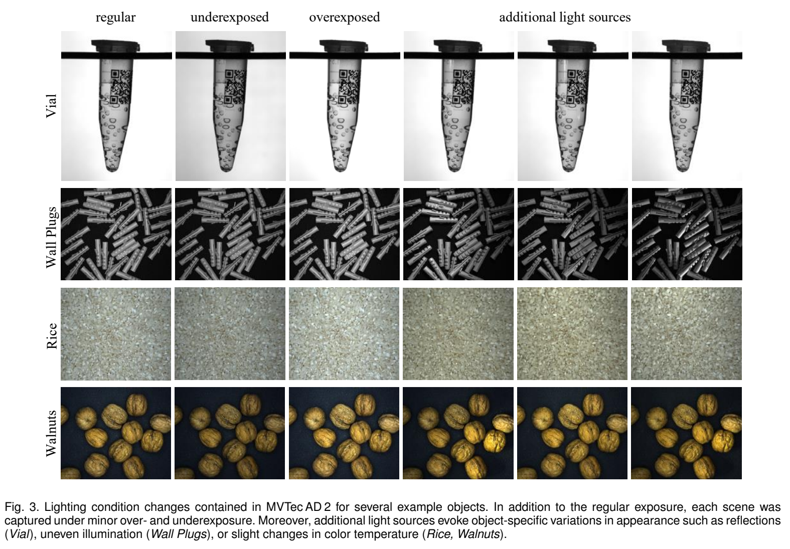
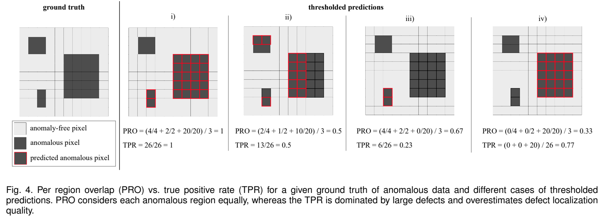
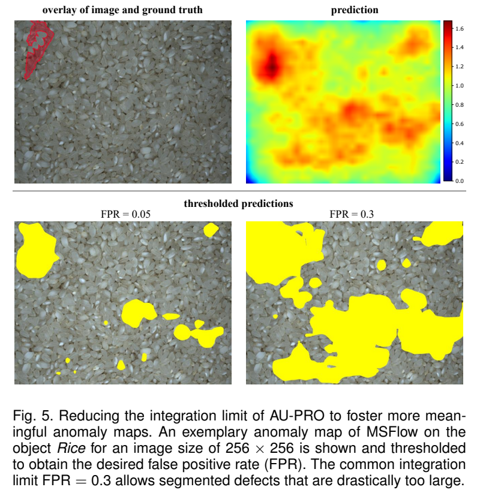

# MVTec AD 2：从“分数很高”到“究竟检测好了什么”

修订日期：2026年11月16日。本文是一份面向《PCB外观缺陷检测方法研究》的详细阅读导读。论文事实以本地2025年第一版、21页PDF为准；下面的PCB联系和教学推导另行标明。

入口：[原论文](<17-MVTec-AD2-Advanced-Anomaly-Detection-2025.pdf>)｜[中文译文](full_translation_zh.md)｜[阅读总报告](../research-plan-and-paper-reading-report-zh.md)｜[研究主文档](../../../research/thesis-research-and-study-guide-zh.md)

## 一、先理解它为什么是你需要读的数据集论文

这篇论文没有提出你的下一种分割网络。它更重要的作用，是让你理解一个研究结果究竟支持什么结论。假如某个方法在旧基准上有很高的异常检测分数，仍可能在正常反光、边缘缺陷和微小缺陷上失败；假如两个模型相差不到一个百分点，也可能难以排除训练波动、尺度和评价实现差异。作者因此重新设计检测场景和评价约束，让这些差别显露出来。

你的SegFormer已有历史测试前景IoU约68.33%，并不属于这篇论文所说的旧基准接近饱和的同一比较条件。作者讨论的是特定正常样本方法、数据与曲线指标；你使用真实掩码进行PCB监督分割。应借鉴它对“难度与评价”的分析，不能据它得出“我的分数太低”或“更换AD2就能证明创新”。

建议把全文看成三层：**场景层**决定正常与异常可能怎样变化；**协议层**决定模型能看什么数据；**指标层**决定哪种错误会被分数强调或掩盖。这三个层次对你两项工作都重要。

## 二、任务与数据协议：正常样本学习不等于下游监督分割

原文第3节介绍八种对象场景，包括罐、织物、果冻、大米、金属薄板、小瓶、膨胀管和核桃。正常外观有较大变化，缺陷可能微小、低对比、靠边，或者出现在透明与反光物体中。这些困难不是一个“更复杂”的标签，而是不同的失败机制。例如，正常核桃形态变化要求模型容忍正常多样性；透明污染物则要求模型对低对比异常保持敏感，两者可能相互牵制。

论文协议中，训练和验证仅包含正常样本，训练使用常规照明。公开示例测试集包含少量带标注正常/异常图像，私有测试集公开图像而隐藏真值，经服务器评价。两个主要私有测试条件为：

| 条件 | 与训练的关系 | 用来观察什么 |
| --- | --- | --- |
| 常规照明私有测试 | 照明与训练相同 | 在熟悉成像条件下的定位效果 |
| 混合照明私有测试 | 同一类场景随机采用已见或未见照明 | 正常外观因成像变化而改变时是否仍可靠 |

“隐藏真值”并不意味着研究者看不到测试图，也不是绝对消除所有形式的针对性开发；它使直接按测试掩码优化更困难。你目前已接触过PCB1历史测试错误，后续应披露这一背景，方法选择回到训练/验证。把已见图重新分组，不会抹去既往接触。

## 三、原图讲解：正常变化为什么会让参考距离变大

来源：原论文图3，PDF第7页，保留原图与图注的页面裁剪；中文说明是本导读添加。

按行看对象，按列看照明。左侧常规照明之后是欠曝、过曝和额外光源。小瓶的反射、散装膨胀管的明暗不均、大米和核桃的色温变化，都可能改变特征，但不一定意味着新缺陷。

对你拟研究的正常参照机制，这张图揭示一个直接问题：待测块与正常库的距离包含哪些差异？可能既有缺陷，也有照明、反射和配准误差。若距离上升，不能只因来源是“正常库”就把解释写成“检测到了物理缺陷”。你应先判断参照结构是否对应，再观察正常变化是否造成同样高分。

对精度工作，这也提醒你不要只追求更敏感的局部支路。局部细节增强可能同时增强真实裂纹与正常高光。一个改动若提高召回却显著增加正常误报，需要把这种权衡写出来，而不是只展示更红的异常图。

## 四、核心公式：像素召回与区域覆盖为什么会给出不同判断

原文第4.2.1节公式（1）定义逐区域重叠PRO。用便于阅读的等价记法写成：

$$
\mathrm{PRO}(t)=\frac{1}{K}\sum_{k=1}^{K}\frac{|P_t\cap C_k|}{|C_k|}.
$$

这里，$C_k$是第$k$个真值连通区域，$P_t$是阈值$t$下预测的异常像素集合，$K$是全部真值区域数。先计算每个区域被覆盖多少，再把这些比例等权平均。PRO本身在这个表达式中只看真值区域覆盖，误报由同时使用的FPR坐标约束。

与之对应，像素召回为：

$$
\mathrm{Recall}(t)=\frac{\sum_k |P_t\cap C_k|}{\sum_k |C_k|}.
$$

这条式子是解释性重写，用于对比两种聚合方式。区域不重叠时，它就是累计真阳性像素除以累计缺陷像素。大区域自然占更高权重。

来源：原论文图4，PDF第8页。图中灰色为真值异常，红色轮廓为预测异常。三个真值区域面积分别为4、2、20像素。

跟着图中的四种预测算一遍：

1. 全部覆盖时，PRO与像素召回都是1。
2. 每个区域恰好覆盖一半时，两者都是0.5。
3. 只检出两个小区域、漏掉大区域，PRO为$(1+1+0)/3\approx0.67$，像素召回仅为$6/26\approx0.23$。
4. 只检出大区域、漏掉两个小区域，PRO为$(0+0+1)/3\approx0.33$，像素召回却为$20/26\approx0.77$。

不是其中一个数字“算错了”，而是它们回答不同问题。像素召回问全部缺陷面积覆盖了多少，PRO问平均每个区域覆盖了多少。若你特别关心微小缺陷，只有累计像素指标可能不足以揭示问题。

对PCB的联系要谨慎：本地的“异常图平均IoU”是逐图等权，PRO是逐连通区域等权，两者不相同；标注连通区域也不自动等于独立工艺缺陷实例。是否新增区域级评价，需要先固定连通规则和匹配定义，不能事后挑一种有利统计。

## 五、AU-PRO为何需要注明积分上限

阈值降低时，通常会覆盖更多缺陷，同时把更多正常像素报成异常。因此不能只最大化PRO；把整张图报成异常，覆盖可以完美，但没有实用价值。AU-PRO综合PRO随正常像素误报率变化的曲线。

论文区分积分到FPR=0.30和积分到0.05。后者更关注较低误报区域。若需要用统一符号理解，归一化形式可记为$\alpha^{-1}\int_0^\alpha\mathrm{PRO}(u)\,du$，其中$u$是正常像素FPR，$\alpha$是上限。这是导读对面积含义的说明，具体数值还依赖阈值采样、插值和实现，应以论文与评价代码为准。

来源：原论文图5，PDF第8页。上方为图像真值叠加与连续异常图，下方分别给出FPR为0.05和0.30时的预测。

先看黄色预测覆盖范围，而不要只看热图颜色。FPR=0.30允许大量正常区域被涂黄，可能掩盖真实缺陷定位能力。原文用大图中的极小缺陷说明，即使5%的像素误报也可能远大于缺陷本身。这仍不是板级5%误剔率：像素误报分母是正常像素，板级误报分母是正常板，二者不能互换。

因此，表1为了说明旧新数据难度而采用的AU-PRO上限，与后文更严格评价的上限必须分开。引用一个“AU-PRO分数”时，缺少下标、尺度和测试条件，就缺少重要比较信息。

## 六、排序指标、阈值分割和最终报警是三层问题

第4.2.2节另外评价阈值化分割F1。正常样本协议中，作者用正常验证像素异常值的均值加三倍标准差设置基线分割阈值，并用最大像素分数导出图像判定。这是论文的具体基线规则，不是通用于你的监督任务的标准阈值。

你已经有缺陷验证掩码，可以在预先规定的验证目标下选择工作点。不能因为本文采用某个规则，就认为只有正常验证数据时的经验阈值在PCB监督任务中最公平。也不能遍历测试阈值拿到最佳F1，再把它称为可部署效果。

一个教学例子：模型甲能把缺陷分数排在正常之前，但输出整体落在0.1附近；模型乙排序相同而整体落在0.9附近。固定0.5得到的掩码可能大不相同，但在相应阈值下它们可以得到相同预测。它说明校准、排序与工作点要分别讨论。实际模型若存在插值或融合，需在最终评分层检查这种关系。

## 七、原论文实验应该怎样读，哪些结论不能外推

第4.1节比较多类正常样本方法，包括记忆库、蒸馏、归一化流及合成异常路线。作者主要使用官方实现与规定设置，而不是为每个场景无限调参。读结果时请同时核对：输入是否默认256方形、是否另测大尺度、骨干是否集成、哪些结果来自原论文、哪些为本次基准运行。

例如，表1的某些旧数据结果与AD2设置在具体模型大小上有说明，不能把表中的差值完全归因于数据集这一项因素。它展示了新场景对代表性方法很难，不是严格证明任意骨干或任意监督设置都只有某个能力上限。

第4.3节与图6讨论放大输入带来的性能和代价。对微小缺陷，更大输入可能保留信号，也会增加耗时与内存。你若以后比较512与更大尺度，需要把几何、训练预算及评价恢复统一，而不是把“更高分辨率必然更好”当作设计结论。论文中的整体性能也不能作为PCB产线验收线。

## 八、怎样落实到你的两项研究

| 论文中的问题 | 对精度工作的启发 | 对解释工作的启发 |
| --- | --- | --- |
| 小区域容易被累计像素分数掩盖 | 在训练/验证预定义尺度分组，检查改善是否覆盖小区域 | 检查解释是否仅对大而明显的异常有效 |
| 光照使正常特征变化 | 同时记录召回和正常误报 | 正常参照差异要区分缺陷与成像变化 |
| 大输入代价上升 | 比较尺度与局部适配的不同收益来源 | 连同库容量和检索开销报告解释成本 |
| 隐藏真值限制调参 | 方案与阈值使用训练/验证 | 解释案例不要反复按测试结果筛选 |

这里是阅读启发，不是新增AD2实验要求。当前更直接的产出，是把已有PCB1指标解释清楚、把测试接触记录写清楚，并为后续其他PCB类别预先确定访问条件。

## 九、读完后应能独立回答的五个问题

**为什么像素召回较高仍可能漏掉很多小区域？**因为它按像素数量累计，大区域权重大，许多小区域的完全漏检可能只占很小缺陷面积。

**PRO高就代表定位可靠了吗？**还不够。PRO本身看区域覆盖，需要结合FPR约束，也要核对区域定义、误报与阈值。满图预测能覆盖全部真值，却会严重误报。

**AU-PRO的0.05可以当产线标准吗？**不可以，它是曲线积分范围的选择。产线还要定义实际报警规则、允许误剔、漏检风险、成像条件与验证样本。

**为什么保留IoU和逐图结果？**它们与PRO强调不同方面。当前研究应保持已有协议可追溯，而不是遇到更有利指标就替换主要结果。

**这篇对可解释性最直接的帮助是什么？**它提供质疑参照依据的具体条件：同样的异常分数可能来自缺陷、照明或正常变化，必须通过匹配与干预区分，而非把距离直接命名为缺陷原因。

## 十、建议的阅读与记录顺序

第一遍读第3节并看图3，理解正常变化；第二遍精读第4.2节并手算图4；第三遍读结果、图6和第5节服务器协议。留下三份已能复述的内容：区域与像素指标区别、阈值选择说明、PCB测试访问与后续评价边界。原文图像只作本地学习引用，提取信息记录在本目录图片来源文件中。
