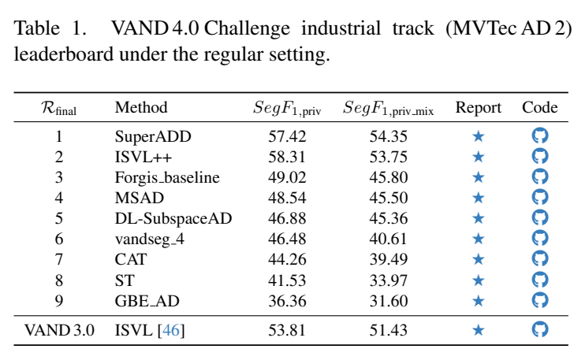
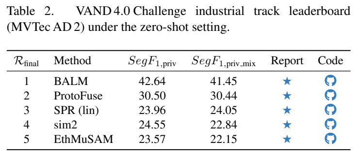
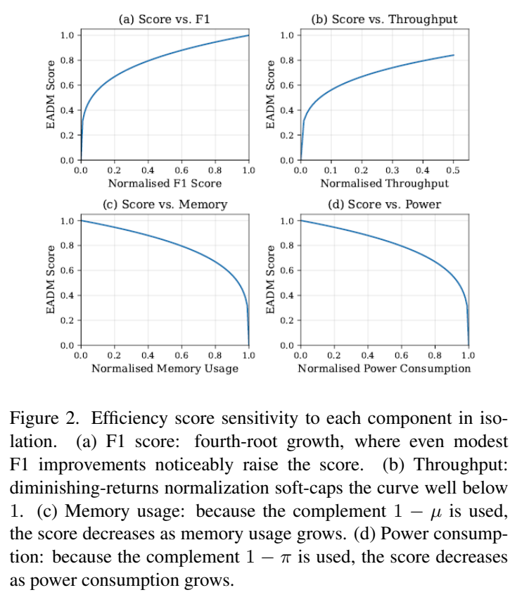

# VAND 4.0：把异常热图变成可比较、可使用的检测结果

修订日期：2026年11月16日。本导读依据本地14页、2026年组织者预印本，重点解释工业赛道和评价逻辑。下面提出的PCB实验联系属于候选分析，不是已完成结果或新增任务。

入口：[原论文](<18-VAND4-Application-Driven-Benchmark-2026.pdf>)｜[中文译文](full_translation_zh.md)｜[总报告](../research-plan-and-paper-reading-report-zh.md)｜[研究主文档](../../../research/thesis-research-and-study-guide-zh.md)

## 一、它为什么比“看谁的分数最高”更值得读

许多异常检测模型输出连续异常图，但使用者需要决定哪里算缺陷、整张图是否报警、处理速度是否满足需求。论文把这些容易被省略的步骤纳入共同规则：隐藏测试真值、约束评估次数、评价阈值化分割、加入照明偏移，并讨论资源代价。

对你的课题，它的价值是检查研究结论是否完整。工作一即使提高IoU，也要说明召回和误报怎样变化；工作二即使能展示正常参照，也要说明依据覆盖了哪条评分路径、增加多少成本。本文不直接验证解释忠实性，却能提醒你不要把漂亮展示和一项排行榜分数当作任务全部价值。

## 二、先把两个赛道和四种信息条件分开

第3.1—3.2节区分工业制造与零售物流。工业使用MVTec AD 2，关心像素定位；零售使用Kaputt 2，主要评价物品图像是否有缺陷。二者不是同一任务，指标也不是同一层级。

| 赛道与设置 | 训练能使用的信息 | 核心输出与评价 |
| --- | --- | --- |
| 工业常规 | 受评类别正常图像，无目标缺陷掩码监督 | 二值像素掩码，SegF1 |
| 工业零样本 | 可用规定的公开外部数据，禁止访问AD2 | 同样需要像素分割与阈值化 |
| 零售常规 | 允许监督与异常检测方法等 | 图像级缺陷排序，AP |
| 零售现成模型 | 核心模型权重不微调，评价规定的现成使用方式 | 图像级检测能力 |

你当前是VisA PCB1、真实像素掩码监督，与工业常规的正常样本学习不同。论文中DINOv3方案表现突出，只能支持它是值得考察的表征，不能证明在你的数据和训练方式下必然更好。零售参考图未显示帮助最佳方法的现象，也不能证明PCB正常参照没有价值：对象、输入和用途都不同。

## 三、从异常分数到分割：真正多出来的一步是什么

设模型对位置$p$输出连续分数$s_p$，越大越异常。给定阈值$t$后，预测掩码为$\hat y_p=\mathbf 1[s_p\ge t]$。这是为理解本文评价而写的通用表达。

由掩码累计真阳性TP、假阳性FP和假阴性FN，得到：

$$
P=\frac{TP}{TP+FP},\qquad R=\frac{TP}{TP+FN},\qquad
\mathrm{SegF}_1=\frac{2PR}{P+R}=\frac{2TP}{2TP+FP+FN}.
$$

原文公式（1）使用前一个F1表达式，后一个是代数等价展开。它直接显示漏检与误报都会降低分数。对二值前景，在相同计数与空集合约定下，这个F1也就是Dice；名字不同不能当成两个独立优点。

原文按每类物体的测试像素累计计算，再在八类上平均。它不是先给每张图算F1再平均，也不是把八类像素全部混成一类。你当前有全局前景IoU与异常图平均IoU，两种聚合已出现明显差异，说明报告时必须写清“先累计还是先平均”。

**教学例子，非论文结果：**一个10像素缺陷被完全检出，但另有100个正常像素被误报，则召回为1、精确率为10/110，F1约0.167。它解释为什么“缺陷都找到了”仍可能不是好的定位。反过来，只预测最有把握的两个缺陷像素可有很高精确率，却严重漏检。只看其中一项会误读改进。

## 四、原表讲解：冠军为何未必在每一列都最高

来源：原论文表1，PDF第5页原表裁剪。左列是最终名次，中间是常规照明与混合照明的SegF1，右侧标出报告和代码入口。

SuperADD两列分别为57.42和54.35，ISVL++为58.31和53.75。第二个方法在常规照明列更高，却在混合照明列更低。读表时应先比较同一列，再问最终名次怎样形成。不能把单列最高值称为整体冠军分数。

原文公式（2）先对两个测试条件分别排名，再对名次求均值：

$$
R_{\mathrm{final}}=\tfrac12\{R(\mathrm{SegF}_{1,\mathrm{priv}})+R(\mathrm{SegF}_{1,\mathrm{priv\ mix}})\}.
$$

它不是直接把两个分数求平均后排名；相同名次均值下还有分数差异的决胜规则。理解这个区别可以防止“我用表中数字算不出排名”的困惑。

来源：原论文表2，PDF第5页。BALM在两种条件下分别为42.64和41.45。它与常规设置有明显差距，表明目标正常数据和适配条件仍可能影响定位。但这是完整方法、不同信息条件的结果，不是严格控制所有因素后测得的“正常数据单独贡献”。

还要防止误读鲁棒性：某方法两列差得小，可能是两列都低。你不能只为缩小落差而牺牲原有能力。应同时看绝对效果与条件变化。

## 五、原文方法分析到底支持哪些启发

第4.1节归纳了强特征、分辨率、二值化和照明鲁棒性。领先方案多使用DINOv3，也包含不同记忆库、训练、预后处理。这个现象支持“强表征值得作为基线”，但排行榜不能把全部收益分解为DINO一个因素。

切块、多尺度和高分辨率针对大图细微缺陷；它们也会增加推理与内存。对PCB，如果更大输入已经能改善定位，局部分支的收益就需要与尺度提升区分。反之，局部分支不能恢复在输入缩放时彻底丢失的信息。研究问题应从实际错误出发，而不是从“排行榜都用了某项技术”出发。

形态学、连通区域过滤和SAM精修会改变最终二值图。这意味着比较时不仅要统一骨干和训练，还要交代后处理及参数确定方式。对你的解释工作，若正常距离只产生初始图，而最终图又被复杂精修改变，就必须说明参照解释覆盖了哪一步，不能把初始距离解释直接推广为最终每个像素的完整依据。

## 六、效率公式：为什么更快不必然得到更高综合分

第3.3节公式（6）将任务质量、吞吐、内存与功耗组成几何平均：

$$
E=[q\tau(1-\mu)(1-\pi)]^{1/4}.
$$

$q$是任务质量，工业与零售取不同评价；$\tau$是归一化吞吐；$\mu$和$\pi$是相对预算的内存与功耗比例。速度更高使$\tau$增大，内存或功耗增大却使相应补量变小。乘积形式鼓励多方面平衡。

来源：原论文图2，PDF第13页，连同图注裁剪。四个小图分别只改变质量、吞吐、内存和功耗，其余条件固定。

左上质量提高时综合分上升，右上速度收益逐渐变缓，下方显示内存和功耗接近预算时综合分下降。请注意这是归一化规则的响应，不是测得的真实模型性能曲线。附录的参考点与预算带有应用选择，不是自然定律。正文与附录的具体预算展示还存在四舍五入或表述差异，若复算应明确采用哪组参数；本导读不据此复算排名。

对你最实用的启发是先分别保存各项原始成本，再决定是否有必要合成指标。一个正常库方法的骨干推理、特征缓存、近邻检索与来源图读取，可能承担不同成本。把它们全称为“模型推理”会隐藏瓶颈。

这里不要求你新增功耗研究或边缘部署。当前可以把时间和显存作为代价记录；只有真正围绕精度—资源关系设计实验，才考虑把效率作为贡献。

## 七、隐藏测试与提交次数为何影响研究可信度

第3.4节限制提交频率或次数，同时要求公开技术报告和可复现实现。即使没有直接看见真值，反复根据服务器分数调参，也会逐渐适配测试集。限制预算正是为了减少这类反馈优化。

对PCB1，历史测试已被用于错误观察和审计，后续不能重新称为完全独立盲测。更合理的做法是保留历史身份，方法诊断回到训练/验证，并在具体设计之前预选其他PCB验证类别。第二类各自训练后表现良好，支持多类别适用性；不经目标训练的跨板型迁移则是另一种协议。

这篇还提醒你记录完整预测链：分数、阈值、后处理、原图还原与聚合。只公开骨干权重，不足以复查最终结果；只展示最佳案例，也不足以证明错误减少。

## 八、与两项研究的具体联系

### 1. 精度工作：把总分拆成可解释的错误变化

保留原图前景IoU、Dice、精确率、召回率、异常图平均和正常误报。若某改动主要使预测更激进，应判断是信息更好还是阈值工作点移动。方案和阈值在验证集上确定，不为获得测试提升临时调整。

### 2. 解释工作：对最终评分路径负责

正常参照若直接参与评分，可以保存真实近邻来源；若只是事后展示，就应叫辅助说明。若还有融合或后处理，要指出参照解释没有覆盖的部分。解释可靠性应通过受控替换、正常到正常控制、重新计算特征、稳定性等证据检验；SegF1本身不衡量这些性质。

### 3. 贡献判断：把应用价值落实到条件

“在同协议下减少哪类漏检、增加多少误报和成本、在哪种PCB与照明范围有效”比“使用了最新基础模型”更有研究信息。借鉴已有结构可以形成应用研究，但应清楚交代来源、必要性和边界。

## 九、读完后的理解问答

**SegF1等于我的Dice吗？**在同一二值前景、同样累计计数与空集合约定下公式相同；但原文跨类别平均和你的PCB1聚合可能不同，所以不能直接比较数值。

**AUROC高为何不保证分割F1高？**前者主要反映排序，后者依赖选定阈值和误报/漏检计数；阈值不匹配或正常变化都可能导致工作点很差。

**能把冠军当成同协议先进基线吗？**需要先核对监督、数据、尺度、代码与训练预算，再在本地协议适配运行。排行榜名称不能替代实验。

**参照图没有提高零售成绩，是否应取消我的解释工作？**不能这样推断。任务不同，而且解释工作的目标包含可核验依据，不必要求IoU上涨；但它仍必须证明自身解释价值。

**最该留下什么笔记？**一张“信息预算—最终输出—指标—阈值—成本”的比较表，以及你当前预测链中每一步参数由什么数据确定。读完第3节再读第4.1与4.3节，最后按需查附录即可。
