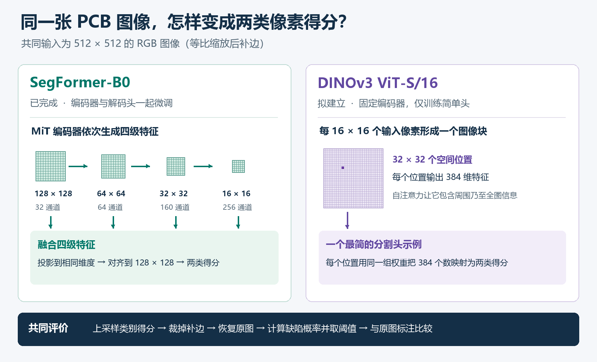
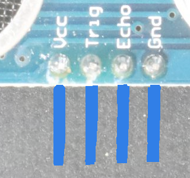

# PCB 缺陷分割的两条基线：SegFormer 与 DINOv3

读开题 PPT 第 6 页时，可以先问一个问题：**同一张板子的缺陷掩码，是怎样从输入图一步步算出来的？** 已完成的 SegFormer-B0 让四种尺度的特征共同判断每个位置，并用 PCB 标注更新整个网络。拟建立的 DINOv3-S/16 先固定一个预训练编码器，只训练把特征读成缺陷分数的小网络。前者给出实测的错误分布，后者检验在多大程度上能直接利用已有特征定位缺陷。[研究与学习主文档](../../research/thesis-research-and-study-guide-zh.md)



*两条路径最后都要回到原图计分。左边四格的数字是实际特征尺寸。右边采用末层特征加线性头，作为“简单分割头”的具体示例。*

沿图阅读只需先记住三个词。**空间位置**回答“在板子的哪里”，**通道**表示“模型用多少个数描述这个位置”，**分割头**负责“怎样根据这些数判断背景还是缺陷”。

## SegFormer 怎样把局部边缘和周围结构联系起来

假设要判断焊盘边缘的一处小缺口。紧贴缺口的几行像素告诉我们轮廓是否中断，周围重复出现的焊盘则提供“这种轮廓通常长什么样”的线索。SegFormer 用四级 MiT 编码器（Mix Transformer）提取不同尺度的线索，再用一个轻量解码头把它们合到同一位置上。[SegFormer 原论文 §3 与图 1](https://papers.neurips.cc/paper/2021/file/64f1f27bf1b4ec22924fd0acb550c235-Paper.pdf)

**跟着一张 512 × 512 的输入走一遍 SegFormer-B0。** 尺寸按“高 × 宽 × 通道数”列出。每行右侧的箭头代表一条送往解码器的路径。

```text
PCB 图像 512 × 512 × 3
   ↓ 重叠窗口取样
第一级  128 × 128 × 32    ─→ 投影到 256 通道 ───────────────┐
   ↓                                                       │
第二级   64 ×  64 × 64    ─→ 投影后上采样到 128 × 128 ───────┤
   ↓                                                       ├→ 拼接 → 融合
第三级   32 ×  32 × 160   ─→ 投影后上采样到 128 × 128 ───────┤       ↓
   ↓                                                       │    128 × 128 × 2
第四级   16 ×  16 × 256   ─→ 投影后上采样到 128 × 128 ───────┘       ↓
                                                      还原到原图 → 缺陷掩码
```

- **重叠分块**。第一级用 7 × 7 窗口、步长 4 提取特征，后三级分别用 3 × 3 窗口、步长 2 降采样。相邻窗口共享一部分输入，横跨窗口边界的走线会被两侧同时看到。四级输出分别保留输入边长的 1/4、1/8、1/16、1/32。[MiT 官方实现](https://github.com/NVlabs/SegFormer/blob/master/mmseg/models/backbones/mix_transformer.py)
- **高效自注意力**。每个位置用查询向量 Q 寻找相关位置，用键 K 算匹配程度、用值 V 汇集信息。MiT 在前三个阶段先对生成 K、V 的网格降采样，因此细网格上的查询也能利用较远处的信息，同时减少配对计算。每个块里的 Mix-FFN 还用 3 × 3 逐通道卷积混合邻域特征，为网络提供局部空间线索。MiT 由此无需给每个位置额外添加一张可学习的绝对位置编码表。[SegFormer 原论文 §3.1](https://papers.neurips.cc/paper/2021/file/64f1f27bf1b4ec22924fd0acb550c235-Paper.pdf)
- **轻量 MLP 解码头**。每一级先用逐位置线性层统一通道数，再对齐空间网格。将同一位置的四组特征拼接、融合后，输出背景和缺陷两个原始分数（logits）。项目实际将分数图插值到 512 × 512，裁去等比例缩放时补的边，再插值到原图尺寸，最后算 softmax 并按阈值 0.5 得到掩码。这样能够把漏检位置对应回原始焊盘。[原论文 §3.2](https://papers.neurips.cc/paper/2021/file/64f1f27bf1b4ec22924fd0acb550c235-Paper.pdf) · [项目实验卡](../../../work/SegFormer/reports/pcb1_b0_v2_seed42/experiment-card.md)

### B0 到 B5 具体变在哪里

四个通道数分别表示四级特征图每个位置存多少个数，四个深度数表示每一级串联多少个 Transformer 块。下表参数量按论文表 1a 的编码器和解码器相加近似取值，M 表示百万。换分类头或实现后，精确参数量会改变。[六种 MiT 的官方配置](https://github.com/NVlabs/SegFormer/blob/master/mmseg/models/backbones/mix_transformer.py) · [论文表 1a 及解码维数说明](https://papers.neurips.cc/paper/2021/file/64f1f27bf1b4ec22924fd0acb550c235-Paper.pdf)

| 型号 | 四级通道数 | 四级深度 | 解码投影维数 | 整个分割模型约多少参数 |
|---|---|---|---:|---:|
| B0 | 32 / 64 / 160 / 256 | 2 / 2 / 2 / 2 | 256 | 3.8 M |
| B1 | 64 / 128 / 320 / 512 | 2 / 2 / 2 / 2 | 256 | 13.7 M |
| B2 | 64 / 128 / 320 / 512 | 3 / 4 / 6 / 3 | 768 | 27.5 M |
| B3 | 64 / 128 / 320 / 512 | 3 / 4 / 18 / 3 | 768 | 47.3 M |
| B4 | 64 / 128 / 320 / 512 | 3 / 8 / 27 / 3 | 768 | 64.1 M |
| B5 | 64 / 128 / 320 / 512 | 3 / 6 / 40 / 3 | 768 | 84.7 M |

B0 升到 B1 主要是加宽。B2 同时加深编码器、加宽解码投影。B2 至 B5 的深度变化集中在第三级，B5 的第二级甚至少于 B4。各型的空间步长相同，给同一张 512 图换用 B5 仍只产生 128 × 128 的第一级特征。因此，“增加模型容量”和“让微小缺陷在输入里占更多像素”是两种不同的实验。项目已完成的是二类 B0，使用预训练 MiT-B0 编码器并全量微调，实测有 3,714,658 个参数。[官方实现](https://github.com/NVlabs/SegFormer/blob/master/mmseg/models/backbones/mix_transformer.py) · [项目实验卡](../../../work/SegFormer/reports/pcb1_b0_v2_seed42/experiment-card.md)

## DINO 怎样学到能定位物体的特征

DINO 的名字来自 **self-distillation with no labels**，即无标签自蒸馏。这里讨论的是从这一方法发展起来的视觉表征系列。以初代为例，将同一张图裁成不同视图，学生网络要根据一张裁图预测教师从另一张裁图得到的输出分布。学生通过梯度学习，教师权重则是历次学生权重的指数移动平均。教师输出的中心化与锐化有助于避免所有图片都得到同一种答案。原论文发现，一些自注意力图能显现物体区域。这说明预训练可能学到了空间结构。要得到“PCB 哪个像素有缺陷”，还要定义下游读出方式和评价标准。[DINO 原论文](https://arxiv.org/abs/2104.14294)

| 代际 | 作者主要解决什么问题 | 对 PCB 研究能借用什么 |
|---|---|---|
| DINO（2021） | 通过同图多视图的教师—学生自蒸馏，在缺少人工类别标签时学习可迁移特征。 | 将图块特征作为空间描述，观察它们能否区分板上不同结构。[原论文](https://arxiv.org/abs/2104.14294) |
| DINOv2（2023 年预印本） | 扩大并筛选出约 1.42 亿张训练图，在图像级自蒸馏外加入 iBOT 式掩码图块预测。学生要推断被遮住的图块在教师看来是什么。将大模型的能力蒸馏到较小模型，供下游冻结使用。 | 用冻结编码器加轻量头，检验通用特征中已有多少任务信息。常见公开 ViT 配置采用 14 × 14 图块。[原论文](https://arxiv.org/abs/2304.07193) · [官方模型](https://github.com/facebookresearch/dinov2) |
| DINOv3（2025） | 在自然图像系列上扩大到约 16.89 亿张训练图和约 67 亿参数的 ViT 教师。长时间训练会使局部描述退化，作者引入 Gram anchoring（格拉姆锚定），再进行高分辨率适配、蒸馏出较小模型。 | 论文在分割、深度估计等密集预测评测中报告了冻结特征的优势。PCB 小缺陷的召回率仍需单独测量。[原论文](https://arxiv.org/abs/2508.10104) · [官方模型卡](https://github.com/facebookresearch/dinov3/blob/main/MODEL_CARD.md) |

**Gram 锚定究竟锚住什么？** 想象同一张图里有三个图块，A、B 各覆盖一段相似走线，C 落在板面背景上。每个图块的特征向量归一化之后，两两做点积，就能列出一张相似度表。设每一行是一块图的特征，整张表就是 Gram 矩阵 `G = X Xᵀ`。训练时让学生的这张表接近一个保有较好局部结构的教师所给的表，向量仍可变化，只要相互关系得到保留。这里的教师是预训练用的模型。本课题拟研究的“正常 PCB 参照”则来自训练集正常板，前者约束预训练期间的空间结构，后者用于解释一次具体的缺陷评分。[DINOv3 原论文 §4，公式 2、图 9](https://arxiv.org/html/2508.10104v1#S4)

**代际和尺寸是两个维度。** v1、v2、v3 指训练方法的演进。S、B、L 等标识同一代内的模型规模。v3 自然图像 ViT 系列从 S、S+、B、L、H+ 到 7B 约为 21 M、29 M、86 M、300 M、840 M、6,716 M 参数。S 与 S+ 同为 384 维，前馈层的实现不同。官方还提供 ConvNeXt 骨干和面向遥感图像的权重。本文以普通 ViT-S 的自然图像蒸馏权重说明选题里的 S/16，官方标识为 `dinov3_vits16`。[DINOv3 官方模型卡](https://github.com/facebookresearch/dinov3/blob/main/MODEL_CARD.md)

## 拆开「冻结 DINOv3-S/16 + 简单分割头」

**S 是 Small，/16 是每块输入的边长。** 对 512 × 512 的三通道图像，ViT-S/16 先生成 32 × 32 个不重叠图块，每块 16 × 16 像素，投影成一个 384 维向量（patch token）。序列中另有一个汇总整图信息的 CLS token 和四个供网络存取信息的 register token。这些额外 token 没有对应的图像坐标。12 个 Transformer 块沿用同一张空间网格，每块含六头自注意力和前馈网络。旋转位置编码（RoPE）向注意力提供位置信息。一个输出 token 锚定一个网格位置，自注意力允许它同时包含周围乃至整块板的上下文。[ViT-S 官方实现](https://github.com/facebookresearch/dinov3/blob/main/dinov3/models/vision_transformer.py) · [官方模型卡](https://github.com/facebookresearch/dinov3/blob/main/MODEL_CARD.md)

**一个可复算的最小例子。** 项目计划已经确定“冻结骨干＋简单头”这条对照路线。下图用末层图块加单层线性头举例，头的最终配置和实验数值待验证。图中省略批次维。[项目选题报告](../../research/选题报告和论文工作计划.md)

```text
512 × 512 × 3 图像
       ↓ 切成 32 × 32 个图块，每块投影为 384 维
1 个 CLS + 4 个寄存 token + 1,024 个图块 token
       ↓ 冻结的 12 层 ViT-S/16 编码器
取末层 1,024 个图块向量，按原有空间次序排成 32 × 32 × 384
       ↓ 每个位置共用同一个可训练的 1 × 1 卷积（384 → 2）
 32 × 32 × 2 类别分数
       ↓ 双线性上采样至 512，再裁补边、还原原图
 每像素背景与缺陷分数 → 缺陷概率 → 二值掩码
```

**冻结的是谁？** 每张 PCB 仍要经过编码器前向计算，但训练时不更新其参数。下游训练直接使用 PCB 掩码：每个有效像素的预测与标注比较，误差只用来更新分割头。在上面的线性头例子中，两类各有 384 个权重和一个偏置，合计 **770 个可训练参数**。约 21 M 的骨干依然要加载和运行，因此可训练参数、总参数、推理耗时应分别记录。已有 SegFormer-B0 采用全量微调，二者代表两条完整方案。若要归因于后续某个模块，应在同一 DINO 骨干上只改变该模块。[官方模型卡](https://github.com/facebookresearch/dinov3/blob/main/MODEL_CARD.md) · [项目研究指南](../../research/thesis-research-and-study-guide-zh.md)

**为什么值得先试这个头？** 如果一条细划痕穿过同一个 16 × 16 图块，图块特征仍可能记录它的存在，但线性头在这个格点只能输出一对类别分数。插值把预测映回原图，不能独立测出划痕在块内的精确走向。可以从训练集和验证集抽取小缺陷，叠看原图、标注、粗分数图及还原掩码：粗图已经响应但边界偏宽，与从未响应，指向两种不同问题。前者值得检验更细的空间读出，后者还需检查输入缩放或编码器表征。两种现象都是待观察的假设。[项目研究指南](../../research/thesis-research-and-study-guide-zh.md)

## 缺陷分割还有哪些做法？

看一张板卡图时，可以问三个不同的问题：“哪里属于缺陷？”“哪里不像正常板？”“有几个缺陷，各自在哪？”三个问题都能得到一张标出可疑区域的图，但方法所需的标注和评价单位不同。

| 方法 | 怎样找到缺陷 | 放在本课题的哪个对照里 |
| --- | --- | --- |
| 模板差分、成对参考分割 | 经典做法先把待测板与良品模板对齐，再检查差异区域。CADNet 学习对应正常图与待测图的多尺度特征差异。 | 板件能稳定配准且有对应良品时，这条路线很有意义。目前协议以单图为输入。若引入成对参考，须说明参考从哪里来，并单独统计错位造成的误报。[CADNet 原论文](https://doi.org/10.1038/s41598-025-94733-4) |
| U-Net、DeepLabv3+ | 都用像素掩码训练。U-Net 用跳跃连接把编码器的高分辨率特征送回解码器。DeepLabv3+ 用不同采样间隔的空洞卷积观察不同范围，再用解码器细化边缘。 | 若要判断对细边界的改善能否超过经典卷积分割模型，可在同一划分上新增一项对照。换成第三种整网，仍不能单独测出 DINO 适配层的贡献。[U-Net](https://arxiv.org/abs/1505.04597) · [DeepLabv3+](https://arxiv.org/abs/1802.02611) |
| CM-UNetv2、S³DNet | 前者直接研究 PCB 缺陷边界恢复。后者在钢带少样本任务中用带标注的支持图和局部分支帮助分割。 | 若工作一要主张“局部信息能修复漏掉的边界”，这两篇是更贴近该主张的比较对象。复现前要对齐板型、支持图与标注预算。原论文分数不能直接与 PCB1 分数相减。[CM-UNetv2](https://www.mdpi.com/1424-8220/25/16/4919) · [S³DNet](https://www.mdpi.com/2227-7390/14/20/3730) |
| SuperSimpleNet、DRAEM | SuperSimpleNet 学习区分正常和异常的特征，支持使用真实异常标注。DRAEM 在正常图上模拟异常，学习恢复正常外观，再联合输入和重建结果定位异常。 | 有缺陷标签时，SuperSimpleNet 的监督配置适合补充对照。若问题改为“收不到带缺陷的训练板怎么办”，可单设仅正常样本实验，并报告合成异常的来源。[SuperSimpleNet](https://arxiv.org/abs/2408.03143) · [DRAEM](https://arxiv.org/abs/2108.07610) |
| PatchCore、DINOSaur | 将训练正常图的局部特征存入库，用待测区域与近邻的距离评分。DINOSaur 增加空间索引，在对应位置的邻域内寻找参照。 | 适合工作二。固定同一特征、库大小与评分规则，比较全图查找和限定邻域查找。原版仅用正常图建模的成绩要标明监督条件。[PatchCore](https://arxiv.org/abs/2106.08265) · [DINOSaur，PPT 所引 v2](https://arxiv.org/abs/2605.24251v2) |
| 目标检测与实例分割 | 以原版 YOLO 为例，框可以快速圈出可疑部位，但框内也包含正常像素。Mask R-CNN 为每个候选实例预测掩码。 | 课题提供背景／缺陷二值标注。若目标改为按缺陷计数，要先定义怎样区分相邻实例。若只比较像素覆盖，框的检测分数不能替代掩码 IoU。[YOLO](https://arxiv.org/abs/1506.02640) · [Mask R-CNN](https://arxiv.org/abs/1703.06870) |

## 为什么本课题先选这两条基线？

**SegFormer-B0 给出实际的误差起点。** 已有模型用 ImageNet 初始化的多尺度编码器和二类解码头进行全量微调。PCB1 测试集上，预测为缺陷的像素中 90.08% 判断正确，但所有真实缺陷像素中只找回 73.90%。402 张正常图中有 32 张出现误报像素。研究者可以据此提出具体问题：如果提高召回，哪些正常结构也更容易被标为缺陷？B0 的训练、选模和原图评价已有记录，可以复查同一张图上的变化。[正式实验卡](../../../work/SegFormer/reports/pcb1_b0_v2_seed42/experiment-card.md)

**冻结 DINOv3-S/16 给出第二个可以检验的起点。** 固定编码器，只用相同的 PCB 像素标注训练一个小头，可以先问“已有空间特征能读出多少缺陷信息”。这些带位置的特征也可以和训练集中正常板的对应区域比较，服务于判别依据研究。当前这套 PCB1 对照仍待建立。即使分数较低，按位置和尺度找出它在哪些图上失效，也能指导下一步该检验输入分辨率、局部信息还是分割头。[项目研究计划](../../research/选题报告和论文工作计划.md)

**为什么从 S/16 开始？** S 是这个系列里较小的标准 ViT，便于在相同硬件上做多次前向、存特征和重复实验。v3 强调空间特征质量，这恰好对应本课题既要定位缺陷、又要按位置检索正常参照的需求。先用简单头建立起点，后续才有条件区分是特征不适用，还是需要更好的读出方式。若要专门验证“v3 比 v2 好”，仍需另做代际对照，记录图块尺寸、预训练权重、输入分辨率与计算预算。[DINOv2 官方模型](https://github.com/facebookresearch/dinov2) · [DINOv3 官方模型卡](https://github.com/facebookresearch/dinov3/blob/main/MODEL_CARD.md)

**可以从两个分数推断什么？** B0 与 S/16 还同时改变了预训练数据与目标、骨干、多尺度结构、分割头和可训练范围。一次交叉比较只能说明两个完整方案在给定条件下的表现。若要证明“新分支带来提升”，更有效的对照是沿用同一 DINO 骨干，分别训练简单头、容量相近的常规卷积头和候选分支。若要声称优于主流 PCB 监督分割方法，再在同协议下补入 CM-UNetv2 等外部方法。两条初始基线足以启动诊断，不能支撑整个领域的性能排名。

### 从第 12 页的一次整图漏检看选型



这张局部图取自最终版 PPT 第 12 页。蓝色表示真实缺陷像素被判成了背景。样本 049 的**整图**有 10,459 个缺陷像素，B0 的输出却完全为空。这里有一个值得追问的细节：一块区域可以很长、总面积很大，同时在短边方向上很窄。单看面积，容易忽略缩放对宽度的影响。[逐图结果与样例选择记录](../../../work/SegFormer/reports/pcb1_b0_v2_seed42/failure-cases.csv)

要区分可能的原因，可以在**训练集和验证集**找同类现象，沿着上图的两条路径检查。先看缩放后的标注还剩多宽，再看阈值之前的缺陷得分。若相应位置已有响应但边界偏宽，值得检验读出网格与边界恢复。若分数从一开始就低，先检查输入细节和特征可分性。每一步都给出可以观察的区别。这张已经看过的测试图只说明问题的表现，后续设计与选模依靠训练、验证数据。

### 把两项研究分别验清楚

| 同一个实验问题 | 要固定什么 | 看哪项证据 |
| --- | --- | --- |
| 局部适配是否有效？ | 同一 DINO 权重、标注预算、输入尺度和选模规则，记录头的参数量及训练预算。设置常规增容和简单融合对照。 | 在训练／验证集预先规定按缺陷尺度分析的方式。报告原图前景 IoU、Dice、精确率、召回率、异常图逐图 IoU、正常图误报及计算代价。 |
| 正常参照能解释哪个分数？ | 对每种特征分别从训练正常图建库。固定库容量，比较全局近邻和位置邻域，保存实际参与打分的原图和坐标。 | 例如，把某个高分焊盘与检索到的正常区域并排核对：对应区域可能也是焊盘，也可能是不相干的元件。分别替换关键区域和等面积随机区域，检查分数变化。用正常区域互换排查拼接痕迹，再测轻微位移或光照变化下的稳定性。只能对实际使用该参照的评分环节作解释。 |

**共同的评价条件。** 沿用 VisA 官方 2-class high-shot 划分，从训练部分划出验证集。PCB1 训练／验证／测试各 530／132／442 张。保留既有阈值 0.5 的原图结果。如另设工作阈值，只用训练和验证数据确定。PCB1 测试结果已查看，新方案设计不回看测试失败图调参。关键配置及其基线均计划用至少三个随机种子重复，并提前选定另一 PCB 类别进行验证。若该类别单独训练，应报告为另一类别上的适用性验证。[VisA 原论文](https://arxiv.org/abs/2207.14315) · [本地评价记录](../../../work/SegFormer/reports/pcb1_b0_v2_seed42/results.md) · [本地研究路线](../../research/2026-11-09-industrial-vision-pcb-research-status-and-roadmap-zh.md)
