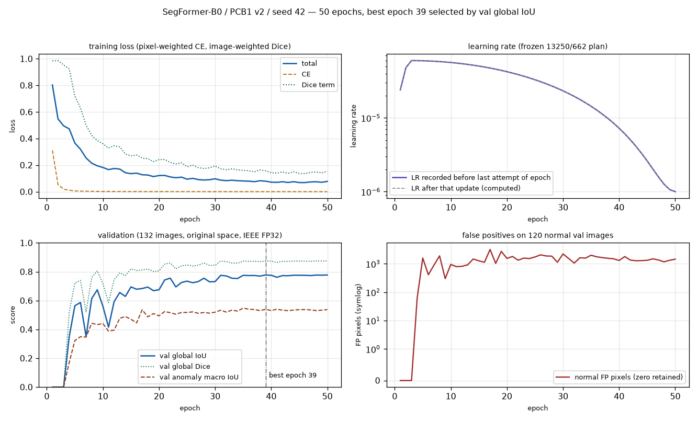
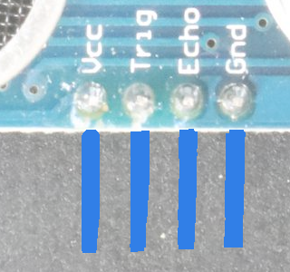

# SegFormer-B0 怎样找出电路板上的缺陷？

**PCB1 监督分割实验速读｜对应开题 PPT 第 9–12 页**

> **汇报时可以这样说（约 30 秒）**  
> 我先在 VisA 的一类电路板上做了一个基线实验，用人工勾出的缺陷区域训练 SegFormer-B0，要求它指出每个缺陷像素的位置。在 442 张测试图上，模型标为缺陷的像素里，约九成确实是缺陷。但从人工标注反过来看，模型只找回了约 74% 的缺陷像素，个别图甚至完全漏检。这次工作给后续改进留下了明确的比较对象：能多找回多少缺陷，又会在正常区域多报多少。

## 1. 模型拿到什么，又要交出什么？（PPT 第 9 页）

**PCB** 是印制电路板，**VisA** 是带有外观缺陷标注的公开图像数据集，**PCB1** 是其中一类板件。每张彩色图都配有一张与它对齐的**掩码**，可以理解为一张答案图：缺陷像素记为 1，其余记为 0，正常板的答案全是 0。训练时用这张答案图教模型逐个像素判断，这就是**有监督二值分割**。“二值”指背景和缺陷两个取值。**基线**指以后换方法时，用来衡量进步或退步的固定方案。

| 哪一组板子 | 正常 / 异常 | 这组图做什么 |
|---|---:|---|
| 训练集，530 张 | 482 / 48 | 给模型看图和答案，更新模型参数。 |
| 验证集，132 张 | 120 / 12 | 每轮训练后检查定位效果，决定保留哪一轮模型。 |
| 测试集，442 张 | 402 / 40 | 模型和评价规则定下后，报告在这组图上的成绩。 |

实验保留 VisA 官方二类监督协议的测试集，从官方训练部分划出验证集。划分时把已识别的同源风险图归在一起，降低相关照片同时出现在训练集和验证集、让成绩虚高的风险。[正式实验卡](../../../work/SegFormer/reports/pcb1_b0_v2_seed42/experiment-card.md)

## 2. 一张板子的照片怎样变成一张缺陷图？（PPT 第 10 页）

```text
原图（宽 1404 × 高 1070）
  ↓ 等比缩到 512 × 390，上下各补 61 像素，得到 512 × 512 输入
MiT-B0 编码器 → 依次生成 128×128、64×64、32×32、16×16 四级特征图
  ↓ 解码头把四级特征对齐到 128 × 128，融合后为每个位置给出背景和缺陷两个分数
分数图 → 放大到 512 × 512 → 裁掉补边 → 还原到原图大小
  ↓ 把两类分数换成概率，缺陷概率达到 0.5 的像素标为 1
原图大小的预测掩码，可以和人工答案逐像素对照
```

**为什么看四个尺度？** 以焊盘边缘为例，密网格保留“边缘在哪儿”的细节，粗网格可以联系周围元件，帮助判断“这里通常是什么结构”。**编码器**负责从图像提取这些线索，每一级输出就是一张**特征图**。这款编码器叫 **Mix Transformer（MiT）**。其中的“自注意力”让模型在判断某个位置时，给图中其他相关位置的线索分配更高权重。B0 是 SegFormer 系列最小的配置。**解码头**把不同尺度的线索合起来，给每个位置分类。这条轻量基线约有 **371 万个可学习参数**。[模型设计与实测输出](../../../work/SegFormer/docs/stages/05-model-design-and-implementation.md)

**为什么先还原分数再画掩码？** 例如相邻两点的缺陷概率接近判定门槛，过早切成 0 和 1 就会丢掉强弱信息。实验先放大连续的类别分数（**logits**），在原图上用 **softmax** 把分数转成概率，再取阈值。这样才能和原始标注在同一坐标上比较。训练时给补边区单独标 255，计算误差时跳过它。[输入、还原与评价配置](../../../work/SegFormer/configs/baseline.yaml)

## 3. 模型怎样学，为什么最后选第 39 轮？（PPT 第 10 页、备 2）

1. **先检查模型学不学得动。** 项目先用少量数据验证训练、保存和重新加载是否正常，再让模型反复学习固定的 8 张训练图，检查它能否复现这些已知答案。随后用完整训练集试跑 3 轮。正式训练从预训练权重重新开始。[八图检查](../../../work/SegFormer/reports/2026-11-01-stage08-09-acceptance.md) · [三轮试跑](../../../work/SegFormer/reports/2026-11-01-stage10-acceptance.md)
2. **用 PCB 标注微调整个网络。** 编码器从 ImageNet 图像数据上训练过的权重起步，二类解码头新建。每批输入 2 张图，整套训练集看一遍称为一轮（**epoch**），共跑 50 轮。训练时图像与答案有一半概率一起左右翻转。**损失**是衡量预测错多少的数：交叉熵逐像素惩罚分错类别，另加半份前景 **Soft Dice 损失**，用连续预测衡量缺陷区域的重合程度。后者只在有缺陷标注的图上计算，正常图仍通过交叉熵教模型少报。更新参数用的是 **AdamW**，一种按误差调整权重的算法。学习率控制每次调整的幅度，本次先升至 0.00006，再逐步降低。[正式训练配置](../../../work/SegFormer/configs/baseline.yaml)
3. **每轮用同一把尺子选模型。** 这把尺子是验证集的**全局前景交并比（IoU）**：把预测与人工都认作缺陷的像素数，除以任一方认为是缺陷的像素数，先汇总整组图再做除法。正式训练前 3 轮，12 张异常验证图的预测都为空。第 4 轮验证 IoU 达到 35.14%，第 39 轮达到最高的 **77.75%**，第 50 轮为 77.73%。所以拿第 39 轮权重去测试。[逐轮日志](../../../work/SegFormer/reports/pcb1_b0_v2_seed42/curves.csv)



*读图时先看左边。左上蓝线是训练损失，前三轮已经下降。左下蓝线是验证 IoU，到第四轮才明显上升。模型开始降低逐像素分类损失，与它开始把缺陷圈出来，是两个可以分别观察的过程。*

## 4. 测试成绩说明了什么？（PPT 第 11–12 页）

测试集里实际有 **341,328 个缺陷像素**。模型找对了 252,227 个，漏了 89,101 个，另外还把 27,779 个背景像素标成了缺陷。主要指标都可以从这三笔数读懂。[测试集原始计数](../../../work/SegFormer/reports/stage12_13_evidence/accepted_eval/test/metrics.json)

| 指标 | 测试结果 | 用一句话读懂 |
|---|---:|---|
| 精确率（Precision） | **90.08%** | 看模型圈出来的区域，每 100 个预测缺陷像素中约 90 个圈对了。 |
| 召回率（Recall） | **73.90%** | 看人工勾出的区域，每 100 个真实缺陷像素中约 74 个被找回，约 26 个被漏掉。 |
| 全局前景 IoU / Dice | **68.33% / 81.19%** | 都衡量预测区域与标注区域的重合程度。IoU 用交集除以并集，Dice 用两倍交集除以“预测面积＋标注面积”。 |
| 异常图平均 IoU | **52.49%** | 先算每一张异常图，再给 40 张图相同权重。全局指标更受并集面积大的样本影响，还计入正常图上的误报。 |



*PPT 第 12 页的样本 049。蓝色标出漏检的位置，整张图有 10,459 个真实缺陷像素，模型的预测却完全为空。另一个极端是正常样本 0333，有 575 个正常像素被误报。402 张正常图中共 32 张出现过误报像素。评估整板报警率还需要定义多大的可疑区域会触发报警。* [逐图错误记录](../../../work/SegFormer/reports/pcb1_b0_v2_seed42/failure-cases.csv)

**这项工作留下的研究起点**是固定的数据划分、选模规则、原图评价流程，以及能逐图复查的漏检和误报。现有证据来自 PCB1、一次训练（随机种子 42，即控制初始化和抽样等随机过程的起点）。后续可以先在训练集和验证集上按缺陷宽度、面积检查漏检集中在哪里，再用同一协议比较改进前后找回的缺陷和新增的误报。另一板型上的表现与重复训练的波动，仍需分别验证。[正式结果与评价口径](../../../work/SegFormer/reports/pcb1_b0_v2_seed42/results.md)
