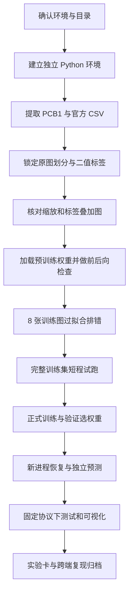

# SegFormer-B0 单基线全程操作指南：在当前 Windows 电脑上与 Agent 协作完成 PCB 缺陷分割

编写日期：2026-10-31；本轮修订：加入 Conda 独立资源部署与逐阶段学习文档要求。适用对象：已有基础 PyTorch 实践，希望理解并亲自验收完整训练流程的学生。

**本指南的目标：用 VisA PCB1 的官方 2-class high-shot 数据，完成 SegFormer-B0 有监督二值分割的环境、数据、训练、验证、独立推理、原图评价、可视化和复现归档。**每张输入图像输出一张缺陷概率图和二值掩码。

本次已完成本机环境与本地数据的只读核查，以及本指南的编写。**工程代码、虚拟环境、训练权重和实验成绩仍需按本指南实际产生。**下文的 `segformer_lab.*`、配置文件和结果文件都是给 Agent 的**待实现接口约定**；首次执行前，先让 Agent 创建对应模块并运行 `--help`。不能把示例路径或命令写进报告，就算实验已经完成。

**本轮新增的执行约定：** 使用指定目录的 Conda 环境，资源统一放 `E:\桌面\AI\segformer_resources`；所有阶段都须交付中文设计与实现 MD。请配套阅读[环境隔离与阶段文档规范](./2026-10-31-segformer-environment-isolation-and-stage-docs.md)及[阶段文档模板](./templates/segformer-stage-design-and-implementation-template.md)。下文的旧分散资源路径与 venv 主方案已统一替换；不会自动迁移或删除已有文件。

当前研究依据：[研究方向与接续说明](./2026-10-29-research-direction-and-handoff.md)、[开题倒排计划](./2026-10-29-proposal-work-plan-to-nov16.md)、[阅读清单](./2026-10-29-reading-list.md)。本指南把第一模型的执行细节补齐；冻结 DINOv3、双编码器融合、云 GPU 和新模型不属于本次基线的必做内容。

**实施进度更新：** 步骤1—3现已完成并通过独立验收，详见[第三阶段验收与修正记录](../../work/SegFormer/reports/2026-10-31-stage03-acceptance.md)及实验目录阶段索引。本指南中“待实现/尚未创建”的说明描述编写时状态；后续执行请先读实际阶段文档，复用现有环境与清单，从步骤4继续。

## 0. 先看清要完成什么

### 0.1 任务定义

- 输入：一张 PCB 板级 RGB 图像。
- 输出：每个像素属于“缺陷”的概率，以及背景/缺陷两类标签。
- 标签 `0`：所有非缺陷区域，包括正常元件、线路和板面；不是只指照片背景。
- 标签 `1`：原始标注中所有非零缺陷 ID 的合并。
- `255`：只用于本指南预处理产生的填充区域，表示不参加损失计算。**原始掩码的非零值须先合并成 1，再产生填充 255。**
- 训练方式：加载 ImageNet-1k 预训练 MiT-B0 编码器，新建二类 SegFormer 解码头，编码器与解码头一起微调。

这是有监督语义分割。VisA 原论文也讨论正常样本异常检测，但这里使用包含异常训练图及掩码的 high-shot 协议。输出不包含电路功能诊断、缺陷原因推断或具体缺陷类型分类。

### 0.2 完成标准

最终应能在**新启动的 Python 进程**中，用保存的最佳权重，对官方测试部分的 442 张原图完成预测、计分和图像导出，并找到以下证据：

| 交付物 | 它能证明什么 |
| --- | --- |
| 环境记录、依赖锁定文件、GPU 检查日志 | 用的是哪个解释器、包版本和 GPU |
| 官方 CSV、派生 train/val/test 清单及校验值 | 哪些原图参与训练，测试是否隔离 |
| 图像/掩码叠加图和数据审计报告 | 标签、缩放和对应关系是否正确 |
| 小样本拟合日志、短程训练日志 | 前向、梯度、优化和保存流程是否工作 |
| 正式训练配置、逐轮日志、best/last checkpoint | 最佳权重如何选出，训练能否继续 |
| 原图尺度测试指标、逐图结果、失败案例 | 分割效果如何，正常图有多少误报 |
| 独立预测命令、复现说明、实验卡 | 其他机器或未来自己能否重新执行 |

“流程已完成”和“模型效果理想”分别判断。若全背景预测，流程可能运行成功，但有效缺陷分割尚未成立；若少量训练图都无法拟合，先排查实现，不进入长时间训练。这里不预先保证某个 IoU，也不把单模型基线当作整篇硕士论文的全部工作。

这次验证集只有 12 张异常图，测试集只有 40 张异常图，单次结果可能对样本较敏感。第一闭环可先用一个训练种子；后续需要稳定性证据时，保持同一份原图划分，另用训练种子 43、44 重复运行，分别按各自验证结果选权重，汇报全部运行而非只挑最好成绩。PCB1 的结果支持该类别与该协议内的结论，跨 PCB 类别或真实产线泛化需后续数据验证。

### 0.3 实施顺序



**执行规则：一阶段一条 Agent 指令，验收后继续。**不要首次就让 Agent 一口气安装、写完所有代码并训练一夜；阶段性检查能把问题定位到具体环节。

## 1. 当前电脑与数据：已确认的事实

以下为 2026-10-31 本次工具实际读取结果，不沿用旧对话中对硬件的口述。

| 项目 | 当前实测 |
| --- | --- |
| 系统 | Windows 11，64 位，系统版本号 10.0.26200 |
| GPU | NVIDIA GeForce RTX 4070 Laptop GPU |
| 显存 | 8188 MiB，约 8 GB；桌面应用会占用一部分 |
| NVIDIA 驱动 | 617.42 |
| 系统内存 | 约 15.2 GiB 可识别总量，约等于标称 16 GB |
| 默认 Python | `E:\Anaconda\python.exe`，Python 3.12.7 |
| 默认 Python 中的关键包 | 尚无 torch、torchvision、transformers、tensorboard；有 NumPy 1.26.4、Pillow 10.4.0、Matplotlib 3.9.2、PyYAML 6.0.1 |
| 仓库 | `E:\桌面\AI\AI_Try` |
| 现有实验目录 | `E:\桌面\AI\AI_Try\work\SegFormer`，现有阶段 Agent 规则，尚无训练工程 |
| 数据归档 | `E:\桌面\AI\AI_Try\docs\dataset\VisA\VisA_20220922.tar` |
| 官方代码 ZIP | `E:\桌面\AI\AI_Try\docs\dataset\VisA\spot-diff-main.zip` |
| E 盘可用空间 | 本次读取约 163.5 GiB，使用前重新检查 |

CPU 的具体商品型号未核实；不影响此处的单 GPU 起步方案。其他 Python 安装未作为本指南的可用解释器依据。现有 Anaconda 配置包含旧镜像和跨平台 channel，因此主方案改为新建指定 prefix 的 Conda 环境，显式限定创建源，项目内用 pip 管理训练包；不修改 base 包或全局 Conda/pip 配置。当前登记列表仅发现 base，常见环境目录为空，不能据此排除其他未登记环境；盘点命令见配套隔离规范。

### 1.1 本地 PCB1 的核查结果

已读取本地 ZIP 中的 `spot-diff-main/split_csv/2cls_highshot.csv`，并检查对应图像/掩码路径在 TAR 中存在。该 CSV 的 SHA-256：

```text
c3331eede15f2da8a75b380d4fbfb24f75ee036ec9a25147eca898da6e972f09
```

| 官方部分 | 正常图 | 异常图 | 总图数 |
| --- | ---: | ---: | ---: |
| train | 602 | 60 | 662 |
| test | 402 | 40 | 442 |
| 合计 | 1004 | 100 | 1104 |

本次还读取了全部 1104 张 PCB1 图像的尺寸信息及全部 100 张异常掩码：

- 图像尺寸均为宽 1404、高 1070，RGB 图像样例已确认；正式导入时仍统一 `.convert("RGB")`。
- 异常掩码为单通道，合并前的取值集合为 `{0,1,2,3,4}`，不能直接把它们送入二类交叉熵。
- 在 100 张异常图中，缺陷面积占比的中位数约 **0.1982%**，最小约 **0.0766%**。这是异常图中的统计，不是全数据集前景占比。
- 将二值掩码按本指南的 512 等比例缩放方式用最近邻处理，100 张中未出现整张缺陷掩码变空；这**不能证明细边界或每个小连通区域都被保留**。
- 本次没有对全部 JPEG 做完整像素解码或图像重复性审计；步骤 4 仍需补齐。

官方入口：[VisA 仓库与数据说明](https://github.com/amazon-science/spot-diff)、[high-shot 划分](https://github.com/amazon-science/spot-diff/blob/main/split_csv/2cls_highshot.csv)。本地归档已存在，通常无须重新下载整个数据集。

## 2. 技术路线与默认配置

### 2.1 为什么这样搭建

| 实现方式 | 判断 |
| --- | --- |
| Hugging Face Transformers 模型接口 + 原生 PyTorch 循环 | **主方案**。使用成熟模型实现，同时能看清 DataLoader、loss、反向传播和验证；适合当前学习目标 |
| NVlabs 原论文旧训练工程 | 适合研究原论文完整训练配方；旧依赖与编译算子会增加本机搭建负担，此阶段不作为起点 |
| MMSegmentation 完整框架 | 有成熟组件，但初期多出框架配置与 MMCV 等依赖学习成本；已有框架需求时再评估 |

权重起点选择 **`nvidia/mit-b0`**：这是 ImageNet-1k 预训练编码器，不是已训练好的 PCB 分割模型。二类解码头随机初始化，随后全网络微调。不要在未记录的情况下换成 ADE20K 分割权重；那会改变预训练条件。[MiT-B0 模型卡](https://huggingface.co/nvidia/mit-b0)

Hugging Face 提供 SegFormer 的分割模型接口；其输出 logits 通常比输入图像小，需要插值到标签或评价尺寸。这里使用二通道 softmax，保留真实背景标签，关闭标签减一处理。[SegFormer 接口说明](https://huggingface.co/docs/transformers/v4.57.1/en/model_doc/segformer)

### 2.2 本指南建议的第一份正式配方

下表是为本任务制定的起步设置，**不是原论文在 ADE20K 上的严格复现配方，也不是本机已验证的最优参数**。

| 项目 | 建议起点 |
| --- | --- |
| 数据 | PCB1，官方 train 再划出验证集，官方 test 保留 |
| 模型 | SegFormer-B0；MiT-B0 ImageNet 编码器 + 新二类解码头 |
| 训练范围 | 编码器、解码头全部可训练 |
| 输入 | 512×512 等比例缩放后居中填充；256 仅用于必要的调试 |
| batch | 训练 2、验证/推理 1；显存不足时训练 1 |
| 梯度累积 | 默认 1；batch 改 1 时可累积 2 次以维持约 2 张的有效 batch，并记录变化 |
| 精度 | CUDA FP16 AMP，损失中的 Dice 在 FP32 计算 |
| 优化器 | AdamW，学习率 `6e-5`，weight decay `0.01`；bias/归一化参数不衰减 |
| 学习率计划 | 线性 warmup 占优化器总更新步数 5%，之后余弦下降至 `1e-6` |
| 正式训练上限 | 50 epochs；先试跑 3 epochs，实测再决定是否需要调整上限 |
| 损失 | `CE + 0.5 × 前景 Soft Dice`，定义见步骤 7；CE-only 用于模型/梯度核验 |
| 增强 | 仅训练使用同步水平翻转，概率 0.5；首轮不加随机裁块与复杂颜色增强 |
| DataLoader | Windows 起步 `num_workers=0`，稳定后可测 2；不把全数据预加载到内存 |
| 随机种子 | 数据划分 42；模型/训练 42；两者分别记录 |
| 最佳权重 | 验证集原图尺度、固定阈值 0.5 下的缺陷类全局 IoU 最大；并列取较早轮次 |
| 测试阈值 | 0.5 固定，不加连通域过滤、TTA 或其他后处理 |

CPU/RAM/显存的可用量随应用变化。8GB 显存适合从 B0、小 batch 开始试跑，但实际能否稳定运行以及耗时，需要由步骤 8—10 的日志确认。

## 3. 步骤 1：统一目录、解释器与 Agent 工作约定

### 3.1 目录规划

沿用已有的 `work\SegFormer`，不要创建一个无法追溯的第二仓库。建议规划如下，除已注明现存的目录外，均由后续阶段创建：

```text
E:\桌面\AI\
├─ segformer_resources\               # 统一独立资源根目录，仓库外
│  ├─ env\                             # 独立 Conda Python 环境
│  ├─ cache\                           # Conda/pip/HF/torch等项目缓存
│  ├─ config\condarc.yml                # 项目配置，不覆盖全局配置
│  ├─ tmp\ / audit\                    # 项目临时文件与环境快照
│  ├─ data\visa\pcb1\                  # 保留官方相对路径
│  ├─ models\mit-b0\                    # 固定revision的预训练快照
│  └─ runs\                             # 权重、日志、批量预测
└─ AI_Try\
   ├─ docs\research\本指南
   ├─ docs\dataset\VisA\...          # 现有 TAR 和 ZIP
   └─ work\SegFormer\
      ├─ AGENTS.md                        # 阶段交付与隔离规则
      ├─ README.md
      ├─ scripts\enter_project.ps1
      ├─ scripts\run_project.ps1
      ├─ docs\stages\README.md
      ├─ docs\stages\01-workspace-design-and-implementation.md
      ├─ docs\stages\...               # 13个阶段各一份中文设计/实现记录
      ├─ requirements-lock.txt
      ├─ configs\baseline.yaml
      ├─ configs\smoke.yaml
      ├─ configs\overfit.yaml
      ├─ configs\pilot.yaml
      ├─ manifests\official_2cls_highshot.csv
      ├─ manifests\train.csv
      ├─ manifests\val.csv
      ├─ manifests\test.csv
      ├─ manifests\split_meta.json
      ├─ manifests\overfit_train_ids.txt
      ├─ segformer_lab\__init__.py
      ├─ segformer_lab\env_check.py
      ├─ segformer_lab\prepare_data.py
      ├─ segformer_lab\audit_data.py
      ├─ segformer_lab\preview_data.py
      ├─ segformer_lab\download_model.py
      ├─ segformer_lab\data.py
      ├─ segformer_lab\modeling.py
      ├─ segformer_lab\losses.py
      ├─ segformer_lab\metrics.py
      ├─ segformer_lab\smoke.py
      ├─ segformer_lab\train.py
      ├─ segformer_lab\evaluate.py
      ├─ segformer_lab\predict.py
      ├─ segformer_lab\summarize.py
      ├─ segformer_lab\utils.py
      └─ reports\                       # 小型审计摘要与实验卡
```

`modeling.py` 等是实现模块，不需要都有命令行。带执行命令的模块应有 `main()` 和 Windows 所需的 `if __name__ == "__main__":` 保护。所有程序用 `pathlib.Path` 处理中文路径；PIL 负责读图，不引入 OpenCV 作为前置依赖。

### 3.2 每次开工加载独立项目上下文

第一阶段先按[隔离规范第4节](./2026-10-31-segformer-environment-isolation-and-stage-docs.md)盘点并创建启动入口。首次尚无入口时可在专用 PowerShell 粘贴其完整命令块；不要先假定启动脚本已经存在。入口落地后，每次开工：

```powershell
$SegProject = 'E:\桌面\AI\AI_Try\work\SegFormer'
Set-Location -LiteralPath $SegProject
. '.\scripts\enter_project.ps1'
```

入口定义 `$SegConda`、`$SegResource`、`$SegEnv`、`$SegPython`、`$SegOutput`、项目缓存和临时目录，并提供 `Invoke-SegPython` / `Invoke-SegPip`。下文统一使用这两个包装命令，它们通过 `conda run --prefix` 获得该环境的 Windows 运行上下文。

每个新 Agent 工具进程必须重新加载上下文，或使用 `scripts/run_project.ps1 -PythonArgs @(...)`；不要假设前一次工具调用中的函数、环境变量仍然有效。无需 `conda init`、`setx` 或全局 PATH 变更。详细命令、可选人工 activate/deactivate、配置复查和隔离验收都在配套规范中。

### 3.3 给 Agent 的首条总约束

```text
请先读 docs/research/2026-10-31-segformer-baseline-end-to-end-guide.md，
以及当前研究方向说明。当前只完成 VisA PCB1 high-shot 的 SegFormer-B0 单基线。
代码放 AI_Try/work/SegFormer，中文说明，英文文件名，原生 PyTorch 训练循环。
使用 segformer_resources/env 独立Conda环境，数据、缓存、临时文件、模型与批量产物均按配套规范隔离；保留base、旧环境、全局配置与用户文件。
只执行我当前指定的阶段。先检查真实文件，再实现该阶段必要文件。
每阶段返回：改动文件、准确命令、实际执行结果、产物路径、未完成项、我该检查什么。
凡未运行的命令、未完成的训练、估计的资源开销，均明确标注；不得编造指标。
每个编号阶段必须按模板生成或更新 work/SegFormer/docs/stages/NN-<topic>-design-and-implementation.md，
中文解释设计、实现细节、技术栈/实际版本、代码与命令、真实验证、问题与学习要点。
若同时做步骤1—2，分别输出两份MD；未运行/受阻也须记录真实状态，不伪造完成报告。
更新 docs/stages/README.md 索引以及 work/SegFormer/README.md 的进度记录，返回文档链接。
```

你负责确认数据叠加图、训练日志和结果是否合理，要求 Agent 解释关键代码。Agent 负责实现、检查和定位报错。每阶段可让同一 Agent 再做一次只读自查；不要求必须启用多个并行 Agent。

**本阶段必交学习文档：** `docs/stages/01-workspace-design-and-implementation.md`。按[统一模板](./templates/segformer-stage-design-and-implementation-template.md)交代目标、设计、实现、技术栈与实际版本、操作/验证证据及学习要点，并更新阶段索引；未验证部分明确标记。

## 4. 步骤 2：建立环境并验证 GPU

### 4.1 创建独立 Conda 环境

先完成配套隔离规范第3—4节：保存base/已知旧环境与配置的快照，加载当前项目进程变量，写入项目 `condarc.yml`，准备独立包缓存。以下是未来实际执行步骤，本轮编写文档未创建环境或安装包。

```powershell
if (Test-Path -LiteralPath $SegEnv) { throw '目标环境已存在，先盘点核对，勿覆盖创建。' }
Assert-SegCondaIsolation
& $SegConda create --prefix $SegEnv --copy --no-shortcuts --no-default-packages --override-channels --channel 'https://repo.anaconda.com/pkgs/main' --strict-channel-priority 'python=3.12' pip -y
if ($LASTEXITCODE -ne 0) { throw '环境创建失败，请先处理完整报错。' }
Invoke-SegPython -c "import sys,site; print(sys.executable); print(sys.version); print(sys.prefix); print(site.ENABLE_USER_SITE)"
Invoke-SegPip install --no-user --upgrade pip --index-url 'https://pypi.org/simple'
```

新环境应位于 `E:\桌面\AI\segformer_resources\env`，Python为实际取得的3.12修订版，用户site禁用。不要装入base，不要在新Conda环境里再建venv。如果创建失败，记录错误并在本项目范围排查，不切回全局Python安装来绕过。

### 4.2 安装已明确版本的核心依赖

本指南选择已有官方安装指令的 **PyTorch 2.10.0 + torchvision 0.25.0，CUDA 12.6 wheel**，以及 Transformers 4.57.6。它们是可核对的固定起点，**不宣称是截至未来执行时的最新版，也尚未在本机做组合运行验证**。若安装检查发现真实兼容问题，再由 Agent 提出替代并记录变更。[PyTorch 版本配对](https://pytorch.org/get-started/previous-versions/)、[Transformers 4.57.6 发布记录](https://github.com/huggingface/transformers/releases/tag/v4.57.6)

```powershell
Invoke-SegPip install --no-user torch==2.10.0 torchvision==0.25.0 --index-url https://download.pytorch.org/whl/cu126
Invoke-SegPip install --no-user 'transformers==4.57.6' 'huggingface-hub>=0.34,<1' 'numpy>=1.26,<3' 'Pillow>=10,<13' 'matplotlib>=3.9,<4' 'PyYAML>=6,<7' 'tqdm>=4.66,<5' 'tensorboard>=2.18,<3' --index-url 'https://pypi.org/simple'
Invoke-SegPip check
```

音频包 torchaudio、本任务不使用的 `datasets`、`accelerate`、MMCV、自定义 CUDA 算子均不是第一轮依赖。辅助包范围待成功导入后用 `pip freeze` 固定；核心 torch 与 torchvision 成对调整。

本机驱动报告的 CUDA 能力版本与 Python wheel 的运行时版本不是一回事。通常使用预编译 wheel 训练本模型，不需要另外安装一套匹配数值的 CUDA Toolkit 或手动拷贝 cuDNN。首先看当前环境中的 `torch.cuda.is_available()` 和真实 CUDA 运算结果。[PyTorch 安装入口](https://pytorch.org/get-started/locally/)

### 4.3 最小 GPU 核验

```powershell
Invoke-SegPython -c "import torch, torchvision, transformers; print(torch.__version__, torchvision.__version__, transformers.__version__); print('CUDA build:', torch.version.cuda); print('available:', torch.cuda.is_available()); assert torch.cuda.is_available(); print(torch.cuda.get_device_name(0)); x=torch.randn(256,256,device='cuda',requires_grad=True); loss=(x@x.T).square().mean(); loss.backward(); torch.cuda.synchronize(); print('loss:', loss.item(), 'grad finite:', bool(torch.isfinite(x.grad).all()))"
```

预期：解释器路径位于 `segformer_resources\env`；CUDA 为 True；GPU 名称为 RTX 4070 Laptop；loss 和梯度有限。该运算只说明基础 GPU 运算可用，不能证明 SegFormer 已跑通。

让 Agent 在 `env_check.py` 中记录版本、GPU、显存、Python 路径、OS、可用内存与磁盘；不要导出整份环境变量或账号信息。随后执行约定接口：

```powershell
Invoke-SegPython -m segformer_lab.env_check --out 'reports\environment.json'
Invoke-SegPip freeze | Set-Content -LiteralPath 'requirements-lock.txt' -Encoding utf8
```

**本步验收：** `pip check` 无依赖冲突，GPU 运算完成，环境 JSON 与锁定文件存在；包与缓存/临时路径均位于项目资源根，base/已盘点旧环境包清单及原有配置前后核对一致。按配套规范保存 environment-history.yml 和审计记录。仅下载完成但导入失败，不算通过。

**给 Agent 的阶段指令：**“只完成步骤 1—2，创建必要的包入口和环境检查模块，执行导入、CUDA 前后向检查，输出结果；先不要下载模型或开始训练。”

**本阶段必交学习文档：** `docs/stages/02-environment-design-and-implementation.md`。按[统一模板](./templates/segformer-stage-design-and-implementation-template.md)交代目标、设计、实现、技术栈与实际版本、操作/验证证据及学习要点，并更新阶段索引；未验证部分明确标记。

## 5. 步骤 3：引入 PCB1、固定划分与标签规则

### 5.1 导入策略

由 `prepare_data.py` 完成以下流程：

1. 从已有 ZIP 读取官方 `2cls_highshot.csv`，保留完整原 CSV 到 `manifests/official_2cls_highshot.csv`，记录其 SHA-256。
2. 仅选择 `object == "pcb1"`；保留原始 `split` 和 `label` 字段，不把 1-class CSV 混入。
3. 从 TAR 提取 PCB1 的文件至 `E:\桌面\AI\segformer_resources\data\visa`，保留 `pcb1/Data/...` 路径。提取前检查成员最终路径位于目标根目录内，拒绝绝对路径、`..`、链接和意外覆盖。
4. 同一路径已存在时，核验而不是无条件覆盖；记录归档大小和提取文件清单。原 TAR 与 ZIP 留在原处。
5. 只对官方 train 的 662 张原图划分训练与验证；官方 test 的 442 张保持不变。
6. 写出派生清单、统计和 `split_meta.json`。任何重复运行都应得到相同清单内容与校验值，或清楚说明差异来源。

不必先运行官方准备脚本复制全套 12 类数据；本工程直接按 CSV 读取原始路径。官方准备代码会把非零标注转换为 255 以便存图，本工程则在内存中转换为训练标签 1。**两种约定都可存在，但不能把保存用的 255 直接当作本任务训练时的缺陷类。**

### 5.2 固定验证集划法

**2026-10-31 第四阶段验收更新：当前采用 v2 分组协议。**Normal/0042 与 0043 存在高可信同实物／固定场景近重复风险，已作为不可分组重出完整清单，两张都在 train。原 v1 文件级随机划分保留在 `work/SegFormer/manifests/archive/pcb1_v1`；当前实验以 `manifests/split_meta.json` 及三份 CSV 哈希为准。详见[第四阶段验收](../../work/SegFormer/reports/2026-10-31-stage04-acceptance.md)。

为避免“20%”的不同舍入实现带来跨端差异，配额保持不变，当前规则为：

- 只在官方 train 内按 `manifests/reviewed_groups.json` 建立不可分组，其余图片为单例；每组必须同类。
- 按组内最小路径排序；使用一个 `numpy.random.default_rng(42)`，先排列 normal 组，再排列 anomaly 组。
- 顺序选取能放进剩余验证配额的整组，精确填满正常 120 张、异常 12 张；若凑不齐就失败，不能拆组；余下作为训练。
- 保存清单后按 `image` 排序，文件编码 UTF-8；记录算法、配额、随机种子和 NumPy 版本。
- 正式运行以**保存的清单及其 SHA-256**为准，不能每轮重新随机切分。

| 最终部分 | 正常 | 异常 | 总计 |
| --- | ---: | ---: | ---: |
| train | 482 | 48 | 530 |
| val | 120 | 12 | 132 |
| test | 402 | 40 | 442 |

清单保留 `object,split,label,image,mask` 五列，其中 `split` 为派生后的 train/val/test；原始来源由官方 CSV 与元数据追溯。正常图 `mask` 字段保留空字符串，Dataset 内生成全零掩码，不能将空值拼成目录后当作图像读取。

路径示例：

```csv
object,split,label,image,mask
pcb1,train,normal,pcb1/Data/Images/Normal/0417.JPG,
pcb1,train,anomaly,pcb1/Data/Images/Anomaly/053.JPG,pcb1/Data/Masks/Anomaly/053.png
```

上面用于说明列与原始相对路径；两行实际最终属于 train 还是 val，必须由固定算法生成，**不要手动照抄这两行作为真实训练清单**。

### 5.3 运行接口与验收

Agent 实现模块后，从 `$SegProject` 执行：

```powershell
Invoke-SegPython -m segformer_lab.prepare_data --archive '..\..\docs\dataset\VisA\VisA_20220922.tar' --source-zip '..\..\docs\dataset\VisA\spot-diff-main.zip' --data-root 'E:\桌面\AI\segformer_resources\data\visa' --category pcb1 --seed 42 --val-normal 120 --val-anomaly 12 --reviewed-groups 'manifests\reviewed_groups.json' --out 'manifests'
```

**本步验收：** 三份计数与上表一致；集合两两无交集；官方测试路径集合完全相等；异常图均有可读取的掩码；正常图可构造零掩码；官方 CSV 校验值与本指南一致，或已说明版本变化；重复执行不会重划分。

若在后续发现近重复或同一实物跨集，不要只保证文件名不同。应记录并评估分组划分需求；若改变官方测试协议，另设实验协议并交代，不能继续冒充原 high-shot 测试。

**给 Agent 的阶段指令：**“只完成步骤 3，安全提取 PCB1、导出官方 CSV、生成固定配额划分和元数据，执行计数与交集检查；不要训练，返回三份清单与审计摘要。”

**本阶段必交学习文档：** `docs/stages/03-data-preparation-design-and-implementation.md`。按[统一模板](./templates/segformer-stage-design-and-implementation-template.md)交代目标、设计、实现、技术栈与实际版本、操作/验证证据及学习要点，并更新阶段索引；未验证部分明确标记。

## 6. 步骤 4：完成数据审计与可视化，先查标签再接模型

### 6.1 自动审计项目

让 `audit_data.py` 检查并输出 JSON 与简短 Markdown：

1. 1104 张图像可完整解码，100 张异常掩码可完整解码；尺寸匹配，未出现 RGB 彩色标注误读。
2. 每张异常图原始像素值集合、合并后的 `{0,1}` 集合、前景像素数和占比。
3. 正常图构造的掩码全零；异常图掩码若为空，视为需要排查的问题。
4. 原图路径重复、图像内容哈希重复、图像/掩码缺失、跨划分重复。文件 SHA 重复是明确重复证据；没有相同哈希不等于排除了近重复。
5. 各划分异常图的前景面积分布及可能的尺寸差异；官方 CSV 中不存在空图像路径。
6. 原始与 512 变换后前景面积、消失的缺陷连通区域或极薄结构。全掩码不为空不代表每一处缺陷还在。

正常图和异常图都要进入训练与评价。首轮不使用按缺陷位置筛选的测试裁块。

### 6.2 人工看图的具体要求

输出至少 12 个训练样本：6 张正常、6 张异常，异常尽量覆盖不同面积。另输出 6 个验证样本用于检查预处理。每个样本包含：

```text
原 RGB 图 | 原二值掩码 | 红色半透明 GT 叠加 | 512 输入与填充边界 | 512 标签与忽略区
```

文件名包含 split 与 image ID，图注写原尺寸、前景像素数及比例。正常样本应没有红色缺陷；异常掩码应覆盖实际可见瑕疵，边缘不能整体偏移。

**不要仅展示二值掩码。**只看黑白图，无法发现图像与掩码错配、左右翻转不同步或宽高弄反。

```powershell
Invoke-SegPython -m segformer_lab.audit_data --config 'configs\baseline.yaml' --out 'reports\data_audit'
Invoke-SegPython -m segformer_lab.preview_data --config 'configs\baseline.yaml' --split train --normal 6 --anomaly 6 --out 'E:\桌面\AI\segformer_resources\runs\data_preview\train'
Invoke-SegPython -m segformer_lab.preview_data --config 'configs\baseline.yaml' --split val --normal 3 --anomaly 3 --out 'E:\桌面\AI\segformer_resources\runs\data_preview\val'
```

这里首次需要 `baseline.yaml`，由 Agent 在本步创建步骤 6 所列的完整配置。此步审计/预览只使用 PIL、NumPy 与几何变换工具，不初始化模型或 image processor，也不要求模型快照已存在；尚未实现的模块留到所属阶段。

**本步验收：** 审计没有未处理的数据错误；你亲自打开叠加图；Agent 能指认至少三处真实缺陷以及它们的掩码位置。测试图的表现分析留到最终测试，当前以训练/验证图完成预处理检查。

**给 Agent 的阶段指令：**“实现数据审计与预览，展示正常/异常、原图/512 变换的对应关系；标出 padding=255，输出清单校验值与数据分布。等我看完图再接模型。”

**本阶段必交学习文档：** `docs/stages/04-data-audit-design-and-implementation.md`。按[统一模板](./templates/segformer-stage-design-and-implementation-template.md)交代目标、设计、实现、技术栈与实际版本、操作/验证证据及学习要点，并更新阶段索引；未验证部分明确标记。

## 7. 步骤 5：取得预训练权重并搭建模型

### 7.1 下载一次、固定一次

让 `download_model.py` 使用 `huggingface_hub`：

1. 查询 `nvidia/mit-b0` 当前提交 SHA，固定为这次实验的 revision。
2. 用该 SHA 下载配置、processor 配置及 PyTorch 权重；不要只下载 README 或 Git LFS 指针。
3. 存入 `E:\桌面\AI\segformer_resources\models\mit-b0`；保存 `source.json`，包含模型 ID、revision、下载时间与权重 SHA-256。
4. 后续从本地目录以 `local_files_only=True` 加载，避免每次训练访问网络或悄悄更新权重。

模型下载使用官方 Hub 的快照接口即可；网络失败时记录具体错误，允许断点重试或在可联网机器下载完整快照后搬运。不要通过一个普通 Git clone 的小指针文件判断权重已取得。[Hub 下载说明](https://huggingface.co/docs/huggingface_hub/guides/download)

```powershell
Invoke-SegPython -m segformer_lab.download_model --model-id 'nvidia/mit-b0' --out 'E:\桌面\AI\segformer_resources\models\mit-b0'
```

### 7.2 加载逻辑示意

下面用于说明接口和必须检查的状态，不是完整训练脚本：

```python
from transformers import SegformerImageProcessor, SegformerForSemanticSegmentation

processor = SegformerImageProcessor.from_pretrained(
    local_model_dir,
    local_files_only=True,
    do_resize=False,
    do_reduce_labels=False,
    do_rescale=True,
    do_normalize=True,
)
model, loading_info = SegformerForSemanticSegmentation.from_pretrained(
    local_model_dir,
    local_files_only=True,
    num_labels=2,
    id2label={0: "background", 1: "defect"},
    label2id={"background": 0, "defect": 1},
    semantic_loss_ignore_index=255,
    ignore_mismatched_sizes=True,
    output_loading_info=True,
)
```

从图像分类编码器权重建立分割模型时，未使用的分类头、新初始化的分割解码头属于预期差异。**编码器大量 missing/mismatched keys 不是正常现象**，不能用 `ignore_mismatched_sizes=True` 将其掩盖。记录完整加载报告并核对编码器权重确实来自预训练快照。

### 7.3 先用人工张量做单次前向与反向核验

- 此步先用人工 RGB 张量 `[2,3,512,512]` 和含 0/1/255 的 long 标签检查模型，不依赖尚未实现的真实 Dataset；步骤 6 完成后再接真实图片。
- 所有模型参数默认可训练，输出参数总数与可训练数，确认编码器不是误冻结。
- 512 输入的典型输出是 `[B,2,128,128]` logits，读取实际输出确认，避免在代码里盲目写死。
- 用双线性插值、`align_corners=False` 将 logits 上采样到 `[B,2,512,512]` 后计算像素损失。
- CE 输入为原始 logits，标签为 `[B,H,W]` long，不能先 softmax 再给 CE，更不能先 argmax 再反向传播。
- 检查编码器和解码头至少各一个参数的梯度非零且有限，optimizer step 后参数发生变化。

这个阶段只用 `CrossEntropyLoss(ignore_index=255)` 也足以检查反向传播；正式的组合损失在步骤 7 接入。

**给 Agent 的阶段指令：**“实现下载和模型封装，核验 revision、encoder 加载、二类输出、输入/输出尺寸、CE 和梯度。返回加载报告和编码器/解码头各一个梯度/参数变化证据，先不正式训练。”

**本阶段必交学习文档：** `docs/stages/05-model-design-and-implementation.md`。按[统一模板](./templates/segformer-stage-design-and-implementation-template.md)交代目标、设计、实现、技术栈与实际版本、操作/验证证据及学习要点，并更新阶段索引；未验证部分明确标记。

## 8. 步骤 6：实现 Dataset、变换和配置

### 8.1 统一 512×512 处理

主方案采用 **保持长宽比缩放 + 居中填充（letterbox）**，降低非等比例拉伸带来的几何变化。对宽 1404、高 1070 的本地 PCB1：

1. 计算比例 `r = min(512 / W, 512 / H)`。
2. 计算整数 `new_w = round(W*r)`、`new_h = round(H*r)`，记录实际整数尺寸。
3. 本数据得到 `new_w=512`、`new_h=390`，上、下各填充 61 像素。
4. 图像使用双线性插值；二值掩码使用最近邻插值。
5. 图像填充 RGB `(124,116,104)`；标签填充 `255`，不参与 CE/Dice。
6. 保存 `orig_w,orig_h,new_w,new_h,left,top,right,bottom`，供推理还原使用。

不要用 `ToTensor()` 对标签缩放成浮点 `[0,1/255]`；标签用 NumPy 整数数组转 `torch.long`。掩码合并逻辑的核心是：

```python
binary_mask = (raw_mask > 0).astype("uint8")
```

前景合并发生在填充之前。如果对已经填充 255 的结果再执行 `>0`，会把 padding 错标成缺陷。

### 8.2 图像归一化与增强

- 模型快照中的 image processor 保存归一化配置，随模型一起使用并记录。
- 几何变换由 Dataset 完成；processor 设置 `do_resize=False`，避免再次缩放。
- Dataset 把 uint8 RGB 图交给 processor，保留其一次 `do_rescale=True` 和 `do_normalize=True`；不要提前除以 255 后又让 processor 再除一次。
- 明确 `do_reduce_labels=False`，保留背景标签 0；标签不交给默认 ADE20K 减一流程。
- 训练时对原图与原二值掩码同步水平翻转，再 letterbox；验证/测试不做随机变换。
- mask 的几何变换必须与图像使用同一随机决策，但采用不同插值规则。

首轮不用随机裁块，便于保持完整板面与原图评价。若以后研究局部裁块，先锁定原图划分，并为回拼、边界与采样重新制定独立配置。

### 8.3 Dataset 和 DataLoader 的验收形状

每个训练样本返回至少：

| 字段 | 约定 |
| --- | --- |
| `pixel_values` | `float32 [3,512,512]`，已经按预训练配置归一化 |
| `labels` | `int64 [512,512]`，值为 0/1/255 |
| `image_id` | 可追溯到原图相对路径的稳定 ID，避免仅用可能重名的文件 stem |
| `geometry` | 上述缩放/填充元数据 |
| `original_mask` | 验证/测试读取的原图尺寸二值标注，或其路径 |

batch=2 时前两项为 `[2,3,512,512]`、`[2,512,512]`。几何信息和原图标签保留为逐样本列表；未来类别尺寸变化时，不能要求默认 collate 强行堆叠所有原尺寸标签。

Windows 使用 `num_workers=0` 起步。若改为 2，Dataset、collate 函数应位于可导入模块顶层，入口有 main 保护，worker 内不做 CUDA 运算。[PyTorch Windows FAQ](https://docs.pytorch.org/docs/2.10/notes/windows.html)

### 8.4 `configs/baseline.yaml` 接口范本

所有相对路径按**实验项目根目录 `$SegProject`**解析；运行时将解析后的绝对路径保存到 `resolved_config.yaml`。下面是约定格式，由 Agent 落实读取和校验。

```yaml
experiment:
  name: segformer_b0_pcb1_v1
  seed: 42
  output_root: E:/桌面/AI/segformer_resources/runs
data:
  root: E:/桌面/AI/segformer_resources/data/visa
  category: pcb1
  train_manifest: manifests/train.csv
  val_manifest: manifests/val.csv
  test_manifest: manifests/test.csv
  split_meta: manifests/split_meta.json
  train_ids_file: null
  input_size: 512
  resize_mode: letterbox
  image_pad_rgb: [124, 116, 104]
  ignore_index: 255
  horizontal_flip_p: 0.5
  workers: 0
model:
  pretrained_dir: E:/桌面/AI/segformer_resources/models/mit-b0
  num_labels: 2
  id2label: {0: background, 1: defect}
  train_encoder: true
train:
  epochs: 50
  max_steps: null
  batch_size: 2
  gradient_accumulation_steps: 1
  amp: true
  learning_rate: 0.00006
  min_learning_rate: 0.000001
  weight_decay: 0.01
  warmup_ratio: 0.05
  grad_clip_norm: 1.0
  validate_every_epochs: 1
  early_stopping: false
loss:
  ce_weight: 1.0
  foreground_dice_weight: 0.5
  dice_epsilon: 0.000001
eval:
  batch_size: 1
  threshold: 0.5
  metric_space: original
  postprocess: none
  selection_metric: foreground_iou_global
logging:
  tensorboard: true
  log_every_micro_steps: 20
  fixed_preview_manifest: manifests/val_preview_ids.txt
```

`train_ids_file: null` 表示使用完整 train；smoke/overfit 配置填写仅来源于 train 的 8 个稳定 ID 文件，train 模块据此筛选，并校验 ID 全部属于 train。`val_preview_ids.txt` 在验证集中固定挑选 3 正常、3 异常，使用稳定 ID，之后不根据效果随意替换。`smoke.yaml/overfit.yaml/pilot.yaml` 各自保存完整配置，避免靠隐含继承产生无法追溯的默认值。

**本步验收：** 随机取一批打印形状、dtype、标签唯一值；检查 padding 与有效像素数；同一验证样本重复读取一致；训练增强后的图像/掩码叠加仍对齐。正常图除 padding 外只有 0。

**给 Agent 的阶段指令：**“实现配置解析、PCB1 Dataset、可追溯 ID、同步变换、letterbox 元数据和 DataLoader。展示一批张量与增强叠加图，说明 processor 如何避免二次 resize/归一化。”

**本阶段必交学习文档：** `docs/stages/06-dataset-design-and-implementation.md`。按[统一模板](./templates/segformer-stage-design-and-implementation-template.md)交代目标、设计、实现、技术栈与实际版本、操作/验证证据及学习要点，并更新阶段索引；未验证部分明确标记。

## 9. 步骤 7：先定义损失与指标，避免‘能跑但算错’

### 9.1 正式损失的精确定义

由于缺陷前景很少，第一份实用配方采用 `L = L_CE + 0.5 × L_Dice`。这仍是 SegFormer 单模型，只是明确了常见的训练配方；不能把普通损失组合宣称为新算法。

`L_CE`：二通道交叉熵，对非 255 像素取均值。`L_Dice`：先将上采样 logits 转 FP32，softmax 后取缺陷通道；**仅对含真实缺陷像素的样本计算逐图前景 Soft Dice，再取平均**：

```text
valid = labels != 255
g = labels == 1
p = softmax(logits, dim=1)[:, 1]
每张异常图：Dice = (2×sum(p×g×valid)+eps) / (sum(p×valid)+sum(g×valid)+eps)
L_Dice = mean(1-Dice)，仅对 sum(g×valid)>0 的图求均值
```

当 batch 全为正常图时，Dice 项设为与计算图相连的 0，例如 `p.sum()*0.0`；正常图由 CE 监督，仍惩罚误报。padding 对两项损失均无贡献。保存损失的精确定义，防止后续 Agent 换成另一种 Dice 实现却沿用同一实验名。

先不加类别权重、focal loss、异常过采样与多种边界损失。若全背景预测，先完成步骤 9 的实现排错，再在验证集上一次改变一个因素，另存新配置。

### 9.2 原图尺度计分

主指标使用所有评价原图累计的**缺陷类**混淆量：

```text
TP：预测缺陷且 GT 缺陷
FP：预测缺陷但 GT 正常
FN：预测正常但 GT 缺陷
TN：预测正常且 GT 正常
foreground IoU = TP / (TP + FP + FN)
foreground Dice = 2TP / (2TP + FP + FN)
precision = TP / (TP + FP)
recall = TP / (TP + FN)
```

使用 64 位整数累计像素数。**先累计再计算**，不要把 batch IoU 或每图 IoU 直接平均后冠以全局 IoU。全测试集存在真实缺陷时，全背景预测的 IoU/Dice/recall 为 0；precision 因没有预测正类而报告 `NA`，不能靠平滑项得到漂亮分数。

其他约定：

- 验证/测试 GT 使用原始二值掩码，不先把 GT 缩小到 512 再计分。
- 仅正常图上累计 `FP_normal / 全部正常图像素数`，报告正常图误报像素比例。
- 同时报告正常图逐图预测缺陷面积比例的中位数/P95，避免全局均值掩盖少数严重误报。
- 逐图 IoU/Dice：正常且预测空时写 `NA`，不将大量空图按 1 分加入均值；异常图逐图结果另列为异常图宏平均。
- 若某个分组分母为零，写 `NA` 和原因。验证/测试均含异常图，主全局指标正常应有定义。
- 像素准确率可放附录，但不能作为缺陷检测有效性的主结论。
- 当前不报告“图像级缺陷检出率”，因为那需要另定义像素到图像的判定规则。若以后增加，必须在验证集选规则并冻结。

### 9.3 必做的人工小例子

让 Agent 用小数组核对指标，无需写庞大测试框架：

```text
GT   = [[0,1], [1,0]]
Pred = [[0,1], [0,0]]
TP=1, FP=0, FN=1, TN=2
IoU=0.5, Dice=2/3, precision=1, recall=0.5
```

再检查：全对、全背景、全前景、正常 GT 上出现 FP、忽略像素、将同一组数据分为不同 batch 累计后结果相同。Dice loss 在完美预测时接近 0，padding 区概率改变不影响 loss。

**本步验收：** 上述手算与程序一致，loss 有限，预测空图不会带来虚高主指标。没有必要单独引入另一套第三方评价框架。

**给 Agent 的阶段指令：**“实现指南精确定义的损失、原图混淆量和正常图误报统计，用人工小数组核对；解释 loss 的空前景处理与指标的空 GT 处理为什么不同。”

**本阶段必交学习文档：** `docs/stages/07-loss-metrics-design-and-implementation.md`。按[统一模板](./templates/segformer-stage-design-and-implementation-template.md)交代目标、设计、实现、技术栈与实际版本、操作/验证证据及学习要点，并更新阶段索引；未验证部分明确标记。

## 10. 步骤 8：20 步冒烟检查，验证完整代码通路

由 Agent 生成 `smoke.yaml`：输入 512、batch 2、只使用训练清单中固定 4 正常+4 异常，关闭增强，种子 42，AMP 开启，梯度累积 1，最多 20 次 optimizer 更新。验证只读取少量固定 val 图用于通路检查，结果标为 smoke，不能当性能结论。

```powershell
Invoke-SegPython -m segformer_lab.smoke --config 'configs\smoke.yaml' --out 'E:\桌面\AI\segformer_resources\runs\smoke_001'
```

冒烟程序必须实际完成：

1. 数据读取、图像与标签上 GPU、模型前向、上采样。
2. 组合损失、AMP 反传、optimizer 更新。
3. 小批量验证、原图还原和计分。
4. 保存 checkpoint，关闭原进程后可重新加载。
5. 输出至少一张异常和一张正常预测图，附配置、日志和形状。
6. 记录峰值 `torch.cuda.max_memory_allocated()`、`max_memory_reserved()`、有效 batch、单步时间。GPU 计时前后同步；首次初始化/下载时间单独记录。

推荐现代 AMP 接口为 `torch.autocast(device_type="cuda", dtype=torch.float16)` 与 `torch.amp.GradScaler("cuda")`；裁剪梯度前先 `scaler.unscale_(optimizer)`。[PyTorch AMP](https://docs.pytorch.org/docs/2.10/amp.html)

**本步验收：** 没有尺寸或 dtype 错误、NaN/Inf、CUDA OOM；编码器与头均收到梯度；完成真实保存/恢复；日志中能看到优化更新次数。只在 CPU 上跑通、只输出模型结构或 loss 没有反传，都不算本步完成。

此时不要求未充分训练的预测准确，随机头产生的差结果不能用来判断 SegFormer 不适合 PCB。

**给 Agent 的阶段指令：**“完成 smoke，限制为 20 次优化更新，不自动延长训练。记录日志、峰值显存、保存重载和原图预测，若失败只排当前错误。”

**本阶段必交学习文档：** `docs/stages/08-smoke-design-and-implementation.md`。按[统一模板](./templates/segformer-stage-design-and-implementation-template.md)交代目标、设计、实现、技术栈与实际版本、操作/验证证据及学习要点，并更新阶段索引；未验证部分明确标记。

## 11. 步骤 9：8 张训练图过拟合检查

此步骤用来确认模型确实能学到当前标签，是实现排错实验，**不评价泛化，也不能写成测试结果**。

1. 从最终 train 清单固定选 4 正常+4 异常，异常包括不同缺陷面积；写 `overfit_train_ids.txt`。
2. 不使用 val/test 选样，禁用随机增强；保持相同缩放、标签与模型。
3. 建立独立 `overfit.yaml`，最多 500 次 optimizer 更新，可用 `1e-4` 学习率、不做学习率衰减；保持 batch 2。
4. 先尝试 AMP；数值有疑问时对照 FP32。可在此调试实验关闭 dropout/drop-path，必须记录并在正式配置恢复。
5. 每 25—50 次更新在这 8 张训练图本身计分并出图，分别看异常和正常，别只看训练 loss。

```powershell
Invoke-SegPython -m segformer_lab.train --config 'configs\overfit.yaml' --out 'E:\桌面\AI\segformer_resources\runs\overfit_001'
```

你应观察到明显的学习：异常缺陷大致被定位，正常图的前景预测减少，训练前景 IoU/Dice 显著高于初始化。IoU 达到约 0.8 可作为排错参考目标，但不是保证；如果边界细节受低分辨率限制，需要查看缩放与模型输出，不应无限训练等它碰到一个固定门槛。

如果 100—200 次更新后仍全背景或完全不动，按顺序检查：

1. 缺陷标签是否仍是 2/3/4 或被 255 忽略；异常样本是否真实参与该子集。
2. 标签与图像是否对齐；RGB 是否被重复归一化；尺寸 H/W 是否写反。
3. 是否 `argmax` 后求 loss、错误 `detach/no_grad`、未执行 step、误冻结编码器。
4. loss 中 valid mask 是否全 False，解码头是否错误输出 1 或 1000 类。
5. 是否只统计背景准确率；学习率是否实际为 0；数据是否每次被错误随机重划分。
6. 512 的缩放是否让关键结构变得过薄；必要时在同一小子集临时使用 768 或局部观察排错，并记录。

**本步验收：** 你能在训练样例上看到从初始化到学到缺陷的变化。若仍无法解释失败，正式训练暂不启动。正式训练时重新从原始 MiT-B0 预训练权重初始化，不沿用这 8 张的过拟合权重。

**给 Agent 的阶段指令：**“只跑固定训练图的 overfit 检查，提供初始/中间/最后预测和前景指标，若不学习按清单定位。完成后保留日志，但正式训练重新初始化。”

**本阶段必交学习文档：** `docs/stages/09-overfit-design-and-implementation.md`。按[统一模板](./templates/segformer-stage-design-and-implementation-template.md)交代目标、设计、实现、技术栈与实际版本、操作/验证证据及学习要点，并更新阶段索引；未验证部分明确标记。

## 12. 步骤 10：完整训练集短程试跑

`pilot.yaml` 使用正式 530/132 划分、512 输入、实际增强与损失，只将训练轮数设为 3，并写入独立 run 目录。验证完整 132 张，恢复至原图尺寸计算指标。

```powershell
Invoke-SegPython -m segformer_lab.train --config 'configs\pilot.yaml' --out 'E:\桌面\AI\segformer_resources\runs\pilot_001'
```

本轮主要核对：

- 每轮确实读完 530 张训练图，验证恰好 132 张，没有 `drop_last=True` 意外丢掉少量异常样本。
- 每轮日志有训练 CE/Dice/总 loss、原图验证 IoU/Dice、正常误报、学习率与用时。
- 验证阶段 `model.eval()` + `torch.inference_mode()`；下一轮恢复 `model.train()`。
- 未把 255 填充区算入 loss/网络尺度调试指标；原图评价无 padding。
- 正常误报可读，固定验证图的预测过程可追溯。
- GPU 时间、CPU 读图、每轮验证用时分别记录；不要用单个前向时间推算完整训练。

**估算正式训练预算：**从第 2—3 轮取稳定的“训练+完整验证”耗时，乘以拟训练轮数，再给保存和波动留余量。这是实测后的预算，不预先承诺这台笔记本几小时跑完。

若 pilot 的 3 轮配置导致 warmup/余弦计划短于正式 50 轮，这是正常的短程通路实验，不直接将 pilot 最佳分数和正式成绩比较。正式运行重新初始化并使用 50 轮对应的学习率计划。

**本步验收：** 全量数据、验证、日志和保存均稳定。3 轮验证分数较低不等于训练失败；数据错位、全程无梯度、loss 非有限则必须先修复。

**给 Agent 的阶段指令：**“完整运行 3 轮 pilot，返回真实训练/验证计数、显存、每轮时间、曲线、固定样例和正式训练预算，不调用测试集选择参数。”

**本阶段必交学习文档：** `docs/stages/10-pilot-design-and-implementation.md`。按[统一模板](./templates/segformer-stage-design-and-implementation-template.md)交代目标、设计、实现、技术栈与实际版本、操作/验证证据及学习要点，并更新阶段索引；未验证部分明确标记。

## 13. 步骤 11：正式训练、监控和可靠保存

### 13.1 启动前由你确认

- 已看过数据叠加图与过拟合结果。
- 划分清单、预训练 revision、损失定义、阈值、输入尺寸已固定。
- `baseline.yaml` 与 pilot 区别清楚，正式训练从原预训练权重重新开始。
- 电源已接通，保持散热；系统设置允许训练期间不进入睡眠。
- 关闭确实不需要的 GPU 应用。不要为训练结束未知进程或修改系统级电源策略；按个人电脑使用需要手动设置即可。
- run 目录为新目录，现有 checkpoint 不会被覆盖。

```powershell
Invoke-SegPython -m segformer_lab.train --config 'configs\baseline.yaml' --out 'E:\桌面\AI\segformer_resources\runs\pcb1_b0_v1_seed42'
```

运行名至少区分数据、模型、配方版本和 seed。若改变分辨率、损失、权重起点或训练预算，使用新配置与新 run，不覆盖旧实验。

### 13.2 训练循环必须具备的功能

1. 固定 Python/NumPy/torch/CUDA 随机种子；记录 DataLoader 随机生成器、shuffle 和 worker 设置。首轮可开启 cuDNN deterministic 并关闭 benchmark；不同平台或软件版本仍可能有差异，不承诺位级一致。[PyTorch 可复现说明](https://docs.pytorch.org/docs/2.10/notes/randomness.html)
2. 每个 epoch 的 loss 按实际样本或有效像素口径正确加权，注明统计方法。不要把不同 batch 的均值直接当作精确全像素平均；可额外记录 loss 分子/分母。
3. AMP 中先 scale/backward，再 unscale、裁剪、step、update。梯度累积时清楚区分 `micro_step` 和 `optimizer_step`。
4. 有效 batch=`物理 batch×累积步数`；最后不满一个累积组时按实际组大小归一化并更新，不丢弃尾组。scheduler 按真实优化更新步数推进，AMP 因溢出跳过更新时不能盲目前进。
5. 在实际更新前保存/打印学习率，warmup 至少一步；总更新数由 `ceil(len(train_loader)/accumulation)×epochs` 确定。
6. 每轮验证整个 val，按步骤 7 原图指标选 best。初始 best 设为负无穷，保证分数为 0 的首轮也保存；并列取较早轮次。
7. 每轮保存 last；best 更新时另存；文件先写临时文件再原子替换。不要每轮保存一整套大模型目录造成无谓占盘。
8. `Ctrl+C` 时尽可能安全记录中断；默认从最后一个完整 epoch 的 last 续训。本指南不要求任意 batch 位置无损恢复。

### 13.3 checkpoint 与运行目录

```text
pcb1_b0_v1_seed42/
├─ resolved_config.yaml
├─ environment.json
├─ provenance.json                 # 清单哈希、模型revision、代码版本/变更证据
├─ epoch_log.csv
├─ console.log
├─ events/                         # TensorBoard
├─ checkpoints/best.pt
├─ checkpoints/last.pt
├─ model_config.json
├─ processor/                      # 使用的预处理配置
├─ val_previews/                   # 固定的验证样本
└─ experiment_card.md
```

`best.pt/last.pt` 应包含：model state、optimizer state、scheduler state、GradScaler state、已完成 epoch、optimizer step、best score/epoch、配置与模型身份、Python/NumPy/torch/CUDA 随机状态，以及 DataLoader generator 状态。恢复时核对当前配置、数据清单和权重来源与 checkpoint 一致。

模型推理所需的 `model_config.json` 与 processor 必须保存，不能只留一个没有结构说明的 state_dict。checkpoint 含 Python/NumPy 状态时，训练恢复可能需对**本工程自己产生且已知来源的文件**显式 `torch.load(..., weights_only=False)`；另可导出只含模型张量的推理权重，避免混淆用途。

独立推理时，使用保存的 `model_config.json` 构造 `SegformerConfig` 与分割模型，再以 `strict=True` 加载训练 state_dict，并加载 run 内的 processor；不必再次下载初始 MiT-B0。这样搬运训练产物时，只要权重、模型配置、processor、代码和推理配置齐全，就能恢复推理；训练续跑还需要优化器等完整状态。

如代码尚未提交，单独一个 git HEAD 不能代表实际训练代码。至少保存 HEAD、工作区差异和关键源文件哈希；有条件时在你审阅后提交本轮代码，训练记录引用对应提交。提交/推送不是模型训练的技术前置条件。

### 13.4 监控方式

另开 PowerShell，重设步骤 1 的变量后：

```powershell
Invoke-SegPython -m tensorboard.main --logdir 'E:\桌面\AI\segformer_resources\runs\pcb1_b0_v1_seed42\events' --port 6006 --host 127.0.0.1
```

浏览器打开 `http://127.0.0.1:6006`。看训练 loss、验证前景 IoU/Dice、正常误报比例、学习率，以及固定图片。[TensorBoard 支持](https://docs.pytorch.org/docs/2.10/tensorboard.html)

另可执行 `nvidia-smi -l 2` 查看利用率和显存，按 Ctrl+C 停止监视。显存接近上限时，优先降低 batch；显存已分配/已保留与整个桌面显存占用不是同一个数。

### 13.5 恢复训练

```powershell
Invoke-SegPython -m segformer_lab.train --config 'configs\baseline.yaml' --resume 'E:\桌面\AI\segformer_resources\runs\pcb1_b0_v1_seed42\checkpoints\last.pt' --out 'E:\桌面\AI\segformer_resources\runs\pcb1_b0_v1_seed42'
```

普通 resume 沿用原总训练预算与 scheduler，从下一完整 epoch 继续。若要从 50 轮改为 100 轮，不直接伪装为同一 resume；另建实验并说明学习率计划如何延长。恢复验证至少做一次：新进程载入、参数一致、epoch/学习率正确、同一验证样本的概率图在容差内一致。

**本步验收：** 正式日志与 checkpoint 完整；best 来自验证集；训练未用 test 反馈调整；新进程能恢复。发生中断时明确最后完成的 epoch，不能把计划 50 轮写成已完成 50 轮。

**给 Agent 的阶段指令：**“按已固定配置正式训练，保存可恢复 checkpoint、逐轮指标和固定验证图，记录真实状态；除非遇到明确报错，不在运行中修改配方。完成后先报告验证结果和最佳轮次。”

**本阶段必交学习文档：** `docs/stages/11-training-design-and-implementation.md`。按[统一模板](./templates/segformer-stage-design-and-implementation-template.md)交代目标、设计、实现、技术栈与实际版本、操作/验证证据及学习要点，并更新阶段索引；未验证部分明确标记。

## 14. 步骤 12：独立推理、原图还原与最终测试

### 14.1 原图还原顺序必须一致

对每张图保存的几何信息，执行：

```text
模型低分辨率二通道 logits
→ 双线性上采样至 512×512，align_corners=False
→ 按 left/top/new_w/new_h 去除填充
→ 双线性恢复至 orig_h×orig_w
→ 通道维 softmax，取缺陷概率
→ 概率 >= 0.5 得到二值掩码
→ 与原始二值 GT 比较
```

不能先 argmax，再用双线性插值放大离散标签；也不能漏掉去 padding，直接把正方形图拉回原图。验证、测试和单图预测共用这一套函数，不维护三份略有不同的实现。

### 14.2 第一次独立验证

在新 Python 进程加载 best，先重算完整 val，核对与训练时 best 的原图指标在合理数值容差内一致：

```powershell
Invoke-SegPython -m segformer_lab.evaluate --config 'configs\baseline.yaml' --checkpoint 'E:\桌面\AI\segformer_resources\runs\pcb1_b0_v1_seed42\checkpoints\best.pt' --split val --out 'E:\桌面\AI\segformer_resources\runs\pcb1_b0_v1_seed42\val_independent'
```

若差异明显，先检查 `eval()`、模型配置、归一化、插值顺序、阈值与 checkpoint 加载。不要跳过这一环节直接报测试分数。

### 14.3 固定规则后测试

确认配置、权重和阈值固定后，对 442 张官方 test 运行：

```powershell
Invoke-SegPython -m segformer_lab.evaluate --config 'configs\baseline.yaml' --checkpoint 'E:\桌面\AI\segformer_resources\runs\pcb1_b0_v1_seed42\checkpoints\best.pt' --split test --out 'E:\桌面\AI\segformer_resources\runs\pcb1_b0_v1_seed42\test'
```

应输出：

- `metrics.json`：TP/FP/FN/TN、全局前景 IoU/Dice/precision/recall、正常图误报、评价数量和协议。
- `per_image.csv`：image ID、正常/异常、原尺寸、GT/预测面积、混淆量、逐图指标、预测路径。
- `predictions/`：原图尺寸预测掩码 PNG，保存 0/255 用于查看；读取计分时再按非零解释为 1。
- `probabilities/`：原图尺寸 float32 缺陷概率，按需存压缩 NPZ；调试热力图 PNG 不能替代真实概率。
- `visualizations/`：固定正常/异常样本及代表性失败案例；整个测试均计分，不只算展示部分。
- `evaluation_meta.json`：checkpoint SHA、配置/清单哈希、阈值、原图还原方式和评价代码身份。

不要用测试集选择最优 epoch、阈值或连通域面积。若测试后做了方法调整，视为新的探索实验并说明测试反馈已被看到，不能继续称该测试完全未参与开发。

### 14.4 单图无 GT 推理

```powershell
Invoke-SegPython -m segformer_lab.predict --config 'configs\baseline.yaml' --checkpoint 'E:\桌面\AI\segformer_resources\runs\pcb1_b0_v1_seed42\checkpoints\best.pt' --image 'E:\桌面\AI\segformer_resources\data\visa\pcb1\Data\Images\Anomaly\053.JPG' --out 'E:\桌面\AI\segformer_resources\runs\single_prediction'
```

`predict` 不要求 mask 或图像标签，只读取图像；输出原图尺寸概率、二值掩码、热力图和预测叠加图。示例 053.JPG 是数据内图，具体属于训练还是验证应查派生清单，不能拿它的效果称为独立测试性能。

**本步验收：** 独立 val 与训练记录一致；test 数量为 442；保存图尺寸为 1404×1070；同一输入的 evaluate 与 predict 概率在容差内一致；没有 GT 时也可推理。

**给 Agent 的阶段指令：**“在新进程完成 best 加载、独立 val 复核，再按已冻结规则测试；实现无需 GT 的单图预测，输出原图尺度结果及完整评价元数据。”

**本阶段必交学习文档：** `docs/stages/12-evaluation-design-and-implementation.md`。按[统一模板](./templates/segformer-stage-design-and-implementation-template.md)交代目标、设计、实现、技术栈与实际版本、操作/验证证据及学习要点，并更新阶段索引；未验证部分明确标记。

## 15. 步骤 13：结果可视化、失败分析与实验卡

### 15.1 必须导出的图

| 图表 | 具体内容与用途 |
| --- | --- |
| 数据预览 | 正常/异常原图、GT、叠加和 letterbox，证明标签流程 |
| 训练曲线 | epoch/optimizer step 对应 CE、Dice loss、总 loss |
| 验证曲线 | 原图前景 IoU/Dice、正常误报、学习率，标注最佳 epoch |
| 异常样本结果 | 原图、GT、概率热力图、二值预测、TP/FP/FN 叠加 |
| 正常样本结果 | 原图、概率图、预测、误报叠加，不能只展示缺陷图 |
| 最差案例 | 按异常图 IoU、正常图误报面积排序，展示预先约定数量 |

概率热力图统一色标 0—1，避免每张图单独拉伸后让低置信度看起来很强。TP=绿色、FP=红色、FN=蓝色，图内给图例；正常图的 GT 为零图仍应显示。论文示意图导出足够分辨率，保留原始数值 CSV。

验证图每轮用同一组 ID；最终测试展示例如固定 6 异常+6 正常，以及最差 5 异常+5 正常，附选择规则。最差案例用于解释局限，不拿来反复调测试阈值。

```powershell
Invoke-SegPython -m segformer_lab.summarize --run 'E:\桌面\AI\segformer_resources\runs\pcb1_b0_v1_seed42' --out 'reports\pcb1_b0_v1_seed42'
```

### 15.2 失败案例怎么分析

按“观察—证据—可能原因—下一项验证”写，不把猜测直接写成结论：

| 观察 | 先找的证据 | 后续可验证方向 |
| --- | --- | --- |
| 小缺陷漏检 | 原图与缩放后 GT、概率峰值、缺陷宽度 | 提高分辨率或受控切块；属于后续实验 |
| 正常焊点/高光误报 | 正常图概率分布、相似训练样本 | 数据覆盖、增强或损失/采样；先核对标签 |
| 区域位置对但边界粗 | logits 网格、GT 边界、还原函数 | 输入/输出尺度限制，不先归咎于 Transformer |
| 训练很好、验证差 | train/val 曲线、异常数量、分布 | 过拟合或划分波动，保持独立评价 |
| 一直全背景 | 训练预测、梯度、标签、loss 各项 | 先排实现错误，再做一次有依据的配方调整 |

本次基线不追求不断叠模块刷分。先得到可靠参照，后续 DINOv3 才能复用相同清单、还原与评价代码。

### 15.3 实验卡模板

由 Agent 填入真实数据，尚未完成的字段写“未完成”，不要保留假数值：

```markdown
# PCB1 SegFormer-B0 实验卡
- 日期 / run ID：
- 当前状态：环境 / smoke / pilot / 正式训练 / 独立测试中的哪一步
- 任务：有监督背景/缺陷二值分割
- 数据版本、官方 CSV SHA、train/val/test 清单 SHA：
- 划分：530/132/442；各部分正常/异常数：
- 预训练：nvidia/mit-b0，revision 与权重 SHA：
- 模型和训练参数量：
- 输入/还原：512 letterbox，原图尺度计分
- 损失的准确版本：CE + 0.5×正 GT 图前景 Soft Dice
- 物理/有效 batch、学习率、epochs、AMP、seed：
- Python / torch / torchvision / transformers / CUDA / 驱动：
- 代码身份、未提交差异或源码哈希：
- 实际完成轮数、最佳 epoch 与选择依据：
- 原图 val IoU/Dice / 正常误报：
- 原图 test IoU/Dice/precision/recall / 正常误报：
- 训练/验证耗时、峰值 allocated/reserved 显存：
- 失败案例及局限：
- 独立预测与恢复命令：
- 配置、日志、权重、图表路径：
```

可记录推理延迟，但要分清 GPU 前向和端到端。固定 batch=1，预热至少 20 次、测量例如 100 次，同步 CUDA，报告中位数/P95；说明是否包含读图、预处理、原图恢复和写盘。不拿初始化、下载或 GPU 异步调用时间充当稳定延迟。

### 15.4 归档与跨端操作

- Git 保存代码、配置、依赖锁定、原图清单、审计摘要、少量代表图与实验卡。
- 数据归档、解压图像、虚拟环境、模型缓存、checkpoint、全量预测留在仓库外；这也符合此前不推送两个数据集的要求。
- 清单路径使用相对数据根路径；另一台电脑修改本地配置根目录，保持协议与相对路径不变。
- `requirements-lock.txt` 记录 pip 成功环境，但 CUDA wheel 安装源仍需按步骤 2 单独说明；只复制 freeze 文件不一定能取得相同 CUDA 构建。
- 另一台机器先恢复环境、取得相同模型快照/数据、核对清单哈希，再运行独立 val；不通过 Git 搬运 Conda 环境目录。
- 若后来要求提交/推送，先查看差异和待上传大小；不要 `git add` 原始图像、权重或凭证。

**本步验收：** 指标、图表和实验卡指向同一 run 与同一 best；原图清单可追溯；他人知道哪些文件需单独搬运，哪些可通过 Git 恢复。

**给 Agent 的阶段指令：**“从实际 run 生成曲线、正常/异常预测和失败案例，填写实验卡与复现命令，核对所有成绩有对应日志。先只整理产物，不自行推送。”

**本阶段必交学习文档：** `docs/stages/13-results-design-and-implementation.md`。按[统一模板](./templates/segformer-stage-design-and-implementation-template.md)交代目标、设计、实现、技术栈与实际版本、操作/验证证据及学习要点，并更新阶段索引；未验证部分明确标记。

## 16. 遇到问题时按这张表处理

| 现象 | 优先检查 | 处理与验收 |
| --- | --- | --- |
| pip 装了包但 import 不到 | `sys.executable` 与 `python -m pip --version` | 全部用 `Invoke-SegPip`，避免全局 pip；通过项目上下文的包装命令运行 |
| CUDA False / CPU wheel | torch 构建、安装源、当前解释器 | 在项目环境中修正匹配 CUDA wheel，再跑小矩阵反传；不先重装整个系统 CUDA |
| `torchvision::nms` 或 DLL 错误 | torch/torchvision 是否配对、是否混入别的环境库 | 回到成对版本和 `pip check`；按官方 Windows 指引定位具体缺失运行库 |
| Hugging Face 下载失败 | 网络错误、是否是 LFS 指针、快照是否完整 | 记录错误，重试或搬运固定 revision 的完整快照，核对 SHA |
| 大量编码器权重未加载 | 模型 ID、权重格式、架构和加载报告 | 停止训练，修正加载；新分割头未初始化警告与编码器丢失不同 |
| target out of bounds | 标签仍有 2/3/4；二类头/标签范围 | `raw>0` 合并，检查 long 和 0/1/255；不能随手把 num_labels 改为 5 |
| 数据全背景或全忽略 | mask 字段、标签减一、255 混淆 | 抽样唯一值和 overlay，确认 `do_reduce_labels=False` 与先合并后填充 |
| CUDA OOM | 分辨率、batch、是否保存带梯度的 tensor | 先 batch 2→1；日志 `.item()`/图像 `.detach().cpu()`；验证用 inference_mode；再考虑调试 256 |
| 显存逐轮增长 | 日志列表保留 loss/输出计算图 | 存标量或 CPU 张量；不把每轮 logits 常驻 GPU；empty_cache 不能释放仍被引用的张量 |
| OOM 后改 256 | 新配置是否被完整记录 | 256 结果标为该分辨率，不冒充 512；有资源再回到主配置 |
| Windows DataLoader 卡住 | workers、main guard、worker CUDA、函数是否可序列化 | 回到 workers=0 验证，再逐个优化 |
| GPU 利用率低 | CPU 读图/可视化频率、磁盘、batch | 分别计时；减少同步绘图；稳定后测 workers=2，别只提高显存占用 |
| loss NaN/Inf | 标签、学习率、AMP、Dice 分母 | 记录坏 batch ID，FP32 对照，Dice FP32，梯度裁剪；修复后新 run |
| loss 降而 IoU 为 0 | 前景预测面积、GT占比、指标是否算前景 | 先通过 overfit；区分模型只学背景与实现错误，避免用 accuracy 自我安慰 |
| 训练验证分数高但独立加载差 | best 文件、eval模式、processor、还原函数 | 新进程复算固定 val，统一概率生成代码 |
| checkpoint resume 报错 | 是否含 NumPy RNG 等非纯张量状态 | 对自己产生的可信训练 checkpoint 按保存格式加载，核验版本与元数据；推理权重单独导出 |
| Mask 模糊、边缘偏移 | mask 插值、H/W、padding去除顺序 | 标签最近邻，logits 双线性，原图还原看 overlay |
| TensorBoard 没曲线 | logdir、writer.flush/close、程序是否仍在运行 | 指向同一 run 的 events，重开页面，CSV 同时作为记录 |
| 正常图无误报但异常全漏 | 全背景捷径 | 同时报告 recall 与前景IoU，不能只报正常误报低 |

排错时给 Agent：**完整启动命令、解释器路径、配置、报错堆栈、发生阶段与样本 ID**。不要只截最后一行；修复后重跑失败的最小环节，再继续原流程。

## 17. 你真正需要亲自理解与完成的部分

### 17.1 分工表

| 内容 | Agent 可以承担 | 你需要验收/学会 |
| --- | --- | --- |
| 环境 | 安装命令、依赖冲突定位、版本记录 | 当前用哪个 Python，CUDA是否实际可用 |
| 数据 | CSV、Dataset、统计、叠加图 | 为什么先划分原图，0/1/255各是什么 |
| 模型 | 预训练加载、二类头、参数与形状检查 | 编码器/解码器作用，为什么 logits 要上采样 |
| 优化 | AMP、梯度、AdamW、scheduler、保存恢复 | loss/backward/step 的关系，是否所有需训练参数都更新 |
| 评价 | 混淆量、原图还原、误报统计 | 为什么不主报像素准确率，验证与测试区别 |
| 图表 | 曲线、预测图、失败排序 | 能从图解释漏检、误检和边界问题 |
| 记录 | 实验卡、命令、哈希与文档 | 哪个结论有证据，哪些只是下一步假设 |

要求 Agent 讲清下面 10 个问题，再考虑这次流程是否真的变成了你的知识：

1. 为什么原始 1/2/3/4 缺陷 ID 要合并？为什么 padding 的 255 不等于缺陷？
2. 为什么先划分原图，再考虑裁块或增强？
3. `pixel_values`、`labels`、`logits` 的形状和 dtype 分别是什么？
4. 二类任务为什么是两个通道 softmax？什么时候才用一个通道 sigmoid？
5. 为什么不能对 argmax 的结果反向传播？
6. 预训练编码器和新解码头从哪里获得参数？什么加载警告正常？
7. 训练时的 `model.train()` 与参数 `requires_grad` 分别控制什么？
8. loss 下降为什么不能直接证明学会了小缺陷？
9. 选 best 与做最终 test 为什么要分开？
10. 从 512 输出恢复到 1404×1070 原图时，padding 如何去掉？

本次能学到：PyTorch 分割工程、预训练迁移、层级 Transformer、多尺度特征、损失与梯度、GPU 训练、实验复现与失败分析。这些能力比机械增加模型数量更直接地支持后续视觉算法实践。

### 17.2 建议的个人操作节奏

以下是执行顺序的时间预算参考，**不是本机已测训练时长**。遇到错误按阶段处理，不为赶日期跳过数据与评价核验。

| 工作段 | 目标 | 大致个人投入 |
| --- | --- | --- |
| 第 1 段 | 步骤 1—3，环境/GPU/清单 | 1—2 小时，网络下载另计 |
| 第 2 段 | 步骤 4，数据审计/缩放看图 | 2—3 小时 |
| 第 3 段 | 步骤 5—9，模型/Dataset/损失/smoke/overfit | 2—4 小时，排错可能更久 |
| 第 4 段 | 步骤 10，pilot 与正式预算 | 1—2 小时个人操作，GPU时间实测 |
| 第 5 段 | 步骤 11，正式运行与恢复核验 | 启动/检查约 1 小时，训练时间实测 |
| 第 6 段 | 步骤 12—13，测试/图表/实验卡 | 2—3 小时 |

结合 11 月 16 日开题材料截止：优先争取 11 月 3 日前形成可信的最小闭环证据。完整训练或成绩尚未理想时，报告里如实写当前阶段及后续计划，继续同步准备开题材料，不追加新模型来替代排错。

## 18. 最终逐项验收表

### 环境与数据

- [ ] 项目使用独立Conda prefix，主要资源在segformer_resources，启动入口可在新工具进程复用。
- [ ] base/旧环境包与原全局配置已按快照核对，缓存/临时目录已实际检查。

- [ ] 确认 GPU 实测为 4070 Laptop 8GB，记录实际解释器与依赖。
- [ ] CUDA 小运算与 SegFormer 前后向均实际完成。
- [ ] 官方 CSV 与原图/掩码路径正确，派生清单为 530/132/442。
- [ ] train/val/test 原图无交集，重复性审计有记录。
- [ ] 0/1/255 含义正确；正常图零掩码；几何变换对齐。
- [ ] 自己查看过正常/异常叠加图和缩放后的缺陷细节。

### 模型与训练

- [ ] MiT-B0 权重来源、revision 与加载报告已保存，编码器未误随机初始化。
- [ ] 二类输出、CE/Dice、梯度与参数更新检查完成。
- [ ] smoke 实际运行、保存并重载；8 张训练图的学习情况可见。
- [ ] pilot 完整读过训练/验证清单，有真实显存与耗时。
- [ ] 正式训练配置、已完成轮数、best/last、逐轮日志齐全。
- [ ] best 只按验证集固定规则选择；新进程恢复正常。

### 评价与交付

- [ ] 每个已执行编号阶段都有对应中文设计与实现MD，阶段索引与实际状态一致。
- [ ] 文档解释技术栈、实现细节和学习要点，代码、命令、版本与验证证据一致。

- [ ] 指标通过手算小例子，全背景不会得到虚高主分数。
- [ ] 验证/测试都在原图尺度评价，还原逻辑与单图预测相同。
- [ ] 独立 val 与训练 best 记录一致，最终 test 数量为 442。
- [ ] 有前景 IoU/Dice/precision/recall、正常图误报和逐图结果。
- [ ] 有正常/异常预测图、固定色标概率图、失败案例与训练曲线。
- [ ] 单张无 GT 图像可以独立推理。
- [ ] 实验卡中每个成绩都有日志或结果文件支持；数据、代码、权重身份可追溯。
- [ ] 环境、数据、模型大文件与 Git 同步规则清楚，跨端命令可复现。

**达到这些条件，可以称为“SegFormer-B0 单基线完整闭环已完成”。**后续若要做冻结 DINOv3，先复用本次的数据清单、原图还原和评价实现，再建立独立模型配置。

## 19. 资料与接口核对入口

1. [SegFormer 原论文](https://arxiv.org/abs/2105.15203)、[作者代码](https://github.com/NVlabs/SegFormer)。理解 MiT 层级编码器与轻量解码头。
2. [本地 SegFormer 中文全文](<../paper/261029/2. SegFormer/full_translation_zh.md>)。配合模型接口和张量形状读，不要求先从零实现注意力。
3. [VisA 官方仓库](https://github.com/amazon-science/spot-diff)、[官方 high-shot CSV](https://github.com/amazon-science/spot-diff/blob/main/split_csv/2cls_highshot.csv)。核对数据和协议。
4. [MiT-B0 模型卡](https://huggingface.co/nvidia/mit-b0)、[权重文件入口](https://huggingface.co/nvidia/mit-b0/tree/main)。核对预训练来源。
5. [Transformers SegFormer 版本化说明](https://huggingface.co/docs/transformers/v4.57.1/en/model_doc/segformer)、[4.57.6 发布记录](https://github.com/huggingface/transformers/releases/tag/v4.57.6)。本指南选用 4.57.6，接口说明参考同一 4.57 分支，仍以实际安装接口为准。
6. [PyTorch 官方版本安装配对](https://pytorch.org/get-started/previous-versions/)。本指南固定 2.10.0/0.25.0，不照抄动态首页的任意组合。
7. [AMP](https://docs.pytorch.org/docs/2.10/amp.html)、[Windows FAQ](https://docs.pytorch.org/docs/2.10/notes/windows.html)、[可复现性](https://docs.pytorch.org/docs/2.10/notes/randomness.html)、[TensorBoard](https://docs.pytorch.org/docs/2.10/tensorboard.html)。排错时按所安装版本查接口。
8. [Hub 下载与固定 revision](https://huggingface.co/docs/huggingface_hub/guides/download)。避免权重版本和下载状态不清楚。

以上链接用于实现依据和继续学习。实验数字只能来自本工程实际运行，不能拿原论文或模型卡上的结果替代自己的 PCB1 成绩。


## 20. 本轮完善内容与后续执行入口

本轮保留模型、数据划分与评价协议，更新为独立Conda prefix及统一资源根目录，补齐Anaconda盘点/复查、进程级缓存与临时目录、启动包装命令、base前后比对、13份阶段设计与实现文档及索引要求。配套规范给出完整命令，模板给出每份文档结构，`work/SegFormer/AGENTS.md`使后续Agent在实验目录工作时能读取这些要求。

本轮产物是方案与规范，不是环境搭建完成记录。建议下一次任务只执行步骤1—2，并真实生成01/02阶段文档后，再进入数据阶段。
