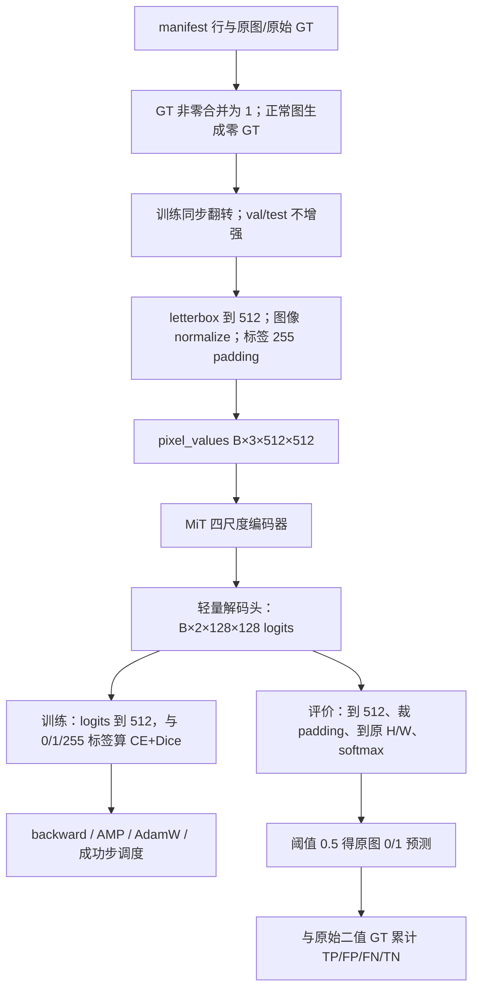

# 从 PyTorch 基础到读懂 PCB1 SegFormer 基线：论文、工程、13 阶段与调优学习指南

更新日期：2026-11-02（Asia/Shanghai）。面向已经做过基础 PyTorch 练习、由 Agent 较快完成了工程、现在希望真正掌握它的学习者。

本文依据仓库 `714a9cc` 时点的实际源码、配置、阶段文档和验收记录编写；模型结构还核对了本机安装的 Transformers 4.57.6 源码。本文只整理学习材料，不安装环境、不修改实验代码、不启动训练、不重新评价 test。

**你现在已经拥有一条完成验收的有监督分割基线。接下来的首要任务，是能解释“一张原图怎样变成训练信号，又怎样还原成可评价的缺陷掩码”，并能从文件中找到每个解释的证据。**先建立这条主线，再逐步掌握必要的外围审计，无须先把所有脚本逐行看完。

本轮学习重点是**理解本机已经完成的训练过程**。11 月 16 日前的实验完成进度以已验收的 SegFormer 基线为准，不要求重做 13 阶段、换机部署或先完成 DINOv3 训练。但开题报告仍应介绍整篇论文的暂定路线：**SegFormer 基线 → 冻结 DINOv3-S/16＋轻量分割头的独立训练与对照 → 根据证据选择一项适度适配改进**，并与导师确认。本文负责其中的基线学习，不能代替完整论文计划；详细区分见第 13.5 节及[开题与导师沟通指南](./2026-11-02-proposal-preparation-and-advisor-discussion-guide.md)。基础论文也不必全部通读之后才开始整理汇报。

## 1. 先校准当前事实与学习目标

### 1.1 这次到底做了什么

任务是 VisA 中 **PCB1 的 high-shot 有监督背景/缺陷二值语义分割**：输入一张 PCB RGB 图，输出每个原图像素的缺陷概率及 0/1 掩码。不是只用正常图训练的异常检测，也没有识别具体缺陷种类、判断电路功能或生成缺陷原因。

编码器使用 ImageNet-1k 预训练的 `nvidia/mit-b0`，新建完整二类 SegFormer 解码头，然后**编码器与解码头全部微调**。没有使用已训练好的 PCB 模型，没有冻结编码器，没有引入 DINOv3 或双编码器融合。

| 项目 | 当前已核准的事实 | 最直接的入口 |
| --- | --- | --- |
| 数据划分 | train 530（482 正常、48 异常）；val 132（120、12）；test 442（402、40） | [划分元数据](../../work/SegFormer/manifests/split_meta.json) |
| 划分版本 | PCB1 v2 分组；官方 test 保持不变 | [阶段 04](../../work/SegFormer/docs/stages/04-data-audit-design-and-implementation.md) |
| 模型参数 | 3,714,658；编码器 3,319,392，解码头 395,266，全部可训练 | [模型检查](../../work/SegFormer/reports/model_check.json) |
| 正式 run | `pcb1_b0_v2_seed42`；50 轮连续完成 | [正式配置](../../work/SegFormer/configs/baseline.yaml) |
| 更新计数 | 13,250 次尝试；13,243 次成功；7 次 AMP 跳步 | [结果摘要](../../work/SegFormer/reports/pcb1_b0_v2_seed42/results.md) |
| best | epoch 39、累计成功更新 10,330；按 val 全局前景 IoU 选出 | [实验卡](../../work/SegFormer/reports/pcb1_b0_v2_seed42/experiment-card.md) |
| val | global IoU 0.7775342969；异常图 macro IoU 0.5395555278 | [联合验收](../../work/SegFormer/reports/2026-11-01-stage12-13-acceptance.md) |
| test | global IoU 0.6833438542；异常图 macro IoU 0.5248580728 | 同上 |
| 工程验收 | 291 项回归通过；val v2 门禁 74/74；完整 val/test 技术复核通过 | [回归日志](../../work/SegFormer/reports/stage12-13-unit-tests.txt) |
| 实际硬件 | RTX 4070 Laptop GPU，8188 MiB，约 8 GB 显存 | [环境记录](../../work/SegFormer/reports/environment.json) |

补全test读数：全局Dice为0.8119、precision为0.9008、recall为0.7390；402张正常图共3689个FP像素，32张出现任意FP。结合异常macro IoU0.5249和失败图看，当前模型仍有漏检与误报，不能只用global IoU概括所有样本。

这些数字证明当前协议下的结果与工程状态。它们没有证明跨 PCB 类别、跨产线、不同训练种子或不同硬件的泛化能力。学习时尤其要分清：**best 时刻是 10,330 次成功更新，训练结束才是 13,243 次**。

### 1.2 应怎样使用旧文档

[10 月 31 日主指南](./2026-10-31-segformer-baseline-end-to-end-guide.md)是最初的实施蓝图，保留了“尚未创建”“待实现”等历史文字；[环境隔离规范](./2026-10-31-segformer-environment-isolation-and-stage-docs.md)也包含搭建前的机器状态。这些文字不能用于判断今天是否有环境、权重和成绩。

当前状态以[阶段索引](../../work/SegFormer/docs/stages/README.md)、各阶段末尾修订记录、[阶段 12—13 联合验收](../../work/SegFormer/reports/2026-11-01-stage12-13-acceptance.md)、当前源码和真实工件为准。阶段 03 的 v1 划分已被阶段 04 的 v2 分组清单接替；旧证据保留用来解释变化，不与当前清单混用。

### 1.3 学到什么程度才算“自己掌握”

你应能独立画出数据流，标出形状、类型、标签取值和坐标空间；能解释 CE、Dice、AdamW、AMP 与学习率各解决什么问题；能指出一个实验结论来自哪份配置、哪条日志、哪个 best；能设计一个只改变一个因素的对照，并说明用什么指标判断它。

不要求背会 291 个测试，也不要求先重写 Transformers。对基础 PyTorch 阶段，先读懂十来个关键函数，比连续浏览几千行入口和审计代码更有效。

## 2. 三种学习深度：从现在开始怎么走

### 2.1 60 分钟：先把实验讲明白

| 时间 | 阅读/观察 | 结束时应能回答 |
| --- | --- | --- |
| 0—10 分钟 | 本文第 1、3 节；打开[实验卡](../../work/SegFormer/reports/pcb1_b0_v2_seed42/experiment-card.md) | 任务、数据、模型、best、global/macro 分别是什么？ |
| 10—20 分钟 | 第 5 节张量流；[data.py](../../work/SegFormer/segformer_lab/data.py) 的 `prepared_sample`、`__getitem__` | 图像与标签为什么走不同的缩放/归一化路径？ |
| 20—35 分钟 | 第 6 节模型；SegFormer 论文图 2 与本地中文译文 | 四尺度怎样产生，轻量头怎样融合？ |
| 35—45 分钟 | 第 7、8 节；`segformer_loss`、`restore_defect_probability` | 为什么 loss 在 512 算，分数在原图算？ |
| 45—55 分钟 | 第 9 节训练；`train_step` | 一次成功更新必须经过哪些步骤？ |
| 55—60 分钟 | 第 14 节自检；对照训练曲线与失败图 | 分数能说明什么，下一步还缺什么证据？ |

这一小时以读文件、画图和复述为主。不要把“重新跑 50 轮”当成理解流程的第一步。

### 2.2 半天：沿一张图追到权重，再追回掩码

用约 30 分钟补分割、logits/softmax 和指标基础；约 60 分钟读第 5—6 节及 HF 结构；约 60 分钟追 Dataset→loss→反向传播；约 45 分钟追保存→新进程加载→原图评价；余下时间读 13 阶段表并完成纸面练习。先做完下列四件事：

1. 为一张正常图、一张异常图分别写出原 mask、512 label、prediction 的取值和含义。
2. 画出 `[B,3,512,512] → 四尺度 → [B,2,128,128]`，再画训练/评价两条分支。
3. 在 `train_step` 旁边写出每一步修改的对象：梯度、权重、optimizer、scaler、scheduler。
4. 从实验卡一路找到配置、best 身份、逐图计数和验收记录，说明结果不是凭聊天摘要得到的。

### 2.3 深入路线：按知识依赖走，不按脚本数量走

| 顺序 | 学习主题 | 建议产出 |
| --- | --- | --- |
| A | 图像分类与语义分割；监督信号；train/val/test | 用自己的话写一页任务定义 |
| B | Attention→ViT→MiT→SegFormer | 一张架构图，一张不同模型的对比表 |
| C | 数据划分、几何变换、同步增强与标签语义 | 记录一个样本的完整数据契约 |
| D | CE/Dice、反向传播、AdamW、AMP、调度与选模 | 手算小例子，逐行注释一个训练 step |
| E | 原图恢复、global/macro/NA、正常误报 | 手算混淆矩阵，并解释现有失败图 |
| F | 保存、独立加载、身份与本机环境 | 说明保存权重怎样变回可用模型 |
| G（有余力再做） | 有依据的调优与独立对照 | 先写实验设计卡；开题不以新增实验为前提 |

基础不熟时可花数天甚至更久；表中的先后关系比具体天数更重要。遇到不懂的框架辅助函数，先写下它的输入/输出与调用方，再决定是否深入。

## 3. 地图：仓库、环境、资源到底放在哪里

### 3.1 顶层目录与当前研究主线

仓库根是 `E:\桌面\AI\AI_Try`，SegFormer 工程根是 `E:\桌面\AI\AI_Try\work\SegFormer`，运行资源根是并列的 `E:\桌面\AI\segformer_resources`。相对链接在本文位置 `AI_Try/docs/research` 解析；资源区链接要向上三级再进入 `segformer_resources`。

指向资源区或已安装库源码的链接仅在当前电脑对应目录存在时可打开；GitHub保存的是说明、代码与小型证据，不包含这些环境、数据或权重内容。

| 目录/文件 | 用途 | 学习优先级 |
| --- | --- | --- |
| [根 AGENTS.md](../../AGENTS.md) | 项目背景、研究方向、存储规则；本文中文属于明确任务例外 | 开始时读一次 |
| [docs/research](./) | 研究路线、阅读清单、操作指南与本文 | 先读当前指南，历史计划按需 |
| [docs/paper](../paper/) | 论文原文、翻译、综述资料 | 按第 4 节顺序 |
| [docs/dataset/VisA](../dataset/VisA/) | VisA 原始 TAR、官方代码 ZIP、论文、数据卡 | 先读数据卡；不修改原归档 |
| [docs/dataset/MVTec AD](<../dataset/MVTec AD/>) | 另一工业数据集资料 | 当前基线无需读完 |
| [docs/技术树](../技术树/)、[docs/others](../others/) | 技术树与工业异常检测教程 | 扩展材料 |
| [work/SegFormer](../../work/SegFormer/) | 当前实验代码、配置、清单、测试、阶段文档和小型报告 | 主要学习场所 |
| [archive](../../archive/) | 旧研究路线等历史材料 | 不作为当前执行入口 |
| [personal-planning](../../personal-planning/)、[travel-planning](../../travel-planning/) | 个人规划与旅行记录 | 与本模型无依赖 |
| `E:\桌面\AI` 下其他目录 | 另有 `dataset`、`outputs`、`tmp`、`web`、`blender_workspace` 等；不由名称推断为本实验输入 | 只以当前配置实际引用的路径为准 |

### 3.2 工程根的每类文件

```text
work/SegFormer/
├─ AGENTS.md、README.md                 工作约束与当前工程入口
├─ scripts/                            Windows 进程上下文与环境快照
├─ segformer_lab/                      本项目 Python 模块
├─ configs/                            各阶段的明确实验协议
├─ manifests/                          原图级 train/val/test 与固定子集
├─ docs/stages/                        13 份中文设计/实现学习文档及索引
├─ reports/                            小型证据、验收、图表与结果卡
├─ tests/                              用来约束行为的单元/回归测试
├─ requirements-runtime.txt            完整可移植 pip 版本约束
├─ requirements-lock.txt               当时 pip freeze 原始记录
├─ requirements-cu126.txt              CUDA wheel 的辅助配方/来源
└─ environment-history.yml             Conda from-history 记录
```

`configs/baseline.yaml` 是正式协议；`smoke.yaml`、`overfit.yaml`、`pilot.yaml` 分别用于 20 步通路、八图拟合、三轮完整集试跑；`resume_fixture.yaml` 用于恢复对照。它们有不同目标，不能用 overfit 的成绩冒充泛化成绩，也不能把 overfit 的学习率直接当正式配方。

`manifests/train.csv`、`val.csv`、`test.csv` 决定图像归属；`official_2cls_highshot.csv` 是官方副本；`split_meta.json` 记录派生协议和来源；`reviewed_groups.json` 记录同实物风险分组；`val_preview_ids.txt` 固定展示图；`overfit_train_ids.txt` 固定八张训练图；`resume_fixture_train_ids.txt` 服务恢复夹具；`archive/pcb1_v1` 保留旧清单。

`reports/data_audit` 是当前 v2 数据审计；`data_audit_v1` 是历史；`stage05_pre_acceptance`、`stage07_pre_acceptance` 等保留验收前事实；`stage08_09_evidence`、`stage10_evidence`、`stage11_evidence`、`stage12_13_evidence` 存放相应阶段证据。`recorded_source` 或 `*.py.txt` 是历史源码快照，不是 Python 包的执行入口。

最终先看 [reports/pcb1_b0_v2_seed42](../../work/SegFormer/reports/pcb1_b0_v2_seed42/)：`experiment-card.md` 回答实验是什么，`results.md` 回答成绩怎样，`reproduction.md` 回答恢复需要什么，`curves.csv` 给逐轮数字，`failure-cases.csv` 给选图依据，`results-summary.json` 给生成来源和校验，`figures` 给五张学习图。

### 3.3 仓库外的每类资源

```text
E:/桌面/AI/segformer_resources/
├─ env/                               项目 Conda prefix：解释器、DLL、site-packages
├─ config/condarc.yml                  项目 Conda 配置
├─ cache/                             包、模型下载及运行缓存
│  ├─ conda_pkgs/、conda_envs/          Conda 包缓存与项目环境搜索目录
│  ├─ pip/、wheels/                    pip 缓存与下载的 wheel
│  ├─ huggingface/                     Hub/Xet 等缓存
│  ├─ torch/、torch_extensions/、cuda/  Torch 与 CUDA 编译缓存
│  └─ xdg/、matplotlib/、pycache/       通用、绘图、Python 字节码缓存
├─ tmp/                               项目进程的临时文件
├─ data/visa/                         提取的 PCB1 与 extraction_manifest.json
├─ models/mit-b0/                      固定 revision 的原始预训练快照
├─ runs/                              训练、评价、预测和历史失败现场
└─ audit/                             环境前后快照、日志和校验材料
```

`env/python.exe` 决定解释器；`env/Lib/site-packages` 中是已安装库的源码和包。理解模型时只需按需读 Transformers 的 SegFormer 实现，无须逐个浏览几万个环境文件。缓存不是训练结果，模型下载缓存也不是你的训练后权重。本文没有清理或移动任何目录。

`data/visa/pcb1/Data/Images/{Normal,Anomaly}` 保存图像，`Masks/Anomaly` 保存异常掩码；正常图在 Dataset 中生成全零 GT。`extraction_manifest.json` 记录提取文件身份。原始 TAR/ZIP 仍在仓库 `docs/dataset/VisA`，提取文件不是重新标注的数据集。

`models/mit-b0` 的 `config.json` 描述原始模型配置，`preprocessor_config.json` 描述归一化，`pytorch_model.bin` 是预训练权重，`source.json` 记录来源/revision/SHA；还有下载器元数据 `.cache`。这不是正式 run 的 best，重新下载它不会恢复已经学到的 PCB 分割能力。

`runs/data_preview`、`dataset_check`、`loss_metrics_check` 是数据/数学诊断；`smoke_*` 是通路试验；`overfit_002` 是成功八图拟合；`overfit_001` 和 `archive` 保留失败；`pilot_001` 是三轮试跑；`resume_fixture_*`、`resume_acceptance_*` 是恢复夹具。它们是可解释的历史，不应仅凭名字批量删除。

`runs/pcb1_b0_v2_seed42` 是正式训练 bundle；`pcb1_b0_v2_seed42_eval_001` 是首次评价；`pcb1_b0_v2_seed42_eval_acceptance_20261101` 是验收技术复核；`pcb1_b0_v2_seed42_results_acceptance_20261101` 是复核图表的完整生成物。首次运行与复核分开保存，避免覆盖历史或按成绩择优。

### 3.4 环境为什么要单独放，平时怎样找回

当前记录为 Python 3.12.16、torch 2.10.0+cu126、torchvision 0.25.0+cu126、Transformers 4.57.6、NumPy 2.5.4、Pillow 12.3.0、Matplotlib 3.11.2、PyYAML 6.0.3。Conda 管理器来自 `E:\Anaconda\Scripts\conda.exe`，环境 prefix 在资源根 `env`。这些是本实验记录，不是要求其他任务升级到同一版本。

| 工具/库 | 在本训练中实际做什么 |
| --- | --- |
| PyTorch | Tensor、autograd、DataLoader、AdamW、AMP、模型状态保存 |
| Hugging Face Transformers | SegFormer 结构、ImageProcessor、预训练加载接口；本项目自己写训练循环与 loss |
| Pillow / NumPy | 读 RGB/GT、缩放/翻转/画布、二值化、审计和像素统计 |
| PyYAML | 读取明确的实验配置，避免只把超参数藏在脚本里 |
| Matplotlib / CSV / JSON(L) | 学习图、曲线和可追溯的机器/逐轮/逐图记录；正式配置没有开启 TensorBoard 日志 |
| PowerShell / Conda / pip | 本机上下文、解释器与依赖管理；它们不承担模型学习算法 |

[enter_project.ps1](../../work/SegFormer/scripts/enter_project.ps1) 设置进程级资源/缓存路径；`Invoke-SegPython`、`Invoke-SegPip` 经 `conda run --prefix` 调用项目环境；[run_project.ps1](../../work/SegFormer/scripts/run_project.ps1) 为新进程包装调用，并恢复调用方环境/目录/编码。只写一个 Python 可执行路径，无法表达全部缓存和 Windows 运行上下文。

另外，[snapshot_environment.ps1](../../work/SegFormer/scripts/snapshot_environment.ps1)采集环境前后记录到 audit，[test_runtime_context.ps1](../../work/SegFormer/scripts/test_runtime_context.ps1)验证包装/恢复等行为；它们用于环境建立与验收，理解训练时只需知道职责，不必重复运行。

本机裸 `python` 的 PATH 入口与项目环境不同，base 也有自己的包；不凭终端提示符判断解释器。项目关闭用户 site，设置 `HF_HOME`、`TORCH_HOME`、`PIP_CACHE_DIR`、`PYTHONPYCACHEPREFIX`、`TMPDIR/TEMP/TMP` 等，使大部分项目资源集中。Conda 环境登记被关闭，所以 `conda env list` 看不到 prefix 并不等于它不存在。

这隔离了项目 Python 包和资源，Windows、驱动、GPU、Conda 管理器仍共享。本机环境已经可用，本轮理解训练无需重装。

要在本机新 PowerShell 中辨识现有环境，可先读完入口脚本再用下列命令；它们设置当前进程上下文并打印解释器，不训练、不安装包：

```powershell
$env:PSExecutionPolicyPreference = 'Bypass'
Set-Location -LiteralPath 'E:\桌面\AI\AI_Try\work\SegFormer'
. '.\scripts\enter_project.ps1'
Invoke-SegPython -c "import sys; print(sys.executable); print(sys.version)"
```

输出解释器应为 `E:\桌面\AI\segformer_resources\env\python.exe`。进程级执行策略只影响当前窗口；入口会建立/使用项目目录与缓存设置，关闭窗口后重新进入时还需加载。不要照抄旧指南的环境创建命令。

## 4. 论文怎么读：每篇只带一个明确问题

### 4.1 当前核心先读，基础按需补

当前最直接的两篇是 **VisA/SPD 与 SegFormer**。先读懂数据协议和模型图，遇到 attention/token/decoder 不熟，再按需补下面的基础；不把基础论文全读完作为开始理解代码的门槛。

| 核心 | 材料 | 先回答的问题 | 当前实验关系 |
| --- | --- | --- | --- |
| 数据 | [VisA/SPD 原文](https://arxiv.org/abs/2207.14315)、[本地中文译文](<../paper/261029/1. VisA/full_translation_zh.md>)、[数据卡](../dataset/VisA/dataset-card.md) | 数据来自哪里，官方协议与本文有监督设置如何对应？ | 数据与划分依据；不是把 SPD 算法完整复现一遍 |
| 模型 | [SegFormer 原文](https://arxiv.org/abs/2105.15203)、[本地中文译文](<../paper/261029/2. SegFormer/full_translation_zh.md>) | 分层 MiT 与轻量解码头为什么适合密集预测？ | 当前模型的核心依据 |

| 按需基础 | 材料 | 只带这个问题去读 |
| --- | --- | --- |
| Attention | [Attention Is All You Need](https://arxiv.org/abs/1706.03762) | Q/K/V、softmax、残差、归一化、FFN 是什么？先读 scaled dot-product 与 multi-head |
| ViT | [ViT 原文](https://arxiv.org/abs/2010.11929)、[本地中文译文](<../paper/261029/3. ViT/full_translation_zh.md>) | 图像怎样变 token？与 MiT 的分层/位置/FFN 有什么区别？ |
| 分割背景 | [U-Net 原文](https://arxiv.org/abs/1505.04597) | 为什么需要恢复空间细节，编码器/解码器各做什么？本工程没有实现 U-Net |

理解**当前 SegFormer 训练代码**时，可暂缓深入 [DINOv3 本地中文译文](<../paper/261029/4. DINOv3/full_translation_zh.md>)；但准备**整篇论文的开题研究方案**时，应读其摘要、表征提取与密集预测评估相关部分，结合 [ViT 译文](<../paper/261029/3. ViT/full_translation_zh.md>)，讲清“冻结视觉骨干、只训练分割头”的含义、采用它的动机和拟验证的问题。目前未实施 DINOv3，开题前不要求读完整篇、下载权重或给出其训练结果；研究方案仍保留该阶段。

U-Net 和 Attention 在这里提供在线原文，没有声称已存在对应本地中文全文。四篇本地译文实际文件名都叫 `full_translation_zh.md`；译文帮助理解，公式、图表和实验条件应回到原论文核对。

### 4.2 SegFormer 第一遍读哪些部分

先看摘要、整体结构图、hierarchical encoder、overlapping patch merging、efficient self-attention、Mix-FFN、all-MLP decoder，再看 B0 的规模与实验设置。把论文中每个模块对应到本文第 6 节的本机类名。第二遍再研究消融、复杂度和跨分辨率表现，第三遍才比较其他尺寸与训练配方。

论文在通用分割数据集上的结果，不能直接当成 PCB1 成绩。当前预处理、CE+Dice、二类标签、划分、50 轮和 512 输入，是本实验的工程协议；它们不全来自 SegFormer 原论文。

### 4.3 给自己做一张“论文→代码”卡

每个概念写五项：论文里的名字、解决的问题、数学表达、当前类/函数、可核对的张量形状。例如“SR attention→缩短 K/V 序列→`QKᵀ` 的第二个空间维度变短→`SegformerEfficientSelfAttention.forward`→第一尺度 `[B,1,16384,256]` 的注意力分数”。这比只抄摘要更接近读懂实现。

## 5. 从一张图开始：数据、标签与张量路径

### 5.1 原图与标签的含义

原图宽 1404、高 1070，NumPy 图像是 `[H,W,3]=[1070,1404,3]` 的 uint8 RGB。异常原 mask 中的 `1..4` 是原始缺陷 ID，本实验先做 `mask>0 → 1`，得到背景 0、缺陷 1；正常图直接生成 `[1070,1404]` 全零。这里的“背景”包括所有正常 PCB 区域，不仅是照片外的桌面背景。

先合并缺陷 ID，再缩放和 padding。若先生成 255 padding 再执行 `>0`，padding 会被误当成缺陷。`255` 在本训练标签里只表示忽略区域，它既不是第三个类别，也不代表正常背景。

### 5.2 为什么要 letterbox

直接把 1404×1070 拉伸成正方形会改变长宽比例。本工程等比例缩成宽 512、高 390，居中放到 512×512 画布，上下各 61 行 padding；图像使用双线性插值，标签用最近邻，标签 padding=255。保存 `geometry`，才能在推理时裁掉这 61 行再回原图。

图像插值可以产生连续颜色；类别 ID 的插值必须保持离散语义。标签用双线性会产生不存在的类别值或混合边界。即使用最近邻，缩小也可能丢微小连通域：数据审计记录原始 328 个连通域中有 19 个在 512 标签中消失，涉及 12 图、39 个原图像素。不是整张异常图全空，也不代表每个缺陷细节保留。

### 5.3 一次归一化与 Dataset 输出

`PCB1Dataset.prepared_sample` 完成读图/GT、同步翻转、letterbox；`__getitem__` 调 processor 做一次 `x/255` 和按通道 `(x-mean)/std`，得到 CHW float32。`do_resize=False` 防止第二次缩放，`do_reduce_labels=False` 保留真实背景 0。标签独立转 int64，不做图像归一化。

| 字段 | 单样本 | B2 后 | 用途 |
| --- | --- | --- | --- |
| `pixel_values` | float32 `[3,512,512]` | `[2,3,512,512]` | 模型输入 |
| `labels` | int64 `[512,512]`，0/1/255 | `[2,512,512]` | loss 的监督 |
| `original_mask` | uint8 `[1070,1404]`，0/1 | 保留为 list | 原图尺度评价 GT |
| `geometry` | 原尺寸、缩放、padding 等字典 | list | 恢复坐标 |
| `image_id`、`mask_id` | manifest 相对路径 | list | 追溯样本 |
| `flipped` | bool | list | 说明当前样本坐标方向 |

训练中 `original_mask` 若保留，表示与增强后图像方向一致的原尺寸 GT；val/test 不翻转，才与文件原图坐标一致。`collate_pcb1` 堆叠固定形状张量，保留原尺寸对象为 list，为将来不同尺寸图像留出空间。

训练只做 p=0.5 的同步水平翻转；`flip_decision` 由 `(seed,epoch,index)` 决定，每轮须 `set_epoch(epoch)`。图像与 GT 必须一起翻。val/test 的 random/force flip 被拒绝。当前 `workers=0` 经验证，更多 worker 的吞吐和状态传递还没有验收。

### 5.4 主线图



## 6. 模型怎么理解：从 Attention 到 MiT-B0 与解码头

### 6.1 先分清几个名字

Transformer 是以注意力和 FFN 等组成的模型家族；ViT 是把图像 patch 作为 token 的一种视觉 Transformer；MiT（Mix Transformer）是 SegFormer 使用的分层编码器；SegFormer 是“MiT 编码器＋轻量分割解码头”的整体方案。`B0` 表示其中较小的规模配置，不是训练 batch=0。

| 维度 | 原始 ViT 分类设定的典型做法 | 当前 MiT-B0 |
| --- | --- | --- |
| patch | 非重叠 patch 投影 | 重叠卷积 patch embedding |
| 空间尺度 | 主干基本保持同一 token 网格 | 四阶段下采样，形成四尺度 |
| 输出目标 | 常由分类 token/分类头输出整图类别 | 保留空间特征供分割头使用 |
| 位置处理 | 显式位置 embedding | 不依赖显式位置 embedding；Mix-FFN 的卷积提供局部空间信息 |
| attention | 全长 token 间交互 | Q 保持当前网格，K/V 可作空间缩减 |
| FFN | token 内通道混合 MLP | 加入 3×3 depthwise conv 的 Mix-FFN |

这里描述的是论文原始典型设定，不代表所有后来叫 ViT 的模型都具有完全相同结构。MiT 仍使用注意力，但不是把普通 ViT 分类头改成两类就完成分割。

### 6.2 Q、K、V 到底在做什么

把某尺度特征排成 `X=[B,N,C]`，`N=H×W` 是 token 数，`C` 是每个位置的特征维。线性层生成 Q（查询）、K（用于匹配）、V（被加权汇集的信息）。单头核心为 `Attention(Q,K,V)=softmax(QKᵀ/√d) V`，softmax 沿 K 的 token 维归一化，多头则在不同投影子空间分别计算再融合。[Attention 原文](https://arxiv.org/abs/1706.03762)

它不是把像素直接互相投票。它对**特征**计算依赖输入的权重，当前位置可以汇集较远位置的信息。多头让不同投影学习不同关系，但不能仅凭“头多”就解释某类 PCB 缺陷一定检出。

### 6.3 四个尺度的精确形状

下面由当前 B0 配置与 512 输入推导，外部输入采用 `[B,C,H,W]`；每个尺度内部转成 `[B,N,C]` 做 Transformer 运算，再转回特征图。

| 编码阶段 | patch kernel / stride | 输出特征图 | token N | block 数 / attention heads | SR ratio |
| --- | --- | --- | ---: | --- | ---: |
| 1 | 7×7 / 4，padding 3 | `[B,32,128,128]` | 16,384 | 2 / 1 | 8 |
| 2 | 3×3 / 2，padding 1 | `[B,64,64,64]` | 4,096 | 2 / 2 | 4 |
| 3 | 3×3 / 2，padding 1 | `[B,160,32,32]` | 1,024 | 2 / 5 | 2 |
| 4 | 3×3 / 2，padding 1 | `[B,256,16,16]` | 256 | 2 / 8 | 1 |

第一阶段 `Conv2d` 的 kernel 大于 stride，相邻 patch 共享输入像素，这就是 overlap。后续阶段进一步降低空间分辨率、增加通道：较浅层提供较细位置线索，较深层提供更大范围的语义上下文。这是设计动机，不是当前模型已经学到某个具体 PCB 语义的直接证据。

### 6.4 SR attention 怎样省计算

`SegformerEfficientSelfAttention` 对 Q 使用当前全部 token；当 `sr_ratio>1` 时，把特征转回二维，用 kernel=stride=ratio 的卷积缩减 K/V 来源。ratio 是二维边长缩减倍数，因此 token 约减少 ratio² 倍。这里 K/V 的四尺度网格都为 16×16，即 256 token；Q 分别为 16384、4096、1024、256。

第一阶段单头 `QKᵀ` 是 `[B,1,16384,256]`，不再是 `[B,1,16384,16384]`。这减少注意力矩阵成本；它不是把 Q 的空间输出同步降到 16×16，也不是完全删除全局交互。注意力之后仍输出当前尺度的 token 网格。

### 6.5 Mix-FFN、残差与归一化

普通 FFN 对每个 token 进行通道扩展和收缩；当前 `SegformerMixFFN` 是 `Linear(C→4C) → 3×3 depthwise conv → GELU → Linear(4C→C)`，中间带配置的 dropout。depthwise 表示每通道单独做空间卷积，再由线性层混合通道；它要求临时恢复 H/W，而不能一直把 token 当成无序列表。

`SegformerLayer` 先 LayerNorm 再 attention，与输入残差相加；再 LayerNorm、Mix-FFN、第二次残差相加，包含 stochastic depth/drop path。残差帮助信号和梯度通过深层网络；归一化稳定特征尺度；这些机制与“只加一个注意力层”不同。[SegFormer 原文](https://arxiv.org/abs/2105.15203)

### 6.6 轻量解码头怎样融合四尺度

`SegformerDecodeHead` 给四个特征分别做线性投影，统一成 256 通道；双线性上采样到第一尺度的 128×128；沿通道拼接成 `[B,1024,128,128]`，再做 1×1 Conv 融合到 256、BatchNorm、ReLU、Dropout，最后 1×1 classifier 输出 `[B,2,128,128]`。

论文称 all-MLP decoder 强调轻量投影与多尺度融合。本机 HF 实现中确实还有 Conv/BatchNorm/ReLU，不能把“all-MLP”按字面写成“源码里完全没有卷积”。这里也没有 U-Net 式逐级反卷积解码器。

两通道是两个类别的 **logits**，是未归一化分数，既不是概率也不是两个独立 sigmoid。分割头不直接输出每个像素的文字标签；softmax 和阈值由后续通道完成。

一个像素的两类分数为 `z0,z1`，缺陷概率 `p1=exp(z1)/(exp(z0)+exp(z1))`。softmax 给概率；argmax 给最大分数对应的类别索引；`p1>=0.5` 给二值判断。这是三种操作。两类无并列时，argmax 与 0.5 阈值结果一致；并列 `z0=z1` 时，常用 argmax 返回第一个类别 0，而当前 `>=0.5` 判为 1。训练时 CE 直接接 logits，Dice 使用软概率，**不对训练输出 argmax/阈值**，否则离散决策会切断所需的梯度路径。

### 6.7 实际模型实现藏在哪里

本项目 [modeling.py](../../work/SegFormer/segformer_lab/modeling.py) 负责构造/加载/核验，真正网络算子在已安装的 [HF modeling_segformer.py](../../../segformer_resources/env/Lib/site-packages/transformers/models/segformer/modeling_segformer.py) 中。推荐只追这些类：`SegformerOverlapPatchEmbeddings` → `SegformerEfficientSelfAttention` → `SegformerMixFFN` → `SegformerLayer` → `SegformerEncoder` → `SegformerDecodeHead` → `SegformerForSemanticSegmentation`。

本地还有 [configuration_segformer.py](../../../segformer_resources/env/Lib/site-packages/transformers/models/segformer/configuration_segformer.py) 和 [image_processing_segformer.py](../../../segformer_resources/env/Lib/site-packages/transformers/models/segformer/image_processing_segformer.py)。它们属于当前环境，不直接编辑 site-packages。[HF 官方 SegFormer 文档](https://huggingface.co/docs/transformers/model_doc/segformer)帮助理解接口，当前实际行为仍以本地 4.57.6 为准。预训练 `config.json` 内旧 `transformers_version` 是快照元数据，不是本机已安装版本。

### 6.8 预训练权重究竟加载了哪些部分

快照固定 `nvidia/mit-b0@80983a413c30d36a39c20203974ae7807835e2b4`。`verify_encoder_weights` 核对 192 个编码器张量，与原快照精确相等；原 ImageNet `classifier.weight/bias` 两个张量不用；16 个 `decode_head.*` 缺失属于新头。这里的“16 个键”包含状态项，不能简单等同于 16 层或 16 个参数张量。

`load_all` 同时核 source.json、快照 SHA、加载键、二类 classifier、processor 与可训练参数。`ignore_mismatched_sizes=True` 不是成功的充分证据；本次依据是逐键分类与编码器逐张量核对。训练之后编码器也改变，所以推理须读正式 run 的 best，不能再次用初始快照替换。

## 7. 损失：模型到底在被要求优化什么

### 7.1 CE 的作用与不均衡问题

模型给 `[B,2,128,128]` logits，`segformer_loss` 先双线性上采样到标签 512 网格，`align_corners=False`；CE 对 `logits.float()` 算，`ignore_index=255`。CE 在整个 batch 的有效像素上取均值，惩罚真实类别概率过低；正常图的误报也会受到惩罚。不要先 softmax 再把概率传给这个 `cross_entropy` 接口。

最小公式为 `CE=-(1/|V|)Σ[j∈V] log p_j(y_j)`：V 是非 255 的有效像素集合，`p_j(y_j)` 是像素 j 对正确类别给出的概率。PyTorch 接收 logits，在内部稳定地完成对应计算；这里写概率公式是为了理解监督含义。

PCB 前景像素很少，大量背景预测正确即可使像素平均 CE 较低；因此低 CE 或高像素 accuracy 不一定意味着缺陷学会了。原先三轮 pilot 的 CE 很低仍有多张异常图预测空，就是需要结合 IoU、recall 和逐图检查的原因。

### 7.2 当前 Dice 的精确定义

记某张图有效区的前景概率为 `p_i`、二值 GT 为 `g_i`，`D=(2Σp_i g_i+ε)/(Σp_i+Σg_i+ε)`，`ε=1e-6`。每张 GT 有前景的图计算 `1-D`，在这些图之间等权平均，得到 Dice loss。总损失为 `CE + 0.5×Dice_loss`。

这是 **FP32 softmax 后的逐图前景 Soft Dice，只平均正 GT 图**；不是整个 batch 合成一个 Dice，不是全图背景/前景两类平均，也不是最终二值 Dice 指标。交集是逐像素乘积再求和 `Σ(p*g)`，不能换成 `Σp × Σg`。

正常图没有 Dice 项，仍由 CE 监督；全正常 batch 返回连在计算图上的 `prob.sum()*0`，Dice 单独反向梯度恰为零。全 255 的 batch 没有任何有效像素，当前实现直接拒绝，防止 CE 的 0/0 产生 NaN。`0.5` 是基线选择，不是证明最优的常数。

### 7.3 怎么自己核对

在纸上取 `p=[0.75,0.25,0.75,0]`、`g=[1,0,1,0]`，算得 `Σp=1.75`、`Σg=2`、`Σpg=1.5`，忽略微小 ε 时 Dice loss=0.2；然后在[losses.py](../../work/SegFormer/segformer_lab/losses.py)中找到对应三次求和。再把某位置设为 ignore，检查它是否同时从 CE 归约和 Dice 有效区退出。

精读 `segformer_loss` 即可；[metrics_check.py](../../work/SegFormer/segformer_lab/metrics_check.py) 的 `loss_fixtures` 和[阶段 07 文档](../../work/SegFormer/docs/stages/07-loss-metrics-design-and-implementation.md)用于扩展，不必第一天逐行读整份诊断器。

## 8. 评价：为什么原图恢复、global、macro 和 NA 都不可省

### 8.1 固定恢复顺序

`restore_defect_probability` 对单图 logits `[2,128,128]`：转 CPU FP32 → bilinear 到 512×512 → 按 geometry 裁出 `[2,390,512]` 有效区 → bilinear 到 `[2,1070,1404]` → 对两通道 softmax → 取缺陷通道，返回原图尺度的CPU float32概率。随后由 `OriginalSpaceEvaluator.add_sample`、`predict.do_predict` 等调用方用 `p>=0.5` 得到二值预测。所有插值 `align_corners=False`。

先 softmax 再插值和先插值 logits 再 softmax 不是同一个函数；漏裁 padding 会改变几何。评价 GT 必须是原始二值 mask，不能把 512 标签放大回来当 GT，否则缩小时消失的细缺陷会被评价一起抹去。

### 8.2 四个基本计数

| 计数 | 含义 | 分割中的错误解释 |
| --- | --- | --- |
| TP | 预测缺陷且 GT 缺陷 | 正确命中 |
| FP | 预测缺陷但 GT 背景 | 误报 |
| FN | 预测背景但 GT 缺陷 | 漏检 |
| TN | 预测背景且 GT 背景 | 正确背景；数量通常很大 |

`IoU=TP/(TP+FP+FN)`；`Dice=2TP/(2TP+FP+FN)`；`precision=TP/(TP+FP)`；`recall=TP/(TP+FN)`。预测面积/GT 面积不是 recall，因为预测面积含 FP。当前评价不向这些分母加 ε 来掩盖未定义情形。

### 8.3 三套并列视角

global 先以 int64 累加**所有图**的 TP/FP/FN/TN，最后除一次；它包含正常图产生的 FP。异常 macro 先计算每张异常图指标，再对有定义值等权平均；正常图误报另报像素数、比例、每图分布和有任意 FP 的张数。三者回答不同问题，不能只挑最高的写。

global IoU 可理解为按各图并集像素数加权；macro 是异常图等权，两者样本范围也不同。test 的 0.6833 与 0.5249 差距提示表现不均，但不足以独立证明“小缺陷一定更差”，还需要面积/宽度分层与相关性证据。

手算一个聚合例子：异常图 A 为 TP99/FP0/FN1，IoU=0.99；异常图 B 为 TP0/FP0/FN1，IoU=0；正常图 N 误报 1 像素。异常 macro IoU=`(0.99+0)/2=0.495`，全部图 global IoU=`99/(99+1+2)=99/102≈0.9706`。再加入一张 GT/预测都空的正常图，global 不变、异常 macro 不变，该正常图自己的 IoU/Dice 记 NA。这说明指标必须先讲清样本范围和权重，不能只比较数字大小。

GT 和预测都空时 IoU/Dice 分母为零，记 `null/NA` 并给原因，不算成 1；预测空时 precision 为 NA；GT 有缺陷但预测空时 recall=0、IoU=0。正常图有 FP 时 IoU=0，而正常全空图的 IoU 是 NA。宏平均必须同时报告 defined/NA 张数。

test 40 张异常图中 049、057、077 的 TP=0；只有 049、057 预测完全为空，077 另有 351 FP。“TP=0”与“预测空”必须分开。正常图 32/402 有任意 FP，没有定义图像级报警阈值，不能直接称为图像级误检率。

### 8.4 精度策略也是协议的一部分

训练使用 FP16 AMP；评价固定 **B1、IEEE FP32、eval、inference_mode、关闭 autocast 和 TF32**。`model.eval()` 控制 dropout/BatchNorm，`inference_mode()` 控制梯度记录，FP32/TF32 控制算术，它们互不替代。[evaluation.py](../../work/SegFormer/segformer_lab/evaluation.py) 的上下文退出时恢复后端标志。

`requires_grad_(False)` 则控制参数是否求梯度，不能代替 `eval()`：冻结参数的模型若仍在 train 模式，Dropout 仍可随机丢弃，BatchNorm 仍可更新 running statistics。`no_grad()`/`inference_mode()` 也不会自动切 eval；当前解码头真实包含 BN，所以训练/评价模式不是形式上的一行代码。

关闭 TF32 不等于保证所有 batch 分组逐位相同，更不等于恢复训练必定同轨迹。阶段 07 曾观察到 IEEE FP32 下 B2/B1 仍有极小差异，因此当前固定 B1。最新验收的同协议重载概率差 0、二值 XOR0 是实测结果，不是跨硬件普遍定理。

## 9. 训练：一次更新、50 轮、选模与保存分别是什么

### 9.1 必须能手写的一次更新

```text
batch 从 CPU 送到 GPU
→ optimizer.zero_grad(set_to_none=True)
→ autocast 下 model(pixel_values).logits
→ FP32 CE/Dice 与 total loss
→ scaler.scale(loss).backward()
→ scaler.unscale_(optimizer)
→ 检查梯度 / clip_grad_norm_(max_norm=1.0)
→ scaler.step(optimizer)，确认 AdamW 是否真实执行
→ scaler.update()
→ 只有成功更新才推进 scheduler
→ 记录 attempt / successful / skipped / LR / loss
```

`backward()` 求梯度；`optimizer.step()` 用梯度改变权重；scheduler 改学习率；保存 checkpoint 把状态落盘。这几件事不是同一动作。`train_step` 是学习这一过程的最佳入口，外层 `train_full.do_train` 管 epoch、覆盖、日志、验证、best 与保存。

前向时 PyTorch 记录运算构成计算图；`loss.backward()` 按链式法则把 `∂L/∂θ` 累积到参数 `.grad`。最朴素的梯度下降是 `θ←θ-η∂L/∂θ`，AdamW 在此基础上使用动量/二阶统计和衰减。梯度是“如果略改参数，损失怎样变化”，不是下一轮预测结果；有 `.grad` 也不等于 optimizer 已经成功更新。

下面是**带解释的阅读伪代码，不是替换工程入口或要求执行的脚本**。它展开一批数据的因果关系，实际数值安全与真实更新确认复用当前 `step_optimizer`；外层覆盖/身份/保存逻辑仍应回到源码理解。

```python
# 教学伪代码：省略导入、初始化和错误处理，不直接运行。
model.train()                              # 训练行为：BN 更新统计，Dropout 生效
pixels = batch['pixel_values'].to('cuda')  # float32 [B,3,512,512]
labels = batch['labels'].to('cuda')        # int64 [B,512,512]，0/1/255
optimizer.zero_grad(set_to_none=True)      # 防上一批梯度混入

with torch.autocast('cuda', dtype=torch.float16):
    logits = model(pixel_values=pixels).logits  # [B,2,128,128]，建立计算图
    logits512 = F.interpolate(
        logits, size=labels.shape[-2:], mode='bilinear', align_corners=False)

# 当前工程统一由 segformer_loss 计算，下面将定义展开，帮助理解：
ce = F.cross_entropy(logits512.float(), labels, ignore_index=255)
prob = torch.softmax(logits512.float(), dim=1)[:, 1]  # 软前景概率，不 argmax
valid = labels != 255
gt = ((labels == 1) & valid).float()
prob_sum = (prob * valid).sum(dim=(1, 2))
gt_sum = gt.sum(dim=(1, 2))
intersection = (prob * gt).sum(dim=(1, 2))
positive = gt_sum > 0
if positive.any():
    soft_dice = (2 * intersection[positive] + 1e-6) / (
        prob_sum[positive] + gt_sum[positive] + 1e-6)
    dice_loss = (1 - soft_dice).mean()      # 只平均 GT 有前景的图
else:
    dice_loss = prob.sum() * 0             # 正常 batch：CE 仍有监督
loss = ce + 0.5 * dice_loss

scaler.scale(loss).backward()              # 缩放后求梯度，不是改权重
step_evidence = step_optimizer(            # 当前工程的共享 helper 内部依次做：
    model, optimizer, scaler, grad_clip=1.0)
#   scaler.unscale_(optimizer)            # 先还原梯度量级
#   检查非有限值、必要时 clip_grad_norm_  # 有限梯度才正常裁剪
#   scaler.step(optimizer) + 真实执行hook # scaler 溢出可跳过 AdamW
#   scaler.update()                       # 更新 loss scale
if step_evidence['optimizer_step_executed']:
    scheduler.step(optimizer)              # 只有真实更新才推进 LR
# 下一批开始前再次 zero_grad；不把此处解释当作新增的训练入口。
```

正式实现还拒绝全 ignore 标签、核查 loss/梯度/参数有限性，并记录跳步时参数与 optimizer 计数不变。教学展开式没有列出这些保护，因此不能直接复制成正式训练代码。当前前向只向 HF 传 `pixel_values`，取 `.logits` 后用自定义 loss；没有使用 HF 模型 `labels=` 接口内置的 CE。

### 9.2 AdamW 与学习率

AdamW 用一阶/二阶梯度统计自适应调整更新，并对选定参数做解耦 weight decay。当前 `lr=6e-5`、`weight_decay=0.01`、betas `(0.9,0.999)`、eps `1e-8`；bias 和名字含 norm 的参数不衰减。学习率主要控制更新幅度，weight decay 约束权重，不要把它们理解成同一种正则化开关。

预训练编码器已有通用特征，过大学习率可能破坏它；新头需要学习任务映射。但当前并没有编码器/头分组学习率，也没有先冻后解冻，不能在报告里补写这些做法。[build_optimizer](../../work/SegFormer/segformer_lab/training.py)的实际参数组是依据。

### 9.3 AMP 为什么有 scaler 和跳步

FP16 前向/反向可降低部分显存和计算成本，但数值范围有限。GradScaler 放大 loss 以改善小梯度表达，再在更新前 unscale；若发现非有限梯度，跳过本次 AdamW、降低 scale。它不会把所有训练运算都变成 FP16，模型主参数和当前 CE/Dice 计算仍保持相应 FP32 路径。

当前 `step_optimizer` 区分 scaler 确认的溢出与梯度范数归约等其他非有限错误，核实跳步没有改变参数/optimizer step。7 次跳步不是 7 张图未被 DataLoader 访问，也不是 7 次成功更新；它们参与了尝试计数，但不推进学习率调度。

### 9.4 warmup、cosine 与步数

530 张 train、B2、无累积、无丢尾，每轮 265 个 batch；50 轮预算 `50×265=13250` 次尝试。配置计划按 13250 更新设计：warmup `round(13250×0.05)=662`，之后 cosine 跨度 12588。实际有 7 次 AMP 跳步，因此成功 13243，调度 `completed` 也只到 13243。

`WarmupCosineLR.lr_at(k)` 中 k 是已经完成的成功更新数：warmup 时 `base_lr×(k+1)/662`；第 662 次成功更新用 base LR，随后余弦下降。计划最后一步应到 1e-6；实际最后一次使用的 LR 约 `1.0000450168e-6`，更新后保存的下一 LR 约 `1.0000330735e-6`，略高于终点，符合少 7 次成功更新的事实。

warmup 为早期小步适应而设，cosine 随预算降低更新幅度。前三轮全背景的具体原因没有通过对照定位；warmup 在第 3 轮已经到 base LR，不能把欠报简单归因于 warmup 太长。

### 9.5 batch、epoch、累积与覆盖

batch 是一次取来的图数；epoch 是按本协议完整访问一轮训练集；成功 step 是一次真实参数更新；梯度累积则可把多个 microbatch 的梯度合成一次更新。当前物理 batch=2、累积=1、有效 batch=2，不能把“显存只用约 1 GB”直接解释成应当尽量放大 batch。

增大 batch 会改变每轮更新数、梯度噪声、BN 统计和调度预算；同样 epochs 不保证同样更新次数。未来对照应事先确定按 epochs、更新数还是总计算量比较，并保持记录完整。

减小物理 batch 再增加梯度累积，可以匹配名义有效 batch；它不保证 BN、随机路径或浮点归约与一次大 batch 完全等价，应记录为新配置。当前 DataLoader 使用独立 seeded Generator；不是每轮把 generator 重置到同一 seed。epoch CE 按有效像素、Dice 按正 GT 图数汇总，已前向但 AMP 跳步的批次仍进入 loss 统计。

### 9.6 验证选 best 与保存

每轮完整验证 132 张，按原图 global 前景 IoU 选择 best，并列保留较早轮。50 轮上限固定，没有 early stopping；best=39 不表示运行只进行了 39 轮，也不表示 test 用来选 epoch。`last.pt` 用于轮末状态，`best.pt` 用于选中的模型，`model_state.pt` 是 best 的权重镜像。

checkpoint 包含模型、optimizer、scaler、scheduler、epoch/计数、RNG 等；processor、结构、配置、清单身份和日志是恢复解释所需的其他部分。只保存 `state_dict` 可以支持某些推理程序，但不等于当前工程已具有完整恢复与审计条件。

### 9.7 “身份复现”与“数值复现”要分开

身份检查说明源码/配置/数据/模型/工件是否是同一对象；数值检查说明重新执行是否得到同样概率、掩码和指标。文件 SHA 相同不直接保证不同 GPU 上数值逐位相同；概率最大差很小也不保证阈值附近二值 XOR=0。

阶段 11 新恢复 A/B 夹具通过了 epoch 边界状态、下一轮样本与翻转等检查，但续跑 epoch3 last 概率最大差约 `1.5032291e-4`、XOR33，没有达到 `1e-5/XOR0` 门槛，原因尚未定位。正式 50 轮是连续训练，没有依赖 resume；best 新进程推理复验通过。**保存可用、推理一致与续训完全同轨迹是三个不同结论。**

## 10. 13 阶段总表：每一步解决哪个问题

下面的函数名均对应当前实际文件；入口 `main` 负责 CLI，学习优先追它调用的核心函数。“依据”列区分论文概念与本工程验证，不强行为环境脚本找一篇算法论文。

| 阶段与学习文档 | 需要掌握的核心 | 当前代码/函数 | 应核对的证据/依据 |
| --- | --- | --- | --- |
| [01 工作区](../../work/SegFormer/docs/stages/01-workspace-design-and-implementation.md) | repo 与资源分离；进程上下文 | `enter_project.ps1`: `Invoke-SegPython`、`Assert-SegCondaIsolation`；`paths.py`: `resolve` | `audit/before-*`；[01—02 验收](../../work/SegFormer/reports/2026-10-31-stage01-02-acceptance.md) |
| [02 环境](../../work/SegFormer/docs/stages/02-environment-design-and-implementation.md) | prefix、CUDA、包来源、缓存 | `env_check.py`: `collect`、`probe_cuda`、`probe_segformer` | [environment.json](../../work/SegFormer/reports/environment.json)、依赖锁定；不是模型质量实验 |
| [03 数据准备](../../work/SegFormer/docs/stages/03-data-preparation-design-and-implementation.md) | 官方 high-shot、固定原图清单 | `prepare_data.py`: `extract_category`、`build_split`、`audit` | [03 验收](../../work/SegFormer/reports/2026-10-31-stage03-acceptance.md)；VisA 原文/官方 CSV；v1 已归档 |
| [04 审计](../../work/SegFormer/docs/stages/04-data-audit-design-and-implementation.md) | v2 分组、近重复、几何与小目标 | `build_group_split`、`audit_data.audit`、`geometry.component_retention`、`preview_data.render_sample` | [data_audit/summary.md](../../work/SegFormer/reports/data_audit/summary.md)、[04 验收](../../work/SegFormer/reports/2026-10-31-stage04-acceptance.md) |
| [05 模型](../../work/SegFormer/docs/stages/05-model-design-and-implementation.md) | MiT 预训练＋新头，实际载入核验 | `modeling.load_all`、`verify_encoder_weights`、`model_check.main` | [模型核验](../../work/SegFormer/reports/2026-10-31-stage05-model-loading-and-check.md)；SegFormer 原文/HF |
| [06 Dataset](../../work/SegFormer/docs/stages/06-dataset-design-and-implementation.md) | 样本契约、同步增强、collate | `PCB1Dataset.prepared_sample`、`__getitem__`、`collate_pcb1`、`build_dataloader` | [dataset_check.json](../../work/SegFormer/reports/dataset_check.json)、[06 验收](../../work/SegFormer/reports/2026-10-31-stage06-acceptance.md) |
| [07 损失/指标](../../work/SegFormer/docs/stages/07-loss-metrics-design-and-implementation.md) | CE/Dice、原图恢复、global/NA | `segformer_loss`、`restore_defect_probability`、`OriginalSpaceEvaluator`、`evaluation_precision` | [07 验收](../../work/SegFormer/reports/2026-11-01-stage07-acceptance.md)；手算夹具而非质量成绩 |
| [08 冒烟](../../work/SegFormer/docs/stages/08-smoke-design-and-implementation.md) | 20 次更新的技术通路 | `smoke.do_train`、`training.run_training`、`step_optimizer`、`smoke.do_verify` | [stage08-gates.json](../../work/SegFormer/reports/stage08-gates.json)，5/5；[08—09 验收](../../work/SegFormer/reports/2026-11-01-stage08-09-acceptance.md) |
| [09 八图拟合](../../work/SegFormer/docs/stages/09-overfit-design-and-implementation.md) | 学得会的基本排错，不证明泛化 | `train.do_train`、`subset.pick_anomalies`、`training.run_training` | [stage09-summary.json](../../work/SegFormer/reports/stage09-summary.json)；200 成功/201 尝试 |
| [10 pilot](../../work/SegFormer/docs/stages/10-pilot-design-and-implementation.md) | 完整 epoch 覆盖、三轮预算与调度 | `pilot.do_train`、`training.train_step`、`WarmupCosineLR`、`pilot.do_verify` | [10 验收](../../work/SegFormer/reports/2026-11-01-stage10-acceptance.md)，795/795/0；不是正式成绩 |
| [11 正式训练](../../work/SegFormer/docs/stages/11-training-design-and-implementation.md) | 50 轮、选模、保存、恢复边界 | `train_full.do_train`、`planned_schedule`、`save_checkpoint`、`restore_checkpoint`、`full_check.verify_run` | [11 验收](../../work/SegFormer/reports/2026-11-01-stage11-acceptance.md)；恢复数值限制保留 |
| [12 推理/评价](../../work/SegFormer/docs/stages/12-evaluation-design-and-implementation.md) | 保存物独立加载、val 门禁、冻结 test | `inference.load_frozen_run`、`stream_split`、`evaluate.do_evaluate`、`predict.do_predict` | [联合验收](../../work/SegFormer/reports/2026-11-01-stage12-13-acceptance.md)，74/74 与 574 图计数 |
| [13 结果](../../work/SegFormer/docs/stages/13-results-design-and-implementation.md) | 曲线、失败图、结论边界与实验卡 | `summarize.do_summarize`、`curves_table`、`render_training_curves`、`_write_reports` | [最终结果](../../work/SegFormer/reports/pcb1_b0_v2_seed42/results.md)，23 图 XOR0、5 图人工 QA |

### 10.1 阶段 01—02：让“运行在哪”成为可核对的事实

先读入口脚本中路径推导、环境变量设置和调用包装；再读 `paths.py` 的项目根/资源根。理解 Conda 管理器、Python prefix、模型目录、缓存目录是四类对象。脚本和配置给出设计，`environment.json` 与 `audit` 前后记录给出实际结果。

练习：只读记录，从环境报告找解释器、torch 来源、GPU 和一个缓存路径，说明它们为什么不是 base。自问：如果新工具进程只调用裸 `python`，哪些上下文可能丢失？答不出先回阶段 01，不必研究 CUDA kernel。

### 10.2 阶段 03—04：先保证数据问题不会伪装成模型问题

读官方 CSV 一行及当前 train/val/test 一行，核图像、标签、mask 的关系；再读 `split_meta`、`reviewed_groups` 和审计摘要。阶段 03 先做原始划分，阶段 04 因同实物风险组 0042/0043 重出 v2，两张均入 train。近重复候选规则没有发现当前跨集候选，不等于证明绝对实物独立。

练习：用现有五联图指出原图、GT、叠加、512 输入、512 标签。自问：清单文件 SHA 相同能否证明图像字节没被替换？不能；还要图像/GT 提取索引的校验。理解这一点之后再深入 dHash/Hamming/连通域算法。

### 10.3 阶段 05：先证明“真加载、真有梯度”

读 `load_all → load_segformer → verify_encoder_weights`；理解初始化与训练后权重的区别。模型检查同时观察编码器/头的梯度及一步更新，而不只观察 loss 能打印。人工张量检查没有给出 PCB 质量成绩。

练习：从模型加载报告找 expected missing/unexpected，解释为什么新头缺键合理而编码器缺键不合理。自问：只看到“loaded successfully”是否足以证明 ImageNet 编码器完整加载？

### 10.4 阶段 06—07：把每个轴与每个像素讲清楚

这是最值得精读的两阶段：Dataset 决定模型看到什么，loss 决定被奖惩什么，metrics 决定报告什么。它们共享 geometry，避免训练、展示与评价各自写一套坐标逻辑。

练习：完成第 5、7、8 节的纸面推导，再看现有 39 项 Dataset 契约和 42 项损失指标检查的名称。自问：padding 不参与 loss 是否意味着卷积完全看不到 padding？不是；输入仍有填充值，只是损失不直接监督它。

### 10.5 阶段 08—09：区分“通”和“能拟合”

20 步 smoke 看有限 loss/梯度、实际更新、显存、保存与重载；八图 overfit 再看小集合能否学会。成功八图 run 是 4 正常＋4 异常、200 成功/201 尝试/1 跳步，全局 IoU 约 0.9457、异常 macro 约 0.7607，计分对象就是这八张训练图。

练习：从现有 summary 找停止原因与成功/尝试计数，不重跑失败现场。自问：八图拟合好后为什么仍不能报告 test 性能？因为没有检验未参与拟合的数据，且八图大缺陷主导全局量。

### 10.6 阶段 10：完整集的短程学习检查

pilot 每轮覆盖全部 530 张；三轮 795 次成功、0 跳步。验证 global IoU 约 0.6081，但 12 张异常中 7 张预测空，说明 global、逐图与正常误报需要一起解释。正常图 FP=0 也可能来自欠报，不能单独视作高质量证据。

练习：读 `pilot._LossTally` 如何按有效像素/正图数汇总不同 loss，观察训练曲线与 val 的关系。自问：CE 降得快，Dice 项改善慢，是否一定是代码错？先结合前景不均衡与逐图输出判断。

### 10.7 阶段 11：让训练结果可解释、保存可用

先读正式配置，再读 `do_train` 外层每轮行为，最后才读 checkpoint 与恢复保护。不要从上千行入口的第一行一直读到底；先定位“创建 Dataset/模型/optimizer → epoch loop → train_step → val → best → save”这几段。

练习：在 `curves.csv` 找 epoch39 与 epoch50 两行，分别标注成功步数和学习率。自问：resume 保存了 RNG，为何还不能保证跨进程逐位一致？因为算子、精度、状态加载及执行路径都可能影响数值，必须实际对照，当前夹具仍未过数值门槛。

### 10.8 阶段 12：脱离训练进程仍能得到同一预测

读 `load_frozen_run → forward_logits/probability_map → restore_defect_probability`，再看 `evaluate` 怎样校验身份、原数据字节和完整覆盖。val 门禁检查重载行为，不是“val IoU 高于某分数才允许 test”的质量阈值；74 项技术一致性是它的重点。

练习：从现有 `gate.json` 找 passed，再从 acceptance JSON 找实际前向次数与 PNG 独立计数证据。自问：`predict` 没有 GT 能否输出概率？能；GT 是评价需要，模型前向不需要。

### 10.9 阶段 13：从漂亮图回到可审计结论

先读图例和固定色标，再读曲线，最后读失败图。概率图固定 0—1 范围，TP 绿、FP 红、FN 蓝；黑色概率图不表示所有概率精确为零。正常图要显示全零 GT，固定几张正常样例无 FP 不代表全量都无 FP。

练习：对一个失败案例写“观察→证据→可能机制→验证办法”，把没有测量的原因写为假设。自问：低 IoU 能否直接归因于目标太小、边界太细或 warmup？不能，先量化对应变量再做对照。

## 11. 代码阅读地图：哪些精读，哪些只定位

### 11.1 第一轮精读的 12 个入口

按下列顺序看函数体与调用点即可，先忽略日志美化、长报告模板和 argparse 细节：

1. [config.py](../../work/SegFormer/segformer_lab/config.py)：`load_config`，知道 raw 配置与解析后的 paths。
2. [geometry.py](../../work/SegFormer/segformer_lab/geometry.py)：`compute_letterbox`、`binarize_ids`、`letterbox_label`。
3. [data.py](../../work/SegFormer/segformer_lab/data.py)：`prepared_sample`、`__getitem__`、`collate_pcb1`。
4. [modeling.py](../../work/SegFormer/segformer_lab/modeling.py)：`load_segformer`、`load_all`，再转 HF 类。
5. [losses.py](../../work/SegFormer/segformer_lab/losses.py)：`segformer_loss`。
6. [training.py](../../work/SegFormer/segformer_lab/training.py)：`compute_loss_terms`、`train_step`、`step_optimizer`。
7. 同文件 `build_optimizer`、`WarmupCosineLR.lr_at/step`。
8. [train_full.py](../../work/SegFormer/segformer_lab/train_full.py)：`do_train` 中的 epoch/验证/选 best 主线。
9. [metrics.py](../../work/SegFormer/segformer_lab/metrics.py)：`restore_defect_probability`、`add_sample`、`result`。
10. [evaluation.py](../../work/SegFormer/segformer_lab/evaluation.py)：`evaluation_precision`。
11. [inference.py](../../work/SegFormer/segformer_lab/inference.py)：`load_frozen_run`、`probability_map`、`stream_split`。
12. [evaluate.py](../../work/SegFormer/segformer_lab/evaluate.py) / [predict.py](../../work/SegFormer/segformer_lab/predict.py)：`do_evaluate` / `do_predict`，理解评价与无 GT 推理的区别。

### 11.2 其余模块完整职责索引

| 文件 | 负责什么 | 何时深入 |
| --- | --- | --- |
| `__init__.py` | 包标识/版本等 | 了解即可 |
| `paths.py` | 唯一路径根与相对路径解析 | 环境、换目录问题 |
| `env_check.py` | 环境、导入隔离、CUDA、随机模型通路 | 环境异常或重建 |
| `prepare_data.py` | 安全提取、官方划分、副本与分组划分 | 追数据来源/泄漏风险 |
| `audit_data.py` | 解码、尺寸/掩码、重复/近重复、分组核查 | 审计算法与数据问题 |
| `preview_data.py` | 固定选图与数据五联图 | 检查标签/坐标 |
| `download_model.py` | pinned revision 下载、LFS/文件身份核验 | 模型访问或恢复快照 |
| `model_check.py` | 人工张量前后向、一步更新、显存 | 核验模型加载/梯度 |
| `dataset_check.py` | Dataset 的 39 项契约和预览 | 预处理改变后 |
| `metrics_check.py` | 损失/指标/恢复手算夹具和真实 probe | 深入数值边界 |
| `subset.py` | 固定八图选取与前景统计 | 理解 overfit 的样本范围 |
| `smoke.py` | 20 步训练、保存、重载检查 | 训练通路调试 |
| `train.py` | 八图 overfit、阶段性评价与可视化 | 学习小样本排错 |
| `pilot.py` | 完整集三轮 epoch 管理、覆盖、身份与复验；部分工具被后续复用 | 从 step 过渡到 epoch |
| `train_full.py` | 正式训练、冻结身份、checkpoint、恢复与验证入口 | 掌握主循环后 |
| `full_check.py` | 只读核全部保存状态、历史、全量 val 与预览 | 保存工件独立验证 |
| `resume_check.py` | 边界状态与真正 continuation 的数值对照 | 深入恢复可靠性 |
| `run_check.py` | 八图等历史训练保存物复核 | 读阶段 08—09 证据时 |
| `summarize.py` | 校验来源，生成曲线、失败图、实验卡和复现说明 | 解读/再生成报告 |

`tests/test_dataset.py`、`test_losses_metrics.py`、`test_training.py`、`test_inference_eval.py` 是理解行为边界的好补充。先找测试名称对应的问题，再看夹具/断言；测试数目增加表示覆盖修复，不表示模型能力提高。阶段 11 的 263 项是当时记录，当前完整回归为 291 项。

### 11.3 按功能找代码的办法

在编辑器先搜函数名/字段名，例如 `original_mask`、`positive_images`、`optimizer_step_executed`、`best_global_step`；再看定义和调用两端。`python -m segformer_lab.xxx` 对应模块底部 `main`，但核心计算通常不在 argparse。把调用关系压缩成三层：“入口控制→共享计算→HF/PyTorch 算子”，避免在文件之间无目的跳转。

## 12. 看懂日志和保存物，不重新跑一遍

### 12.1 正式训练保存了什么，为什么保存

| 组 | 实际文件 | 作用 |
| --- | --- | --- |
| 权重/状态 | `checkpoints/best.pt`、`last.pt`、`model_state.pt` | best、末轮训练状态、best 权重镜像 |
| 模型/输入 | `model_config.json`、`processor/preprocessor_config.json`、`resolved_config.yaml` | 重建结构与预处理、还原协议 |
| 训练记录 | `summary.json`、`epochs.jsonl`、`updates.jsonl`、`curves.png` | 总览、逐轮、逐次更新、历史图 |
| 身份/完整性 | `artifact_manifest.json`、`code_identity_start.json`、`code_identity_end.json` | 工件集合、源码/配置/数据身份 |
| 重载参考 | `pre_save_probabilities.npz`、`reload_check.json` | 保存前概率与重载复验 |
| 固定预览 | `val_previews/best` 下 6 张 PNG | 当时固定正常/异常图展示 |

当前正式 run 共 21 文件、154,043,135 bytes。对学习最重要的是：权重、结构、预处理、训练状态和日志各自保存，`best.pt` 与 `last.pt` 服务不同目的。当前固定加载器锚定 best39/10330 与 SHA，是冻结基线的验证通道，不是支持任意新 run 的通用模型加载器。

评价目录 `val/test` 有 `metrics.json`、`per_image.{csv,json}`、`evaluation_meta.json`、`artifact_manifest.json`、`selection.json`、`display_rules.json`、原图尺寸 `predictions/*.png`，val 另有 `gate.json`。PNG 以 uint8 的 0/1 保存，不是 0/255；用普通看图软件可能很暗，展示用的叠加图另行生成。

现有冻结 CLI 还依赖完整 run 和同绝对路径布局，这是当前工具边界；本轮只需理解本机训练，不需要展开换机流程。

训练时 HEAD 加未提交源码的身份与当前 HEAD 不同；首次评价部分源码 SHA 对应的完整文本未保存。这个历史限制已在验收中明确，当前版本已有绑定准确源码的完整技术复核，不把历史缺口写成已恢复。

### 12.2 怎样读一轮日志

先看 [curves.csv](../../work/SegFormer/reports/pcb1_b0_v2_seed42/curves.csv) 的 `epoch/attempts_in_epoch/successful_total`，确认正在读哪轮、尝试和成功有没有混淆；再看 `lr_first_used/lr_last_used/lr_after_epoch_computed`，区分实际更新 LR 与下一步 LR；接着看 `ce/dice_term/total_loss`；最后并列看 `val_iou/val_dice/anomaly_macro_iou/normal_fp_pixels/empty_anomaly_count`。

| 记录 | epoch 39（选中 best） | epoch 50（最后一轮） |
| --- | ---: | ---: |
| 成功更新累计 | 10330 | 13243 |
| CE / Dice loss | 0.000392779 / 0.157183503 | 0.000400186 / 0.153830146 |
| 总 loss | 0.078984531 | 0.077315259 |
| val global IoU | 0.7775342969 | 0.7773430009 |
| 异常 macro IoU | 0.5395555278 | 0.5371655904 |
| 正常图 FP 像素 | 1495 | 1448 |

epoch50 总 loss 更低、正常 FP 更少，仍没有按既定选择指标超过 epoch39；训练损失最小、正常误报最少和 val global IoU 最大并不是同一选择规则。不能事后在几个指标中挑一个来改选 best。`epochs.jsonl` 给每轮更完整记录，`updates.jsonl` 继续追每次真实更新/跳步，通常读到这里就够定位问题，无须先逐条浏览全部 13250 次尝试。

### 12.3 适合现在做的只读命令

以下只读文本和 SHA，不创建环境、不载入 GPU、不写旧 run。可以在普通 PowerShell 中执行；路径固定为当前本机：

```powershell
$SegProject = 'E:\桌面\AI\AI_Try\work\SegFormer'
Get-Content -LiteralPath (Join-Path $SegProject 'configs\baseline.yaml')
Get-Content -LiteralPath (Join-Path $SegProject 'reports\pcb1_b0_v2_seed42\experiment-card.md')
Import-Csv -LiteralPath (Join-Path $SegProject 'reports\pcb1_b0_v2_seed42\curves.csv') |
    Where-Object { $_.epoch -in @('39','50') } | Format-List
Get-FileHash -LiteralPath 'E:\桌面\AI\segformer_resources\runs\pcb1_b0_v2_seed42\checkpoints\best.pt' -Algorithm SHA256
```

若已安装 `rg`，`rg -n 'def train_step|def segformer_loss|def restore_defect_probability' $SegProject\segformer_lab` 可以定位核心函数。没有 `rg` 时使用编辑器全文搜索即可。

需要 Python 时按[工程 README](../../work/SegFormer/README.md)加载项目上下文；`--help` 适合了解现有接口。环境检查器、完整保存物复验、evaluate、predict 和 summarize 会产生报告或输出，有些还实际用 GPU，不能统称纯只读练习。当前学习没有必要重新执行它们；真要复核时使用全新输出目录，保留原因、来源与全部结果。

## 13. 训练优化与调参：理解机制，再设计实验

### 13.1 首先区分三类问题

**正确性问题**包括标签错、重复归一化、漏裁 padding、没有梯度、误把 AMP 跳步当更新；用契约/夹具/smoke 排查。**学习问题**包括训练也学不好、过拟合、漏报/误报；用 train/val 曲线和逐图输出提出假设。**效率问题**包括读图等待、显存、吞吐；用计时和峰值数据定位。不要用换大模型掩盖正确性问题，也不要把更快误认为更准。

现有正式记录为训练墙钟约 2609.2 s（其中读图等待约 898.0 s）、验证约 533.4 s，峰值 allocated 约 806.3 MiB / reserved 934.0 MiB。它们来自本机这次训练，不是稳定推理延迟基准；当前没有做预热、多次重复的推理延迟测量。

### 13.2 可调因素、机制、代价与判断标准

| 因素 | 为什么可能有效 | 风险/代价 | 用什么证据判断 |
| --- | --- | --- | --- |
| 输入分辨率/切图 | 保留细缺陷采样与边界细节 | 计算/显存增加；切图丢上下文、拼接变化；需防原图跨集 | val 小目标/逐图 FN、macro、正常 FP；先定义原图恢复与切图规则 |
| LR/分组 LR | 控制预训练特征与新头更新幅度 | 太大学习不稳，太小欠拟合；改变优化条件 | 训练/val 曲线、梯度与实际更新；比较固定预算 |
| warmup/训练时长 | 调整早期适应与后期收敛机会 | 更久可能过拟合，曲线因果需对照 | 预先固定选模规则，观察 val 峰值/稳定性 |
| CE/Dice 权重、采样 | 提高稀少前景的优化影响 | 可能增加 FP；重采样改变训练分布 | 同时看 recall、precision、macro、正常 FP；记录正图访次 |
| 数据增强 | 增加对合理成像变化的适应 | 不符合物理的增强会改变标签语义；裁块可裁没缺陷 | val 分层与失败图；先做几何/同步检查 |
| 冻结/解冻、头结构 | 限制特征漂移或增加任务适应 | 表征不匹配/参数增加；不保证提升 | 单因素对照，核梯度与参数量，再比较 val |
| batch/累积 | 改梯度估计或提升设备利用 | 更新数、BN 与调度预算变化 | 同时报告有效 batch、更新次数、吞吐与 val |
| AMP/worker/预取 | 降部分计算成本或减少数据等待 | 数值或 Windows 多进程状态变化；workers>0 未验证 | 先通路/数值检查，再计时、主机内存和覆盖 |
| 阈值/后处理 | 改 precision/recall 权衡、去局部噪声 | 会改评价协议，可能删真小缺陷 | 只在 val 选择；记录阈值、连通域规则与完整权衡 |

这些都是机制与候选方向，不是已经验证有效的优化。当前代码对正式配置有 guard，固定推理器也只认冻结 best；未来实验应使用新配置、新 run 和明确的实验协议，按需设计通用新加载接口并单独验证，不能直接改原 YAML/清单或删除保护来“让分数跑起来”。

### 13.3 一个合理的对照如何写

先写假设，例如“512 缩小造成某些细缺陷监督不足”；在 train/val 量化支持证据；只选一个变量，如更高输入分辨率，并先明确其几何/显存检查与公平预算。保持划分、初始化来源、种子、选模规则、评价空间和指标一致；输出独立 run。报告 global、异常 macro、正常 FP、关键逐图结果、耗时/显存以及失败的尝试。

第一轮可验证单 seed 的趋势，但不能只挑最好 seed。后续重复训练应预先设定 seeds，保留所有运行，按各自 val 选 best，汇报均值/离散和逐次结果。只有 12 张异常 val，反复大量试验容易对它过拟合，实验数量与选择过程也应记录。

### 13.4 test 已经见过，该怎样继续研究

当前 test 的分数和失败图已经被查看。以后针对这些失败模式设计方法，应披露这一事实，开发和选型仍只用 train/val；不能把同一个 test 当作未见盲测反复寻找最高分。验收重跑的用途是冻结协议技术复核，不是新一轮选模。

更强的最终泛化结论可能需要导师认可的新留出数据、其他 PCB 类别/数据集或明确的新评估设计。不能为了“重新变盲”临时乱分当前 test。当前基线与未来改进分开报告，避免把已知反馈带来的选择优势隐藏起来。

### 13.5 分清开题前完成进度与整篇论文研究计划

**开题前的实验完成进度，以已验收的 SegFormer 单基线为准。**用当前数据协议、模型结构、训练日志、成绩和失败案例说明已有基础，先掌握训练过程，再准备报告和 PPT。11 月 16 日前不把 DINOv3 训练、融合或新模型指标设为完成条件；报告中明确区分“已完成”与“拟开展”。

**整篇论文仍暂按此前的主线规划，并未收缩为基线实现与写作：**

| 论文研究环节 | 当前状态 | 计划解决的问题 |
| --- | --- | --- |
| SegFormer-B0 独立基线 | 已完成当前 PCB1 协议下的工程与评价 | 建立监督分割参照，识别误报、漏检及评价边界 |
| 冻结 DINOv3-S/16＋轻量分割头 | 拟开展；尚无实现或结果 | 不更新预训练骨干，仅用本任务像素标签训练头；验证其在该数据上的可迁移性、分割表现和资源成本，并与基线独立对照 |
| 一项有依据的适配改进及验证 | 拟开展；具体方案待证据与导师讨论 | 从对照和失败案例形成假设，选择适当的特征利用、细节恢复或训练策略调整，做必要对照与消融，避免堆叠模块 |

这是提交导师讨论的**暂定论文计划**，不是已完成成果或效果承诺。冻结 DINOv3 仍需训练分割头、验证并选择 checkpoint，不等于免训练或无监督异常检测。两种独立方案的比较也包含预训练来源、结构与可训练参数量等差异，不能据此单独归因“自监督一定更好”。

特征融合、预测集成或蒸馏是存在互补证据、算力与时间允许时才考虑的候选，**整篇论文也不预先要求融合**。与导师讨论时应同时确认 PCB 与元器件的对象边界、上述三个环节的工作量，以及后续评价设计，而不是只询问现有基线能否毕业。相关依据见[原研究方向](./2026-10-29-research-direction-and-handoff.md)、[后续技术交接](../../work/SegFormer/reports/2026-11-01-post-baseline-next-step-handoff.md)和[开题沟通指南](./2026-11-02-proposal-preparation-and-advisor-discussion-guide.md)。

## 14. 不碰原实验的学习练习与自测

### 14.1 五个可以立即完成的纸面/只读练习

1. **数据合同卡**：选现有 train 正常/异常各一行，写 RGB、原 GT、512 标签和模型输入的 shape/dtype/value；在现有预览中确认方向与 padding。
2. **结构形状卡**：默画四尺度和 decoder，解释第一尺度 attention 为什么是 16384×256；对照 HF 源码纠正自己的图。
3. **损失手算卡**：完成第 7 节四像素例子，再解释正常 batch 的 Dice=0 为何仍能学习背景。
4. **指标手算卡**：造一个 TP=2、FP=1、FN=3 的小例子，算 IoU=1/3、Dice=1/2、P=2/3、R=2/5；再给正常空图说明 NA。
5. **证据追踪卡**：从实验卡找到 best39/10330、SHA、曲线两行、结果图与验收；标出每个结论是哪种证据，不重新训练或打分。

练习笔记应单独保存，避免覆写 baseline 配置、manifest、run 或验收报告。如果想写微型 PyTorch 教学程序，先把输入/预期结果写清，使用独立学习目录和合成张量，不把它挂到正式训练入口。

### 14.2 能不看答案回答这些问题吗

| 自测问题 | 正确方向/回读位置 |
| --- | --- |
| 为什么它是有监督分割而不是正常样本异常检测？ | train 包含异常图与像素 GT；第 1 节 |
| `nvidia/mit-b0` 是否直接给了训练好的二类 PCB 头？ | 没有，编码器预训练，新头；第 6.8 节 |
| ViT、MiT、SegFormer 是同一层级的名字吗？ | 典型架构、分层编码器与整体方案；第 6.1 节 |
| `[B,2,128,128]` 的 2 和 128 各是什么？ | 类别通道与 stride4 网格；第 6 节 |
| 为什么不能把 255 先做 `>0`？ | 会把 padding 变缺陷；第 5 节 |
| 为什么 labels 不做 mean/std 归一化？ | 它是离散类别而非颜色；第 5.3 节 |
| 正常图的 Dice 没参与，为什么不会被完全忽略？ | CE 仍监督其有效像素；第 7 节 |
| 为什么不能把每个 batch IoU 平均称 global？ | 聚合顺序不同；第 8.3 节 |
| 正常 GT/预测都空为何不是 IoU=1？ | 当前协议分母零记 NA；第 8 节 |
| 正常图 FP=0 是否证明模型优秀？ | 可能全背景欠报，要看异常 recall；阶段 10 |
| 为什么 13250、13243、10330 都正确？ | 尝试预算、最终成功、best 成功时刻；第 9 节 |
| `eval()`、`inference_mode()`、FP32 是否互相替代？ | 分别管理模块行为、梯度、精度；第 8.4 节 |
| 保存状态齐全是否已保证续训轨迹完全相等？ | 没有，恢复数值夹具未过；第 9.7 节 |
| 为什么初始 mit-b0 权重不是训练后的 best？ | 它只提供初始化编码器，训练后的编码器与新头已经改变；第 6.8、9.6 节 |
| 为什么不能再用 test 选阈值/结构并称盲测？ | 已查看且选择会泄漏反馈；第 13.4 节 |

若多数问题答不出，优先回到数据流和训练 step；若答得出但追不到函数，按第 11 节补代码映射；若追得到却解释不清优化机制，再补 Attention、反向传播和不均衡损失。每次补一层，比再次让 Agent 代跑一整套更能增加你的掌控力。

## 15. 当前证据入口与明确保留的边界

| 想核实什么 | 从哪里开始 |
| --- | --- |
| 今天做到哪一步 | [阶段索引](../../work/SegFormer/docs/stages/README.md) |
| 实际训练协议 | [baseline.yaml](../../work/SegFormer/configs/baseline.yaml) |
| 数据与标签是否可信 | [数据审计摘要](../../work/SegFormer/reports/data_audit/summary.md)、[阶段 06](../../work/SegFormer/docs/stages/06-dataset-design-and-implementation.md) |
| 模型是否加载正确 | [阶段 05 验证报告](../../work/SegFormer/reports/2026-10-31-stage05-model-loading-and-check.md) |
| 损失与指标是否按定义实现 | [阶段 07 验收](../../work/SegFormer/reports/2026-11-01-stage07-acceptance.md) |
| 正式训练与恢复限制 | [阶段 11 验收](../../work/SegFormer/reports/2026-11-01-stage11-acceptance.md) |
| 完整 val/test 技术复核 | [阶段 12—13 联合验收](../../work/SegFormer/reports/2026-11-01-stage12-13-acceptance.md) |
| 成绩与失败图 | [结果摘要](../../work/SegFormer/reports/pcb1_b0_v2_seed42/results.md)、[实验卡](../../work/SegFormer/reports/pcb1_b0_v2_seed42/experiment-card.md) |

当前仍保留：单 seed/单类别、仅 40 张异常 test、未估计置信区间、推理延迟未测、workers>0 未验证、恢复训练数值轨迹限制、原始部分源码文本缺失、当前冻结 CLI 的完整 bundle 与同绝对路径约束。它们是已知证据边界，不能因为工程闭环通过就省略。

本文的学习目标是让你能独立解释与核查这条已经完成的基线；整篇论文的后续 DINOv3 迁移、独立对照与适配研究仍按第 13.5 节及开题指南暂定。真正开始下一项实验时，应先能写清任务、假设、数据边界、唯一改动、选模规则、评价口径、资源预算和保存位置，再让 Agent 协助实现与验证。
