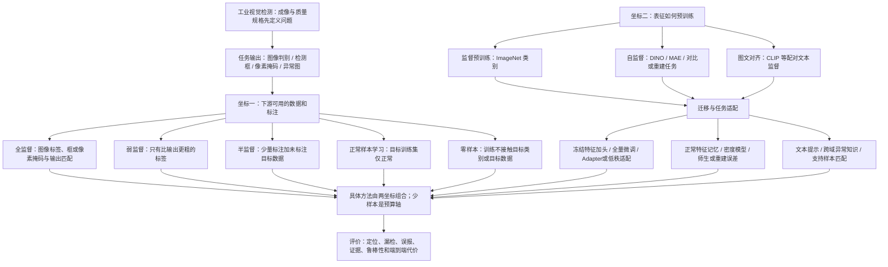

# 工业视觉与 PCB 外观缺陷检测：研究现状、方法地图与后续路线

调研截止：**2026-11-09，Asia/Shanghai**。本文是当前主文档的领域综述与证据附录，服务于理解研究、设计实验和撰写论文；不替代[研究与学习主文档](thesis-research-and-study-guide-zh.md)，也不将候选设计视为已经批准或完成的方法。

同日讨论后的修订重点：允许以PCB应用问题和任务适配形成有证据的贡献，区分应用/系统成果与新机制主张；局部细节、位置邻域均保留为候选。原始基线数字不变；补充正常参照评分含义和后续验证分工，新增论文见[19篇阅读目录](../paper/261107/README.md)。

证据标记：**[本地已核实]**＝本次读取实验配置、验收归档或代码；**[公开已核实]**＝原始论文、作者代码、数据集或机构官方资料；**[本文推导]**＝明确给出分母和假设的计算；**[拟研究]**＝尚未实验；**NR**＝本次未核实，不能据此补全条件。公开成绩均为作者报告或组织者评价，本次没有复现这些模型，也没有重新训练本地基线。调研覆盖代表性路线与截至该日可核验的近期工作，不声称穷尽所有最新论文或证明某方法是全球最优。

## 阅读导航

| 关心的问题 | 阅读位置 |
| --- | --- |
| 现在到底做成了什么，SegFormer 分数说明什么 | §1 |
| 学习范式、预训练、迁移、少样本之间的关系 | §2 方法地图 |
| 一个分数到底衡量什么，能否相互比较 | §3 指标对照与 §4 数据协议 |
| PCB 和工业方法实际达到什么水平 | §5 可追溯结果表、§6 前沿判断 |
| 论文成绩能否代表产线达标 | §7 |
| 我的研究放在哪里，接下来怎么做 | §8—§9 |
| 回查原记录和原始文献 | §10 |

当前最重要的判断是：你已建立**像素监督、单图输入、PCB1 二值分割的可复查基线**，尚未证明预训练适配或证据判别的有效性。test 前景 IoU=68.334%、Dice=81.189%、像素 Recall=73.896%；它说明模型能定位相当一部分缺陷，但仍有覆盖不足、逐图不稳定及正常区域误报。没有同协议先进方法复现，也没有现场验收数据，因而目前既不能判断“已接近 PCB 领域最佳”，也不能判断“达到工业标准”。数字来源见下表。

## 1. 个人研究现状：把事实、设想与要求分开

### 1.1 最新方向与任务边界

[主文档](thesis-research-and-study-guide-zh.md)已于2026-11-09按本轮讨论修订，项目 [AGENTS.md](../../AGENTS.md)指定它为优先入口；文件名日期为11月7日的文献/答辩文档保留为附录并同步修订，较早的SegFormer指南用于实现学习，不能覆盖最新方向。

| 项目 | 当前口径及状态 |
| --- | --- |
| 论文方向 | 导师建议《PCB 外观缺陷检测方法研究》；关注检测精度与可解释性，希望有两项以上实质工作 |
| 实际计算任务 | 板级 RGB 图像 → 每像素背景/缺陷二值掩码，恢复至原图尺度；目前不预测缺陷类型，不区分缺陷实例 |
| 下游监督 | train 有正常/异常样本与真实像素 mask；正常图提供全背景监督；属于全监督分割 |
| 数据入口 | VisA PCB1，基于官方 **2-class high-shot** 的本地派生 train/val，保留官方 test；不是通常的 VisA 1-class normal-only 协议 |
| 已完成 | SegFormer-B0 训练、val 选模、独立 test 评价与技术复核、错误展示、可追溯归档 |
| 工作一草案 | 面向PCB的预训练表征任务适配；先建冻结 DINOv3-S/16＋简单头，局部细节支路在诊断支持后再验证 |
| 工作二草案 | 正常参照直接进入评分并形成可核验证据；位置/结构筛选是候选，尚未建立库或验证匹配和解释 |
| 尚无证据 | DINO 胜过 SegFormer、小缺陷是主要漏检原因、两项机制有新颖性或有效性、多 seed 稳定性、跨板泛化、工业达标 |
| 边界 | 外观异常不等于电气失效、内部焊点缺陷或制造原因诊断；掩码、模型解释、工艺因果三者分开 |

这些是本地材料中已收敛的方向，不意味着所有方法设计已定型。有限算力是实施条件；只有做了精度—代价实验，才可将效率写成研究贡献。

### 1.2 正式实验身份与可复查配置

主要依据：[实验卡](../../work/SegFormer/reports/pcb1_b0_v2_seed42/experiment-card.md)、[正式配置](../../work/SegFormer/configs/baseline.yaml)、[划分元信息](../../work/SegFormer/manifests/split_meta.json)、[阶段12—13验收](../../work/SegFormer/reports/2026-11-01-stage12-13-acceptance.md)。

| 项目 | 已核实配置 |
| --- | --- |
| run / 随机性 | `pcb1_b0_v2_seed42`；正式单次 seed=42，不把早期检查/过拟合测试算成独立研究成果 |
| train | 530 图＝482 正常＋48 异常 |
| val | 132 图＝120 正常＋12 异常 |
| test | 442 图＝402 正常＋40 异常；异常比例约 9.05%，不能代表实际产线不良率 |
| 分组 | 官方训练部分 662 图再按本地 v2 分组方案派生 train/val；同源风险分组规则/清单见 split_meta，不能笼统声称知道所有真实物理板身份 |
| 初始化 | `nvidia/mit-b0`，ImageNet-1k 监督预训练编码器；revision `80983a413c30d36a39c20203974ae7807835e2b4`；整个二类解码头新建，全网络微调 |
| 参数量 | 总计 3,714,658＝编码器 3,319,392＋头 395,266 |
| 几何 | 原图记录 1404×1070；512×512 letterbox；mask 合并为 0/1，padding=255 忽略；训练同步水平翻转 p=0.5 |
| 预测还原 | logits 上采样至输入 → 裁 padding → 恢复原 H/W → softmax → 前景概率阈值 0.5；无后处理 |
| 损失 | CE(ignore=255)＋0.5×正 GT 图逐图前景 Soft Dice；正常图参与 CE，不能说正常图不参与训练 |
| 优化 | 50 epoch；batch=2、累积=1；AdamW，LR 6e-5，weight decay=0.01；warmup 662 步＋cosine 至 1e-6；梯度裁剪 1.0；FP16 AMP |
| 实际更新 | 尝试 13,250 次，成功 13,243 次，AMP 跳过 7 次 |
| 选模 | 最高 val global foreground IoU，平分保留较早轮；best epoch=39、成功更新 global_step=10,330 |
| 正式评价 | batch=1、IEEE FP32，TF32/autocast 关闭；原图 GT 0/1；累计整数 TP/FP/FN/TN |
| 环境记录 | RTX 4070 Laptop（8,188 MiB），PyTorch 2.10.0+cu126；这是历史实验环境记录，并非本次重新确认硬件状态 |
| 运行证据限制 | 归档 JSON 中的 `E:\桌面\AI\...` 是历史运行路径；本次核验的是当前仓库内的便携记录，未据此声称外部 checkpoint/数据仍在该路径可运行 |

### 1.3 找回的 SegFormer 成绩

以下均为前景缺陷指标，不是包含背景平均的 mIoU。val/test 采用同一冻结评价协议。原始执行与验收复核分别归档，主报告采用验收口径，不能混合挑选较高数值。

| 指标 | val（132 图） | test（442 图） | 精确来源 |
| --- | ---: | ---: | --- |
| 全局前景 IoU | 0.7775342969 | **0.6833438542** | [val metrics](../../work/SegFormer/reports/stage12_13_evidence/accepted_eval/val/metrics.json)、[test metrics](../../work/SegFormer/reports/stage12_13_evidence/accepted_eval/test/metrics.json) |
| 全局前景 Dice | 0.8748459012 | **0.8118886139** | 同上 |
| 全局像素 Precision | 0.9397792286 | **0.9007914116** | 同上 |
| 全局像素 Recall | 0.8183056947 | **0.7389578353** | 同上 |
| 异常图 macro IoU | 0.5395555278（12 图） | **0.5248580728**（40 图） | 同上；逐异常图等权 |
| 异常图 macro Dice | 0.6203118681 | 0.6350735444 | 同上 |
| 异常图 macro Recall | 0.6154797088 | 0.5831748857 | 同上 |
| 异常图 macro Precision | 0.7953262383，11/12图有定义 | 0.8070891646，**仅 38 图有定义** | 空预测使分母为 0，不补成满分 |
| 正常图 FP 像素总数 | 1,495 | **3,689** | 同上；不是全部 test FP |
| 正常图像素 FP 比例 | 8.29295027e-6 | 6.10845975e-6（约 0.000611%） | test为3,689 / 603,916,560；val为1,495 / 180,273,600 |
| 正常图存在任意 FP | 11/120 | **32/402** | 约 7.96%，尚非正式板级过杀率 |

test 全局混淆计数为 TP=252,227、FP=27,779、FN=89,101、TN=663,638,653，合计 664,007,760 像素。因此 IoU 可手工复算为 `252227/(252227+27779+89101)`。全部 FP 中，正常图贡献 3,689；其余 24,090 来自异常图的非缺陷区域。[test metrics](../../work/SegFormer/reports/stage12_13_evidence/accepted_eval/test/metrics.json)

### 1.4 这些数字反映了什么

1. **能找出并覆盖相当部分缺陷，但仍漏掉约 26.10% 的真实缺陷像素。**Precision≈90.08% 说明所预测的前景像素多数正确；Recall≈73.90% 说明缺陷覆盖不足。二者都是在阈值 0.5 的一个工作点，不能解释成“90% 坏板检出”或“26% 坏板漏检”。
2. **平均图像表现比全局像素表现更弱。**global IoU 先累计 TP/FP/FN，异常图 macro IoU 对每张异常图等权。全局分数受并集面积较大的图影响；正常图 FP 也进入全局分母。0.6833 与 0.5249 的差距说明聚合方式影响结论，尚不能单独证明小缺陷更难。
3. **存在明确的完全不命中案例。**`049.JPG`、`057.JPG` 预测为空；`077.JPG` 预测的 351 像素全部是 FP。因此 3/40 异常图没有命中任何 GT 像素；“没有报警”与“报警位置完全错误”必须分别统计。[逐图归档](../../work/SegFormer/reports/stage12_13_evidence/accepted_eval/test/per_image.json.gz)、[失败清单](../../work/SegFormer/reports/pcb1_b0_v2_seed42/failure-cases.csv)
4. **很小的像素误报也可能造成明显的板级复判负担。**正常像素 FP 比例约 0.000611%，但已有 32/402 张正常图含 FP。若事后假设“一张图任意预测一个缺陷像素即报警”，本次样本的图像 FPR=7.96%，异常图报警召回=38/40=95%；其中 077 因错误位置也会算作图像 TP。这只是演示性的事后计算，不是经 val 选定的生产规则，更不是正确定位率。[本文推导，依据上述逐图记录]
5. **总体像素 accuracy 几乎没有诊断价值。**始终预测背景仍能得到约 99.9486% accuracy，因为 GT 缺陷像素仅占约 0.0514%；其缺陷 Recall 却为 0。[本文推导]
6. **val 到 test 有落差，原因尚未证明。**global IoU 下降约 9.42 个百分点；每组只有 12/40 张异常、错误分布与抽样波动均可能参与，不能仅据此诊断过拟合或域偏移。

补充已知几何证据：[数据审计](../../work/SegFormer/reports/data_audit/summary.md)检查 PCB1 全部 100 张异常图：328 个原始 GT **4连通域**中，19 个经 512 标签采样后消失，涉及 12 图，原面积合计 39 像素（单域 1—8 像素），没有整张异常 GT 消失。**这是标注采样风险，不是已证实的主要漏检成因；连通域也不自动等同工艺缺陷实例。**该历史审计及 test 失败图已经接触测试集，后续应披露，方法开发回到 train/val。

目前没有完整图像/板级 AUROC、AP、正式缺陷级召回、稳定推理延迟、多 seed 置信区间或现场验收结果。评价总时长包括读图和写盘，不能除以张数后宣称为模型延迟；单次训练显存也不能直接与其他骨干/库检索配置比较。

## 2. 方法地图：先区分两个相互独立的坐标

### 2.1 一张领域方法地图



若阅读器不渲染 Mermaid，核心关系是：**先确定下游任务与标签，再选择表征来源和适配方式，最后按该任务评价。少样本不是独立网络家族，预训练自监督也不意味着下游无监督。**

### 2.2 下游监督条件与典型方法

| 范式 | 真正需要的数据 | 常见做法、为什么有效 | 代表原始工作 | 场景与主要限制 |
| --- | --- | --- | --- | --- |
| 全监督 | 分类需图像标签，检测需框，分割需 mask；正常与缺陷分布应覆盖目标工况 | U-Net/DeepLab/SegFormer 学习像素决策；Faster R-CNN/YOLO 类学框与类别；分类头可整合局部与全局信息 | [SegFormer，NeurIPS 2021](https://proceedings.neurips.cc/paper/2021/hash/64f1f27bf1b4ec22924fd0acb550c235-Abstract.html)；[工业两阶段分割/判别，2019/2020](https://arxiv.org/abs/1903.08536) | 已知缺陷、有标注、需要明确类别/边界；未知缺陷、稀缺样本与新工况可能失效。你当前位于此行 |
| 弱监督 | 对空间输出只有图像异常标签，或框、点、涂鸦、粗 mask | CAM、MIL 将区域响应汇聚成图像标签；伪 mask/一致性细化将粗监督传向像素 | [Mixed supervision，Computers in Industry 2021](https://arxiv.org/abs/2104.06064)、[作者实现](https://github.com/vicoslab/mixed-segdec-net-comind2021) | 能知道好坏但画 mask 成本高；常只定位最显著部分，背景相关性和伪标签噪声要检查 |
| 半监督 | 少量真实标签＋额外未标注目标图；必须写未标注集的来源和异常污染 | Teacher/Student、EMA、一致性与置信伪标签，用额外样本约束边界 | [FixMatch，NeurIPS 2020](https://papers.nips.cc/paper/2020/hash/06964dce9addb1c5cb5d6e3d9838f733-Abstract.html)是通用机制代表，原文不是 PCB 分割成绩 | 有未标注流数据且标注少；错误伪标签易强化“微缺陷＝背景”。不能把“不再使用的 mask”默认为额外免费数据 |
| 正常样本/单类异常检测 | 干净正常训练图；真实异常与 mask 通常只在评价出现 | 正常特征分布、记忆库最近邻、重建、师生差异、归一化流；偏离正常支持集即异常 | [PaDiM](https://arxiv.org/abs/2011.08785)、[PatchCore，CVPR 2022](https://openaccess.thecvf.com/content/CVPR2022/html/Roth_Towards_Total_Recall_in_Industrial_Anomaly_Detection_CVPR_2022_paper.html)、[Dinomaly，CVPR 2025](https://arxiv.org/html/2405.14325v5) | 未知缺陷多、正常样本易收集；正常变化没覆盖会误报，结构/逻辑约束可能仅靠局部特征捕捉不到 |
| 自监督学习 | 无人工语义标签，用数据自身构造学习目标 | 对比、教师自蒸馏、掩码重建，或 CutPaste 合成任务；得到可复用特征/正常性表征 | [CutPaste，CVPR 2021](https://arxiv.org/abs/2104.04015)、[DINOv3，2025技术报告](https://arxiv.org/abs/2508.10104) | 通常是预训练方式，也可在目标正常图上作为训练机制；它不能与上述下游监督范式简单并列成互斥五选一 |

**术语陷阱：**工业文献常把 normal-only 称作 unsupervised AD，也有论文称其 semi-supervised，因为训练图已被筛为正常。本文将其写为“正常样本学习”，与“少量标注＋未标注混合”的半监督区分。normal-only 并非从任意未标注混合流中自动学习；训练集正常性筛选本身有成本。图像标签对分类是完整监督，对精确分割则是弱监督。

### 2.3 按机制理解，避免只记模型名

| 机制 | 有效的理由 | 容易失效的条件 | 对本研究的意义 |
| --- | --- | --- | --- |
| 经典视觉、配准与参考差分 | 固定成像下可直接检测线宽、连通性、缺口和对应结构差异，规则可追溯 | 反光、位移、正常印刷差异、参考不匹配；不规则外观难写规则 | 作为可解释、低成本对照；不能假设 VisA 有逐图配对黄金板 |
| 监督密集预测 | 利用正负像素学习“缺陷”而非“所有不同”，正常纹理可被显式压制 | 标注少、边界噪声、缩放损失、训练未覆盖的新缺陷 | 保留原 SegFormer，先定位真实错误再改结构 |
| 正常记忆与密度 | 通用特征把相似正常块聚集，距离/概率反映偏离 | 库太小遗漏正常模式；库污染掩盖异常；错结构的最近邻可能伪装正常 | 参照直接参与评分时可追踪来源；“找到近邻”不等于语义匹配正确 |
| 重建与师生差异 | 仅在正常数据拟合，期待异常不能同样被恢复/模仿 | 容量过强也重建异常；捷径/恒等映射削弱差异 | Dinomaly 的设计针对该机制；不能把其解码器直接当监督分割贡献 |
| 合成异常 | 用 CutPaste/Perlin 噪声等提供代理缺陷目标，建立局部判别能力 | 合成纹理与真实缺陷不符，模型学会识别合成伪影 | [DRAEM](https://arxiv.org/abs/2108.07610)、[SuperSimpleNet](https://arxiv.org/html/2408.03143v1)是代表；合成 mask 不等于使用真实缺陷监督 |
| 视觉语言/提示 | 图文对齐带来通用“正常/损坏”语义，跨类别迁移异常知识 | 语义能识物却未必能定位细小电路变化，文本解释可能与评分脱离 | 可用于零样本或概念证据，但需要单独核验像素表现及解释忠实性 |

### 2.4 表征学习、迁移、少样本与零样本的关系

表征学习是“如何把图像编码成有用特征”；迁移学习是“把别处学到的信息用于新任务”；任务适配是迁移中的具体步骤。冻结骨干加头、全量微调、Adapter/低秩更新、特征层选择、记忆库建模都属于不同适配策略。预训练降低从少量 PCB 数据重新学习所有视觉结构的难度，但其不变性、patch 网格和训练域也可能丢失缺陷差异。[DINOv3 原文](https://arxiv.org/abs/2508.10104)

三条具体路径可同时成立：

- **你现在：监督 ImageNet 预训练 → PCB mask 全监督微调。**不是从零训练，也不是下游自监督。
- **拟建 DINO 对照：自监督预训练 → 冻结编码器 → 用 PCB mask 训练头。**仍然是全监督分割，只是可训练参数较少。
- **AnomalyDINO：自监督 DINOv2 → 少数正常参考图构库 → 距离异常定位。**下游不用真实异常 mask，也不训练网络权重，但仍需要目标正常参考图。[原文](https://arxiv.org/html/2405.14529v3)

“few-shot”必须写清计数对象：少数正常图、少数带缺陷 mask 的图、每类少数检测框，还是每个 episode 的 support 样本。你有 48 张异常训练图，不自动成为标准 few-shot 设定。若研究标注效率，需固定 test、抽取多组嵌套标注预算并重复；同时记录正常图数量和额外未标注数据。

“zero-shot”也必须写清边界：WinCLIP 用文本先验，不接触目标正常图；WinCLIP+ 加正常参考后是 few-normal-shot。[WinCLIP 原文](https://openaccess.thecvf.com/content/CVPR2023/html/Jeong_WinCLIP_Zero-Few-Shot_Anomaly_Classification_and_Segmentation_CVPR_2023_paper.html) AD-DINOv3 的零样本指目标数据未参与训练，其辅助数据含正常/异常及 mask，因此不是全流程没有人工缺陷标签。[AD-DINOv3 §3.1、§4.1](https://arxiv.org/html/2509.14084v2)

## 3. 可追溯指标对照：先确定统计单位，再讨论分数

### 3.1 四种任务不可混成“检测准确率”

| 任务 | 输出、统计单位 | 常用指标 | 必须补充的协议 |
| --- | --- | --- | --- |
| 图像级/板级判别 | 一张图或一块板一个异常分数及报警结果 | I-AUROC、I-AP、P/R/F1、FNR/FPR | 一板多图如何合并；阈值来源；好坏定义；实际不良率 |
| 目标检测 | 每个缺陷框、类别、置信度 | AP50、AP75、mAP50:95、实例 Recall | 框 IoU 一对一匹配、类别、重复检测、NMS、小缺陷分组 |
| 语义分割 | 每像素类别/概率 | 前景 IoU、Dice、像素 P/R、P-AP | 原图还是缩放图；global/macro；正常图与空 GT；忽略像素 |
| 异常定位 | 连续异常热图，必要时阈值成 mask | P-AUROC、P-AP、AUPRO、阈值后 Dice/IoU | 训练是否 normal-only；热图归一化、平滑、阈值；FPR 积分上限 |

异常定位不自动给出缺陷类型；语义掩码不自动给出缺陷实例。图像与板只有在“一图对应一板并采用已定义规则”时才可互换。局部 PCB crop 的图像准确率更不能直接成为整板合格率。

### 3.2 指标定义、局限和原始实现依据

以下均以“缺陷/异常＝正类”。TP/FP/FN/TN 需先指定是像素、缺陷实例还是板；不同单位的混淆矩阵不能代换。

| 指标 | 定义或读法 | 适合回答什么 | 主要局限及可追溯依据 |
| --- | --- | --- | --- |
| Precision | TP/(TP+FP) | 发出的缺陷预测有多少是真的 | 不是好板误杀概率；与不良率/像素稀疏度有关。[官方定义](https://scikit-learn.org/stable/modules/generated/sklearn.metrics.precision_score.html) |
| Recall / TPR | TP/(TP+FN) | 真实缺陷中覆盖/命中多少 | 单看 Recall 可通过全面报警获得高分；像素 Recall 不是实例 Recall |
| IoU / Jaccard | TP/(TP+FP+FN) | 预测区域与 GT 并集上的重叠 | 小边界偏移对微缺陷影响很大；全局可被大缺陷主导；前景 IoU 不等于含背景 mIoU。[本地实现](../../work/SegFormer/segformer_lab/metrics.py) |
| Dice / 像素 F1 | 2TP/(2TP+FP+FN) | 同一二值掩码的重叠 | 同一混淆矩阵上 Dice=2IoU/(1+IoU)，不是独立能力；不同图平均后不能直接套换。soft Dice loss 与硬阈值 Dice 指标亦不同 |
| AP | 常用非插值定义为 Σ(R_n−R_(n−1))P_n；对分数排序下 PR 曲线汇总 | 异常稀少时，检出与报警可信度的折中 | 需标明 image/pixel/box；AP 和梯形 PR-AUC 不严格等价；随机排序基准受正类比例影响。[scikit-learn AP](https://scikit-learn.org/stable/modules/generated/sklearn.metrics.average_precision_score.html) |
| mAP | 对类别及/或指定框/实例 IoU 阈值平均的 AP | 多类实例检测与定位 | AP50 不等于 COCO AP50:95；后者平均 0.50:0.05:0.95 十个 IoU 阈值，标准 COCO 使用 101 个召回点；语义分割前景 IoU 不是 mAP。[COCO 官方评价](https://cocodataset.org/dataset/detection-eval.htm) |
| AUROC | ROC 曲线 TPR 对 FPR 的面积；可理解为随机正例分数高于随机负例的概率，平分折半 | 跨阈值排序/可分性 | 不说明选定阈值、不良率下 Precision 或低 FPR 段表现；P-AUROC 可很高而局部 mask 仍不好。[官方 ROC-AUC](https://scikit-learn.org/stable/modules/generated/sklearn.metrics.roc_auc_score.html) |
| AUPRO / AU-PRO | 每个 GT 区域的覆盖率先等权平均为 PRO，再对像素 FPR 积分，一般按上限归一化 | 降低大区域对覆盖评价的支配 | 本质为区域覆盖率曲线，不要求每个预测域正确一对一匹配，也不等同缺陷检出率。FPR 上限 0.30 与 0.05 不可直接比较；官方说明见 §7 的 AD2 来源 |
| F1-max | 在一组阈值中取得的最大 F1 | 比较排序能支持的最佳分割潜力 | 若用 test GT 搜最佳点即为 oracle，不能称可部署工作点；你本地是固定 0.5，不是 F1-max |
| FNR / 漏检率 | FN/(TP+FN)=1−Recall | 真实不合格中有多少被放过 | 必须注明板/实例/像素、缺陷严重等级；绝非 1−IoU |
| FPR / 好品误报率 | FP/(FP+TN) | 真实良品中有多少被报警 | 与 1−Precision 不同；像素 FPR 小不保证板 FPR 小 |
| 过杀率 / 假缺陷率 | 企业口径不统一，可能为误判坏的良品/全部良品，也可能为假报警/全部报警 | 良品损失或复判负担 | 前者是 FPR，后者是 1−Precision；必须同时报计数和分母，不能只写中文术语 |
| 延迟 / 吞吐 / 节拍 | 单板端到端延迟、稳态每秒出板量/相邻出板周期、目标需求节拍分别报告 | 能否跟上目标工位 | FPS 不等于 1000/单图 ms（batch/流水线可不同）；单板延迟不等于流水线出板周期；还需计入成像、搬运、配准、后处理和通信 |

normal-only 的“未用训练 mask”不妨碍用隐藏测试 mask **评价**；反之，用真实异常验证集挑模型/阈值时必须披露标注访问，不能继续宣称所有选择都无需异常标签。

### 3.3 从像素到缺陷再到板：本研究需要补的评价层

**像素层**保留原图 global IoU/Dice、P/R，增加 P-AP 以观察排序；若与 AD 文献比较，再加 P-AUROC/AUPRO，并固定积分上限与代码。global、异常图 macro、正常图 FP 单独报告。正常图 GT 和预测都空时，当前代码将逐图 IoU/Dice 记为 NA，并另报正常误报；不能事后改成 1 再与旧结果混比。

**缺陷层**先定义 GT 实例：由专家实例标注，或清楚声明是几何连通域代理，预先固定4或8邻域。若改用8邻域，需另建扩展统计，不能沿用历史4连通的328/19计数。事先固定匹配规则，如一对一 mask IoU≥τ，或某类细线缺陷允许有物理意义的覆盖规则；记录 τ、拆分/合并、忽略微域的理由。只要命中 1 个 GT 像素就算“检出”过于宽松。报实例 Recall、每图 FP 数及按尺寸/缺陷类型分层，不能把 AUPRO 当成这个指标。

**板层**把像素概率转为实际报警：例如概率阈值＋连通域面积/宽度＋多图聚合，但这些都是待选规则，应在 val 决定并冻结。报坏板召回、好板 FPR、每千板误报、复判负荷；如果没有物理尺寸标定，规则只能以像素计，不声称达到微米级检出。视图间、同板 crop 间必须按板分组划分。

**不确定性层**不能把数亿相邻像素当成数亿独立试验。有可信物理板ID时按板/样件做bootstrap或二项区间；PCB1暂缺完整物理板ID，只能按图像/已知风险组作探索性配对重采样，披露未知相关性，不称独立板级区间。多seed反映训练随机性，不能代替不同批次的独立取样。40张异常图只要错1张，图像漏检率就变2.5个百分点。[本文统计建议]

### 3.4 速度与工作点的最小报告格式

记录 GPU/CPU、精度、输入原图和切块数、batch、预热次数、CUDA 同步方式；分别报告模型、检索/后处理、完整软件链路的 P50/P95/P99 ms、峰值显存、正常库大小与稳定吞吐。若要论证工位达标，再加曝光、传输、机械与控制时间。不要把某论文 V100/A6000 上的模型 FPS 搬到自己的笔记本或整板 AOI 上。

阈值先在 val 选，例如以事先约定的好板 FPR 约束最大化缺陷召回，再冻结到 test。若正常验证图只有 120 张，观测 FPR 的粒度是 1/120≈0.833 个百分点，不能据此可靠标定万分级误报尾部；需要更多独立正常样本或诚实说明仅作探索。

## 4. 数据集和评价协议：PCB 不是单一问题

| 数据集/对象 | 数据与标注、输入条件 | 常见协议及比较边界 | 原始来源 |
| --- | --- | --- | --- |
| **VisA** | 12 类、10,821 图＝9,621 正常＋1,200 异常；含 pcb1—pcb4，板上结构复杂；异常有像素 mask；不是只有裸板铜线 | 官方同时提供 1-class、2-class high-shot、few-shot；同叫“VisA”也未必同 train/test。一般没有每张异常图对应的黄金正常板 | [Amazon 官方仓库](https://github.com/amazon-science/spot-diff)、[SPD 原文](https://arxiv.org/html/2207.14315v1) |
| **本地 VisA PCB1** | 全部 1,104 原图；异常共 100 图；原始 GT 非零类型合成一个缺陷类 | 官方 high-shot train=602正常＋60异常，test=402＋40；本地再分 train530/val132。论文与本地的选模和训练预算仍不同 | [官方 high-shot CSV](https://raw.githubusercontent.com/amazon-science/spot-diff/main/split_csv/2cls_highshot.csv)、[本地清单](../../work/SegFormer/manifests/split_meta.json) |
| **DeepPCB** | 1,500 对 640×640 检测图/无缺陷模板图，六类缺陷框；主要是裸板线路结构 | 官方 1,000 train/500 test，配准参考条件；不同方法可能只用检测图，也可能用图对。框级 AP/F1 不是语义掩码 IoU；不能把图对拆进不同集合 | [作者仓库及数据协议](https://github.com/tangsanli5201/DeepPCB) |
| **PKU-Market-PCB / HRIPCB 来源数据** | 原库 1,386 合成缺陷图、六类框标注，由10张正常模板生成；693正向＋693旋转图 | 论文可能改变裁切、划分、mask 生成和输入；CADNet 使用参考图与自己的预处理划分。仅凭库名不能直接排名 | [北京大学原数据页](https://robotics.pkusz.edu.cn/resources/dataset/)、[原始数据论文](https://arxiv.org/html/1901.08204v1) |
| **DsPCBSD+** | 10,259 图、20,276 个框、九类工业裸板缺陷；论文描述226×226 AOI缺陷图 | 官方8,208 train/2,051 validation，无另立独立test；不能将验证成绩写成盲测成绩，也不能把框填满当精细分割GT | [Scientific Data2024原文](https://pmc.ncbi.nlm.nih.gov/articles/PMC11263390/)、[官方数据DOI](https://doi.org/10.6084/m9.figshare.24970329) |
| **MeiweiPCB** | CM-UNetv2 使用 926 个 220×220 缺陷 patch及像素标注；具体标签合并实现本次NR | 监督语义分割，pad 到256，随机80/20；不是本地板级原图协议；应核查原大图/实物来源组，避免同板 patch 泄漏 | [CM-UNetv2，Sensors 2025](https://www.mdpi.com/1424-8220/25/16/4919) |
| **MVTec AD** | 15 类、5,354 图，包含物体与纹理；正常训练、含正常/异常的测试及像素 GT | 通常每类独立 normal-only 模型，也有所有类统一训练；两者资源与难度不同。并非 PCB 专项数据 | [MVTec 官方](https://www.mvtec.com/research-teaching/datasets/mvtec-ad) |
| **KSDD2** | 真实表面缺陷、有图像标签和像素 GT，包含正常和缺陷训练样本 | 适合监督/弱监督/混合标注预算；AP_det 在相关论文中为图像 AP，不是框检测 mAP | [作者代码与协议](https://github.com/vicoslab/mixed-segdec-net-comind2021)、[SuperSimpleNet §4](https://arxiv.org/html/2408.03143v1) |
| **Real-IAD** | 151,050 图、30 类、每个实物5视角；顶视＋4侧视；有专用装置和人工制作缺陷 | 图像与样件级评价不同；五视图不能当五个独立样件。官网还提供1024下采样版，必须声明版本 | [原文](https://arxiv.org/html/2403.12580v1)、[官方项目](https://realiad4ad.github.io/Real-IAD/) |
| **MVTec AD 2** | 8 类、8,000余高分辨率图；包括小缺陷、正常高变异、透明/反光及未见照明；私有测试 GT | normal-only，正常 validation；隐藏测试与光照变化；数据集 AU-PRO 与 VAND 挑战 SegF1 协议分开看 | [原文](https://arxiv.org/html/2503.21622v1)、[官方页](https://www.mvtec.com/research-teaching/datasets/mvtec-ad-2) |

这里刻意不将各 PCB 库统称一个“标准 PCB 基准”：裸板短路/断路、装配板外观变化、微小纹理、元件缺失及 3D 焊点检查，所需成像、标注和验收都不同。本地 PCB1 目前只能支持其中一个明确子问题。

每次引用结果，至少抄齐：**任务、数据版本/类别、划分单位与清单、真实标注预算、额外数据、输入与评价尺度、参考图条件、预/后处理、阈值和选模、聚合方式、重复次数、资源与来源**。一个字段 NR 就保留 NR，不根据常识补填。

## 5. 代表性结果：按协议分表，不做跨表排行榜

本节公开成绩以百分数表示；本地小数在此乘100。**先进结果**表示该工作在其发表时或相应挑战内具有代表性，不表示本次证明其截至2026-11-09在所有协议全球第一。

### 5.1 与当前任务最接近的 PCB 监督证据

| 任务—数据 | 监督与方法 | 训练/输入/参考图/评价协议 | 指标 | 来源与能比较的范围 |
| --- | --- | --- | --- | --- |
| 二值分割，VisA PCB1，本地可靠基线 | 真实 mask；ImageNet MiT-B0→SegFormer-B0 全量微调 | train530/val132/test442；512 letterbox→原1404×1070计分；单图；val选epoch、阈值0.5；seed42 | 前景 IoU **68.334**，Dice **81.189**，像素P/R **90.079/73.896**；异常图macro IoU **52.486** | [accepted test](../../work/SegFormer/reports/stage12_13_evidence/accepted_eval/test/metrics.json)。可作为本地后续同协议比较基准 |
| 异常分割，VisA PCB1，SPD原始基线 | high-shot真实mask；ImageNet监督预训练ResNet-50编码器的U-Net | 官方train662/test442，60异常训练图；无逐图黄金参考；输入/本次精确训练选模细节NR；原文像素排序指标包含正常图 | pixel **AU-PR 59.4、AU-ROC 93.6** | [SPD，ECCV2022，表10](https://arxiv.org/html/2207.14315v1)。与本地训练预算/val不同，且AU-PR不能与IoU排名 |
| 同上，预训练适配的直接历史依据 | ImageNet监督预训练＋SPD，再做high-shot监督分割 | 同一原文协议；SPD是合成局部差异的自监督预训练，不是DINO | pixel **AU-PR 91.3、AU-ROC 99.2**；SimSiam＋SPD为85.1/99.4 | [同文表10](https://arxiv.org/html/2207.14315v1)。说明预训练目标会影响细缺陷表征，不预言本地模型应达到91.3 IoU |
| 参考图缺陷分割，PKU-Market-PCB | CADNet，六类像素监督，双图差异、平衡对比损失与change-aware decoder | 原1,386图经resize/crop成1000²子图，仅保留含缺陷子图；1,566 train/676 test，再512²输入；需对应无缺陷参考模板；非本地单图协议 | 六类缺陷宏平均mIoU **77.52**、mAcc **85.87**、mFscore **87.31** | [Scientific Reports2025，表4](https://www.nature.com/articles/s41598-025-94733-4.pdf)、[作者代码](https://github.com/HATFormer/CADNet)。不能当合并所有缺陷的二值前景IoU |
| patch语义分割，MeiweiPCB | CM-UNetv2，像素监督；空间/语义及边界恢复 | 926个220²patch，pad256²、80/20；单张patch；具体独立大板分组、seed/置信区间NR | mIoU **82.24**、F1 **89.25**，P/R **89.70/88.82** | [Sensors2025，表6](https://www.mdpi.com/1424-8220/25/16/4919)。mIoU平均口径NR，不能确认与本地一致，不能直接说高13.9点 |

SPD 的 **AU-PR 保留原名**，没有核对其数值积分实现前不擅自改称非插值 AP。CADNet 表4六类IoU均值可复算为77.5217%，表中不含额外背景列；CM-UNetv2 的背景处理和平均方式本次未核实，复现时需核对原实现。CM-UNetv2 的另一数据集 **KWSD2 是水体分割数据，不是工业 Kolektor 的 KSDD2**，原文800/200的划分不能挪到MeiweiPCB。

PCB 框检测还有一组值得保留的锚点，反映“AP50很高”不代表严格定位也同样高：

| 任务—数据—监督 | 方法/年代 | 划分、标注预算与输入条件 | 指标（%） | 原始来源及限制 |
| --- | --- | --- | --- | --- |
| 九类框监督，DsPCBSD+ | Co-DETR / YOLOv6-L6，数据集原始基线2024 | 官方8,208训练/2,051验证；不需配对参考；网络输入尺度本表NR | AP50/AP50:95＝**84.8/49.2**、**85.1/51.4** | [原文表2](https://pmc.ncbi.nlm.nih.gov/articles/PMC11263390/)。这是validation，不是独立test |
| 九类框监督，DsPCBSD+ | PCB-MMF，Scientific Reports2026-04正式发表 | 重新随机7:2:1；单图CNN+Mamba；输入尺度NR | mAP50/mAP50:95＝**85.39/51.60** | [原文表3、表6](https://pmc.ncbi.nlm.nih.gov/articles/PMC13280455/)。同表Mamba-YOLO-T为85.58/52.51，不能说其精度全面第一；也不能与上一行直接排榜 |
| 同方法，DeepPCB | PCB-MMF | 同样7:2:1，**不是**官方1000/500；框监督；单图；输入尺度NR | mAP50 **98.68** | [同文摘要及实验协议](https://pmc.ncbi.nlm.nih.gov/articles/PMC13280455/)。说明接近99的框AP仍需逐项核对协议 |
| 九类框监督，DsPCBSD+ | 结构引导掩码预训练＋空间连续性正则，2026-06预印本 | YOLOv8s，640²；无标签PCB预训练400epoch，再监督100epoch；8,208/2,051；预训练是否严格仅用train、±对应重复次数NR | mAP50/mAP50:95＝**85.5±0.4/52.3±0.2** | [原文表2](https://arxiv.org/html/2606.03508v1)。只列预印本进展，未独立核实正式接收；validation分数，不是mask分割成绩 |

最后一行与本研究的联系是“结构先验用于表征适配已有直接 PCB 先例”，而不是要求把当前任务改成YOLO检测。其未说明的预训练访问范围需补查后再作严谨复现对照。

### 5.2 正常样本、少正常参考与零样本：更强分数来自不同资源条件

| 任务—数据 | 下游监督/方法 | 预算、分辨率、参考与评价协议 | 作者报告指标 | 原始来源 |
| --- | --- | --- | --- | --- |
| 图像判别＋定位，MVTec AD | normal-only，PatchCore WR50可靠基线 | 每类正常训练库，ImageNet特征；单张待测图＋训练正常特征库；官方不同示例使用224/320等尺度，本行预训练模型精确尺度NR | I-AUROC **99.2**，P-AUROC **98.1**，PRO **94.4**；官方ensemble为99.6/98.2/94.9 | [官方代码“Expected performance”](https://github.com/amazon-science/patchcore-inspection)、[CVPR2022原文](https://openaccess.thecvf.com/content/CVPR2022/html/Roth_Towards_Total_Recall_in_Industrial_Anomaly_Detection_CVPR_2022_paper.html)；不是任意PatchCore配置都99.6 |
| 定位与判别，MVTec AD | 1-normal-shot，AnomalyDINO-S，冻结DINOv2、无梯度训练 | 每类1张正常参考，3组不同正常参考样本运行（非训练seed）；agnostic预处理；较短边672；特征近邻、上采样/平滑 | I-AUROC **96.6±0.4**，P-AUROC **96.8±0.1**，pixel F1-max **60.2±1.1**，PRO **92.7±0.1** | [WACV2025原文表2、§4](https://arxiv.org/html/2405.14529v3)。1张正常图不等于1张异常mask |
| 图像判别＋定位，VisA | zero-target-shot，WinCLIP | 无目标正常参考；CLIP图文预训练＋文本状态/窗口聚合；本表输入尺度NR | I-AUROC **78.1**，P-AUROC **79.6** | [CVPR2023原文](https://openaccess.thecvf.com/content/CVPR2023/html/Jeong_WinCLIP_Zero-Few-Shot_Anomaly_Classification_and_Segmentation_CVPR_2023_paper.html)；是历史零样本锚点 |
| 同上，VisA | 1-normal-shot，WinCLIP+ | 增加每类1张正常参考；其余不能等同零样本预算 | I-AUROC **83.8**，P-AUROC **96.4** | [同一原文](https://openaccess.thecvf.com/content/CVPR2023/html/Jeong_WinCLIP_Zero-Few-Shot_Anomaly_Classification_and_Segmentation_CVPR_2023_paper.html) |
| 多类别统一定位，MVTec AD | normal-only，Dinomaly，DINOv2-R ViT-B/14 | 所有类正常图统一模型；448²resize→392²center crop；10,000步；不用逐图黄金参考；类均值 | I-AUROC **99.6**；P-AUROC/AP/F1-max/AUPRO＝**98.4/69.3/69.2/94.8** | [CVPR2025原文表1、§4.1](https://arxiv.org/html/2405.14325v5) |
| 同方法，VisA全12类 | 同上 | VisA 1-class normal-only，非high-shot；同尺度与统一训练 | I-AUROC **98.7**；P-AUROC/AP/F1-max/AUPRO＝**98.7/53.2/55.7/94.5** | [同文表1](https://arxiv.org/html/2405.14325v5) |
| 同方法，VisA PCB1子类 | 同上，来自统一模型 | 1-class test而非本地high-shot test；表内按该类别评价 | P-AUROC/AP/F1-max/AUPRO＝**99.5/87.9/80.5/95.1** | [同文表A17](https://arxiv.org/html/2405.14325v5)。不能把80.5 F1-max与本地81.19固定阈值Dice当成胜负 |
| 多类别统一检测，Real-IAD | normal-only，Dinomaly | 全类别统一模型，50,000步；同预处理；官方图像级/像素级结果，不是实物多视角融合成绩 | I-AUROC **89.3**，P-AP **42.8**，P-AUROC **98.8** | [同文表1](https://arxiv.org/html/2405.14325v5)。说明高像素AUROC可与较弱AP/图像判别同时存在 |
| 监督表面检测/定位，KSDD2 | SuperSimpleNet，预训练特征＋适配＋分割/分类头，真实与合成异常 | 预定义train/test、真实mask；232×640；最后epoch，5次运行；单张待测图，无黄金板输入 | **AP_det 97.4±0.25、AP_loc 82.1±0.50** | [ICPR2024原文表2、§4.3](https://arxiv.org/html/2408.03143v1)。分别是图像AP/像素AP，不是框mAP/IoU |
| normal-only检测/定位，VisA PCB1 | SuperSimpleNet，同一架构的无监督模式 | 官方1-class正常训练，256²，无center crop；最后epoch，5次运行；类别独立训练 | I-AUROC **96.9**、AUPRO **92.9** | [同文表4](https://arxiv.org/html/2408.03143v1)。不能将该VisA结果说成mask监督成绩 |
| 跨数据零样本定位，VisA | AD-DINOv3，DINOv3-L/16＋CLIP文本适配 | 在MVTec AD真实正常/异常mask上训练，目标VisA未参与；512²；不需目标黄金正常图；2025预印本，正式会议状态本次NR | P-AUROC **95.6**、pixel F1-max **37.7** | [原文表1、§3.1/4.1](https://arxiv.org/html/2509.14084v2)。是辅助监督后的目标零样本，不是全程无标签 |

表中最值得学习的不是谁的某一列最大，而是同一模型在 **AUROC、AP、F1** 上呈现不同水平。Dinomaly 的 VisA P-AUROC=98.7% 与 P-AP=53.2% 同时成立，直接说明“像素排序多数正确”与“缺陷稀少时精确分割并控制报警”不是同一个问题。这里的 F1-max 还给了选最佳阈值的便利，不能代表事先冻结的工业阈值。

### 5.3 2026 年更贴近应用的隐藏测试：高 AUROC 之后仍有什么难题

以下为组织者2026-10公开的 VAND4 工业赛道成绩。**同一表内**才具有相同挑战规则；不能与上面的PCB1、MVTec AD或AU-PRO混排。

| 数据/任务/监督 | 方法及输入资源 | 评价协议 | 指标（%） | 来源 |
| --- | --- | --- | --- | --- |
| MVTec AD2，异常分割，regular normal-only | SuperADD；DINOv3正常特征记忆；具体切块/输入NR | 8类，各类像素累计F1后类均值；隐藏 `priv`/光照变化 `priv_mix`；提交二值mask；两集合名次取平均排名 | SegF1 **57.42 / 54.35**，最终第1 | [组织者论文§3.3、表1](https://arxiv.org/html/2610.04392v1) |
| 同一regular设置 | ISVL++；DINOv3并结合合成异常训练头/估阈值；输入NR | 同上；不是按单个priv分数排总名次 | **58.31 / 53.75**，最终第2 | [同表1](https://arxiv.org/html/2610.04392v1) |
| 同数据，target zero-shot | BALM；使用辅助训练，含SAM细化；输入/辅助标注预算NR | 训练不接触MVTec AD2；同一隐藏测试与SegF1排名规则 | **42.64 / 41.45**，零样本第1 | [同表2及分析](https://arxiv.org/html/2610.04392v1) |

这支持两个有限结论：阈值化分割与光照变化仍困难；强预训练特征已有现实竞争力。它不支持“所有先进工业方法只有57%精度”，也不支持“你的81.19% Dice比冠军更好”。数据、监督预算、聚合及工况完全不同。

## 6. 前沿走向与仍未解决的问题

### 6.1 从重新设计大网络，走向表征选择和任务适配

DINOv3 的长处是通用、可迁移的密集视觉特征，Gram anchoring 用于缓解长训练中密集特征退化；但这不是针对PCB的像素监督模型。[DINOv3，2025](https://arxiv.org/abs/2508.10104)、[官方实现/模型卡](https://github.com/facebookresearch/dinov3)

更直接的2026对照研究发现：DINOv3蒸馏的ConvNeXt在冻结迁移时并没有稳定胜过ImageNet监督预训练，在RGB任务全量微调后更有优势，X-ray域则不成立。这是CVPR2026 **VISION workshop**论文，使用ConvNeXt而非拟用的ViT-S/16；结果来自其验证协议和单seed，不能外推成DINO必胜。[Gharbage等，原始会议记录](https://openaccess.thecvf.com/content/CVPR2026W/VISION26/html/Gharbage_Rethinking_Transfer_Learning_for_Industrial_Inspection_DINOv3_vs._ImageNet_Pretraining_CVPRW_2026_paper.html)、[全文](https://arxiv.org/html/2605.23472v1)

**对你的含义：[研究建议]**冻结DINO＋简单头值得做，但结果差也有价值；先检验固定表征是否保留缺陷信号，再判断需要局部细节、层选择、可训练适配还是更合适的编码器。SegFormer与DINO的比较同时改变骨干、预训练、头和训练范围，只能是系统比较；要归因“自监督预训练更好”，需尽量同骨干、同头、同优化并仅改变初始化。

### 6.2 两项草案已有非常接近的先例，需要收窄贡献

| 最接近的已有工作 | 与草案的接近点 | 你仍需要独立证明的内容 |
| --- | --- | --- |
| [SuperSimpleNet，ICPR2024](https://arxiv.org/html/2408.03143v1)及[No label left behind，2025在线/2026卷期](https://doi.org/10.1007/s10845-025-02680-8) | 预训练特征＋适配＋定位/判别、不同监督预算 | 仅增加现成适配层不足以宣称新方法；PCB适配的应用价值可通过具体问题、同协议比较、收益和边界建立 |
| [S³DNet，Mathematics2026-10](https://www.mdpi.com/2227-7390/14/20/3730) | 冻结DINOv3、局部空间分支、语义适配与门控融合 | 原文为带mask support的少样本钢带分割，不是PCB high-shot；但“DINO＋卷积细节支路”的一般构想已有，需具体结构和问题证据上的差异 |
| [DINOSaur，2026-05预印本](https://arxiv.org/html/2605.24251v1) | 冻结DINOv3-S/16、空间索引正常库、邻域约束近邻评分 | 与“位置/结构约束正常参照”高度相关，不能把位置限制本身称作新颖；其重点是持续异常图像判别，不能据此推断PCB监督分割有效 |
| [CADNet，2025](https://www.nature.com/articles/s41598-025-94733-4.pdf) | 对应正常图差异直接参与缺陷分割 | 真正参考成对条件与VisA非成对正常库不同；需要验证匹配/配准可行性与错误参考的影响 |
| [CONVAD，2025预印本、2026-10修订v3](https://arxiv.org/html/2511.20088v3) | 概念证据、视觉定位与干预；讨论分支融合与解释覆盖 | 自然语言/概念或参照只解释某个分支时，不自动覆盖最终决策；需报告实际覆盖和分支贡献，会议状态本次NR |

这些是需要查新的**直接近邻**。特别是DINOSaur和S³DNet，应在设计局部融合/参照机制前精读。可以复用已有组件研究PCB应用，明确来源并说明具体场景困难、必要适配、同协议效果与适用边界；若主张新方法，再提供实质机制差异。任务从钢带/normal-only变成PCB监督分割，为研究提供不同条件，但不自动证明新颖性或学位工作量充分。

### 6.3 评价前沿：低误报、阈值、泛化和证据

近年的关键问题包括：极小缺陷/细线被采样或patch网格淹没；正常纹理变化被误当缺陷；训练正常库覆盖不足；光照、姿态、批次、设备变化；未知缺陷和逻辑错误；训练集混入异常；统一模型的类间干扰；大骨干、高分辨率和检索库带来的成本。这些问题应按任务选择少数验证，不能把综述中的每一个难点都变成论文承诺。

可解释性方面，**一张漂亮热图不证明模型使用了正确依据**。Kauffmann等在表征与异常模型中展示了错误捷径对分布变化的脆弱性；这支持审计依据，但不证明你的模型已经存在同样问题。[Nature Machine Intelligence2025原文](https://www.nature.com/articles/s42256-025-01000-2) 随机化检查能排除某些与参数/数据无关的显著图，却不是解释正确性的充分条件。[Adebayo等，NeurIPS2018](https://proceedings.neurips.cc/paper/2018/hash/294a8ed24b1ad22ec2e7efea049b8737-Abstract.html)

目前更可辩护的目标是：说明缺陷分数用了哪些区域/参照，检验参照是否匹配正确结构、干预能否改变对应评分、扰动下依据是否稳定。不能把这些实验叫作制造原因的因果识别；LLM把掩码描述成一句话也不自动增加忠实性。

## 7. 论文成绩与工业验收：没有跨场景通用合格线

### 7.1 产品合格规则、检测系统性能和模型分数是三层要求

**本次没有查到可以跨产品、工位和缺陷类型直接套用的“IoU≥某数”或“AUROC≥某数即产线合格”的统一规则。**根据官方标准的适用对象和实际评价协议，更合理的工程结论是：先确定何为不合格，再规定检测系统在特定成像、缺陷尺寸、漏检/误剔风险和节拍下的验收方法，而不是由公开基准均分反推产线合格。

截至本次访问，官方列出 **IPC-A-600M（印制板可接受性）**与 **IPC-A-610J（电子装联可接受性）**。前者涉及印制板可外部/内部观察的质量状态，后者针对电子装联的视觉验收，官方还明确后者不提供截面评估准则。裸板铜线路与装配板元件/焊点不能套用同一检查对象。[Global Electronics Association/IPC官方说明](https://www.electronics.org/meetyourstandards)

这里核实的是公开的名称、对象和概括范围；**未获取完整标准并逐条核验尺寸、公差、产品等级及例外**，不编造条款。项目采用哪个版本及客户补充要求，需由实际产品规范决定；“最新版”不意味着某工厂自动必须改用该版。IPC产品质量标准也不能被简化为深度模型精度标准。

### 7.2 有来源、有条件的设备案例

| 公开案例 | 规格中的对象与条件 | 同条件速度 | 如何正确理解 |
| --- | --- | --- | --- |
| KLA/Orbotech Fusion22裸板AOI | line/space **25μm**；457×610mm panel、1英寸margin、标准工作台 | **105面/小时** | 25μm指线宽/线距能力，不能改称最小缺陷直径；面/小时不是双面整板/小时 |
| 同设备不同工作条件 | line/space **100μm**，同板幅/工作台条件 | **240面/小时** | 更细结构与扫描节拍存在取舍；不能将240面/小时与25μm条件拼接 |
| MIRTEC MV-3 OMNI，官方历史Rev2A配置 | 15MP、**10μm/px**，FOV39.04×39.04mm | 2D最高**5,080mm²/s**；3D最高**1,890mm²/s** | 像素采样尺度不是保证检出的缺陷尺寸；2D与3D模式不同 |
| 同机另一光学选项 | **15μm/px**，FOV58.56×58.56mm | 2D最高**10,716mm²/s**；3D最高**4,260mm²/s** | 不能用该选项速度配前一行分辨率；历史规格不代表现款通用配置 |

来源：[KLA官方Fusion22规格PDF](https://www.kla.com/wp-content/uploads/KLAC_BROCHURE-Fusion-22-A4-DIGITAL-v3.0.pdf)、[MIRTEC USA官方Rev2A PDF](https://mirtecusa.com/images/MIRTEC_MV-3%20OMNI_Desktop_3D_AOI_Machine_REV2A.PDF)。**均为厂家商业规格，不是用你板型/缺陷/阈值实测的验收结果，也没有给出可转移到本研究的统一漏检率保证。**

最小可检缺陷不仅取决于μm/px，还取决于光学MTF、对比度、照明角度、反光、景深、曝光/运动模糊、信噪比与标注公差。[Edmund Optics成像分辨率技术说明](https://www.edmundoptics.com/knowledge-center/application-notes/imaging/resolution/) RGB图像看不到的内部缺陷，不能靠升级分割骨干补救；是否需要3D/多视角/其他成像要由缺陷对象决定。

### 7.3 AD2 提供的工业化评价启示，不能变成生产规格

AD2原论文的常规分割评测将 AU-PRO 的像素FPR积分上限从 **0.30收紧到0.05**，强调低误报区域；这是指标设计，**不是允许5%良板过杀**。该论文还表明，阈值无关分数接近的方法，阈值化后的F1表现可能不同。[AD2 §IV-B/C](https://arxiv.org/html/2503.21622v1)

另需分清年份和协议：2025 VAND3与2026 VAND4工业挑战最终均使用 **SegF1**及两种隐藏测试的平均名次，不能统称“AU-PRO₀.₀₅挑战”。前者冠军53.81/51.43，后者冠军57.42/54.35；跨年规则和方法访问条件仍需核对，不能只相减宣称普适提升。[VAND3官方挑战页](https://sites.google.com/view/vand30cvpr2025/challenge)、[2025组织者论文§4.2](https://arxiv.org/pdf/2509.17615)、[2026组织者论文](https://arxiv.org/html/2610.04392v1)

### 7.4 给未来合作工位的验收表，不预填虚假的通用数值

| 要约定的内容 | 可执行的写法 |
| --- | --- |
| 质量对象 | 板型/材料/工艺步骤、缺陷类别、严重等级、物理尺寸、人工仲裁与标注公差；未知缺陷如何处理 |
| 检测范围 | 哪一面、几次曝光/几视角、反光遮挡、视野边缘；超出适用工况是否转人工 |
| 数据 | 独立物理板及批次，正常品与边界不良品，真实缺陷和人工制作缺陷分开；时间/设备/供应批次留出 |
| 风险工作点 | 先写正类与分母，例如“严重缺陷板FN/全部严重缺陷板”和“好板FP/全部好板”；按类别/尺寸分别报，阈值在验收前锁定 |
| 统计保证 | 报计数及置信区间，避免“0/40漏检＝零风险”；预先约定独立性、抽样及通过规则 |
| 效率 | 单板P95/P99端到端延迟、稳态出板周期/吞吐、目标工位节拍、复判比例和可用率；包括采集/搬运/配准/多patch/计算/通信 |
| 运行维护 | 光源老化、相机更换、分布漂移监控、重标定及模型更新后的重新验收 |

以下两项是**说明统计和成本关系的算例，不是任何工厂标准**：

- 若不良率π=0.1%，TPR=99.9%、好板FPR=0.1%，则报警Precision=`π×TPR/[π×TPR+(1−π)×FPR]`=50%。检出很高仍可能有一半报警需排除；因此公开测试集的不良率不能代替产线基准率。[本文推导]
- 独立、代表性的n个不良样件全部无漏检时，单侧95%二项上界为`1−0.05^(1/n)`。n=40仍约7.22%；要将上界压到0.1%以下约需2,995个全检出的独立不良样件。假设不成立或缺陷种类未覆盖时，这个区间也不能保证上线风险。[本文推导，不是对当前3张未命中结果的区间估计]

误报/过杀词义应特别谨慎：NIST原始报告中“False Alarm Rate”甚至使用FP/(TP+FP)，而FPR使用FP/(FP+TN)，可见仅看名称就可能混淆。文档、论文与验收表都应写出公式。[NISTIR7972 §3.2](https://nvlpubs.nist.gov/nistpubs/ir/2014/NIST.IR.7972.pdf)

## 8. 个人研究定位：可以争取什么，暂时不能声称什么

### 8.1 当前在领域中的位置

你位于“**真实mask监督的PCB局部缺陷分割 → 预训练表征适配 → 与评分绑定的可核验证据**”这条路线。现有优势是已有数据/几何/选模/原图评价链路和具体错误，适合做小范围、机制清楚的研究；当前证据主要是工程基线与问题入口，还不是新方法成果。

**PCB应用与适配可以是贡献重点。**不必要求每个模块原创，也不以模型更新保证贡献。复现可形成迁移/应用验证；针对已证实的PCB困难作合理适配，或建立可靠的应用/评价流程，并说明效果和局限，可以形成进一步成果。没有真实工位时，成果范围限定为公开数据上的PCB应用研究。若声称方法创新，则另需机制层面的差异和实验；不能把两类主张混写，也不把“首次用于PCB”当作未经检索证明的前提。

| 层次 | 已有证据 | 最近对照/尚缺证据 | 合理下一步 |
| --- | --- | --- | --- |
| 基线可信度 | 配置、清单、指标与逐图失败均可追溯 | 单seed；当前运行资源未恢复；历史源码身份仍有边界 | 先恢复固定best推理并按同口径复算，不改旧基线 |
| 精度研究 | 明确漏检和正常误报、极小GT采样风险 | 未证明尺度/语义/结构哪一个主导；无DINO成绩 | 在train/val定义错误分组，建立简单DINO与普通头对照 |
| 工作一 | PCB特征适配目标，局部分支候选 | SuperSimpleNet、S³DNet等已有一般模块；CM-UNetv2提供PCB场景参照 | 比较直接迁移、普通增容/尺度调整，解释收益来源；按证据陈述PCB适配价值或机制差异 |
| 工作二 | 评分绑定证据目标，参照选择候选 | PatchCore、CADNet、DINOSaur等直接先例；VisA无配对黄金板 | 先验证参照匹配；位置邻域不等于结构语义；比较定位/误报与证据可靠性 |
| 学术贡献 | 研究问题具备依据 | 现有基线尚未建立应用改进或方法创新成果 | 允许已有模块支撑场景适配；用同协议对照、必要消融和失败边界限定贡献类型 |
| 工业价值 | 关注漏检、误报与证据 | 无物理尺寸、工况、节拍、合作工位验收 | 将其写为工业问题导向的公开数据研究，不写已工业落地 |

### 8.2 两项工作的可检验命题

**工作一目标与候选命题：[拟研究]**目标是预训练表征对PCB监督分割的有效适配。局部信息候选要检验：固定监督预算、输入与评价时，能否改善预先定义的困难区域覆盖，并控制正常误报？与同DINO简单头、普通卷积头/融合、相近参数量和单纯尺度调整比较。若收益来自更多输入像素或更大头，仍可报告配置与应用价值，但不能归因为独创适配机制。

**工作二目标与候选命题：[拟研究]**目标是构造与实际评分相联系的可核验证据。若train/val诊断确认相应混淆，在固定特征和正常库容量下，可靠的参照选择能否改善定位/误报，并提供可追溯、可干预核查和稳定的依据？位置邻域已有先例；PCB匹配可靠性、错误参照识别及任务/证据联合验证是候选问题，尚未证明空白或有效性。

两者可以用2×2实验分开核验：

| 特征 | 普通监督头 | 直接参照评分 |
| --- | --- | --- |
| 原冻结DINO | 简单头基线 | 独立检验工作二 |
| 工作一适配后DINO | 独立检验工作一 | 检验互补/冲突，不预设必须融合 |

适配会改变特征空间，必须分别从**训练正常图**重建对应库。若在参照距离之外再融合一个独立分割分数，参照证据只能解释其实际参与的部分，需报告每条支路和最终融合；不能事后检索一张相似图就声称解释了原分割器。

### 8.3 正常库、空间约束与特征近邻分别做什么

```text
训练正常图 → DINO特征 → 保存正常特征及其来源/坐标
待测图区域 → DINO特征 → 筛选允许参照 → 找特征最近邻 → 距离参与评分
```

正常库保存“见过的正常外观”；空间约束决定“允许与哪些坐标的正常区域比较”；特征近邻决定“候选中谁最相似”。简化距离为 `d(p)=min_{q∈M(p)} ||f(p)-q||₂`，其中M(p)是经筛选的正常特征集合。距离大只说明偏离库中正常，不自动等于缺陷；位移、反光、未覆盖的正常变化也能产生高分。为展示真实依据，特征需保存可追溯原图和区域索引。

假设某裸板焊盘缺铜，缺损外观可能类似别处正常基板；全局近邻可能因此低估异常，限定对应焊盘附近的正常参考可能有帮助。这个例子只解释机制，不声称VisA基线已出现该类错误。反过来，正常板偏移可能使位置限制产生误报；坐标邻域不能替代实际结构匹配。

与DINOSaur“接近”特指其已实现位置正常库、邻域候选与最小距离评分。原论文以normal-only持续学习、图像判别为重点；当前拟研究是mask监督PCB分割及证据核验。可复用前者作对照，但不能据其图像级结果推出像素定位或解释已成立。阅读目录存v2，既有引文核验以标明的v1为准；版本差异不混用。[DINOSaur原文](https://arxiv.org/abs/2605.24251)

### 8.4 数据角色与最小扩展

保留VisA high-shot与现有PCB1划分，PCB1承担开发/诊断；预先选定至少一个尚未用于设计的其他PCB类别，记录访问与监督预算，冻结方法后验证。分别训练其他类只能支持多类适用性；跨板型零适配泛化另立协议。仅在问题需要时补一个条件匹配的独立数据集，不将DeepPCB框标注、配对模板或AD2 normal-only成绩混入当前分割比较。

## 9. 可执行后续路线：按证据门槛推进

这是沿现有方向细化的建议路线，不是承诺所有候选都必做。以在职研究的“一个可归档实验单元”为粒度；每步先产出表格、记录或可复核结果，再进入下一步，不用大批量盲目训练替代判断。

| 顺序与建议工作量 | 操作与控制变量 | 可交付结果/进入下一步条件 |
| --- | --- | --- |
| **P0 恢复运行条件，1—2个单元** | 找回原数据、best及所需bundle，校验哈希；当前归档的E盘路径不存在，不直接重用绝对路径；按独立迁移方案恢复资源路径并记录。先固定best在val推理，检查标签、几何、logits、精度策略；不覆盖历史归档 | 一份“当前可运行性”记录、输入/权重/配置身份、val复算；若资源缺失，列具体缺项，不为恢复分数立即重训50轮 |
| **P1 固定扩展评价，1—2个单元** | 保留原IoU/Dice/P/R，加入分数存储、P-AP、逐图分布；定义几何域代理/匹配规则与板级报警。所有阈值/后处理只用train/val；保留无后处理旧协议作锚点 | 一页协议卡、指标实现版本和小例手算验证；可区分像素/缺陷/板结果；说明正常val数量不足以校准极低FPR |
| **P2 错误诊断，2个单元** | 只在train/val预定义尺寸/宽度、对比度、结构位置分组；比较GT采样保留；先固定权重做推理尺度/切块敏感性检查，再分别控制训练尺度、上下文和合并规则；避免从test失败反复调方法 | 失败分组表＋尺度代价/收益表；筛选获得支持的候选原因，必要时追加消融。尺度/tiling同时影响上下文与输入分布，不能据此完成因果分离；允许结论“不支持局部分支” |
| **P3 最小迁移对照，2—3个单元** | 冻结DINOv3-S/16＋简单分割头，核验权重许可/身份、token网格、中间层和梯度冻结；同train/val与原图评价。建立同DINO普通卷积头/适配对照，资源允许再加局部解冻或全量微调参照 | 原SegFormer vs DINO系统比较；同骨干控制实验。若DINO更弱，保留结果，诊断后再决定工作载体，不预设融合 |
| **P4 工作一，3—4个单元** | 仅选择一个经P2支持的适配机制；提前与S³DNet等列差异。至少含简单头、普通增容/融合、所提机制；尺度固定，训练预算和可训练参数透明 | 主结果＋消融＋误差分层＋代价；关键配置至少3个训练seed，原基线亦需相应重复才比较稳定增益；收益不稳则收窄主张或停止该候选 |
| **P5 工作二可行性与证据，3—4个单元** | 训练正常库，先测试姿态/配准与匹配；对比全局近邻、DINOSaur式位置邻域与候选参照，固定特征、库规模、尺度及监督预算。解释对象限定实际区域得分 | 输出参照图/坐标/距离/最终贡献；核查匹配、任务错误、干预与伪影；位置不等于结构，错配无法识别时收缩或替换约束候选 |
| **P6 独立验证与归纳，2—3个单元** | 冻结设计再评估；披露PCB1 test历史接触。按§8.4预先保留至少一个其他PCB类别；独立数据按需；有实物ID时按板配对重采样，PCB1只报图像/已知风险组探索性区间；多seed；测P95软件延迟与库代价 | 一份独立评估报告、失败与适用边界。另训PCB2只能支持多类别适用性，不能自动叫跨板零样本泛化 |

单元是工作包而非固定小时数；上述为排期粒度，不是实验耗时保证。P0恢复失败不妨碍阅读和协议设计，但会阻止声称新模型已跑通。本文本次没有进行资源迁移、权重下载或训练。

### 9.1 工作二的最小证据核验设计

1. 固定解释目标，如某个候选缺陷区域的实际分数；保存它真正选用的正常参照，而非事后挑漂亮例子。
2. 用匹配正常块替换高证据区域，与等面积随机区域、正常区域替换比较；增加正常→正常替换，控制拼接/边缘伪影。改变输入后涉及GT是否仍有效要说明。
3. 抽样检查参照是否同结构，加入结构错误参照对照；如果可能，再控制相似距离，避免把“更近”与“更正确”混成一个因素。
4. 测分数/预测响应、参考匹配有效率、稳定性及任务误报/漏检；分别报告，不能用一项替代全部证据质量。
5. 做适合该解释形式的参数/数据随机化检查；轻微光照/位移扰动须保持标签含义，不能将合成扰动鲁棒性冒充真实产线漂移验证。

距离评分下“替换成近的正常块后分数下降”是机制预期，单独这一结果存在循环论证；真正需要增加的是结构有效性、相对控制条件的差异和对任务错误的改善。[本文实验建议；依据见§6]

### 9.2 标注效率与工业工作点作为可选扩展

若主结果稳定，再做监督异常mask预算曲线，例如从48张训练异常中抽取6/12/24/48，固定正常训练图、val/test与组约束，多次抽样，不把mask丢弃的数据偷偷移作训练。这里是**本地预算实验**，不冒称官方few-shot协议；还需把抽样随机性与训练seed分开。若时间有限，优先完成同协议对照、错误解释和独立验证，暂缓扩展到全部无监督/VLM/3D路线。

研究内部可事先提出正常图FPR约束，但具体数值应结合val规模、用途和样本支持选择，并标为研究工作点；未经工位规格确认不能叫“工业合格线”。最终每项主张都应对应：提出的问题、最近方法差异、控制实验、重复性、失败边界。

## 10. 证据索引与阅读顺序

### 10.1 本地事实的回查链

| 需要核查 | 文件与用途 |
| --- | --- |
| 最新方向、两项草案、导师口径 | [当前主文档](thesis-research-and-study-guide-zh.md)、[文献依据附录](2026-11-07-thesis-literature-grounding-and-research-assessment.md) |
| 正式配置/划分 | [baseline.yaml](../../work/SegFormer/configs/baseline.yaml)、[split_meta](../../work/SegFormer/manifests/split_meta.json)、[已审阅风险组](../../work/SegFormer/manifests/reviewed_groups.json) |
| 模型初始化身份 | [model_source](../../work/SegFormer/reports/model_source.json)、[model_loading](../../work/SegFormer/reports/model_loading.json)：192/192编码器张量匹配，源权重额外2项为分类头 |
| 一页实验身份与汇总 | [实验卡](../../work/SegFormer/reports/pcb1_b0_v2_seed42/experiment-card.md)、[结果摘要](../../work/SegFormer/reports/pcb1_b0_v2_seed42/results-summary.json)、[训练summary](../../work/SegFormer/reports/stage11-summary.json) |
| 精确计数与逐图标量 | [accepted val metrics](../../work/SegFormer/reports/stage12_13_evidence/accepted_eval/val/metrics.json)、[accepted test metrics](../../work/SegFormer/reports/stage12_13_evidence/accepted_eval/test/metrics.json)、[压缩逐图test JSON](../../work/SegFormer/reports/stage12_13_evidence/accepted_eval/test/per_image.json.gz) |
| 验收与证据局限 | [2026-11-01验收](../../work/SegFormer/reports/2026-11-01-stage12-13-acceptance.md)、[原始源码身份范围](../../work/SegFormer/reports/stage12_13_evidence/source-identity-scope.json)、[复现要求](../../work/SegFormer/reports/pcb1_b0_v2_seed42/reproduction.md) |
| 几何与指标实现 | [geometry.py](../../work/SegFormer/segformer_lab/geometry.py)、[metrics.py](../../work/SegFormer/segformer_lab/metrics.py)、[inference.py](../../work/SegFormer/segformer_lab/inference.py) |
| 极小域审计与失败 | [审计summary](../../work/SegFormer/reports/data_audit/summary.md)、[failure-cases.csv](../../work/SegFormer/reports/pcb1_b0_v2_seed42/failure-cases.csv) |

本次只读重算逐图压缩JSON，与accepted全局计数、macro和诊断数一致；正式配置/清单及抽核关键源码哈希与验收记录一致。**这不等于本次重新前向推理。**历史验收记录提供CUDA完整评价证据；原首次计分的部分完整源码字节未保存，当前归档明确标记这一身份范围。续训轨迹也未证明完全复现，不能把固定best推理验收扩展成“任何条件下训练均可逐位复现”。

### 10.2 优先读十组材料，每组带一个具体问题

| 顺序 | 材料 | 要带走的问题 |
| --- | --- | --- |
| 1 | 本地实验卡、accepted指标、metrics源码 | 我能否手算一个IoU，准确说明三个完全未命中案例和32张正常误报？ |
| 2 | [SPD/VisA，ECCV2022](https://arxiv.org/html/2207.14315v1)、[官方CSV](https://github.com/amazon-science/spot-diff) | high-shot与1-class差在哪里？局部差异预训练为什么能帮助缺陷？ |
| 3 | [SegFormer，NeurIPS2021](https://proceedings.neurips.cc/paper/2021/hash/64f1f27bf1b4ec22924fd0acb550c235-Abstract.html)、[DINOv3原文](https://arxiv.org/abs/2508.10104) | 多尺度特征、patch网格和下游头各自提供了什么？ |
| 4 | [2026迁移对照](https://arxiv.org/html/2605.23472v1)、[SuperSimpleNet](https://arxiv.org/html/2408.03143v1) | 冻结与微调为何不同？普通特征适配已做到什么？ |
| 5 | [AnomalyDINO](https://arxiv.org/html/2405.14529v3)、[Dinomaly](https://arxiv.org/html/2405.14325v5) | 同样DINO特征，为何可分别用记忆和重建？哪些分数与我不能直接比？ |
| 6 | [S³DNet2026](https://www.mdpi.com/2227-7390/14/20/3730)、[DINOSaur2026](https://arxiv.org/html/2605.24251v1) | 两项草案与最近机制具体还剩什么差异？ |
| 7 | [CADNet](https://www.nature.com/articles/s41598-025-94733-4.pdf)、[CM-UNetv2](https://pmc.ncbi.nlm.nih.gov/articles/PMC12389856/)、[DsPCBSD+](https://pmc.ncbi.nlm.nih.gov/articles/PMC11263390/) | 参考、裁切、类别与指标的改变会怎样改变“PCB最好成绩”？ |
| 8 | [Clever Hans2025](https://www.nature.com/articles/s42256-025-01000-2)、[CONVAD v3](https://arxiv.org/html/2511.20088v3)、[Saliency sanity checks](https://proceedings.neurips.cc/paper/2018/hash/294a8ed24b1ad22ec2e7efea049b8737-Abstract.html) | 我的解释对象是什么，哪个实验可以推翻它？ |
| 9 | [AD2原文](https://arxiv.org/html/2503.21622v1)、[VAND4组织者2026报告](https://arxiv.org/html/2610.04392v1)、[Real-IAD](https://arxiv.org/html/2403.12580v1) | 阈值、隐藏测试、光照、多视角和物理样件单位如何改变评价？ |
| 10 | [IPC公开范围](https://www.electronics.org/meetyourstandards)、§7设备规格、[COCO指标](https://cocodataset.org/dataset/detection-eval.htm) | 产品可接受性、整机检测能力和模型分数分别需要什么证据？ |

### 10.3 当前应保留的未知项

- 尚无与本地完全同划分、同训练/输入预算、同原图固定阈值评价的近期先进方法成绩；“本地落后先进多少”本次不能给出可信差值。
- 文献表中NR字段需在复现实验前补查，尤其预训练数据访问、原始大图分组、类别/背景平均和阈值选择；高分不补足这些信息。
- 两项草案都已有接近先例，创新边界仍待机制查新和受控实验；本次调研不能充当完整新颖性证明。
- 缺少当前机器运行资源、真实工位规格、物理尺寸标定、真实流数据与验收试验；公开数据成绩不能填补这些缺口。
